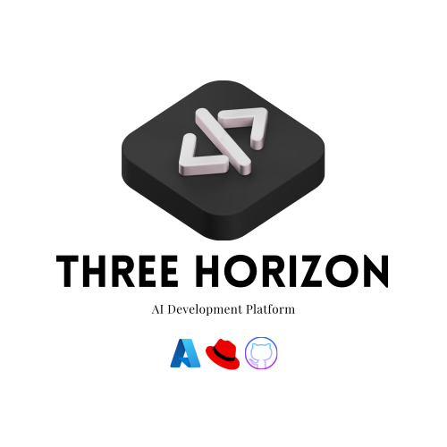
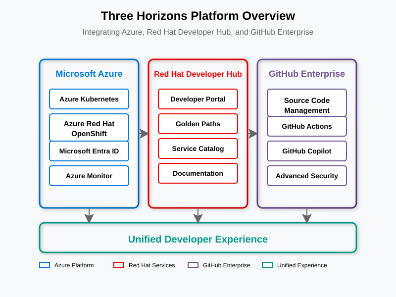
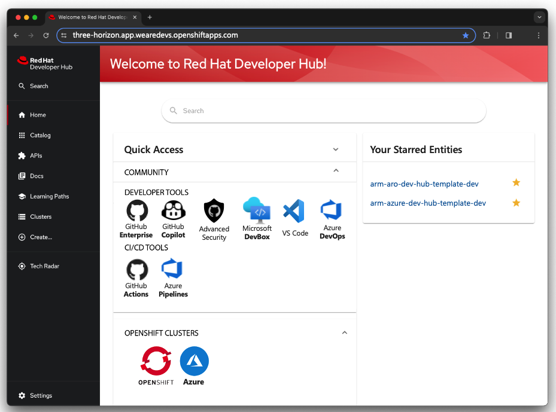

# 🚀 Three Horizons Platform

 [![GitHub Stars]

**A comprehensive platform integrating Microsoft Azure, Red Hat Developer Hub, and GitHub Enterprise to create a superior developer experience.**

## 🔍 Overview

The Three Horizons Platform integrates Microsoft Azure, Red Hat Developer Hub, and GitHub Enterprise to create a unified developer experience that accelerates innovation while maintaining governance and quality.

This platform evolves your organization's capabilities across three horizons:

1. **Horizon 1**: Foundation - Establish the core platform and essential services
2. **Horizon 2**: Enhancement - Optimize workflows and improve developer productivity
3. **Horizon 3**: Innovation - Enable AI-powered development and continuous innovation

## ✨ Key Benefits

- **🚀 Accelerated Onboarding** - Developers become productive in minutes
- **🧠 Reduced Cognitive Load** - Golden Paths guide developers through common workflows
- **🤖 AI-Assisted Development** - GitHub Copilot integration enhances productivity
- **🔒 Integrated Security** - Unified security controls across the platform
- **📈 Streamlined Lifecycle** - Seamless transitions from development to deployment

## 🏗️ Architecture

The platform combines three key technology pillars:

1. **Microsoft Azure** - Cloud infrastructure and services (AKS/ARO)
2. **Red Hat Developer Hub** - Developer portal and experience platform
3. **GitHub Enterprise** - Source control, collaboration and CI/CD

## 🚀 Implementation Guide

For a comprehensive, step-by-step guide to implementing the complete Three Horizons Platform, follow our detailed tutorial:

👉 [**Complete Integration Tutorial**](docs/complete-integration-tutorial/index.md)

This tutorial will guide you through:

1. Infrastructure provisioning
2. Platform installation
3. Developer Hub deployment
4. GitHub integration
5. CI/CD pipeline setup
6. Monitoring & observability configuration
7. Platform validation

## 📚 Playbook Components

Our comprehensive playbook includes these key documentation resources:

### Core Implementation Resources

- [Complete Integration Tutorial](docs/complete-integration-tutorial/index.md) - Primary step-by-step implementation guide
- [Inner Loop Development Guide](docs/guides/inner-loop-development.md) - Optimizing developer workflows
- [Outer Loop Deployment Guide](docs/guides/outer-loop-deployment.md) - Implementing continuous deployment
- [Golden Paths Guide](docs/guides/golden-paths.md) - Standardized developer workflows

### Developer Resources

- [Developer Guide](docs/guides/developer-guide.md) - Guidance for application developers

## 🔧 Prerequisites

- Azure subscription with appropriate permissions
- GitHub Enterprise Cloud account or GitHub.com organization
- Red Hat OpenShift subscription (for ARO deployments) or AKS access
- Basic familiarity with Kubernetes, Git, and CI/CD concepts

## 📝 License

This project is licensed under the MIT License - see the [LICENSE](LICENSE) file for details.

---

<b>The Future of Development Now: Microsoft, Red Hat, and GitHub Redefining What's Possible.</b>

