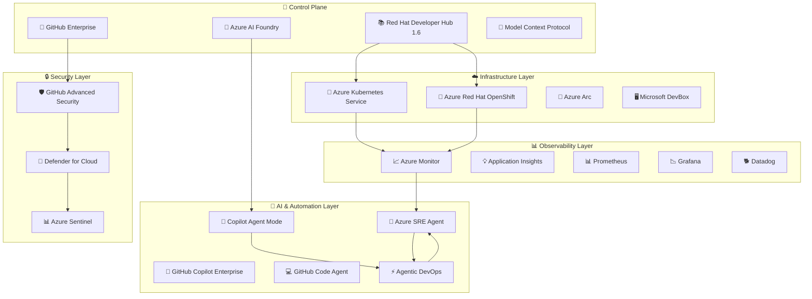

# 🚀 Three Horizons AI Platform


**The Industry's First AI-Enabled Development Platform with Agentic DevOps**

*Integrating Microsoft Azure, Red Hat Developer Hub 1.6, GitHub Enterprise, and Azure AI Foundry to create an autonomous, self-operating development ecosystem*


## 📋 Table of Contents

- [🔍 Overview](#-overview)
- [🏗️ Platform Architecture](#-platform-architecture)
- [🎯 Three Horizons Implementation](#-three-horizons-implementation)
- [🚀 Quick Start](#-quick-start)
- [📚 Documentation](#-documentation)
- [🛠️ Implementation Guides](#-implementation-guides)
- [📊 Platform Components](#-platform-components)
- [🔒 Security & Compliance](#-security--compliance)
- [📈 Metrics & KPIs](#-metrics--kpis)

## 🔍 Overview

The Three Horizons AI Platform revolutionizes enterprise software development by creating the industry's first fully autonomous development ecosystem. This platform transcends traditional DevOps by introducing **Agentic DevOps** - where AI agents autonomously handle development tasks, security scanning, deployment decisions, and operational maintenance.

### 🎯 What Makes This Platform Unique?

| Traditional DevOps | Agentic DevOps (Our Platform) |
|-------------------|------------------------------|
| Manual pipeline creation | AI agents design and optimize pipelines |
| Reactive security scanning | Proactive shift-left security with AI prediction |
| Script-based deployments | Autonomous deployment decisions |
| Human-operated monitoring | Self-healing infrastructure with SRE agents |
| Static development environments | Dynamic AI-optimized DevBox environments |

### 💡 Business Impact

According to [Microsoft's Agentic DevOps announcement](https://azure.microsoft.com/en-us/blog/agentic-devops-evolving-software-development-with-github-copilot-and-microsoft-azure/):
- **80% reduction** in repetitive DevOps tasks
- **60% faster** time-to-market for new features
- **90% reduction** in security vulnerabilities through shift-left practices
- **50% improvement** in developer productivity

## 🏗️ Platform Architecture



### 🔄 Development Workflow Zones


1. **🏠 Development Zone (Inner Loop)**
   - AI-powered local development with DevBox
   - GitHub Copilot Enterprise integration
   - Instant environment provisioning
   - Real-time AI code suggestions

2. **⚙️ Integration Zone (CI/CD)**
   - Autonomous pipeline generation
   - Self-optimizing workflows
   - Shift-left security gates
   - AI-driven quality checks

3. **🚀 Runtime Zone (Outer Loop)**
   - Multi-cloud deployment (Azure, AWS, GCP)
   - GitOps with Ansible automation
   - Progressive delivery with AI decisions
   - Self-scaling infrastructure

4. **📊 Operations Zone**
   - Autonomous incident response
   - Predictive failure detection
   - Self-healing systems
   - AI-powered root cause analysis

## 🎯 Three Horizons Implementation

Our implementation follows a proven three-horizon model that progressively transforms your development platform:

### 🟦 Horizon 1: AI-Assisted Foundation (Months 0-6)
*Establish core infrastructure with basic AI capabilities*

**Key Deliverables:**
- ✅ Azure infrastructure with AKS/ARO deployment
- ✅ Red Hat Developer Hub 1.6 installation
- ✅ GitHub Enterprise integration
- ✅ Basic CI/CD with GitHub Actions
- ✅ Shift-left security with GHAS
- ✅ DevBox standardized environments
- ✅ Foundation monitoring setup

**[📘 H1 Documentation →](docs/horizon-1/)**

### 🟨 Horizon 2: AI-Enhanced Optimization (Months 6-12)
*Optimize platform with advanced AI features*

**Key Deliverables:**
- ✅ Azure AI Foundry integration
- ✅ GitHub Copilot Enterprise deployment
- ✅ Advanced GitOps with Flux/ArgoCD
- ✅ Multi-cloud deployment capabilities
- ✅ Enhanced security automation
- ✅ Comprehensive observability
- ✅ Golden Path templates

**[📙 H2 Documentation →](docs/horizon-2/)**

### 🟪 Horizon 3: Autonomous Innovation (Months 12+)
*Transform to fully autonomous operations*

**Key Deliverables:**
- ✅ Agentic DevOps activation
- ✅ GitHub Copilot Agent Mode
- ✅ Autonomous deployment decisions
- ✅ Self-healing infrastructure
- ✅ Natural language automation
- ✅ Zero-touch operations
- ✅ Continuous AI optimization

**[📕 H3 Documentation →](docs/horizon-3/)**

## 🚀 Quick Start

### Prerequisites

- Azure subscription with Owner/Contributor access
- GitHub Enterprise account or GitHub.com organization
- Red Hat subscription (for ARO) or AKS access
- Basic knowledge of Kubernetes and Git

### Rapid Deployment

```bash
# Clone the repository
git clone https://github.com/three-horizon-ai/Three-Horizons-AI-Developer-Platform.git
cd Three-Horizons-AI-Developer-Platform

# Run the automated deployment
./scripts/deploy-developer-hub.sh -e dev -p aks -l centralus

# Configure integrations
./scripts/configure-integrations.sh
```

For detailed instructions, see our **[Complete Integration Tutorial](docs/tutorials/complete-integration-tutorial.md)**.

## 📚 Documentation

### 🌅 Horizon 1: Foundation
- [H1-001: Platform Introduction](docs/horizon-1/h1-001-platform-introduction.md)
- [H1-002: Infrastructure Setup](docs/horizon-1/h1-002-infrastructure-setup.md)
- [H1-003: Security Foundation](docs/horizon-1/h1-003-security-foundation.md)
- [H1-004: GitHub Enterprise Setup](docs/horizon-1/h1-004-github-setup.md)
- [H1-005: Developer Hub Deployment](docs/horizon-1/h1-005-developer-hub-deployment.md)
- [H1-006: Basic CI/CD Pipeline](docs/horizon-1/h1-006-basic-cicd.md)
- [H1-007: Demo Environment](docs/horizon-1/h1-007-demo-environment.md)

### 🌄 Horizon 2: Enhancement
- [H2-001: Advanced Deployment](docs/horizon-2/h2-001-advanced-deployment.md)
- [H2-002: Comprehensive Monitoring](docs/horizon-2/h2-002-monitoring.md)
- [H2-003: Enhanced Security](docs/horizon-2/h2-003-enhanced-security.md)
- [H2-004: Performance Optimization](docs/horizon-2/h2-004-performance.md)
- [H2-005: Golden Paths](docs/horizon-2/h2-005-golden-paths.md)
- [H2-006: Advanced Developer Hub](docs/horizon-2/h2-006-advanced-devhub.md)
- [H2-007: Enhanced Demo](docs/horizon-2/h2-007-enhanced-demo.md)

### 🌇 Horizon 3: Innovation
- [H3-001: AI-Driven Development](docs/horizon-3/h3-001-ai-development.md)
- [H3-002: Azure AI Foundry](docs/horizon-3/h3-002-ai-foundry.md)
- [H3-003: Autonomous Operations](docs/horizon-3/h3-003-autonomous-ops.md)
- [H3-004: MCP Implementation](docs/horizon-3/h3-004-mcp-implementation.md)
- [H3-005: Advanced Analytics](docs/horizon-3/h3-005-analytics.md)
- [H3-006: Unified Experience](docs/horizon-3/h3-006-unified-experience.md)
- [H3-007: Innovation Showcase](docs/horizon-3/h3-007-innovation-demo.md)

## 🛠️ Implementation Guides

### Development Workflow Guides
- 📖 [Inner Loop Development Guide](docs/guides/inner-loop-development.md)
- 📖 [Outer Loop Deployment Guide](docs/guides/outer-loop-deployment.md)
- 📖 [Developer Guide](docs/guides/developer-guide.md)

### Technical Implementation
- 🔧 [Infrastructure as Code (Bicep)](resources/bicep/)
- 🔧 [Ansible Automation](resources/ansible/)
- 🔧 [GitHub Actions Workflows](resources/github-actions/)
- 🔧 [Monitoring Configurations](resources/monitoring/)

## 📊 Platform Components

### 🔷 Microsoft Azure - AI-Enhanced Infrastructure

| Component | Description | Horizon |
|-----------|-------------|---------|
| **Azure Kubernetes Service (AKS)** | Managed K8s with GPU support | H1 |
| **Azure Red Hat OpenShift (ARO)** | Enterprise container platform | H1 |
| **Azure DevBox** | AI-ready dev environments | H1 |
| **Azure Monitor** | Unified observability | H2 |
| **Azure SRE Agent** | Autonomous site reliability | H3 |
| **Agentic DevOps** | Self-operating pipelines | H3 |

### 🐙 GitHub Enterprise - AI-Powered Development

| Component | Description | Horizon |
|-----------|-------------|---------|
| **GitHub Actions** | CI/CD automation | H1 |
| **GitHub Copilot Enterprise** | AI pair programming | H2 |
| **GitHub Advanced Security** | Shift-left security | H1 |
| **Copilot Agent Mode** | Autonomous coding | H3 |
| **GitHub Code Agent** | PR/Issue automation | H3 |

### 📚 Red Hat Developer Hub 1.6 - Unified Portal

| Component | Description | Horizon |
|-----------|-------------|---------|
| **Software Catalog** | Service discovery | H1 |
| **Golden Path Templates** | Standardized workflows | H2 |
| **Dynamic Plugins** | Extensible platform | H2 |
| **RBAC Delegation** | Fine-grained access | H2 |
| **Air-gapped Support** | Secure deployment | H2 |

### 🧪 Azure AI Foundry - Enterprise AI Platform

| Component | Description | Horizon |
|-----------|-------------|---------|
| **Unified SDK** | Consistent AI development | H2 |
| **GenAIOps Workflows** | AI application lifecycle | H2 |
| **Model Registry** | Centralized AI models | H2 |
| **MCP Protocol** | Multi-model orchestration | H3 |
| **Responsible AI** | Governance & evaluation | H3 |

## 🔒 Security & Compliance

Our platform implements **shift-left security** by default:

- 🛡️ **GitHub Advanced Security**: Code scanning, secret detection, dependency review
- 🔐 **Azure Defender**: Cloud workload protection
- 📊 **Azure Sentinel**: SIEM and SOAR capabilities
- 🔒 **Zero Trust Architecture**: Identity-based security model
- ✅ **Compliance**: SOC2, HIPAA, PCI-DSS ready

## 📈 Metrics & KPIs

Track your platform success with built-in metrics:

### Developer Productivity
- Lead time for changes
- Deployment frequency
- Mean time to recovery
- Change failure rate

### Platform Health
- Infrastructure availability (target: 99.95%)
- API response times
- Resource utilization
- Cost optimization metrics

### Security Posture
- Vulnerabilities detected/fixed
- Time to patch
- Security gate pass rate
- Compliance score

## 🚦 Getting Started

1. **Choose Your Starting Point:**
   - [Complete Platform Tutorial](docs/tutorials/complete-integration-tutorial.md) - Full implementation guide
   - [Quick Start on AKS](docs/quick-start/aks-quickstart.md) - Rapid deployment
   - [Quick Start on ARO](docs/quick-start/aro-quickstart.md) - OpenShift deployment

2. **Select Your Horizon:**
   - Start with [Horizon 1](docs/horizon-1/) if you're building from scratch
   - Jump to [Horizon 2](docs/horizon-2/) if you have basic infrastructure
   - Explore [Horizon 3](docs/horizon-3/) for cutting-edge AI features

3. **Get Support:**
   - [Architecture Decision Records](docs/adr/)
   - [Troubleshooting Guide](docs/troubleshooting/)
   - [FAQ](docs/faq.md)

## 📝 License

This project is licensed under the MIT License - see the [LICENSE](LICENSE) file for details.

---


**🚀 Welcome to the Future of Software Development**

*Where AI doesn't just assist—it autonomously creates, deploys, and maintains*

[Get Started](docs/tutorials/complete-integration-tutorial.md) • [View Demos](docs/demos/) • [Architecture](docs/architecture/)

