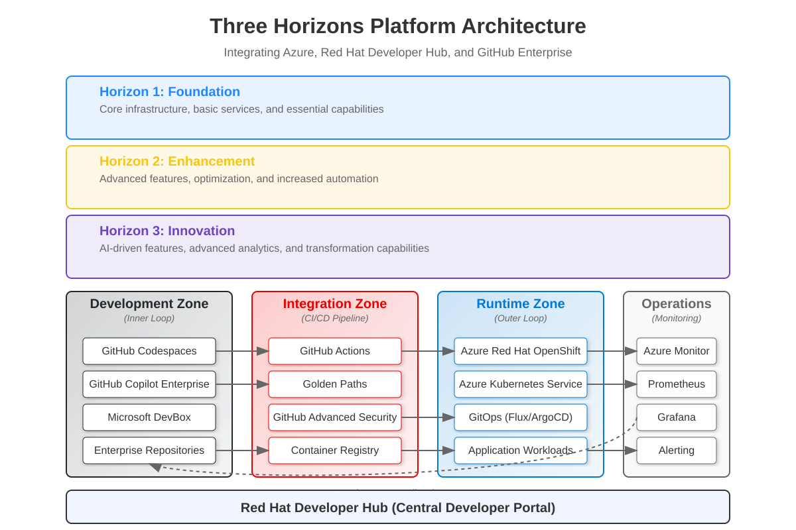

# 📁 Assets Directory - Scripts, Templates & Resources

<div align="center">


**Centralized Resource Management for the Three Horizons AI Platform**

</div>

## 📋 Directory Structure Overview

The `assets` directory consolidates all resources needed for implementing and maintaining the Three Horizons AI Platform:

```
assets/
├── 📊 diagrams/              # Architecture diagrams and visual resources
├── 🖼️ images/                # Platform images and logos
├── 🔧 scripts/               # Automation scripts organized by horizon
├── 📄 templates/             # Reusable templates for deployment
└── 📚 README.md              # This file
```

## 📊 Diagrams Directory

Contains all visual documentation including:

- **Architecture diagrams** (SVG format)
- **Mermaid diagrams** (workflow, sequence, UML)
- **Process flows** and visual guides
- **Network diagrams** and security flows

**Usage in Documentation**:
```markdown

```

## 🖼️ Images Directory

Platform branding and visual assets:

- **Logos** (Three Horizons platform)
- **Icons** and badges
- **Screenshots** and interface examples
- **Promotional materials**

**Usage in Documentation**:
```markdown

```

## 🔧 Scripts Directory

Automation scripts organized by implementation horizon:

### `/scripts/h1-foundation/`
Scripts for basic platform setup:
- Infrastructure deployment (Bicep)
- Basic security configuration
- GitHub integration setup
- Developer Hub deployment
- Basic CI/CD pipeline creation

### `/scripts/h2-optimization/`
Scripts for platform optimization:
- Advanced deployment strategies
- Performance monitoring setup
- Enhanced security implementations
- Golden path automation
- Advanced DevHub configurations

### `/scripts/h3-innovation/`
Scripts for AI-driven features:
- AI integration automation
- Azure AI Foundry setup
- Autonomous operations configuration
- MCP implementation scripts
- Advanced analytics deployment

### `/scripts/shared/`
Common utilities and cross-horizon scripts:
- Documentation generation (`add-complete-navigation.sh`)
- Link validation (`update-links.sh`)
- Structure reorganization (`reorganize-docs.sh`)
- Common helper functions

**Script Naming Convention**:
```
[horizon]-[sequence]-[component]-[action].sh

Examples:
- h1-001-infrastructure-deploy.sh
- h2-003-monitoring-setup.sh
- h3-002-ai-foundry-configure.sh
- shared-validate-links.sh
```

## 📄 Templates Directory

Reusable templates for consistent implementations:

### `/templates/bicep/`
Infrastructure as Code templates:
- **Foundation templates** - Basic Azure resources
- **Optimization templates** - Advanced configurations
- **Innovation templates** - AI-enabled resources

### `/templates/github-actions/`
CI/CD pipeline templates:
- **Build workflows** for different application types
- **Deployment pipelines** for each horizon
- **Security scanning** and compliance checks
- **AI-assisted** workflow templates

### `/templates/helm-charts/`
Kubernetes deployment templates:
- **Application charts** for standard deployments
- **Platform charts** for Developer Hub components
- **AI workload charts** for ML/AI applications

### `/templates/documentation/`
Documentation templates and standards:
- **Document templates** with navigation
- **API documentation** templates
- **Architecture decision** records (ADRs)
- **Troubleshooting guides** templates

## 🚀 Quick Usage Guide

### For Platform Engineers

1. **Choose Your Horizon**: Start with H1 scripts for foundation
2. **Review Templates**: Check available Bicep and Helm templates
3. **Execute Scripts**: Run scripts in sequence within each horizon
4. **Customize Templates**: Adapt templates to your environment

### For Developers

1. **Use GitHub Actions Templates**: Copy and customize CI/CD templates
2. **Reference Diagrams**: Include diagrams in your documentation
3. **Follow Script Examples**: Learn from automation script patterns

### For Documentation Contributors

1. **Use Document Templates**: Start with `templates/documentation/document-template.md`
2. **Include Diagrams**: Reference diagrams from `diagrams/` directory
3. **Run Navigation Scripts**: Use `scripts/shared/add-complete-navigation.sh`

## 🔗 Integration Examples

### In Documentation (Markdown)
```markdown
# Include diagrams


# Include images

```

### In Scripts (Bash)
```bash
# Reference shared utilities
source "../shared/common-functions.sh"

# Use templates
cp "../../templates/bicep/foundation-template.bicep" ./main.bicep
```

### In CI/CD (GitHub Actions)
```yaml
# Use workflow templates
uses: ./.github/workflows/templates/deploy-to-azure.yml
```

## 🛠️ Best Practices

### Scripts
- ✅ Use descriptive naming conventions
- ✅ Include error handling and logging
- ✅ Add parameter validation
- ✅ Document prerequisites and usage
- ✅ Follow shell scripting best practices

### Templates
- ✅ Include comprehensive parameters
- ✅ Add inline documentation
- ✅ Provide default values
- ✅ Include validation rules
- ✅ Keep templates modular and reusable

### Diagrams
- ✅ Use SVG format for scalability
- ✅ Include source files (Mermaid) when possible
- ✅ Keep diagrams updated with implementation
- ✅ Use consistent styling and colors

## 📞 Support

For questions about assets organization or usage:

1. **Scripts Issues**: Check script documentation and logs
2. **Template Problems**: Verify parameter values and prerequisites
3. **Diagram Updates**: Follow Mermaid or SVG editing guidelines
4. **General Questions**: Reference the main documentation

---

<div align="center">

**🎯 Centralized Resources for Streamlined Implementation**

*Everything you need for the Three Horizons AI Platform in one organized location*

</div>
