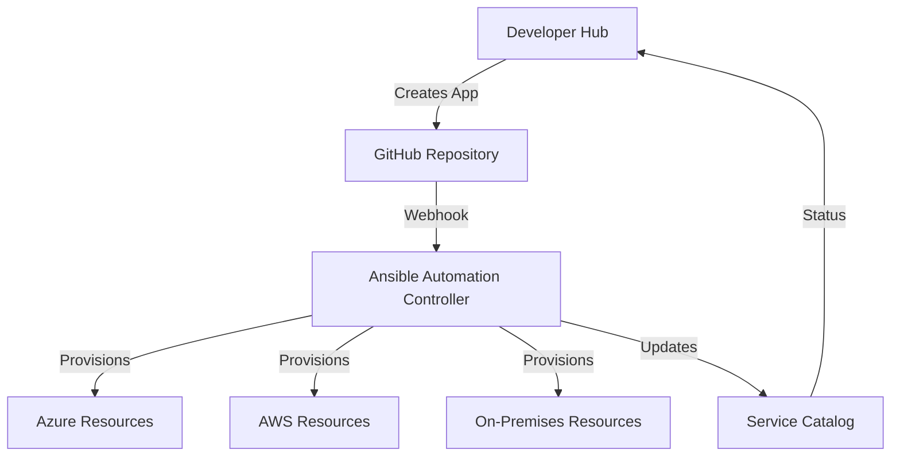

# 🤖 Infrastructure as Code with Ansible for Developer Hub

## 🎯 Overview

This guide demonstrates how to integrate Ansible with the Three Horizons Platform to automatically provision infrastructure for applications created through the Developer Hub. By combining Red Hat Developer Hub's self-service capabilities with Ansible's powerful automation, teams can provision complete application environments with a single click.


> 🔍 **Note:** This integration enables developers to request infrastructure through Developer Hub templates, which trigger Ansible playbooks to provision resources across Azure, AWS, GCP, or on-premises environments.

## 🤔 Why Ansible for Infrastructure Automation?

- **Declarative Infrastructure**: Define infrastructure as YAML code
- **Multi-Cloud Support**: Single automation language for all cloud providers
- **Idempotent Operations**: Safe to run multiple times
- **No Agent Required**: Agentless architecture reduces overhead
- **Integration with Developer Hub**: Seamless workflow from request to provision

## 📋 Prerequisites

- Red Hat Ansible Automation Platform subscription
- Azure subscription with appropriate permissions
- Developer Hub with template creation permissions
- Service principals for cloud providers
- Git repository for Ansible playbooks

## 🏗️ Architecture



## 🚀 Setting Up Ansible Automation Platform

### Install Ansible Automation Platform on Kubernetes

```bash
# Create namespace
kubectl create namespace ansible-automation-platform

# Add Ansible Automation Platform operator
cat <<EOF | kubectl apply -f -
apiVersion: operators.coreos.com/v1alpha1
kind: CatalogSource
metadata:
  name: redhat-operators
  namespace: openshift-marketplace
spec:
  displayName: Red Hat Operators
  publisher: Red Hat
  sourceType: grpc
  image: registry.redhat.io/redhat/redhat-operator-index:v4.14
EOF

# Install the operator
cat <<EOF | kubectl apply -f -
apiVersion: operators.coreos.com/v1alpha1
kind: Subscription
metadata:
  name: ansible-automation-platform-operator
  namespace: ansible-automation-platform
spec:
  channel: stable-2.4
  name: ansible-automation-platform-operator
  source: redhat-operators
  sourceNamespace: openshift-marketplace
EOF
```

### Deploy Automation Controller

```yaml
# automation-controller.yaml
apiVersion: automationcontroller.ansible.com/v1beta1
kind: AutomationController
metadata:
  name: three-horizons-controller
  namespace: ansible-automation-platform
spec:
  replicas: 1
  admin_user: admin
  admin_password_secret: controller-admin-password
  postgres_configuration_secret: controller-postgres-configuration
  
  ingress_type: Route
  route_tls_termination_mechanism: Edge
  
  image_pull_policy: IfNotPresent
  projects_persistence: true
  projects_storage_size: 8Gi
  projects_storage_class: managed-premium
  
  web_resource_requirements:
    requests:
      cpu: 1000m
      memory: 2Gi
    limits:
      cpu: 2000m
      memory: 4Gi
      
  task_resource_requirements:
    requests:
      cpu: 500m
      memory: 1Gi
    limits:
      cpu: 1000m
      memory: 2Gi
```

## 📚 Ansible Playbook Structure

### Directory Structure

```
ansible-infrastructure/
├── inventories/
│   ├── production/
│   │   ├── group_vars/
│   │   │   └── all.yml
│   │   └── hosts.yml
│   └── staging/
├── playbooks/
│   ├── provision-azure-app.yml
│   ├── provision-aws-app.yml
│   ├── provision-database.yml
│   └── provision-full-stack.yml
├── roles/
│   ├── azure-webapp/
│   ├── azure-database/
│   ├── azure-networking/
│   ├── kubernetes-namespace/
│   └── monitoring-setup/
├── templates/
│   └── developer-hub/
│       ├── azure-app-template.yml
│       └── multi-cloud-template.yml
└── collections/
    └── requirements.yml
```

### Base Playbook for Azure Application

```yaml
# playbooks/provision-azure-app.yml
---
- name: Provision Azure Infrastructure for Developer Hub Application
  hosts: localhost
  gather_facts: no
  vars:
    app_name: "{{ app_metadata.name }}"
    environment: "{{ app_metadata.environment | default('development') }}"
    resource_group: "{{ app_metadata.resource_group | default('three-horizons-apps') }}"
    location: "{{ app_metadata.location | default('eastus') }}"
    
  tasks:
    - name: Ensure resource group exists
      azure.azcollection.azure_rm_resourcegroup:
        name: "{{ resource_group }}"
        location: "{{ location }}"
        tags:
          Environment: "{{ environment }}"
          ManagedBy: "Ansible"
          CreatedFrom: "DeveloperHub"
          Application: "{{ app_name }}"
    
    - name: Create Application Service Plan
      azure.azcollection.azure_rm_appserviceplan:
        resource_group: "{{ resource_group }}"
        name: "{{ app_name }}-plan"
        location: "{{ location }}"
        sku: S1
        is_linux: true
        number_of_workers: 1
    
    - name: Create Web App
      azure.azcollection.azure_rm_webapp:
        resource_group: "{{ resource_group }}"
        name: "{{ app_name }}-webapp"
        plan:
          resource_group: "{{ resource_group }}"
          name: "{{ app_name }}-plan"
        app_settings:
          WEBSITE_NODE_DEFAULT_VERSION: "14-lts"
          SCM_DO_BUILD_DURING_DEPLOYMENT: "true"
        frameworks:
          - name: "node"
            version: "14-lts"
    
    - name: Configure continuous deployment
      azure.azcollection.azure_rm_webapp_deployment_source:
        resource_group: "{{ resource_group }}"
        name: "{{ app_name }}-webapp"
        repo_url: "{{ app_metadata.repo_url }}"
        branch: "{{ app_metadata.branch | default('main') }}"
        manual_integration: false
        deployment_rollback_enabled: true
    
    - name: Create Application Insights
      azure.azcollection.azure_rm_resource:
        resource_group: "{{ resource_group }}"
        provider: Microsoft.Insights
        resource_type: components
        name: "{{ app_name }}-insights"
        api_version: "2020-02-02"
        location: "{{ location }}"
        body:
          kind: "web"
          properties:
            Application_Type: "web"
            Flow_Type: "Bluefield"
            Request_Source: "rest"
    
    - name: Register application in service catalog
      uri:
        url: "{{ developer_hub_api }}/catalog/entities"
        method: POST
        headers:
          Authorization: "Bearer {{ developer_hub_token }}"
          Content-Type: "application/json"
        body_format: json
        body:
          apiVersion: backstage.io/v1alpha1
          kind: Component
          metadata:
            name: "{{ app_name }}"
            namespace: default
            annotations:
              azure.com/resource-group: "{{ resource_group }}"
              azure.com/webapp-name: "{{ app_name }}-webapp"
              azure.com/webapp-url: "https://{{ app_name }}-webapp.azurewebsites.net"
          spec:
            type: service
            lifecycle: "{{ environment }}"
            owner: "{{ app_metadata.owner }}"
            system: "{{ app_metadata.system | default('default') }}"
```

### Multi-Cloud Infrastructure Playbook

```yaml
# playbooks/provision-full-stack.yml
---
- name: Provision Multi-Cloud Full Stack Application
  hosts: localhost
  gather_facts: no
  vars_files:
    - "{{ playbook_dir }}/../vars/{{ app_name }}.yml"
    
  tasks:
    - name: Provision Azure Resources
      include_role:
        name: azure-infrastructure
      when: cloud_providers.azure.enabled
      vars:
        azure_config: "{{ cloud_providers.azure }}"
    
    - name: Provision AWS Resources
      include_role:
        name: aws-infrastructure
      when: cloud_providers.aws.enabled
      vars:
        aws_config: "{{ cloud_providers.aws }}"
    
    - name: Provision Kubernetes Resources
      include_role:
        name: kubernetes-resources
      vars:
        k8s_deployments: "{{ kubernetes_resources }}"
    
    - name: Setup Monitoring
      include_role:
        name: monitoring-setup
      vars:
        monitoring_targets: "{{ all_provisioned_resources }}"
```

## 🔧 Developer Hub Template Integration

### Create Infrastructure Template

```yaml
# templates/azure-fullstack-template.yaml
apiVersion: scaffolder.backstage.io/v1beta3
kind: Template
metadata:
  name: azure-fullstack-ansible
  title: Azure Full Stack Application with Ansible
  description: Creates a full application stack on Azure using Ansible automation
  tags:
    - azure
    - ansible
    - fullstack
spec:
  owner: platform-team
  type: service
  parameters:
    - title: Application Details
      required:
        - name
        - description
        - owner
      properties:
        name:
          title: Name
          type: string
          description: Unique name for the application
          pattern: '^[a-z0-9-]+$'
        description:
          title: Description
          type: string
        owner:
          title: Owner
          type: string
          description: Owner of the application
          ui:field: OwnerPicker
          ui:options:
            catalogFilter:
              kind: Group
    
    - title: Infrastructure Configuration
      properties:
        environment:
          title: Environment
          type: string
          enum:
            - development
            - staging
            - production
          default: development
        
        database:
          title: Database
          type: object
          properties:
            enabled:
              title: Include Database
              type: boolean
              default: true
            type:
              title: Database Type
              type: string
              enum:
                - postgresql
                - mysql
                - cosmosdb
              default: postgresql
            size:
              title: Database Size
              type: string
              enum:
                - small
                - medium
                - large
              default: small
        
        monitoring:
          title: Monitoring
          type: object
          properties:
            enabled:
              title: Enable Monitoring
              type: boolean
              default: true
            sreAgent:
              title: Enable SRE Agent
              type: boolean
              default: true
    
  steps:
    - id: create-repo
      name: Create Repository
      action: github:repo:create
      input:
        name: ${{ parameters.name }}
        description: ${{ parameters.description }}
        owner: ${{ parameters.owner }}
        visibility: private
        topics:
          - azure
          - ansible
          - ${{ parameters.environment }}
    
    - id: fetch-base
      name: Fetch Base
      action: fetch:template
      input:
        url: ./content
        values:
          name: ${{ parameters.name }}
          description: ${{ parameters.description }}
          environment: ${{ parameters.environment }}
    
    - id: trigger-ansible
      name: Trigger Infrastructure Provisioning
      action: http:request
      input:
        method: POST
        url: https://ansible-controller.example.com/api/v2/job_templates/provision-azure-app/launch/
        headers:
          Authorization: Bearer ${{ secrets.ANSIBLE_TOKEN }}
          Content-Type: application/json
        body:
          extra_vars:
            app_metadata:
              name: ${{ parameters.name }}
              owner: ${{ parameters.owner }}
              environment: ${{ parameters.environment }}
              repo_url: https://github.com/${{ parameters.owner }}/${{ parameters.name }}
              database: ${{ parameters.database }}
              monitoring: ${{ parameters.monitoring }}
    
    - id: register-in-catalog
      name: Register in Catalog
      action: catalog:register
      input:
        repoContentsUrl: ${{ steps.publish.output.repoContentsUrl }}
        catalogInfoPath: '/catalog-info.yaml'
  
  output:
    links:
      - title: Repository
        url: ${{ steps.publish.output.remoteUrl }}
      - title: Azure Portal
        url: https://portal.azure.com/#resource/subscriptions/${{ secrets.AZURE_SUBSCRIPTION_ID }}/resourceGroups/three-horizons-apps/resources
      - title: Ansible Job
        url: https://ansible-controller.example.com/#/jobs/${{ steps['trigger-ansible'].output.job_id }}
```

## 🔄 Ansible Roles for Common Patterns

### Azure Web Application Role

```yaml
# roles/azure-webapp/tasks/main.yml
---
- name: Create App Service Plan
  azure.azcollection.azure_rm_appserviceplan:
    resource_group: "{{ resource_group }}"
    name: "{{ app_service_plan_name }}"
    location: "{{ location }}"
    sku: "{{ app_service_sku | default('S1') }}"
    is_linux: "{{ is_linux | default(true) }}"
  register: app_service_plan

- name: Create Web App
  azure.azcollection.azure_rm_webapp:
    resource_group: "{{ resource_group }}"
    name: "{{ webapp_name }}"
    plan: "{{ app_service_plan }}"
    app_settings: "{{ app_settings | default({}) }}"
    frameworks: "{{ frameworks }}"
    https_only: true
  register: webapp

- name: Configure deployment slots
  azure.azcollection.azure_rm_webappslot:
    resource_group: "{{ resource_group }}"
    webapp_name: "{{ webapp_name }}"
    name: staging
    configuration_source: "{{ webapp_name }}"
  when: environment == 'production'

- name: Setup autoscaling
  azure.azcollection.azure_rm_autoscale:
    resource_group: "{{ resource_group }}"
    name: "{{ webapp_name }}-autoscale"
    target: "{{ app_service_plan.id }}"
    enabled: true
    profiles:
      - name: default
        capacity:
          minimum: "{{ autoscale_min | default(1) }}"
          maximum: "{{ autoscale_max | default(10) }}"
          default: "{{ autoscale_default | default(2) }}"
        rules: "{{ autoscale_rules }}"
```

### Database Provisioning Role

```yaml
# roles/azure-database/tasks/main.yml
---
- name: Create PostgreSQL Server
  azure.azcollection.azure_rm_postgresqlserver:
    resource_group: "{{ resource_group }}"
    name: "{{ database_server_name }}"
    location: "{{ location }}"
    admin_username: "{{ database_admin_user }}"
    admin_password: "{{ database_admin_password }}"
    version: "{{ postgresql_version | default('11') }}"
    sku:
      name: "{{ database_sku | default('B_Gen5_1') }}"
      tier: "{{ database_tier | default('Basic') }}"
    storage_mb: "{{ database_storage_mb | default(5120) }}"
    backup_retention_days: "{{ backup_retention_days | default(7) }}"
    geo_redundant_backup: "{{ geo_redundant_backup | default('Disabled') }}"
  register: postgresql_server

- name: Create Database
  azure.azcollection.azure_rm_postgresqldatabase:
    resource_group: "{{ resource_group }}"
    server_name: "{{ database_server_name }}"
    name: "{{ database_name }}"
    charset: UTF8
    collation: en_US.utf8

- name: Configure firewall rules
  azure.azcollection.azure_rm_postgresqlfirewallrule:
    resource_group: "{{ resource_group }}"
    server_name: "{{ database_server_name }}"
    name: "{{ item.name }}"
    start_ip_address: "{{ item.start_ip }}"
    end_ip_address: "{{ item.end_ip }}"
  loop: "{{ database_firewall_rules }}"

- name: Store connection string in Key Vault
  azure.azcollection.azure_rm_keyvaultsecret:
    vault_uri: "{{ key_vault_uri }}"
    secret_name: "{{ app_name }}-db-connection"
    secret_value: "postgresql://{{ database_admin_user }}@{{ database_server_name }}:{{ database_admin_password }}@{{ postgresql_server.fullyqualifieddomainname }}/{{ database_name }}?ssl=true"
```

## 🔌 Integration with CI/CD

### GitHub Actions Workflow

```yaml
# .github/workflows/ansible-provision.yml
name: Provision Infrastructure with Ansible

on:
  repository_dispatch:
    types: [provision-infrastructure]

jobs:
  provision:
    runs-on: ubuntu-latest
    steps:
      - name: Checkout
        uses: actions/checkout@v4
      
      - name: Setup Python
        uses: actions/setup-python@v4
        with:
          python-version: '3.9'
      
      - name: Install Ansible
        run: |
          pip install ansible ansible-core azure-cli
          ansible-galaxy collection install azure.azcollection
          ansible-galaxy collection install kubernetes.core
      
      - name: Configure Azure credentials
        uses: azure/login@v1
        with:
          creds: ${{ secrets.AZURE_CREDENTIALS }}
      
      - name: Run Ansible Playbook
        env:
          ANSIBLE_HOST_KEY_CHECKING: false
        run: |
          ansible-playbook playbooks/provision-azure-app.yml \
            -e "app_metadata=${{ toJson(github.event.client_payload.app_metadata) }}" \
            -e "developer_hub_api=${{ secrets.DEVELOPER_HUB_API }}" \
            -e "developer_hub_token=${{ secrets.DEVELOPER_HUB_TOKEN }}"
```

## 📊 Monitoring Ansible Execution

### Create Ansible Dashboard in Developer Hub

```typescript
// plugins/ansible-dashboard/src/components/AnsibleJobStatus.tsx
import React, { useEffect, useState } from 'react';
import { Table, TableColumn, Progress } from '@backstage/core-components';
import { useApi } from '@backstage/core-plugin-api';
import { ansibleApiRef } from '../api';

export const AnsibleJobStatus = ({ appName }: { appName: string }) => {
  const ansibleApi = useApi(ansibleApiRef);
  const [jobs, setJobs] = useState([]);
  const [loading, setLoading] = useState(true);

  useEffect(() => {
    const fetchJobs = async () => {
      const jobList = await ansibleApi.getJobsForApp(appName);
      setJobs(jobList);
      setLoading(false);
    };
    
    fetchJobs();
    const interval = setInterval(fetchJobs, 5000);
    return () => clearInterval(interval);
  }, [appName]);

  const columns: TableColumn[] = [
    { title: 'Job ID', field: 'id' },
    { title: 'Status', field: 'status' },
    { title: 'Started', field: 'started', type: 'datetime' },
    { title: 'Duration', field: 'elapsed' },
    { 
      title: 'Progress', 
      field: 'progress',
      render: (row) => <Progress value={row.progress} />
    },
  ];

  if (loading) return <Progress />;

  return (
    <Table
      title="Infrastructure Provisioning Jobs"
      columns={columns}
      data={jobs}
      options={{
        search: false,
        paging: false,
      }}
    />
  );
};
```

## ✅ Best Practices

1. **Idempotent Playbooks**: Always write playbooks that can be run multiple times safely
2. **Use Ansible Vault**: Store sensitive data encrypted with Ansible Vault
3. **Tag Resources**: Tag all cloud resources for cost tracking and management
4. **Error Handling**: Implement proper error handling and rollback procedures
5. **Testing**: Test playbooks in staging before production use
6. **Documentation**: Document all variables and their purposes
7. **Version Control**: Keep all playbooks in version control
8. **Monitoring**: Monitor playbook execution and resource provisioning

## 🛠️ Troubleshooting

### Common Issues

#### Ansible Connection Issues
```bash
# Test Azure connection
ansible -m azure.azcollection.azure_rm_resourcegroup_info -a "name=*" localhost

# Debug authentication
export AZURE_AUTH_LOCATION=~/.azure/credentials
ansible-playbook playbooks/test-connection.yml -vvv
```

#### Permission Errors
- Ensure service principal has appropriate RBAC roles
- Verify Ansible Automation Platform has necessary secrets
- Check Developer Hub API permissions

#### Resource Provisioning Failures
- Review Ansible job logs in Automation Controller
- Check Azure Activity Log for detailed error messages
- Verify resource quotas and limits

## 📚 Related Documentation

- [Ansible Azure Collection](https://docs.ansible.com/ansible/latest/collections/azure/azcollection/)
- [Developer Hub Templates](./golden-paths.md)
- [Azure Resource Manager](https://docs.microsoft.com/en-us/azure/azure-resource-manager/)
- [Ansible Automation Platform](https://access.redhat.com/documentation/en-us/red_hat_ansible_automation_platform/)

---

<footer>
  <p align="center">🔄 Last updated: June 2025 | Platform Version: 1.6</p>
</footer> 