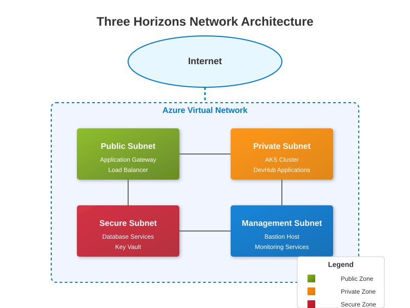

# Three Horizons Platform Reference Guide

**Navigation:** [Home](../../README.md) > [Documentation Map](../DOCUMENTATION_MAP.md) > Reference Guide

This reference guide provides detailed technical specifications, API documentation, and configuration references for the Three Horizons Platform. Use this as your comprehensive technical resource.

## Architecture Reference

### Component Specifications

Detailed specifications for platform components:

| Component | Version | Documentation |
|-----------|---------|---------------|
| **Azure Red Hat OpenShift** | 4.10+ | [ARO Documentation](https://docs.microsoft.com/en-us/azure/openshift/) |
| **Azure Kubernetes Service** | 1.24+ | [AKS Documentation](https://docs.microsoft.com/en-us/azure/aks/) |
| **Red Hat Developer Hub** | 1.5+ | [Developer Hub Documentation](https://developers.redhat.com/products/developer-hub) |
| **GitHub Enterprise** | Cloud | [GitHub Enterprise Documentation](https://docs.github.com/en/enterprise-cloud) |

### Network Architecture

Detailed network configuration reference:



## API Reference

### REST APIs

Reference documentation for platform REST APIs:

#### Developer Hub API

```
Base URL: https://developer-hub.your-domain.com/api/v1
```

| Endpoint | Method | Description |
|----------|--------|-------------|
| `/catalog` | GET | Retrieve service catalog |
| `/catalog/{serviceId}` | GET | Get specific service details |
| `/templates` | GET | List available templates |
| `/templates/{templateId}` | GET | Get template details |
| `/scaffolder/jobs` | POST | Create new project from template |

#### Monitoring API

```
Base URL: https://monitoring.your-domain.com/api/v1
```

| Endpoint | Method | Description |
|----------|--------|-------------|
| `/metrics` | GET | Get platform metrics |
| `/alerts` | GET | List active alerts |
| `/dashboards` | GET | List available dashboards |

### GraphQL Schema

Developer Hub GraphQL API schema:

```graphql
type Service {
  id: ID!
  name: String!
  description: String
  owner: String
  lifecycle: String
  tags: [String]
  apis: [API]
}

type API {
  id: ID!
  name: String!
  description: String
  type: String
  definition: String
}

type Query {
  service(id: ID!): Service
  services(filter: ServiceFilter): [Service]
}

input ServiceFilter {
  owner: String
  tags: [String]
  lifecycle: String
}
```

## Configuration Reference

### Kubernetes Resources

Standard Kubernetes resource configurations:

```yaml
# Example Developer Hub Deployment
apiVersion: apps/v1
kind: Deployment
metadata:
  name: developer-hub
  namespace: developer-hub
spec:
  replicas: 3
  selector:
    matchLabels:
      app: developer-hub
  template:
    metadata:
      labels:
        app: developer-hub
    spec:
      containers:
      - name: developer-hub
        image: developerhub/backend:v1.5.0
        ports:
        - containerPort: 8080
        resources:
          requests:
            memory: "512Mi"
            cpu: "500m"
          limits:
            memory: "1Gi"
            cpu: "1000m"
        env:
        - name: DATABASE_URL
          valueFrom:
            secretKeyRef:
              name: developer-hub-secrets
              key: database-url
```

### GitHub Copilot Configuration

Optimizing GitHub Copilot for Three Horizons:

#### IDE Configuration

Visual Studio Code `settings.json`:

```json
{
  "github.copilot.enable": {
    "*": true,
    "yaml": true,
    "plaintext": true,
    "markdown": false
  },
  "github.copilot.advanced": {
    "inlineSuggest.enable": true,
    "listCount": 10
  }
}
```

#### Custom Prompts

Effective prompts for platform-specific tasks:

```
// Generate a Kubernetes deployment for a Node.js application with resource limits and health checks
// that follows Three Horizons platform standards

// Create an Azure Monitor alert rule for high CPU usage on AKS nodes
// that follows Three Horizons alerting standards

// Generate a GitHub Action workflow for CI/CD that includes security scanning
// and follows Three Horizons pipeline standards
```

### Azure Policy Definitions

Standard policy configurations:

```json
{
  "properties": {
    "displayName": "Three Horizons - Require HTTPS for AKS",
    "policyType": "Custom",
    "mode": "All",
    "description": "This policy ensures that all AKS ingress resources use HTTPS.",
    "metadata": {
      "category": "Three Horizons Security"
    },
    "parameters": {},
    "policyRule": {
      "if": {
        "allOf": [
          {
            "field": "type",
            "equals": "Microsoft.Network/applicationGateways/httpListeners"
          },
          {
            "field": "Microsoft.Network/applicationGateways/httpListeners/protocol",
            "notEquals": "Https"
          }
        ]
      },
      "then": {
        "effect": "deny"
      }
    }
  }
}
```

## Security Reference

### Security Controls Matrix

Comprehensive security controls:

| Control Category | Control | Implementation |
|------------------|---------|----------------|
| **Identity & Access** | Authentication | Azure AD with MFA |
| **Identity & Access** | Authorization | RBAC, Azure AD Groups |
| **Network Security** | Network Isolation | NSGs, Azure Firewall |
| **Network Security** | Ingress Control | App Gateway WAF, Network Policies |
| **Data Protection** | Encryption at Rest | Azure Storage Encryption, Key Vault |
| **Data Protection** | Encryption in Transit | TLS 1.2+, mTLS |
| **Compliance** | Policy Enforcement | Azure Policy, OPA/Gatekeeper |
| **Compliance** | Audit Logging | Azure Monitor, Log Analytics |

### Compliance Framework Mapping

Mapping to common compliance frameworks:

| Framework | Control ID | Platform Implementation |
|-----------|------------|-------------------------|
| **NIST 800-53** | AC-2 | AAD Access Management |
| **NIST 800-53** | AC-3 | RBAC Configuration |
| **NIST 800-53** | AU-2 | Azure Monitor Logging |
| **ISO 27001** | A.9.2 | User Access Management |
| **ISO 27001** | A.12.4 | Event Logging |
| **PCI-DSS** | Req 7 | Access Control Measures |
| **PCI-DSS** | Req 10 | Tracking and Monitoring |

## Performance Reference

### Benchmark Results

Platform performance benchmarks:

| Scenario | Metrics | Result |
|----------|---------|--------|
| **Platform Startup** | Time to ready | 20 min |
| **Developer Hub Load** | Average response time | 250ms |
| **API Gateway Throughput** | Requests/second | 2,000 RPS |
| **CI/CD Pipeline** | Build + deploy time | 5-8 min |
| **Template Generation** | Scaffolding time | 45 sec |

### Sizing Guidelines

Resource sizing recommendations:

| Component | Small (10-50 devs) | Medium (50-200 devs) | Large (200+ devs) |
|-----------|-------------------|---------------------|------------------|
| **Control Plane** | Standard_D4s_v3 x 3 | Standard_D8s_v3 x 3 | Standard_D16s_v3 x 3 |
| **Worker Nodes** | Standard_D4s_v3 x 4-6 | Standard_D8s_v3 x 6-12 | Standard_D8s_v3 x 12-30 |
| **Developer Hub** | 2 pods, 1Gi mem | 3-5 pods, 2Gi mem | 5+ pods, 4Gi mem |
| **Database** | 4 vCPU, 16GB RAM | 8 vCPU, 32GB RAM | 16 vCPU, 64GB RAM |
| **Storage** | 500GB Premium SSD | 2TB Premium SSD | 5TB+ Premium SSD |

## Integrations

For a comprehensive list of available integrations, refer to our [Integration Hub](integration-hub.md).

## Glossary

For definitions of platform-specific terms, refer to our [Glossary](../GLOSSARY.md).

## Related Topics

- [Architecture Documentation](../1-architecture/README.md)
- [GitHub Copilot Integration](../getting-started/github-copilot-integration.md)
- [Operations Guide](../4-operations-guide/README.md)
- [Developer Guide](../3-developer-guide/README.md)

---

<footer>
  <p align="center">Last updated: April 9, 2025 | <a href="../../.github/CONTRIBUTING.md">Contribute to this document</a></p>
</footer>
