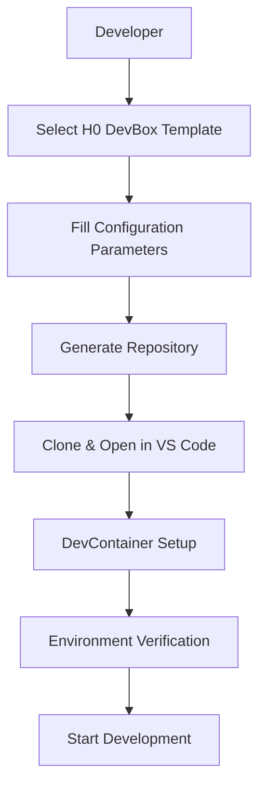
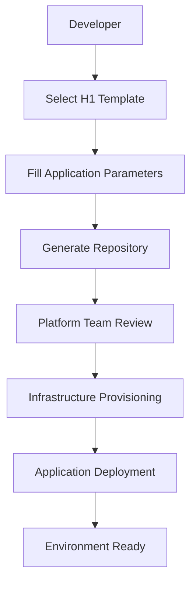
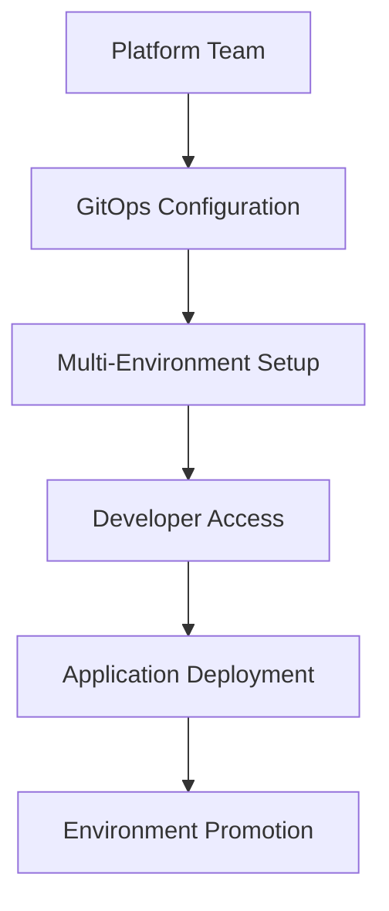
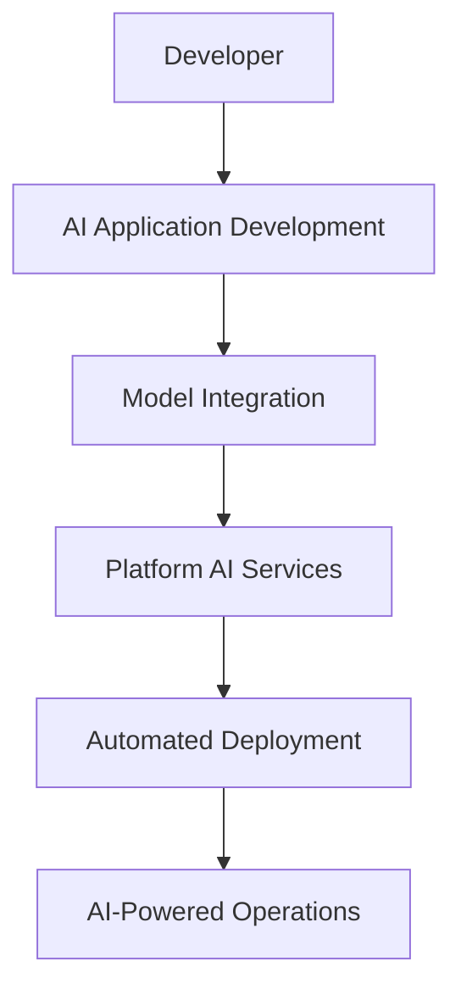

# Three Horizons AI Platform - Development Workflow & Best Practices

## Overview

This document defines the official development workflow, responsibilities, and best practices for the Three Horizons AI Platform. It establishes clear separation of concerns between developers, platform engineers, and operations teams while ensuring security, compliance, and operational excellence.

## Workflow Architecture

### Platform Engineering Model

The Three Horizons AI Platform follows the **Platform as a Product** approach, implementing a clear separation between:

- **Platform Team**: Manages infrastructure, templates, and platform capabilities
- **Development Teams**: Focus on application development using platform services
- **Operations Team**: Handles production deployments and monitoring

### Developer Hub Integration

The platform uses **Red Hat Developer Hub (Backstage)** as the central orchestration point for:
- Template discovery and scaffolding
- Service catalog management
- Documentation and governance
- Self-service infrastructure provisioning

## Responsibility Matrix

### 👩‍💻 Developer Responsibilities

#### Core Development Tasks
```yaml
responsibilities:
  - Application code development
  - Local testing and debugging
  - Unit and integration tests
  - Pull request creation
  - Code review participation
  - Documentation updates
```

#### Infrastructure Interaction
```yaml
allowed_actions:
  - Use H0 DevBox for development environment
  - Deploy to development environments via templates
  - Monitor application metrics and logs
  - Request infrastructure changes via Developer Hub
  
not_allowed:
  - Direct production infrastructure access
  - Manual Azure resource creation
  - Production secrets management
  - Security policy modifications
```

#### Development Workflow
1. **Environment Setup**: Use H0 DevBox template for consistent development environment
2. **Application Development**: Use H1/H2/H3 templates for application scaffolding
3. **Local Testing**: Test locally within DevBox environment
4. **CI/CD Integration**: Push code triggers automated pipelines
5. **Environment Promotion**: Automated promotion through dev → staging → production

### 🏗️ Platform Team Responsibilities

#### Infrastructure Management
```yaml
responsibilities:
  - Azure infrastructure provisioning and management
  - Bicep template development and maintenance
  - Security policy implementation
  - Network configuration and management
  - Monitoring and observability setup
  - Disaster recovery planning
```

#### Template Development
```yaml
responsibilities:
  - Create and maintain Backstage templates
  - Develop reusable Bicep modules
  - Establish security baselines
  - Performance optimization
  - Documentation and training materials
```

#### Platform Operations
```yaml
responsibilities:
  - Azure subscription management
  - RBAC and identity management
  - Secret and certificate management
  - Compliance monitoring
  - Cost optimization
  - Platform updates and patches
```

### 🔧 Operations Team Responsibilities

#### Production Management
```yaml
responsibilities:
  - Production deployment approvals
  - Incident response and management
  - Performance monitoring
  - Capacity planning
  - Backup and recovery operations
  - SLA monitoring and reporting
```

## Template Execution Workflow

### H0 DevBox - Developer Environment

**Who Executes**: Developer  
**Infrastructure Owner**: Platform Team  
**Execution Context**: Local developer machine or GitHub Codespaces



**Security Model**:
- No Azure infrastructure provisioned
- Uses developer's personal Azure authentication
- Local containers with non-root execution
- GitHub token for repository access

### H1 Foundation - Core Infrastructure

**Who Executes**: Platform Team (Initial) / Developer (Applications)  
**Infrastructure Owner**: Platform Team  
**Execution Context**: Azure DevOps / GitHub Actions



**Deployment Flow**:
1. **Developer Action**: Selects template, fills parameters
2. **Automated Process**: Repository creation, CI/CD setup
3. **Platform Approval**: Infrastructure provisioning review
4. **Automated Deployment**: Bicep execution, resource creation
5. **Application Deployment**: Developer code deployment to infrastructure

### H2 Optimization - Advanced Features

**Who Executes**: Platform Team (GitOps Setup) / Developer (Applications)  
**Infrastructure Owner**: Platform Team  
**Execution Context**: ArgoCD / Azure DevOps



**Advanced Features**:
- GitOps with ArgoCD for deployment automation
- Multi-environment management (dev/staging/prod)
- Advanced monitoring and observability
- Performance optimization and auto-scaling

### H3 Innovation - AI Integration

**Who Executes**: Developer + Platform Team  
**Infrastructure Owner**: Platform Team  
**Execution Context**: Azure AI Foundry / MLOps Pipelines



## Azure Best Practices Implementation

### Naming Conventions

Following **Microsoft Azure Cloud Adoption Framework** standards:

```bicep
// Resource naming pattern: {resource-type}-{workload}-{environment}-{region}-{instance}
param resourceBaseName string = 'threehorizons'
param environment string
param location string
param instance string = '001'

// Generate unique suffix for global resources
var uniqueSuffix = uniqueString(resourceGroup().id)

// Resource names following CAF standards
var storageAccountName = 'st${resourceBaseName}${environment}${uniqueSuffix}'
var keyVaultName = 'kv-${resourceBaseName}-${environment}-${location}-${instance}'
var aksClusterName = 'aks-${resourceBaseName}-${environment}-${location}-${instance}'
var logAnalyticsName = 'log-${resourceBaseName}-${environment}-${location}-${instance}'
```

### Security Best Practices

```bicep
// Managed Identity for secure authentication
resource managedIdentity 'Microsoft.ManagedIdentity/userAssignedIdentities@2023-01-31' = {
  name: 'id-${resourceBaseName}-${environment}-${location}-${instance}'
  location: location
  tags: tags
}

// Key Vault with proper access policies
resource keyVault 'Microsoft.KeyVault/vaults@2023-07-01' = {
  name: keyVaultName
  location: location
  properties: {
    tenantId: tenant().tenantId
    sku: {
      family: 'A'
      name: 'standard'
    }
    enabledForDeployment: false
    enabledForTemplateDeployment: true
    enabledForDiskEncryption: false
    enableRbacAuthorization: true
    enableSoftDelete: true
    softDeleteRetentionInDays: 90
    enablePurgeProtection: true
    networkAcls: {
      defaultAction: 'Deny'
      bypass: 'AzureServices'
    }
  }
}
```

### Infrastructure Modules

```bicep
// Module structure following CAF patterns
module network 'modules/network.bicep' = {
  name: 'networkDeployment'
  params: {
    vnetName: 'vnet-${resourceBaseName}-${environment}-${location}-${instance}'
    location: location
    addressSpace: '10.0.0.0/16'
    subnets: [
      {
        name: 'snet-aks'
        addressPrefix: '10.0.1.0/24'
      }
      {
        name: 'snet-services'
        addressPrefix: '10.0.2.0/24'
      }
    ]
    tags: tags
  }
}
```

## Developer Hub Configuration

### Template Registration

```yaml
# catalog-info.yaml - Service registration
apiVersion: backstage.io/v1alpha1
kind: Component
metadata:
  name: three-horizons-template
  title: Three Horizons AI Platform Template
  description: Comprehensive AI platform template with multi-horizon architecture
  tags:
    - azure
    - ai
    - platform-engineering
    - devops
  links:
    - url: https://github.com/three-horizon-ai/platform-docs
      title: Platform Documentation
      icon: docs
spec:
  type: template
  lifecycle: production
  owner: platform-team
  system: three-horizons-platform
```

### Access Control

```yaml
# RBAC configuration for template access
permissions:
  developers:
    - template.read
    - template.execute
    - environment.dev.deploy
  
  platform_engineers:
    - template.write
    - template.admin
    - infrastructure.manage
    - environment.all.manage
  
  operations:
    - environment.prod.deploy
    - environment.prod.manage
    - monitoring.admin
```

## Validation and Quality Assurance

### Pre-deployment Validation

All templates include automated validation:

```bash
# Bicep validation
az deployment group validate \
  --resource-group $RESOURCE_GROUP \
  --template-file main.bicep \
  --parameters @parameters.json

# Security scanning
az security assessment list \
  --resource-group $RESOURCE_GROUP

# Cost estimation
az deployment group what-if \
  --resource-group $RESOURCE_GROUP \
  --template-file main.bicep \
  --parameters @parameters.json
```

### Quality Gates

```yaml
quality_gates:
  - bicep_lint: "All Bicep files must pass linting"
  - security_scan: "No high/critical security findings"
  - cost_validation: "Deployment cost within approved limits"
  - naming_compliance: "Resource names follow CAF standards"
  - documentation: "All templates have complete documentation"
```

## Error Prevention and Handling

### Common Issues Prevention

1. **Naming Conflicts**: Use `uniqueString()` for global resources
2. **Permission Issues**: Implement proper RBAC from template creation
3. **Resource Limits**: Include quota checks in validation
4. **Cost Control**: Implement budget alerts and cost limits
5. **Security**: Default to secure configurations

### Error Handling

```bicep
// Conditional deployment based on environment
resource productionFeatures 'Microsoft.Resources/deployments@2022-09-01' = if (environment == 'prod') {
  name: 'productionFeaturesDeployment'
  properties: {
    mode: 'Incremental'
    template: {
      // Production-specific resources
    }
  }
}

// Error handling with try/catch equivalent
var storageAccountName = length('st${resourceBaseName}${environment}${uniqueSuffix}') > 24 
  ? 'st${take('${resourceBaseName}${environment}', 20)}${uniqueSuffix}' 
  : 'st${resourceBaseName}${environment}${uniqueSuffix}'
```

## Monitoring and Observability

### Platform Metrics

```yaml
platform_metrics:
  - template_usage_count
  - deployment_success_rate
  - time_to_environment
  - cost_per_environment
  - security_compliance_score
```

### Developer Experience Metrics

```yaml
developer_metrics:
  - time_to_first_deployment
  - environment_setup_time
  - developer_satisfaction_score
  - support_ticket_count
  - self_service_adoption_rate
```

## Documentation Standards

### Code Documentation

All code must include:
- **English-only comments and documentation**
- **Inline comments for complex logic**
- **Parameter descriptions with examples**
- **Output documentation**
- **Usage examples**

```bicep
// Deploy AKS cluster with security-hardened configuration
// This module creates an AKS cluster following Microsoft security best practices
// including network policy enforcement, RBAC integration, and workload identity
@description('Creates a production-ready AKS cluster with security best practices')
@metadata({
  examples: [
    {
      name: 'Basic AKS cluster'
      parameters: {
        clusterName: 'aks-myapp-prod-eastus-001'
        location: 'eastus'
        agentCount: 3
      }
    }
  ]
})
param clusterName string
```

## Compliance and Governance

### Security Compliance

```yaml
compliance_requirements:
  - azure_security_benchmark: "Level 1 compliance"
  - cis_controls: "Critical security controls implementation"
  - nist_framework: "Security controls mapping"
  - gdpr_compliance: "Data protection requirements"
```

### Audit Requirements

```yaml
audit_logging:
  - template_execution_logs
  - infrastructure_changes
  - access_control_modifications
  - security_policy_updates
  - cost_allocation_tracking
```

## Summary

The Three Horizons AI Platform implements a secure, scalable, and governed approach to platform engineering that:

1. **Separates Concerns**: Clear boundaries between development, platform, and operations
2. **Ensures Security**: Security-by-default with proper RBAC and governance
3. **Enables Self-Service**: Developers can deploy safely without infrastructure expertise
4. **Maintains Quality**: Automated validation and quality gates
5. **Provides Observability**: Comprehensive monitoring and metrics
6. **Follows Best Practices**: Microsoft Azure CAF and industry standards

This approach ensures that developers can focus on application development while the platform team provides secure, compliant, and efficient infrastructure services.

---

*This document is maintained by the Platform Engineering team and updated as the platform evolves.*
