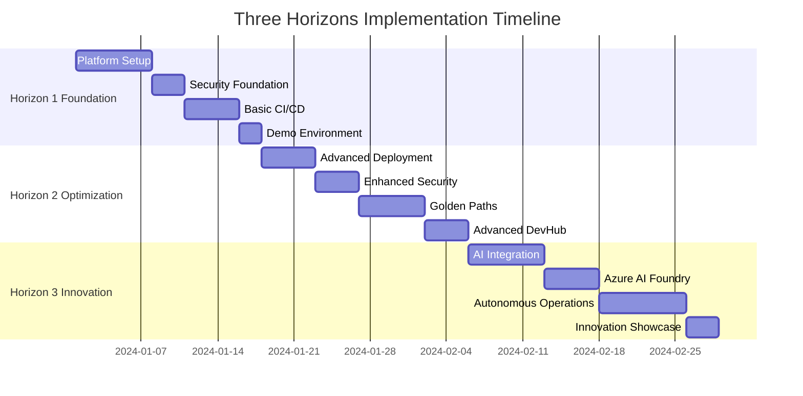

# 🚀 Three Horizons AI Platform - Documentation Index

**The Industry's First AI-Enabled Development Platform with Agentic DevOps**

*Integrating Microsoft Azure, Red Hat Developer Hub 1.6, GitHub Enterprise, and Azure AI Foundry*

## 📋 Navigation Guide

This documentation is organized into three progressive horizons, each building upon the previous one:

### 🏗️ Horizon 1: Foundation Platform
> **Core platform capabilities - The foundation of your AI-powered development environment**

| Document | Description | Time Investment | Prerequisites |
|----------|-------------|-----------------|---------------|
| [📖 Platform Introduction](h1-horizon-foundation/h1-001-platform-introduction.md) | Overview and business case | 30 min | None |
| [🏗️ Infrastructure Setup](h1-horizon-foundation/h1-002-infrastructure-setup.md) | Azure infrastructure deployment | 2-4 hours | Azure subscription |
| [🔒 Security Foundation](h1-horizon-foundation/h1-003-security-foundation.md) | Core security implementation | 1-2 hours | Infrastructure |
| [🐙 GitHub Setup](h1-horizon-foundation/h1-004-github-setup.md) | GitHub Enterprise configuration | 1 hour | GitHub licenses |
| [📚 Developer Hub Deployment](h1-horizon-foundation/h1-005-developer-hub-deployment.md) | Red Hat Developer Hub setup | 2-3 hours | K8s cluster |
| [🔄 Basic CI/CD](h1-horizon-foundation/h1-006-basic-cicd.md) | Pipeline implementation | 1-2 hours | All previous |
| [🎬 Demo Environment](h1-horizon-foundation/h1-007-demo-environment.md) | Complete demonstration | 1 hour | All previous |

### ⚡ Horizon 2: Optimization Platform
> **Enhanced capabilities - Optimize performance, security, and developer experience**

| Document | Description | Time Investment | Prerequisites |
|----------|-------------|-----------------|---------------|
| [🚀 Advanced Deployment](h2-horizon-optimization/h2-001-advanced-deployment.md) | GitOps and multi-cloud strategies | 3-4 hours | H1 Complete |
| [📊 Comprehensive Monitoring](h2-horizon-optimization/h2-002-comprehensive-monitoring.md) | Advanced observability | 2-3 hours | H1 Complete |
| [🛡️ Enhanced Security](h2-horizon-optimization/h2-003-enhanced-security.md) | Advanced security controls | 2-3 hours | H1 Complete |
| [⚡ Performance Optimization](h2-horizon-optimization/h2-004-performance-optimization.md) | Platform performance tuning | 2-3 hours | H1 Complete |
| [🛣️ Golden Paths](h2-horizon-optimization/h2-005-golden-paths.md) | Developer best practices | 2-3 hours | H1 Complete |
| [🏛️ Advanced Developer Hub](h2-horizon-optimization/h2-006-advanced-devhub.md) | Enhanced portal features | 2-3 hours | H1 Complete |
| [🎭 Enhanced Demo](h2-horizon-optimization/h2-007-enhanced-demo.md) | Advanced demonstrations | 1-2 hours | H2 Complete |

### 🤖 Horizon 3: Innovation Platform
> **AI-driven capabilities - The future of autonomous development**

| Document | Description | Time Investment | Prerequisites |
|----------|-------------|-----------------|---------------|
| [🧠 AI-Driven Development](h3-horizon-innovation/h3-001-ai-driven-development.md) | GitHub Copilot integration | 2-3 hours | H2 Complete |
| [🧪 Azure AI Foundry](h3-horizon-innovation/h3-002-azure-ai-foundry.md) | AI model management | 3-4 hours | H2 Complete |
| [🤖 Autonomous Operations](h3-horizon-innovation/h3-003-autonomous-operations.md) | Self-healing systems | 4-5 hours | H2 Complete |
| [🔌 MCP Implementation](h3-horizon-innovation/h3-004-mcp-implementation.md) | Multi-Cloud Protocol | 3-4 hours | H2 Complete |
| [📈 Advanced Analytics](h3-horizon-innovation/h3-005-advanced-analytics.md) | AI-powered insights | 2-3 hours | H2 Complete |
| [🎯 Unified Experience](h3-horizon-innovation/h3-006-unified-experience.md) | Seamless integration | 2-3 hours | H2 Complete |
| [🎪 Innovation Showcase](h3-horizon-innovation/h3-007-innovation-showcase.md) | Cutting-edge demonstrations | 1-2 hours | H3 Complete |

## 📚 Additional Resources

### 🛠️ Developer Guides
- [👨‍💻 Developer Guide](guides/developer-guide.md) - Complete developer handbook
- [💻 Inner Loop Development](guides/inner-loop-development.md) - Local development with AI
- [🚀 Outer Loop Deployment](guides/outer-loop-deployment.md) - Production deployment strategies
- [� Complete Integration Tutorial](guides/complete-integration-tutorial.md) - End-to-end tutorial

### 📖 Reference Documentation
- [🔧 Troubleshooting & FAQ](reference/troubleshooting-faq.md) - Common issues and solutions

### �️ Scripts & Templates
- [📁 Assets Directory](../assets/README.md) - Scripts, templates, and resources
- [🔧 Automation Scripts](../assets/scripts/) - Deployment and management scripts
- [📄 Templates](../assets/templates/) - Bicep, Helm, and GitHub Actions templates

## 🎯 Quick Start Paths

### 🚀 For Decision Makers (30 minutes)
1. [📖 Platform Introduction](h1-horizon-foundation/h1-001-platform-introduction.md)
2. [🎬 Demo Environment](h1-horizon-foundation/h1-007-demo-environment.md)
3. [🎪 Innovation Showcase](h3-horizon-innovation/h3-007-innovation-showcase.md)

### 👨‍💻 For Developers (2 hours)
1. [👨‍💻 Developer Guide](guides/developer-guide.md)
2. [💻 Inner Loop Development](guides/inner-loop-development.md)
3. [🧠 AI-Driven Development](h3-horizon-innovation/h3-001-ai-driven-development.md)

### 🏗️ For Platform Engineers (1 day)
1. Start with [Horizon 1 Foundation](#%EF%B8%8F-horizon-1-foundation-platform)
2. Review [🔧 Troubleshooting & FAQ](reference/troubleshooting-faq.md)
3. Implement progressively through all horizons

### 🔒 For Security Teams (4 hours)
1. [🔒 Security Foundation](h1-horizon-foundation/h1-003-security-foundation.md)
2. [🛡️ Enhanced Security](h2-horizon-optimization/h2-003-enhanced-security.md)
3. [📊 Comprehensive Monitoring](h2-horizon-optimization/h2-002-comprehensive-monitoring.md)

## 🖼️ Visual Architecture

### 🏗️ Platform Architecture (Updated)

### 🎯 User Journey Through Three Horizons

### 🔄 Complete Three Horizons Workflow

### 📊 System Architecture (Legacy)

### 🔐 Security Architecture

### 🔄 Developer Workflow (Legacy)

### ↪️ Shift-Left DevOps

## 📊 Progress Tracking

### Implementation Roadmap

### Readiness Checklist

- [ ] **Prerequisites Complete** - Azure subscription, GitHub licenses, Red Hat licenses
- [ ] **Team Prepared** - Platform engineers, developers, security team ready
- [ ] **Infrastructure Ready** - Network, storage, compute resources available
- [ ] **Governance Established** - Policies, procedures, approval processes defined

## 🚀 Getting Started

1. **Choose Your Path**: Select appropriate quick start path above
2. **Check Prerequisites**: Ensure you have necessary licenses and access
3. **Start Implementation**: Begin with Horizon 1 Foundation
4. **Track Progress**: Use the implementation roadmap and checklists
5. **Get Support**: Reference troubleshooting guide when needed

---

**🌟 Welcome to the Future of Software Development 🌟**

*Transforming how enterprises build, deploy, and operate software with AI-powered automation*

[🚀 Start Your Journey](h1-horizon-foundation/h1-001-platform-introduction.md) | [📊 View Architecture](../assets/diagrams/architecture-diagram.svg) | [🔧 Get Support](reference/troubleshooting-faq.md)

