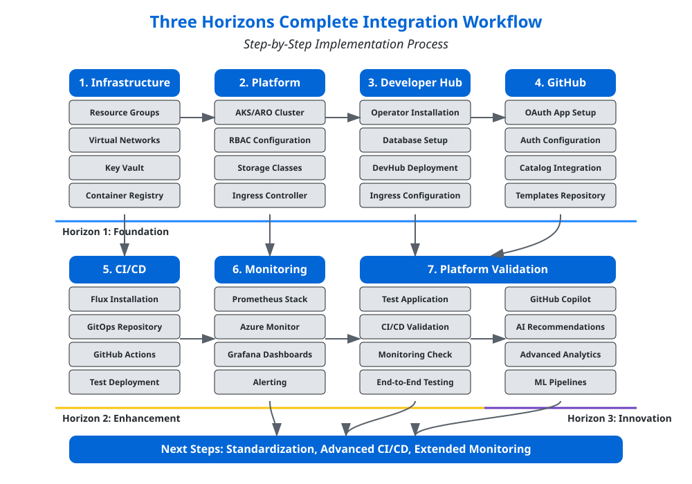

# <span style="color: #0366d6;">🚀 Complete Integration Tutorial</span>

**Navigation:** [Home](../../../../README.md) > [Documentation Map](../../../DOCUMENTATION_MAP.md) > Complete Integration Tutorial

> **RECOMMENDED IMPLEMENTATION PATH**: This tutorial is the recommended starting point for implementing the Three Horizons Platform. It provides a comprehensive, step-by-step guide with detailed commands, code samples, and validation procedures.

## <span style="color: #0366d6;">🔄 Your Complete Integration Journey</span>

Welcome to the definitive tutorial for implementing a complete Three Horizons Platform. This guide will walk you through each step of the integration process, from infrastructure provisioning to full platform operation. At each stage, we'll provide detailed instructions, external references, and links to internal documentation.

This tutorial follows the Three Horizons model, helping you build capabilities progressively:

| Horizon | Focus | Outcome |
|---------|-------|---------|
| **Horizon 1** | Foundation | Core platform with essential capabilities |
| **Horizon 2** | Enhancement | Advanced features and optimizations |
| **Horizon 3** | Innovation | AI integration and future-ready capabilities |


## <span style="color: #0366d6;">🔄 Implementation Workflow</span>

The following diagram illustrates the complete implementation workflow for the Three Horizons Platform, organized by phases and aligned with the Three Horizons model:



Each phase builds on the previous one, with clear demarcations between the three horizons of capability maturity. Follow the phases in order for a structured implementation experience.

## <span style="color: #0366d6;">🔍 Pre-requisites</span>

Before beginning this tutorial, ensure you have:

1. **Azure Subscription** with appropriate permissions
   - Owner or Contributor role
   - Quota for required resources
   - [Azure Subscription Requirements](https://docs.microsoft.com/en-us/azure/cloud-adoption-framework/ready/azure-best-practices/initial-subscriptions)

2. **Required Tools**:
   - Azure CLI v2.42.0 or later
   - kubectl v1.25.0 or later
   - Git v2.36.0 or later
   - [Installation guide for development tools](../../../getting-started/installation.md#development-tools)

3. **Access Credentials**:
   - GitHub Enterprise account
   - Azure AD administrator access
   - OpenShift Pull Secret (for ARO)
   - [Identity management documentation](../../architecture/identity-integration.svg)

4. **Network Requirements**:
   - Ability to create VNets and subnets
   - Outbound internet access
   - [Network architecture documentation](../../architecture/network-diagram.svg)

## <span style="color: #0366d6;">📋 Implementation Phases</span>

The complete implementation is divided into 7 phases:

1. [**Infrastructure Provisioning**](#phase-1-infrastructure-provisioning) - Setting up Azure foundation
2. [**Platform Installation**](#phase-2-platform-installation) - Installing AKS/ARO and core services
3. [**Developer Hub Deployment**](#phase-3-developer-hub-deployment) - Deploying Red Hat Developer Hub
4. [**GitHub Integration**](#phase-4-github-integration) - Connecting with GitHub Enterprise
5. [**CI/CD Pipeline Setup**](#phase-5-cicd-pipeline-setup) - Implementing GitOps workflows
6. [**Monitoring & Observability**](#phase-6-monitoring--observability) - Setting up monitoring stack
7. [**Platform Validation**](#phase-7-platform-validation) - Testing and validation

Let's start with the first phase.

## <span style="color: #0366d6;">💻 Phase 1: Infrastructure Provisioning</span>

In this phase, we'll set up the foundational Azure infrastructure required for the Three Horizons Platform.

### <span style="color: #0366d6;">Step 1.1: Resource Group Creation</span>

First, create resource groups to organize your resources:

```bash
# Login to Azure
az login

# Set your subscription
az account set --subscription "<subscription-id>"

# Create resource group for the platform
az group create --name three-horizons-platform --location eastus

# Create resource group for shared services
az group create --name three-horizons-shared --location eastus
```

> 📘 **Note:** For production environments, consider using separate resource groups for each major component.
> Read more in the [Azure cloud foundations guide](https://docs.microsoft.com/en-us/azure/cloud-adoption-framework/ready/landing-zone/).

### <span style="color: #0366d6;">Step 1.2: Virtual Network Setup</span>

Create the virtual network and subnets:

```bash
# Create the virtual network
az network vnet create \
  --resource-group three-horizons-platform \
  --name three-horizons-vnet \
  --address-prefix 10.0.0.0/16 \
  --subnet-name aks-subnet \
  --subnet-prefix 10.0.0.0/22

# Create subnet for Azure services
az network vnet subnet create \
  --resource-group three-horizons-platform \
  --vnet-name three-horizons-vnet \
  --name services-subnet \
  --address-prefix 10.0.4.0/24
```

> 🔗 **Reference:** See our [network architecture documentation](../../architecture/network-diagram.svg) for the recommended network topology.

### <span style="color: #0366d6;">Step 1.3: Create Key Vault</span>

Create an Azure Key Vault to store secrets:

```bash
# Create Key Vault
az keyvault create \
  --name three-horizons-vault \
  --resource-group three-horizons-shared \
  --location eastus \
  --sku standard
```

> 🔒 **Security Note:** Follow the [security guidelines](security-guide.md) for configuring access policies and network restrictions for your Key Vault.

### <span style="color: #0366d6;">Step 1.4: Create Container Registry</span>

Set up Azure Container Registry:

```bash
# Create Container Registry
az acr create \
  --name threehorizonsregistry \
  --resource-group three-horizons-shared \
  --location eastus \
  --sku Premium \
  --admin-enabled false
```

> 💡 **Best Practice:** For production environments, enable geo-replication for your container registry to improve image pull performance.

### <span style="color: #0366d6;">Step 1.5: Create Service Principal</span>

Create a service principal for automation:

```bash
# Create Service Principal and save the output
az ad sp create-for-rbac \
  --name "three-horizons-sp" \
  --role Contributor \
  --scopes /subscriptions/<subscription-id>/resourceGroups/three-horizons-platform \
  --output json > sp-credentials.json
```

> ⚠️ **Important:** Store the service principal credentials securely. Consider saving them in Key Vault.

### <span style="color: #0366d6;">Horizon 1 (Foundation) Validation</span>

Validate your infrastructure setup:

```bash
# Verify resource groups
az group list --query "[?contains(name, 'three-horizons')]" -o table

# Verify virtual network and subnets
az network vnet subnet list \
  --resource-group three-horizons-platform \
  --vnet-name three-horizons-vnet \
  -o table

# Verify Key Vault
az keyvault show --name three-horizons-vault -o table

# Verify Container Registry
az acr show --name threehorizonsregistry -o table
```

## <span style="color: #0366d6;">🚀 Phase 2: Platform Installation</span>

Now let's install the core platform components: Azure Kubernetes Service (AKS) or Azure Red Hat OpenShift (ARO).

### <span style="color: #0366d6;">Option A: AKS Installation</span>

#### <span style="color: #0366d6;">Step 2.A.1: Create AKS Cluster</span>

```bash
# Create AKS cluster
az aks create \
  --resource-group three-horizons-platform \
  --name three-horizons-aks \
  --node-count 3 \
  --enable-managed-identity \
  --network-plugin azure \
  --vnet-subnet-id $(az network vnet subnet show --resource-group three-horizons-platform --vnet-name three-horizons-vnet --name aks-subnet --query id -o tsv) \
  --docker-bridge-address 172.17.0.1/16 \
  --dns-service-ip 10.2.0.10 \
  --service-cidr 10.2.0.0/24 \
  --node-vm-size Standard_DS3_v2 \
  --generate-ssh-keys
```

#### <span style="color: #0366d6;">Step 2.A.2: Connect to AKS Cluster</span>

```bash
# Get credentials
az aks get-credentials \
  --resource-group three-horizons-platform \
  --name three-horizons-aks

# Verify connection
kubectl get nodes
```

> 🔍 **Learn More:** Review our [AKS architecture documentation](../../architecture/kubernetes-architecture.md) for details on how AKS fits into the Three Horizons architecture.

### <span style="color: #0366d6;">Option B: ARO Installation</span>

#### <span style="color: #0366d6;">Step 2.B.1: Create ARO Cluster</span>

```bash
# Create master and worker subnets
az network vnet subnet create \
  --resource-group three-horizons-platform \
  --vnet-name three-horizons-vnet \
  --name aro-master-subnet \
  --address-prefixes 10.0.8.0/23 \
  --service-endpoints Microsoft.ContainerRegistry

az network vnet subnet create \
  --resource-group three-horizons-platform \
  --vnet-name three-horizons-vnet \
  --name aro-worker-subnet \
  --address-prefixes 10.0.10.0/23 \
  --service-endpoints Microsoft.ContainerRegistry

# Create ARO cluster
az aro create \
  --resource-group three-horizons-platform \
  --name three-horizons-aro \
  --vnet three-horizons-vnet \
  --master-subnet aro-master-subnet \
  --worker-subnet aro-worker-subnet \
  --pull-secret @pull-secret.txt
```

#### <span style="color: #0366d6;">Step 2.B.2: Connect to ARO Cluster</span>

```bash
# Get the console URL
az aro show \
  --name three-horizons-aro \
  --resource-group three-horizons-platform \
  --query consoleProfile.url -o tsv

# Get login credentials
az aro list-credentials \
  --name three-horizons-aro \
  --resource-group three-horizons-platform

# Login with oc CLI
oc login <api-server-url> -u kubeadmin -p <password>

# Verify connection
oc get nodes
```

> 📝 **Note:** The ARO console URL will open the web UI. Use the kubeadmin credentials to log in.

### <span style="color: #0366d6;">Step 2.3: Configure RBAC</span>

Set up role-based access control for your cluster:

```bash
# Create namespace for platform components
kubectl create namespace three-horizons-system

# Apply RBAC configuration
kubectl apply -f - <<EOF
apiVersion: v1
kind: ServiceAccount
metadata:
  name: platform-admin
  namespace: three-horizons-system
---
apiVersion: rbac.authorization.k8s.io/v1
kind: ClusterRoleBinding
metadata:
  name: platform-admin
subjects:
- kind: ServiceAccount
  name: platform-admin
  namespace: three-horizons-system
roleRef:
  kind: ClusterRole
  name: cluster-admin
  apiGroup: rbac.authorization.k8s.io
EOF
```

### <span style="color: #0366d6;">Step 2.4: Configure Storage</span>

Set up storage classes for persistent data:

```bash
# For AKS (already has default storage class)
kubectl get storageclass

# For ARO, create a storage class with Azure Files
oc apply -f - <<EOF
apiVersion: storage.k8s.io/v1
kind: StorageClass
metadata:
  name: azure-file-rwx
provisioner: kubernetes.io/azure-file
parameters:
  skuName: Premium_LRS
reclaimPolicy: Delete
volumeBindingMode: Immediate
mountOptions:
  - dir_mode=0777
  - file_mode=0777
  - uid=0
  - gid=0
EOF
```

> 📊 **Resource Planning:** For production environments, see our [resource planning guide](../../../getting-started/installation.md#resource-planning) for storage recommendations.

### <span style="color: #0366d6;">Step 2.5: Install Ingress Controller</span>

Install an ingress controller to manage external access:

```bash
# Install NGINX Ingress Controller
helm repo add ingress-nginx https://kubernetes.github.io/ingress-nginx
helm repo update

helm install ingress-nginx ingress-nginx/ingress-nginx \
  --namespace three-horizons-system \
  --create-namespace \
  --set controller.replicaCount=2 \
  --set controller.service.annotations."service\.beta\.kubernetes\.io/azure-load-balancer-internal"="false"
```

### <span style="color: #0366d6;">Horizon 1 (Foundation) Validation</span>

Validate your platform installation:

```bash
# Verify node health
kubectl get nodes -o wide

# Verify system pods
kubectl get pods -n three-horizons-system

# Verify ingress controller
kubectl get services -n three-horizons-system
```

## <span style="color: #0366d6;">🚀 Phase 3: Developer Hub Deployment</span>

Now let's deploy the Red Hat Developer Hub, which is the central component for the Three Horizons Platform.

### <span style="color: #0366d6;">Step 3.1: Install Operator Lifecycle Manager</span>

```bash
# For AKS
curl -sL https://github.com/operator-framework/operator-lifecycle-manager/releases/download/v0.24.0/install.sh | bash -s v0.24.0

# For ARO, OLM is already installed
oc get pods -n openshift-operator-lifecycle-management
```

### <span style="color: #0366d6;">Step 3.2: Install Developer Hub Operator</span>

```bash
# Create namespace
kubectl create namespace developer-hub

# Deploy Developer Hub Operator
cat <<EOF | kubectl apply -f -
apiVersion: operators.coreos.com/v1alpha1
kind: Subscription
metadata:
  name: rhda-operator
  namespace: developer-hub
spec:
  channel: stable
  name: rhda-operator
  source: redhat-operators
  sourceNamespace: openshift-marketplace
EOF
```

> 📘 **Reference:** For detailed operator configuration, see the [Red Hat Developer Hub documentation](https://developers.redhat.com/rhdh/getting-started).

### <span style="color: #0366d6;">Step 3.3: Configure Database</span>

Deploy a PostgreSQL database for the Developer Hub:

```bash
# Create PostgreSQL deployment
kubectl apply -f - <<EOF
apiVersion: apps/v1
kind: Deployment
metadata:
  name: developer-hub-postgres
  namespace: developer-hub
spec:
  replicas: 1
  selector:
    matchLabels:
      app: postgresql
  template:
    metadata:
      labels:
        app: postgresql
    spec:
      containers:
      - name: postgresql
        image: postgres:13
        env:
        - name: POSTGRES_USER
          value: backstage
        - name: POSTGRES_PASSWORD
          value: backstage
        - name: POSTGRES_DB
          value: backstage
        ports:
        - containerPort: 5432
        volumeMounts:
        - name: postgresql-data
          mountPath: /var/lib/postgresql/data
      volumes:
      - name: postgresql-data
        persistentVolumeClaim:
          claimName: postgresql-data
---
apiVersion: v1
kind: Service
metadata:
  name: developer-hub-postgres
  namespace: developer-hub
spec:
  ports:
  - port: 5432
    targetPort: 5432
  selector:
    app: postgresql
---
apiVersion: v1
kind: PersistentVolumeClaim
metadata:
  name: postgresql-data
  namespace: developer-hub
spec:
  accessModes:
    - ReadWriteOnce
  resources:
    requests:
      storage: 10Gi
  storageClassName: managed-premium
EOF
```

> ⚠️ **Warning:** For production, use a managed database service like Azure Database for PostgreSQL and store credentials in Key Vault.

### <span style="color: #0366d6;">Step 3.4: Deploy Developer Hub Instance</span>

```bash
# Deploy Developer Hub instance
kubectl apply -f - <<EOF
apiVersion: rhda.redhat.com/v1alpha1
kind: Backstage
metadata:
  name: developer-hub
  namespace: developer-hub
spec:
  application:
    replicas: 1
    resources:
      requests:
        cpu: "500m"
        memory: "1Gi"
      limits:
        cpu: "2"
        memory: "2Gi"
  database:
    host: "developer-hub-postgres"
    port: 5432
    name: "backstage"
    user: "backstage"
    passwordSecret:
      name: "developer-hub-postgres"
      key: "postgres-password"
EOF

# Create password secret
kubectl create secret generic developer-hub-postgres \
  --namespace developer-hub \
  --from-literal=postgres-password=backstage
```

> 🔗 **Internal Document:** See our [Developer Hub architecture](../../architecture/developer-hub-architecture.svg) for a visualization of how these components interconnect.

### <span style="color: #0366d6;">Step 3.5: Create Ingress for Developer Hub</span>

Create an ingress rule to expose the Developer Hub:

```bash
# Get external IP of ingress controller
INGRESS_IP=$(kubectl get services -n three-horizons-system ingress-nginx-controller -o jsonpath='{.status.loadBalancer.ingress[0].ip}')

# Create DNS record (manual step)
echo "Create an A record for devhub.example.com pointing to $INGRESS_IP"

# Create ingress rule
kubectl apply -f - <<EOF
apiVersion: networking.k8s.io/v1
kind: Ingress
metadata:
  name: developer-hub
  namespace: developer-hub
  annotations:
    kubernetes.io/ingress.class: nginx
    nginx.ingress.kubernetes.io/proxy-body-size: "0"
    nginx.ingress.kubernetes.io/proxy-read-timeout: "600"
    nginx.ingress.kubernetes.io/proxy-send-timeout: "600"
    cert-manager.io/cluster-issuer: letsencrypt-prod
spec:
  rules:
  - host: devhub.example.com
    http:
      paths:
      - path: /
        pathType: Prefix
        backend:
          service:
            name: developer-hub
            port:
              number: 7007
  tls:
  - hosts:
    - devhub.example.com
    secretName: developer-hub-tls
EOF
```

> 📝 **Note:** Replace devhub.example.com with your actual domain. For production, install cert-manager for TLS certificate management.

### <span style="color: #0366d6;">Horizon 1 (Foundation) Validation</span>

Validate your Developer Hub deployment:

```bash
# Check Developer Hub operator status
kubectl get pods -n developer-hub

# Check Developer Hub service status
kubectl get services -n developer-hub

# Check ingress
kubectl get ingress -n developer-hub
```

Access the Developer Hub at https://devhub.example.com (replace with your domain).

## <span style="color: #0366d6;">🚀 Phase 4: GitHub Integration</span>

In this phase, we'll integrate your GitHub Enterprise instance with the Three Horizons Platform.

### <span style="color: #0366d6;">Step 4.1: Create GitHub OAuth App</span>

1. Go to your GitHub Enterprise instance
2. Navigate to Settings > Developer Settings > OAuth Apps > New OAuth App
3. Fill in the following:
   - Application name: Three Horizons Platform
   - Homepage URL: https://devhub.example.com
   - Authorization callback URL: https://devhub.example.com/api/auth/github/handler/frame
4. Register the application and note the Client ID and Client Secret

### <span style="color: #0366d6;">Step 4.2: Configure Developer Hub for GitHub Authentication</span>

```bash
# Create GitHub secrets
kubectl create secret generic github-oauth \
  --namespace developer-hub \
  --from-literal=client-id=<your-client-id> \
  --from-literal=client-secret=<your-client-secret>

# Update Developer Hub configuration (apply custom resources)
kubectl apply -f - <<EOF
apiVersion: rhda.redhat.com/v1alpha1
kind: BackstageConfig
metadata:
  name: developer-hub-auth
  namespace: developer-hub
spec:
  app:
    auth:
      environment: development
      providers:
        github:
          development:
            clientId: \${GITHUB_CLIENT_ID}
            clientSecret: \${GITHUB_CLIENT_SECRET}
  args:
    - "--config"
    - "app-config.yaml"
  envs:
    - name: GITHUB_CLIENT_ID
      valueFrom:
        secretKeyRef:
          name: github-oauth
          key: client-id
    - name: GITHUB_CLIENT_SECRET
      valueFrom:
        secretKeyRef:
          name: github-oauth
          key: client-secret
EOF
```

> 🔍 **Learn More:** See [GitHub Enterprise integration](https://backstage.io/docs/integrations/github/github-apps) in the Backstage documentation.

### <span style="color: #0366d6;">Step 4.3: Configure GitHub Integration for Software Catalog</span>

```bash
# Create GitHub integration token
kubectl create secret generic github-token \
  --namespace developer-hub \
  --from-literal=token=<your-personal-access-token>

# Configure software catalog
kubectl apply -f - <<EOF
apiVersion: rhda.redhat.com/v1alpha1
kind: BackstageConfig
metadata:
  name: developer-hub-catalog
  namespace: developer-hub
spec:
  app:
    catalog:
      providers:
        github:
          providerId: 'github'
          organization: 'your-org-name'
          schedule:
            frequency: { minutes: 30 }
            timeout: { minutes: 5 }
  args:
    - "--config"
    - "app-config.yaml"
  envs:
    - name: GITHUB_TOKEN
      valueFrom:
        secretKeyRef:
          name: github-token
          key: token
EOF
```

> 🔐 **Security Note:** For production, use GitHub Apps instead of personal access tokens for better security and auditability.

### <span style="color: #0366d6;">Step 4.4: Configure Templates Repository</span>

```bash
# Create a templates repository in your GitHub organization
echo "Create a templates repository in your GitHub organization with starter templates"

# Add repository to Developer Hub catalog
kubectl apply -f - <<EOF
apiVersion: v1
kind: ConfigMap
metadata:
  name: catalog-info
  namespace: developer-hub
data:
  catalog-info.yaml: |
    apiVersion: backstage.io/v1alpha1
    kind: Location
    metadata:
      name: templates
      description: Templates Repository
    spec:
      targets:
        - https://github.com/your-org-name/templates/blob/main/catalog-info.yaml
EOF
```

> 📚 **Templates Guide:** For template examples, see our [Golden Paths guide](../../documentation/developer/golden-paths.md).

### <span style="color: #0366d6;">Horizon 2 (Enhancement) Validation</span>

Validate your GitHub integration:

1. Access the Developer Hub at https://devhub.example.com
2. Sign in with GitHub
3. Navigate to the Catalog section
4. Verify that repositories and templates are being imported
5. Test creating a new component from a template

## <span style="color: #0366d6;">🚀 Phase 5: CI/CD Pipeline Setup</span>

In this phase, we'll set up GitOps-based CI/CD pipelines using GitHub Actions and Flux.

### <span style="color: #0366d6;">Step 5.1: Install Flux CD</span>

```bash
# Install Flux CLI
curl -s https://fluxcd.io/install.sh | bash

# Export GitHub credentials
export GITHUB_TOKEN=<your-personal-access-token>
export GITHUB_USER=<your-github-username>

# Bootstrap Flux
flux bootstrap github \
  --owner=your-org-name \
  --repository=flux-infra \
  --branch=main \
  --path=clusters/three-horizons \
  --personal
```

> 🔄 **GitOps Reference:** See our [CI/CD architecture](../../architecture/cicd-pipeline.svg) for the complete workflow visualization.

### <span style="color: #0366d6;">Step 5.2: Create GitOps Repository Structure</span>

Create the following structure in your flux-infra repository:

```
flux-infra/
├── clusters/
│   └── three-horizons/
│       ├── infrastructure/
│       ├── apps/
│       └── kustomization.yaml
└── platform/
    ├── base/
    │   ├── monitoring/
    │   ├── ingress/
    │   └── security/
    └── overlays/
        └── production/
```

### <span style="color: #0366d6;">Step 5.3: Configure Flux for Applications</span>

```bash
# Create Git repository for application manifests
flux create source git apps \
  --url=https://github.com/your-org-name/three-horizons-apps \
  --branch=main \
  --interval=1m \
  --export > apps-source.yaml

# Create kustomization for syncing applications
flux create kustomization apps \
  --source=apps \
  --path="./" \
  --prune=true \
  --interval=10m \
  --export > apps-sync.yaml

# Apply configurations
kubectl apply -f apps-source.yaml
kubectl apply -f apps-sync.yaml
```

### <span style="color: #0366d6;">Step 5.4: Set up GitHub Actions Templates</span>

Create GitHub Actions workflow templates in your templates repository:

```yaml
# .github/workflows/build-deploy.yml
name: Build and Deploy

on:
  push:
    branches: [ main ]
  pull_request:
    branches: [ main ]

jobs:
  build:
    runs-on: ubuntu-latest
    steps:
      - uses: actions/checkout@v3
      
      - name: Set up Docker Buildx
        uses: docker/setup-buildx-action@v2
      
      - name: Login to Container Registry
        uses: docker/login-action@v2
        with:
          registry: threehorizonsregistry.azurecr.io
          username: ${{ secrets.REGISTRY_USERNAME }}
          password: ${{ secrets.REGISTRY_PASSWORD }}
      
      - name: Build and push
        uses: docker/build-push-action@v4
        with:
          context: .
          push: true
          tags: threehorizonsregistry.azurecr.io/app:${{ github.sha }}
          
  deploy:
    needs: build
    runs-on: ubuntu-latest
    if: github.ref == 'refs/heads/main'
    steps:
      - uses: actions/checkout@v3
      
      - name: Update Kubernetes manifests
        run: |
          cd ./k8s
          kustomize edit set image app=threehorizonsregistry.azurecr.io/app:${{ github.sha }}
          
      - name: Commit and push changes
        run: |
          git config --global user.name 'GitHub Actions'
          git config --global user.email 'actions@github.com'
          git add k8s/
          git commit -m "Update image to ${{ github.sha }}"
          git push
```

> 🚀 **CI/CD Guide:** For complete CI/CD configuration, see our [GitHub Actions guide](../../../examples/pipelines/github-actions/).

### <span style="color: #0366d6;">Step 5.5: Configure and Test Deployment Pipeline</span>

1. Create a test application using the Developer Hub templates
2. Review the generated GitHub Actions workflow
3. Make a code change and push to your repository
4. Verify that the CI/CD pipeline builds and deploys your application

### <span style="color: #0366d6;">Horizon 2 (Enhancement) Validation</span>

Validate your CI/CD pipeline:

```bash
# Check Flux controllers
kubectl get pods -n flux-system

# Check GitRepository sources
flux get sources git

# Check Kustomizations
flux get kustomizations

# Check deployed applications
kubectl get deployments -A
```

## <span style="color: #0366d6;">🚀 Phase 6: Monitoring & Observability</span>

In this phase, we'll set up monitoring and observability for the platform.

### <span style="color: #0366d6;">Step 6.1: Install Prometheus Stack</span>

```bash
# Add Prometheus Helm repository
helm repo add prometheus-community https://prometheus-community.github.io/helm-charts
helm repo update

# Create monitoring namespace
kubectl create namespace monitoring

# Install Prometheus Stack
helm install prometheus prometheus-community/kube-prometheus-stack \
  --namespace monitoring \
  --set grafana.adminPassword=admin \
  --set prometheusOperator.createCustomResource=true
```

> 📊 **Monitoring Guide:** See our [monitoring architecture](../../architecture/monitoring-observability.svg) for an overview of the monitoring components.

### <span style="color: #0366d6;">Step 6.2: Configure Azure Monitor Integration</span>

```bash
# Create Azure Monitor workspace
az monitor log-analytics workspace create \
  --resource-group three-horizons-shared \
  --workspace-name three-horizons-logs

# Get workspace ID and key
WORKSPACE_ID=$(az monitor log-analytics workspace show \
  --resource-group three-horizons-shared \
  --workspace-name three-horizons-logs \
  --query customerId -o tsv)
  
WORKSPACE_KEY=$(az monitor log-analytics workspace get-shared-keys \
  --resource-group three-horizons-shared \
  --workspace-name three-horizons-logs \
  --query primarySharedKey -o tsv)

# Deploy Azure Monitor for Containers
kubectl apply -f - <<EOF
apiVersion: v1
kind: Secret
metadata:
  name: azure-log-analytics
  namespace: monitoring
type: Opaque
data:
  workspaceId: $(echo -n $WORKSPACE_ID | base64)
  workspaceKey: $(echo -n $WORKSPACE_KEY | base64)
---
apiVersion: apps/v1
kind: DaemonSet
metadata:
  name: azure-monitor-agent
  namespace: monitoring
spec:
  selector:
    matchLabels:
      app: azure-monitor-agent
  template:
    metadata:
      labels:
        app: azure-monitor-agent
    spec:
      containers:
      - name: azure-monitor-agent
        image: mcr.microsoft.com/azuremonitor/containerinsights/ciprod:ciprod04252022
        env:
        - name: WSID
          valueFrom:
            secretKeyRef:
              name: azure-log-analytics
              key: workspaceId
        - name: WSKEY
          valueFrom:
            secretKeyRef:
              name: azure-log-analytics
              key: workspaceKey
        - name: CLUSTER_NAME
          value: "three-horizons-aks"
        securityContext:
          privileged: true
        volumeMounts:
        - name: docker-sock
          mountPath: /var/run/docker.sock
        - name: host-log
          mountPath: /var/log
        - name: host-run
          mountPath: /run
      volumes:
      - name: docker-sock
        hostPath:
          path: /var/run/docker.sock
      - name: host-log
        hostPath:
          path: /var/log
      - name: host-run
        hostPath:
          path: /run
EOF
```

### <span style="color: #0366d6;">Step 6.3: Set up Grafana Dashboards</span>

```bash
# Create Grafana dashboards configmap
kubectl apply -f - <<EOF
apiVersion: v1
kind: ConfigMap
metadata:
  name: three-horizons-dashboards
  namespace: monitoring
  labels:
    grafana_dashboard: "1"
data:
  platform-overview.json: |
    {
      "annotations": {
        "list": [
          {
            "builtIn": 1,
            "datasource": "-- Grafana --",
            "enable": true,
            "hide": true,
            "iconColor": "rgba(0, 211, 255, 1)",
            "name": "Annotations & Alerts",
            "type": "dashboard"
          }
        ]
      },
      "editable": true,
      "gnetId": null,
      "graphTooltip": 0,
      "id": 1,
      "links": [],
      "panels": [
        {
          "aliasColors": {},
          "bars": false,
          "dashLength": 10,
          "dashes": false,
          "datasource": "Prometheus",
          "fieldConfig": {
            "defaults": {
              "custom": {}
            },
            "overrides": []
          },
          "fill": 1,
          "fillGradient": 0,
          "gridPos": {
            "h": 8,
            "w": 12,
            "x": 0,
            "y": 0
          },
          "hiddenSeries": false,
          "id": 2,
          "legend": {
            "avg": false,
            "current": false,
            "max": false,
            "min": false,
            "show": true,
            "total": false,
            "values": false
          },
          "lines": true,
          "linewidth": 1,
          "nullPointMode": "null",
          "options": {
            "alertThreshold": true
          },
          "percentage": false,
          "pluginVersion": "7.3.7",
          "pointradius": 2,
          "points": false,
          "renderer": "flot",
          "seriesOverrides": [],
          "spaceLength": 10,
          "stack": false,
          "steppedLine": false,
          "targets": [
            {
              "expr": "sum(rate(container_cpu_usage_seconds_total{namespace!=\"\"}[5m])) by (namespace)",
              "interval": "",
              "legendFormat": "{{namespace}}",
              "refId": "A"
            }
          ],
          "thresholds": [],
          "timeFrom": null,
          "timeRegions": [],
          "timeShift": null,
          "title": "CPU Usage by Namespace",
          "tooltip": {
            "shared": true,
            "sort": 0,
            "value_type": "individual"
          },
          "type": "graph",
          "xaxis": {
            "buckets": null,
            "mode": "time",
            "name": null,
            "show": true,
            "values": []
          },
          "yaxes": [
            {
              "format": "short",
              "label": null,
              "logBase": 1,
              "max": null,
              "min": null,
              "show": true
            },
            {
              "format": "short",
              "label": null,
              "logBase": 1,
              "max": null,
              "min": null,
              "show": true
            }
          ],
          "yaxis": {
            "align": false,
            "alignLevel": null
          }
        }
      ],
      "schemaVersion": 26,
      "style": "dark",
      "tags": [],
      "templating": {
        "list": []
      },
      "time": {
        "from": "now-6h",
        "to": "now"
      },
      "timepicker": {},
      "timezone": "",
      "title": "Three Horizons Platform Overview",
      "uid": "three-horizons",
      "version": 1
    }
EOF
```

> 📈 **Dashboard Examples:** For more dashboard examples, see our [monitoring dashboards](../../../examples/dashboards/).

### <span style="color: #0366d6;">Step 6.4: Configure Alerting</span>

```bash
# Create alert rules
kubectl apply -f - <<EOF
apiVersion: monitoring.coreos.com/v1
kind: PrometheusRule
metadata:
  name: three-horizons-alerts
  namespace: monitoring
spec:
  groups:
  - name: three-horizons.rules
    rules:
    - alert: HighCPUUsage
      expr: sum(rate(container_cpu_usage_seconds_total{namespace!=""}[5m])) by (namespace, pod) > 0.8
      for: 10m
      labels:
        severity: warning
      annotations:
        summary: "High CPU usage for pod {{ \$labels.pod }} in namespace {{ \$labels.namespace }}"
        description: "Pod {{ \$labels.pod }} in namespace {{ \$labels.namespace }} has high CPU usage (> 80%) for more than 10 minutes."
EOF

# Configure Alertmanager
kubectl apply -f - <<EOF
apiVersion: monitoring.coreos.com/v1
kind: AlertmanagerConfig
metadata:
  name: three-horizons-alerts
  namespace: monitoring
spec:
  route:
    group_by: ['alertname', 'namespace']
    group_wait: 30s
    group_interval: 5m
    repeat_interval: 12h
    receiver: 'email'
  receivers:
  - name: 'email'
    email_configs:
    - to: 'alerts@example.com'
      from: 'alertmanager@example.com'
      smarthost: 'smtp.example.com:587'
      auth_username: 'alertmanager'
      auth_identity: 'alertmanager@example.com'
      auth_password: 'password'
EOF
```

> ⚠️ **Alert Configuration:** For production, configure more sophisticated alerting with PagerDuty, OpsGenie, or Microsoft Teams.

### <span style="color: #0366d6;">Horizon 2 (Enhancement) Validation</span>

Validate your monitoring setup:

```bash
# Check Prometheus pods
kubectl get pods -n monitoring

# Port-forward Grafana
kubectl port-forward svc/prometheus-grafana 3000:80 -n monitoring

# Access Grafana at http://localhost:3000 with credentials
# username: admin, password: admin
```

## <span style="color: #0366d6;">🚀 Phase 7: Platform Validation</span>

In this final phase, we'll validate the complete platform integration.

### <span style="color: #0366d6;">Step 7.1: Create Test Application</span>

1. Log in to the Developer Hub at https://devhub.example.com
2. Navigate to Create -> Select Web Application Template
3. Fill in the required details and create the application
4. Wait for the GitHub repository to be created

### <span style="color: #0366d6;">Step 7.2: Validate CI/CD Pipeline</span>

1. Clone the newly created repository
2. Make a code change
3. Push the change to trigger the CI/CD pipeline
4. Monitor the GitHub Actions workflow
5. Verify that the application is deployed to the cluster

### <span style="color: #0366d6;">Step 7.3: Validate Monitoring</span>

1. Access Grafana dashboards
2. Verify that metrics for the test application are being collected
3. Check that alerts are properly configured

### <span style="color: #0366d6;">Step 7.4: End-to-End Testing</span>

Perform the following end-to-end tests:

1. Create a new application from the Developer Hub
2. Make code changes and observe the CI/CD pipeline
3. Test the application's functionality
4. Monitor application performance in Grafana
5. Test the alerting system by triggering an alert condition

### <span style="color: #0366d6;">Horizon 3 (Innovation) Implementation</span>

Now that you have completed the foundation and enhancement phases, you can proceed to implement Horizon 3 innovations:

1. **GitHub Copilot Integration**:
   - Enable GitHub Copilot for your organization
   - Configure Copilot in DevBox environments
   - [GitHub Copilot documentation](https://docs.github.com/en/copilot)

2. **AI-Powered Recommendations**:
   - Implement a machine learning model for code quality recommendations
   - Deploy as a Developer Hub plugin
   - [Developer Hub plugins guide](../../documentation/developer/custom-templates.md)

3. **Advanced Analytics**:
   - Set up a data lake for platform telemetry
   - Implement predictive analytics for resource usage
   - [Azure Data Lake documentation](https://docs.microsoft.com/en-us/azure/storage/blobs/data-lake-storage-introduction)

## <span style="color: #0366d6;">🔍 Troubleshooting</span>

If you encounter issues during the implementation, refer to our comprehensive [troubleshooting guide](troubleshooting.md) for solutions to common problems.

## <span style="color: #0366d6;">🔐 Security Considerations</span>

For production deployments, ensure you implement the security best practices detailed in our [security guide](security-guide.md).

## <span style="color: #0366d6;">⚡ Performance Tuning</span>

For optimizing performance, refer to our [performance tuning guide](performance-tuning.md).

## <span style="color: #0366d6;">🔄 Next Steps in Your Journey</span>

Congratulations on implementing the complete Three Horizons Platform! Here are recommended next steps:

1. **Standardize Development Practices**:
   - Implement [Golden Paths](../../documentation/developer/golden-paths.md) for developers
   - Create organization-specific templates

2. **Advanced CI/CD**:
   - Implement advanced deployment strategies like canary and blue/green
   - Set up automated testing frameworks

3. **Extended Monitoring**:
   - Implement business metrics tracking
   - Set up user experience monitoring

4. **Developer Experience**:
   - Collect feedback from developers
   - Continuously improve templates and workflows

5. **Community Building**:
   - Establish an internal user group
   - Share best practices and success stories

## <span style="color: #0366d6;">📚 References</span>

### Internal Documentation

- [Architecture Overview](../../architecture/index.md)
- [Developer Guide](../../documentation/developer/README.md)
- [Operations Guide](../../documentation/operations/index.md)
- [Security Architecture](../../architecture/security-architecture.svg)

### External Documentation

- [Azure Kubernetes Service Documentation](https://docs.microsoft.com/en-us/azure/aks/)
- [Azure Red Hat OpenShift Documentation](https://docs.microsoft.com/en-us/azure/openshift/)
- [Red Hat Developer Hub Documentation](https://developers.redhat.com/rhdh/getting-started)
- [Flux Documentation](https://fluxcd.io/docs/)
- [Prometheus Operator Documentation](https://prometheus-operator.dev/docs/operator/)
- [GitHub Actions Documentation](https://docs.github.com/en/actions)

---

<footer>
  <p align="center">🔄 Last updated: April 2025 | Contribute to this document through <a href="../../../../.github/CONTRIBUTING.md">Pull Requests</a></p>
</footer>