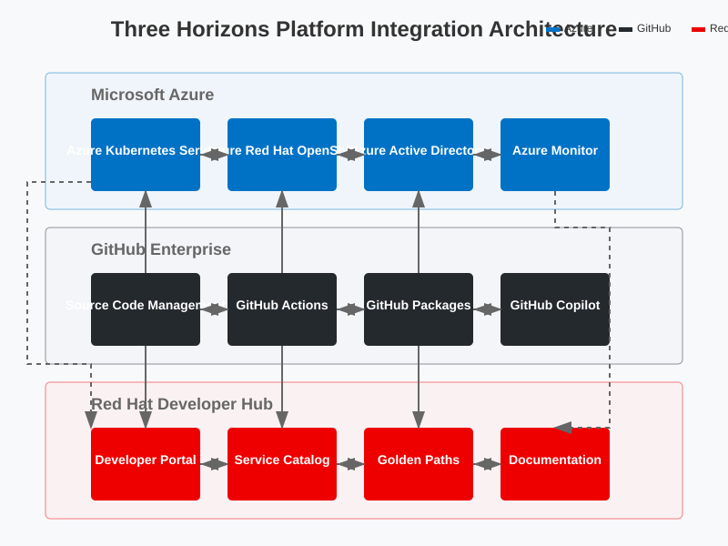

# 🏗️ Architecture

**Navigation:** [Home](../../../README.md) > [Documentation Map](../../DOCUMENTATION_MAP.md) > Architecture

## 🔍 Overview

The Three Horizons Platform uses a multi-layer architecture that integrates Microsoft Azure, Red Hat Developer Hub, and GitHub Enterprise. The architecture is designed with these key principles:

- **Modularity**: Components can be deployed and scaled independently
- **Security**: Defense-in-depth approach with multiple security layers
- **Observability**: Comprehensive monitoring and logging
- **Automation**: Infrastructure as Code and GitOps methodologies
- **Resilience**: Fault tolerance and disaster recovery capabilities

## 🏗️ Architecture Documentation

### Core Architecture
- [Three Horizons Architecture](three-horizons-architecture.svg) - Complete platform architecture overview
- [Developer Hub Architecture](developer-hub-architecture.svg) - Red Hat Developer Hub architecture details
- [Security Architecture](security-architecture.svg) - Comprehensive security framework and controls
- [Network Architecture](network-diagram.svg) - Network topology and connectivity patterns
- [Workflow Architecture](workflow-diagram.svg) - Development and deployment workflows

### Web Application Patterns
- [Standard Web Application](web-application-standard.svg) - Traditional web application architecture
- [Microservices Architecture](web-application-microservices.svg) - Cloud-native microservices pattern
- [Serverless Architecture](web-application-serverless.svg) - Event-driven serverless application pattern

### DevOps & Operations
- [CI/CD Pipeline](cicd-pipeline.svg) - Continuous integration and delivery pipeline
- [Monitoring & Observability](monitoring-observability.svg) - Comprehensive monitoring framework
- [Disaster Recovery](disaster-recovery.svg) - Business continuity and DR architecture

### Standards
- [SVG Standards Guide](../../SVG_STANDARD.md) - Guidelines for working with SVG diagrams

## 🔄 Workflow Process

The Three Horizons Platform implements a streamlined workflow process that connects development, deployment, and operations:

## 📐 Architectural Foundations

The Three Horizons Platform is built on a solid foundation of architectural principles that guide its design and implementation. These principles ensure the platform is not only technically sound but also aligned with business objectives and user needs.

### Key Architectural Principles

1. **Platform-Based Approach**
   * Centralizes common capabilities
   * Provides reusable components and patterns
   * Establishes consistent developer experience

2. **Cloud-Native Design**
   * Leverages container orchestration
   * Implements microservices architecture
   * Utilizes managed cloud services

3. **DevSecOps Integration**
   * Embeds security throughout the lifecycle
   * Automates security controls and checks
   * Provides visibility into security posture

4. **Inner/Outer Loop Optimization**
   * Streamlines developer inner loop for productivity
   * Optimizes outer loop for reliability and governance
   * Maintains consistent practices across both loops

## 🔹 Architectural Decisions

Major architectural decisions are documented using Architectural Decision Records (ADRs) and can be found in the relevant subsections.

## 🚀 Implementation Options

The platform can be deployed on various Azure infrastructure options:

  

    
    
<strong>Azure Kubernetes Service</strong>

  

  

    
    
<strong>Azure Red Hat OpenShift</strong>

  

## 🔄 Your Architectural Journey

Understanding the Three Horizons Platform architecture is a foundational step in your implementation journey. As you progress through the documentation, you'll see how the architectural components come together to create a cohesive platform experience.

After reviewing the architecture, continue to the [Implementation Strategy](../implementation/index.md) to begin planning your deployment approach.

---

<footer>
  
Last updated: April 10, 2025 | <a href="../../../.github/CONTRIBUTING.md">Contribute to this document</a>

</footer>