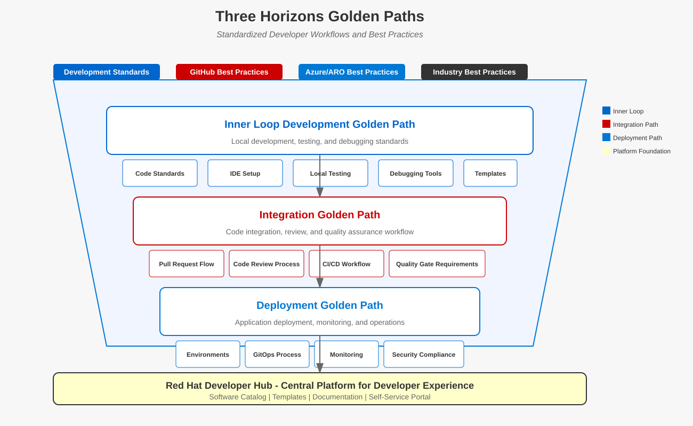

# 🛣️ Golden Paths Guide

**Navigation:** [Home](../../../README.md) > [Documentation Map](../../DOCUMENTATION_MAP.md) > [Developer Experience](README.md) > Golden Paths

## 🔄 Your Golden Path Journey

Golden Paths represent a crucial element in your development journey with the Three Horizons Platform. They provide standardized, well-documented workflows that accelerate development while ensuring consistency and quality.

This guide will take you through understanding, selecting, and following the Golden Paths available in the platform. By embracing these paths, you'll be able to focus more on creating business value and less on figuring out how to configure and connect various components.

## 🔍 What Are Golden Paths?

Golden Paths are carefully designed, well-supported routes to achieve common development tasks. They provide:

- **Standardization**: Consistent approaches across projects and teams
- **Acceleration**: Pre-built components and automated workflows
- **Best Practices**: Embedded security, scalability, and reliability patterns
- **Support**: Thoroughly documented and actively maintained paths
- **Flexibility**: Room for customization while maintaining core standards

## 🔄 Three Horizons Approach to Golden Paths

The Three Horizons Platform implements Golden Paths following the Three Horizons model, providing a progressive capability journey:

Each Golden Path exists in three maturity levels:

| Horizon | Focus | Capabilities |
|---------|-------|-------------|
| **Horizon 1: Foundation** | Core functionality | Basic implementations, simplified workflows, essential security controls |
| **Horizon 2: Enhancement** | Operational excellence | Performance optimization, advanced security, scalability, observability |
| **Horizon 3: Innovation** | Competitive advantage | AI integration, advanced analytics, autonomous operations, business intelligence |

As you progress through your platform journey, your Golden Paths evolve to incorporate more advanced capabilities while maintaining compatibility with applications created at earlier horizons.

## 🔹 Golden Path Principles

All Golden Paths in the Three Horizons Platform adhere to these core principles:

1. **Self-Service**: Developers can initiate and complete common tasks without dependencies on other teams
2. **Standardized**: Consistent patterns that are reusable across projects
3. **Automated**: Minimize manual steps in the workflow
4. **Well-Documented**: Clear guidance on the intended usage
5. **Maintained**: Regular updates to incorporate feedback and improvements
6. **Secure by Default**: Security controls built into the path
7. **Observable**: Monitoring and logging capabilities included

## 🚀 Available Golden Paths

The Three Horizons Platform provides several Golden Paths designed for different application types and scenarios:

### Web Application Path

Create a complete web application with frontend, API backend, database, and CI/CD pipeline:

1. **Frontend**: React, Angular, or Vue framework with standardized architecture
2. **Backend API**: Node.js, .NET, or Java with RESTful API patterns
3. **Database**: Azure Database for PostgreSQL or MongoDB
4. **Authentication**: Azure AD integration
5. **CI/CD**: GitHub Actions pipeline for testing and deployment
6. **Monitoring**: Application Insights integration

**👉 [Start Web Application Path](../../examples/golden-paths/web-application.md)**

### Microservice Path

Create a containerized microservice with API endpoints, messaging, and deployment configuration:

1. **Service Framework**: Node.js, .NET, Java, or Go with standardized architecture
2. **API Layer**: RESTful or gRPC endpoints with OpenAPI documentation
3. **Messaging**: Azure Service Bus integration for event-driven patterns
4. **Database**: Azure Cosmos DB or Azure Database for PostgreSQL
5. **Deployment**: Kubernetes manifests and GitOps-based deployment
6. **Observability**: Prometheus metrics and distributed tracing

**👉 [Start Microservice Path](../../examples/golden-paths/microservice.md)**

### Data Pipeline Path

Create a data processing pipeline for extract, transform, and load (ETL) operations:

1. **Data Sources**: Azure Storage, Azure SQL, or external APIs
2. **Processing**: Azure Data Factory or Azure Databricks
3. **Transformation**: SQL, Python, or Spark
4. **Destination**: Azure Data Lake or Azure Synapse
5. **Orchestration**: Azure Data Factory pipelines
6. **Monitoring**: Azure Monitor and alerting

**👉 [Start Data Pipeline Path](../../examples/golden-paths/data-pipeline.md)**

### DevOps Extension Path

Create a DevOps extension to enhance the platform capabilities:

1. **Extension Type**: GitHub Action, Azure Pipeline Task, or Backstage Plugin
2. **Language**: TypeScript, JavaScript, or Go
3. **Testing**: Unit and integration testing setup
4. **Documentation**: Automated documentation generation
5. **Distribution**: Packaging and publication workflow
6. **Versioning**: Semantic versioning enforcement

**👉 [Start DevOps Extension Path](../../examples/golden-paths/devops-extension.md)**

## 🔍 How to Follow a Golden Path

Each Golden Path provides a guided workflow through the Developer Hub:

1. **Initiation**: 
   - Navigate to the Developer Hub
   - Select "Create" from the main menu
   - Choose the appropriate Golden Path

2. **Configuration**:
   - Provide basic information about your application
   - Configure required settings and options
   - Review and confirm your choices

3. **Generation**:
   - The system generates your project structure
   - Repositories are created and initialized
   - Initial CI/CD pipelines are configured

4. **Development**:
   - Clone the generated repositories
   - Follow the provided README for next steps
   - Begin implementing your business logic

5. **Deployment**:
   - Commit your changes to trigger CI/CD
   - Review the deployment logs and status
   - Verify your application in the target environment

## 🔧 Customizing Golden Paths

While Golden Paths provide standardized approaches, customization is often necessary:

### Acceptable Customizations

- Adding additional dependencies or libraries
- Modifying the frontend design and components
- Extending the data model and API endpoints
- Adjusting configuration for specific requirements
- Adding custom monitoring and logging

### Discouraged Customizations

- Changing the fundamental architecture pattern
- Bypassing security controls and policies
- Modifying CI/CD pipeline core functionality
- Removing required observability components
- Altering infrastructure management approach

For extensive customizations, consider using [Custom Templates](custom-templates.md) instead of Golden Paths.

## 📊 Golden Path Metrics

The Three Horizons Platform tracks several metrics for Golden Paths:

- **Usage**: Number of applications created with each path
- **Success Rate**: Percentage of successful deployments
- **Customization Level**: Degree of deviation from standard path
- **Time to Production**: Average time from creation to production deployment
- **Maintenance Efficiency**: Time spent on maintenance activities

These metrics help improve Golden Paths over time based on real usage patterns.

## 🔄 Golden Path Lifecycle

Golden Paths evolve over time through this lifecycle:

1. **Experimental**: New paths available for early adopters
2. **Supported**: Stable paths with full documentation and support
3. **Preferred**: Recommended paths for most use cases
4. **Legacy**: Older paths maintained for existing applications
5. **Deprecated**: Paths being phased out in favor of newer approaches

The current status of each path is clearly indicated in the Developer Hub.

## 🚨 Common Issues and Solutions

| Issue | Solution |
|-------|----------|
| **Generation fails** | Check network connectivity and permissions |
| **CI/CD pipeline errors** | Verify required secrets and environment variables |
| **Deployment failures** | Check resource quotas and service health |
| **Integration issues** | Ensure service dependencies are properly configured |
| **Performance problems** | Review recommended sizing and scaling guidelines |

For more detailed troubleshooting, refer to our [Troubleshooting Guide](troubleshooting.md).

## 🔄 Next Steps in Your Journey

After mastering Golden Paths, explore these advanced topics:

1. Learn how to [customize components](customization.md) within Golden Paths
2. Understand how to [create custom templates](custom-templates.md) for specialized needs
3. Contribute improvements to existing Golden Paths
4. Propose new Golden Paths for common patterns in your organization

---

<footer>
  
Last updated: April 10, 2025 | <a href="../../../.github/CONTRIBUTING.md">Contribute to this document</a>

</footer>