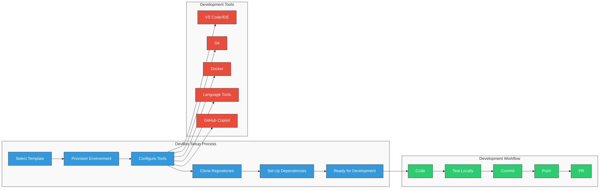

# <span style="color: #0366d6;">🔹 Inner Loop Development with Three Horizons</span>

**Navigation:** [Home](../../../README.md) > [Documentation Map](../../DOCUMENTATION_MAP.md) > [Implementation Guides](index.md) > Inner Loop Development

## <span style="color: #0366d6;">🔄 Your Developer Experience Journey</span>

Welcome to the Inner Loop Development guide for the Three Horizons Platform. This guide will take you through the journey of creating an optimized developer workflow that accelerates productivity while maintaining quality and consistency.

The "inner loop" is where developers spend most of their time—coding, testing, and debugging locally before sharing changes. By optimizing this workflow, you'll see immediate productivity gains and create a foundation for smooth integration with deployment pipelines later in your journey.

## <span style="color: #0366d6;">🔍 Overview</span>

Inner loop development refers to the individual developer's workflow - coding, building, testing, and debugging applications locally before committing changes to a shared repository. The Three Horizons platform optimizes this inner loop experience by integrating Microsoft Azure, Red Hat Developer Hub, and GitHub Enterprise capabilities.

## <span style="color: #0366d6;">🔄 DevBox Workflow</span>

The following diagram illustrates the comprehensive DevBox setup and development workflow used in the Three Horizons platform:

<div align="center">



</div>

## <span style="color: #0366d6;">⚙️ Key Components</span>

### <span style="color: #0366d6;">GitHub Codespaces</span>

Three Horizons leverages GitHub Codespaces to provide consistent, pre-configured development environments:

- **Zero Setup Time**: Developers access ready-to-use environments in minutes
- **Consistent Configuration**: All tools, extensions, and dependencies pre-installed
- **Resource Efficiency**: Scale compute resources based on needs
- **Cross-Platform Compatibility**: Works identically on any device with a browser

### <span style="color: #0366d6;">Red Hat Developer Hub Templates</span>

Developer Hub provides Golden Path templates for creating new projects with built-in best practices:

- **Standardized Project Structures**: Consistent layouts and configurations
- **Built-in CI/CD Pipelines**: Pre-configured GitHub Actions workflows 
- **Integrated Security Scanning**: Automated vulnerability detection
- **Dependency Management**: Validated library versions and updates

### <span style="color: #0366d6;">GitHub Copilot</span>

AI-assisted development accelerates coding velocity while maintaining quality:

- **Context-Aware Code Completion**: Suggestions based on current codebase
- **Documentation Generation**: Automatic comment and documentation creation
- **Test Generation**: AI-assisted creation of unit and integration tests
- **Bug Detection**: Early identification of potential issues

## <span style="color: #0366d6;">🚀 Implementation Steps</span>

To implement an optimized inner loop development workflow, follow these sequential steps:

### <span style="color: #0366d6;">1. Configure Development Environments</span>

First, set up the standardized development environment configuration:

1. **Create Codespaces Configuration**:
   ```yaml
   # .devcontainer/devcontainer.json
   {
     "name": "Three Horizons Dev Environment",
     "image": "mcr.microsoft.com/devcontainers/universal:2-linux",
     "features": {
       "ghcr.io/devcontainers/features/docker-in-docker:2": {},
       "ghcr.io/devcontainers/features/github-cli:1": {},
       "ghcr.io/devcontainers/features/azure-cli:1": {},
       "ghcr.io/devcontainers/features/kubectl-helm-minikube:1": {}
     },
     "customizations": {
       "vscode": {
         "extensions": [
           "github.copilot",
           "github.vscode-pull-request-github",
           "ms-azuretools.vscode-docker",
           "ms-kubernetes-tools.vscode-kubernetes-tools"
         ]
       }
     }
   }
   ```

2. **Configure Local Development Scripts**:
   ```bash
   # scripts/setup-dev.sh
   #!/bin/bash
   
   # Install project-specific dependencies
   npm install
   
   # Set up local environment variables
   cp .env.example .env
   
   # Start development services
   docker-compose up -d dev-dependencies
   
   echo "Development environment ready!"
   ```

3. **Create Developer Documentation**:
   Document the inner loop process in the project README.md, explaining the available commands, workflows, and best practices.

### <span style="color: #0366d6;">2. Implement Developer Hub Templates</span>

Next, configure templates in the Developer Hub:

1. **Create Template Definition**:
   ```yaml
   # template.yaml
   apiVersion: scaffolder.backstage.io/v1beta3
   kind: Template
   metadata:
     name: three-horizons-web-app
     title: Three Horizons Web Application
     description: Standard web application template with React frontend and Node.js backend
   spec:
     owner: team-platform
     type: website
     parameters:
       - title: Provide details
         required:
           - name
           - owner
         properties:
           name:
             title: Name
             type: string
             description: Unique name of the application
           owner:
             title: Owner
             type: string
             description: Owner of the application
     # Template steps definition follows
   ```

2. **Deploy Templates to Developer Hub**:
   - Add template to Developer Hub catalog
   - Configure template permissions
   - Test template functionality

3. **Create Template Documentation**:
   - Document available templates
   - Provide usage examples
   - Explain customization options

### <span style="color: #0366d6;">3. Configure Inner Loop Tools</span>

Set up the tools that optimize local development:

1. **Local Testing Configuration**:
   ```yaml
   # .github/workflows/pre-commit.yml
   name: Pre-commit hooks
   
   on:
     pull_request:
       branches: [ main, develop ]
   
   jobs:
     pre-commit:
       runs-on: ubuntu-latest
       steps:
         - uses: actions/checkout@v3
         - uses: actions/setup-node@v3
           with:
             node-version: '16'
         - name: Install dependencies
           run: npm ci
         - name: Run linting
           run: npm run lint
         - name: Run tests
           run: npm test
   ```

2. **Developer Feedback Tools**:
   - Configure linting rules with automated fixes
   - Set up test watchers for instant feedback
   - Implement hot reloading for application changes

3. **Performance Optimization**:
   - Configure caching for build processes
   - Implement parallel testing
   - Optimize container builds

## <span style="color: #0366d6;">🔄 Inner Loop Workflow</span>

With the environment configured, developers follow this optimized workflow:

### <span style="color: #0366d6;">1. Project Initialization</span>

Developers start new projects using Red Hat Developer Hub templates:

```
1. Navigate to Developer Hub portal
2. Select "Create Project" from the catalog
3. Choose appropriate template for your workload
4. Complete configuration parameters
5. Submit to generate project scaffold
```

The template automatically configures:
- Source repository in GitHub Enterprise
- GitHub Codespaces configuration
- CI/CD workflows
- Code quality gates
- Development container setup

### <span style="color: #0366d6;">2. Local Development</span>

Develop using GitHub Codespaces with full IDE capabilities:

- Open the repository in a browser-based VS Code environment
- Leverage pre-configured extensions and tools
- Build and test locally within the Codespace
- Access simulated dependencies via local service mocking
- Debug applications with full IDE tooling

### <span style="color: #0366d6;">3. Local Testing</span>

Test changes before committing using integrated tools:

- Run automated tests within Codespace
- Validate against linting rules and coding standards
- Perform local security scanning
- Compare API compatibility with previous versions
- Check performance against baseline metrics

### <span style="color: #0366d6;">4. Committing Changes</span>

Submit changes to trigger automated validation:

- Commit code to feature branch
- Push changes to GitHub Enterprise repository
- GitHub Actions automatically run validation pipelines
- Automated tests verify functionality
- Code quality and security scans identify issues

## <span style="color: #0366d6;">🔄 Integration with Outer Loop</span>

The inner loop seamlessly connects to the broader deployment pipeline:

- **Automated Pull Requests**: Create and assign PRs with required reviewers
- **Environment Provisioning**: Deploy to on-demand test environments
- **Pipeline Visualization**: Track build and deployment progress
- **Feedback Integration**: Receive alerts on quality issues

For details on connecting to deployment pipelines, see the [Outer Loop Deployment](outer-loop-deployment.md) guide.

## <span style="color: #0366d6;">📊 Measuring Success</span>

Measure the effectiveness of your inner loop implementation with these key metrics:

- **Time to First Feedback**: How quickly developers get feedback on code changes
- **Local Build Time**: Duration of local build and test processes
- **Environment Setup Time**: Time required to onboard new developers
- **Pre-commit Rejection Rate**: Percentage of commits rejected by quality gates
- **Inner Loop Satisfaction**: Developer satisfaction with the development workflow

Target improvements in these metrics to continuously enhance your developer experience.

## <span style="color: #0366d6;">✨ Developer Experience Benefits</span>

Three Horizons inner loop provides significant productivity improvements:

- **90% Reduction** in environment setup time
- **40% Faster** coding velocity with AI assistance
- **30% Fewer** bugs reaching review stage
- **50% Reduction** in context switching between tools
- **Near-Zero** environment-related issues

## <span style="color: #0366d6;">🔹 Getting Started</span>

To begin using the Three Horizons inner loop:

1. Request access to the Developer Hub portal
2. Complete onboarding training (30 minutes)
3. Create your first project using a template
4. Open in GitHub Codespaces
5. Follow guided tutorials for your specific workload

## <span style="color: #0366d6;">🔧 Troubleshooting</span>

| Common Issue | Resolution |
|--------------|------------|
| Codespace fails to start | Check network connectivity and VPN settings |
| Template errors | Verify parameters match expected format |
| Build failures | Review logs for dependency or configuration issues |
| Local testing errors | Ensure test dependencies are properly configured |

## <span style="color: #0366d6;">🔄 Next Steps in Your Journey</span>

After optimizing your inner loop development workflow, continue your implementation journey by:

1. Setting up [Outer Loop Deployment](outer-loop-deployment.md) for continuous delivery
2. Implementing [CI/CD Integration](ci-cd-integration.md) for automated pipelines
3. Configuring [Developer Hub Integration](devhub-integration.md) for a centralized developer portal
4. Exploring [Security Policies](security-policies.md) for secure development practices

---

<footer>
  <p align="center">Last updated: April 10, 2025 | <a href="../../../.github/CONTRIBUTING.md">Contribute to this document</a></p>
</footer>