# <span style="color: #0366d6;">🚀 Outer Loop Deployment with Three Horizons</span>

**Navigation:** [Home](../../../README.md) > [Documentation Map](../../DOCUMENTATION_MAP.md) > [Implementation Guides](index.md) > Outer Loop Deployment

## <span style="color: #0366d6;">🔄 Your Deployment Journey</span>

Welcome to the Outer Loop Deployment guide for the Three Horizons Platform. This guide takes you through the journey of implementing automated, secure, and reliable deployment pipelines that move code from development to production environments.

While the inner loop focuses on individual developer productivity, the outer loop is about team collaboration, automation, and governance. By implementing a robust outer loop, you'll create consistent, repeatable deployments that enable your organization to deliver value continuously with confidence.

## <span style="color: #0366d6;">🔍 Overview</span>

The outer loop in Three Horizons encompasses the continuous integration, delivery, and deployment processes that move code from developer branches to production environments. This automated pipeline integrates Microsoft Azure, Red Hat OpenShift, and GitHub Enterprise to provide secure, compliant, and reliable deployments.

## <span style="color: #0366d6;">🏗️ CI/CD Workflow Architecture</span>

The following diagram illustrates the comprehensive CI/CD workflow used in the Three Horizons platform:

```mermaid
flowchart LR
    subgraph DeveloperWorkflow["Developer Workflow"]
        D1[Code Changes] --> D2[Pull Request]
        D2 --> D3[Code Review]
    end
    
    subgraph CICD["CI/CD Process"]
        C1[Automated Build] --> C2[Unit Tests]
        C2 --> C3[Security Scans]
        C3 --> C4[Container Image]
        C4 --> C5[Image Scanning]
        C5 --> C6[Registry Push]
    end
    
    subgraph GitOps["GitOps Deployment"]
        G1[Environment Config] --> G2[Pull Request]
        G2 --> G3[Policy Validation]
        G3 --> G4[Automated Sync]
        G4 --> G5[Health Checks]
    end
    
    subgraph Environments["Deployment Environments"]
        E1[Development]
        E2[QA/Test]
        E3[Staging]
        E4[Production]
    end
    
    D3 --> C1
    C6 --> G1
    G5 --> E1
    E1 --> E2
    E2 --> E3
    E3 --> E4
    
    %% Styling
    classDef devStyle fill:#6db33f,stroke:#333,color:#fff,stroke-width:1px
    classDef cicdStyle fill:#4078c0,stroke:#333,color:#fff,stroke-width:1px
    classDef gitopsStyle fill:#EE0000,stroke:#333,color:#fff,stroke-width:1px
    classDef envStyle fill:#8c52ff,stroke:#333,color:#fff,stroke-width:1px
    classDef sectionStyle fill:#f9f9f9,stroke:#999,stroke-width:2px,color:#333
    
    class D1,D2,D3 devStyle
    class C1,C2,C3,C4,C5,C6 cicdStyle
    class G1,G2,G3,G4,G5 gitopsStyle
    class E1,E2,E3,E4 envStyle
    class DeveloperWorkflow,CICD,GitOps,Environments sectionStyle
```

<div align="center">



</div>

## <span style="color: #0366d6;">⚙️ Key Components</span>

### <span style="color: #0366d6;">GitHub Actions</span>

Three Horizons utilizes GitHub Actions as the primary CI/CD orchestration engine:

- **Workflow as Code**: Pipeline definitions stored alongside application code
- **Matrix Testing**: Parallel validation across multiple configurations
- **Environment Targeting**: Deployment to specific environments with approvals
- **Reusable Workflows**: Centralized, standardized pipeline components
- **Secrets Management**: Secure credential handling integrated with Azure Key Vault

### <span style="color: #0366d6;">Red Hat OpenShift GitOps</span>

Deployment management is handled through OpenShift GitOps (ArgoCD):

- **Declarative Deployments**: Infrastructure and application deployments defined as code
- **Drift Detection**: Automatic identification and remediation of environment differences
- **Progressive Delivery**: Canary and blue/green deployment patterns
- **Multi-Cluster Management**: Consistent deployment across development, staging, and production
- **Self-Healing**: Automatic reconciliation to desired state

### <span style="color: #0366d6;">Azure Platform Services</span>

Azure provides the foundation for secure, scalable deployments:

- **Azure Key Vault**: Centralized secrets management
- **Azure Container Registry**: Secure image storage and vulnerability scanning
- **Azure Monitor**: Unified monitoring and alerting
- **Azure Policy**: Governance and compliance controls
- **Azure RBAC**: Fine-grained access control

## <span style="color: #0366d6;">🚀 Implementation Steps</span>

To implement the outer loop deployment workflow, follow these sequential steps:

### <span style="color: #0366d6;">1. Set Up CI/CD Infrastructure</span>

First, establish the foundation for your CI/CD pipelines:

1. **Configure GitHub Environments**:
   ```yaml
   # .github/environments.yml
   environments:
     development:
       protection_rules: []
     staging:
       protection_rules:
         - required_reviewers:
             - platform-team
     production:
       protection_rules:
         - required_reviewers:
             - release-managers
         - wait_timer: 30
   ```

2. **Set Up Secrets Management**:
   - Create a Key Vault for pipeline secrets
   - Configure GitHub repository secrets
   - Set up federated identity for secure access

3. **Configure Container Registry**:
   - Create an Azure Container Registry
   - Set up vulnerability scanning
   - Configure RBAC for pipeline access

### <span style="color: #0366d6;">2. Implement GitHub Actions Workflows</span>

Next, create the CI/CD pipeline definitions:

1. **Continuous Integration Workflow**:
   ```yaml
   # .github/workflows/ci.yml
   name: Continuous Integration

   on:
     push:
       branches: [ main, develop ]
     pull_request:
       branches: [ main, develop ]

   jobs:
     build:
       runs-on: ubuntu-latest
       steps:
         - uses: actions/checkout@v3
         - name: Set up environment
           uses: actions/setup-node@v3
           with:
             node-version: '16'
         - name: Install dependencies
           run: npm ci
         - name: Run tests
           run: npm test
         - name: Build
           run: npm run build
   ```

2. **Container Build Workflow**:
   ```yaml
   # .github/workflows/container-build.yml
   name: Build and Push Container

   on:
     workflow_run:
       workflows: ["Continuous Integration"]
       branches: [main]
       types:
         - completed

   jobs:
     build-container:
       if: ${{ github.event.workflow_run.conclusion == 'success' }}
       runs-on: ubuntu-latest
       steps:
         - uses: actions/checkout@v3
         - name: Build and push
           uses: docker/build-push-action@v4
           with:
             context: .
             push: true
             tags: ${{ secrets.ACR_REGISTRY }}/${{ github.repository }}:${{ github.sha }}
   ```

3. **Deployment Workflow**:
   ```yaml
   # .github/workflows/deploy.yml
   name: Deploy Application

   on:
     workflow_run:
       workflows: ["Build and Push Container"]
       branches: [main]
       types:
         - completed

   jobs:
     update-manifests:
       if: ${{ github.event.workflow_run.conclusion == 'success' }}
       runs-on: ubuntu-latest
       steps:
         - uses: actions/checkout@v3
           with:
             repository: your-org/gitops-repo
             token: ${{ secrets.GH_PAT }}
         - name: Update image tag
           run: |
             cd environments/development
             kustomize edit set image ${{ secrets.ACR_REGISTRY }}/${{ github.repository }}:${{ github.sha }}
         - name: Commit changes
           run: |
             git config --global user.name "GitHub Actions"
             git config --global user.email "actions@github.com"
             git add .
             git commit -m "Update image to ${{ github.sha }}"
             git push
   ```

### <span style="color: #0366d6;">3. Set Up GitOps with ArgoCD</span>

Configure GitOps for automated deployment:

1. **Install ArgoCD on Clusters**:
   ```bash
   # Install the OpenShift GitOps Operator
   oc apply -f - <<EOF
   apiVersion: operators.coreos.com/v1alpha1
   kind: Subscription
   metadata:
     name: openshift-gitops-operator
     namespace: openshift-operators
   spec:
     channel: stable
     name: openshift-gitops-operator
     source: redhat-operators
     sourceNamespace: openshift-marketplace
   EOF
   ```

2. **Create ArgoCD Application Configuration**:
   ```yaml
   # application.yaml
   apiVersion: argoproj.io/v1alpha1
   kind: Application
   metadata:
     name: my-application
     namespace: openshift-gitops
   spec:
     project: default
     source:
       repoURL: https://github.com/your-org/gitops-repo.git
       targetRevision: HEAD
       path: environments/development
     destination:
       server: https://kubernetes.default.svc
       namespace: my-application
     syncPolicy:
       automated:
         prune: true
         selfHeal: true
   ```

3. **Configure Environment Promotion**:
   Create a process for promoting deployments between environments, typically through Pull Requests to the GitOps repository.

### <span style="color: #0366d6;">4. Implement Security Controls</span>

Add security measures to your deployment pipeline:

1. **Image Scanning Integration**:
   ```yaml
   # .github/workflows/security-scan.yml
   name: Security Scan

   on:
     workflow_run:
       workflows: ["Build and Push Container"]
       types:
         - completed

   jobs:
     scan-image:
       runs-on: ubuntu-latest
       steps:
         - name: Run Trivy vulnerability scanner
           uses: aquasecurity/trivy-action@master
           with:
             image-ref: ${{ secrets.ACR_REGISTRY }}/${{ github.repository }}:${{ github.sha }}
             format: 'sarif'
             output: 'trivy-results.sarif'
             severity: 'CRITICAL,HIGH'
   ```

2. **Policy Enforcement**:
   Implement Open Policy Agent/Gatekeeper to enforce security policies in clusters.

3. **Compliance Validation**:
   Add automated checks for regulatory compliance requirements.

## <span style="color: #0366d6;">🔄 Outer Loop Workflow</span>

With the infrastructure configured, the outer loop workflow operates as follows:

### <span style="color: #0366d6;">1. Continuous Integration</span>

When code is pushed to a GitHub repository:

- **Automated Build**: Compile code and generate artifacts
- **Unit Testing**: Run comprehensive test suite
- **Static Analysis**: Check code quality and security
- **Dependency Scanning**: Identify vulnerable dependencies
- **Container Scanning**: Validate container images for vulnerabilities

### <span style="color: #0366d6;">2. Validation Environments</span>

Prior to production deployment, changes flow through validation environments:

- **Development**: Initial integration testing with simulated dependencies
- **QA**: Full integration testing with test data
- **Staging**: Production-like environment for final validation
- **Pre-Production**: Mirror of production for performance testing

### <span style="color: #0366d6;">3. Deployment Process</span>

The deployment to each environment follows a controlled process:

1. **Environment Preparation**: Validate environment readiness
2. **Change Approval**: Automated or manual approval based on risk
3. **Progressive Deployment**: Canary or blue/green deployment pattern
4. **Automated Verification**: Health checks and smoke tests
5. **Observability Setup**: Configure monitoring and alerts
6. **Rollback Readiness**: Prepare rollback procedures if needed

### <span style="color: #0366d6;">4. Production Release</span>

Production deployments include additional safeguards:

- **Scheduled Window**: Deployments during approved change windows
- **Traffic Shifting**: Gradual traffic migration to new version
- **Automated Rollback**: Immediate reversion if issues detected
- **Post-Deployment Verification**: Comprehensive system validation
- **Release Documentation**: Automatic release notes generation

## <span style="color: #0366d6;">🚀 Golden Path Deployment Patterns</span>

Three Horizons provides pre-configured deployment patterns for common scenarios:

### <span style="color: #0366d6;">Stateless Applications</span>

```
GitOps-managed Deployment → Progressive Traffic Shift → Full Rollout
```

### <span style="color: #0366d6;">Database Changes</span>

```
Schema Validation → Pre-Deployment Backup → Schema Migration → Application Deployment
```

### <span style="color: #0366d6;">Infrastructure Changes</span>

```
IaC Plan → Policy Validation → Change Advisory → Incremental Apply → Compliance Verification
```

## <span style="color: #0366d6;">🛡️ Security and Compliance</span>

All deployments include built-in security controls:

- **Signed Commits**: Verification of code authenticity
- **Policy Validation**: Pre-deployment check against security policies
- **Compliance Scanning**: Validation against regulatory requirements
- **Audit Logging**: Comprehensive tracking of all deployment activities
- **Least Privilege**: Minimized permissions for deployment processes

## <span style="color: #0366d6;">📊 Metrics and Monitoring</span>

Three Horizons provides comprehensive deployment metrics:

- **Deployment Frequency**: Number of deployments per day/week
- **Lead Time**: Time from commit to production
- **Mean Time to Recovery**: Duration to recover from failures
- **Change Failure Rate**: Percentage of deployments causing incidents
- **Deployment Duration**: Time to complete deployment lifecycle

These metrics align with the DORA (DevOps Research and Assessment) framework for measuring DevOps performance and should be tracked over time to measure improvement.

## <span style="color: #0366d6;">📊 Measuring Success</span>

Track these key metrics to measure the effectiveness of your outer loop implementation:

- **Deployment Frequency**: How often you can deploy to production
- **Lead Time for Changes**: Time from code commit to production deployment
- **Change Failure Rate**: Percentage of deployments causing failures
- **Mean Time to Restore**: Time to recover from incidents
- **Deployment Duration**: Time to complete a full deployment cycle

Use these metrics to continuously improve your deployment processes and move toward elite DevOps performance.

## <span style="color: #0366d6;">🔹 Getting Started</span>

To utilize the Three Horizons outer loop:

1. Set up GitHub repository with Actions workflows
2. Configure integration with Red Hat Developer Hub
3. Set up environment targets in Azure
4. Configure deployment approval processes
5. Implement required quality gates

## <span style="color: #0366d6;">🔧 Troubleshooting</span>

| Common Issue | Resolution |
|--------------|------------|
| Pipeline failures | Check logs, verify credentials, validate YAML syntax |
| ArgoCD sync issues | Verify Git access, check manifest validity, confirm cluster access |
| Image pull errors | Validate registry credentials and image tags |
| Deployment timeouts | Check resource constraints and health probe configuration |
| Security scan failures | Review vulnerability reports and update dependencies |

## <span style="color: #0366d6;">🔄 Next Steps in Your Journey</span>

After implementing outer loop deployment, continue your implementation journey by:

1. Implementing [CI/CD Integration](ci-cd-integration.md) for deeper pipeline integration
2. Setting up [Developer Hub Integration](devhub-integration.md) for a unified developer portal
3. Implementing [Kubernetes Guide](kubernetes-guide.md) for container orchestration best practices
4. Exploring [DevSecOps Guide](devsecops-guide.md) for security integration

---

<footer>
  <p align="center">Last updated: April 10, 2025 | <a href="../../../.github/CONTRIBUTING.md">Contribute to this document</a></p>
</footer>