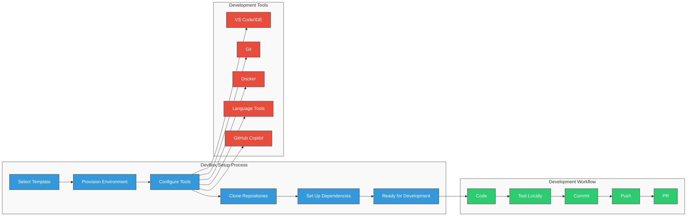

# <span style="color: #0366d6;">🔹 Inner Loop Development with Three Horizons</span>

## <span style="color: #0366d6;">🔍 Overview</span>

Inner loop development refers to the individual developer's workflow - coding, building, testing, and debugging applications locally before committing changes to a shared repository. The Three Horizons platform optimizes this inner loop experience by integrating Microsoft Azure, Red Hat Developer Hub, and GitHub Enterprise capabilities.

## <span style="color: #0366d6;">🔄 DevBox Workflow</span>

The following diagram illustrates the comprehensive DevBox setup and development workflow used in the Three Horizons platform:

<div align="center">



</div>

## <span style="color: #0366d6;">⚙️ Key Components</span>

### <span style="color: #0366d6;">GitHub Codespaces</span>

Three Horizons leverages GitHub Codespaces to provide consistent, pre-configured development environments:

- **Zero Setup Time**: Developers access ready-to-use environments in minutes
- **Consistent Configuration**: All tools, extensions, and dependencies pre-installed
- **Resource Efficiency**: Scale compute resources based on needs
- **Cross-Platform Compatibility**: Works identically on any device with a browser

### <span style="color: #0366d6;">Red Hat Developer Hub Templates</span>

Developer Hub provides Golden Path templates for creating new projects with built-in best practices:

- **Standardized Project Structures**: Consistent layouts and configurations
- **Built-in CI/CD Pipelines**: Pre-configured GitHub Actions workflows 
- **Integrated Security Scanning**: Automated vulnerability detection
- **Dependency Management**: Validated library versions and updates

### <span style="color: #0366d6;">GitHub Copilot</span>

AI-assisted development accelerates coding velocity while maintaining quality:

- **Context-Aware Code Completion**: Suggestions based on current codebase
- **Documentation Generation**: Automatic comment and documentation creation
- **Test Generation**: AI-assisted creation of unit and integration tests
- **Bug Detection**: Early identification of potential issues

## <span style="color: #0366d6;">🔄 Inner Loop Workflow</span>

### <span style="color: #0366d6;">1. Project Initialization</span>

Developers start new projects using Red Hat Developer Hub templates:

```
1. Navigate to Developer Hub portal
2. Select "Create Project" from the catalog
3. Choose appropriate template for your workload
4. Complete configuration parameters
5. Submit to generate project scaffold
```

The template automatically configures:
- Source repository in GitHub Enterprise
- GitHub Codespaces configuration
- CI/CD workflows
- Code quality gates
- Development container setup

### <span style="color: #0366d6;">2. Local Development</span>

Develop using GitHub Codespaces with full IDE capabilities:

- Open the repository in a browser-based VS Code environment
- Leverage pre-configured extensions and tools
- Build and test locally within the Codespace
- Access simulated dependencies via local service mocking
- Debug applications with full IDE tooling

### <span style="color: #0366d6;">3. Local Testing</span>

Test changes before committing using integrated tools:

- Run automated tests within Codespace
- Validate against linting rules and coding standards
- Perform local security scanning
- Compare API compatibility with previous versions
- Check performance against baseline metrics

### <span style="color: #0366d6;">4. Committing Changes</span>

Submit changes to trigger automated validation:

- Commit code to feature branch
- Push changes to GitHub Enterprise repository
- GitHub Actions automatically run validation pipelines
- Automated tests verify functionality
- Code quality and security scans identify issues

## <span style="color: #0366d6;">🔄 Integration with Outer Loop</span>

The inner loop seamlessly connects to the broader deployment pipeline:

- **Automated Pull Requests**: Create and assign PRs with required reviewers
- **Environment Provisioning**: Deploy to on-demand test environments
- **Pipeline Visualization**: Track build and deployment progress
- **Feedback Integration**: Receive alerts on quality issues

## <span style="color: #0366d6;">✨ Developer Experience Benefits</span>

Three Horizons inner loop provides significant productivity improvements:

- **90% Reduction** in environment setup time
- **40% Faster** coding velocity with AI assistance
- **30% Fewer** bugs reaching review stage
- **50% Reduction** in context switching between tools
- **Near-Zero** environment-related issues

## <span style="color: #0366d6;">🔹 Getting Started</span>

To begin using the Three Horizons inner loop:

1. Request access to the Developer Hub portal
2. Complete onboarding training (30 minutes)
3. Create your first project using a template
4. Open in GitHub Codespaces
5. Follow guided tutorials for your specific workload

## <span style="color: #0366d6;">🔧 Troubleshooting</span>

| Common Issue | Resolution |
|--------------|------------|
| Codespace fails to start | Check network connectivity and VPN settings |
| Template errors | Verify parameters match expected format |
| Build failures | Review logs for dependency or configuration issues |
| Local testing errors | Ensure test dependencies are properly configured |


---

<footer>
  <p align="center">🔄 Last updated: April 2025 | Contribute to this document through <a href="../../.github/CONTRIBUTING.md">Pull Requests</a></p>
</footer>
