# <span style="color: #0366d6;">🚀 Outer Loop Deployment with Three Horizons</span>

## <span style="color: #0366d6;">🔍 Overview</span>

The outer loop in Three Horizons encompasses the continuous integration, delivery, and deployment processes that move code from developer branches to production environments. This automated pipeline integrates Microsoft Azure, Red Hat OpenShift, and GitHub Enterprise to provide secure, compliant, and reliable deployments.

## <span style="color: #0366d6;">🏗️ CI/CD Workflow Architecture</span>

The following diagram illustrates the comprehensive CI/CD workflow used in the Three Horizons platform:

```mermaid
flowchart LR
    subgraph DeveloperWorkflow["Developer Workflow"]
        D1[Code Changes] --> D2[Pull Request]
        D2 --> D3[Code Review]
    end
    
    subgraph CICD["CI/CD Process"]
        C1[Automated Build] --> C2[Unit Tests]
        C2 --> C3[Security Scans]
        C3 --> C4[Container Image]
        C4 --> C5[Image Scanning]
        C5 --> C6[Registry Push]
    end
    
    subgraph GitOps["GitOps Deployment"]
        G1[Environment Config] --> G2[Pull Request]
        G2 --> G3[Policy Validation]
        G3 --> G4[Automated Sync]
        G4 --> G5[Health Checks]
    end
    
    subgraph Environments["Deployment Environments"]
        E1[Development]
        E2[QA/Test]
        E3[Staging]
        E4[Production]
    end
    
    D3 --> C1
    C6 --> G1
    G5 --> E1
    E1 --> E2
    E2 --> E3
    E3 --> E4
    
    %% Styling
    classDef devStyle fill:#6db33f,stroke:#333,color:#fff,stroke-width:1px
    classDef cicdStyle fill:#4078c0,stroke:#333,color:#fff,stroke-width:1px
    classDef gitopsStyle fill:#EE0000,stroke:#333,color:#fff,stroke-width:1px
    classDef envStyle fill:#8c52ff,stroke:#333,color:#fff,stroke-width:1px
    classDef sectionStyle fill:#f9f9f9,stroke:#999,stroke-width:2px,color:#333
    
    class D1,D2,D3 devStyle
    class C1,C2,C3,C4,C5,C6 cicdStyle
    class G1,G2,G3,G4,G5 gitopsStyle
    class E1,E2,E3,E4 envStyle
    class DeveloperWorkflow,CICD,GitOps,Environments sectionStyle
```

<div align="center">



</div>

## <span style="color: #0366d6;">⚙️ Key Components</span>

### <span style="color: #0366d6;">GitHub Actions</span>

Three Horizons utilizes GitHub Actions as the primary CI/CD orchestration engine:

- **Workflow as Code**: Pipeline definitions stored alongside application code
- **Matrix Testing**: Parallel validation across multiple configurations
- **Environment Targeting**: Deployment to specific environments with approvals
- **Reusable Workflows**: Centralized, standardized pipeline components
- **Secrets Management**: Secure credential handling integrated with Azure Key Vault

### <span style="color: #0366d6;">Red Hat OpenShift GitOps</span>

Deployment management is handled through OpenShift GitOps (ArgoCD):

- **Declarative Deployments**: Infrastructure and application deployments defined as code
- **Drift Detection**: Automatic identification and remediation of environment differences
- **Progressive Delivery**: Canary and blue/green deployment patterns
- **Multi-Cluster Management**: Consistent deployment across development, staging, and production
- **Self-Healing**: Automatic reconciliation to desired state

### <span style="color: #0366d6;">Azure Platform Services</span>

Azure provides the foundation for secure, scalable deployments:

- **Azure Key Vault**: Centralized secrets management
- **Azure Container Registry**: Secure image storage and vulnerability scanning
- **Azure Monitor**: Unified monitoring and alerting
- **Azure Policy**: Governance and compliance controls
- **Azure RBAC**: Fine-grained access control

## <span style="color: #0366d6;">🔄 Outer Loop Workflow</span>

### <span style="color: #0366d6;">1. Continuous Integration</span>

When code is pushed to a GitHub repository:

- **Automated Build**: Compile code and generate artifacts
- **Unit Testing**: Run comprehensive test suite
- **Static Analysis**: Check code quality and security
- **Dependency Scanning**: Identify vulnerable dependencies
- **Container Scanning**: Validate container images for vulnerabilities

### <span style="color: #0366d6;">2. Validation Environments</span>

Prior to production deployment, changes flow through validation environments:

- **Development**: Initial integration testing with simulated dependencies
- **QA**: Full integration testing with test data
- **Staging**: Production-like environment for final validation
- **Pre-Production**: Mirror of production for performance testing

### <span style="color: #0366d6;">3. Deployment Process</span>

The deployment to each environment follows a controlled process:

1. **Environment Preparation**: Validate environment readiness
2. **Change Approval**: Automated or manual approval based on risk
3. **Progressive Deployment**: Canary or blue/green deployment pattern
4. **Automated Verification**: Health checks and smoke tests
5. **Observability Setup**: Configure monitoring and alerts
6. **Rollback Readiness**: Prepare rollback procedures if needed

### <span style="color: #0366d6;">4. Production Release</span>

Production deployments include additional safeguards:

- **Scheduled Window**: Deployments during approved change windows
- **Traffic Shifting**: Gradual traffic migration to new version
- **Automated Rollback**: Immediate reversion if issues detected
- **Post-Deployment Verification**: Comprehensive system validation
- **Release Documentation**: Automatic release notes generation

## <span style="color: #0366d6;">🚀 Golden Path Deployment Patterns</span>

Three Horizons provides pre-configured deployment patterns for common scenarios:

### <span style="color: #0366d6;">Stateless Applications</span>

```
GitOps-managed Deployment → Progressive Traffic Shift → Full Rollout
```

### <span style="color: #0366d6;">Database Changes</span>

```
Schema Validation → Pre-Deployment Backup → Schema Migration → Application Deployment
```

### <span style="color: #0366d6;">Infrastructure Changes</span>

```
IaC Plan → Policy Validation → Change Advisory → Incremental Apply → Compliance Verification
```

## <span style="color: #0366d6;">🛡️ Security and Compliance</span>

All deployments include built-in security controls:

- **Signed Commits**: Verification of code authenticity
- **Policy Validation**: Pre-deployment check against security policies
- **Compliance Scanning**: Validation against regulatory requirements
- **Audit Logging**: Comprehensive tracking of all deployment activities
- **Least Privilege**: Minimized permissions for deployment processes

## <span style="color: #0366d6;">📊 Metrics and Monitoring</span>

Three Horizons provides comprehensive deployment metrics:

- **Deployment Frequency**: Number of deployments per day/week
- **Lead Time**: Time from commit to production
- **Mean Time to Recovery**: Duration to recover from failures
- **Change Failure Rate**: Percentage of deployments causing incidents
- **Deployment Duration**: Time to complete deployment lifecycle

## <span style="color: #0366d6;">🔹 Getting Started</span>

To utilize the Three Horizons outer loop:

1. Set up GitHub repository with Actions workflows
2. Configure integration with Red Hat Developer Hub
3. Set up environment targets in Azure
4. Configure deployment approval processes
5. Implement required quality gates

For more information, see the [GitHub Actions Configuration Guide](./references/github-actions-configuration.md) and [OpenShift GitOps Setup](./references/openshift-gitops-setup.md).

---

<footer>
  <p align="center">🔄 Last updated: April 2025 | Contribute to this document through <a href="../../.github/CONTRIBUTING.md">Pull Requests</a></p>
</footer>
