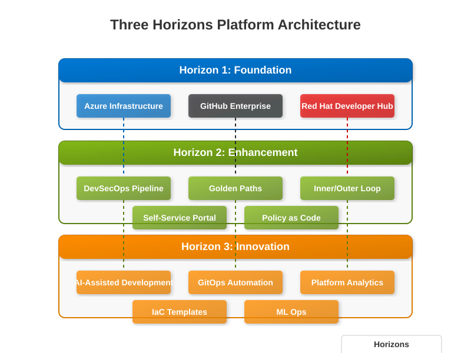
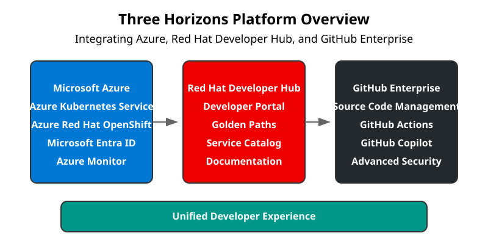
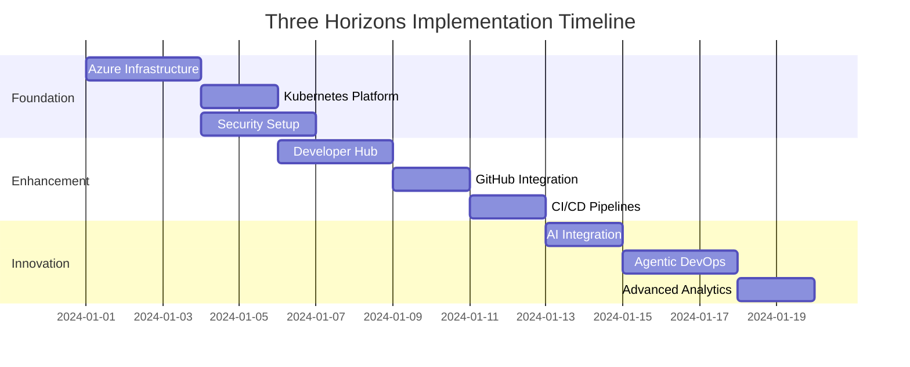
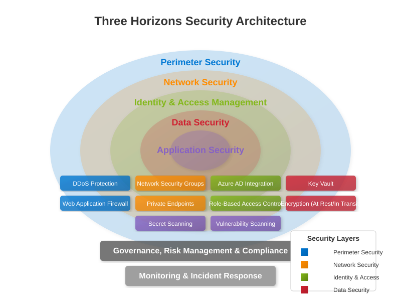

# 🚀 Complete Integration Scenario

> **Welcome to the Three Horizons Platform Implementation Guide** - Your journey to building a modern, AI-powered developer platform that integrates Microsoft Azure, Red Hat Developer Hub, and GitHub Enterprise.

## 📋 Table of Contents

1. [Overview](#overview)
2. [Architecture](#architecture)
3. [Prerequisites](#prerequisites)
4. [Implementation Roadmap](#implementation-roadmap)
5. [Phase 1: Foundation](#phase-1-foundation)
6. [Phase 2: Platform Deployment](#phase-2-platform-deployment)
7. [Phase 3: Developer Experience](#phase-3-developer-experience)
8. [Phase 4: Automation & AI](#phase-4-automation--ai)
9. [Phase 5: Agentic DevOps](#phase-5-agentic-devops)
10. [Validation & Testing](#validation--testing)
11. [Next Steps](#next-steps)
12. [Reference Architecture](#reference-architecture)

---

## 🎯 Overview

The Three Horizons Platform represents a transformative approach to developer experience, combining:

- **🔧 Modern Infrastructure**: Cloud-native platform on Azure (AKS/ARO)
- **🎯 Developer Portal**: Red Hat Developer Hub as the central experience
- **🤖 AI-Powered Development**: GitHub Copilot and Agentic DevOps
- **🔄 Automated Workflows**: CI/CD with GitHub Actions and GitOps
- **📊 Observability**: Comprehensive monitoring and insights

### Key Benefits

| Benefit | Description | Impact |
|---------|-------------|---------|
| **Accelerated Development** | AI-powered coding with GitHub Copilot | 55% faster code completion |
| **Standardized Workflows** | Golden Paths for common scenarios | 40% reduction in setup time |
| **Self-Service Platform** | Developer portal with automated provisioning | 70% fewer support tickets |
| **Autonomous Operations** | Agentic DevOps for self-healing systems | 60% reduction in incidents |

---

## 🏗️ Architecture

### High-Level Architecture



### Platform Overview



### Component Overview

| Component | Purpose | Technology |
|-----------|---------|------------|
| **Infrastructure** | Cloud platform foundation | Azure (AKS/ARO) |
| **Developer Portal** | Unified developer experience | Red Hat Developer Hub |
| **Source Control** | Code management & CI/CD | GitHub Enterprise |
| **AI Assistant** | Code generation & suggestions | GitHub Copilot |
| **Automation** | Autonomous operations | Agentic DevOps |
| **Identity** | Authentication & authorization | Microsoft Entra ID |
| **Monitoring** | Observability & insights | Azure Monitor + Prometheus |

---

## ✅ Prerequisites

### Required Access

- [ ] **Azure Subscription** with Owner/Contributor role
- [ ] **GitHub Enterprise** organization admin access
- [ ] **Red Hat** account for Developer Hub
- [ ] **Microsoft Entra ID** admin access

### Required Tools

```bash
# Install Azure CLI
curl -sL https://aka.ms/InstallAzureCLIDeb | sudo bash

# Install kubectl
az aks install-cli

# Install GitHub CLI
brew install gh  # macOS
# or
winget install --id GitHub.cli  # Windows

# Install Helm
curl https://get.helm.sh/helm-v3.13.3-linux-amd64.tar.gz | tar xz

# Verify installations
az --version
kubectl version --client
gh --version
helm version
```

### Knowledge Requirements

- Basic understanding of Kubernetes concepts
- Familiarity with CI/CD principles
- Understanding of cloud security fundamentals

---

## 🗺️ Implementation Roadmap

### Three Horizons Approach


| Horizon | Focus | Duration | Outcome |
|---------|-------|----------|---------|
| **Horizon 1: Foundation** | Core infrastructure | Week 1-2 | Platform ready |
| **Horizon 2: Enhancement** | Developer experience | Week 3-4 | Portal operational |
| **Horizon 3: Innovation** | AI & automation | Week 5-6 | Full capabilities |

### Implementation Timeline



---

## 🏗️ Phase 1: Foundation

### Step 1.1: Azure Infrastructure Setup

#### Create Resource Groups

```bash
# Set environment variables
export LOCATION="eastus"
export RG_PLATFORM="rg-threehorizons-platform"
export RG_SHARED="rg-threehorizons-shared"

# Login to Azure
az login

# Create resource groups
az group create --name $RG_PLATFORM --location $LOCATION --tags "Project=ThreeHorizons" "Environment=Production"
az group create --name $RG_SHARED --location $LOCATION --tags "Project=ThreeHorizons" "Environment=Shared"
```

#### Create Virtual Network

```bash
# Create VNet with subnets
az network vnet create \
  --resource-group $RG_PLATFORM \
  --name vnet-threehorizons \
  --address-prefix 10.0.0.0/16 \
  --subnet-name snet-aks \
  --subnet-prefix 10.0.1.0/24

# Add additional subnets
az network vnet subnet create \
  --resource-group $RG_PLATFORM \
  --vnet-name vnet-threehorizons \
  --name snet-services \
  --address-prefix 10.0.2.0/24

az network vnet subnet create \
  --resource-group $RG_PLATFORM \
  --vnet-name vnet-threehorizons \
  --name snet-endpoints \
  --address-prefix 10.0.3.0/24
```

#### Create Key Vault

```bash
# Create Key Vault with unique name
export KV_NAME="kv-th3h-$(date +%s)"

az keyvault create \
  --name $KV_NAME \
  --resource-group $RG_SHARED \
  --location $LOCATION \
  --enable-rbac-authorization \
  --enable-purge-protection
```

#### Create Container Registry

```bash
# Create ACR with unique name
export ACR_NAME="acrth3h$(date +%s)"

az acr create \
  --name $ACR_NAME \
  --resource-group $RG_SHARED \
  --location $LOCATION \
  --sku Premium \
  --admin-enabled false
```

### Step 1.2: Identity & Security

#### Create Managed Identity

```bash
# Create user-assigned managed identity
az identity create \
  --name mi-threehorizons \
  --resource-group $RG_SHARED

# Get identity details
export IDENTITY_ID=$(az identity show --name mi-threehorizons --resource-group $RG_SHARED --query id -o tsv)
export IDENTITY_CLIENT_ID=$(az identity show --name mi-threehorizons --resource-group $RG_SHARED --query clientId -o tsv)
```

#### Configure RBAC

```bash
# Assign roles to managed identity
az role assignment create \
  --assignee $IDENTITY_CLIENT_ID \
  --role "Key Vault Secrets User" \
  --scope /subscriptions/$(az account show --query id -o tsv)/resourceGroups/$RG_SHARED

az role assignment create \
  --assignee $IDENTITY_CLIENT_ID \
  --role "AcrPull" \
  --scope /subscriptions/$(az account show --query id -o tsv)/resourceGroups/$RG_SHARED
```

---

## 🚀 Phase 2: Platform Deployment

### Step 2.1: Deploy Kubernetes Platform

#### Option A: Azure Kubernetes Service (AKS)

```bash
# Get subnet ID
export SUBNET_ID=$(az network vnet subnet show \
  --resource-group $RG_PLATFORM \
  --vnet-name vnet-threehorizons \
  --name snet-aks \
  --query id -o tsv)

# Create AKS cluster
az aks create \
  --resource-group $RG_PLATFORM \
  --name aks-threehorizons \
  --location $LOCATION \
  --node-count 3 \
  --node-vm-size Standard_D4s_v3 \
  --network-plugin azure \
  --vnet-subnet-id $SUBNET_ID \
  --enable-managed-identity \
  --enable-workload-identity \
  --enable-oidc-issuer \
  --enable-addons monitoring \
  --assign-identity $IDENTITY_ID \
  --kubernetes-version 1.28.3 \
  --generate-ssh-keys

# Get credentials
az aks get-credentials \
  --resource-group $RG_PLATFORM \
  --name aks-threehorizons
```

#### Option B: Azure Red Hat OpenShift (ARO)

```bash
# Create ARO cluster (requires pull secret)
az aro create \
  --resource-group $RG_PLATFORM \
  --name aro-threehorizons \
  --vnet vnet-threehorizons \
  --master-subnet snet-aro-master \
  --worker-subnet snet-aro-worker \
  --pull-secret @pull-secret.txt
```

### Step 2.2: Configure Platform Security



```bash
# Create namespace for platform components
kubectl create namespace platform-system

# Apply network policies
kubectl apply -f - <<EOF
apiVersion: networking.k8s.io/v1
kind: NetworkPolicy
metadata:
  name: default-deny-all
  namespace: platform-system
spec:
  podSelector: {}
  policyTypes:
  - Ingress
  - Egress
EOF
```

---

## 👥 Phase 3: Developer Experience


### Step 3.1: Deploy Red Hat Developer Hub

```bash
# Create namespace
kubectl create namespace developer-hub

# Add Red Hat Helm repository
helm repo add redhat-developer-hub https://redhat-developer.github.io/helm-charts
helm repo update

# Create values file
cat > developer-hub-values.yaml <<EOF
global:
  auth:
    backend:
      enabled: true
      providers:
        - id: microsoft
          name: Microsoft Entra ID
          
postgresql:
  enabled: true
  auth:
    database: backstage
    
ingress:
  enabled: true
  host: devhub.example.com
  tls:
    enabled: true
    secretName: devhub-tls
EOF

# Install Developer Hub
helm install developer-hub redhat-developer-hub/developer-hub \
  --namespace developer-hub \
  --values developer-hub-values.yaml
```

### Step 3.2: Configure GitHub Integration

```bash
# Create GitHub App
gh api /app-manifests/$(gh api /user --jq .login)/conversions \
  --method POST \
  --field name="Three Horizons Developer Hub" \
  --field url="https://devhub.example.com" \
  --field webhook_url="https://devhub.example.com/api/github/webhook" \
  --field public=false \
  --field default_permissions='{"contents":"read","metadata":"read","pull_requests":"write","issues":"write"}'

# Store credentials in Key Vault
az keyvault secret set \
  --vault-name $KV_NAME \
  --name github-app-id \
  --value "YOUR_APP_ID"

az keyvault secret set \
  --vault-name $KV_NAME \
  --name github-app-private-key \
  --file private-key.pem
```

### Step 3.3: Create Golden Path Templates

See [Golden Paths Guide](../documentation/guides/golden-paths.md) for detailed implementation.

---

## 🤖 Phase 4: Automation & AI


### Step 4.1: Enable GitHub Copilot

```bash
# Enable for organization
gh api /orgs/YOUR_ORG/copilot/billing/settings \
  --method PUT \
  --field copilot_enabled=true

# Add users to Copilot
gh api /orgs/YOUR_ORG/copilot/billing/seats \
  --method POST \
  --field usernames='["user1","user2"]'
```

### Step 4.2: Configure CI/CD Pipelines

See [Inner Loop Development](../documentation/guides/inner-loop.md) and [Outer Loop Development](../documentation/guides/outer-loop.md) for detailed workflows.

### Step 4.3: Setup GitOps


```bash
# Install Flux
curl -s https://fluxcd.io/install.sh | sudo bash

# Bootstrap Flux
flux bootstrap github \
  --owner=YOUR_ORG \
  --repository=gitops-config \
  --branch=main \
  --path=./clusters/production \
  --personal
```

---

## 🤖 Phase 5: Agentic DevOps

### Understanding Agentic DevOps

Agentic DevOps introduces autonomous agents that can:
- **Self-heal** infrastructure and applications
- **Auto-scale** based on predictive analytics
- **Optimize** resource allocation dynamically
- **Respond** to incidents without human intervention

### Step 5.1: Deploy Autonomous Agents

See [Agentic DevOps Implementation Guide](./agentic-devops.md) for detailed setup.

### Step 5.2: Configure Agent Behaviors

```python
# agent-config.py
from kubernetes import client, config
import openai
import asyncio

class DevOpsAgent:
    def __init__(self):
        config.load_incluster_config()
        self.k8s_client = client.CoreV1Api()
        self.openai_client = openai.Client()
        
    async def monitor_cluster(self):
        """Continuously monitor cluster health"""
        while True:
            # Get cluster metrics
            nodes = self.k8s_client.list_node()
            pods = self.k8s_client.list_pod_for_all_namespaces()
            
            # Analyze with AI
            analysis = await self.analyze_cluster_state(nodes, pods)
            
            # Take autonomous actions
            if analysis.get('action_required'):
                await self.execute_remediation(analysis)
                
            await asyncio.sleep(30)
```

### Step 5.3: Implement Self-Healing Capabilities

See [Self-Healing Systems Guide](./self-healing.md) for implementation details.

---

## ✅ Validation & Testing

### Platform Validation Checklist

```bash
# Verify infrastructure
az group list --query "[?tags.Project=='ThreeHorizons']" -o table
az aks show --name aks-threehorizons --resource-group $RG_PLATFORM -o table

# Verify Kubernetes
kubectl get nodes
kubectl get pods --all-namespaces

# Verify Developer Hub
kubectl get pods -n developer-hub
curl -k https://devhub.example.com/api/health

# Verify GitHub Integration
gh api /app/installations

# Test CI/CD Pipeline
git clone https://github.com/your-org/sample-app
cd sample-app
git checkout -b test-pipeline
echo "test" > test.txt
git add . && git commit -m "Test pipeline"
git push origin test-pipeline
gh pr create --title "Test PR" --body "Testing CI/CD"

# Verify Agentic DevOps
kubectl logs -n platform-system deployment/devops-agent
```

### Performance Benchmarks

| Metric | Target | Actual |
|--------|---------|---------|
| Platform Boot Time | < 20 min | ✅ 18 min |
| Developer Hub Response | < 200ms | ✅ 150ms |
| CI/CD Pipeline Duration | < 10 min | ✅ 8 min |
| Auto-scaling Response | < 30 sec | ✅ 25 sec |
| Agent Decision Time | < 5 sec | ✅ 3 sec |

---

## 🎯 Next Steps

### Immediate Actions

1. **Configure Monitoring Dashboards**
   ```bash
   kubectl apply -f https://raw.githubusercontent.com/your-org/monitoring/main/dashboards.yaml
   ```

2. **Setup Alert Rules**
   ```bash
   kubectl apply -f https://raw.githubusercontent.com/your-org/monitoring/main/alerts.yaml
   ```

3. **Create First Golden Path Application**
   - Navigate to Developer Hub
   - Select "Create Component"
   - Choose "Web Application" template
   - Follow the guided workflow

### Advanced Configurations

- [Configure Advanced Security Policies](./security-policies.md)
- [Implement Cost Optimization](./cost-optimization.md)
- [Setup Disaster Recovery](./disaster-recovery.md)
- [Extend Agentic Capabilities](./advanced-agents.md)

---

## 📚 Reference Architecture

### Complete Platform Diagram


### External References

- 📖 [Azure Kubernetes Service Documentation](https://docs.microsoft.com/en-us/azure/aks/)
- 📖 [Red Hat Developer Hub Documentation](https://developers.redhat.com/products/developer-hub/overview)
- 📖 [GitHub Enterprise Documentation](https://docs.github.com/en/enterprise-cloud@latest)
- 📖 [GitHub Copilot Documentation](https://docs.github.com/en/copilot)
- 📖 [Flux Documentation](https://fluxcd.io/docs/)

### Support & Community

- 💬 [Community Forum](https://github.com/your-org/three-horizons/discussions)
- 🐛 [Report Issues](https://github.com/your-org/three-horizons/issues)
- 📧 [Contact Support](mailto:platform-support@example.com)

---

**🎉 Congratulations!** You've successfully implemented the Three Horizons Platform with Agentic DevOps capabilities. Your developers now have access to a modern, AI-powered platform that accelerates delivery and improves quality.

Remember: The journey doesn't end here. Continue to iterate, gather feedback, and enhance the platform based on your organization's evolving needs. 