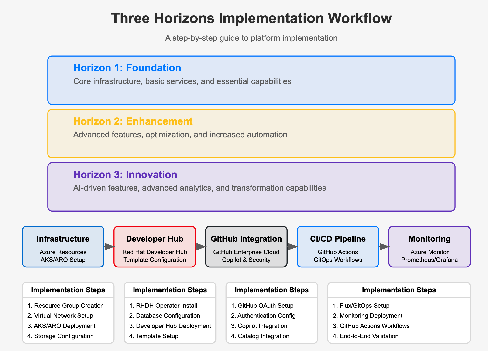
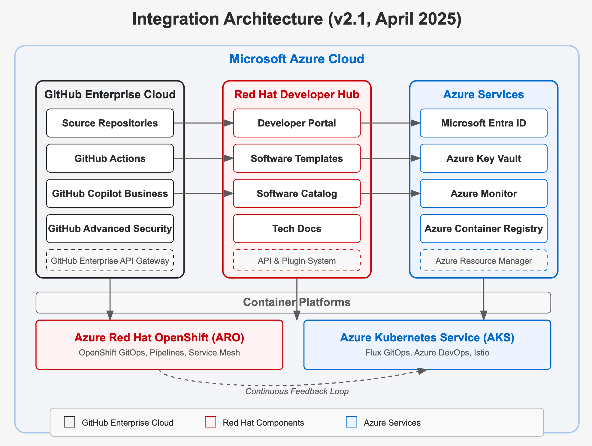
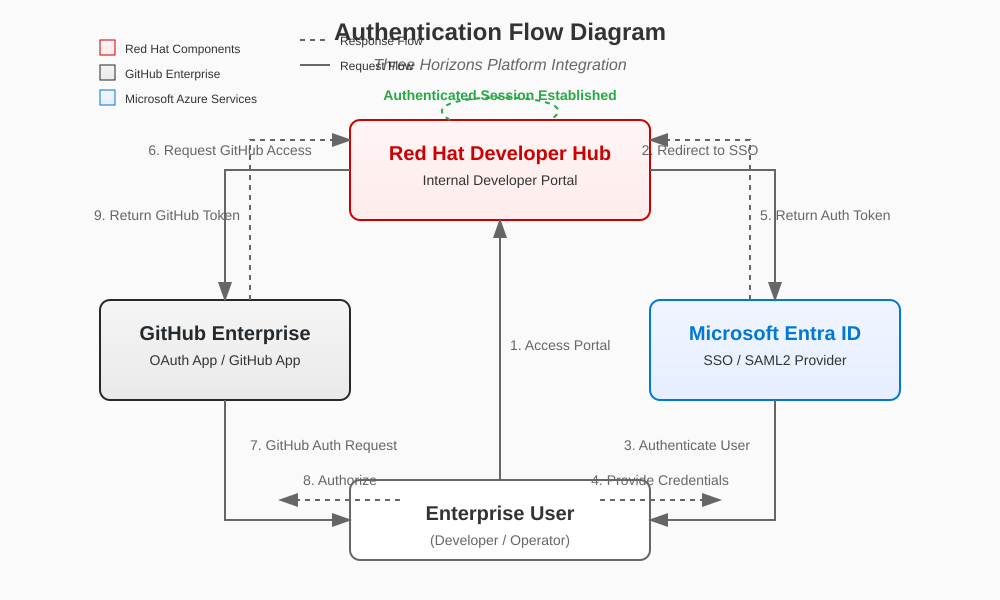
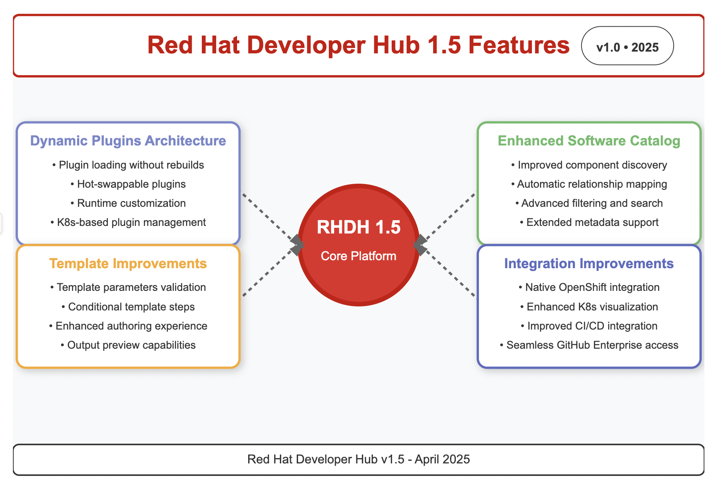
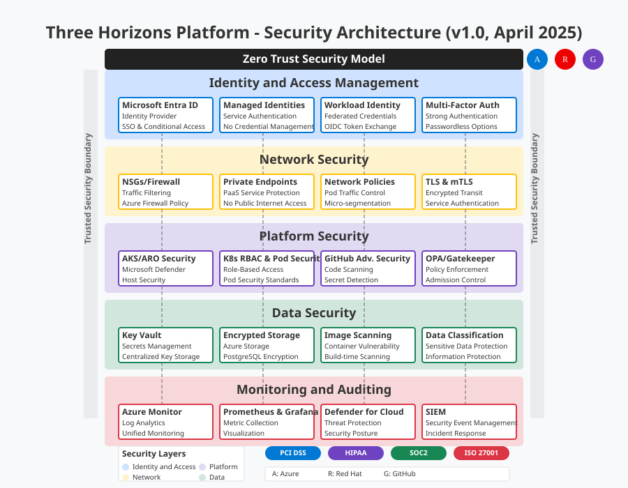

# <span style="color: #0366d6;">🚀 Complete Integration Tutorial</span>

**Navigation:** [Home](../README.md) > [Documentation Map](../DOCUMENTATION_MAP.md) > Complete Integration Tutorial

> **RECOMMENDED IMPLEMENTATION PATH**: This tutorial is the primary documentation for implementing the Three Horizons Platform. It provides a comprehensive, step-by-step guide with detailed commands, code samples, and validation procedures.

## <span style="color: #0366d6;">🔄 Your Complete Integration Journey</span>

Welcome to the definitive tutorial for implementing a complete Three Horizons Platform. This guide will walk you through each step of the integration process, from infrastructure provisioning to full platform operation. At each stage, we'll provide detailed instructions, external references, and links to internal documentation.

This tutorial follows the Three Horizons model, helping you build capabilities progressively:

## <span style="color: #0366d6;">📐 Three Horizons Platform Architecture</span>

The Three Horizons Platform integrates three main technology pillars to create a unified developer experience:

### <span style="color: #0366d6;">Key Components</span>

#### <span style="color: #0078D4;">Microsoft Azure</span> - Cloud infrastructure and platform services
- Azure Kubernetes Service (AKS)
- Azure Red Hat OpenShift (ARO)
- Azure Active Directory
- Azure Monitor and Log Analytics
- Azure Container Registry

#### <span style="color: #EE0000;">Red Hat Developer Hub</span> - Developer portal and experience platform
- Software Catalog
- Golden Path Templates
- Technical Documentation
- Self-Service Portal
- Unified Developer Experience

#### <span style="color: #24292E;">GitHub Enterprise Cloud</span> - Source control, collaboration, and CI/CD
- Source Repository Management
- GitHub Actions for automated CI/CD workflows
- GitHub Copilot Enterprise for AI-assisted development
- GitHub Advanced Security for code scanning and secret detection
- GitHub Codespaces for cloud-based development environments

### <span style="color: #0366d6;">Development Workflow Zones</span>

The platform organizes development activities into distinct zones:

#### <span style="color: #24292E;">Development Zone (Inner Loop)</span>
Where developers write, test, and debug code locally before committing to a shared repository.
- GitHub Codespaces provides cloud-based development environments
- Microsoft DevBox offers standardized developer workstations
- GitHub Copilot Enterprise accelerates development through AI assistance
- Local testing tools provide immediate feedback

#### <span style="color: #EE0000;">Integration Zone (CI/CD Pipeline)</span>
Where code changes are built, tested, and prepared for deployment.
- GitHub Actions automates build and test workflows
- Golden Paths provide standardized developer workflows
- GitHub Advanced Security identifies vulnerabilities through code scanning
- Container Registry stores validated container images

#### <span style="color: #0078D4;">Runtime Zone (Outer Loop)</span>
Where applications are deployed and managed in production environments.
- Azure Kubernetes Service (AKS) provides managed Kubernetes
- Azure Red Hat OpenShift (ARO) offers enterprise-grade Kubernetes
- GitOps tools (Flux/ArgoCD) manage declarative deployments
- Application workloads run with consistent configurations

#### <span style="color: #666666;">Operations Zone (Monitoring)</span>
Where applications are monitored and maintained.
- Azure Monitor provides unified monitoring
- Prometheus collects metrics from containerized applications
- Grafana visualizes performance data through dashboards
- Alerting notifies teams of potential issues

### <span style="color: #0366d6;">Three Horizons Implementation Approach</span>

The platform implementation follows the Three Horizons model:

#### <span style="color: #2188ff;">Horizon 1: Foundation</span>
Establishes the core infrastructure and essential capabilities:
- Basic platform installation with AKS/ARO
- Initial Developer Hub deployment
- GitHub Enterprise integration
- Fundamental CI/CD pipelines

#### <span style="color: #f9c513;">Horizon 2: Enhancement</span>
Builds on the foundation with optimized features:
- Advanced deployment strategies
- Comprehensive monitoring
- Enhanced security controls
- Performance optimization

#### <span style="color: #6f42c1;">Horizon 3: Innovation</span>
Introduces transformative capabilities:
- AI-driven development with GitHub Copilot Enterprise
- Advanced analytics
- Autonomous operations
- ML-powered recommendations

### <span style="color: #0366d6;">Architecture Diagram</span>


> 🔍 **Architecture Note:** The diagram above illustrates the interconnected nature of the Three Horizons Platform components and the workflow across different zones. The Red Hat Developer Hub serves as the central developer portal unifying the experience.

## <span style="color: #0366d6;">🔄 Implementation Workflow</span>

The following diagram illustrates the complete implementation workflow for the Three Horizons Platform, organized by phases and aligned with the Three Horizons model:



> **Note on Diagrams**: All architecture diagrams in this documentation reflect the latest Three Horizons Platform architecture as of April 2025, using a consistent styling and nomenclature. Each diagram includes a version indicator to help track changes over time.

Each phase builds on the previous one, with clear demarcations between the three horizons of capability maturity. Follow the phases in order for a structured implementation experience.

## <span style="color: #0366d6;">🔍 Pre-requisites</span>

Before beginning this tutorial, ensure you have:

1. **Azure Subscription** with appropriate permissions
   - Owner or Contributor role
   - Quota for required resources
   - [Azure Subscription Requirements](https://learn.microsoft.com/en-us/azure/cloud-adoption-framework/ready/azure-best-practices/initial-subscriptions)

2. **Required Tools**:
   - Azure CLI v2.53.0 or later
   - kubectl v1.28.0 or later
   - Git v2.42.0 or later
   - GitHub CLI v2.40.0 or later
   - [Installation guide for development tools](../getting-started/installation.md#development-tools)

3. **Access Credentials**:
   - GitHub Enterprise account
   - Azure AD administrator access
   - OpenShift Pull Secret (for ARO)
   - [Identity management documentation](../documentation/architecture/security-architecture.svg)

4. **Network Requirements**:
   - Ability to create VNets and subnets
   - Outbound internet access
   - [Network architecture documentation](../documentation/architecture/network-diagram.svg)

## <span style="color: #0366d6;">📋 Implementation Phases</span>

The complete implementation is divided into 8 phases:

1. [**Infrastructure Provisioning**](#phase-1-infrastructure-provisioning) - Setting up Azure foundation
2. [**Platform Installation**](#phase-2-platform-installation) - Installing AKS/ARO and core services
3. [**Developer Hub Deployment**](#phase-3-developer-hub-deployment) - Deploying Red Hat Developer Hub
4. [**GitHub Integration**](#phase-4-github-integration) - Connecting with GitHub Enterprise
5. [**CI/CD Pipeline Setup**](#phase-5-cicd-pipeline-setup) - Implementing GitOps workflows
6. [**Monitoring & Observability**](#phase-6-monitoring--observability) - Setting up monitoring stack
7. [**Platform Validation**](#phase-7-platform-validation) - Testing and validation
8. [**Microsoft DevBox Configuration**](#phase-8-microsoft-devbox-configuration) - Setting up developer environments

## <span style="color: #0366d6;">🔄 Integration Architecture</span>

### <span style="color: #0366d6;">Key Integration Points</span>

The Three Horizons Platform connects multiple technologies to create a cohesive developer experience. The diagram below shows the primary integration points between components:



### <span style="color: #0366d6;">Authentication Flows</span>

Authentication between services uses modern protocols to ensure secure access:

1. **Developer Hub to GitHub Enterprise**:
   - OAuth 2.0 flow with PKCE for developer authentication
   - GitHub Apps with fine-grained permissions for system-to-system communication
   - Personal Access Tokens (PATs) for CI/CD workflows (transitional, moving to GitHub Apps)



2. **Microsoft Entra ID Integration**:
   - OIDC-based authentication for AKS/ARO
   - Workload identity federation for pod-to-Azure service authentication
   - Azure RBAC integration with Kubernetes RBAC

> **Security Note**: Microsoft Entra ID (formerly Azure Active Directory) is the recommended identity provider for all platform components. This documentation has been updated to reflect the rebranding and new features.

### <span style="color: #0366d6;">Identity Management</span>

The Three Horizons Platform uses a unified identity approach:

1. **Developer Identities**: Managed in Microsoft Entra ID, with federation to GitHub Enterprise
2. **Service Identities**: Use managed identities and workload identity federation instead of service principals
3. **Application Identities**: Implemented through managed identities and OIDC-based workload identity

## <span style="color: #0366d6;">📚 Specific Component Guides</span>

For detailed implementation of specific components, refer to these guides:

- [**Red Hat Developer Hub Guide**](#phase-3-developer-hub-deployment) - Comprehensive guide for implementing the Developer Hub
- [**GitHub Platform Integration Guide**](#phase-4-github-integration) - Detailed steps for GitHub Enterprise integration
- [**Microsoft DevBox Guide**](#phase-8-microsoft-devbox-configuration) - Complete guide for setting up developer environments
- [**Azure Integration Guide**](#phase-1-infrastructure-provisioning) - Guide for ARM templates and Terraform infrastructure

Let's start with the first phase.

## <span style="color: #0366d6;">💻 Phase 1: Infrastructure Provisioning</span>

In this phase, we'll set up the foundational Azure infrastructure required for the Three Horizons Platform.

### <span style="color: #0366d6;">Step 1.1: Resource Group Creation</span>

First, create resource groups to organize your resources:

```bash
# Login to Azure
az login

# Set your subscription
az account set --subscription "<subscription-id>"

# Create resource group for the platform with tags
az group create \
  --name three-horizons-platform \
  --location eastus \
  --tags Environment=Production Project=ThreeHorizons Owner=PlatformTeam

# Create resource group for shared services
az group create \
  --name three-horizons-shared \
  --location eastus \
  --tags Environment=Production Project=ThreeHorizons Owner=PlatformTeam
```

> 📘 **Note:** For production environments, consider using separate resource groups for each major component.
> Read more in the [Azure cloud foundations guide](https://learn.microsoft.com/en-us/azure/cloud-adoption-framework/ready/landing-zone/).

### <span style="color: #0366d6;">Step 1.2: Virtual Network Setup</span>

Create the virtual network and subnets:

```bash
# Create the virtual network with proper address space
az network vnet create \
  --resource-group three-horizons-platform \
  --name three-horizons-vnet \
  --address-prefix 10.0.0.0/16 \
  --subnet-name aks-subnet \
  --subnet-prefix 10.0.0.0/22 \
  --tags Environment=Production Project=ThreeHorizons

# Create subnet for Azure services
az network vnet subnet create \
  --resource-group three-horizons-platform \
  --vnet-name three-horizons-vnet \
  --name services-subnet \
  --address-prefix 10.0.4.0/24

# Create subnet for private endpoints
az network vnet subnet create \
  --resource-group three-horizons-platform \
  --vnet-name three-horizons-vnet \
  --name endpoint-subnet \
  --address-prefix 10.0.5.0/24 \
  --disable-private-endpoint-network-policies true
```

> 🔗 **Reference:** See our [network architecture documentation](../documentation/architecture/network-diagram.svg) for the recommended network topology and Microsoft's [private endpoint documentation](https://learn.microsoft.com/en-us/azure/private-link/private-endpoint-overview).

### <span style="color: #0366d6;">Step 1.3: Create Key Vault</span>

Create an Azure Key Vault to store secrets:

```bash
# Create Key Vault with access policies and network rules
az keyvault create \
  --name three-horizons-vault \
  --resource-group three-horizons-shared \
  --location eastus \
  --sku standard \
  --enable-rbac-authorization true \
  --tags Environment=Production Project=ThreeHorizons Owner=PlatformTeam

# Configure networking (optional for higher security)
az keyvault network-rule add \
  --name three-horizons-vault \
  --resource-group three-horizons-shared \
  --vnet-name three-horizons-vnet \
  --subnet services-subnet
```

> 🔒 **Security Note:** We're using RBAC-based access control for Key Vault, which is the recommended approach for granular permissions. Learn more in the [Key Vault RBAC documentation](https://learn.microsoft.com/en-us/azure/key-vault/general/rbac-guide).

### <span style="color: #0366d6;">Step 1.4: Create Container Registry</span>

Set up Azure Container Registry:

```bash
# Create Container Registry with geo-replication
az acr create \
  --name threehorizonsregistry \
  --resource-group three-horizons-shared \
  --location eastus \
  --sku Premium \
  --admin-enabled false \
  --tags Environment=Production Project=ThreeHorizons

# Enable geo-replication for production workloads
az acr replication create \
  --registry threehorizonsregistry \
  --location westus

# Enable image scanning
az acr security enable \
  --registry threehorizonsregistry \
  --name defender
```

> 💡 **Best Practice:** For production environments, enable geo-replication for your container registry to improve image pull performance and availability. [Learn more about ACR geo-replication](https://learn.microsoft.com/en-us/azure/container-registry/container-registry-geo-replication).

### <span style="color: #0366d6;">Step 1.5: Create Managed Identity for Workload Identity</span>

Create managed identities for modern authentication:

```bash
# Create user-assigned managed identity
az identity create \
  --name three-horizons-identity \
  --resource-group three-horizons-shared \
  --tags Environment=Production Project=ThreeHorizons

# Get identity client ID and principal ID
IDENTITY_CLIENT_ID=$(az identity show --name three-horizons-identity --resource-group three-horizons-shared --query clientId -o tsv)
IDENTITY_PRINCIPAL_ID=$(az identity show --name three-horizons-identity --resource-group three-horizons-shared --query principalId -o tsv)

# Grant access to Key Vault
az role assignment create \
  --assignee-object-id $IDENTITY_PRINCIPAL_ID \
  --assignee-principal-type ServicePrincipal \
  --role "Key Vault Secrets User" \
  --scope $(az keyvault show --name three-horizons-vault --resource-group three-horizons-shared --query id -o tsv)
```

> ⚠️ **Important:** Managed identities are the preferred method for service authentication in Azure. They provide better security than service principals as they don't require secret management. [Learn more about managed identities](https://learn.microsoft.com/en-us/azure/active-directory/managed-identities-azure-resources/overview).

### <span style="color: #0366d6;">Horizon 1 (Foundation) Validation</span>

Validate your infrastructure setup:

```bash
# Verify resource groups
az group list --query "[?contains(name, 'three-horizons')]" -o table

# Verify virtual network and subnets
az network vnet subnet list \
  --resource-group three-horizons-platform \
  --vnet-name three-horizons-vnet \
  -o table

# Verify Key Vault
az keyvault show --name three-horizons-vault -o table

# Verify Container Registry
az acr show --name threehorizonsregistry -o table

# Verify managed identity
az identity show --name three-horizons-identity --resource-group three-horizons-shared -o table
```

## <span style="color: #0366d6;">🚀 Phase 2: Platform Installation</span>

Now let's install the core platform components: Azure Kubernetes Service (AKS) or Azure Red Hat OpenShift (ARO).

### <span style="color: #0366d6;">Option A: AKS Installation</span>

#### <span style="color: #0366d6;">Step 2.A.1: Create AKS Cluster</span>

```bash
# Create AKS cluster with modern features
az aks create \
  --resource-group three-horizons-platform \
  --name three-horizons-aks \
  --node-count 3 \
  --enable-managed-identity \
  --enable-workload-identity \
  --enable-oidc-issuer \
  --enable-addons monitoring \
  --network-plugin azure \
  --network-plugin-mode overlay \
  --vnet-subnet-id $(az network vnet subnet show --resource-group three-horizons-platform --vnet-name three-horizons-vnet --name aks-subnet --query id -o tsv) \
  --docker-bridge-address 172.17.0.1/16 \
  --dns-service-ip 10.2.0.10 \
  --service-cidr 10.2.0.0/24 \
  --node-vm-size Standard_D4s_v3 \
  --kubernetes-version 1.28.3 \
  --tags Environment=Production Project=ThreeHorizons \
  --generate-ssh-keys
```

#### <span style="color: #0366d6;">Step 2.A.2: Connect to AKS Cluster</span>

```bash
# Get credentials
az aks get-credentials \
  --resource-group three-horizons-platform \
  --name three-horizons-aks

# Verify connection
kubectl get nodes
```

#### <span style="color: #0366d6;">Step 2.A.3: Configure Workload Identity</span>

```bash
# Get AKS OIDC issuer URL
AKS_OIDC_ISSUER="$(az aks show -n three-horizons-aks -g three-horizons-platform --query "oidcIssuerProfile.issuerUrl" -o tsv)"

# Create a Kubernetes service account and establish federated identity
cat <<EOF | kubectl apply -f -
apiVersion: v1
kind: ServiceAccount
metadata:
  annotations:
    azure.workload.identity/client-id: $IDENTITY_CLIENT_ID
  name: workload-identity-sa
  namespace: default
EOF

# Create federated identity credential
az identity federated-credential create \
  --name three-horizons-federated-credential \
  --identity-name three-horizons-identity \
  --resource-group three-horizons-shared \
  --issuer $AKS_OIDC_ISSUER \
  --subject system:serviceaccount:default:workload-identity-sa
```

> 🔍 **Learn More:** Review our [AKS architecture documentation](../documentation/architecture/three-horizons-diagram.svg) for details on how AKS fits into the Three Horizons architecture and [Azure Workload Identity documentation](https://learn.microsoft.com/en-us/azure/aks/workload-identity-overview).

### <span style="color: #0366d6;">Option B: ARO Installation</span>

#### <span style="color: #0366d6;">Step 2.B.1: Create ARO Cluster</span>

```bash
# Register required resource providers
az provider register --namespace Microsoft.RedHatOpenShift --wait
az provider register --namespace Microsoft.Compute --wait
az provider register --namespace Microsoft.Storage --wait
az provider register --namespace Microsoft.Authorization --wait

# Create master and worker subnets
az network vnet subnet create \
  --resource-group three-horizons-platform \
  --vnet-name three-horizons-vnet \
  --name aro-master-subnet \
  --address-prefixes 10.0.8.0/23 \
  --service-endpoints Microsoft.ContainerRegistry

az network vnet subnet create \
  --resource-group three-horizons-platform \
  --vnet-name three-horizons-vnet \
  --name aro-worker-subnet \
  --address-prefixes 10.0.10.0/23 \
  --service-endpoints Microsoft.ContainerRegistry

# Update subnet for Azure CNI networking
az network vnet subnet update \
  --name aro-master-subnet \
  --resource-group three-horizons-platform \
  --vnet-name three-horizons-vnet \
  --disable-private-link-service-network-policies true

# Create ARO cluster with current OpenShift version
az aro create \
  --resource-group three-horizons-platform \
  --name three-horizons-aro \
  --vnet three-horizons-vnet \
  --master-subnet aro-master-subnet \
  --worker-subnet aro-worker-subnet \
  --apiserver-visibility Public \
  --ingress-visibility Public \
  --pull-secret @pull-secret.txt \
  --worker-count 3 \
  --worker-vm-size Standard_D4s_v3 \
  --tags Environment=Production Project=ThreeHorizons
```

#### <span style="color: #0366d6;">Step 2.B.2: Connect to ARO Cluster</span>

```bash
# Get the console URL
az aro show \
  --name three-horizons-aro \
  --resource-group three-horizons-platform \
  --query consoleProfile.url -o tsv

# Get login credentials
az aro list-credentials \
  --name three-horizons-aro \
  --resource-group three-horizons-platform

# Login with oc CLI
oc login <api-server-url> -u kubeadmin -p <password>

# Verify connection
oc get nodes
```

> 📝 **Note:** The ARO console URL will open the web UI. Use the kubeadmin credentials to log in. For production environments, configure Azure AD integration for authentication. See [ARO Azure AD integration](https://learn.microsoft.com/en-us/azure/openshift/configure-azure-ad-ui).

### <span style="color: #0366d6;">Step 2.3: Configure RBAC</span>

Set up role-based access control for your cluster:

```bash
# Create namespace for platform components
kubectl create namespace three-horizons-system

# Apply RBAC configuration
kubectl apply -f - <<EOF
apiVersion: v1
kind: ServiceAccount
metadata:
  name: platform-admin
  namespace: three-horizons-system
---
apiVersion: rbac.authorization.k8s.io/v1
kind: ClusterRoleBinding
metadata:
  name: platform-admin
subjects:
- kind: ServiceAccount
  name: platform-admin
  namespace: three-horizons-system
roleRef:
  kind: ClusterRole
  name: cluster-admin
  apiGroup: rbac.authorization.k8s.io
EOF
```

### <span style="color: #0366d6;">Step 2.4: Configure Storage</span>

Set up storage classes for persistent data:

```bash
# For AKS (already has default storage class)
kubectl get storageclass

# For ARO, create a storage class with Azure Files
oc apply -f - <<EOF
apiVersion: storage.k8s.io/v1
kind: StorageClass
metadata:
  name: azure-file-rwx
provisioner: kubernetes.io/azure-file
parameters:
  skuName: Premium_ZRS
reclaimPolicy: Delete
volumeBindingMode: Immediate
allowVolumeExpansion: true
mountOptions:
  - dir_mode=0777
  - file_mode=0777
  - uid=0
  - gid=0
EOF
```

> 📊 **Resource Planning:** For production environments, see our [resource planning guide](../getting-started/installation.md#resource-planning) for storage recommendations. Consider using zone-redundant storage (ZRS) for high availability.

### <span style="color: #0366d6;">Step 2.5: Install Ingress Controller</span>

Install an ingress controller to manage external access:

```bash
# Install NGINX Ingress Controller
helm repo add ingress-nginx https://kubernetes.github.io/ingress-nginx
helm repo update

helm install ingress-nginx ingress-nginx/ingress-nginx \
  --namespace three-horizons-system \
  --create-namespace \
  --set controller.replicaCount=2 \
  --set controller.nodeSelector."kubernetes\.io/os"=linux \
  --set controller.admissionWebhooks.patch.nodeSelector."kubernetes\.io/os"=linux \
  --set controller.service.annotations."service\.beta\.kubernetes\.io/azure-load-balancer-internal"="false" \
  --set controller.service.annotations."service\.beta\.kubernetes\.io/azure-load-balancer-health-probe-request-path"="/healthz"
```

### <span style="color: #0366d6;">Horizon 1 (Foundation) Validation</span>

Validate your platform installation:

```bash
# Verify node health
kubectl get nodes -o wide

# Verify system pods
kubectl get pods -n three-horizons-system

# Verify ingress controller
kubectl get services -n three-horizons-system

# Verify Azure Monitor connectivity (for AKS)
kubectl get pods -n kube-system -l component=oms-agent
```

## <span style="color: #0366d6;">🚀 Phase 3: Developer Hub Deployment</span>

Now let's deploy the Red Hat Developer Hub (RHDH) version 1.5, which is the central component for the Three Horizons Platform.

### <span style="color: #0366d6;">Step 3.1: Install Operator Lifecycle Manager</span>

```bash
# For AKS
curl -sL https://github.com/operator-framework/operator-lifecycle-manager/releases/download/v0.26.0/install.sh | bash -s v0.26.0

# For ARO, OLM is already installed
oc get pods -n openshift-operator-lifecycle-management
```

### <span style="color: #0366d6;">Step 3.2: Install Developer Hub Operator</span>

```bash
# Create namespace
kubectl create namespace developer-hub

# For AKS: Install OLM Catalog Sources for Red Hat Operators
cat <<EOF | kubectl apply -f -
apiVersion: operators.coreos.com/v1alpha1
kind: CatalogSource
metadata:
  name: redhat-operators
  namespace: olm
spec:
  displayName: Red Hat Operators
  publisher: Red Hat
  sourceType: grpc
  image: registry.redhat.io/redhat/redhat-operator-index:v4.13
  updateStrategy:
    registryPoll:
      interval: 30m
EOF

# For AKS: Create OperatorGroup
cat <<EOF | kubectl apply -f -
apiVersion: operators.coreos.com/v1
kind: OperatorGroup
metadata:
  name: developer-hub-operatorgroup
  namespace: developer-hub
spec:
  targetNamespaces:
  - developer-hub
EOF

# Deploy Developer Hub Operator
cat <<EOF | kubectl apply -f -
apiVersion: operators.coreos.com/v1alpha1
kind: Subscription
metadata:
  name: rhdh-operator
  namespace: developer-hub
spec:
  channel: stable
  name: rhdh-operator
  source: redhat-operators
  sourceNamespace: olm
EOF
```

> 📘 **Reference:** For detailed operator configuration, see the [Red Hat Developer Hub documentation](https://developers.redhat.com/rhdh/1.5/getting_started).

### <span style="color: #0366d6;">RHDH 1.5 Key Features</span>

Red Hat Developer Hub 1.5 introduces several important enhancements and features:

1. **Dynamic Plugins Architecture**:
   - Plugin loading without container rebuilds
   - Hot-swappable plugins for runtime customization
   - Simplified plugin management through Kubernetes resources

2. **Enhanced Software Catalog**:
   - Improved component discovery
   - Automatic relationship mapping
   - Advanced filtering and search capabilities
   - Extended metadata support

3. **Template Improvements**:
   - Template parameters validation
   - Conditional template steps
   - Enhanced template authoring experience
   - Output preview capabilities

4. **Integration Improvements**:
   - Native OpenShift integration
   - Enhanced Kubernetes resource visualization
   - Improved CI/CD integration



### <span style="color: #0366d6;">Available RHDH Plugins</span>

RHDH 1.5 includes the following plugins that can be enabled as needed:

| Plugin Name | Description | Configuration |
|-------------|-------------|---------------|
| `@backstage/plugin-kubernetes` | Kubernetes resource visualization | Requires cluster access configuration |
| `@backstage/plugin-techdocs` | Documentation as code | Requires storage configuration |
| `@backstage/plugin-catalog-backend-module-github` | GitHub integration | Requires GitHub token |
| `@backstage/plugin-scaffolder-backend` | Software templates | No additional configuration needed |
| `@backstage/plugin-auth-backend` | Authentication provider | Requires identity provider configuration |
| `@backstage/plugin-search` | Platform-wide search | No additional configuration needed |
| `@backstage/plugin-api-docs` | API documentation | For OpenAPI and AsyncAPI specs |
| `@backstage/plugin-tech-radar` | Technology radar | Requires radar data source |
| `@backstage/plugin-github-actions` | GitHub Actions integration | Requires GitHub token |
| `@backstage/plugin-azure-devops` | Azure DevOps integration | Requires Azure DevOps credentials |

### <span style="color: #0366d6;">Step 3.3: Configure Managed Database</span>

For production environments, we recommend using a managed database service:

```bash
# Create Azure Database for PostgreSQL flexible server
az postgres flexible-server create \
  --resource-group three-horizons-shared \
  --name three-horizons-psql \
  --admin-user backstage \
  --admin-password "StrongPassword123!" \
  --sku-name Standard_D2s_v3 \
  --tier GeneralPurpose \
  --storage-size 32 \
  --version 14 \
  --high-availability Enabled \
  --location eastus \
  --database-name backstage \
  --tags Environment=Production Project=ThreeHorizons

# Configure firewall rule to allow Azure services
az postgres flexible-server firewall-rule create \
  --resource-group three-horizons-shared \
  --name three-horizons-psql \
  --rule-name AllowAzureServices \
  --start-ip-address 0.0.0.0 \
  --end-ip-address 0.0.0.0

# Store database credentials in Key Vault
az keyvault secret set \
  --name db-password \
  --vault-name three-horizons-vault \
  --value "StrongPassword123!"

# Get the database host
DB_HOST=$(az postgres flexible-server show \
  --resource-group three-horizons-shared \
  --name three-horizons-psql \
  --query fullyQualifiedDomainName \
  --output tsv)

# Create Kubernetes secret for database connection
kubectl create secret generic developer-hub-postgres \
  --namespace developer-hub \
  --from-literal=postgres-password="StrongPassword123!"
```

> ⚠️ **Warning:** For production, use a more secure method to manage passwords, such as retrieving them from Key Vault using managed identities.

### <span style="color: #0366d6;">Step 3.4: Deploy Developer Hub Instance</span>

```bash
# Deploy Red Hat Developer Hub instance
kubectl apply -f - <<EOF
apiVersion: rhdh.redhat.com/v1alpha1
kind: Backstage
metadata:
  name: developer-hub
  namespace: developer-hub
spec:
  application:
    replicas: 2
    resources:
      requests:
        cpu: "1"
        memory: "2Gi"
      limits:
        cpu: "2"
        memory: "4Gi"
  database:
    host: "${DB_HOST}"
    port: 5432
    name: "backstage"
    user: "backstage"
    passwordSecret:
      name: "developer-hub-postgres"
      key: "postgres-password"
  rbac:
    enabled: true
  extraEnvs:
    - name: RHDH_CONFIG_APP_CONFIG_app_baseUrl
      value: "https://devhub.example.com"
    - name: RHDH_DYNAMIC_PLUGINS_BACKEND_DYNAMIC_PLUGINS
      value: "true"
EOF
```

> 🔗 **Internal Document:** See our [Developer Hub architecture](images/three-horizons-complete.svg) for a visualization of how these components interconnect.

### <span style="color: #0366d6;">Step 3.5: Create Ingress for Developer Hub</span>

Create an ingress rule to expose the Developer Hub:

```bash
# Create ingress rule
kubectl apply -f - <<EOF
apiVersion: networking.k8s.io/v1
kind: Ingress
metadata:
  name: developer-hub
  namespace: developer-hub
  annotations:
    kubernetes.io/ingress.class: nginx
    nginx.ingress.kubernetes.io/proxy-body-size: "0"
    nginx.ingress.kubernetes.io/proxy-read-timeout: "600"
    nginx.ingress.kubernetes.io/proxy-send-timeout: "600"
    cert-manager.io/cluster-issuer: letsencrypt-prod
spec:
  rules:
  - host: devhub.example.com
    http:
      paths:
      - path: /
        pathType: Prefix
        backend:
          service:
            name: developer-hub
            port:
              number: 7007
  tls:
  - hosts:
    - devhub.example.com
    secretName: developer-hub-tls
EOF
```

> 📝 **Note:** Replace devhub.example.com with your actual domain.

### <span style="color: #0366d6;">Horizon 1 (Foundation) Validation</span>

Validate your Developer Hub deployment:

```bash
# Check Developer Hub operator status
kubectl get pods -n developer-hub

# Wait for the RHDH operator to be ready
kubectl wait --for=condition=ready pod -l name=rhdh-operator -n developer-hub --timeout=300s

# Check Developer Hub instance status
kubectl get backstage -n developer-hub

# Check all pods are running
kubectl get pods -n developer-hub

# Check services
kubectl get services -n developer-hub

# Check ingress
kubectl get ingress -n developer-hub
```

Access the Developer Hub at https://devhub.example.com (replace with your domain).

## <span style="color: #0366d6;">🚀 Phase 4: GitHub Integration</span>

In this phase, we'll integrate your GitHub Enterprise Cloud instance with the Three Horizons Platform.

### <span style="color: #0366d6;">Step 4.1: Create GitHub OAuth App</span>

1. Go to your GitHub Enterprise instance (or github.com for your organization)
2. Navigate to Settings > Developer Settings > OAuth Apps > New OAuth App
3. Fill in the following:
   - Application name: Three Horizons Platform
   - Homepage URL: https://devhub.example.com
   - Authorization callback URL: https://devhub.example.com/api/auth/github/handler/frame
   - Enable Device Flow: Yes (check this option)
4. Register the application and note the Client ID
5. Generate a new client secret and save it securely

> 📝 **Note:** For GitHub Enterprise Cloud, follow the [enterprise OAuth app documentation](https://docs.github.com/en/enterprise-cloud@latest/apps/oauth-apps/building-oauth-apps/creating-an-oauth-app).

### <span style="color: #0366d6;">Step 4.2: Configure Developer Hub for GitHub Authentication</span>

```bash
# Create GitHub secrets
kubectl create secret generic github-oauth \
  --namespace developer-hub \
  --from-literal=client-id=<your-client-id> \
  --from-literal=client-secret=<your-client-secret>

# Update Developer Hub configuration (apply dynamic plugins configuration)
kubectl apply -f - <<EOF
apiVersion: rhdh.redhat.com/v1alpha1
kind: DynamicPlugin
metadata:
  name: github-auth-plugin
  namespace: developer-hub
spec:
  disabled: false
  package: 
    name: '@backstage/plugin-auth-backend'
  pluginConfig:
  - name: auth.providers.github
    data:
            clientId: \${GITHUB_CLIENT_ID}
            clientSecret: \${GITHUB_CLIENT_SECRET}
    deployment:
      env: 
    - name: GITHUB_CLIENT_ID
      valueFrom:
        secretKeyRef:
          name: github-oauth
          key: client-id
    - name: GITHUB_CLIENT_SECRET
      valueFrom:
        secretKeyRef:
          name: github-oauth
          key: client-secret
EOF
```

> 🔍 **Learn More:** See [GitHub Enterprise integration](https://backstage.io/docs/integrations/github/github-apps) in the Backstage documentation.

### <span style="color: #0366d6;">Step 4.3: Configure GitHub Integration for Software Catalog</span>

```bash
# Create a GitHub Personal Access Token with appropriate scopes
# For GitHub Enterprise Cloud, create a token at https://github.com/settings/tokens with:
# - repo
# - read:org
# - workflow
# - read:packages

# Create GitHub integration token secret
kubectl create secret generic github-token \
  --namespace developer-hub \
  --from-literal=token=<your-personal-access-token>

# Configure software catalog with dynamic plugins
kubectl apply -f - <<EOF
apiVersion: rhdh.redhat.com/v1alpha1
kind: DynamicPlugin
metadata:
  name: github-catalog-plugin
  namespace: developer-hub
spec:
  disabled: false
  package:
    name: '@backstage/plugin-catalog-backend-module-github'
  pluginConfig:
  - name: catalog.providers.github
    data:
      allowedInstances: ['github.com']
          organization: 'your-org-name'
          schedule:
            frequency: { minutes: 30 }
        timeout: { minutes: 3 }
      catalogPath: '/catalog-info.yaml'
      validateLocationsExist: true
    deployment:
      env:
    - name: GITHUB_TOKEN
      valueFrom:
        secretKeyRef:
          name: github-token
          key: token
EOF
```

> 🔐 **Security Note:** For production, use GitHub Apps instead of personal access tokens for better security and auditability. See the [GitHub Apps integration guide](https://docs.github.com/en/apps/creating-github-apps/about-creating-github-apps/about-creating-github-apps).

### <span style="color: #0366d6;">Step 4.4: Configure Templates Repository</span>

```bash
# Create a templates repository in your GitHub organization
echo "Create a templates repository in your GitHub organization with starter templates"

# Add repository to Developer Hub catalog
kubectl apply -f - <<EOF
apiVersion: v1
kind: ConfigMap
metadata:
  name: catalog-info
  namespace: developer-hub
data:
  catalog-info.yaml: |
    apiVersion: backstage.io/v1alpha1
    kind: Location
    metadata:
      name: templates
      description: Templates Repository
    spec:
      targets:
        - https://github.com/your-org-name/templates/blob/main/catalog-info.yaml
EOF

# Configure the Software Templates plugin
kubectl apply -f - <<EOF
apiVersion: rhdh.redhat.com/v1alpha1
kind: DynamicPlugin
metadata:
  name: scaffolder-plugin
  namespace: developer-hub
spec:
  disabled: false
  package:
    name: '@backstage/plugin-scaffolder-backend'
  pluginConfig:
  - name: scaffolder
    data:
      github:
        token: \${GITHUB_TOKEN}
        visibility: public
    deployment:
      env:
      - name: GITHUB_TOKEN
        valueFrom:
          secretKeyRef:
            name: github-token
            key: token
EOF
```

### <span style="color: #0366d6;">Step 4.5: Configure GitHub Copilot</span>

GitHub Copilot is a transformative AI pair programmer that significantly enhances developer productivity. This section provides detailed guidance on integrating Copilot with the Three Horizons Platform.

```bash
# Enable GitHub Copilot for your organization
echo "Navigate to https://github.com/organizations/your-org-name/settings/copilot to enable GitHub Copilot"

# Configure Copilot for GitHub Enterprise (if applicable)
echo "For GitHub Enterprise Cloud instances, follow the enterprise-specific setup at https://docs.github.com/en/enterprise-cloud@latest/copilot/overview-of-github-copilot/about-github-copilot-for-business"

# Create GitHub Copilot configuration for the templates
cat << EOF > .github/copilot-settings.json
{
  "github-copilot.enable": {
    "*": true,
    "yaml": true,
    "plaintext": true
  },
  "github-copilot.advanced": {
    "inlineSuggestCount": 3
  }
}
EOF
```

#### <span style="color: #0366d6;">GitHub Copilot Business vs Enterprise</span>

For the Three Horizons Platform, you can choose between:

- **GitHub Copilot Business**:
  - Purchase GitHub Copilot for Business licenses
  - Navigate to `https://github.com/organizations/your-org-name/settings/copilot`
  - Enable "GitHub Copilot for Business"
  - Ideal for most organizations that need AI-powered coding assistance
  - Features organization-wide policy management

- **GitHub Copilot Enterprise**:
  - Purchase GitHub Copilot Enterprise licenses (provides enhanced capabilities)
  - Navigate to `https://github.com/organizations/your-org-name/settings/copilot/enterprise`
  - Enable "GitHub Copilot Enterprise"
  - Additional enterprise features including:
    - Custom model training on your codebase
    - Enterprise data controls
    - Enhanced security features
    - Improved contextual awareness of your organization's code patterns
    - Integration with your private repositories for context-aware completions

Choose the appropriate tier based on your organization's needs for AI-assisted development.

#### <span style="color: #0366d6;">Effective Prompting Patterns</span>

GitHub Copilot works best with clear, context-rich prompts. Here are effective patterns for the Three Horizons Platform:

1. **Creating Golden Path Templates**:
   ```markdown
   // Create a Kubernetes deployment manifest for a Node.js application
   // with the following characteristics:
   // - Must use the Three Horizons resource naming convention
   // - Must set resource limits according to organization policy
   // - Must include standard monitoring annotations
   // - Must apply standard security context
   ```

2. **Building CI/CD Workflows**:
   ```markdown
   // Create a GitHub Actions workflow for a Java Spring Boot application
   // that follows Three Horizons best practices:
   // - Uses the standardized build and test steps
   // - Implements the security scanning policy
   // - Pushes container images to threehorizonsregistry
   // - Updates the GitOps repository
   ```

3. **Implementing Developer Hub Plugins**:
   ```markdown
   // Create a Red Hat Developer Hub plugin for:
   // - Adding a custom navigation item
   // - Integrating with our internal API at https://api.example.com
   // - Displaying data in a card format
   // - Using Three Horizons design system components
   ```

#### <span style="color: #0366d6;">Advanced Copilot Features</span>

Take advantage of these advanced GitHub Copilot capabilities:

1. **Copilot Chat**: Use `/help` within Copilot Chat to access contextual assistance specific to Three Horizons patterns.

2. **@Workspace**: Query your entire workspace with `@workspace` to find patterns and examples across your codebase.

3. **Copilot for Pull Requests**: Use Copilot to generate high-quality PR descriptions with the `/pr` command.

4. **Copilot for Testing**: Generate comprehensive tests with the `/tests` command, ensuring proper coverage of application logic.

5. **Copilot CLI Integration**: Install the Copilot extension for GitHub CLI:
   ```bash
   gh extension install github/gh-copilot
   ```

> 🤖 **AI Development:** GitHub Copilot helps developers write better code faster. For enterprise-wide deployment, see the [GitHub Copilot for Business documentation](https://docs.github.com/en/copilot/overview-of-github-copilot/about-github-copilot-for-business).

### <span style="color: #0366d6;">Horizon 2 (Enhancement) Validation</span>

Validate your GitHub integration:

1. Access the Developer Hub at https://devhub.example.com
2. Sign in with GitHub
3. Navigate to the Catalog section
4. Verify that repositories and templates are being imported
5. Test creating a new component from a template
6. Verify GitHub Copilot is enabled for your organization by opening a code file in GitHub Codespaces or in a local editor with the GitHub Copilot extension

## <span style="color: #0366d6;">🚀 Phase 5: CI/CD Pipeline Setup</span>

In this phase, we'll set up GitOps-based CI/CD pipelines using GitHub Actions and Flux CD. We'll also cover hybrid scenarios with Azure DevOps integration.

### <span style="color: #0366d6;">Step 5.1: Install Flux CD</span>

```bash
# Install Flux CLI
curl -s https://fluxcd.io/install.sh | bash

# Export GitHub credentials
export GITHUB_TOKEN=<your-personal-access-token>
export GITHUB_USER=<your-github-username>

# Bootstrap Flux with modern component structure
flux bootstrap github \
  --owner=your-org-name \
  --repository=flux-infra \
  --branch=main \
  --path=clusters/three-horizons \
  --personal \
  --components-extra=image-reflector-controller,image-automation-controller
```

> 🔄 **GitOps Reference:** See our [CI/CD architecture](images/integration-workflow.svg) for the complete workflow visualization and [Flux documentation](https://fluxcd.io/flux/installation/) for the latest installation options.

### <span style="color: #0366d6;">Step 5.2: Create GitOps Repository Structure</span>

Create the following structure in your flux-infra repository:

```
flux-infra/
├── clusters/
│   └── three-horizons/
│       ├── infrastructure/
│       │   ├── kustomization.yaml
│       │   ├── sources.yaml
│       │   ├── monitoring/
│       │   └── networking/
│       ├── apps/
│       │   ├── kustomization.yaml
│       │   ├── base/
│       │   └── overlays/
│       └── kustomization.yaml
└── platform/
    ├── base/
    │   ├── monitoring/
    │   ├── ingress/
    │   └── security/
    └── overlays/
        └── production/
```

### <span style="color: #0366d6;">Step 5.3: Configure Flux for Applications</span>

```bash
# Create Git repository for application manifests
flux create source git apps \
  --url=https://github.com/your-org-name/three-horizons-apps \
  --branch=main \
  --interval=1m \
  --export > apps-source.yaml

# Create kustomization for syncing applications
flux create kustomization apps \
  --source=apps \
  --path="./" \
  --prune=true \
  --interval=10m \
  --health-check-timeout=3m \
  --export > apps-sync.yaml

# Apply configurations
kubectl apply -f apps-source.yaml
kubectl apply -f apps-sync.yaml

# Set up image automation
flux create image repository app-repository \
  --image=threehorizonsregistry.azurecr.io/app \
  --interval=1m \
  --export > app-repository.yaml

flux create image policy app-policy \
  --image-ref=app-repository \
  --select-semver=1.x.x \
  --export > app-policy.yaml

kubectl apply -f app-repository.yaml
kubectl apply -f app-policy.yaml
```

### <span style="color: #0366d6;">Step 5.4: Set up GitHub Actions Templates</span>

Create GitHub Actions workflow templates in your templates repository:

```yaml
# .github/workflows/build-deploy.yml
name: Build and Deploy

on:
  push:
    branches: [ main ]
  pull_request:
    branches: [ main ]

jobs:
  build:
    runs-on: ubuntu-latest
    permissions:
      contents: read
      packages: write
      
    steps:
      - name: Checkout
        uses: actions/checkout@v4
      
      - name: Set up Docker Buildx
        uses: docker/setup-buildx-action@v3
      
      - name: Log in to Container Registry
        uses: docker/login-action@v3
        with:
          registry: threehorizonsregistry.azurecr.io
          username: ${{ secrets.REGISTRY_USERNAME }}
          password: ${{ secrets.REGISTRY_PASSWORD }}
      
      - name: Extract metadata for Docker
        id: meta
        uses: docker/metadata-action@v5
        with:
          images: threehorizonsregistry.azurecr.io/app
          tags: |
            type=semver,pattern={{version}}
            type=sha,prefix=,format=short
      
      - name: Build and push
        uses: docker/build-push-action@v5
        with:
          context: .
          push: ${{ github.event_name != 'pull_request' }}
          tags: ${{ steps.meta.outputs.tags }}
          labels: ${{ steps.meta.outputs.labels }}
          cache-from: type=gha
          cache-to: type=gha,mode=max
          
  deploy:
    needs: build
    if: github.ref == 'refs/heads/main' && github.event_name != 'pull_request'
    runs-on: ubuntu-latest
    permissions:
      contents: write
    
    steps:
      - name: Checkout
        uses: actions/checkout@v4
        with:
          fetch-depth: 0
      
      - name: Setup Flux CLI
        uses: fluxcd/flux2/action@v2.2.2
        
      - name: Setup Kustomize
        uses: fluxcd/flux2/action@v2.2.2
        with:
          cmd: flux install kustomize
      
      - name: Update Kubernetes manifests
        run: |
          cd ./k8s
          VERSION=${GITHUB_SHA::8}
          kustomize edit set image app=threehorizonsregistry.azurecr.io/app:${VERSION}
          
      - name: Commit and push changes
        uses: stefanzweifel/git-auto-commit-action@v5
        with:
          commit_message: "Update image to ${{ github.sha }}"
          file_pattern: 'k8s/*.yaml'
```

> 🚀 **CI/CD Guide:** For complete CI/CD configuration, see our [GitHub Actions guide](../examples/pipelines/github-actions/).

### <span style="color: #0366d6;">Step 5.5: Configure and Test Deployment Pipeline</span>

1. Create a test application using the Developer Hub templates
2. Review the generated GitHub Actions workflow
3. Make a code change and push to your repository
4. Verify that the CI/CD pipeline builds and deploys your application

### <span style="color: #0366d6;">Step 5.6: Set Up Hybrid Integration with Azure DevOps</span>

For organizations using both GitHub and Azure DevOps, we'll set up a hybrid CI/CD approach:

#### <span style="color: #0366d6;">Step 5.6.1: Create Azure DevOps Service Connection</span>

1. Go to your Azure DevOps project
2. Navigate to Project Settings > Service Connections > New Service Connection
3. Set up the following connections:
   - Azure Resource Manager connection
   - GitHub connection
   - Kubernetes connection

```bash
# Install Azure DevOps CLI extension
az extension add --name azure-devops

# Login to Azure DevOps
az devops login

# Configure defaults
az devops configure --defaults organization=https://dev.azure.com/your-organization project=three-horizons

# Create service principal for Azure connection
az ad sp create-for-rbac --name "three-horizons-azdo" --role contributor --scopes /subscriptions/<subscription-id> --output json > azdo-sp.json

# Create Kubernetes service connection (using the CLI)
az devops service-endpoint create \
  --service-endpoint-type kubernetes \
  --authorization-type Kubeconfig \
  --name "three-horizons-aks" \
  --kubeconfig "$(cat ~/.kube/config)" \
  --output table
```

#### <span style="color: #0366d6;">Step 5.6.2: Set Up Azure DevOps Pipeline for Terraform Deployments</span>

Create an Infrastructure as Code pipeline in Azure DevOps:

1. Create a new repository for Terraform code in Azure Repos
2. Add Terraform configurations for deployments

```hcl
# main.tf
provider "azurerm" {
  features {}
}

resource "azurerm_resource_group" "example" {
  name     = "three-horizons-app-${var.environment}"
  location = "East US"
  tags     = {
    environment = var.environment
    managedBy   = "terraform"
  }
}

resource "azurerm_app_service_plan" "example" {
  name                = "three-horizons-plan-${var.environment}"
  location            = azurerm_resource_group.example.location
  resource_group_name = azurerm_resource_group.example.name
  kind                = "Linux"
  reserved            = true

  sku {
    tier = "Standard"
    size = "S1"
  }
}

resource "azurerm_app_service" "example" {
  name                = "three-horizons-app-${var.environment}"
  location            = azurerm_resource_group.example.location
  resource_group_name = azurerm_resource_group.example.name
  app_service_plan_id = azurerm_app_service_plan.example.id

  site_config {
    linux_fx_version = "DOCKER|${var.image_name}:${var.image_tag}"
    always_on        = true
  }

  app_settings = {
    "WEBSITES_ENABLE_APP_SERVICE_STORAGE" = "false"
    "DOCKER_REGISTRY_SERVER_URL"          = "https://threehorizonsregistry.azurecr.io"
    "DOCKER_REGISTRY_SERVER_USERNAME"     = var.acr_username
    "DOCKER_REGISTRY_SERVER_PASSWORD"     = var.acr_password
  }
}

# variables.tf
variable "environment" {
  description = "Deployment environment (dev, staging, prod)"
  type        = string
}

variable "image_name" {
  description = "Container image name"
  type        = string
}

variable "image_tag" {
  description = "Container image tag"
  type        = string
}

variable "acr_username" {
  description = "ACR username"
  type        = string
  sensitive   = true
}

variable "acr_password" {
  description = "ACR password"
  type        = string
  sensitive   = true
}
```

3. Create an Azure Pipeline YAML file:

```yaml
# azure-pipelines.yml
trigger:
  branches:
    include:
      - main

variables:
  environment: 'dev'
  terraformVersion: '1.3.7'

stages:
- stage: 'Validate'
  displayName: 'Validate Terraform'
  jobs:
  - job: 'Validate'
    displayName: 'Validate'
    pool:
      vmImage: 'ubuntu-latest'
    steps:
    - task: TerraformInstaller@0
      displayName: 'Install Terraform $(terraformVersion)'
      inputs:
        terraformVersion: '$(terraformVersion)'
    
    - task: TerraformTaskV3@3
      displayName: 'Terraform Init'
      inputs:
        provider: 'azurerm'
        command: 'init'
        workingDirectory: '$(System.DefaultWorkingDirectory)/terraform'
        backendServiceArm: 'three-horizons-service-connection'
        backendAzureRmResourceGroupName: 'three-horizons-tfstate'
        backendAzureRmStorageAccountName: 'threehorizonstfstate'
        backendAzureRmContainerName: 'tfstate'
        backendAzureRmKey: 'dev.terraform.tfstate'
    
    - task: TerraformTaskV3@3
      displayName: 'Terraform Plan'
      inputs:
        provider: 'azurerm'
        command: 'plan'
        workingDirectory: '$(System.DefaultWorkingDirectory)/terraform'
        environmentServiceNameAzureRM: 'three-horizons-service-connection'
        commandOptions: '-var="environment=$(environment)" -var="image_name=app" -var="image_tag=latest" -var="acr_username=$(ACR_USERNAME)" -var="acr_password=$(ACR_PASSWORD)"'

- stage: 'Deploy'
  displayName: 'Deploy Infrastructure'
  dependsOn: 'Validate'
  condition: succeeded()
  jobs:
  - job: 'Deploy'
    displayName: 'Deploy'
    pool:
      vmImage: 'ubuntu-latest'
    steps:
    - task: TerraformInstaller@0
      displayName: 'Install Terraform $(terraformVersion)'
      inputs:
        terraformVersion: '$(terraformVersion)'
    
    - task: TerraformTaskV3@3
      displayName: 'Terraform Init'
      inputs:
        provider: 'azurerm'
        command: 'init'
        workingDirectory: '$(System.DefaultWorkingDirectory)/terraform'
        backendServiceArm: 'three-horizons-service-connection'
        backendAzureRmResourceGroupName: 'three-horizons-tfstate'
        backendAzureRmStorageAccountName: 'threehorizonstfstate'
        backendAzureRmContainerName: 'tfstate'
        backendAzureRmKey: 'dev.terraform.tfstate'
    
    - task: TerraformTaskV3@3
      displayName: 'Terraform Apply'
      inputs:
        provider: 'azurerm'
        command: 'apply'
        workingDirectory: '$(System.DefaultWorkingDirectory)/terraform'
        environmentServiceNameAzureRM: 'three-horizons-service-connection'
        commandOptions: '-var="environment=$(environment)" -var="image_name=app" -var="image_tag=latest" -var="acr_username=$(ACR_USERNAME)" -var="acr_password=$(ACR_PASSWORD)" -auto-approve'
```

#### <span style="color: #0366d6;">Step 5.6.3: Integrate GitHub Actions with Azure DevOps Pipelines</span>

Set up a GitHub Actions workflow that triggers Azure DevOps pipelines:

```yaml
# .github/workflows/hybrid-cicd.yml
name: Hybrid CI/CD with Azure DevOps

on:
  push:
    branches: [ main ]
  pull_request:
    branches: [ main ]

jobs:
  build:
    runs-on: ubuntu-latest
    steps:
      - uses: actions/checkout@v3
      
      - name: Set up Docker Buildx
        uses: docker/setup-buildx-action@v2
      
      - name: Login to Container Registry
        uses: docker/login-action@v2
        with:
          registry: threehorizonsregistry.azurecr.io
          username: ${{ secrets.REGISTRY_USERNAME }}
          password: ${{ secrets.REGISTRY_PASSWORD }}
      
      - name: Build and push
        uses: docker/build-push-action@v4
        with:
          context: .
          push: true
          tags: threehorizonsregistry.azurecr.io/app:${{ github.sha }}
      
      - name: Trigger Azure DevOps Pipeline
        uses: Azure/pipelines@v1
        with:
          azure-devops-project-url: 'https://dev.azure.com/your-organization/three-horizons'
          azure-pipeline-name: 'three-horizons-infrastructure'
          azure-devops-token: '${{ secrets.AZURE_DEVOPS_TOKEN }}'
          azure-pipeline-variables: '{"image_tag": "${{ github.sha }}", "environment": "dev"}'
```

#### <span style="color: #0366d6;">Step 5.6.4: Implement ARM Template Deployments</span>

For Azure-specific deployments, create ARM templates:

```json
{
  "$schema": "https://schema.management.azure.com/schemas/2019-04-01/deploymentTemplate.json#",
  "contentVersion": "1.0.0.0",
  "parameters": {
    "appName": {
      "type": "string",
      "metadata": {
        "description": "The name of the application"
      }
    },
    "environment": {
      "type": "string",
      "allowedValues": [
        "dev",
        "test",
        "staging",
        "prod"
      ],
      "metadata": {
        "description": "The deployment environment"
      }
    },
    "containerImage": {
      "type": "string",
      "metadata": {
        "description": "The container image to deploy"
      }
    },
    "registryUsername": {
      "type": "string",
      "metadata": {
        "description": "The container registry username"
      }
    },
    "registryPassword": {
      "type": "securestring",
      "metadata": {
        "description": "The container registry password"
      }
    }
  },
  "variables": {
    "appServicePlanName": "[concat(parameters('appName'), '-plan-', parameters('environment'))]",
    "webAppName": "[concat(parameters('appName'), '-', parameters('environment'))]"
  },
  "resources": [
    {
      "type": "Microsoft.Web/serverfarms",
      "apiVersion": "2021-02-01",
      "name": "[variables('appServicePlanName')]",
      "location": "[resourceGroup().location]",
      "sku": {
        "name": "S1",
        "tier": "Standard",
        "size": "S1",
        "family": "S",
        "capacity": 1
      },
      "kind": "linux",
      "properties": {
        "reserved": true
      }
    },
    {
      "type": "Microsoft.Web/sites",
      "apiVersion": "2021-02-01",
      "name": "[variables('webAppName')]",
      "location": "[resourceGroup().location]",
      "dependsOn": [
        "[resourceId('Microsoft.Web/serverfarms', variables('appServicePlanName'))]"
      ],
      "properties": {
        "serverFarmId": "[resourceId('Microsoft.Web/serverfarms', variables('appServicePlanName'))]",
        "siteConfig": {
          "appSettings": [
            {
              "name": "DOCKER_REGISTRY_SERVER_URL",
              "value": "https://threehorizonsregistry.azurecr.io"
            },
            {
              "name": "DOCKER_REGISTRY_SERVER_USERNAME",
              "value": "[parameters('registryUsername')]"
            },
            {
              "name": "DOCKER_REGISTRY_SERVER_PASSWORD",
              "value": "[parameters('registryPassword')]"
            },
            {
              "name": "WEBSITES_ENABLE_APP_SERVICE_STORAGE",
              "value": "false"
            }
          ],
          "linuxFxVersion": "[concat('DOCKER|', parameters('containerImage'))]",
          "alwaysOn": true
        }
      }
    }
  ],
  "outputs": {
    "webAppUrl": {
      "type": "string",
      "value": "[concat('https://', variables('webAppName'), '.azurewebsites.net')]"
    }
  }
}
```

#### <span style="color: #0366d6;">Step 5.6.5: Set Up Cross-Platform Deployments</span>

Configure a deployment strategy that leverages both platforms:

1. GitHub Actions: Build and test code, create container images
2. Azure DevOps: Handle infrastructure deployments with Terraform or ARM templates
3. Flux: Manage Kubernetes application deployments

### <span style="color: #0366d6;">Horizon 2 (Enhancement) Validation</span>

Validate your CI/CD pipeline:

```bash
# Check Flux controllers
kubectl get pods -n flux-system

# Check GitRepository sources
flux get sources git

# Check Kustomizations
flux get kustomizations

# Check deployed applications
kubectl get deployments -A

# Verify Azure DevOps pipeline runs
az pipelines runs list --pipeline-name three-horizons-infrastructure --output table
```

## <span style="color: #0366d6;">🚀 Phase 6: Monitoring & Observability</span>

In this phase, we'll set up monitoring and observability for the platform.

### <span style="color: #0366d6;">Step 6.1: Install Prometheus Stack</span>

```bash
# Add Prometheus Helm repository
helm repo add prometheus-community https://prometheus-community.github.io/helm-charts
helm repo update

# Create monitoring namespace
kubectl create namespace monitoring

# Install Prometheus Stack
helm install prometheus prometheus-community/kube-prometheus-stack \
  --namespace monitoring \
  --set grafana.adminPassword=admin \
  --set prometheusOperator.createCustomResource=true
```

> 📊 **Monitoring Guide:** See our [monitoring architecture](../documentation/architecture/workflow-diagram.svg) for an overview of the monitoring components.

### <span style="color: #0366d6;">Step 6.2: Configure Azure Monitor Integration</span>

```bash
# Create Azure Monitor workspace
az monitor log-analytics workspace create \
  --resource-group three-horizons-shared \
  --workspace-name three-horizons-logs

# Get workspace ID and key
WORKSPACE_ID=$(az monitor log-analytics workspace show \
  --resource-group three-horizons-shared \
  --workspace-name three-horizons-logs \
  --query customerId -o tsv)
  
WORKSPACE_KEY=$(az monitor log-analytics workspace get-shared-keys \
  --resource-group three-horizons-shared \
  --workspace-name three-horizons-logs \
  --query primarySharedKey -o tsv)

# Deploy Azure Monitor for Containers
kubectl apply -f - <<EOF
apiVersion: v1
kind: Secret
metadata:
  name: azure-log-analytics
  namespace: monitoring
type: Opaque
data:
  workspaceId: $(echo -n $WORKSPACE_ID | base64)
  workspaceKey: $(echo -n $WORKSPACE_KEY | base64)
---
apiVersion: apps/v1
kind: DaemonSet
metadata:
  name: azure-monitor-agent
  namespace: monitoring
spec:
  selector:
    matchLabels:
      app: azure-monitor-agent
  template:
    metadata:
      labels:
        app: azure-monitor-agent
    spec:
      containers:
      - name: azure-monitor-agent
        image: mcr.microsoft.com/azuremonitor/containerinsights/ciprod:ciprod04252022
        env:
        - name: WSID
          valueFrom:
            secretKeyRef:
              name: azure-log-analytics
              key: workspaceId
        - name: WSKEY
          valueFrom:
            secretKeyRef:
              name: azure-log-analytics
              key: workspaceKey
        - name: CLUSTER_NAME
          value: "three-horizons-aks"
        securityContext:
          privileged: true
        volumeMounts:
        - name: docker-sock
          mountPath: /var/run/docker.sock
        - name: host-log
          mountPath: /var/log
        - name: host-run
          mountPath: /run
      volumes:
      - name: docker-sock
        hostPath:
          path: /var/run/docker.sock
      - name: host-log
        hostPath:
          path: /var/log
      - name: host-run
        hostPath:
          path: /run
EOF
```

### <span style="color: #0366d6;">Step 6.3: Set up Grafana Dashboards</span>

```bash
# Create Grafana dashboards configmap
kubectl apply -f - <<EOF
apiVersion: v1
kind: ConfigMap
metadata:
  name: three-horizons-dashboards
  namespace: monitoring
  labels:
    grafana_dashboard: "1"
data:
  platform-overview.json: |
    {
      "annotations": {
        "list": [
          {
            "builtIn": 1,
            "datasource": "-- Grafana --",
            "enable": true,
            "hide": true,
            "iconColor": "rgba(0, 211, 255, 1)",
            "name": "Annotations & Alerts",
            "type": "dashboard"
          }
        ]
      },
      "editable": true,
      "gnetId": null,
      "graphTooltip": 0,
      "id": 1,
      "links": [],
      "panels": [
        {
          "aliasColors": {},
          "bars": false,
          "dashLength": 10,
          "dashes": false,
          "datasource": "Prometheus",
          "fieldConfig": {
            "defaults": {
              "custom": {}
            },
            "overrides": []
          },
          "fill": 1,
          "fillGradient": 0,
          "gridPos": {
            "h": 8,
            "w": 12,
            "x": 0,
            "y": 0
          },
          "hiddenSeries": false,
          "id": 2,
          "legend": {
            "avg": false,
            "current": false,
            "max": false,
            "min": false,
            "show": true,
            "total": false,
            "values": false
          },
          "lines": true,
          "linewidth": 1,
          "nullPointMode": "null",
          "options": {
            "alertThreshold": true
          },
          "percentage": false,
          "pluginVersion": "7.3.7",
          "pointradius": 2,
          "points": false,
          "renderer": "flot",
          "seriesOverrides": [],
          "spaceLength": 10,
          "stack": false,
          "steppedLine": false,
          "targets": [
            {
              "expr": "sum(rate(container_cpu_usage_seconds_total{namespace!=""}[5m])) by (namespace)",
              "interval": "",
              "legendFormat": "{{namespace}}",
              "refId": "A"
            }
          ],
          "thresholds": [],
          "timeFrom": null,
          "timeRegions": [],
          "timeShift": null,
          "title": "CPU Usage by Namespace",
          "tooltip": {
            "shared": true,
            "sort": 0,
            "value_type": "individual"
          },
          "type": "graph",
          "xaxis": {
            "buckets": null,
            "mode": "time",
            "name": null,
            "show": true,
            "values": []
          },
          "yaxes": [
            {
              "format": "short",
              "label": null,
              "logBase": 1,
              "max": null,
              "min": null,
              "show": true
            },
            {
              "format": "short",
              "label": null,
              "logBase": 1,
              "max": null,
              "min": null,
              "show": true
            }
          ],
          "yaxis": {
            "align": false,
            "alignLevel": null
          }
        }
      ],
      "schemaVersion": 26,
      "style": "dark",
      "tags": [],
      "templating": {
        "list": []
      },
      "time": {
        "from": "now-6h",
        "to": "now"
      },
      "timepicker": {},
      "timezone": "",
      "title": "Three Horizons Platform Overview",
      "uid": "three-horizons",
      "version": 1
    }
EOF
```

> 📈 **Dashboard Examples:** For more dashboard examples, see our [monitoring dashboards](../examples/dashboards/).

### <span style="color: #0366d6;">Step 6.4: Configure Alerting</span>

```bash
# Create alert rules
kubectl apply -f - <<EOF
apiVersion: monitoring.coreos.com/v1
kind: PrometheusRule
metadata:
  name: three-horizons-alerts
  namespace: monitoring
spec:
  groups:
  - name: three-horizons.rules
    rules:
    - alert: HighCPUUsage
      expr: sum(rate(container_cpu_usage_seconds_total{namespace!=""}[5m])) by (namespace, pod) > 0.8
      for: 10m
      labels:
        severity: warning
      annotations:
        summary: "High CPU usage for pod {{ \$labels.pod }} in namespace {{ \$labels.namespace }}"
        description: "Pod {{ \$labels.pod }} in namespace {{ \$labels.namespace }} has high CPU usage (> 80%) for more than 10 minutes."
EOF

# Configure Alertmanager
kubectl apply -f - <<EOF
apiVersion: monitoring.coreos.com/v1
kind: AlertmanagerConfig
metadata:
  name: three-horizons-alerts
  namespace: monitoring
spec:
  route:
    group_by: ['alertname', 'namespace']
    group_wait: 30s
    group_interval: 5m
    repeat_interval: 12h
    receiver: 'email'
  receivers:
  - name: 'email'
    email_configs:
    - to: 'alerts@example.com'
      from: 'alertmanager@example.com'
      smarthost: 'smtp.example.com:587'
      auth_username: 'alertmanager'
      auth_identity: 'alertmanager@example.com'
      auth_password: 'password'
EOF
```

> ⚠️ **Alert Configuration:** For production, configure more sophisticated alerting with PagerDuty, OpsGenie, or Microsoft Teams.

### <span style="color: #0366d6;">Horizon 2 (Enhancement) Validation</span>

Validate your monitoring setup:

```bash
# Check Prometheus pods
kubectl get pods -n monitoring

# Port-forward Grafana
kubectl port-forward svc/prometheus-grafana 3000:80 -n monitoring

# Access Grafana at http://localhost:3000 with credentials
# username: admin, password: admin
```

## <span style="color: #0366d6;">🚀 Phase 7: Platform Validation</span>

In this final phase, we'll validate the complete platform integration.

### <span style="color: #0366d6;">Step 7.1: Create Test Application</span>

1. Log in to the Developer Hub at https://devhub.example.com
2. Navigate to Create -> Select Web Application Template
3. Fill in the required details and create the application
4. Wait for the GitHub repository to be created

### <span style="color: #0366d6;">Step 7.2: Validate CI/CD Pipeline</span>

1. Clone the newly created repository
2. Make a code change
3. Push the change to trigger the CI/CD pipeline
4. Monitor the GitHub Actions workflow
5. Verify that the application is deployed to the cluster

### <span style="color: #0366d6;">Step 7.3: Validate Monitoring</span>

1. Access Grafana dashboards
2. Verify that metrics for the test application are being collected
3. Check that alerts are properly configured

### <span style="color: #0366d6;">Step 7.4: End-to-End Testing</span>

Perform the following end-to-end tests:

1. Create a new application from the Developer Hub
2. Make code changes and observe the CI/CD pipeline
3. Test the application's functionality
4. Monitor application performance in Grafana
5. Test the alerting system by triggering an alert condition

### <span style="color: #0366d6;">Horizon 3 (Innovation) Implementation</span>

Now that you have completed the foundation and enhancement phases, you can proceed to implement Horizon 3 innovations:

1. **GitHub Copilot Integration**:
   - Enable GitHub Copilot for your organization
   - Configure Copilot in DevBox environments
   - [GitHub Copilot documentation](https://docs.github.com/en/copilot)

2. **AI-Powered Recommendations**:
   - Implement a machine learning model for code quality recommendations
   - Deploy as a Developer Hub plugin
   - [Developer Hub plugins guide](#phase-3-developer-hub-deployment)

3. **Advanced Analytics**:
   - Set up a data lake for platform telemetry
   - Implement predictive analytics for resource usage
   - [Azure Data Lake documentation](https://docs.microsoft.com/en-us/azure/storage/blobs/data-lake-storage-introduction)

## <span style="color: #0366d6;">✅ Implementation Checklists</span>

Below are checklists for each component to ensure complete implementation of the Three Horizons Platform. Check off each item as you complete it.

### <span style="color: #0366d6;">Infrastructure Checklist</span>

- [ ] Resource groups created
- [ ] Virtual network and subnets configured
- [ ] Key Vault created and configured
- [ ] Container Registry deployed
- [ ] Service principals created with appropriate permissions
- [ ] Network security rules configured
- [ ] Availability zones and regions planned for HA/DR

### <span style="color: #0366d6;">AKS/ARO Checklist</span>

- [ ] Cluster deployed with appropriate node sizing
- [ ] Network plugin configured correctly
- [ ] RBAC configured for cluster access
- [ ] Storage classes created for persistent data
- [ ] Ingress controller installed and configured
- [ ] Azure AD integration for authentication
- [ ] Cluster monitoring enabled

### <span style="color: #0366d6;">Developer Hub Checklist</span>

- [ ] Red Hat Developer Hub operator installed
- [ ] Database configured for Developer Hub
- [ ] Developer Hub instance deployed
- [ ] Ingress and TLS configured
- [ ] Template repositories added
- [ ] Custom plugins installed
- [ ] User authentication configured

### <span style="color: #0366d6;">GitHub Platform Checklist</span>

- [ ] GitHub Enterprise connected to Developer Hub
- [ ] OAuth app configured
- [ ] Software catalog integration set up
- [ ] GitHub Actions workflow templates created
- [ ] Repository templates initialized
- [ ] Branch protection rules configured
- [ ] GitHub Copilot enabled for development teams

### <span style="color: #0366d6;">Azure DevOps Integration Checklist</span>

- [ ] Service connections created
- [ ] Pipeline templates created
- [ ] Terraform configurations added
- [ ] ARM templates configured
- [ ] Azure DevOps repositories initialized
- [ ] GitHub-to-Azure DevOps integration configured
- [ ] Release gates and approvals set up

### <span style="color: #0366d6;">DevBox Checklist</span>

- [ ] Dev Center resource created
- [ ] Network connections set up
- [ ] DevBox definitions created
- [ ] Projects and pools configured
- [ ] Developer access granted
- [ ] Environment configuration scripts deployed
- [ ] GitHub tools and extensions installed

### <span style="color: #0366d6;">CI/CD Pipeline Checklist</span>

- [ ] Flux CD installed and bootstrapped
- [ ] GitOps repository structure created
- [ ] GitHub Actions workflows implemented
- [ ] Terraform/ARM deployment pipelines configured
- [ ] Container build pipelines set up
- [ ] Environment promotion flows defined
- [ ] Security scanning integrated

### <span style="color: #0366d6;">Monitoring Checklist</span>

- [ ] Prometheus stack installed
- [ ] Azure Monitor integration configured
- [ ] Grafana dashboards created
- [ ] Alerting rules defined
- [ ] Log aggregation configured
- [ ] Application performance monitoring set up
- [ ] Notification channels configured

## <span style="color: #0366d6;">🔍 Troubleshooting</span>

If you encounter issues during the implementation, refer to our comprehensive troubleshooting guide for solutions to common problems.

## <span style="color: #0366d6;">💻 Phase 8: Microsoft DevBox Configuration</span>

In this phase, we'll set up Microsoft DevBox as the standardized development environment for your developers, ensuring consistency and improving productivity.

### <span style="color: #0366d6;">Step 8.1: Configure Azure Prerequisites</span>

```bash
# Create a resource group for DevBox
az group create \
  --name three-horizons-devbox \
  --location eastus \
  --tags Environment=Production Project=ThreeHorizons

# Register required resource providers
az provider register --namespace Microsoft.DevCenter
az provider register --namespace Microsoft.DeviceUpdate
az provider register --namespace Microsoft.OperationalInsights
az provider register --namespace Microsoft.Compute
```

> ⚠️ **Note:** Resource provider registration may take a few minutes. You can check status with `az provider show -n Microsoft.DevCenter`.

### <span style="color: #0366d6;">Step 8.2: Create Dev Center</span>

```bash
# Create a dev center
az devcenter admin devcenter create \
  --name three-horizons-devcenter \
  --resource-group three-horizons-devbox \
  --location eastus \
  --identity-type SystemAssigned \
  --tags Environment=Production Project=ThreeHorizons
```

### <span style="color: #0366d6;">Step 8.3: Create Network Connection</span>

```bash
# Create a Log Analytics workspace for DevBox
az monitor log-analytics workspace create \
  --workspace-name three-horizons-devbox-logs \
  --resource-group three-horizons-devbox \
  --location eastus \
  --tags Environment=Production Project=ThreeHorizons

# Get the workspace ID
WORKSPACE_ID=$(az monitor log-analytics workspace show \
  --workspace-name three-horizons-devbox-logs \
  --resource-group three-horizons-devbox \
  --query id -o tsv)

# Create a network connection
az devcenter admin networkconnection create \
  --name three-horizons-network \
  --resource-group three-horizons-devbox \
  --devcenter-name three-horizons-devcenter \
  --subnet-id $(az network vnet subnet show --resource-group three-horizons-platform --vnet-name three-horizons-vnet --name services-subnet --query id -o tsv) \
  --network-connection-type Subnet \
  --domain-join-type AAD \
  --log-analytics-workspace-id $WORKSPACE_ID
```

### <span style="color: #0366d6;">Step 8.4: Create DevBox Definition</span>

```bash
# Get the latest DevBox gallery image
GALLERY_IMAGE=$(az vm image list --publisher microsoftvisualstudio --offer visualstudio2022 --sku enterprise-vs2022 --all --query "[?contains(version, '2023')]|[0].urn" -o tsv)

# Create a DevBox definition
az devcenter admin devbox-definition create \
  --name windows-development-box \
  --resource-group three-horizons-devbox \
  --devcenter-name three-horizons-devcenter \
  --image-reference $GALLERY_IMAGE \
  --sku-name general_i5_8c32gb256ssd_v2 \
  --os-storage-type ssd_1024gb \
  --enable-auto-suspend true \
  --auto-suspend-idle-time-in-minutes 120 \
  --hibernate-after-idle-time-in-minutes 0 \
  --storage-type ssd \
  --tags Environment=Production Project=ThreeHorizons
```

### <span style="color: #0366d6;">Step 8.5: Create Project and Pool</span>

```bash
# Create a project
az devcenter admin project create \
  --name three-horizons-project \
  --resource-group three-horizons-devbox \
  --devcenter-name three-horizons-devcenter \
  --description "Three Horizons Platform Development" \
  --max-devboxes-per-user 2

# Create a pool in the project
az devcenter admin pool create \
  --name developer-pool \
  --resource-group three-horizons-devbox \
  --project-name three-horizons-project \
  --devbox-definition-name windows-development-box \
  --network-connection-name three-horizons-network \
  --local-administrator Enabled
```

### <span style="color: #0366d6;">Step 8.6: Configure DevBox Environment</span>

Create a configuration script for developer environments:

```powershell
# devbox-configuration.ps1
# Install required tools for development
Write-Host "Setting up developer environment..."

# Install winget packages
winget install -e --id Git.Git
winget install -e --id Microsoft.VisualStudioCode
winget install -e --id Microsoft.AzureCLI
winget install -e --id Microsoft.PowerShell
winget install -e --id Kubernetes.kubectl
winget install -e --id Docker.DockerDesktop
winget install -e --id Microsoft.DotNet.SDK.7
winget install -e --id OpenJS.NodeJS.LTS
winget install -e --id HashiCorp.Terraform
winget install -e --id GitHub.cli

# Configure Git
git config --global init.defaultBranch main
git config --global core.editor "code --wait"

# Install GitHub CLI extensions
gh extension install github/gh-copilot

# Create workspace and clone starter templates
mkdir C:\Workspace
cd C:\Workspace
gh auth login --web
gh repo clone your-org-name/templates

# Install VS Code extensions
code --install-extension ms-azuretools.vscode-docker
code --install-extension ms-kubernetes-tools.vscode-kubernetes-tools
code --install-extension github.copilot
code --install-extension github.vscode-pull-request-github
code --install-extension github.vscode-github-actions
code --install-extension ms-vscode.azure-account
code --install-extension hashicorp.terraform
code --install-extension ms-dotnettools.csharp
code --install-extension redhat.vscode-yaml

# Setup environment variables
[Environment]::SetEnvironmentVariable("KUBECONFIG", "$HOME\.kube\config", "User")

# Configure Azure CLI
az login --use-device-code

Write-Host "Developer environment setup completed!"
```

Save this script to Azure Blob Storage and create a shared access signature (SAS) URL for it:

```bash
# Create a storage account for DevBox customization scripts
az storage account create \
  --name threehorizonscustom \
  --resource-group three-horizons-devbox \
  --location eastus \
  --sku Standard_LRS \
  --kind StorageV2 \
  --tags Environment=Production Project=ThreeHorizons

# Create a container for scripts
az storage container create \
  --name scripts \
  --account-name threehorizonscustom \
  --public-access off

# Upload the script to Blob Storage
az storage blob upload \
  --account-name threehorizonscustom \
  --container-name scripts \
  --name devbox-configuration.ps1 \
  --file devbox-configuration.ps1 \
  --overwrite

# Create a SAS token for the blob (valid for 1 year)
end=`date -u -d "1 year" '+%Y-%m-%dT%H:%MZ'`
SAS_URL=$(az storage blob generate-sas \
  --account-name threehorizonscustom \
  --container-name scripts \
  --name devbox-configuration.ps1 \
  --permissions r \
  --expiry $end \
  --full-uri \
  --output tsv)

# Configure custom script for DevBox definitions
az devcenter admin custom-script create \
  --devcenter three-horizons-devcenter \
  --resource-group three-horizons-devbox \
  --name developer-environment-setup \
  --url $SAS_URL \
  --script-type PowerShellScript

# Associate the script with the DevBox definition
az devcenter admin devbox-definition update \
  --name windows-development-box \
  --resource-group three-horizons-devbox \
  --devcenter-name three-horizons-devcenter \
  --custom-script-names developer-environment-setup
```

### <span style="color: #0366d6;">Step 8.7: Integrate with GitHub Copilot</span>

1. Ensure GitHub Copilot is enabled for your organization
2. Configure VS Code settings for DevBox instances
3. Add the GitHub Copilot extension to VS Code in the DevBox configuration

To automate GitHub Copilot setup for all developers:

### <span style="color: #0366d6;">Step 8.7: Integrate with GitHub Copilot Business/Enterprise</span>

1. Ensure GitHub Copilot Business or Enterprise is enabled for your organization
2. Configure VS Code settings for DevBox instances
3. Add the GitHub Copilot extension to VS Code in the DevBox configuration

To automate GitHub Copilot Business/Enterprise setup for all developers:

### <span style="color: #0366d6;">Step 8.8: Configure Developer Access</span>

Assign roles to developers to access DevBox:

```bash
# Get the object ID of your development group
GROUP_ID=$(az ad group show --group "Three Horizons Developers" --query id -o tsv)

# Assign DevCenter Project Admin role
az role assignment create \
  --role "DevCenter Project Admin" \
  --assignee-object-id $GROUP_ID \
  --scope $(az devcenter admin project show --name three-horizons-project --resource-group three-horizons-devbox --query id -o tsv)

# Assign DevBox User role
az role assignment create \
  --role "DevCenter DevBox User" \
  --assignee-object-id $GROUP_ID \
  --scope $(az devcenter admin project show --name three-horizons-project --resource-group three-horizons-devbox --query id -o tsv)
```

### <span style="color: #0366d6;">Horizon 3 (Innovation) Validation</span>

Verify the DevBox setup:

1. Have a developer log into the [DevCenter portal](https://devbox.microsoft.com)
2. Create a new DevBox instance
3. Verify all development tools are properly installed
4. Test connection to GitHub repositories
5. Validate GitHub Copilot integration in VS Code
6. Test cloning a repository from the Three Horizons templates
7. Ensure VSCode extensions are working properly

> 🔗 **Reference:** For detailed DevBox configuration options, see the [Microsoft DevBox documentation](https://learn.microsoft.com/en-us/azure/dev-box/overview-what-is-microsoft-dev-box)

## <span style="color: #0366d6;">🔄 Next Steps in Your Journey</span>

Congratulations on implementing the complete Three Horizons Platform! Here are recommended next steps:

1. **Standardize Development Practices**:
   - Implement [Golden Paths](#phase-3-developer-hub-deployment) for developers
   - Create organization-specific templates

2. **Advanced CI/CD**:
   - Implement advanced deployment strategies like canary and blue/green
   - Set up automated testing frameworks

3. **Extended Monitoring**:
   - Implement business metrics tracking
   - Set up user experience monitoring

4. **Developer Experience**:
   - Collect feedback from developers
   - Continuously improve templates and workflows

5. **Community Building**:
   - Establish an internal user group
   - Share best practices and success stories

## <span style="color: #0366d6;">📚 References</span>

### Internal Documentation

- [Architecture Overview](images/three-horizons-complete.svg)
- [Developer Hub Guide](#phase-3-developer-hub-deployment)
- [GitHub Platform Guide](#phase-4-github-integration)
- [Security Architecture](../documentation/architecture/security-architecture.svg)

### External Documentation

- [Azure Kubernetes Service Documentation](https://learn.microsoft.com/en-us/azure/aks/)
- [Azure Red Hat OpenShift Documentation](https://learn.microsoft.com/en-us/azure/openshift/)
- [Red Hat Developer Hub Documentation](https://developers.redhat.com/rhdh/1.5/getting_started)
- [Red Hat Developer Hub Operator Guide](https://access.redhat.com/documentation/en-us/red_hat_developer_hub/1.5)
- [Workload Identity for AKS](https://learn.microsoft.com/en-us/azure/aks/workload-identity-overview)
- [Flux CD Documentation](https://fluxcd.io/flux/concepts/)
- [Prometheus Operator Documentation](https://prometheus-operator.dev/docs/operator/)
- [GitHub Actions Documentation](https://docs.github.com/en/actions)
- [GitHub Enterprise Cloud Documentation](https://docs.github.com/en/enterprise-cloud@latest)
- [GitHub Copilot Documentation](https://docs.github.com/en/copilot)
- [Microsoft DevBox Documentation](https://learn.microsoft.com/en-us/azure/dev-box/overview-what-is-microsoft-dev-box)
- [Azure Database for PostgreSQL Flexible Server](https://learn.microsoft.com/en-us/azure/postgresql/flexible-server/overview)
- [Cert-Manager Documentation](https://cert-manager.io/docs/)

## <span style="color: #0366d6;">🛡️ Security and Compliance</span>

Integrating security and compliance into the Three Horizons Platform is critical for enterprise environments. This section provides guidance on implementing robust security measures and meeting regulatory requirements.

### <span style="color: #0366d6;">Security Architecture</span>

The Three Horizons Platform security architecture follows defense-in-depth principles:



### <span style="color: #0366d6;">Zero Trust Implementation</span>

Implement zero trust security principles across the platform:

1. **Identity and Access Management**:
   - Use Microsoft Entra ID as the primary identity provider
   - Implement strong authentication with MFA for all users
   - Use workload identity for service-to-service authentication
   - Implement least privilege access control

2. **Network Security**:
   - Implement network segmentation with NSGs and Azure Firewall
   - Use private endpoints for all PaaS services
   - Implement network policies in Kubernetes
   - Enable TLS for all internal and external communications

3. **Resource Protection**:
   - Use Azure Policy to enforce security controls
   - Implement OPA/Gatekeeper for Kubernetes policy enforcement
   - Configure Azure Security Center for continuous monitoring
   - Implement RBAC throughout the platform

4. **Zero Trust Implementation Steps**:

```bash
# Enable Azure Defender for Kubernetes
az security auto-provisioning-setting create \
  --name default \
  --auto-provision on \
  --resource-group three-horizons-platform

# Configure network policies to enforce pod-to-pod communication restrictions
kubectl apply -f - <<EOF
apiVersion: networking.k8s.io/v1
kind: NetworkPolicy
metadata:
  name: default-deny-all
  namespace: default
spec:
  podSelector: {}
  policyTypes:
  - Ingress
  - Egress
EOF

# Enable Azure Private Link for container registry
az acr private-endpoint-connection create \
  --registry-name threehorizonsregistry \
  --name threehorizons-registry-endpoint \
  --resource-group three-horizons-shared

# Configure Microsoft Defender for Cloud
az security pricing create -n KubernetesService --tier 'standard'
az security pricing create -n KeyVaults --tier 'standard'
az security pricing create -n ContainerRegistry --tier 'standard'
az security pricing create -n AppServices --tier 'standard'
```

### <span style="color: #0366d6;">Compliance Mapping</span>

The following table maps Three Horizons Platform components to common compliance frameworks:

| Component | PCI DSS | HIPAA | SOC2 | ISO 27001 | FedRAMP |
|-----------|---------|-------|------|----------|---------|
| **Azure Infrastructure** | ✅ | ✅ | ✅ | ✅ | ✅ |
| **AKS/ARO** | ✅ | ✅ | ✅ | ✅ | ✅ |
| **Key Vault** | ✅ | ✅ | ✅ | ✅ | ✅ |
| **Container Registry** | ✅ | ✅ | ✅ | ✅ | ✅ |
| **Developer Hub** | 🔄 | 🔄 | ✅ | ✅ | 🔄 |
| **GitHub Enterprise** | ✅ | ✅ | ✅ | ✅ | ✅* |
| **DevBox** | ✅ | ✅ | ✅ | ✅ | 🔄 |

✅ = Fully compliant, 🔄 = Configuration-dependent, * = With FedRAMP Tailoring

### <span style="color: #0366d6;">Compliance Implementation Guidelines</span>

Implement the following controls for specific compliance requirements:

1. **PCI DSS**:
   - Network segmentation for cardholder data environment
   - Strong access controls and MFA
   - Encryption for data in transit and at rest
   - Comprehensive logging and monitoring

2. **HIPAA**:
   - PHI data encryption at rest and in transit
   - Access controls with audit logging
   - Business Associate Agreements with cloud providers
   - Backup and disaster recovery procedures

3. **SOC2**:
   - Implement all Type 2 controls
   - Ensure proper monitoring and alerting
   - Document all security procedures
   - Implement regular security testing

4. **FedRAMP**:
   - Implement all applicable NIST 800-53 controls
   - Document System Security Plan (SSP)
   - Configure FIPS 140-2 compliant encryption
   - Implement continuous monitoring

### <span style="color: #0366d6;">Security Validation Checklist</span>

Validate platform security with the following checks:

- [ ] Microsoft Entra ID is properly configured with conditional access policies
- [ ] All platform components use managed identities where possible
- [ ] Network security groups properly restrict traffic
- [ ] Key Vault is configured with RBAC and proper access policies
- [ ] Azure Private Link is enabled for PaaS services
- [ ] AKS/ARO network policies are implemented
- [ ] Container image scanning is enabled
- [ ] Proper RBAC is implemented across the platform
- [ ] Logging and monitoring are properly configured
- [ ] All sensitive data is encrypted at rest and in transit

> 🔒 **Security Note:** Conduct regular security assessments and penetration testing against the platform to identify and address potential vulnerabilities.

## <span style="color: #0366d6;">🔄 Validation and Troubleshooting</span>

### <span style="color: #0366d6;">Implementation Validation Framework</span>

Each phase of the Three Horizons Platform implementation includes validation steps. The following framework provides a comprehensive approach to validating your implementation:

1. **Component-Level Validation**:
   - Core infrastructure checks
   - Platform service health checks
   - Integration point verification
   - Security configuration validation

2. **System-Level Validation**:
   - End-to-end workflow testing
   - Performance benchmarking
   - Resilience testing
   - Security posture assessment

### <span style="color: #0366d6;">Extended Validation Steps</span>

#### <span style="color: #0366d6;">Infrastructure Validation</span>

```bash
# Verify Azure resource provisioning
az resource list --resource-group three-horizons-platform -o table

# Verify network configuration
az network vnet show \
  --resource-group three-horizons-platform \
  --name three-horizons-vnet \
  --query "subnets[].{Name:name, AddressPrefix:addressPrefix, NSG:networkSecurityGroup.id}" \
  -o table

# Verify Key Vault access policies
az keyvault show \
  --name three-horizons-vault \
  --resource-group three-horizons-shared \
  --query "properties.accessPolicies[].{ObjectId:objectId, Permissions:permissions}" \
  -o json

# Test connectivity between components
kubectl run -it --rm --restart=Never network-test --image=mcr.microsoft.com/dotnet/runtime-deps:6.0 -- ping devhub.example.com

# Validate managed identities
az identity list --resource-group three-horizons-shared -o table
```

#### <span style="color: #0366d6;">AKS/ARO Validation</span>

```bash
# Verify cluster health
kubectl get nodes -o wide
kubectl get componentstatuses

# Check pod health across all namespaces
kubectl get pods --all-namespaces | grep -v "Running\|Completed"

# Verify storage classes
kubectl get storageclass

# Test persistent volume claims
kubectl apply -f - <<EOF
apiVersion: v1
kind: PersistentVolumeClaim
metadata:
  name: validation-pvc
  namespace: default
spec:
  accessModes:
    - ReadWriteOnce
  resources:
    requests:
      storage: 1Gi
EOF

kubectl get pvc validation-pvc
kubectl delete pvc validation-pvc

# Verify network policies
kubectl get networkpolicies --all-namespaces
```

#### <span style="color: #0366d6;">Developer Hub Validation</span>

```bash
# Check RHDH operator and resources
kubectl get pods -n developer-hub
kubectl get backstage -n developer-hub -o yaml
kubectl describe backstage developer-hub -n developer-hub | grep -i "Status\|Message\|Reason"

# Test Developer Hub API
curl -k https://devhub.example.com/api/catalog/entities

# Verify database connectivity
kubectl run -it --rm --restart=Never psql-client \
  --image=postgres:14 \
  --namespace developer-hub \
  -- psql -h ${DB_HOST} -U backstage -d backstage -c "\dt"

# Check that plugins are properly loading
kubectl logs -n developer-hub deployment/developer-hub | grep "plugin"
```

#### <span style="color: #0366d6;">GitHub Integration Validation</span>

```bash
# Verify GitHub OAuth configuration
kubectl get secrets -n developer-hub github-oauth

# Test GitHub API access
kubectl run -it --rm --restart=Never github-test \
  --image=curlimages/curl \
  --namespace developer-hub \
  -- curl -s -H "Authorization: token $GITHUB_TOKEN" https://api.github.com/user

# Check catalog ingestion
kubectl logs -n developer-hub deployment/developer-hub | grep "catalog-processor"
```

### <span style="color: #0366d6;">Troubleshooting Guide</span>

#### <span style="color: #0366d6;">Common Issues and Solutions</span>

| Issue | Symptoms | Solution |
|-------|----------|----------|
| **AKS/ARO Connectivity** | Nodes in NotReady state, pods pending | Check NSGs, route tables, and outbound connectivity. Verify VNET integration. |
| **Database Connection** | RHDH pods crash looping, database connection errors | Verify DB firewall rules, credentials, and connection strings. Check database server status. |
| **RHDH Operator Issues** | CRDs not created, operator pod not running | Check OLM installation, verify catalog source, check operator logs. |
| **GitHub Integration** | Authentication failures, 401 errors | Verify OAuth tokens, check redirect URLs, verify API permissions. |
| **Ingress Issues** | 404/503 errors accessing Developer Hub | Check ingress controller, verify DNS records, check TLS certificates. |
| **Workload Identity** | Permission denied accessing Azure resources | Verify federated credential setup, check pod labels and service account annotations. |

#### <span style="color: #0366d6;">Diagnostic Commands</span>

1. **Kubernetes Issues**:
   ```bash
   # Get detailed pod information
   kubectl describe pod <pod-name> -n <namespace>
   
   # View container logs
   kubectl logs <pod-name> -n <namespace> -c <container-name>
   
   # Check events in a namespace
   kubectl get events -n <namespace> --sort-by='.lastTimestamp'
   ```

2. **Network Connectivity**:
   ```bash
   # Test DNS resolution
   kubectl run -it --rm --restart=Never dns-test --image=busybox -- nslookup kubernetes.default
   
   # Test connectivity to services
   kubectl run -it --rm --restart=Never net-test --image=busybox -- wget -O- http://developer-hub.developer-hub.svc.cluster.local:7007
   ```

3. **Azure Resource Issues**:
   ```bash
   # View resource provisioning state
   az resource show --ids /subscriptions/<subscription-id>/resourceGroups/three-horizons-platform/providers/Microsoft.ContainerService/managedClusters/three-horizons-aks --query provisioningState
   
   # Check activity logs
   az monitor activity-log list --resource-group three-horizons-platform --start-time 2023-04-01T00:00:00Z
   ```

4. **Developer Hub Issues**:
   ```bash
   # Check RHDH operator logs
   kubectl logs -n developer-hub deployment/rhdh-operator-controller-manager -c manager
   
   # Verify RHDH configuration
   kubectl get backstage -n developer-hub -o yaml
   ```

#### <span style="color: #0366d6;">Rollback Procedures</span>

In case of critical issues that require rollback:

1. **RHDH Rollback**:
   ```bash
   # Scale down RHDH instance
   kubectl scale deployment developer-hub --replicas=0 -n developer-hub
   
   # Delete and recreate the Backstage resource
   kubectl delete backstage developer-hub -n developer-hub
   kubectl apply -f previous-backstage-config.yaml
   ```

2. **Infrastructure Rollback**:
   ```bash
   # Restore from Terraform state
   cd terraform
   terraform workspace select previous
   terraform apply
   ```

3. **Configuration Rollback**:
   ```bash
   # Revert Flux kustomizations
   flux suspend kustomization apps
   git checkout <previous-commit>
   git push
   flux resume kustomization apps
   ```

> 🔧 **Troubleshooting Tip:** Always collect and preserve logs before making changes when troubleshooting issues. Use `kubectl logs` with the `--previous` flag to see logs from crashed containers.

## <span style="color: #0366d6;">📚 External References</span>

### <span style="color: #0366d6;">Official Documentation</span>

#### <span style="color: #0366d6;">Microsoft Azure</span>

| Component | Documentation | Version |
|-----------|---------------|---------|
| Azure Kubernetes Service (AKS) | [AKS Documentation](https://learn.microsoft.com/en-us/azure/aks/) | April 2025 |
| Azure Red Hat OpenShift (ARO) | [ARO Documentation](https://learn.microsoft.com/en-us/azure/openshift/) | April 2025 |
| Microsoft DevBox | [DevBox Documentation](https://learn.microsoft.com/en-us/azure/dev-box/) | April 2025 |
| Azure Virtual Network | [Virtual Network Documentation](https://learn.microsoft.com/en-us/azure/virtual-network/) | April 2025 |
| Azure Key Vault | [Key Vault Documentation](https://learn.microsoft.com/en-us/azure/key-vault/) | April 2025 |
| Azure Container Registry | [Container Registry Documentation](https://learn.microsoft.com/en-us/azure/container-registry/) | April 2025 |
| Azure Monitor | [Monitor Documentation](https://learn.microsoft.com/en-us/azure/azure-monitor/) | April 2025 |

#### <span style="color: #0366d6;">Red Hat</span>

| Component | Documentation | Version |
|-----------|---------------|---------|
| Red Hat Developer Hub | [RHDH Documentation](https://developers.redhat.com/rhdh) | April 2025 |
| Red Hat Developer Hub Installation | [RHDH Getting Started](https://developers.redhat.com/rhdh/getting-started) | April 2025 |
| OpenShift Container Platform | [OpenShift Documentation](https://docs.openshift.com/container-platform/latest) | April 2025 |
| OpenShift GitOps | [GitOps Documentation](https://docs.openshift.com/gitops/latest) | April 2025 |
| OpenShift Pipelines | [Pipelines Documentation](https://docs.openshift.com/pipelines/latest) | April 2025 |

#### <span style="color: #0366d6;">GitHub</span>

| Component | Documentation | Version |
|-----------|---------------|---------|
| GitHub Enterprise Cloud | [GitHub Enterprise Documentation](https://docs.github.com/en/enterprise-cloud@latest) | April 2025 |
| GitHub Actions | [GitHub Actions Documentation](https://docs.github.com/en/actions) | April 2025 |
| GitHub Copilot | [GitHub Copilot Documentation](https://docs.github.com/en/copilot) | April 2025 |
| GitHub Copilot Business/Enterprise | [GitHub Copilot Documentation](https://docs.github.com/en/copilot) | April 2025 |
| GitHub Codespaces | [GitHub Codespaces Documentation](https://docs.github.com/en/codespaces) | April 2025 |
| GitHub Advanced Security | [Advanced Security Documentation](https://docs.github.com/en/get-started/learning-about-github/about-github-advanced-security) | April 2025 |


> 📘 **Note:** Verify all documentation links periodically as they may change. These references are current as of April 2025.

---

<footer>
  <p align="center">🔄 Last updated: April 2025 | Contribute to this document through <a href="../../.github/CONTRIBUTING.md">Pull Requests</a></p>
</footer>