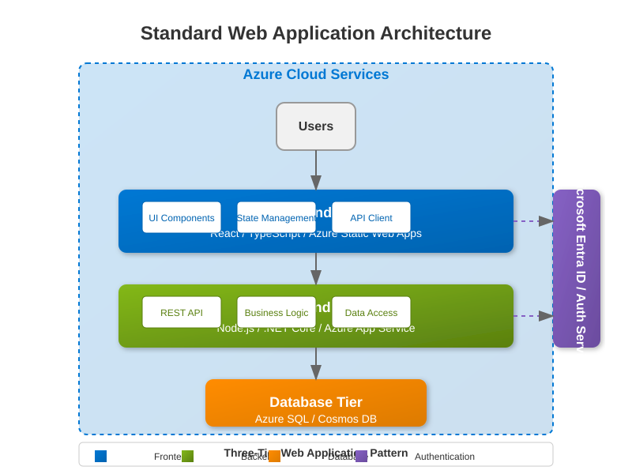
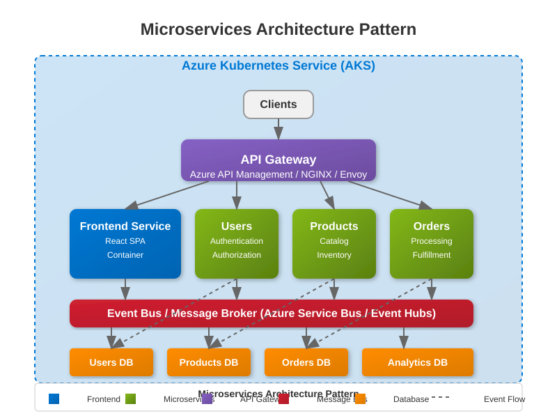
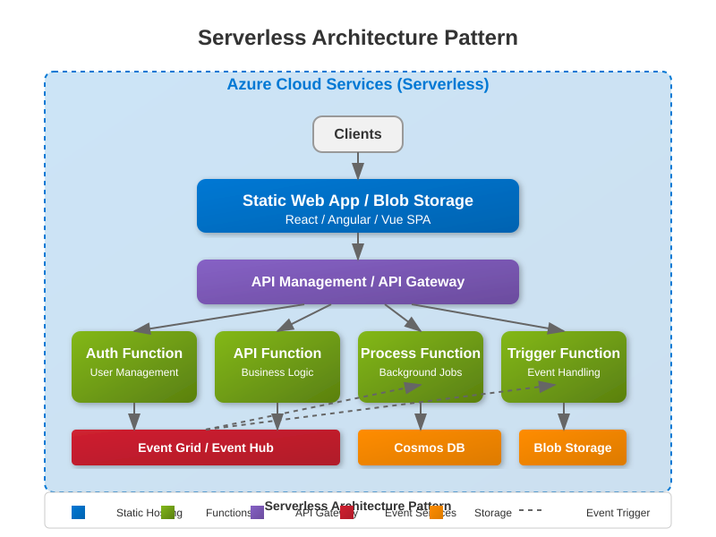
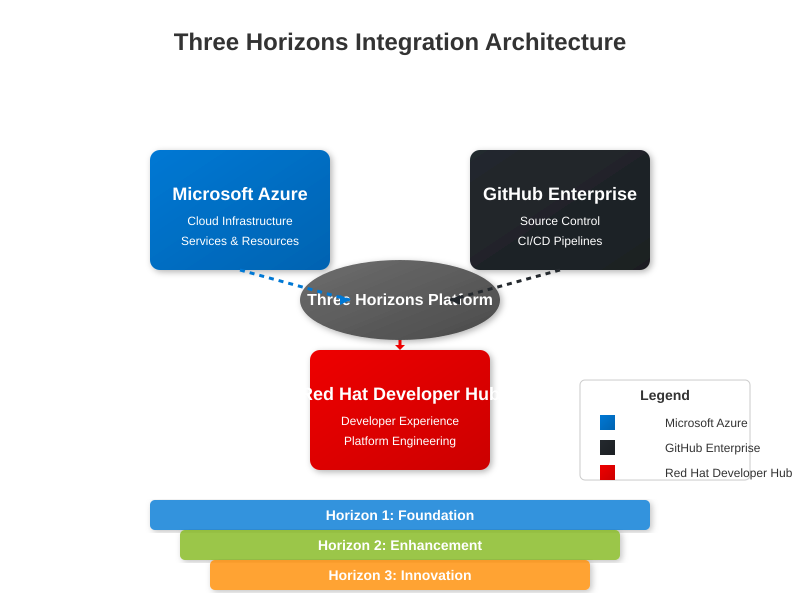
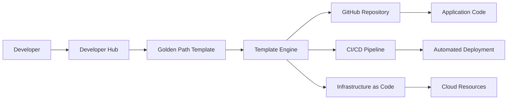

# <span style="color: #0366d6;">🛣️ Golden Paths Guide</span>

## <span style="color: #0366d6;">🔄 Overview</span>

Golden Paths are curated, well-supported development workflows that enable developers to build, deploy, and operate applications efficiently on the Three Horizons Platform. They represent the organization's recommended practices and provide streamlined experiences for common development scenarios.


> 🔍 **Golden Paths Concept:** The diagram illustrates how Golden Paths provide standardized, well-supported pathways for different application types across the Three Horizons Platform.

This guide explains the concept of Golden Paths, the available paths in the Three Horizons Platform, and how to use them to accelerate your development process.

## <span style="color: #0366d6;">🤔 What are Golden Paths?</span>

Golden Paths (sometimes called "paved roads") provide:

- **Pre-configured Templates**: Standardized application templates with best practices built-in
- **Automated Scaffolding**: Quick creation of new projects with the right structure
- **Integrated Toolchains**: CI/CD pipelines, testing frameworks, and operational tooling
- **Consistent Patterns**: Standard approaches to common development challenges
- **Reduced Cognitive Load**: Less decision fatigue for developers

While Golden Paths are recommended, they are not mandatory—developers maintain flexibility to make technology choices based on specific requirements.

## <span style="color: #0366d6;">💡 Benefits of Golden Paths</span>

- **Accelerated Onboarding**: New team members can start contributing quickly
- **Reduced Toil**: Less time spent on configuration and setup
- **Improved Quality**: Built-in best practices for security, testing, and performance
- **Operational Consistency**: Easier to support applications built on standard patterns
- **Focus on Business Logic**: Developers concentrate on creating value, not infrastructure

## <span style="color: #0366d6;">🧩 Available Golden Paths</span>

The Three Horizons Platform offers several Golden Paths designed for different application types and use cases:



> 💡 **Path Selection:** This diagram shows the different Golden Paths available in the platform, each tailored for specific application types and technology stacks. Select the path that best matches your project requirements.

### Web Application Path

Designed for building web applications and frontends.

**Technology Stack:**
- React/TypeScript frontend
- Node.js/Express backend (optional)
- Azure Container Apps hosting
- GitHub Actions for CI/CD

**Features:**
- Authentication integration with Microsoft Entra ID
- Responsive UI components
- Accessibility compliance
- End-to-end testing setup

**Usage:**
```bash
# Create a new web application
devhub create --template web-application --name mywebapp
```

### Microservice Path

Designed for building backend services and APIs.



> 🔍 **Microservice Architecture:** This diagram illustrates the typical architecture of applications built using the Microservice Golden Path, showing service boundaries and interactions.

**Technology Stack:**
- Node.js, Java (Spring Boot), or .NET Core
- OpenAPI/Swagger for API documentation
- Containerized with Docker
- Kubernetes deployment via AKS

**Features:**
- API versioning
- Health check endpoints
- Structured logging
- Metrics collection

**Usage:**
```bash
# Create a new microservice
devhub create --template microservice --language java --name myservice
```

### Data Processing Path

Designed for building data processing and analytics applications.



> 📊 **Data Flow:** This diagram shows how data flows through applications built with the Data Processing Golden Path, from ingestion through processing to insights.

**Technology Stack:**
- Python with data science libraries
- Azure Data Factory integration
- Azure Functions for event processing
- Cosmos DB or Azure SQL for storage

**Features:**
- Data validation schemas
- Batch and stream processing
- Monitoring and alerting setup
- Data lineage tracking

**Usage:**
```bash
# Create a new data processing application
devhub create --template data-processing --name mydataapp
```

### DevOps Extension Path

Designed for creating tooling and automation extensions.

**Technology Stack:**
- Terraform or Bicep for IaC
- Bash or PowerShell scripting
- GitHub Actions for automation
- Azure DevOps extensions

**Features:**
- Testing frameworks for infrastructure
- Security scanning integration
- Documentation generation
- Cross-platform compatibility

**Usage:**
```bash
# Create a new DevOps extension
devhub create --template devops-extension --name mytool
```

## <span style="color: #0366d6;">🚀 Using Golden Paths</span>

### Getting Started

1. Log in to the Red Hat Developer Hub
2. Navigate to the "Create" section
3. Browse available Golden Paths
4. Select the appropriate path for your project
5. Configure project parameters
6. Generate and download/clone your project

### Template Customization

While Golden Paths provide a standard starting point, you can customize them:

```bash
# View customization options
devhub template info --template microservice

# Create with custom parameters
devhub create --template microservice --parameters ./my-custom-params.json
```

### Version Control Integration

Golden Path templates are automatically set up with GitHub Enterprise integration:

```bash
# Initialize Git repository with template
devhub create --template web-application --name mywebapp --git-init

# Push to GitHub Enterprise
cd mywebapp
git remote add origin https://github.com/enterprise/mywebapp.git
git push -u origin main
```

## <span style="color: #0366d6;">🔄 Golden Path Lifecycle</span>

### Inner Loop Development

Each Golden Path includes tooling for efficient local development:



> 🔄 **Lifecycle Flow:** This diagram illustrates the complete lifecycle of applications built with Golden Paths, from local development through to production deployment and ongoing operations.

- Pre-configured dev containers
- Hot-reload capabilities
- Local testing frameworks
- Documentation generation

See the [Inner Loop Development Guide](./inner-loop-development.md) for more information.

### Outer Loop Integration

Golden Paths come with CI/CD pipeline configurations:

- GitHub Actions workflows
- Build and test automation
- Security scanning integration
- Deployment to Azure environments

See the [Outer Loop Deployment Guide](./outer-loop-deployment.md) for more information.

## <span style="color: #0366d6;">🤝 Contributing to Golden Paths</span>

The Three Horizons Platform encourages contributions to improve the Golden Paths:

### Feedback Process

1. Use the feedback button in the Developer Hub
2. Create GitHub issues with the `golden-path` label
3. Join the monthly Golden Path review meetings

### Proposing New Templates

To propose a new Golden Path template:

1. Fork the template repository
2. Develop your template following the contribution guidelines
3. Submit a pull request with comprehensive documentation
4. Participate in the review process

## <span style="color: #0366d6;">📋 Governance and Support</span>

### Maintenance

Golden Paths are maintained by the Platform Engineering team with:

- Regular security updates
- Dependency reviews
- Quarterly technology refreshes
- Documentation updates

### Support Channels

For issues with Golden Paths:

- **Chat**: #golden-paths channel in Teams
- **Office Hours**: Wednesdays, 1:00 PM - 3:00 PM
- **GitHub Issues**: Use the `support` label for template issues

## <span style="color: #0366d6;">✅ Best Practices</span>

- **Start Simple**: Choose the most appropriate Golden Path for your needs
- **Follow Conventions**: Adhere to the patterns established in the templates
- **Extend Thoughtfully**: Add custom functionality without breaking core patterns
- **Contribute Improvements**: Share enhancements that could benefit others
- **Stay Updated**: Regularly update to the latest template versions

## <span style="color: #0366d6;">❓ FAQ</span>

### When should I NOT use a Golden Path?

Golden Paths may not be appropriate when:
- You have unique technology requirements not supported by existing templates
- You're working on a prototype or proof-of-concept with a short lifespan
- You're migrating a legacy application with incompatible architecture

### How often are Golden Paths updated?

Major updates occur quarterly, while security patches and minor improvements are released as needed. All changes are documented in the changelog.

### Can I migrate between Golden Paths?

While possible, migration between paths can be challenging. It's best to select the appropriate path at the beginning of your project.

## <span style="color: #0366d6;">📚 Related Documentation</span>

- [Inner Loop Development Guide](./inner-loop-development.md)
- [Outer Loop Deployment Guide](./outer-loop-deployment.md)
- [Architecture Decision Records](../architecture/adrs.md)
- [Platform Engineering Strategy](../architecture/platform-engineering.md) 

## <span style="color: #0366d6;">📊 Diagram Key</span>

The diagrams in this guide use the following color coding and symbols:

| Color | Component | Description |
|-------|-----------|-------------|
| <span style="color: #0078D4;">■</span> Azure | Azure services and infrastructure | Cloud resources hosting the platform |
| <span style="color: #EE0000;">■</span> Red Hat | Developer Hub components | Developer experience and portal |
| <span style="color: #24292E;">■</span> GitHub | Source control and CI/CD | Code repositories and automation |
| <span style="color: #2188ff;">■</span> Horizon 1 | Foundation capabilities | Core platform elements |
| <span style="color: #f9c513;">■</span> Horizon 2 | Enhancement capabilities | Optimized features |
| <span style="color: #6f42c1;">■</span> Horizon 3 | Innovation capabilities | Advanced and transformative features |

> 🔍 **Note on Diagrams**: All architecture diagrams in this documentation reflect the latest Three Horizons Platform architecture as of April 2025, using a consistent styling and nomenclature. 

# Golden Paths Implementation Guide

## Overview

Golden Paths are pre-defined, well-architected templates that enable developers to quickly create standardized applications following best practices. They provide a streamlined developer experience while ensuring consistency, security, and compliance.

## Architecture



## Available Golden Paths

### 1. Web Application

Full-stack web application with modern architecture:

```yaml
# web-app-template.yaml
apiVersion: scaffolder.backstage.io/v1beta3
kind: Template
metadata:
  name: web-application
  title: Web Application
  description: Create a modern web application with React frontend and Node.js backend
  tags:
    - recommended
    - react
    - nodejs
spec:
  owner: platform-team
  type: service
  parameters:
    - title: Application Details
      required:
        - name
        - description
      properties:
        name:
          title: Application Name
          type: string
          pattern: '^[a-z0-9-]+$'
          description: Unique name for your application (lowercase, alphanumeric, hyphens only)
        description:
          title: Description
          type: string
          description: What does this application do?
          
    - title: Choose Features
      properties:
        features:
          title: Application Features
          type: array
          items:
            type: string
            enum:
              - authentication
              - database
              - caching
              - messaging
              - monitoring
          default: ['authentication', 'monitoring']
          uniqueItems: true
          
    - title: Infrastructure Options
      properties:
        region:
          title: Deployment Region
          type: string
          default: eastus
          enum:
            - eastus
            - westus2
            - centralus
            - westeurope
        environment:
          title: Initial Environment
          type: string
          default: development
          enum:
            - development
            - staging
            - production
            
  steps:
    - id: fetch
      name: Fetch Template
      action: fetch:template
      input:
        url: ./templates/web-app
        values:
          name: ${{ parameters.name }}
          description: ${{ parameters.description }}
          features: ${{ parameters.features }}
          
    - id: generate-manifests
      name: Generate Kubernetes Manifests
      action: generate:kubernetes
      input:
        name: ${{ parameters.name }}
        namespace: ${{ parameters.name }}-dev
        replicas: 2
        
    - id: publish
      name: Create GitHub Repository
      action: publish:github
      input:
        repoUrl: github.com?owner=your-org&repo=${{ parameters.name }}
        description: ${{ parameters.description }}
        topics:
          - three-horizons
          - web-app
          - ${{ parameters.name }}
        repoVisibility: private
        
    - id: register
      name: Register in Catalog
      action: catalog:register
      input:
        repoContentsUrl: ${{ steps.publish.output.repoContentsUrl }}
        catalogInfoPath: '/catalog-info.yaml'
        
    - id: create-pipeline
      name: Setup CI/CD Pipeline
      action: github:actions:create
      input:
        repoUrl: ${{ steps.publish.output.remoteUrl }}
        workflowPath: .github/workflows/ci-cd.yml
        
  output:
    links:
      - title: Repository
        url: ${{ steps.publish.output.remoteUrl }}
      - title: Open in IDE
        url: vscode://vscode.git/clone?url=${{ steps.publish.output.remoteUrl }}
```

### 2. Microservice API

RESTful API service with OpenAPI documentation:

```yaml
# api-service-template.yaml
apiVersion: scaffolder.backstage.io/v1beta3
kind: Template
metadata:
  name: api-service
  title: Microservice API
  description: Create a RESTful API service with OpenAPI documentation
spec:
  owner: platform-team
  type: service
  parameters:
    - title: API Details
      required:
        - name
        - port
      properties:
        name:
          title: Service Name
          type: string
          pattern: '^[a-z0-9-]+$'
        port:
          title: Service Port
          type: number
          default: 8080
        apiVersion:
          title: API Version
          type: string
          default: v1
          
    - title: API Features
      properties:
        authentication:
          title: Authentication Method
          type: string
          enum:
            - jwt
            - oauth2
            - api-key
            - none
          default: jwt
        database:
          title: Database Type
          type: string
          enum:
            - postgresql
            - mysql
            - mongodb
            - none
          default: postgresql
```

### 3. Event-Driven Service

Kafka-based event processing service:

```yaml
# event-service-template.yaml
apiVersion: scaffolder.backstage.io/v1beta3
kind: Template
metadata:
  name: event-driven-service
  title: Event-Driven Service
  description: Create an event-driven microservice with Kafka integration
spec:
  owner: platform-team
  type: service
  parameters:
    - title: Service Configuration
      required:
        - name
        - eventType
      properties:
        name:
          title: Service Name
          type: string
        eventType:
          title: Event Type
          type: string
          enum:
            - producer
            - consumer
            - stream-processor
        topics:
          title: Kafka Topics
          type: array
          items:
            type: string
```

## Template Structure

### Directory Layout

```
templates/
├── web-app/
│   ├── template.yaml
│   ├── skeleton/
│   │   ├── README.md
│   │   ├── package.json
│   │   ├── Dockerfile
│   │   ├── .github/
│   │   │   └── workflows/
│   │   │       └── ci-cd.yml
│   │   ├── src/
│   │   │   ├── frontend/
│   │   │   └── backend/
│   │   ├── k8s/
│   │   │   ├── deployment.yaml
│   │   │   ├── service.yaml
│   │   │   └── ingress.yaml
│   │   └── catalog-info.yaml
│   └── content/
│       └── docs/
│           └── index.md
```

### Example Skeleton Files

#### Dockerfile Template

```dockerfile
# Dockerfile.njk
FROM node:18-alpine AS builder

WORKDIR /app

# Copy package files
COPY package*.json ./

COPY frontend/package*.json ./frontend/


COPY backend/package*.json ./backend/


# Install dependencies
RUN npm ci --only=production

# Copy source code
COPY . .

# Build application
RUN npm run build

# Production stage
FROM node:18-alpine

WORKDIR /app

# Install dumb-init for proper signal handling
RUN apk add --no-cache dumb-init

# Create non-root user
RUN addgroup -g 1001 -S nodejs
RUN adduser -S nodejs -u 1001

# Copy built application
COPY --from=builder --chown=nodejs:nodejs /app .

USER nodejs

EXPOSE {{ port | default(8080) }}

ENTRYPOINT ["dumb-init", "--"]
CMD ["node", "dist/index.js"]
```

#### Kubernetes Deployment

```yaml
# deployment.yaml.njk
apiVersion: apps/v1
kind: Deployment
metadata:
  name: {{ name }}
  labels:
    app: {{ name }}
    version: {{ version | default('1.0.0') }}
spec:
  replicas: {{ replicas | default(2) }}
  selector:
    matchLabels:
      app: {{ name }}
  template:
    metadata:
      labels:
        app: {{ name }}
        version: {{ version | default('1.0.0') }}
    spec:
      serviceAccountName: {{ name }}
      containers:
      - name: {{ name }}
        image: {{ registry }}/{{ name }}:{{ version | default('1.0.0') }}
        ports:
        - containerPort: {{ port | default(8080) }}
          name: http
        env:
        - name: NODE_ENV
          value: {{ environment | default('production') }}
        
        - name: DATABASE_URL
          valueFrom:
            secretKeyRef:
              name: {{ name }}-secrets
              key: database-url
        
        resources:
          requests:
            memory: "128Mi"
            cpu: "100m"
          limits:
            memory: "512Mi"
            cpu: "500m"
        livenessProbe:
          httpGet:
            path: /health/live
            port: http
          initialDelaySeconds: 30
          periodSeconds: 10
        readinessProbe:
          httpGet:
            path: /health/ready
            port: http
          initialDelaySeconds: 20
          periodSeconds: 5
```

#### CI/CD Pipeline

```yaml
# ci-cd.yml.njk
name: CI/CD Pipeline

on:
  push:
    branches: [main, develop]
  pull_request:
    branches: [main]

env:
  REGISTRY: {{ registry | default('ghcr.io') }}
  IMAGE_NAME: {{ "${{ github.repository }}" }}

jobs:
  test:
    runs-on: ubuntu-latest
    steps:
    - uses: actions/checkout@v4
    
    - name: Setup Node.js
      uses: actions/setup-node@v4
      with:
        node-version: '18'
        cache: 'npm'
        
    - name: Install dependencies
      run: npm ci
      
    - name: Run tests
      run: npm test
      
    - name: Run linting
      run: npm run lint
      
    
    - name: Security scan
      uses: aquasecurity/trivy-action@master
      with:
        scan-type: 'fs'
        scan-ref: '.'
    
    
  build:
    needs: test
    runs-on: ubuntu-latest
    if: github.event_name == 'push'
    permissions:
      contents: read
      packages: write
      
    steps:
    - uses: actions/checkout@v4
    
    - name: Log in to Container Registry
      uses: docker/login-action@v3
      with:
        registry: {{ "${{ env.REGISTRY }}" }}
        username: {{ "${{ github.actor }}" }}
        password: {{ "${{ secrets.GITHUB_TOKEN }}" }}
        
    - name: Build and push Docker image
      uses: docker/build-push-action@v5
      with:
        context: .
        push: true
        tags: |
          {{ "${{ env.REGISTRY }}/${{ env.IMAGE_NAME }}:${{ github.sha }}" }}
          {{ "${{ env.REGISTRY }}/${{ env.IMAGE_NAME }}:latest" }}
          
  deploy:
    needs: build
    runs-on: ubuntu-latest
    if: github.ref == 'refs/heads/main'
    steps:
    - uses: actions/checkout@v4
    
    - name: Deploy to Kubernetes
      uses: azure/k8s-deploy@v4
      with:
        namespace: {{ name }}-{{ environment }}
        manifests: |
          k8s/deployment.yaml
          k8s/service.yaml
          k8s/ingress.yaml
        images: |
          {{ "${{ env.REGISTRY }}/${{ env.IMAGE_NAME }}:${{ github.sha }}" }}
```

## Creating Custom Golden Paths

### Step 1: Define Template Metadata

```yaml
apiVersion: scaffolder.backstage.io/v1beta3
kind: Template
metadata:
  name: custom-service
  title: Custom Service Template
  description: Your custom service description
  tags:
    - custom
    - backend
spec:
  owner: your-team
  type: service
```

### Step 2: Create Parameters Schema

```yaml
parameters:
  - title: Basic Information
    required:
      - name
    properties:
      name:
        title: Name
        type: string
        pattern: '^[a-z0-9-]+$'
    
  - title: Advanced Options
    properties:
      enableFeatureX:
        title: Enable Feature X
        type: boolean
        default: false
```

### Step 3: Define Actions

```yaml
steps:
  - id: fetch
    name: Fetch Base Template
    action: fetch:template
    input:
      url: ./skeleton
      values:
        name: ${{ parameters.name }}
        
  - id: custom-action
    name: Custom Processing
    action: custom:process
    input:
      data: ${{ parameters }}
```

### Step 4: Implement Custom Actions

```typescript
// custom-action.ts
import { createTemplateAction } from '@backstage/plugin-scaffolder-backend';

export const customProcessAction = createTemplateAction<{
  data: any;
}>({
  id: 'custom:process',
  schema: {
    input: {
      required: ['data'],
      type: 'object',
      properties: {
        data: {
          type: 'object',
          description: 'Input data to process',
        },
      },
    },
  },
  async handler(ctx) {
    const { data } = ctx.input;
    
    // Custom processing logic
    ctx.logger.info(`Processing data for ${data.name}`);
    
    // Generate additional files
    await ctx.output.writeFile(
      'custom-config.json',
      JSON.stringify(data, null, 2)
    );
  },
});
```

## Best Practices

### 1. Template Design

- **Keep it Simple**: Start with minimal options and add complexity gradually
- **Sensible Defaults**: Provide good defaults for optional parameters
- **Clear Documentation**: Include comprehensive README and inline comments
- **Version Control**: Version your templates for backward compatibility

### 2. Security Considerations

```yaml
# Include security scanning in all templates
- id: security-scan
  name: Security Scan
  action: security:scan
  input:
    scanType: 'dependency'
    failOnVulnerability: true
```

### 3. Monitoring Integration

```yaml
# Automatic monitoring setup
- id: setup-monitoring
  name: Configure Monitoring
  action: monitoring:setup
  input:
    service: ${{ parameters.name }}
    alerts:
      - type: availability
        threshold: 99.9
      - type: latency
        threshold: 500ms
```

### 4. Testing Templates

```bash
# Test template locally
npm run test:template -- --template web-app

# Validate template syntax
backstage-cli template:validate ./templates/web-app

# Dry run template
backstage-cli template:dry-run ./templates/web-app
```

## Integration with CI/CD

### GitHub Actions Integration

```yaml
# .github/workflows/template-validation.yml
name: Validate Templates

on:
  pull_request:
    paths:
      - 'templates/**'

jobs:
  validate:
    runs-on: ubuntu-latest
    steps:
    - uses: actions/checkout@v4
    
    - name: Setup Node.js
      uses: actions/setup-node@v4
      
    - name: Install Backstage CLI
      run: npm install -g @backstage/cli
      
    - name: Validate Templates
      run: |
        for template in templates/*/; do
          backstage-cli template:validate "$template"
        done
```

## Metrics and Analytics

### Tracking Template Usage

```typescript
// analytics.ts
export async function trackTemplateUsage(
  templateId: string,
  parameters: any
) {
  await analytics.track({
    event: 'template_used',
    properties: {
      templateId,
      timestamp: new Date().toISOString(),
      features: parameters.features || [],
      environment: parameters.environment,
    },
  });
}
```

### Success Metrics

- **Adoption Rate**: Number of projects created from templates
- **Time to Production**: Average time from creation to deployment
- **Template Satisfaction**: Developer feedback scores
- **Error Rate**: Failed template executions

## Troubleshooting

### Common Issues

1. **Template Fetch Failures**
   ```bash
   # Check template URL accessibility
   curl -I https://github.com/your-org/templates
   ```

2. **Parameter Validation Errors**
   ```yaml
   # Ensure proper schema definition
   properties:
     name:
       type: string
       pattern: '^[a-z0-9-]+$'  # Must be valid regex
   ```

3. **Action Execution Failures**
   ```typescript
   // Add proper error handling
   try {
     await executeAction();
   } catch (error) {
     ctx.logger.error(`Action failed: ${error.message}`);
     throw error;
   }
   ```

## Next Steps

- [Inner Loop Development Guide](./inner-loop.md)
- [Outer Loop Development Guide](./outer-loop.md)
- [Platform Engineering Best Practices](./platform-engineering.md) 