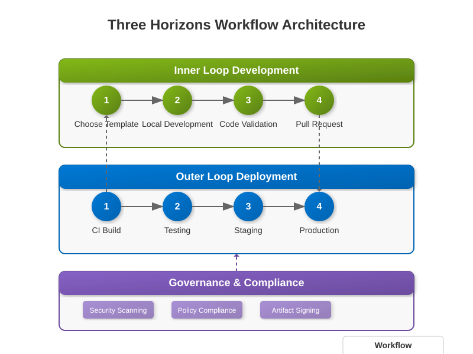
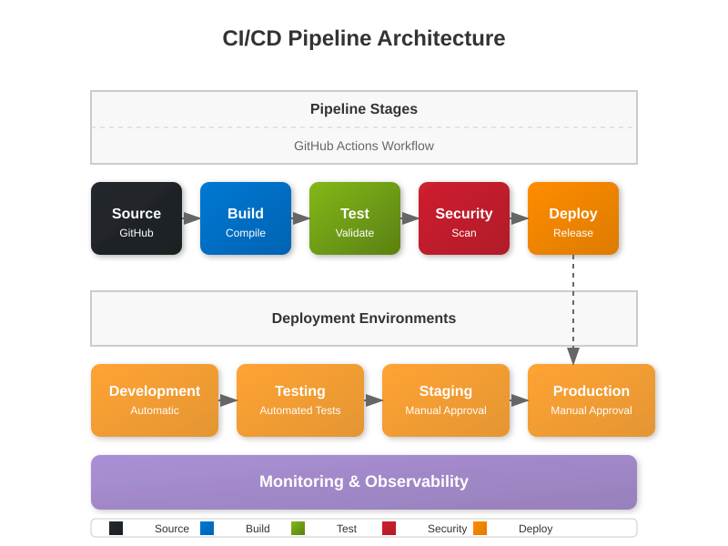

# <span style="color: #0366d6;">🧑‍💻 Inner Loop Development Guide</span>

## <span style="color: #0366d6;">🔄 Overview</span>

The Inner Loop Development process is a core component of the Three Horizons Platform, providing developers with a streamlined workflow for local development, testing, and validation before code is integrated into the main codebase. This guide explains the inner loop concepts, tools, and best practices to help you become productive quickly.



> 🔍 **Note:** The diagram above illustrates the developer's Inner Loop workflow, showing the cycle of writing, building, running, testing, and debugging code locally before committing to shared repositories.

## <span style="color: #0366d6;">🤔 What is the Inner Loop?</span>

The Inner Loop refers to the development workflow that happens locally on a developer's machine. It encompasses the cycle of:

1. Code writing
2. Building
3. Running
4. Testing
5. Debugging

This cycle is repeated frequently as you develop features or fix bugs, all before committing code to the shared repository.

## <span style="color: #0366d6;">📋 Prerequisites</span>

Before starting with the inner loop development process, ensure you have:

- **Developer Hub Access**: Authenticated access to the Red Hat Developer Hub
- **Local Development Environment**: Configured according to the standards (see [Environment Setup](../getting-started/environment-setup.md))
- **Required CLI Tools**: 
  - Git
  - Azure CLI
  - DevHub CLI
  - Language-specific tools (Node.js, Java, Python, etc.)
- **IDE**: Visual Studio Code with recommended extensions or JetBrains IDEs

## <span style="color: #0366d6;">🔄 Inner Loop Workflow</span>

### 1. Project Initialization

#### Starting a New Project

1. Log in to the Red Hat Developer Hub portal
2. Navigate to the "Create" section
3. Select an appropriate template from the Golden Paths catalog
4. Configure project parameters (name, description, initial setup)
5. Generate the project skeleton

#### Working with Existing Projects

```bash
# Clone the repository
git clone https://github.com/enterprise/your-project.git

# Navigate to project directory
cd your-project

# Install dependencies
# For Node.js
npm install

# For Python
pip install -r requirements.txt

# For Java
./mvnw install
```

### 2. Local Development

#### Running the Application Locally

Each project includes scripts for local development:

```bash
# Start development server
npm run dev

# Or for Python applications
python manage.py runserver

# Or for Java applications
./mvnw spring-boot:run
```

#### Local Containerization (Optional)

For testing in a container environment that mirrors production:

```bash
# Build container image
docker build -t your-project:dev .

# Run container
docker run -p 8080:8080 your-project:dev
```

### 3. Code Validation

Before submitting your changes, run local validations:

#### Running Tests

```bash
# Unit tests
npm test

# Integration tests
npm run test:integration
```

#### Code Quality Checks

```bash
# Linting
npm run lint

# Type checking (TypeScript)
npm run type-check

# Security scan
npm run security-scan
```

#### Pre-commit Hooks

The Three Horizons Platform includes pre-configured Git hooks to ensure quality:

- Format checking
- Lint validation
- Test running
- Conventional commit message enforcement

### 4. Local Preview of Documentation

For projects with documentation:

```bash
# Generate and serve documentation
npm run docs:dev
```

### 5. Prepare for Pull Request

Once your local changes are ready:

```bash
# Check status
git status

# Add changed files
git add .

# Commit with conventional commit messages
git commit -m "feat: add new user authentication flow"

# Push to your branch
git push origin feature/user-auth
```

## <span style="color: #0366d6;">🔄 Integration with the Outer Loop</span>

The Inner Loop connects to the Outer Loop (CI/CD) workflow when:

1. You create a Pull Request in GitHub Enterprise
2. The CI pipeline validates your changes
3. Code is reviewed and approved
4. Changes are merged and deployed through the CD pipeline



> 📝 **Integration Note:** This diagram shows how the Inner Loop development workflow connects to the Outer Loop CI/CD process, creating a complete development lifecycle.

See the [Outer Loop Deployment Guide](./outer-loop-deployment.md) for more information on what happens after your code leaves the Inner Loop.

## <span style="color: #0366d6;">🛠️ Troubleshooting</span>

### Common Issues and Solutions

#### Build Failures

- Ensure all dependencies are installed
- Check for compatible versions of libraries
- Verify environment variables are set correctly

#### Runtime Errors

- Check logs using `npm run logs` or equivalent command
- Verify configuration settings
- Ensure required services (databases, APIs) are accessible

#### Test Failures

- Run tests with `--verbose` flag for more details
- Update test fixtures if APIs or models have changed
- Check for environment-specific issues

## <span style="color: #0366d6;">✅ Best Practices</span>

- **Commit Often**: Make small, focused commits that address a single concern
- **Use Feature Branches**: Always develop in feature branches, not directly in main
- **Follow Coding Standards**: Adhere to the project's coding conventions
- **Write Tests**: Include tests for new functionality and bug fixes
- **Document Changes**: Update documentation alongside code changes
- **Peer Review**: Consider informal peer reviews before creating a PR


> 🔍 **Best Practices Note:** This diagram highlights how the Inner Loop development practices integrate with the broader Three Horizons architecture, emphasizing the developer's role in the platform ecosystem.

## <span style="color: #0366d6;">🧰 Tools and Resources</span>

### Recommended Extensions

- **VS Code**:
  - ESLint
  - Prettier
  - GitLens
  - DevHub Companion

### CLI Tools

- **DevHub CLI**: For interacting with the Developer Hub (`devhub --help`)
- **Project-specific tools**: Documented in each project's README

## <span style="color: #0366d6;">📚 Related Documentation</span>

- [Outer Loop Deployment Guide](./outer-loop-deployment.md)
- [Golden Paths Guide](./golden-paths.md)
- [Local Development Setup](../implementation/local-development.md)
- [Testing Best Practices](../implementation/testing-best-practices.md)

## <span style="color: #0366d6;">📊 Diagram Key</span>

The diagrams in this guide use the following color coding and symbols:

| Color | Component | Description |
|-------|-----------|-------------|
| <span style="color: #0078D4;">■</span> Azure | Azure services and infrastructure | Cloud resources hosting the platform |
| <span style="color: #EE0000;">■</span> Red Hat | Developer Hub components | Developer experience and portal |
| <span style="color: #24292E;">■</span> GitHub | Source control and CI/CD | Code repositories and automation |
| <span style="color: #2188ff;">■</span> Horizon 1 | Foundation capabilities | Core platform elements |
| <span style="color: #f9c513;">■</span> Horizon 2 | Enhancement capabilities | Optimized features |
| <span style="color: #6f42c1;">■</span> Horizon 3 | Innovation capabilities | Advanced and transformative features |

> 🔍 **Note on Diagrams**: All architecture diagrams in this documentation reflect the latest Three Horizons Platform architecture as of April 2025, using a consistent styling and nomenclature.

#### Avoiding Burnout

- Take regular breaks
- Communicate blockers early
- Don't sacrifice code quality for speed
- Maintain work-life balance 