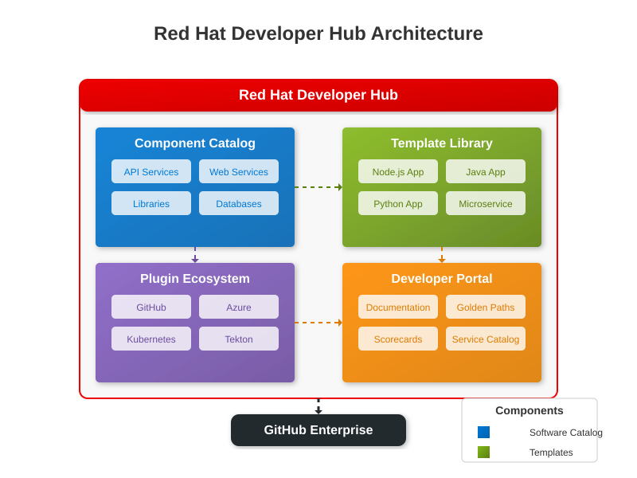

# <span style="color: #0366d6;">🏗️ Your Installation Journey</span>

**Navigation:** [Home](../../README.md) > [Getting Started](README.md) > Installation


> 🔍 **Installation Note:** This diagram illustrates the components you will be installing as part of the Three Horizons Platform, showing how they work together to create a unified developer experience.

Welcome to your Three Horizons Platform installation journey! This guide walks you through the complete process of deploying the platform in your environment. By following these structured steps, you'll establish the foundation for your organization's developer experience transformation.

## <span style="color: #0366d6;">📋 Prerequisites</span>

Before you begin, ensure you have:

- An Azure subscription with Owner or Contributor access
- A GitHub Enterprise account or GitHub organization with admin access
- GitHub Copilot subscription for your organization
- Admin access to a domain name (for configuring DNS)
- A workstation with the following tools installed:
  - Azure CLI (latest version)
  - Git (latest version)
  - kubectl (latest version)
  - Helm v3 (latest version)
  - OpenShift CLI (if using ARO)
  - VS Code or JetBrains IDE with GitHub Copilot extension

## <span style="color: #0366d6;">⚙️ Installation Options</span>

The Three Horizons Platform offers three primary installation options:

| Installation Option | Description | Recommended For |
|---------------------|-------------|----------------|
| **Basic** | Core components with minimal configuration | Evaluation, small teams |
| **Standard** | Complete platform with default configuration | Most organizations |
| **Enterprise** | Full platform with high availability and advanced security | Large enterprises with strict requirements |

This guide covers the Standard installation. For other options, see the [Implementation Guide](../2-implementation-guide/README.md) for customized deployment scenarios.

## <span style="color: #0366d6;">🔄 Step 1: Prepare Your Environment</span>

First, log in to Azure and set up your environment:

```bash
# Login to Azure
az login

# Set your subscription
az account set --subscription "Your-Subscription-ID"

# Create a resource group
az group create --name three-horizons-rg --location centralus

# Register required resource providers
az provider register --namespace Microsoft.Kubernetes
az provider register --namespace Microsoft.KubernetesConfiguration
az provider register --namespace Microsoft.ContainerRegistry
az provider register --namespace Microsoft.OperationalInsights
```

## <span style="color: #0366d6;">🔄 Step 2: Choose Your Infrastructure Platform</span>


> 🔍 **Platform Note:** Choose the infrastructure platform that best fits your organization's needs. AKS provides a managed Kubernetes experience, while ARO offers an enterprise-grade OpenShift experience.

### Option A: Azure Kubernetes Service (AKS)

```bash
# Create AKS cluster
az aks create \
  --resource-group three-horizons-rg \
  --name three-horizons-aks \
  --node-count 3 \
  --enable-addons monitoring \
  --generate-ssh-keys

# Get AKS credentials
az aks get-credentials \
  --resource-group three-horizons-rg \
  --name three-horizons-aks
```

### Option B: Azure Red Hat OpenShift (ARO)

```bash
# Create ARO cluster
az aro create \
  --resource-group three-horizons-rg \
  --name three-horizons-aro \
  --vnet-name aro-vnet \
  --master-subnet master-subnet \
  --worker-subnet worker-subnet

# Get ARO credentials
az aro list-credentials \
  --resource-group three-horizons-rg \
  --name three-horizons-aro
```

## <span style="color: #0366d6;">🔄 Step 3: Deploy Red Hat Developer Hub</span>

### For AKS:

```bash
# Create namespace for Developer Hub
kubectl create namespace developer-hub

# Install Red Hat Developer Hub Operator using OLM
kubectl apply -f - <<EOF
apiVersion: operators.coreos.com/v1alpha1
kind: CatalogSource
metadata:
  name: redhat-operators
  namespace: olm
spec:
  displayName: Red Hat Operators
  publisher: Red Hat
  sourceType: grpc
  image: registry.redhat.io/redhat/redhat-operator-index:v4.13
  updateStrategy:
    registryPoll:
      interval: 30m
EOF

# Create OperatorGroup
kubectl apply -f - <<EOF
apiVersion: operators.coreos.com/v1
kind: OperatorGroup
metadata:
  name: developer-hub-operatorgroup
  namespace: developer-hub
spec:
  targetNamespaces:
  - developer-hub
EOF

# Install RHDH Operator v1.5
kubectl apply -f - <<EOF
apiVersion: operators.coreos.com/v1alpha1
kind: Subscription
metadata:
  name: rhdh-operator
  namespace: developer-hub
spec:
  channel: stable
  name: rhdh-operator
  source: redhat-operators
  sourceNamespace: olm
  startingCSV: rhdh-operator.v1.5.0
EOF

# Deploy RHDH instance
kubectl apply -f - <<EOF
apiVersion: rhdh.redhat.com/v1alpha1
kind: Backstage
metadata:
  name: developer-hub
  namespace: developer-hub
spec:
  application:
    replicas: 1
    resources:
      requests:
        cpu: "500m"
        memory: "1Gi"
      limits:
        cpu: "1"
        memory: "2Gi"
  database:
    enableLocalPostgres: true
  rbac:
    enabled: true
  extraEnvs:
    - name: RHDH_CONFIG_APP_CONFIG_app_baseUrl
      value: "https://devhub.yourdomain.com"
    - name: RHDH_DYNAMIC_PLUGINS_BACKEND_DYNAMIC_PLUGINS
      value: "true"
EOF
```

### For ARO:

```bash
# Login to OpenShift
oc login --token=<token> --server=<server>

# Create project for Developer Hub
oc new-project developer-hub

# Install Red Hat Developer Hub Operator from OperatorHub
oc apply -f - <<EOF
apiVersion: operators.coreos.com/v1alpha1
kind: Subscription
metadata:
  name: rhdh-operator
  namespace: openshift-operators
spec:
  channel: stable
  name: rhdh-operator
  source: redhat-operators
  sourceNamespace: openshift-marketplace
  startingCSV: rhdh-operator.v1.5.0
EOF

# Deploy RHDH instance
oc apply -f - <<EOF
apiVersion: rhdh.redhat.com/v1alpha1
kind: Backstage
metadata:
  name: developer-hub
  namespace: developer-hub
spec:
  application:
    replicas: 1
    resources:
      requests:
        cpu: "500m"
        memory: "1Gi"
      limits:
        cpu: "1"
        memory: "2Gi"
  database:
    enableLocalPostgres: true
  rbac:
    enabled: true
  route:
    enabled: true
    host: devhub.yourdomain.com
    tls:
      insecureEdgeTerminationPolicy: Redirect
      termination: edge
  extraEnvs:
    - name: RHDH_CONFIG_APP_CONFIG_app_baseUrl
      value: "https://devhub.yourdomain.com"
    - name: RHDH_DYNAMIC_PLUGINS_BACKEND_DYNAMIC_PLUGINS
      value: "true"
EOF
```

## <span style="color: #0366d6;">🔄 Step 4: Configure Microsoft Entra ID Integration</span>

```bash
# Register an application in Microsoft Entra ID
az ad app create \
  --display-name "Three Horizons Platform" \
  --web-redirect-uris "https://devhub.yourdomain.com/oauth/callback" \
  --identifier-uris "https://devhub.yourdomain.com" \
  --app-roles @app-roles.json

# Create service principal
az ad sp create --id <application-id>

# Assign permissions
az role assignment create \
  --assignee <service-principal-id> \
  --role "Contributor" \
  --scope /subscriptions/<subscription-id>/resourceGroups/three-horizons-rg
```

## <span style="color: #0366d6;">🔄 Step 5: Configure GitHub Copilot Integration</span>



> 🤖 **AI Integration:** GitHub Copilot enhances developer productivity through AI-assisted code completion and suggestions, integrating directly with your development environments.

Enhance your platform with AI-assisted development capabilities through GitHub Copilot integration.

### Enable GitHub Copilot for Your Organization

1. As a GitHub organization admin, navigate to your organization settings
2. Go to GitHub Copilot settings
3. Enable GitHub Copilot for your organization
4. Assign GitHub Copilot seats to your development team members

### Set Up GitHub Copilot for CI/CD

```bash
# Create a service principal for GitHub Actions integration
az ad sp create-for-rbac --name "github-copilot-cicd" \
  --role contributor \
  --scopes /subscriptions/<subscription-id>/resourceGroups/three-horizons-rg \
  --sdk-auth

# Add the JSON output as a GitHub secret named AZURE_CREDENTIALS
# in your GitHub repository settings
```

### Configure GitHub Copilot in Developer Environments

Ensure all developers install the GitHub Copilot extension in their IDEs:

- **VS Code**: Search for "GitHub Copilot" in the extensions marketplace
- **JetBrains IDEs**: Install via Settings > Plugins > Marketplace

For detailed configuration and usage guidance, see the [GitHub Copilot Integration Guide](github-copilot-integration.md).

## <span style="color: #0366d6;">🔄 Step 6: Configure GitHub Integration</span>

```bash
# Create GitHub App
# Follow the instructions at: https://docs.github.com/en/developers/apps/creating-a-github-app

# Install the GitHub App in your organization

# Create Kubernetes secret for GitHub integration
kubectl create secret generic github-app-credentials \
  --namespace developer-hub \
  --from-literal=app-id=<your-github-app-id> \
  --from-literal=private-key="<your-github-app-private-key>"

# Configure Developer Hub to use GitHub integration
kubectl apply -f github-integration.yaml
```

## <span style="color: #0366d6;">🔄 Step 7: Configure DNS and TLS</span>

Secure your platform with proper DNS configuration and TLS certificates:

```bash
# Get load balancer IP/hostname
HOSTNAME=$(kubectl get svc -n developer-hub developer-hub-frontend -o jsonpath='{.status.loadBalancer.ingress[0].ip}')

# Update your DNS records to point to this IP

# Install cert-manager for TLS
kubectl apply -f https://github.com/jetstack/cert-manager/releases/download/v1.7.0/cert-manager.yaml

# Create certificate for Developer Hub
kubectl apply -f devhub-certificate.yaml
```

## <span style="color: #0366d6;">✅ Step 8: Verification</span>

After installation, verify that all components are running correctly:

```bash
# Check pod status
kubectl get pods -n developer-hub

# Check web access
# Open https://devhub.yourdomain.com in your browser

# Test authentication
# Try logging in with your Microsoft Entra ID credentials

# Verify GitHub integration
# Check that repositories are available in Developer Hub
```

## <span style="color: #0366d6;">🔍 Finalize Your Installation</span>

Complete your installation by following these configuration steps:

1. Log in to the Developer Hub web interface
2. Navigate to **Settings** > **General**
3. Configure the basic settings:
   - Organization name
   - Theme and branding
   - Default user role
4. Configure Golden Paths under **Settings** > **Scaffolder**
5. Set up your catalog under **Settings** > **Catalog**

## <span style="color: #0366d6;">🔍 Continue Your Journey</span>

Now that you've successfully installed the Three Horizons Platform, continue your journey with these next steps:

- [Configure Golden Paths](../documentation/guides/golden-paths.md) - Create standardized development workflows
- [Set Up Inner Loop Development](../documentation/guides/inner-loop-development.md) - Implement developer workflows
- [Set Up Outer Loop Deployment](../documentation/guides/outer-loop-deployment.md) - Configure deployment pipelines
- [Create Custom Templates](../2-implementation-guide/README.md) - Customize for your organization


> 🔄 **Continuous Journey:** Your Three Horizons Platform implementation is a continuous journey. After installation, continue to evolve and enhance your platform to meet your organization's needs.

For additional implementation guidance, proceed to the [Implementation Guide](../2-implementation-guide/README.md).

## <span style="color: #0366d6;">📊 Diagram Key</span>

The diagrams in this guide use the following color coding and symbols:

| Color | Component | Description |
|-------|-----------|-------------|
| <span style="color: #0078D4;">■</span> Azure | Azure services and infrastructure | Cloud resources hosting the platform |
| <span style="color: #EE0000;">■</span> Red Hat | Developer Hub components | Developer experience and portal |
| <span style="color: #24292E;">■</span> GitHub | Source control and CI/CD | Code repositories and automation |
| <span style="color: #2188ff;">■</span> Horizon 1 | Foundation capabilities | Core platform elements |
| <span style="color: #f9c513;">■</span> Horizon 2 | Enhancement capabilities | Optimized features |
| <span style="color: #6f42c1;">■</span> Horizon 3 | Innovation capabilities | Advanced and transformative features |

> 🔍 **Note on Diagrams**: All architecture diagrams in this documentation reflect the latest Three Horizons Platform architecture as of April 2025, using a consistent styling and nomenclature.

---

<footer>
  <p align="center">Last updated: April 10, 2025 | <a href="../../.github/CONTRIBUTING.md">Contribute to this document</a></p>
</footer>