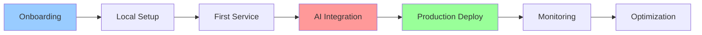
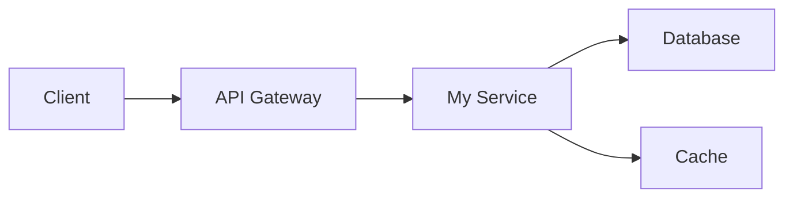

# 👨‍💻 Developer Guide - Building on the Three Horizons AI Platform

<div align="center">

**Your Complete Guide to AI-Powered Development**

</div>

## 📋 Table of Contents

1. [Getting Started](#-getting-started)
2. [Platform Overview](#-platform-overview)
3. [Development Environment](#-development-environment)
4. [Creating Your First Service](#-creating-your-first-service)
5. [Working with AI Assistance](#-working-with-ai-assistance)
6. [Testing and Quality](#-testing-and-quality)
7. [Deployment and Operations](#-deployment-and-operations)
8. [Monitoring and Debugging](#-monitoring-and-debugging)
9. [Best Practices](#-best-practices)
10. [Resources and Support](#-resources-and-support)

## 🚀 Getting Started

### Welcome to Three Horizons!

As a developer on the Three Horizons AI Platform, you have access to cutting-edge AI-powered development tools that will dramatically improve your productivity and code quality. This guide will walk you through everything you need to know.

### Quick Start Checklist

- [ ] **Account Setup**: GitHub, Azure, and Developer Hub access
- [ ] **Environment**: VS Code with Copilot installed
- [ ] **Authentication**: CLI tools configured
- [ ] **Training**: Complete onboarding modules
- [ ] **First App**: Deploy your hello-world service

### Your Development Journey



## 🏗️ Platform Overview

### Architecture Layers

| Layer | Purpose | Tools |
|-------|---------|-------|
| **Development** | Code creation and testing | VS Code, Copilot, DevBox |
| **Integration** | Build and quality checks | GitHub Actions, SonarQube |
| **Deployment** | Progressive rollout | GitOps, Flagger, ArgoCD |
| **Runtime** | Container orchestration | Kubernetes, Istio |
| **Monitoring** | Observability | Prometheus, Grafana, Jaeger |
| **AI Services** | Intelligence layer | Azure AI, Copilot Agent |

### Key Components You'll Use

1. **Developer Hub**: Your central portal for all platform services
2. **GitHub Copilot**: AI pair programmer for code generation
3. **DevBox**: Cloud-powered development environments
4. **Golden Paths**: Pre-configured templates for common patterns
5. **Agentic DevOps**: Autonomous CI/CD pipelines

## 💻 Development Environment

### 1. Local Setup Script

```bash
#!/bin/bash
# developer-setup.sh - Run this first!

echo "🚀 Setting up your Three Horizons development environment"

# Check prerequisites
check_requirement() {
    if ! command -v $1 &> /dev/null; then
        echo "❌ $1 is not installed. Please install it first."
        exit 1
    fi
    echo "✅ $1 is installed"
}

echo "📋 Checking requirements..."
check_requirement git
check_requirement docker
check_requirement kubectl
check_requirement code

# Configure Git
echo "🔧 Configuring Git..."
git config --global init.defaultBranch main
git config --global pull.rebase false

# Install VS Code extensions
echo "💻 Installing VS Code extensions..."
extensions=(
    "GitHub.copilot"
    "GitHub.copilot-chat"
    "ms-vscode-remote.remote-containers"
    "ms-kubernetes-tools.vscode-kubernetes-tools"
    "redhat.vscode-yaml"
    "hashicorp.terraform"
)

for ext in "${extensions[@]}"; do
    code --install-extension "$ext"
done

# Authenticate with services
echo "🔐 Setting up authentication..."

# GitHub
if ! gh auth status &> /dev/null; then
    echo "📝 Please authenticate with GitHub:"
    gh auth login
fi

# Azure
if ! az account show &> /dev/null; then
    echo "☁️ Please authenticate with Azure:"
    az login
fi

# Set up local Kubernetes context
echo "☸️ Configuring Kubernetes..."
ENVIRONMENT=${ENVIRONMENT:-dev}
az aks get-credentials \
    --resource-group "rg-threehorizons-${ENVIRONMENT}-compute" \
    --name "aks-threehorizons-${ENVIRONMENT}" \
    --overwrite-existing

# Clone essential repos
echo "📥 Cloning platform repositories..."
mkdir -p ~/threehorizons
cd ~/threehorizons

repos=(
    "platform-documentation"
    "application-templates"
    "demo-apps"
)

for repo in "${repos[@]}"; do
    if [ ! -d "$repo" ]; then
        gh repo clone "threehorizons-ai/$repo"
    fi
done

# Create workspace settings
echo "⚙️ Creating workspace settings..."
cat > ~/threehorizons/.vscode/settings.json << 'EOF'
{
    "github.copilot.enable": {
        "*": true
    },
    "editor.formatOnSave": true,
    "editor.rulers": [80, 120],
    "files.trimTrailingWhitespace": true,
    "go.lintTool": "golangci-lint",
    "python.linting.enabled": true,
    "typescript.preferences.quoteStyle": "single"
}
EOF

echo "✅ Setup complete! Open VS Code in ~/threehorizons to start developing."
echo ""
echo "📚 Next steps:"
echo "1. Visit the Developer Hub: https://devhub.threehorizons.ai"
echo "2. Create your first service using templates"
echo "3. Enable GitHub Copilot in VS Code"
echo ""
echo "Happy coding! 🎉"
```

### 2. DevBox Quick Access

```yaml
# .devbox/config.yaml
name: my-devbox
spec:
  # Performance tier
  size: large  # 8 vCPU, 32GB RAM
  
  # Pre-installed tools
  features:
    - docker-in-docker
    - kubernetes-tools
    - cloud-sdks
    - ai-ml-tools
    
  # Your customizations
  dotfiles:
    repository: https://github.com/YOUR_USERNAME/dotfiles
    
  # Startup commands
  postCreate: |
    # Personal setup
    echo "alias k=kubectl" >> ~/.bashrc
    echo "alias g=git" >> ~/.bashrc
    
    # Project setup
    gh repo clone threehorizons-ai/my-service ~/workspace/my-service
    cd ~/workspace/my-service
    npm install
```

To create your DevBox:
```bash
# Create DevBox
curl -X POST https://devhub.threehorizons.ai/api/devbox \
  -H "Authorization: Bearer $DEVHUB_TOKEN" \
  -H "Content-Type: application/json" \
  -d @.devbox/config.yaml

# Connect to DevBox
devbox connect my-devbox
```

### 3. VS Code Configuration

```json
// .vscode/settings.json - Optimized for Three Horizons development
{
    // GitHub Copilot
    "github.copilot.enable": {
        "*": true,
        "yaml": true,
        "plaintext": true,
        "markdown": true
    },
    "github.copilot.advanced": {
        "length": "medium",
        "temperature": 0.7,
        "top_p": 0.95,
        "stops": {
            "python": ["\n\n\n"],
            "javascript": ["\n\n\n"],
            "typescript": ["\n\n\n"],
            "go": ["\n\n\n"]
        }
    },
    
    // Language-specific
    "go.formatTool": "goimports",
    "go.lintOnSave": "workspace",
    "[python]": {
        "editor.formatOnSave": true,
        "editor.codeActionsOnSave": {
            "source.organizeImports": true
        }
    },
    "[typescript]": {
        "editor.defaultFormatter": "esbenp.prettier-vscode"
    },
    
    // Three Horizons specific
    "threehorizons.developerHub.url": "https://devhub.threehorizons.ai",
    "threehorizons.ai.model": "gpt-4",
    "threehorizons.telemetry.enabled": true,
    
    // Productivity
    "editor.suggestSelection": "first",
    "editor.snippetSuggestions": "top",
    "editor.tabCompletion": "on",
    "terminal.integrated.enableMultiLinePasteWarning": false,
    
    // Security
    "git.enableSmartCommit": true,
    "git.confirmSync": false,
    "gitlens.advanced.messages": {
        "suppressCommitHasNoPreviousCommitWarning": true
    }
}
```

## 🔨 Creating Your First Service

### 1. Using Developer Hub Templates

Navigate to [Developer Hub](https://devhub.threehorizons.ai) and follow these steps:

```typescript
// Example: Creating a microservice
const steps = {
  1: "Click 'Create Component' in Developer Hub",
  2: "Select 'Microservice Template'",
  3: "Fill in service details",
  4: "Choose your tech stack",
  5: "Review and create"
};
```

### 2. Service Creation Wizard

```yaml
# template-inputs.yaml
apiVersion: scaffolder.backstage.io/v1beta3
kind: Template
metadata:
  name: microservice-template
  title: Microservice
  description: Create a production-ready microservice
spec:
  owner: platform-team
  type: service
  
  parameters:
    - title: Service Details
      properties:
        name:
          title: Name
          type: string
          description: Unique name for your service
          pattern: '^[a-z0-9-]+$'
          maxLength: 63
          
        description:
          title: Description
          type: string
          
        owner:
          title: Team
          type: string
          ui:field: OwnerPicker
          
    - title: Technology
      properties:
        language:
          title: Programming Language
          type: string
          enum:
            - go
            - nodejs
            - python
            - java
          default: go
          
        database:
          title: Database
          type: string
          enum:
            - postgresql
            - mysql
            - mongodb
            - none
          default: postgresql
          
    - title: Features
      properties:
        features:
          title: Enable Features
          type: array
          items:
            type: string
            enum:
              - api
              - grpc
              - messaging
              - caching
              - authentication
          default:
            - api
            - authentication
```

### 3. Generated Service Structure

```bash
# Your service will have this structure:
my-service/
├── .github/
│   └── workflows/
│       ├── ci.yml          # Automated CI pipeline
│       ├── security.yml    # Security scanning
│       └── deploy.yml      # GitOps deployment
├── src/
│   ├── main.go            # Application entry point
│   ├── handlers/          # HTTP/gRPC handlers
│   ├── services/          # Business logic
│   └── models/            # Data models
├── tests/
│   ├── unit/             # Unit tests
│   ├── integration/      # Integration tests
│   └── e2e/             # End-to-end tests
├── k8s/
│   ├── base/            # Base Kubernetes manifests
│   └── overlays/        # Environment-specific configs
├── docs/
│   ├── README.md        # Service documentation
│   ├── API.md          # API documentation
│   └── ARCHITECTURE.md  # Architecture decisions
├── Dockerfile          # Multi-stage container build
├── Makefile           # Common development tasks
├── .gitignore         # Git ignore rules
└── catalog-info.yaml  # Developer Hub metadata
```

### 4. Your First Code Changes

```go
// src/handlers/hello.go - Your first endpoint
package handlers

import (
    "encoding/json"
    "net/http"
    
    "github.com/threehorizons/my-service/pkg/telemetry"
    "go.opentelemetry.io/otel/attribute"
)

// HelloHandler returns a personalized greeting
// GitHub Copilot will help you complete this!
func HelloHandler(w http.ResponseWriter, r *http.Request) {
    ctx, span := telemetry.Tracer.Start(r.Context(), "HelloHandler")
    defer span.End()
    
    // Extract name from query params
    name := r.URL.Query().Get("name")
    if name == "" {
        name = "World"
    }
    
    // Add telemetry
    span.SetAttributes(attribute.String("user.name", name))
    
    // Create response
    response := map[string]interface{}{
        "message": fmt.Sprintf("Hello, %s! Welcome to Three Horizons.", name),
        "timestamp": time.Now().UTC(),
        "version": os.Getenv("VERSION"),
    }
    
    // Return JSON response
    w.Header().Set("Content-Type", "application/json")
    json.NewEncoder(w).Encode(response)
}
```

## 🤖 Working with AI Assistance

### 1. GitHub Copilot Best Practices

```typescript
// copilot-examples.ts

// 1. Clear comments help Copilot understand intent
// Function to validate email addresses using regex
export function validateEmail(email: string): boolean {
    // Copilot will suggest the regex pattern
}

// 2. Use descriptive function names
// Calculate the compound annual growth rate between two values over n years
export function calculateCAGR(initialValue: number, finalValue: number, years: number): number {
    // Copilot will provide the formula
}

// 3. Provide examples in comments
// Parse CSV data into objects
// Example input: "name,age,city\nJohn,30,NYC\nJane,25,LA"
// Example output: [{name: "John", age: 30, city: "NYC"}, ...]
export function parseCSV(csvData: string): any[] {
    // Copilot will implement the parser
}

// 4. Leverage Copilot for tests
describe('UserService', () => {
    // Test that createUser validates required fields
    it('should validate required fields when creating a user', async () => {
        // Copilot will generate comprehensive test cases
    });
});
```

### 2. AI-Powered Code Reviews

```yaml
# .github/copilot-review.yml
name: AI Code Review Settings

review:
  # What Copilot should focus on
  focus_areas:
    - security
    - performance
    - best_practices
    - documentation
    
  # Custom instructions
  instructions: |
    - Follow Three Horizons coding standards
    - Ensure proper error handling
    - Check for security vulnerabilities
    - Verify test coverage
    - Validate API contracts
    
  # Severity levels
  severity_threshold: medium
  
  # Auto-fix simple issues
  auto_fix:
    enabled: true
    types:
      - formatting
      - imports
      - simple_refactoring
```

### 3. Using Copilot Chat

```bash
# Example Copilot Chat commands in VS Code

# Explain code
/explain What does this function do?

# Generate tests
/tests Generate unit tests for the UserService class

# Fix issues
/fix This function is throwing a null pointer exception

# Optimize code
/optimize Make this query more efficient

# Security review
/security Check this code for vulnerabilities

# Documentation
/doc Generate API documentation for this endpoint
```

### 4. AI-Assisted Debugging

```typescript
// debugging-with-ai.ts

// When you encounter an error, Copilot can help debug
export class DebugExample {
    async processOrder(orderId: string) {
        try {
            // Your code here
            const order = await this.getOrder(orderId);
            const result = await this.validateOrder(order);
            return result;
        } catch (error) {
            // Ask Copilot: "Why might this error occur and how to fix it?"
            // Copilot will analyze the code and suggest solutions
            console.error('Order processing failed:', error);
            
            // Copilot suggestion: Add specific error handling
            if (error.code === 'ORDER_NOT_FOUND') {
                throw new NotFoundError(`Order ${orderId} not found`);
            } else if (error.code === 'VALIDATION_FAILED') {
                throw new ValidationError('Order validation failed', error.details);
            }
            
            // Log to monitoring system
            this.logger.error('Unexpected error in processOrder', {
                orderId,
                error: error.message,
                stack: error.stack
            });
            
            throw error;
        }
    }
}
```

## 🧪 Testing and Quality

### 1. Test-Driven Development with AI

```go
// tests/unit/service_test.go

package tests

import (
    "testing"
    "github.com/stretchr/testify/assert"
)

// Ask Copilot to generate test cases
func TestUserService(t *testing.T) {
    // Test case: Create user with valid data
    t.Run("CreateUser_ValidData_Success", func(t *testing.T) {
        // Copilot will generate the test implementation
        service := NewUserService()
        user := &User{
            Name:  "John Doe",
            Email: "john@example.com",
        }
        
        result, err := service.CreateUser(user)
        
        assert.NoError(t, err)
        assert.NotNil(t, result)
        assert.NotEmpty(t, result.ID)
        assert.Equal(t, user.Name, result.Name)
    })
    
    // Copilot will suggest additional test cases:
    // - Invalid email format
    // - Duplicate email
    // - Missing required fields
    // - Database connection failure
}
```

### 2. Quality Gates Configuration

```yaml
# .sonarqube.yml
sonar.projectKey=threehorizons:my-service
sonar.organization=threehorizons

# Quality Gates
sonar.qualitygate.wait=true

# Coverage requirements
sonar.coverage.minimumPct=80
sonar.coverage.exclusions=**/*_test.go,**/mocks/**

# Code quality rules
sonar.go.coverage.reportPaths=coverage.out
sonar.python.coverage.reportPaths=coverage.xml
sonar.javascript.lcov.reportPaths=coverage/lcov.info

# Security hotspots
sonar.security.hotspots.maxIssues=0

# Custom rules for Three Horizons
sonar.custom.rules=file://quality-rules.xml
```

### 3. Automated Testing Pipeline

```yaml
# .github/workflows/test.yml
name: Comprehensive Testing

on: [push, pull_request]

jobs:
  test:
    runs-on: ubuntu-latest
    
    strategy:
      matrix:
        test-type: [unit, integration, e2e, security, performance]
    
    steps:
      - uses: actions/checkout@v4
      
      - name: Setup test environment
        uses: ./.github/actions/setup-tests
        
      - name: Run ${{ matrix.test-type }} tests
        run: |
          case "${{ matrix.test-type }}" in
            unit)
              make test-unit
              ;;
            integration)
              make test-integration
              ;;
            e2e)
              make test-e2e
              ;;
            security)
              make test-security
              ;;
            performance)
              make test-performance
              ;;
          esac
          
      - name: AI Test Analysis
        if: always()
        uses: threehorizons/ai-test-analyzer@v1
        with:
          test-results: ./test-results
          coverage-report: ./coverage
          
      - name: Upload results
        uses: actions/upload-artifact@v4
        with:
          name: test-results-${{ matrix.test-type }}
          path: test-results/
```

### 4. Performance Testing

```javascript
// tests/performance/load-test.js
import http from 'k6/http';
import { check, sleep } from 'k6';
import { Rate } from 'k6/metrics';

// Custom metric
const errorRate = new Rate('errors');

export const options = {
  stages: [
    { duration: '2m', target: 100 },  // Ramp up
    { duration: '5m', target: 100 },  // Stay at 100 users
    { duration: '2m', target: 0 },    // Ramp down
  ],
  thresholds: {
    'http_req_duration': ['p(95)<500'], // 95% of requests under 500ms
    'errors': ['rate<0.1'],             // Error rate under 10%
  },
};

export default function () {
  const response = http.get('https://api.threehorizons.ai/v1/users');
  
  // Check response
  const success = check(response, {
    'status is 200': (r) => r.status === 200,
    'response time < 500ms': (r) => r.timings.duration < 500,
  });
  
  errorRate.add(!success);
  sleep(1);
}
```

## 🚀 Deployment and Operations

### 1. Deployment Configuration

```yaml
# k8s/base/deployment.yaml
apiVersion: apps/v1
kind: Deployment
metadata:
  name: my-service
  labels:
    app: my-service
    version: v1
spec:
  replicas: 3
  selector:
    matchLabels:
      app: my-service
  template:
    metadata:
      labels:
        app: my-service
        version: v1
      annotations:
        # Prometheus scraping
        prometheus.io/scrape: "true"
        prometheus.io/port: "8080"
        prometheus.io/path: "/metrics"
        # Istio sidecar
        sidecar.istio.io/inject: "true"
    spec:
      serviceAccountName: my-service
      containers:
      - name: my-service
        image: acrthreehorizons.azurecr.io/my-service:latest
        ports:
        - containerPort: 8080
          name: http
        - containerPort: 8081
          name: grpc
        env:
        - name: ENVIRONMENT
          valueFrom:
            fieldRef:
              fieldPath: metadata.namespace
        - name: VERSION
          value: "{{ .Values.version }}"
        - name: AI_ENABLED
          value: "true"
        resources:
          requests:
            memory: "256Mi"
            cpu: "100m"
          limits:
            memory: "512Mi"
            cpu: "500m"
        livenessProbe:
          httpGet:
            path: /health
            port: 8080
          initialDelaySeconds: 30
          periodSeconds: 10
        readinessProbe:
          httpGet:
            path: /ready
            port: 8080
          initialDelaySeconds: 5
          periodSeconds: 5
        securityContext:
          runAsNonRoot: true
          runAsUser: 1000
          allowPrivilegeEscalation: false
          readOnlyRootFilesystem: true
          capabilities:
            drop:
              - ALL
```

### 2. Progressive Deployment

```yaml
# k8s/overlays/production/canary.yaml
apiVersion: flagger.app/v1beta1
kind: Canary
metadata:
  name: my-service
  namespace: production
spec:
  targetRef:
    apiVersion: apps/v1
    kind: Deployment
    name: my-service
  progressDeadlineSeconds: 300
  service:
    port: 8080
    targetPort: 8080
    gateways:
    - public-gateway
    hosts:
    - my-service.threehorizons.ai
  analysis:
    interval: 30s
    threshold: 5
    maxWeight: 50
    stepWeight: 10
    metrics:
    - name: request-success-rate
      thresholdRange:
        min: 99
      interval: 1m
    - name: request-duration
      thresholdRange:
        max: 500
      interval: 30s
    webhooks:
    - name: ai-analysis
      type: pre-rollout
      url: http://deployment-agent:8080/analyze
    - name: load-test
      type: rollout
      url: http://flagger-loadtester:8080/
```

### 3. Deployment Commands

```bash
# Makefile - Common deployment tasks

# Variables
SERVICE_NAME := my-service
REGISTRY := acrthreehorizons.azurecr.io
VERSION := $(shell git describe --tags --always --dirty)

# Development deployment
.PHONY: deploy-dev
deploy-dev:
	@echo "🚀 Deploying to development..."
	kubectl apply -k k8s/overlays/dev
	kubectl rollout status deployment/$(SERVICE_NAME) -n dev

# Staging deployment
.PHONY: deploy-staging
deploy-staging: test
	@echo "🚀 Deploying to staging..."
	kubectl apply -k k8s/overlays/staging
	kubectl rollout status deployment/$(SERVICE_NAME) -n staging
	@echo "🧪 Running smoke tests..."
	./scripts/smoke-tests.sh staging

# Production deployment (GitOps)
.PHONY: deploy-prod
deploy-prod:
	@echo "🚀 Creating production deployment PR..."
	./scripts/promote-to-prod.sh $(VERSION)

# Rollback
.PHONY: rollback
rollback:
	@echo "🔄 Rolling back deployment..."
	kubectl rollout undo deployment/$(SERVICE_NAME) -n $(NAMESPACE)
	kubectl rollout status deployment/$(SERVICE_NAME) -n $(NAMESPACE)

# View logs
.PHONY: logs
logs:
	kubectl logs -f deployment/$(SERVICE_NAME) -n $(NAMESPACE) --tail=100

# Port forward for local debugging
.PHONY: port-forward
port-forward:
	kubectl port-forward deployment/$(SERVICE_NAME) 8080:8080 -n $(NAMESPACE)
```

## 📊 Monitoring and Debugging

### 1. Observability Setup

```go
// pkg/telemetry/telemetry.go
package telemetry

import (
    "context"
    "fmt"
    
    "go.opentelemetry.io/otel"
    "go.opentelemetry.io/otel/exporters/prometheus"
    "go.opentelemetry.io/otel/exporters/jaeger"
    "go.opentelemetry.io/otel/metric"
    "go.opentelemetry.io/otel/trace"
    "github.com/prometheus/client_golang/prometheus/promhttp"
)

var (
    Tracer  trace.Tracer
    Meter   metric.Meter
    
    // Common metrics
    RequestCount    metric.Int64Counter
    RequestDuration metric.Float64Histogram
    ErrorCount      metric.Int64Counter
)

func Initialize(serviceName string) error {
    // Initialize tracer
    tracerProvider, err := initTracer(serviceName)
    if err != nil {
        return fmt.Errorf("failed to initialize tracer: %w", err)
    }
    otel.SetTracerProvider(tracerProvider)
    Tracer = otel.Tracer(serviceName)
    
    // Initialize metrics
    meterProvider, err := initMetrics()
    if err != nil {
        return fmt.Errorf("failed to initialize metrics: %w", err)
    }
    otel.SetMeterProvider(meterProvider)
    Meter = otel.Meter(serviceName)
    
    // Create common metrics
    RequestCount, _ = Meter.Int64Counter("requests_total",
        metric.WithDescription("Total number of requests"))
    
    RequestDuration, _ = Meter.Float64Histogram("request_duration_seconds",
        metric.WithDescription("Request duration in seconds"))
    
    ErrorCount, _ = Meter.Int64Counter("errors_total",
        metric.WithDescription("Total number of errors"))
    
    return nil
}

// Middleware for automatic instrumentation
func HTTPMiddleware(next http.Handler) http.Handler {
    return http.HandlerFunc(func(w http.ResponseWriter, r *http.Request) {
        ctx, span := Tracer.Start(r.Context(), r.URL.Path)
        defer span.End()
        
        start := time.Now()
        wrapped := &responseWriter{ResponseWriter: w, statusCode: http.StatusOK}
        
        next.ServeHTTP(wrapped, r.WithContext(ctx))
        
        duration := time.Since(start).Seconds()
        
        // Record metrics
        RequestCount.Add(ctx, 1,
            metric.WithAttributes(
                attribute.String("method", r.Method),
                attribute.String("path", r.URL.Path),
                attribute.Int("status", wrapped.statusCode),
            ))
        
        RequestDuration.Record(ctx, duration,
            metric.WithAttributes(
                attribute.String("method", r.Method),
                attribute.String("path", r.URL.Path),
            ))
        
        if wrapped.statusCode >= 400 {
            ErrorCount.Add(ctx, 1,
                metric.WithAttributes(
                    attribute.Int("status", wrapped.statusCode),
                ))
        }
    })
}
```

### 2. Custom Dashboards

```json
// grafana/dashboards/my-service.json
{
  "dashboard": {
    "title": "My Service Dashboard",
    "panels": [
      {
        "title": "Request Rate",
        "targets": [
          {
            "expr": "sum(rate(requests_total{service=\"my-service\"}[5m])) by (method)"
          }
        ],
        "type": "graph"
      },
      {
        "title": "Error Rate",
        "targets": [
          {
            "expr": "sum(rate(errors_total{service=\"my-service\"}[5m])) / sum(rate(requests_total{service=\"my-service\"}[5m]))"
          }
        ],
        "type": "singlestat",
        "thresholds": "0.01,0.05",
        "colors": ["green", "yellow", "red"]
      },
      {
        "title": "P95 Latency",
        "targets": [
          {
            "expr": "histogram_quantile(0.95, sum(rate(request_duration_seconds_bucket{service=\"my-service\"}[5m])) by (le))"
          }
        ],
        "type": "graph"
      },
      {
        "title": "AI Assistance Metrics",
        "targets": [
          {
            "expr": "sum(rate(ai_suggestions_accepted_total[5m])) / sum(rate(ai_suggestions_total[5m]))"
          }
        ],
        "type": "gauge",
        "title": "AI Suggestion Acceptance Rate"
      }
    ]
  }
}
```

### 3. Debugging Tools

```bash
#!/bin/bash
# scripts/debug-pod.sh

POD=$1
NAMESPACE=${2:-default}

echo "🔍 Debugging pod: $POD in namespace: $NAMESPACE"

# Show pod details
echo "📋 Pod details:"
kubectl describe pod $POD -n $NAMESPACE

# Show recent logs
echo "📝 Recent logs:"
kubectl logs $POD -n $NAMESPACE --tail=50

# Check resource usage
echo "📊 Resource usage:"
kubectl top pod $POD -n $NAMESPACE

# Interactive debugging
echo "🔧 Starting interactive debug session..."
echo "Available commands:"
echo "  - logs: View real-time logs"
echo "  - exec: Execute commands in pod"
echo "  - port: Port forward to local"
echo "  - events: Show pod events"

read -p "Select command: " cmd

case $cmd in
  logs)
    kubectl logs -f $POD -n $NAMESPACE
    ;;
  exec)
    kubectl exec -it $POD -n $NAMESPACE -- /bin/sh
    ;;
  port)
    read -p "Enter pod port: " pod_port
    read -p "Enter local port: " local_port
    kubectl port-forward $POD -n $NAMESPACE $local_port:$pod_port
    ;;
  events)
    kubectl get events -n $NAMESPACE --field-selector involvedObject.name=$POD
    ;;
esac
```

### 4. AI-Powered Debugging

```typescript
// src/debugging/ai-debugger.ts
import { AIDebugger } from '@threehorizons/ai-debugger';

export class SmartDebugger {
  private ai: AIDebugger;
  
  constructor() {
    this.ai = new AIDebugger({
      apiKey: process.env.AI_API_KEY,
      model: 'debug-assistant-v2'
    });
  }
  
  async analyzeError(error: Error, context: any): Promise<DebugAnalysis> {
    // Gather context
    const debugContext = {
      error: {
        message: error.message,
        stack: error.stack,
        type: error.name
      },
      environment: process.env.NODE_ENV,
      logs: await this.getRecentLogs(),
      metrics: await this.getCurrentMetrics(),
      context: context
    };
    
    // Get AI analysis
    const analysis = await this.ai.analyze(debugContext);
    
    return {
      rootCause: analysis.rootCause,
      suggestions: analysis.suggestions,
      similarIssues: analysis.similarIssues,
      fixCode: analysis.suggestedFix,
      preventionTips: analysis.prevention
    };
  }
  
  async suggestOptimization(performanceData: PerformanceData): Promise<Optimization[]> {
    return await this.ai.optimizationSuggestions({
      metrics: performanceData,
      codeAnalysis: await this.analyzeCodeComplexity(),
      dependencies: await this.analyzeDependencies()
    });
  }
}

// Usage
const debugger = new SmartDebugger();

app.use(async (err, req, res, next) => {
  const analysis = await debugger.analyzeError(err, {
    request: req.url,
    method: req.method,
    user: req.user
  });
  
  console.error('AI Debug Analysis:', analysis);
  
  // In development, show detailed analysis
  if (process.env.NODE_ENV === 'development') {
    res.status(500).json({
      error: err.message,
      analysis: analysis
    });
  } else {
    res.status(500).json({ error: 'Internal server error' });
  }
});
```

## 📚 Best Practices

### 1. Code Standards

```typescript
// standards/code-style.ts

/**
 * Three Horizons Code Standards
 * 
 * 1. Clear naming
 * 2. Comprehensive error handling  
 * 3. Proper logging
 * 4. Security by default
 * 5. Performance awareness
 */

// ✅ Good: Clear, descriptive naming
export class UserAuthenticationService {
  async authenticateUser(credentials: UserCredentials): Promise<AuthResult> {
    // Implementation
  }
}

// ❌ Bad: Unclear naming
export class AuthSvc {
  async auth(creds: any): Promise<any> {
    // Implementation
  }
}

// ✅ Good: Comprehensive error handling
export async function processPayment(payment: Payment): Promise<PaymentResult> {
  try {
    // Validate input
    if (!payment.amount || payment.amount <= 0) {
      throw new ValidationError('Invalid payment amount');
    }
    
    // Process payment
    const result = await paymentGateway.process(payment);
    
    // Log success
    logger.info('Payment processed successfully', {
      paymentId: result.id,
      amount: payment.amount
    });
    
    return result;
    
  } catch (error) {
    // Log error with context
    logger.error('Payment processing failed', {
      error: error.message,
      payment: payment.id,
      stack: error.stack
    });
    
    // Rethrow with additional context
    throw new PaymentError('Failed to process payment', { cause: error });
  }
}

// ✅ Good: Security by default
export function createAPIKey(): string {
  // Use cryptographically secure random
  const key = crypto.randomBytes(32).toString('base64url');
  
  // Hash for storage
  const hashedKey = crypto
    .createHash('sha256')
    .update(key)
    .digest('hex');
    
  // Store only hash
  database.save({ keyHash: hashedKey });
  
  // Return key only once
  return key;
}
```

### 2. Git Workflow

```bash
# .gitmessage - Commit message template
# <type>(<scope>): <subject>
#
# <body>
#
# <footer>

# Type: feat, fix, docs, style, refactor, test, chore
# Scope: component or file name
# Subject: imperative mood, don't capitalize, no period

# Example:
# feat(auth): add OAuth2 integration
#
# - Implemented Google OAuth2 provider
# - Added token refresh mechanism
# - Updated user model for OAuth data
#
# Closes #123
```

### 3. Documentation Standards

```markdown
# Service Documentation Template

## Overview
Brief description of what this service does and why it exists.

## Architecture


## API Reference
Document all endpoints with examples.

### Create User
```http
POST /api/v1/users
Content-Type: application/json

{
  "name": "John Doe",
  "email": "john@example.com"
}
```

## Configuration
List all environment variables and their purposes.

| Variable | Description | Default | Required |
|----------|-------------|---------|----------|
| DATABASE_URL | PostgreSQL connection string | - | Yes |
| REDIS_URL | Redis connection string | localhost:6379 | No |
| LOG_LEVEL | Logging level | info | No |

## Development
Instructions for local development.

## Deployment
How to deploy this service.

## Monitoring
Key metrics and where to find them.

## Troubleshooting
Common issues and their solutions.
```

### 4. Security Checklist

```yaml
# security-checklist.yaml
security_requirements:
  authentication:
    - [ ] Use strong authentication (OAuth2/JWT)
    - [ ] Implement proper session management
    - [ ] Enable MFA for sensitive operations
    
  authorization:
    - [ ] Implement RBAC
    - [ ] Follow principle of least privilege
    - [ ] Validate all user inputs
    
  data_protection:
    - [ ] Encrypt sensitive data at rest
    - [ ] Use TLS for all communications
    - [ ] Implement proper key management
    
  api_security:
    - [ ] Rate limiting enabled
    - [ ] Input validation on all endpoints
    - [ ] CORS properly configured
    
  dependencies:
    - [ ] Regular dependency updates
    - [ ] Security scanning in CI/CD
    - [ ] No known vulnerabilities
    
  monitoring:
    - [ ] Security events logged
    - [ ] Alerts for suspicious activity
    - [ ] Regular security audits
```

## 📖 Resources and Support

### Learning Resources

1. **Platform Documentation**
   - [Developer Hub](https://devhub.threehorizons.ai/docs)
   - [API Reference](https://api.threehorizons.ai/docs)
   - [Video Tutorials](https://learn.threehorizons.ai)

2. **AI Assistant Training**
   - [GitHub Copilot Best Practices](https://copilot.threehorizons.ai)
   - [Prompt Engineering Guide](https://ai.threehorizons.ai/prompts)
   - [AI Code Review Guide](https://ai.threehorizons.ai/reviews)

3. **Technology Guides**
   - [Kubernetes Basics](https://k8s.threehorizons.ai)
   - [GitOps Patterns](https://gitops.threehorizons.ai)
   - [Microservices Design](https://microservices.threehorizons.ai)

### Getting Help

1. **Self-Service**
   ```bash
   # Search documentation
   devhub search "error handling"
   
   # Ask AI assistant
   devhub ai "How do I implement caching?"
   
   # View examples
   devhub examples list
   ```

2. **Team Support**
   - Slack: #dev-support
   - Office Hours: Tuesdays & Thursdays 2-4 PM
   - Email: platform-support@threehorizons.ai

3. **Emergency Support**
   - PagerDuty: platform-oncall
   - Hotline: +1-555-PLATFORM
   - Escalation: platform-leads@threehorizons.ai

### Useful Commands Reference

```bash
# Development
make dev              # Start local development
make test            # Run all tests
make lint            # Run linters
make build           # Build application

# Deployment
make deploy-dev      # Deploy to development
make deploy-staging  # Deploy to staging
make promote-prod    # Promote to production

# Debugging
make logs            # View application logs
make debug           # Start debug session
make port-forward    # Forward ports locally

# Utilities
make clean           # Clean build artifacts
make deps            # Update dependencies
make security-scan   # Run security scan
make perf-test      # Run performance tests
```

## 🎓 Continuous Learning

### Stay Updated

1. **Weekly Newsletter**: Platform updates and tips
2. **Monthly Demos**: New features and capabilities
3. **Quarterly Training**: Deep dives into advanced topics
4. **Annual Conference**: Three Horizons DevCon

### Contribute Back

1. **Share Knowledge**
   - Write blog posts
   - Create tutorials
   - Share code snippets

2. **Improve Platform**
   - Submit feature requests
   - Report bugs
   - Contribute to open source

3. **Help Others**
   - Answer questions in Slack
   - Mentor new developers
   - Lead workshops

## 🚀 Your Next Steps

1. **Complete Onboarding**: Finish all training modules
2. **Deploy First Service**: Use the templates to create your service
3. **Explore AI Features**: Try Copilot for complex tasks
4. **Join Community**: Participate in Slack discussions
5. **Build Something Amazing**: The platform is ready for you!

---

<div align="center">

**Welcome to Three Horizons! 🎉**

You're now equipped with everything needed to build amazing applications.

[← Back to Documentation](../) | [Report an Issue](https://github.com/threehorizons-ai/platform/issues)

</div>
