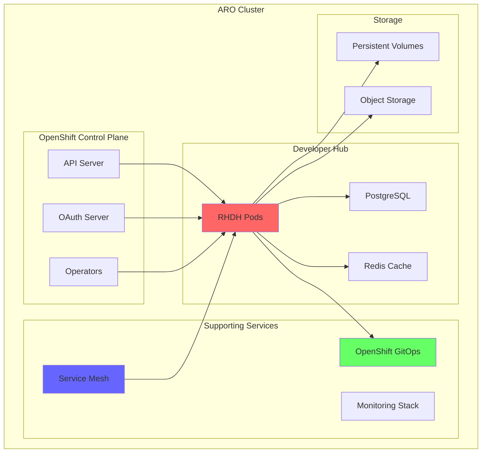

# 🔴 Red Hat Developer Hub on Azure Red Hat OpenShift (ARO)

<div align="center">

**Enterprise-Grade Developer Portal on OpenShift**

</div>

## 📋 Table of Contents

1. [Overview](#-overview)
2. [Prerequisites](#-prerequisites)
3. [ARO Cluster Setup](#-aro-cluster-setup)
4. [Developer Hub Installation](#-developer-hub-installation)
5. [OpenShift Integration](#-openshift-integration)
6. [Security Configuration](#-security-configuration)
7. [GitOps Integration](#-gitops-integration)
8. [Monitoring Setup](#-monitoring-setup)
9. [Advanced Configuration](#-advanced-configuration)
10. [Troubleshooting](#-troubleshooting)

## 🔍 Overview

This guide covers deploying Red Hat Developer Hub 1.6 on Azure Red Hat OpenShift (ARO), leveraging OpenShift's enterprise features for enhanced security, scalability, and operations.

### Why ARO for Developer Hub?

| Feature | Benefit |
|---------|---------|
| **Enterprise Support** | Full Red Hat support stack |
| **Integrated Security** | OpenShift security policies |
| **Operator Framework** | Automated lifecycle management |
| **Built-in GitOps** | OpenShift GitOps operator |
| **Advanced Networking** | Service mesh and network policies |
| **Compliance** | FIPS, PCI-DSS, HIPAA ready |

### Architecture on ARO



## ✅ Prerequisites

### 1. Required Tools

```bash
#!/bin/bash
# check-aro-prerequisites.sh

echo "🔍 Checking ARO prerequisites..."

# Check Azure CLI
if ! command -v az &> /dev/null; then
    echo "❌ Azure CLI not installed"
    echo "Install from: https://docs.microsoft.com/cli/azure/install-azure-cli"
    exit 1
fi

# Check OpenShift CLI
if ! command -v oc &> /dev/null; then
    echo "❌ OpenShift CLI not installed"
    echo "Install from: https://mirror.openshift.com/pub/openshift-v4/clients/ocp/latest/"
    exit 1
fi

# Check ARO extension
if ! az extension show --name aro &> /dev/null; then
    echo "📦 Installing ARO extension..."
    az extension add --name aro
fi

# Check Red Hat pull secret
if [ ! -f "$HOME/.docker/config.json" ]; then
    echo "❌ Red Hat pull secret not found"
    echo "Download from: https://console.redhat.com/openshift/install/azure/aro-provisioned"
    exit 1
fi

echo "✅ All prerequisites met!"
```

### 2. Azure Configuration

```bash
# Set environment variables
export LOCATION="eastus"
export RESOURCE_GROUP="rg-aro-devhub"
export CLUSTER_NAME="aro-devhub"
export PULL_SECRET_FILE="$HOME/.docker/config.json"
export DOMAIN_NAME="devhub.example.com"

# Register providers
az provider register --namespace Microsoft.RedHatOpenShift --wait
az provider register --namespace Microsoft.Compute --wait
az provider register --namespace Microsoft.Storage --wait
az provider register --namespace Microsoft.Authorization --wait
```

## 🏗️ ARO Cluster Setup

### 1. Create Resource Group and Network

```bash
# Create resource group
az group create \
    --name $RESOURCE_GROUP \
    --location $LOCATION

# Create virtual network
az network vnet create \
    --resource-group $RESOURCE_GROUP \
    --name aro-vnet \
    --address-prefixes 10.0.0.0/22

# Create master subnet
az network vnet subnet create \
    --resource-group $RESOURCE_GROUP \
    --vnet-name aro-vnet \
    --name master-subnet \
    --address-prefixes 10.0.0.0/24 \
    --service-endpoints Microsoft.ContainerRegistry

# Create worker subnet
az network vnet subnet create \
    --resource-group $RESOURCE_GROUP \
    --vnet-name aro-vnet \
    --name worker-subnet \
    --address-prefixes 10.0.1.0/24 \
    --service-endpoints Microsoft.ContainerRegistry

# Update subnet to disable private endpoint policies
az network vnet subnet update \
    --resource-group $RESOURCE_GROUP \
    --vnet-name aro-vnet \
    --name master-subnet \
    --disable-private-link-service-network-policies true
```

### 2. Create ARO Cluster

```bash
# Create ARO cluster (this takes ~35 minutes)
echo "🚀 Creating ARO cluster (this will take ~35 minutes)..."

az aro create \
    --resource-group $RESOURCE_GROUP \
    --name $CLUSTER_NAME \
    --vnet aro-vnet \
    --master-subnet master-subnet \
    --worker-subnet worker-subnet \
    --apiserver-visibility Public \
    --ingress-visibility Public \
    --worker-count 3 \
    --worker-vm-size Standard_D8s_v3 \
    --master-vm-size Standard_D8s_v3 \
    --pull-secret @$PULL_SECRET_FILE

# Get credentials
echo "🔑 Getting cluster credentials..."
APISERVER=$(az aro show \
    --name $CLUSTER_NAME \
    --resource-group $RESOURCE_GROUP \
    --query apiserverProfile.url -o tsv)

KUBEADMIN_PASSWORD=$(az aro list-credentials \
    --name $CLUSTER_NAME \
    --resource-group $RESOURCE_GROUP \
    --query kubeadminPassword -o tsv)

# Login to OpenShift
oc login $APISERVER -u kubeadmin -p $KUBEADMIN_PASSWORD

echo "✅ ARO cluster created successfully!"
echo "🌐 Console URL: $(az aro show --name $CLUSTER_NAME --resource-group $RESOURCE_GROUP --query consoleProfile.url -o tsv)"
```

### 3. Configure Storage Classes

```yaml
# storage-class-ssd.yaml
apiVersion: storage.k8s.io/v1
kind: StorageClass
metadata:
  name: managed-premium-retain
  annotations:
    storageclass.kubernetes.io/is-default-class: "false"
provisioner: kubernetes.io/azure-disk
parameters:
  storageaccounttype: Premium_LRS
  kind: Managed
reclaimPolicy: Retain
allowVolumeExpansion: true
volumeBindingMode: WaitForFirstConsumer
```

Apply storage configuration:
```bash
oc apply -f storage-class-ssd.yaml
```

## 📚 Developer Hub Installation

### 1. Create Project and Permissions

```bash
# Create project for Developer Hub
oc new-project developer-hub

# Create service account
oc create serviceaccount rhdh-sa -n developer-hub

# Grant permissions
oc adm policy add-cluster-role-to-user cluster-reader -z rhdh-sa -n developer-hub
oc adm policy add-role-to-user admin -z rhdh-sa -n developer-hub
```

### 2. Deploy PostgreSQL Database

```yaml
# postgres-deployment.yaml
apiVersion: apps/v1
kind: Deployment
metadata:
  name: postgres
  namespace: developer-hub
spec:
  replicas: 1
  selector:
    matchLabels:
      app: postgres
  template:
    metadata:
      labels:
        app: postgres
    spec:
      containers:
      - name: postgres
        image: registry.redhat.io/rhel9/postgresql-15:latest
        ports:
        - containerPort: 5432
        env:
        - name: POSTGRESQL_USER
          value: devhub
        - name: POSTGRESQL_PASSWORD
          valueFrom:
            secretKeyRef:
              name: postgres-secret
              key: password
        - name: POSTGRESQL_DATABASE
          value: devhub
        - name: POSTGRESQL_ADMIN_PASSWORD
          valueFrom:
            secretKeyRef:
              name: postgres-secret
              key: admin-password
        volumeMounts:
        - name: postgres-storage
          mountPath: /var/lib/pgsql/data
        resources:
          requests:
            memory: "512Mi"
            cpu: "500m"
          limits:
            memory: "1Gi"
            cpu: "1000m"
      volumes:
      - name: postgres-storage
        persistentVolumeClaim:
          claimName: postgres-pvc
---
apiVersion: v1
kind: Service
metadata:
  name: postgres
  namespace: developer-hub
spec:
  selector:
    app: postgres
  ports:
  - port: 5432
    targetPort: 5432
---
apiVersion: v1
kind: PersistentVolumeClaim
metadata:
  name: postgres-pvc
  namespace: developer-hub
spec:
  accessModes:
  - ReadWriteOnce
  resources:
    requests:
      storage: 20Gi
  storageClassName: managed-premium-retain
---
apiVersion: v1
kind: Secret
metadata:
  name: postgres-secret
  namespace: developer-hub
type: Opaque
stringData:
  password: "$(openssl rand -base64 32)"
  admin-password: "$(openssl rand -base64 32)"
```

Apply PostgreSQL configuration:
```bash
oc apply -f postgres-deployment.yaml
```

### 3. Install Developer Hub Using Helm

```bash
# Add Red Hat Helm repository
helm repo add redhat-developer-hub https://redhat-developer.github.io/rhdh-chart
helm repo update

# Create values file for ARO
cat > devhub-aro-values.yaml << 'EOF'
global:
  # Use OpenShift routes instead of ingress
  route:
    enabled: true
    host: ${DEVHUB_ROUTE_HOST}
    tls:
      enabled: true
      termination: edge
      insecureEdgeTerminationPolicy: Redirect

upstream:
  backstage:
    image:
      registry: registry.redhat.io
      repository: rhdh/rhdh-hub-rhel9
      tag: 1.6-latest
      pullSecrets:
        - name: pull-secret

    replicas: 3
    
    resources:
      requests:
        memory: 2Gi
        cpu: 1000m
      limits:
        memory: 4Gi
        cpu: 2000m

    extraEnvVars:
      - name: NODE_ENV
        value: production
      - name: LOG_LEVEL
        value: info

    appConfig:
      app:
        title: Red Hat Developer Hub on ARO
        baseUrl: https://${DEVHUB_ROUTE_HOST}

      backend:
        baseUrl: https://${DEVHUB_ROUTE_HOST}
        listen:
          port: 7007
        cors:
          origin: https://${DEVHUB_ROUTE_HOST}
        database:
          client: pg
          connection:
            host: postgres.developer-hub.svc.cluster.local
            port: 5432
            user: devhub
            password: ${POSTGRES_PASSWORD}
            database: devhub

      integrations:
        github:
          - host: github.com
            token: ${GITHUB_TOKEN}

      auth:
        environment: production
        providers:
          openshift:
            production:
              baseUrl: ${OPENSHIFT_OAUTH_URL}
              clientId: developer-hub
              clientSecret: ${OAUTH_CLIENT_SECRET}
              scope: 'user:full user:check-access'

      kubernetes:
        serviceLocatorMethod:
          type: multiTenant
        clusterLocatorMethods:
          - type: config
            clusters:
              - url: ${KUBERNETES_API_URL}
                name: aro-cluster
                authProvider: serviceAccount
                serviceAccountToken: ${SERVICE_ACCOUNT_TOKEN}
                skipTLSVerify: false

      techdocs:
        builder: external
        generator:
          runIn: docker
        publisher:
          type: azureBlobStorage
          azureBlobStorage:
            containerName: techdocs
            accountName: ${STORAGE_ACCOUNT}

    serviceAccount:
      create: false
      name: rhdh-sa

    podSecurityContext:
      runAsNonRoot: true
      runAsUser: 1001
      fsGroup: 1001
      seccompProfile:
        type: RuntimeDefault

    containerSecurityContext:
      allowPrivilegeEscalation: false
      capabilities:
        drop:
          - ALL
      readOnlyRootFilesystem: false
      runAsNonRoot: true
      runAsUser: 1001

postgresql:
  enabled: false

ingress:
  enabled: false
EOF

# Get route host
DEVHUB_ROUTE_HOST="devhub-developer-hub.apps.${CLUSTER_NAME}.${LOCATION}.aroapp.io"

# Install Developer Hub
helm upgrade --install developer-hub \
    redhat-developer-hub/developer-hub \
    --namespace developer-hub \
    --values devhub-aro-values.yaml \
    --set global.route.host=$DEVHUB_ROUTE_HOST \
    --wait
```

### 4. Configure OpenShift OAuth

```yaml
# oauth-client.yaml
apiVersion: oauth.openshift.io/v1
kind: OAuthClient
metadata:
  name: developer-hub
grantMethod: prompt
secret: "$(openssl rand -base64 32)"
redirectURIs:
  - https://${DEVHUB_ROUTE_HOST}/api/auth/openshift/handler/frame
scopeRestrictions:
  - literals:
    - "user:full"
    - "user:check-access"
```

Apply OAuth configuration:
```bash
# Store the secret value
OAUTH_SECRET=$(openssl rand -base64 32)

# Create OAuth client
cat oauth-client.yaml | envsubst | oc apply -f -

# Update Developer Hub with OAuth secret
oc create secret generic oauth-secret \
    --from-literal=client-secret=$OAUTH_SECRET \
    -n developer-hub
```

## 🔐 OpenShift Integration

### 1. Configure RBAC for Developer Hub

```yaml
# devhub-rbac.yaml
apiVersion: rbac.authorization.k8s.io/v1
kind: ClusterRole
metadata:
  name: developer-hub-catalog-reader
rules:
  - apiGroups: [""]
    resources: ["pods", "services", "configmaps", "secrets", "namespaces"]
    verbs: ["get", "list", "watch"]
  - apiGroups: ["apps"]
    resources: ["deployments", "replicasets", "statefulsets", "daemonsets"]
    verbs: ["get", "list", "watch"]
  - apiGroups: ["autoscaling"]
    resources: ["horizontalpodautoscalers"]
    verbs: ["get", "list", "watch"]
  - apiGroups: ["networking.k8s.io"]
    resources: ["ingresses"]
    verbs: ["get", "list", "watch"]
  - apiGroups: ["route.openshift.io"]
    resources: ["routes"]
    verbs: ["get", "list", "watch"]
  - apiGroups: ["build.openshift.io"]
    resources: ["builds", "buildconfigs"]
    verbs: ["get", "list", "watch"]
  - apiGroups: ["image.openshift.io"]
    resources: ["imagestreams", "imagestreamtags"]
    verbs: ["get", "list", "watch"]
---
apiVersion: rbac.authorization.k8s.io/v1
kind: ClusterRoleBinding
metadata:
  name: developer-hub-catalog-reader-binding
roleRef:
  apiGroup: rbac.authorization.k8s.io
  kind: ClusterRole
  name: developer-hub-catalog-reader
subjects:
  - kind: ServiceAccount
    name: rhdh-sa
    namespace: developer-hub
```

Apply RBAC configuration:
```bash
oc apply -f devhub-rbac.yaml
```

### 2. Configure OpenShift Projects Discovery

```yaml
# project-discovery-config.yaml
apiVersion: v1
kind: ConfigMap
metadata:
  name: devhub-openshift-config
  namespace: developer-hub
data:
  openshift-discovery.yaml: |
    catalog:
      rules:
        - allow: [Component, API, System, Domain, Resource, Location]
      
      processors:
        - openshift-project-discovery:
            clusters:
              - name: aro-cluster
                url: ${KUBERNETES_API_URL}
                authProvider: serviceAccount
            filters:
              - kind: Project
                selector:
                  matchLabels:
                    backstage.io/catalog: "true"
```

### 3. Enable OpenShift Console Integration

```typescript
// openshift-console-plugin.ts
import { createPlugin } from '@backstage/core-plugin-api';
import { OpenshiftConsoleClient } from './OpenshiftConsoleClient';

export const openshiftConsolePlugin = createPlugin({
  id: 'openshift-console',
  apis: [
    createApiFactory({
      api: openshiftConsoleApiRef,
      deps: { 
        configApi: configApiRef,
        identityApi: identityApiRef 
      },
      factory: ({ configApi, identityApi }) =>
        new OpenshiftConsoleClient({ configApi, identityApi }),
    }),
  ],
});

// Add to catalog entity page
export const EntityOpenshiftConsoleCard = () => {
  const entity = useEntity();
  const consoleUrl = `https://console-openshift-console.apps.${CLUSTER_NAME}.${LOCATION}.aroapp.io`;
  
  return (
    <InfoCard title="OpenShift Console">
      <Button 
        variant="contained" 
        color="primary"
        href={`${consoleUrl}/k8s/ns/${entity.metadata.namespace}/deployments/${entity.metadata.name}`}
        target="_blank"
      >
        View in OpenShift Console
      </Button>
    </InfoCard>
  );
};
```

## 🔒 Security Configuration

### 1. Network Policies

```yaml
# network-policies.yaml
apiVersion: networking.k8s.io/v1
kind: NetworkPolicy
metadata:
  name: developer-hub-ingress
  namespace: developer-hub
spec:
  podSelector:
    matchLabels:
      app.kubernetes.io/name: developer-hub
  policyTypes:
  - Ingress
  ingress:
  - from:
    - namespaceSelector:
        matchLabels:
          name: openshift-ingress
    ports:
    - protocol: TCP
      port: 7007
  - from:
    - podSelector:
        matchLabels:
          app: postgres
    ports:
    - protocol: TCP
      port: 5432
---
apiVersion: networking.k8s.io/v1
kind: NetworkPolicy
metadata:
  name: postgres-ingress
  namespace: developer-hub
spec:
  podSelector:
    matchLabels:
      app: postgres
  policyTypes:
  - Ingress
  ingress:
  - from:
    - podSelector:
        matchLabels:
          app.kubernetes.io/name: developer-hub
    ports:
    - protocol: TCP
      port: 5432
```

### 2. Security Context Constraints

```yaml
# scc-devhub.yaml
apiVersion: security.openshift.io/v1
kind: SecurityContextConstraints
metadata:
  name: developer-hub-scc
allowHostDirVolumePlugin: false
allowHostIPC: false
allowHostNetwork: false
allowHostPID: false
allowHostPorts: false
allowPrivilegeEscalation: false
allowPrivilegedContainer: false
allowedCapabilities: null
defaultAddCapabilities: null
fsGroup:
  type: MustRunAs
  ranges:
    - min: 1001
      max: 1001
priority: null
readOnlyRootFilesystem: false
requiredDropCapabilities:
- ALL
runAsUser:
  type: MustRunAsRange
  uidRangeMin: 1001
  uidRangeMax: 1001
seLinuxContext:
  type: MustRunAs
supplementalGroups:
  type: RunAsAny
users:
- system:serviceaccount:developer-hub:rhdh-sa
volumes:
- configMap
- downwardAPI
- emptyDir
- persistentVolumeClaim
- projected
- secret
```

Apply security configurations:
```bash
oc apply -f network-policies.yaml
oc apply -f scc-devhub.yaml
```

## 🔄 GitOps Integration

### 1. Install OpenShift GitOps

```bash
# Install OpenShift GitOps operator
cat <<EOF | oc apply -f -
apiVersion: operators.coreos.com/v1alpha1
kind: Subscription
metadata:
  name: openshift-gitops-operator
  namespace: openshift-operators
spec:
  channel: latest
  installPlanApproval: Automatic
  name: openshift-gitops-operator
  source: redhat-operators
  sourceNamespace: openshift-marketplace
EOF

# Wait for operator to be ready
oc wait --for=condition=Ready --timeout=300s -n openshift-gitops pod -l app.kubernetes.io/name=openshift-gitops-server
```

### 2. Configure ArgoCD for Developer Hub

```yaml
# argocd-devhub-app.yaml
apiVersion: argoproj.io/v1alpha1
kind: Application
metadata:
  name: developer-hub
  namespace: openshift-gitops
spec:
  project: default
  source:
    repoURL: https://github.com/${GITHUB_ORG}/gitops-config
    targetRevision: main
    path: developer-hub/overlays/aro
  destination:
    server: https://kubernetes.default.svc
    namespace: developer-hub
  syncPolicy:
    automated:
      prune: true
      selfHeal: true
    syncOptions:
    - CreateNamespace=true
    retry:
      limit: 5
      backoff:
        duration: 5s
        factor: 2
        maxDuration: 3m
```

### 3. Integrate GitOps with Developer Hub

```yaml
# devhub-gitops-config.yaml
apiVersion: v1
kind: ConfigMap
metadata:
  name: devhub-gitops-config
  namespace: developer-hub
data:
  gitops-config.yaml: |
    integrations:
      argocd:
        - name: openshift-gitops
          url: https://openshift-gitops-server-openshift-gitops.apps.${CLUSTER_NAME}.${LOCATION}.aroapp.io
          username: admin
          password: ${ARGOCD_PASSWORD}
          
    catalog:
      locations:
        - type: url
          target: https://openshift-gitops-server-openshift-gitops.apps.${CLUSTER_NAME}.${LOCATION}.aroapp.io/api/v1/applications
          rules:
            - allow: [Component]
```

## 📊 Monitoring Setup

### 1. Enable OpenShift Monitoring

```yaml
# user-workload-monitoring.yaml
apiVersion: v1
kind: ConfigMap
metadata:
  name: user-workload-monitoring-config
  namespace: openshift-user-workload-monitoring
data:
  config.yaml: |
    enableUserWorkload: true
    prometheus:
      retention: 30d
      resources:
        requests:
          cpu: 200m
          memory: 2Gi
    alertmanager:
      enabled: true
```

### 2. Create ServiceMonitor for Developer Hub

```yaml
# devhub-servicemonitor.yaml
apiVersion: monitoring.coreos.com/v1
kind: ServiceMonitor
metadata:
  name: developer-hub
  namespace: developer-hub
spec:
  selector:
    matchLabels:
      app.kubernetes.io/name: developer-hub
  endpoints:
  - port: backend
    interval: 30s
    path: /metrics
```

### 3. Grafana Dashboard

```json
{
  "dashboard": {
    "title": "Developer Hub on ARO",
    "panels": [
      {
        "title": "Request Rate",
        "targets": [{
          "expr": "sum(rate(http_request_duration_seconds_count{job=\"developer-hub\"}[5m])) by (method, route)"
        }]
      },
      {
        "title": "Response Time (P95)",
        "targets": [{
          "expr": "histogram_quantile(0.95, sum(rate(http_request_duration_seconds_bucket{job=\"developer-hub\"}[5m])) by (le))"
        }]
      },
      {
        "title": "Active Users",
        "targets": [{
          "expr": "sum(increase(auth_success_total[1h])) by (provider)"
        }]
      },
      {
        "title": "Catalog Entities",
        "targets": [{
          "expr": "catalog_entities_total"
        }]
      }
    ]
  }
}
```

## 🔧 Advanced Configuration

### 1. Custom Plugins

```typescript
// custom-aro-plugin/src/plugin.ts
import {
  createPlugin,
  createRoutableExtension,
} from '@backstage/core-plugin-api';

import { rootRouteRef } from './routes';

export const aroPlugin = createPlugin({
  id: 'aro',
  routes: {
    root: rootRouteRef,
  },
});

export const AroPage = aroPlugin.provide(
  createRoutableExtension({
    name: 'AroPage',
    component: () =>
      import('./components/AroComponent').then(m => m.AroComponent),
    mountPoint: rootRouteRef,
  }),
);
```

### 2. Multi-Tenancy Configuration

```yaml
# multi-tenancy-config.yaml
apiVersion: v1
kind: ConfigMap
metadata:
  name: devhub-tenancy-config
  namespace: developer-hub
data:
  tenancy.yaml: |
    tenancy:
      enabled: true
      isolation:
        type: namespace
        labelSelector:
          backstage.io/tenant: "true"
      rbac:
        autoCreate: true
        roleTemplate:
          rules:
          - apiGroups: [""]
            resources: ["pods", "services"]
            verbs: ["get", "list", "watch"]
          - apiGroups: ["apps"]
            resources: ["deployments"]
            verbs: ["get", "list", "watch", "create", "update", "patch"]
```

### 3. High Availability Setup

```yaml
# ha-config.yaml
apiVersion: policy/v1
kind: PodDisruptionBudget
metadata:
  name: developer-hub-pdb
  namespace: developer-hub
spec:
  minAvailable: 2
  selector:
    matchLabels:
      app.kubernetes.io/name: developer-hub
---
apiVersion: autoscaling/v2
kind: HorizontalPodAutoscaler
metadata:
  name: developer-hub-hpa
  namespace: developer-hub
spec:
  scaleTargetRef:
    apiVersion: apps/v1
    kind: Deployment
    name: developer-hub
  minReplicas: 3
  maxReplicas: 10
  metrics:
  - type: Resource
    resource:
      name: cpu
      target:
        type: Utilization
        averageUtilization: 70
  - type: Resource
    resource:
      name: memory
      target:
        type: Utilization
        averageUtilization: 80
```

## 🔧 Troubleshooting

### Common Issues

**1. OAuth Login Fails**
```bash
# Check OAuth client
oc get oauthclient developer-hub -o yaml

# Verify redirect URI
oc get route -n developer-hub developer-hub -o jsonpath='{.spec.host}'

# Check logs
oc logs -n developer-hub deployment/developer-hub | grep -i auth
```

**2. Database Connection Issues**
```bash
# Test database connection
oc exec -n developer-hub deployment/developer-hub -- nc -zv postgres 5432

# Check database pod
oc get pods -n developer-hub -l app=postgres
oc logs -n developer-hub -l app=postgres
```

**3. Catalog Discovery Not Working**
```bash
# Check service account permissions
oc auth can-i list deployments --as=system:serviceaccount:developer-hub:rhdh-sa --all-namespaces

# Verify cluster role binding
oc get clusterrolebinding developer-hub-catalog-reader-binding
```

### Performance Tuning

```yaml
# performance-config.yaml
apiVersion: v1
kind: ConfigMap
metadata:
  name: devhub-performance
  namespace: developer-hub
data:
  performance.yaml: |
    backend:
      cache:
        store: redis
        connection:
          host: redis.developer-hub.svc.cluster.local
      database:
        connection:
          max: 20
          idleTimeoutMillis: 30000
      catalog:
        processing:
          interval: { minutes: 5 }
          batchSize: 100
```

### Backup and Recovery

```bash
#!/bin/bash
# backup-devhub.sh

# Backup database
oc exec -n developer-hub postgres-0 -- pg_dump -U devhub devhub > devhub-backup-$(date +%Y%m%d).sql

# Backup configurations
oc get configmap,secret -n developer-hub -o yaml > devhub-config-backup-$(date +%Y%m%d).yaml

# Backup persistent volumes
for pvc in $(oc get pvc -n developer-hub -o jsonpath='{.items[*].metadata.name}'); do
    oc create job backup-$pvc --from=cronjob/backup-job -n developer-hub
done
```

## 📋 Validation Checklist

- [ ] ARO cluster is running and accessible
- [ ] Developer Hub pods are running
- [ ] OAuth login works correctly
- [ ] Catalog shows OpenShift resources
- [ ] GitOps integration is functional
- [ ] Monitoring dashboards are available
- [ ] Network policies are enforced
- [ ] Backups are configured

## 🎯 Next Steps

1. **Configure Templates**: Add Golden Path templates
2. **Enable TechDocs**: Set up documentation system
3. **Add Plugins**: Install additional plugins
4. **Configure RBAC**: Fine-tune permissions
5. **Set up CI/CD**: Integrate with pipelines

---

<div align="center">

**Developer Hub on ARO Successfully Deployed! 🎉**

Your enterprise developer portal is ready on OpenShift.

[← Back to Guides](../) | [View Platform](https://devhub-developer-hub.apps.${CLUSTER_NAME}.${LOCATION}.aroapp.io)

</div>
