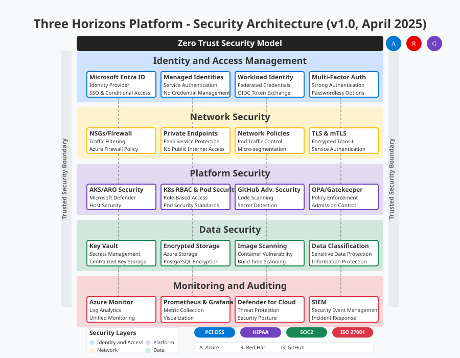

# 📊 Operations Zone - Monitoring & Observability Guide

## 🎯 Overview

The Operations Zone provides comprehensive monitoring, observability, and operational intelligence for the Three Horizons Platform. This zone enables proactive monitoring, incident detection, and performance optimization across all platform components, supporting both cloud-native (Prometheus/Grafana) and enterprise multi-cloud (Datadog) scenarios.



> 🔍 **Note:** The Operations Zone integrates multiple monitoring solutions to provide full-stack observability from infrastructure to application performance.

## 🤔 What is the Operations Zone?

The Operations Zone encompasses:

- **Infrastructure Monitoring**: Resource utilization, health checks, and availability
- **Application Performance Monitoring (APM)**: Transaction tracing, error tracking, and performance metrics
- **Log Management**: Centralized logging, search, and analysis
- **Alerting & Incident Management**: Proactive alerting and incident response workflows
- **Business Metrics**: Custom KPIs and business intelligence dashboards

## 📋 Prerequisites

Before configuring the Operations Zone, ensure you have:

- **Kubernetes Cluster Access**: Administrative access to AKS/ARO clusters
- **Azure Monitor**: Enabled for your Azure subscription
- **Datadog Account**: For multi-cloud monitoring (if using)
- **Network Access**: Proper firewall rules for metrics collection
- **Storage**: Persistent volumes for metrics retention

## 🏗️ Architecture Options

### Option 1: Cloud-Native Stack (Prometheus + Grafana)

Best for:
- Kubernetes-native environments
- Open-source preference
- Cost-conscious deployments

### Option 2: Enterprise Multi-Cloud (Datadog + Azure Monitor)

Best for:
- Multi-cloud environments
- Enterprise support requirements
- Advanced APM features
- Unified monitoring across cloud providers

## 🚀 Cloud-Native Monitoring Setup

### Deploy Prometheus Stack

```bash
# Add Prometheus community Helm repository
helm repo add prometheus-community https://prometheus-community.github.io/helm-charts
helm repo update

# Create monitoring namespace
kubectl create namespace monitoring

# Install kube-prometheus-stack
helm install prometheus prometheus-community/kube-prometheus-stack \
  --namespace monitoring \
  --set prometheus.prometheusSpec.retention=30d \
  --set prometheus.prometheusSpec.storageSpec.volumeClaimTemplate.spec.storageClassName=managed-premium \
  --set prometheus.prometheusSpec.storageSpec.volumeClaimTemplate.spec.resources.requests.storage=100Gi \
  --set grafana.persistence.enabled=true \
  --set grafana.persistence.size=10Gi \
  --set grafana.adminPassword=SecurePassword123! \
  --values prometheus-values.yaml
```

### Prometheus Configuration

Create `prometheus-values.yaml`:

```yaml
prometheus:
  prometheusSpec:
    serviceMonitorSelectorNilUsesHelmValues: false
    podMonitorSelectorNilUsesHelmValues: false
    ruleSelectorNilUsesHelmValues: false
    
    additionalScrapeConfigs:
    - job_name: 'kubernetes-pods'
      kubernetes_sd_configs:
      - role: pod
      relabel_configs:
      - source_labels: [__meta_kubernetes_pod_annotation_prometheus_io_scrape]
        action: keep
        regex: true
      - source_labels: [__meta_kubernetes_pod_annotation_prometheus_io_path]
        action: replace
        target_label: __metrics_path__
        regex: (.+)
        
    - job_name: 'developer-hub'
      static_configs:
      - targets: ['developer-hub.developer-hub.svc.cluster.local:9090']
      metrics_path: /metrics
      
alertmanager:
  config:
    global:
      slack_api_url: 'YOUR_SLACK_WEBHOOK_URL'
    route:
      group_by: ['alertname', 'cluster', 'service']
      group_wait: 10s
      group_interval: 10s
      repeat_interval: 12h
      receiver: 'default-receiver'
      routes:
      - match:
          severity: critical
        receiver: 'critical-receiver'
    receivers:
    - name: 'default-receiver'
      slack_configs:
      - channel: '#alerts'
        title: 'Three Horizons Platform Alert'
    - name: 'critical-receiver'
      slack_configs:
      - channel: '#critical-alerts'
        title: '🚨 CRITICAL: Three Horizons Platform'
        
grafana:
  ingress:
    enabled: true
    annotations:
      kubernetes.io/ingress.class: nginx
      cert-manager.io/cluster-issuer: letsencrypt-prod
    hosts:
      - grafana.example.com
    tls:
      - secretName: grafana-tls
        hosts:
          - grafana.example.com
```

### Custom Metrics for Developer Hub

```yaml
# developer-hub-servicemonitor.yaml
apiVersion: monitoring.coreos.com/v1
kind: ServiceMonitor
metadata:
  name: developer-hub
  namespace: monitoring
spec:
  selector:
    matchLabels:
      app: developer-hub
  endpoints:
  - port: metrics
    interval: 30s
    path: /metrics
  namespaceSelector:
    matchNames:
    - developer-hub
```

## 🌐 Enterprise Multi-Cloud Monitoring with Datadog

### Datadog Agent Installation

```bash
# Set Datadog API and APP keys
export DD_API_KEY="your-datadog-api-key"
export DD_APP_KEY="your-datadog-app-key"
export DD_SITE="datadoghq.com"  # or datadoghq.eu for EU

# Add Datadog Helm repository
helm repo add datadog https://helm.datadoghq.com
helm repo update

# Install Datadog agent
helm install datadog datadog/datadog \
  --namespace monitoring \
  --set datadog.apiKey=$DD_API_KEY \
  --set datadog.appKey=$DD_APP_KEY \
  --set datadog.site=$DD_SITE \
  --set datadog.logs.enabled=true \
  --set datadog.logs.containerCollectAll=true \
  --set datadog.apm.portEnabled=true \
  --set datadog.processAgent.processCollection=true \
  --set datadog.networkMonitoring.enabled=true \
  --set datadog.clusterChecks.enabled=true \
  --set clusterChecksRunner.enabled=true \
  --set datadog.kubelet.tlsVerify=false \
  --values datadog-values.yaml
```

### Datadog Configuration

Create `datadog-values.yaml`:

```yaml
datadog:
  tags:
    - "environment:production"
    - "platform:three-horizons"
    - "cloud:azure"
  
  # Enable integrations
  confd:
    kubernetes_state_core.yaml: |-
      ad_identifiers:
        - kube-state-metrics
      init_config:
      instances:
        - kube_state_url: http://prometheus-kube-state-metrics.monitoring:8080/metrics
    
    azure.yaml: |-
      init_config:
      instances:
        - tenant_id: "YOUR_AZURE_TENANT_ID"
          client_id: "YOUR_AZURE_CLIENT_ID"
          client_secret: "YOUR_AZURE_CLIENT_SECRET"
          subscription_id: "YOUR_AZURE_SUBSCRIPTION_ID"
          
  # APM configuration
  apm:
    enabled: true
    port: 8126
    useSocketVolume: true
    socketPath: /var/run/datadog/apm.socket
    hostSocketPath: /var/run/datadog/
    
  # Log collection
  logs:
    enabled: true
    containerCollectAll: true
    containerCollectUsingFiles: true
    
  # Custom metrics
  dogstatsd:
    useHostPort: true
    port: 8125
    nonLocalTraffic: true
    
agents:
  image:
    tag: "latest"
  rbac:
    create: true
  tolerations:
    - operator: Exists
```

### Azure Monitor Integration with Datadog

```bash
# Create Azure AD Service Principal for Datadog
az ad sp create-for-rbac --name "DatadogIntegration" \
  --role "Monitoring Reader" \
  --scopes "/subscriptions/YOUR_SUBSCRIPTION_ID"

# Configure Azure integration in Datadog
curl -X POST "https://api.datadoghq.com/api/v1/integration/azure" \
  -H "Content-Type: application/json" \
  -H "DD-API-KEY: ${DD_API_KEY}" \
  -H "DD-APPLICATION-KEY: ${DD_APP_KEY}" \
  -d '{
    "tenant_name": "YOUR_AZURE_TENANT_ID",
    "client_id": "YOUR_CLIENT_ID",
    "client_secret": "YOUR_CLIENT_SECRET",
    "host_filters": "environment:production,platform:three-horizons"
  }'
```

### Datadog Dashboards

Create custom dashboards via Terraform:

```hcl
# datadog-dashboards.tf
resource "datadog_dashboard" "three_horizons_overview" {
  title       = "Three Horizons Platform Overview"
  description = "Executive dashboard for Three Horizons Platform"
  layout_type = "ordered"

  widget {
    group_definition {
      title       = "Platform Health"
      layout_type = "ordered"

      widget {
        query_value_definition {
          title = "Cluster CPU Usage"
          request {
            q = "avg:kubernetes.cpu.usage.total{cluster_name:three-horizons-prod}"
            aggregator = "avg"
          }
          precision = 2
        }
      }

      widget {
        query_value_definition {
          title = "Active Deployments"
          request {
            q = "sum:kubernetes.deployments.available{cluster_name:three-horizons-prod}"
          }
        }
      }
    }
  }

  widget {
    timeseries_definition {
      title = "Request Rate by Service"
      request {
        q = "sum:trace.servlet.request.hits{env:production} by {service}.as_rate()"
        display_type = "bars"
        style {
          palette = "dog_classic"
        }
      }
    }
  }
}
```

## 📊 Unified Monitoring Strategy

### Metrics Collection Architecture

```yaml
# metrics-collection-config.yaml
apiVersion: v1
kind: ConfigMap
metadata:
  name: metrics-collection-strategy
  namespace: monitoring
data:
  strategy.yaml: |
    sources:
      - type: kubernetes
        collectors:
          - prometheus
          - datadog-agent
        metrics:
          - cpu_usage
          - memory_usage
          - network_io
          - disk_io
          
      - type: application
        collectors:
          - datadog-apm
          - application-insights
        metrics:
          - response_time
          - error_rate
          - throughput
          - custom_business_metrics
          
      - type: cloud_provider
        collectors:
          - azure-monitor
          - datadog-azure-integration
        metrics:
          - resource_utilization
          - cost_metrics
          - compliance_status
```

### Multi-Cloud Monitoring Federation

```bash
# Configure Prometheus federation for multi-cloud
kubectl apply -f - <<EOF
apiVersion: v1
kind: ConfigMap
metadata:
  name: prometheus-federation-config
  namespace: monitoring
data:
  prometheus.yml: |
    global:
      scrape_interval: 15s
      external_labels:
        cluster: 'azure-prod'
        region: 'eastus'
        
    scrape_configs:
    - job_name: 'federate-aws'
      scrape_interval: 15s
      honor_labels: true
      metrics_path: '/federate'
      params:
        'match[]':
          - '{job=~".*"}'
      static_configs:
        - targets:
          - 'prometheus-aws.example.com:9090'
          
    - job_name: 'federate-gcp'
      scrape_interval: 15s
      honor_labels: true
      metrics_path: '/federate'
      params:
        'match[]':
          - '{job=~".*"}'
      static_configs:
        - targets:
          - 'prometheus-gcp.example.com:9090'
EOF
```

## 🚨 Alerting Configuration

### Critical Alerts Definition

```yaml
# alerts-rules.yaml
apiVersion: monitoring.coreos.com/v1
kind: PrometheusRule
metadata:
  name: three-horizons-alerts
  namespace: monitoring
spec:
  groups:
  - name: platform.rules
    interval: 30s
    rules:
    - alert: HighCPUUsage
      expr: |
        (sum(rate(container_cpu_usage_seconds_total{namespace="three-horizons"}[5m])) by (pod) / 
         sum(container_spec_cpu_quota{namespace="three-horizons"}/container_spec_cpu_period{namespace="three-horizons"}) by (pod)) > 0.8
      for: 5m
      labels:
        severity: warning
        team: platform
      annotations:
        summary: "High CPU usage detected"
        description: "Pod {{ $labels.pod }} is using {{ $value | humanizePercentage }} of CPU"
        
    - alert: PodCrashLooping
      expr: |
        rate(kube_pod_container_status_restarts_total{namespace="three-horizons"}[5m]) > 0
      for: 5m
      labels:
        severity: critical
        team: platform
      annotations:
        summary: "Pod is crash looping"
        description: "Pod {{ $labels.pod }} is crash looping"
        
    - alert: DeveloperHubDown
      expr: |
        up{job="developer-hub"} == 0
      for: 1m
      labels:
        severity: critical
        team: platform
      annotations:
        summary: "Developer Hub is down"
        description: "Developer Hub has been down for more than 1 minute"
```

### Datadog Monitors

```python
# datadog-monitors.py
from datadog_api_client import ApiClient, Configuration
from datadog_api_client.v1.api.monitors_api import MonitorsApi
from datadog_api_client.v1.model.monitor import Monitor

configuration = Configuration()
configuration.api_key["apiKeyAuth"] = "YOUR_API_KEY"
configuration.api_key["appKeyAuth"] = "YOUR_APP_KEY"

with ApiClient(configuration) as api_client:
    api_instance = MonitorsApi(api_client)
    
    # APM Service Monitor
    apm_monitor = Monitor(
        name="Three Horizons - Service Error Rate",
        type="query alert",
        query="avg(last_5m):avg:trace.servlet.request.errors{env:production} by {service} / avg:trace.servlet.request.hits{env:production} by {service} > 0.05",
        message="Service {{service.name}} error rate is {{value}}% @slack-three-horizons-alerts",
        tags=["team:platform", "env:production"],
        options={
            "thresholds": {"critical": 0.05, "warning": 0.03},
            "notify_no_data": True,
            "no_data_timeframe": 10
        }
    )
    
    # Cost Anomaly Monitor
    cost_monitor = Monitor(
        name="Three Horizons - Azure Cost Anomaly",
        type="query alert",
        query="avg(last_1h):anomalies(avg:azure.cost.actual{subscription_id:YOUR_SUB_ID}, 'basic', 2) >= 1",
        message="Azure cost anomaly detected! Current spend is unusual. @slack-three-horizons-finance",
        tags=["team:finance", "cloud:azure"],
        options={
            "threshold_windows": {
                "trigger_window": "last_1h",
                "recovery_window": "last_15m"
            }
        }
    )
    
    api_instance.create_monitor(body=apm_monitor)
    api_instance.create_monitor(body=cost_monitor)
```

## 📈 Observability Best Practices

### 1. Structured Logging

```javascript
// Example structured logging for Node.js applications
const winston = require('winston');
const { DatadogWinston } = require('datadog-winston');

const logger = winston.createLogger({
  level: 'info',
  format: winston.format.json(),
  transports: [
    new winston.transports.Console(),
    new DatadogWinston({
      apiKey: process.env.DD_API_KEY,
      hostname: process.env.HOSTNAME,
      service: 'three-horizons-api',
      ddsource: 'nodejs',
      tags: ['env:production', 'version:' + process.env.APP_VERSION]
    })
  ]
});

// Usage
logger.info('API request processed', {
  user_id: req.user.id,
  endpoint: req.path,
  duration_ms: responseTime,
  status_code: res.statusCode
});
```

### 2. Distributed Tracing

```yaml
# Application deployment with tracing
apiVersion: apps/v1
kind: Deployment
metadata:
  name: sample-app
spec:
  template:
    spec:
      containers:
      - name: app
        env:
        - name: DD_AGENT_HOST
          valueFrom:
            fieldRef:
              fieldPath: status.hostIP
        - name: DD_TRACE_ENABLED
          value: "true"
        - name: DD_SERVICE
          value: "three-horizons-api"
        - name: DD_ENV
          value: "production"
        - name: DD_VERSION
          valueFrom:
            fieldRef:
              fieldPath: metadata.labels['version']
        - name: DD_LOGS_INJECTION
          value: "true"
```

### 3. SLO Configuration

```yaml
# slo-configuration.yaml
apiVersion: sloth.slok.dev/v1
kind: PrometheusServiceLevel
metadata:
  name: three-horizons-api-slo
  namespace: monitoring
spec:
  service: "three-horizons-api"
  labels:
    team: "platform"
  slos:
    - name: "requests-availability"
      objective: 99.9
      sli:
        events:
          error_query: |
            sum(rate(http_requests_total{job="three-horizons-api",code=~"5.."}[5m]))
          total_query: |
            sum(rate(http_requests_total{job="three-horizons-api"}[5m]))
      alerting:
        name: ThreeHorizonsAPIAvailability
        page_alert:
          disable: false
        ticket_alert:
          disable: false
```

## 🔄 Integration with Developer Hub

### Developer Hub Metrics Plugin

```yaml
# developer-hub-metrics-config.yaml
apiVersion: v1
kind: ConfigMap
metadata:
  name: developer-hub-metrics
  namespace: developer-hub
data:
  app-config.production.yaml: |
    proxy:
      '/prometheus':
        target: 'http://prometheus-server.monitoring:9090'
        headers:
          Authorization: 'Bearer ${PROMETHEUS_TOKEN}'
      '/grafana':
        target: 'http://prometheus-grafana.monitoring'
        headers:
          Authorization: 'Bearer ${GRAFANA_TOKEN}'
          
    techdocs:
      metrics:
        enabled: true
        endpoints:
          - name: 'Platform Metrics'
            url: '/prometheus'
          - name: 'Dashboards'
            url: '/grafana'
```

## 🛠️ Troubleshooting

### Common Issues

#### Metrics Not Appearing
- Verify ServiceMonitor/PodMonitor labels match selector
- Check prometheus operator logs
- Ensure network policies allow scraping

#### High Cardinality Issues
- Review metric labels for unbounded values
- Implement metric relabeling to drop unnecessary labels
- Use recording rules for frequently queried metrics

#### Datadog Agent Issues
- Check agent status: `kubectl exec -it <datadog-pod> -- agent status`
- Verify API keys are correct
- Review agent logs for connection issues

## 📚 Related Documentation

- [Integration Zone CI/CD Guide](./integration-zone-cicd.md)
- [Complete Integration Tutorial](../complete-integration-tutorial/index.md)
- [Datadog Kubernetes Integration](https://docs.datadoghq.com/integrations/kubernetes/)
- [Azure Monitor Documentation](https://docs.microsoft.com/en-us/azure/azure-monitor/)
- [Prometheus Operator](https://prometheus-operator.dev/) 