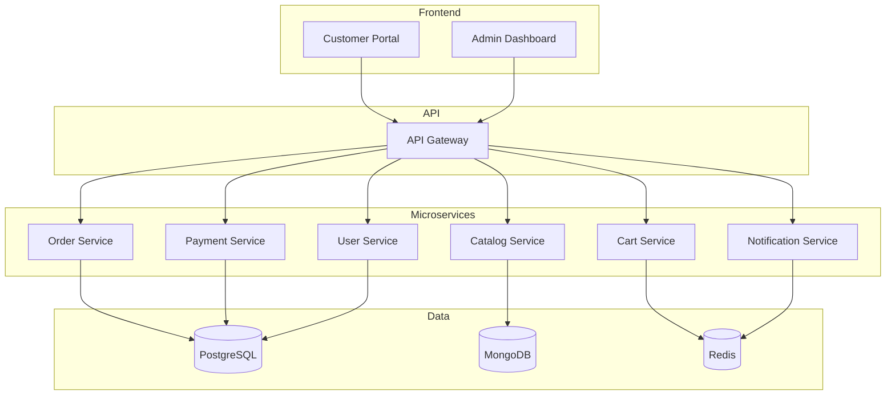

# 🎨 H1-007-B: Guia Completo de Criação de Templates

## 📋 Índice

1. [🎯 Visão Geral](#visao-geral)
2. [📁 Estrutura do Template](#estrutura-template)
3. [🛍️ Template E-commerce Principal](#template-ecommerce)
4. [🧩 Templates de Microsserviços](#templates-microsservicos)
5. [☁️ Templates de Infraestrutura](#templates-infra)
6. [🔧 Ações Customizadas](#acoes-customizadas)
7. [🧪 Testando Templates](#testando-templates)
8. [📦 Publicação e Registro](#publicacao-registro)
9. [🐛 Debugging Templates](#debugging-templates)

## 🎯 Visão Geral {#visao-geral}

Este guia fornece instruções detalhadas para criar todos os templates necessários para a demonstração do Three Horizons AI Platform.

### 📊 Templates a Serem Criados

1. **E-commerce Portal** - Template principal completo
2. **Microsserviços** - Templates para cada linguagem
3. **Infraestrutura Azure** - Templates IaC
4. **DevBox** - Template de ambiente de desenvolvimento

## 📁 Estrutura do Template {#estrutura-template}

### Estrutura de Diretórios

```bash
# Criar estrutura base
cd ~/three-horizons-demo/Three-Horizons-AI-Developer-Platform
git checkout demo/ecommerce-showcase

# Criar diretórios
mkdir -p demos/ecommerce-showcase/templates/{ecommerce-fullstack,microservice-nodejs,microservice-go,microservice-java,microservice-python,microservice-dotnet,azure-infrastructure,devbox}/skeleton
```

### Arquivos Base Necessários

```
templates/
├── catalog-info.yaml           # Registro de todos os templates
├── ecommerce-fullstack/
│   ├── template.yaml          # Definição do template
│   ├── skeleton/              # Estrutura do projeto
│   └── docs/                  # Documentação do template
└── [outros templates...]
```

## 🛍️ Template E-commerce Principal {#template-ecommerce}

### Passo 1: Criar template.yaml

```yaml
# demos/ecommerce-showcase/templates/ecommerce-fullstack/template.yaml
apiVersion: scaffolder.backstage.io/v1beta3
kind: Template
metadata:
  name: ecommerce-portal
  title: 🛍️ Portal E-commerce Moderno
  description: |
    Cria uma plataforma completa de e-commerce com:
    - 🌐 Frontend em Next.js 14 com Tailwind CSS
    - ⚙️ Microsserviços backend em múltiplas linguagens
    - ☁️ Infraestrutura Azure automatizada
    - 🚀 CI/CD com GitHub Actions
    - 📊 Monitoramento completo
    - 🔒 Segurança integrada
    - 🤖 Capacidades AI/ML
  tags:
    - recommended
    - ecommerce
    - fullstack
    - microservices
    - azure
    - production-ready
  links:
    - title: Documentação
      url: https://github.com/three-horizon-ai/docs/ecommerce-template
    - title: Arquitetura
      url: https://github.com/three-horizon-ai/docs/architecture
spec:
  owner: platform-team
  type: website
  
  parameters:
    - title: 📋 Informações Básicas
      required:
        - name
        - description
        - owner
      properties:
        name:
          title: Nome do Portal
          type: string
          description: Nome único para seu portal (lowercase, hífens permitidos)
          pattern: '^[a-z0-9-]+$'
          ui:help: 'Exemplo: minha-loja, portal-vendas'
          ui:autofocus: true
          ui:field: EntityNamePicker
        
        description:
          title: Descrição
          type: string
          description: Descreva o propósito do seu e-commerce
          ui:help: 'Esta descrição aparecerá no catálogo e na documentação'
          ui:options:
            rows: 3
        
        owner:
          title: Proprietário
          type: string
          description: Equipe ou pessoa responsável
          ui:field: OwnerPicker
          ui:options:
            catalogFilter:
              kind: [Group, User]

    - title: 🎨 Configuração Frontend
      properties:
        frontend:
          title: Configurações do Frontend
          type: object
          properties:
            framework:
              title: Framework
              type: string
              default: nextjs
              enum:
                - nextjs
                - react
                - vue
              enumNames:
                - 'Next.js 14 (Recomendado)'
                - 'React 18'
                - 'Vue 3'
            
            styling:
              title: Biblioteca de Estilos
              type: string
              default: tailwind
              enum:
                - tailwind
                - mui
                - chakra
              enumNames:
                - 'Tailwind CSS + Shadcn/ui'
                - 'Material-UI'
                - 'Chakra UI'
            
            language:
              title: Idioma Padrão
              type: string
              default: pt-BR
              enum:
                - pt-BR
                - en-US
                - es
              enumNames:
                - 'Português (Brasil)'
                - 'English (US)'
                - 'Español'

    - title: ⚙️ Configuração Backend
      properties:
        backend:
          title: Configurações do Backend
          type: object
          properties:
            authentication:
              title: Tipo de Autenticação
              type: string
              default: jwt
              enum:
                - jwt
                - azure-ad
                - auth0
                - keycloak
              enumNames:
                - 'JWT (Simples)'
                - 'Azure Active Directory'
                - 'Auth0'
                - 'Keycloak'
            
            database:
              title: Banco de Dados Principal
              type: string
              default: postgresql
              enum:
                - postgresql
                - mysql
                - sqlserver
              enumNames:
                - 'PostgreSQL'
                - 'MySQL'
                - 'SQL Server'

    - title: 🚀 Funcionalidades
      properties:
        features:
          title: Recursos Habilitados
          type: object
          properties:
            payments:
              title: 💳 Processamento de Pagamentos
              type: boolean
              default: true
              ui:help: 'Integração com Stripe/PayPal'
            
            search:
              title: 🔍 Busca Avançada
              type: boolean
              default: true
              ui:help: 'Azure Cognitive Search'
            
            recommendations:
              title: 🤖 Recomendações com IA
              type: boolean
              default: true
              ui:help: 'Azure OpenAI para recomendações'
            
            analytics:
              title: 📊 Analytics e BI
              type: boolean
              default: true
              ui:help: 'Dashboard analytics em tempo real'
            
            inventory:
              title: 📦 Gestão de Estoque
              type: boolean
              default: true
              ui:help: 'Sistema completo de inventário'
            
            multiLanguage:
              title: 🌍 Multi-idioma
              type: boolean
              default: false
              ui:help: 'Suporte para múltiplos idiomas'

    - title: ☁️ Infraestrutura Azure
      required:
        - azure.subscription
        - azure.region
      properties:
        azure:
          title: Configuração Azure
          type: object
          required:
            - subscription
            - region
            - environment
          properties:
            subscription:
              title: Subscription
              type: string
              default: ME-MngEnvMCAP178642-paulasilva-1
              ui:help: 'Selecione a subscription Azure'
              enum:
                - ME-MngEnvMCAP178642-paulasilva-1
              enumNames:
                - 'Three Horizons Development'
            
            region:
              title: Região
              type: string
              default: centralus
              enum:
                - centralus
                - eastus
                - westus2
                - brazilsouth
              enumNames:
                - 'Central US (Recomendado)'
                - 'East US'
                - 'West US 2'
                - 'Brazil South'
            
            environment:
              title: Ambiente
              type: string
              default: dev
              enum:
                - dev
                - staging
                - prod
              enumNames:
                - 'Development'
                - 'Staging'
                - 'Production'
            
            resourceGroup:
              title: Resource Group
              type: string
              default: 'rg-${{ parameters.name }}-${{ parameters.azure.environment }}'
              ui:help: 'Nome do resource group (gerado automaticamente)'
              ui:widget: hidden

  steps:
    - id: log
      name: 📝 Log de Parâmetros
      action: debug:log
      input:
        message: |
          Criando portal e-commerce:
          Nome: ${{ parameters.name }}
          Owner: ${{ parameters.owner }}
          Frontend: ${{ parameters.frontend.framework }}
          Features: ${{ parameters.features }}

    - id: fetch
      name: 📁 Buscar Template Base
      action: fetch:template
      input:
        url: ./skeleton
        copyWithoutTemplating:
          - .github/workflows/scripts/**
        values:
          name: ${{ parameters.name }}
          description: ${{ parameters.description }}
          owner: ${{ parameters.owner }}
          frontend: ${{ parameters.frontend }}
          backend: ${{ parameters.backend }}
          features: ${{ parameters.features }}
          azure: ${{ parameters.azure }}
          # Valores computados
          dockerRegistry: 'acrthreehorizonsdemo.azurecr.io'
          aksCluster: 'threehorizons-aks'
          namespace: '${{ parameters.name }}-${{ parameters.azure.environment }}'
          domain: 'demo.threehorizons.io'

    - id: publish
      name: 🚀 Publicar no GitHub
      action: publish:github
      input:
        description: |
          ${{ parameters.description }}
          
          🏗️ Gerado pelo template Three Horizons E-commerce
        repoUrl: 'github.com?owner=three-horizon-ai&repo=${{ parameters.name }}'
        defaultBranch: main
        gitCommitMessage: 'feat: Initial commit from Three Horizons template'
        gitAuthorName: 'Three Horizons Bot'
        gitAuthorEmail: 'bot@threehorizons.ai'
        topics:
          - ecommerce
          - three-horizons
          - ${{ parameters.frontend.framework }}
          - azure
          - microservices
        repoVariables:
          AZURE_SUBSCRIPTION: ${{ parameters.azure.subscription }}
          AZURE_REGION: ${{ parameters.azure.region }}
          RESOURCE_GROUP: ${{ parameters.azure.resourceGroup }}
          ENVIRONMENT: ${{ parameters.azure.environment }}

    - id: wait
      name: ⏳ Aguardar Propagação
      action: debug:log
      input:
        message: 'Aguardando propagação do repositório...'

    - id: azure-setup
      name: ☁️ Criar Recursos Azure Base
      action: http:backstage:request
      input:
        method: POST
        path: '/api/azure/setup'
        headers:
          Content-Type: 'application/json'
        body:
          subscription: ${{ parameters.azure.subscription }}
          resourceGroup: ${{ parameters.azure.resourceGroup }}
          location: ${{ parameters.azure.region }}
          projectName: ${{ parameters.name }}
          environment: ${{ parameters.azure.environment }}

    - id: register
      name: 📚 Registrar no Catálogo
      action: catalog:register
      input:
        repoContentsUrl: ${{ steps['publish'].output.repoContentsUrl }}
        catalogInfoPath: '/catalog-info.yaml'

    - id: create-argocd-app
      name: 🔄 Configurar GitOps
      action: http:backstage:request
      input:
        method: POST
        path: '/api/argocd/applications'
        headers:
          Content-Type: 'application/json'
        body:
          name: ${{ parameters.name }}-${{ parameters.azure.environment }}
          namespace: argocd
          project: default
          source:
            repoURL: ${{ steps['publish'].output.remoteUrl }}
            path: k8s/overlays/${{ parameters.azure.environment }}
            targetRevision: main
          destination:
            server: https://kubernetes.default.svc
            namespace: ${{ parameters.namespace }}

  output:
    links:
      - title: 📁 Repositório
        url: ${{ steps['publish'].output.remoteUrl }}
        icon: github
      - title: 🏠 Página no Catálogo
        url: ${{ steps['register'].output.entityRef }}
        icon: catalog
      - title: 🔄 ArgoCD
        url: https://argocd.demo.threehorizons.io/applications/${{ parameters.name }}-${{ parameters.azure.environment }}
        icon: dashboard
      - title: 📊 Azure Portal
        url: https://portal.azure.com/#@/resource/subscriptions/${{ parameters.azure.subscription }}/resourceGroups/${{ parameters.azure.resourceGroup }}/overview
        icon: cloud
    text:
      - title: 🎉 Portal E-commerce Criado!
        content: |
          Seu portal foi criado com sucesso!
          
          **Próximos passos:**
          1. O pipeline de CI/CD iniciará automaticamente
          2. Aguarde ~10 minutos para o primeiro deploy
          3. Acesse o portal em: https://${{ parameters.name }}.demo.threehorizons.io
          
          **Links úteis:**
          - Logs: [GitHub Actions](${{ steps['publish'].output.remoteUrl }}/actions)
          - Monitoramento: [Grafana](https://grafana.demo.threehorizons.io/d/${{ parameters.name }})
```

### Passo 2: Criar Estrutura do Skeleton

```bash
# Criar estrutura base do skeleton
cd demos/ecommerce-showcase/templates/ecommerce-fullstack/skeleton

# Estrutura de diretórios
mkdir -p {.github/workflows,frontend/{portal,admin},backend/{api-gateway,catalog-service,cart-service,order-service,payment-service,user-service,notification-service},infrastructure/{terraform,k8s/{base,overlays/{dev,staging,prod}}},docs,scripts,data/{sql,mongo,seed}}
```

### Passo 3: Criar catalog-info.yaml do Template

```yaml
# skeleton/catalog-info.yaml
apiVersion: backstage.io/v1alpha1
kind: Component
metadata:
  name: ${{ values.name }}
  title: ${{ values.name | title }}
  description: ${{ values.description }}
  annotations:
    github.com/project-slug: three-horizon-ai/${{ values.name }}
    backstage.io/techdocs-ref: dir:.
    azure.com/subscription-id: ${{ values.azure.subscription }}
    azure.com/resource-group: ${{ values.azure.resourceGroup }}
    argocd/app-name: ${{ values.name }}-${{ values.azure.environment }}
    sonarqube.org/project-key: ${{ values.name }}
    grafana/dashboard-url: https://grafana.demo.threehorizons.io/d/${{ values.name }}
    datadog/service-name: ${{ values.name }}
  tags:
    - ecommerce
    - ${{ values.frontend.framework }}
    - azure
    
    - payments
    
    
    - ai-powered
    
  links:
    - url: https://${{ values.name }}.demo.threehorizons.io
      title: Portal de Produção
      icon: web
    - url: https://admin-${{ values.name }}.demo.threehorizons.io
      title: Admin Dashboard
      icon: dashboard
    - url: https://api-${{ values.name }}.demo.threehorizons.io/docs
      title: API Documentation
      icon: docs
spec:
  type: website
  lifecycle: production
  owner: ${{ values.owner }}
  system: ecommerce-platform
  providesApis:
    - ${{ values.name }}-api
  consumesApis:
    
    - payment-gateway-api
    
    - shipping-provider-api
  dependsOn:
    - resource:default/postgres-${{ values.name }}
    - resource:default/redis-${{ values.name }}
    - resource:default/mongodb-${{ values.name }}
---
apiVersion: backstage.io/v1alpha1
kind: API
metadata:
  name: ${{ values.name }}-api
  title: ${{ values.name | title }} API
  description: REST API for ${{ values.name }}
spec:
  type: openapi
  lifecycle: production
  owner: ${{ values.owner }}
  system: ecommerce-platform
  definition:
    $text: ./docs/openapi.yaml
```

### Passo 4: Criar README.md do Template

```markdown
# skeleton/README.md
# 🛍️ ${{ values.name | title }}

${{ values.description }}

## 🚀 Quick Start

### Prerequisites
- Node.js 18+
- Docker & Docker Compose
- Azure CLI
- Kubernetes CLI (kubectl)

### Local Development

```bash
# Install dependencies
npm install

# Start development environment
npm run dev

# Run tests
npm test
```

### URLs
- Frontend: http://localhost:3000
- Admin: http://localhost:3001
- API: http://localhost:8080
- Docs: http://localhost:8080/docs

## 🏗️ Architecture



## 📦 Features


- ✅ **Payment Processing**: Integrated with Stripe/PayPal


- ✅ **Advanced Search**: Powered by Azure Cognitive Search


- ✅ **AI Recommendations**: Using Azure OpenAI


- ✅ **Real-time Analytics**: Business intelligence dashboard


- ✅ **Inventory Management**: Complete stock control


## 🔧 Configuration

All configuration is managed through environment variables and Kubernetes ConfigMaps/Secrets.

See [docs/configuration.md](docs/configuration.md) for details.

## 📊 Monitoring

- **Metrics**: Prometheus + Grafana
- **Logs**: Azure Monitor
- **APM**: Application Insights
- **Alerts**: PagerDuty integration

## 🚢 Deployment

Deployments are automated via GitOps with ArgoCD.

```bash
# Manual deployment (not recommended)
kubectl apply -k k8s/overlays/${{ values.azure.environment }}
```

## 📚 Documentation

- [API Documentation](./docs/api.md)
- [Architecture Guide](./docs/architecture.md)
- [Development Guide](./docs/development.md)
- [Operations Runbook](./docs/runbook.md)

## 🤝 Contributing

See [CONTRIBUTING.md](CONTRIBUTING.md) for guidelines.

---

Generated with ❤️ by Three Horizons AI Platform
```

## 🧩 Templates de Microsserviços {#templates-microsservicos}

### Template Node.js

```yaml
# templates/microservice-nodejs/template.yaml
apiVersion: scaffolder.backstage.io/v1beta3
kind: Template
metadata:
  name: nodejs-microservice
  title: 🟢 Microsserviço Node.js
  description: Cria um microsserviço Node.js com Express, TypeScript e Docker
  tags:
    - nodejs
    - typescript
    - microservice
    - api
spec:
  owner: platform-team
  type: service
  
  parameters:
    - title: Informações do Serviço
      required:
        - name
        - description
        - owner
      properties:
        name:
          title: Nome do Serviço
          type: string
          pattern: '^[a-z0-9-]+$'
        
        description:
          title: Descrição
          type: string
        
        owner:
          title: Proprietário
          type: string
          ui:field: OwnerPicker
        
        port:
          title: Porta
          type: number
          default: 3000
    
    - title: Configurações Técnicas
      properties:
        database:
          title: Banco de Dados
          type: string
          default: postgresql
          enum:
            - none
            - postgresql
            - mongodb
            - redis
        
        messaging:
          title: Mensageria
          type: string
          default: none
          enum:
            - none
            - rabbitmq
            - kafka
            - azure-service-bus

  steps:
    - id: fetch
      name: Buscar Template
      action: fetch:template
      input:
        url: ./skeleton
        values:
          name: ${{ parameters.name }}
          description: ${{ parameters.description }}
          owner: ${{ parameters.owner }}
          port: ${{ parameters.port }}
          database: ${{ parameters.database }}
          messaging: ${{ parameters.messaging }}

    - id: publish
      name: Publicar no GitHub
      action: publish:github
      input:
        repoUrl: 'github.com?owner=three-horizon-ai&repo=${{ parameters.name }}'
        description: ${{ parameters.description }}

    - id: register
      name: Registrar no Catálogo
      action: catalog:register
      input:
        repoContentsUrl: ${{ steps['publish'].output.repoContentsUrl }}
        catalogInfoPath: '/catalog-info.yaml'

  output:
    links:
      - title: Repositório
        url: ${{ steps['publish'].output.remoteUrl }}
      - title: Pipeline
        url: ${{ steps['publish'].output.remoteUrl }}/actions
```

## ☁️ Templates de Infraestrutura {#templates-infra}

### Template Azure Resources

```yaml
# templates/azure-infrastructure/template.yaml
apiVersion: scaffolder.backstage.io/v1beta3
kind: Template
metadata:
  name: azure-resources
  title: ☁️ Recursos Azure
  description: Cria recursos Azure usando Terraform ou Bicep
  tags:
    - azure
    - infrastructure
    - iac
spec:
  owner: platform-team
  type: resource
  
  parameters:
    - title: Informações do Recurso
      required:
        - name
        - resourceType
      properties:
        name:
          title: Nome
          type: string
          pattern: '^[a-z0-9-]+$'
        
        resourceType:
          title: Tipo de Recurso
          type: string
          enum:
            - aks-cluster
            - postgresql
            - cosmos-db
            - redis-cache
            - storage-account
            - key-vault
    
    - title: Configuração Azure
      properties:
        azure:
          type: object
          properties:
            subscription:
              title: Subscription
              type: string
              default: ME-MngEnvMCAP178642-paulasilva-1
            
            region:
              title: Região
              type: string
              default: centralus
            
            resourceGroup:
              title: Resource Group
              type: string

  steps:
    - id: fetch
      name: Buscar Template
      action: fetch:template
      input:
        url: ./skeleton/${{ parameters.resourceType }}
        values:
          name: ${{ parameters.name }}
          azure: ${{ parameters.azure }}

    - id: publish
      name: Publicar Código
      action: publish:github
      input:
        repoUrl: 'github.com?owner=three-horizon-ai&repo=infra-${{ parameters.name }}'

    - id: trigger-pipeline
      name: Executar Terraform
      action: github:actions:dispatch
      input:
        repoUrl: 'github.com?owner=three-horizon-ai&repo=infra-${{ parameters.name }}'
        workflowId: terraform-apply.yml
        branchOrTagName: main
```

## 🔧 Ações Customizadas {#acoes-customizadas}

### Criar Ação Azure Setup

```typescript
// packages/backend/src/plugins/scaffolder/actions/azure-setup.ts
import { createTemplateAction } from '@backstage/plugin-scaffolder-node';
import { DefaultAzureCredential } from '@azure/identity';
import { ResourceManagementClient } from '@azure/arm-resources';

export const createAzureSetupAction = () => {
  return createTemplateAction<{
    subscription: string;
    resourceGroup: string;
    location: string;
    projectName: string;
    environment: string;
  }>({
    id: 'azure:setup',
    schema: {
      input: {
        required: ['subscription', 'resourceGroup', 'location', 'projectName'],
        type: 'object',
        properties: {
          subscription: { type: 'string' },
          resourceGroup: { type: 'string' },
          location: { type: 'string' },
          projectName: { type: 'string' },
          environment: { type: 'string' },
        },
      },
    },
    async handler(ctx) {
      const { subscription, resourceGroup, location, projectName } = ctx.input;

      ctx.logger.info(`Creating Azure resources for ${projectName}`);

      const credential = new DefaultAzureCredential();
      const resourceClient = new ResourceManagementClient(credential, subscription);

      // Create resource group
      await resourceClient.resourceGroups.createOrUpdate(resourceGroup, {
        location,
        tags: {
          project: projectName,
          environment: ctx.input.environment,
          managedBy: 'backstage',
        },
      });

      ctx.logger.info(`Resource group ${resourceGroup} created`);
    },
  });
};
```

## 🧪 Testando Templates {#testando-templates}

### Script de Teste Local

```bash
#!/bin/bash
# test-template.sh

# Instalar Backstage CLI
npm install -g @backstage/cli

# Criar app de teste
npx @backstage/create-app test-app
cd test-app

# Copiar templates
cp -r ../demos/ecommerce-showcase/templates/* packages/backend/templates/

# Iniciar Backstage
yarn dev

# Acessar http://localhost:3000/create
```

### Validação de Template

```yaml
# .github/workflows/validate-templates.yml
name: Validate Templates

on:
  pull_request:
    paths:
      - 'demos/ecommerce-showcase/templates/**'

jobs:
  validate:
    runs-on: ubuntu-latest
    steps:
      - uses: actions/checkout@v4
      
      - name: Setup Node.js
        uses: actions/setup-node@v4
        with:
          node-version: '18'
      
      - name: Validate YAML
        run: |
          npm install -g js-yaml
          find demos/ecommerce-showcase/templates -name "*.yaml" -exec js-yaml {} \;
      
      - name: Test Template Rendering
        run: |
          npm install -g @backstage/cli
          backstage-cli template:validate demos/ecommerce-showcase/templates/*/template.yaml
```

## 📦 Publicação e Registro {#publicacao-registro}

### Passo 1: Commit e Push

```bash
# Adicionar todos os arquivos
git add demos/ecommerce-showcase/templates/

# Commit
git commit -m "feat: Add e-commerce templates for Three Horizons demo

- Main e-commerce portal template
- Microservice templates (Node.js, Go, Java, Python, .NET)
- Azure infrastructure templates
- DevBox environment template"

# Push para o branch
git push origin demo/ecommerce-showcase
```

### Passo 2: Registrar no Developer Hub

1. Acesse o Developer Hub
2. Vá para **Catalog → Register Existing Component**
3. Use a URL:
   ```
   https://github.com/three-horizon-ai/Three-Horizons-AI-Developer-Platform/blob/demo/ecommerce-showcase/demos/ecommerce-showcase/templates/catalog-info.yaml
   ```
4. Clique em **Analyze**
5. Revise os templates descobertos
6. Clique em **Import**

### Passo 3: Verificar Templates

1. Navegue para a página **Create**
2. Verifique se todos os templates aparecem
3. Teste a criação de um projeto exemplo

## 🐛 Debugging Templates {#debugging-templates}

### Logs do Scaffolder

```bash
# Ver logs do scaffolder
kubectl logs -f deployment/backstage -n rhdh-operator | grep scaffolder

# Logs detalhados
kubectl exec -it deployment/backstage -n rhdh-operator -- \
  cat /tmp/scaffolder-*/workspace/log.txt
```

### Problemas Comuns

| Erro | Solução |
|------|---------|
| "Template not found" | Verificar caminho no catalog-info.yaml |
| "Invalid input" | Revisar schema dos parâmetros |
| "Action failed" | Verificar logs da ação específica |
| "GitHub publish failed" | Confirmar token e permissões |

### Modo Debug

```yaml
# Adicionar ao template para debug
steps:
  - id: debug
    name: Debug Info
    action: debug:log
    input:
      message: |
        Parameters: ${{ parameters }}
        Context: ${{ steps }}
```

---

## 🎯 Próximos Passos

Com os templates criados:

1. **[H1-007-C: Configuração Azure](./H1-007-C-azure-configuration.md)** - Configurar recursos Azure
2. **[H1-007-D: Desenvolvimento da Aplicação](./H1-007-D-application-development.md)** - Implementar aplicação
3. **[H1-007-E: DevBox Setup](./H1-007-E-devbox-setup.md)** - Configurar ambiente dev

---

**📝 Checklist de Templates**

- [ ] Template e-commerce principal criado
- [ ] Templates de microsserviços criados
- [ ] Templates de infraestrutura criados
- [ ] Ações customizadas implementadas
- [ ] Templates testados localmente
- [ ] Templates registrados no Developer Hub
- [ ] Documentação completa