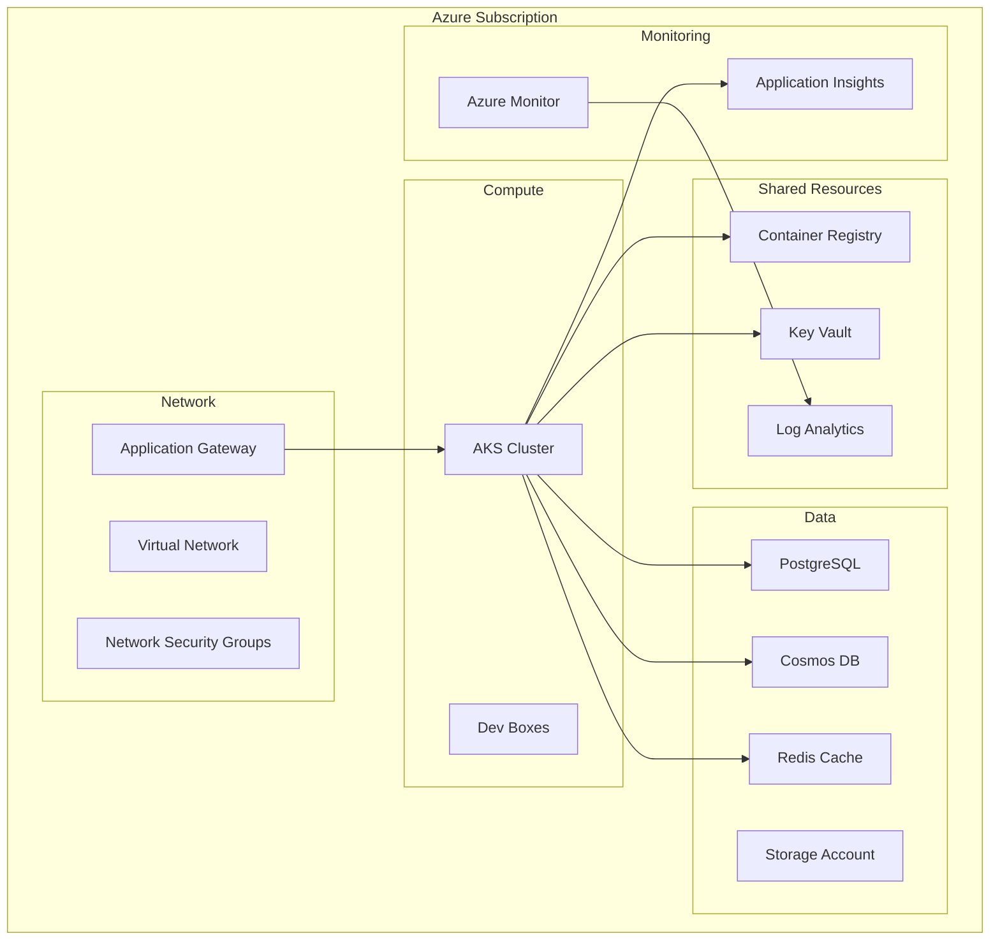

# ☁️ H1-007-C: Guia Completo de Configuração da Infraestrutura Azure

## 📋 Índice

1. [🎯 Visão Geral](#visao-geral)
2. [📊 Arquitetura Azure](#arquitetura-azure)
3. [🔧 Configuração Inicial](#configuracao-inicial)
4. [🏗️ Terraform Setup](#terraform-setup)
5. [⚡ Bicep Templates](#bicep-templates)
6. [🗄️ Recursos de Dados](#recursos-dados)
7. [🔒 Segurança e Identidade](#seguranca-identidade)
8. [🌐 Networking](#networking)
9. [📊 Monitoramento](#monitoramento)
10. [🚀 Scripts de Automação](#scripts-automacao)

## 🎯 Visão Geral {#visao-geral}

Este guia fornece instruções detalhadas para configurar toda a infraestrutura Azure necessária para a demonstração do Three Horizons AI Platform.

### 📊 Recursos a Serem Criados

- **Resource Groups**: Organização lógica dos recursos
- **AKS Cluster**: Kubernetes gerenciado
- **Container Registry**: ACR para imagens Docker
- **Databases**: PostgreSQL, MongoDB (Cosmos DB), Redis
- **Key Vault**: Gerenciamento de secrets
- **Application Gateway**: Load balancer e WAF
- **Monitor & Insights**: Observabilidade completa

## 📊 Arquitetura Azure {#arquitetura-azure}

### Diagrama de Arquitetura



## 🔧 Configuração Inicial {#configuracao-inicial}

### Passo 1: Preparar Ambiente

```bash
#!/bin/bash
# setup-azure-env.sh

# Variáveis de ambiente
export SUBSCRIPTION_ID="aca2dc4a-9d62-4b64-82d4-11e152d98f02"
export LOCATION="centralus"
export PROJECT_NAME="threehorizons"
export ENVIRONMENT="demo"

# Login no Azure
az login
az account set --subscription $SUBSCRIPTION_ID

# Criar Service Principal para automação
az ad sp create-for-rbac \
  --name "sp-${PROJECT_NAME}-${ENVIRONMENT}" \
  --role "Contributor" \
  --scopes "/subscriptions/${SUBSCRIPTION_ID}" \
  --sdk-auth > azure-credentials.json

# Registrar providers necessários
az provider register --namespace Microsoft.ContainerService
az provider register --namespace Microsoft.ContainerRegistry
az provider register --namespace Microsoft.KeyVault
az provider register --namespace Microsoft.DBforPostgreSQL
az provider register --namespace Microsoft.DocumentDB
az provider register --namespace Microsoft.Cache
az provider register --namespace Microsoft.Network
az provider register --namespace Microsoft.Monitor
az provider register --namespace Microsoft.OperationalInsights

echo "✅ Ambiente Azure preparado!"
```

### Passo 2: Criar Resource Groups

```bash
# Resource Groups por categoria
az group create --name "rg-${PROJECT_NAME}-${ENVIRONMENT}-shared" --location $LOCATION
az group create --name "rg-${PROJECT_NAME}-${ENVIRONMENT}-network" --location $LOCATION
az group create --name "rg-${PROJECT_NAME}-${ENVIRONMENT}-compute" --location $LOCATION
az group create --name "rg-${PROJECT_NAME}-${ENVIRONMENT}-data" --location $LOCATION
az group create --name "rg-${PROJECT_NAME}-${ENVIRONMENT}-monitoring" --location $LOCATION
```

## 🏗️ Terraform Setup {#terraform-setup}

### Estrutura Terraform

```bash
# Criar estrutura Terraform
mkdir -p infrastructure/terraform/{modules,environments}
cd infrastructure/terraform
```

### main.tf Principal

```hcl
# infrastructure/terraform/main.tf
terraform {
  required_version = ">= 1.5.0"
  
  required_providers {
    azurerm = {
      source  = "hashicorp/azurerm"
      version = "~> 3.75.0"
    }
    azuread = {
      source  = "hashicorp/azuread"
      version = "~> 2.45.0"
    }
    kubernetes = {
      source  = "hashicorp/kubernetes"
      version = "~> 2.23.0"
    }
    helm = {
      source  = "hashicorp/helm"
      version = "~> 2.11.0"
    }
  }
  
  backend "azurerm" {
    resource_group_name  = "rg-terraform-state"
    storage_account_name = "stterraformstate${var.project_name}"
    container_name       = "tfstate"
    key                  = "${var.environment}.terraform.tfstate"
  }
}

provider "azurerm" {
  features {
    key_vault {
      purge_soft_delete_on_destroy = false
    }
  }
}

# Data sources
data "azurerm_subscription" "current" {}
data "azurerm_client_config" "current" {}
```

### variables.tf

```hcl
# infrastructure/terraform/variables.tf
variable "project_name" {
  description = "Nome do projeto"
  type        = string
  default     = "threehorizons"
}

variable "environment" {
  description = "Ambiente (dev, staging, prod)"
  type        = string
  default     = "demo"
}

variable "location" {
  description = "Região Azure"
  type        = string
  default     = "centralus"
}

variable "kubernetes_version" {
  description = "Versão do Kubernetes"
  type        = string
  default     = "1.28.3"
}

variable "node_count" {
  description = "Número de nodes do AKS"
  type        = number
  default     = 3
}

variable "node_size" {
  description = "Tamanho das VMs dos nodes"
  type        = string
  default     = "Standard_D4s_v3"
}

variable "tags" {
  description = "Tags padrão"
  type        = map(string)
  default = {
    ManagedBy   = "Terraform"
    Platform    = "ThreeHorizons"
    Environment = "Demo"
  }
}
```

### Módulo AKS

```hcl
# infrastructure/terraform/modules/aks/main.tf
resource "azurerm_kubernetes_cluster" "main" {
  name                = "aks-${var.project_name}-${var.environment}"
  location            = var.location
  resource_group_name = var.resource_group_name
  dns_prefix          = "${var.project_name}-${var.environment}"
  kubernetes_version  = var.kubernetes_version

  default_node_pool {
    name                = "system"
    node_count          = var.system_node_count
    vm_size             = var.system_node_size
    os_disk_size_gb     = 100
    max_pods            = 110
    type                = "VirtualMachineScaleSets"
    enable_auto_scaling = true
    min_count           = 2
    max_count           = 5
    vnet_subnet_id      = var.subnet_id
  }

  network_profile {
    network_plugin     = "azure"
    network_policy     = "calico"
    dns_service_ip     = "10.0.0.10"
    docker_bridge_cidr = "172.17.0.1/16"
    service_cidr       = "10.0.0.0/16"
    load_balancer_sku  = "standard"
  }

  identity {
    type = "SystemAssigned"
  }

  azure_active_directory_role_based_access_control {
    managed                = true
    admin_group_object_ids = var.admin_group_object_ids
    azure_rbac_enabled     = true
  }

  workload_identity_enabled = true
  oidc_issuer_enabled      = true

  key_vault_secrets_provider {
    secret_rotation_enabled = true
  }

  monitor_metrics {
    annotations_allowed = null
    labels_allowed      = null
  }

  tags = var.tags
}

# Node pools adicionais
resource "azurerm_kubernetes_cluster_node_pool" "user" {
  name                  = "user"
  kubernetes_cluster_id = azurerm_kubernetes_cluster.main.id
  vm_size               = var.user_node_size
  node_count            = var.user_node_count
  os_disk_size_gb       = 100
  max_pods              = 110
  enable_auto_scaling   = true
  min_count             = 1
  max_count             = 10
  vnet_subnet_id        = var.subnet_id

  node_labels = {
    "workload" = "user"
  }

  node_taints = [
    "workload=user:NoSchedule"
  ]

  tags = var.tags
}
```

## ⚡ Bicep Templates {#bicep-templates}

### Container Registry

```bicep
// infrastructure/bicep/acr.bicep
param projectName string
param environment string
param location string = resourceGroup().location

var acrName = 'acr${projectName}${environment}'

resource acr 'Microsoft.ContainerRegistry/registries@2023-01-01-preview' = {
  name: acrName
  location: location
  sku: {
    name: 'Premium'
  }
  properties: {
    adminUserEnabled: false
    networkRuleSet: {
      defaultAction: 'Allow'
    }
    policies: {
      quarantinePolicy: {
        status: 'enabled'
      }
      trustPolicy: {
        type: 'Notary'
        status: 'enabled'
      }
      retentionPolicy: {
        days: 30
        status: 'enabled'
      }
    }
    encryption: {
      status: 'enabled'
    }
    dataEndpointEnabled: false
    publicNetworkAccess: 'Enabled'
    zoneRedundancy: 'Enabled'
  }
}

// Replication for geo-redundancy
resource acrReplication 'Microsoft.ContainerRegistry/registries/replications@2023-01-01-preview' = {
  parent: acr
  name: 'eastus'
  location: 'eastus'
  properties: {
    regionEndpointEnabled: true
    zoneRedundancy: 'Enabled'
  }
}

output acrName string = acr.name
output acrLoginServer string = acr.properties.loginServer
```

### Key Vault

```bicep
// infrastructure/bicep/keyvault.bicep
param projectName string
param environment string
param location string = resourceGroup().location
param tenantId string = subscription().tenantId

var kvName = 'kv-${projectName}-${environment}'

resource keyVault 'Microsoft.KeyVault/vaults@2023-07-01' = {
  name: kvName
  location: location
  properties: {
    sku: {
      family: 'A'
      name: 'premium'
    }
    tenantId: tenantId
    enabledForDeployment: true
    enabledForDiskEncryption: true
    enabledForTemplateDeployment: true
    enableRbacAuthorization: true
    enableSoftDelete: true
    softDeleteRetentionInDays: 90
    enablePurgeProtection: true
    publicNetworkAccess: 'Enabled'
    networkAcls: {
      defaultAction: 'Allow'
      bypass: 'AzureServices'
    }
  }
}

// Secrets base
var secrets = [
  {
    name: 'jwt-secret'
    value: uniqueString(resourceGroup().id, 'jwt')
  }
  {
    name: 'database-password'
    value: uniqueString(resourceGroup().id, 'db')
  }
  {
    name: 'redis-password'
    value: uniqueString(resourceGroup().id, 'redis')
  }
]

@batchSize(1)
resource keyVaultSecrets 'Microsoft.KeyVault/vaults/secrets@2023-07-01' = [for secret in secrets: {
  parent: keyVault
  name: secret.name
  properties: {
    value: secret.value
  }
}]

output keyVaultName string = keyVault.name
output keyVaultUri string = keyVault.properties.vaultUri
```

## 🗄️ Recursos de Dados {#recursos-dados}

### PostgreSQL Flexible Server

```bicep
// infrastructure/bicep/postgresql.bicep
param projectName string
param environment string
param location string = resourceGroup().location
param administratorLogin string = 'psqladmin'
@secure()
param administratorPassword string

var serverName = 'psql-${projectName}-${environment}'

resource postgresqlServer 'Microsoft.DBforPostgreSQL/flexibleServers@2023-03-01-preview' = {
  name: serverName
  location: location
  sku: {
    name: 'Standard_D4s_v3'
    tier: 'GeneralPurpose'
  }
  properties: {
    version: '15'
    administratorLogin: administratorLogin
    administratorLoginPassword: administratorPassword
    availabilityZone: '1'
    backup: {
      backupRetentionDays: 30
      geoRedundantBackup: 'Enabled'
    }
    highAvailability: {
      mode: 'ZoneRedundant'
      standbyAvailabilityZone: '2'
    }
    storage: {
      storageSizeGB: 128
      autoGrow: 'Enabled'
    }
    network: {
      publicNetworkAccess: 'Enabled'
    }
  }
}

// Databases
var databases = [
  'users'
  'orders'
  'payments'
  'notifications'
]

@batchSize(1)
resource postgresqlDatabases 'Microsoft.DBforPostgreSQL/flexibleServers/databases@2023-03-01-preview' = [for db in databases: {
  parent: postgresqlServer
  name: '${projectName}_${db}'
  properties: {
    charset: 'UTF8'
    collation: 'en_US.utf8'
  }
}]

// Firewall rules
resource allowAzureServices 'Microsoft.DBforPostgreSQL/flexibleServers/firewallRules@2023-03-01-preview' = {
  parent: postgresqlServer
  name: 'AllowAzureServices'
  properties: {
    startIpAddress: '0.0.0.0'
    endIpAddress: '0.0.0.0'
  }
}

output serverName string = postgresqlServer.name
output serverFqdn string = postgresqlServer.properties.fullyQualifiedDomainName
```

### Cosmos DB (MongoDB API)

```bicep
// infrastructure/bicep/cosmosdb.bicep
param projectName string
param environment string
param location string = resourceGroup().location

var accountName = '${projectName}-cosmos-${environment}'

resource cosmosAccount 'Microsoft.DocumentDB/databaseAccounts@2023-11-15' = {
  name: accountName
  location: location
  kind: 'MongoDB'
  properties: {
    consistencyPolicy: {
      defaultConsistencyLevel: 'Session'
    }
    locations: [
      {
        locationName: location
        failoverPriority: 0
        isZoneRedundant: true
      }
    ]
    databaseAccountOfferType: 'Standard'
    enableAutomaticFailover: true
    enableMultipleWriteLocations: false
    apiProperties: {
      serverVersion: '4.2'
    }
    capabilities: [
      {
        name: 'EnableMongo'
      }
    ]
    backupPolicy: {
      type: 'Continuous'
      continuousModeProperties: {
        tier: 'Continuous30Days'
      }
    }
  }
}

// MongoDB Database
resource mongoDatabase 'Microsoft.DocumentDB/databaseAccounts/mongodbDatabases@2023-11-15' = {
  parent: cosmosAccount
  name: '${projectName}_catalog'
  properties: {
    resource: {
      id: '${projectName}_catalog'
    }
    options: {
      throughput: 1000
    }
  }
}

// Collections
var collections = [
  'products'
  'categories'
  'reviews'
]

@batchSize(1)
resource mongoCollections 'Microsoft.DocumentDB/databaseAccounts/mongodbDatabases/collections@2023-11-15' = [for collection in collections: {
  parent: mongoDatabase
  name: collection
  properties: {
    resource: {
      id: collection
      shardKey: {
        _id: 'Hash'
      }
      indexes: [
        {
          key: {
            keys: ['_id']
          }
        }
      ]
    }
  }
}]

output connectionString string = cosmosAccount.listConnectionStrings().connectionStrings[0].connectionString
```

### Redis Cache

```bicep
// infrastructure/bicep/redis.bicep
param projectName string
param environment string
param location string = resourceGroup().location

var redisName = 'redis-${projectName}-${environment}'

resource redisCache 'Microsoft.Cache/Redis@2023-08-01' = {
  name: redisName
  location: location
  properties: {
    sku: {
      name: 'Premium'
      family: 'P'
      capacity: 1
    }
    enableNonSslPort: false
    minimumTlsVersion: '1.2'
    redisConfiguration: {
      'maxmemory-policy': 'allkeys-lru'
      'maxmemory-reserved': '50'
      'maxfragmentationmemory-reserved': '50'
      'rdb-backup-enabled': 'true'
      'rdb-backup-frequency': '60'
      'rdb-backup-max-snapshot-count': '1'
    }
    redisVersion: '6.0'
    replicasPerMaster: 1
    replicasPerPrimary: 1
    shardCount: 1
    zones: ['1', '2']
  }
}

output redisName string = redisCache.name
output redisHostName string = redisCache.properties.hostName
output redisSslPort int = redisCache.properties.sslPort
```

## 🔒 Segurança e Identidade {#seguranca-identidade}

### Managed Identities

```bicep
// infrastructure/bicep/identity.bicep
param projectName string
param environment string
param location string = resourceGroup().location

// User-assigned managed identity for AKS workloads
resource aksIdentity 'Microsoft.ManagedIdentity/userAssignedIdentities@2023-01-31' = {
  name: 'id-${projectName}-aks-${environment}'
  location: location
}

// App identities
var appIdentities = [
  'api-gateway'
  'catalog-service'
  'order-service'
  'payment-service'
]

@batchSize(1)
resource appManagedIdentities 'Microsoft.ManagedIdentity/userAssignedIdentities@2023-01-31' = [for app in appIdentities: {
  name: 'id-${projectName}-${app}-${environment}'
  location: location
}]

output aksIdentityId string = aksIdentity.id
output aksIdentityClientId string = aksIdentity.properties.clientId
output aksIdentityPrincipalId string = aksIdentity.properties.principalId
```

### Role Assignments

```bicep
// infrastructure/bicep/rbac.bicep
param keyVaultName string
param acrName string
param aksIdentityPrincipalId string

// Get existing resources
resource keyVault 'Microsoft.KeyVault/vaults@2023-07-01' existing = {
  name: keyVaultName
}

resource acr 'Microsoft.ContainerRegistry/registries@2023-01-01-preview' existing = {
  name: acrName
}

// Key Vault access for AKS
resource keyVaultRbac 'Microsoft.Authorization/roleAssignments@2022-04-01' = {
  name: guid(keyVault.id, aksIdentityPrincipalId, 'Key Vault Secrets User')
  scope: keyVault
  properties: {
    roleDefinitionId: subscriptionResourceId('Microsoft.Authorization/roleDefinitions', '4633458b-17de-408a-b874-0445c86b69e6')
    principalId: aksIdentityPrincipalId
    principalType: 'ServicePrincipal'
  }
}

// ACR pull for AKS
resource acrRbac 'Microsoft.Authorization/roleAssignments@2022-04-01' = {
  name: guid(acr.id, aksIdentityPrincipalId, 'AcrPull')
  scope: acr
  properties: {
    roleDefinitionId: subscriptionResourceId('Microsoft.Authorization/roleDefinitions', '7f951dda-4ed3-4680-a7ca-43fe172d538d')
    principalId: aksIdentityPrincipalId
    principalType: 'ServicePrincipal'
  }
}
```

## 🌐 Networking {#networking}

### Virtual Network

```bicep
// infrastructure/bicep/network.bicep
param projectName string
param environment string
param location string = resourceGroup().location

var vnetName = 'vnet-${projectName}-${environment}'

resource vnet 'Microsoft.Network/virtualNetworks@2023-09-01' = {
  name: vnetName
  location: location
  properties: {
    addressSpace: {
      addressPrefixes: [
        '10.0.0.0/16'
      ]
    }
    subnets: [
      {
        name: 'snet-aks'
        properties: {
          addressPrefix: '10.0.0.0/20'
          serviceEndpoints: [
            {
              service: 'Microsoft.ContainerRegistry'
            }
            {
              service: 'Microsoft.KeyVault'
            }
            {
              service: 'Microsoft.Storage'
            }
            {
              service: 'Microsoft.Sql'
            }
          ]
        }
      }
      {
        name: 'snet-agw'
        properties: {
          addressPrefix: '10.0.16.0/24'
        }
      }
      {
        name: 'snet-data'
        properties: {
          addressPrefix: '10.0.17.0/24'
          serviceEndpoints: [
            {
              service: 'Microsoft.Sql'
            }
            {
              service: 'Microsoft.Storage'
            }
          ]
        }
      }
    ]
  }
}

// Network Security Groups
resource nsgAks 'Microsoft.Network/networkSecurityGroups@2023-09-01' = {
  name: 'nsg-${vnetName}-aks'
  location: location
  properties: {
    securityRules: [
      {
        name: 'AllowKubeAPIServer'
        properties: {
          protocol: 'Tcp'
          sourcePortRange: '*'
          destinationPortRange: '443'
          sourceAddressPrefix: 'Internet'
          destinationAddressPrefix: '*'
          access: 'Allow'
          priority: 100
          direction: 'Inbound'
        }
      }
    ]
  }
}

output vnetId string = vnet.id
output aksSubnetId string = vnet.properties.subnets[0].id
output agwSubnetId string = vnet.properties.subnets[1].id
```

### Application Gateway

```bicep
// infrastructure/bicep/appgateway.bicep
param projectName string
param environment string
param location string = resourceGroup().location
param subnetId string

var agwName = 'agw-${projectName}-${environment}'
var pipName = 'pip-${agwName}'

// Public IP
resource publicIp 'Microsoft.Network/publicIPAddresses@2023-09-01' = {
  name: pipName
  location: location
  sku: {
    name: 'Standard'
    tier: 'Regional'
  }
  properties: {
    publicIPAllocationMethod: 'Static'
    dnsSettings: {
      domainNameLabel: '${projectName}-${environment}'
    }
  }
  zones: ['1', '2', '3']
}

// Application Gateway
resource appGateway 'Microsoft.Network/applicationGateways@2023-09-01' = {
  name: agwName
  location: location
  properties: {
    sku: {
      name: 'WAF_v2'
      tier: 'WAF_v2'
    }
    autoscaleConfiguration: {
      minCapacity: 2
      maxCapacity: 10
    }
    gatewayIPConfigurations: [
      {
        name: 'gatewayIpConfig'
        properties: {
          subnet: {
            id: subnetId
          }
        }
      }
    ]
    frontendIPConfigurations: [
      {
        name: 'frontendIpConfig'
        properties: {
          publicIPAddress: {
            id: publicIp.id
          }
        }
      }
    ]
    frontendPorts: [
      {
        name: 'port_80'
        properties: {
          port: 80
        }
      }
      {
        name: 'port_443'
        properties: {
          port: 443
        }
      }
    ]
    backendAddressPools: [
      {
        name: 'aks-backend'
        properties: {}
      }
    ]
    backendHttpSettingsCollection: [
      {
        name: 'http-settings'
        properties: {
          port: 80
          protocol: 'Http'
          cookieBasedAffinity: 'Disabled'
          requestTimeout: 30
          pickHostNameFromBackendAddress: true
        }
      }
    ]
    httpListeners: [
      {
        name: 'http-listener'
        properties: {
          frontendIPConfiguration: {
            id: resourceId('Microsoft.Network/applicationGateways/frontendIPConfigurations', agwName, 'frontendIpConfig')
          }
          frontendPort: {
            id: resourceId('Microsoft.Network/applicationGateways/frontendPorts', agwName, 'port_80')
          }
          protocol: 'Http'
        }
      }
    ]
    requestRoutingRules: [
      {
        name: 'rule1'
        properties: {
          ruleType: 'Basic'
          priority: 100
          httpListener: {
            id: resourceId('Microsoft.Network/applicationGateways/httpListeners', agwName, 'http-listener')
          }
          backendAddressPool: {
            id: resourceId('Microsoft.Network/applicationGateways/backendAddressPools', agwName, 'aks-backend')
          }
          backendHttpSettings: {
            id: resourceId('Microsoft.Network/applicationGateways/backendHttpSettingsCollection', agwName, 'http-settings')
          }
        }
      }
    ]
    webApplicationFirewallConfiguration: {
      enabled: true
      firewallMode: 'Prevention'
      ruleSetType: 'OWASP'
      ruleSetVersion: '3.2'
    }
  }
  zones: ['1', '2', '3']
}

output appGatewayId string = appGateway.id
output appGatewayName string = appGateway.name
output publicIpAddress string = publicIp.properties.ipAddress
output publicIpFqdn string = publicIp.properties.dnsSettings.fqdn
```

## 📊 Monitoramento {#monitoramento}

### Log Analytics e Application Insights

```bicep
// infrastructure/bicep/monitoring.bicep
param projectName string
param environment string
param location string = resourceGroup().location

var workspaceName = 'law-${projectName}-${environment}'
var appInsightsName = 'ai-${projectName}-${environment}'

// Log Analytics Workspace
resource logAnalyticsWorkspace 'Microsoft.OperationalInsights/workspaces@2022-10-01' = {
  name: workspaceName
  location: location
  properties: {
    sku: {
      name: 'PerGB2018'
    }
    retentionInDays: 90
    features: {
      enableLogAccessUsingOnlyResourcePermissions: true
    }
    workspaceCapping: {
      dailyQuotaGb: 10
    }
  }
}

// Application Insights
resource appInsights 'Microsoft.Insights/components@2020-02-02' = {
  name: appInsightsName
  location: location
  kind: 'web'
  properties: {
    Application_Type: 'web'
    WorkspaceResourceId: logAnalyticsWorkspace.id
    IngestionMode: 'LogAnalytics'
    publicNetworkAccessForIngestion: 'Enabled'
    publicNetworkAccessForQuery: 'Enabled'
    RetentionInDays: 90
  }
}

// Diagnostic settings for AKS
resource aksDiagnostics 'Microsoft.Insights/diagnosticSettings@2021-05-01-preview' = {
  name: 'aks-diagnostics'
  scope: resourceId('Microsoft.ContainerService/managedClusters', 'aks-${projectName}-${environment}')
  properties: {
    workspaceId: logAnalyticsWorkspace.id
    logs: [
      {
        category: 'kube-apiserver'
        enabled: true
      }
      {
        category: 'kube-controller-manager'
        enabled: true
      }
      {
        category: 'kube-scheduler'
        enabled: true
      }
      {
        category: 'cluster-autoscaler'
        enabled: true
      }
    ]
    metrics: [
      {
        category: 'AllMetrics'
        enabled: true
      }
    ]
  }
}

output workspaceId string = logAnalyticsWorkspace.id
output appInsightsConnectionString string = appInsights.properties.ConnectionString
output appInsightsInstrumentationKey string = appInsights.properties.InstrumentationKey
```

## 🚀 Scripts de Automação {#scripts-automacao}

### Script de Deploy Completo

```bash
#!/bin/bash
# infrastructure/scripts/deploy-all.sh

set -euo pipefail

# Colors
GREEN='\033[0;32m'
BLUE='\033[0;34m'
RED='\033[0;31m'
NC='\033[0m'

log() { echo -e "${BLUE}[$(date +'%H:%M:%S')] $1${NC}"; }
success() { echo -e "${GREEN}[SUCCESS] $1${NC}"; }
error() { echo -e "${RED}[ERROR] $1${NC}" >&2; }

# Configuration
SUBSCRIPTION_ID="aca2dc4a-9d62-4b64-82d4-11e152d98f02"
PROJECT_NAME="threehorizons"
ENVIRONMENT="demo"
LOCATION="centralus"

# Deploy function
deploy_infrastructure() {
    log "🚀 Starting infrastructure deployment..."
    
    # Set subscription
    az account set --subscription $SUBSCRIPTION_ID
    
    # Deploy with Bicep
    log "Deploying shared resources..."
    az deployment sub create \
        --location $LOCATION \
        --template-file ../bicep/main.bicep \
        --parameters \
            projectName=$PROJECT_NAME \
            environment=$ENVIRONMENT \
            location=$LOCATION
    
    # Get outputs
    RESOURCE_GROUP=$(az deployment sub show \
        --name main \
        --query properties.outputs.resourceGroupName.value -o tsv)
    
    ACR_NAME=$(az deployment group show \
        --resource-group $RESOURCE_GROUP \
        --name acr \
        --query properties.outputs.acrName.value -o tsv)
    
    AKS_NAME=$(az deployment group show \
        --resource-group $RESOURCE_GROUP \
        --name aks \
        --query properties.outputs.aksName.value -o tsv)
    
    success "Infrastructure deployed successfully!"
    
    # Configure kubectl
    log "Configuring kubectl..."
    az aks get-credentials \
        --resource-group $RESOURCE_GROUP \
        --name $AKS_NAME \
        --overwrite-existing
    
    # Install necessary components
    install_k8s_components
    
    success "Deployment complete!"
}

# Install Kubernetes components
install_k8s_components() {
    log "Installing Kubernetes components..."
    
    # Install cert-manager
    kubectl apply -f https://github.com/cert-manager/cert-manager/releases/download/v1.13.0/cert-manager.yaml
    
    # Install NGINX Ingress
    helm upgrade --install ingress-nginx ingress-nginx \
        --repo https://kubernetes.github.io/ingress-nginx \
        --namespace ingress-nginx --create-namespace \
        --set controller.service.loadBalancerIP=$PUBLIC_IP
    
    # Install ArgoCD
    kubectl create namespace argocd || true
    kubectl apply -n argocd -f https://raw.githubusercontent.com/argoproj/argo-cd/stable/manifests/install.yaml
    
    # Install Prometheus/Grafana
    helm upgrade --install prometheus prometheus-community/kube-prometheus-stack \
        --namespace monitoring --create-namespace \
        --set grafana.adminPassword="ThreeHorizons2024!"
    
    log "Kubernetes components installed!"
}

# Validate deployment
validate_deployment() {
    log "Validating deployment..."
    
    # Check resource groups
    az group show --name "rg-${PROJECT_NAME}-${ENVIRONMENT}-shared" > /dev/null || error "Shared RG not found"
    
    # Check AKS
    kubectl cluster-info > /dev/null || error "Cannot connect to AKS"
    
    # Check pods
    kubectl get pods --all-namespaces
    
    success "Validation complete!"
}

# Main execution
main() {
    echo -e "${BLUE}╔══════════════════════════════════════════════════════════════╗${NC}"
    echo -e "${BLUE}║        Azure Infrastructure Deployment                        ║${NC}"
    echo -e "${BLUE}╚══════════════════════════════════════════════════════════════╝${NC}"
    
    deploy_infrastructure
    validate_deployment
    
    echo -e "\n${GREEN}✅ Infrastructure is ready!${NC}"
    echo -e "\n📋 Resources created:"
    echo -e "  • AKS Cluster: $AKS_NAME"
    echo -e "  • Container Registry: $ACR_NAME"
    echo -e "  • Resource Group: $RESOURCE_GROUP"
    echo -e "\n🔗 Next steps:"
    echo -e "  1. Deploy applications"
    echo -e "  2. Configure monitoring"
    echo -e "  3. Set up GitOps"
}

# Run if executed directly
if [[ "${BASH_SOURCE[0]}" == "${0}" ]]; then
    main "$@"
fi
```

### Script de Cleanup

```bash
#!/bin/bash
# infrastructure/scripts/cleanup.sh

# Remove all resources
RESOURCE_GROUPS=(
    "rg-threehorizons-demo-shared"
    "rg-threehorizons-demo-network"
    "rg-threehorizons-demo-compute"
    "rg-threehorizons-demo-data"
    "rg-threehorizons-demo-monitoring"
)

for RG in "${RESOURCE_GROUPS[@]}"; do
    echo "Deleting resource group: $RG"
    az group delete --name $RG --yes --no-wait
done

echo "Cleanup initiated. Resources will be deleted in background."
```

---

## 🎯 Próximos Passos

Com a infraestrutura configurada:

1. **[H1-007-D: Desenvolvimento da Aplicação](./H1-007-D-application-development.md)** - Implementar aplicação
2. **[H1-007-E: DevBox Setup](./H1-007-E-devbox-setup.md)** - Configurar ambiente dev
3. **[H1-007-F: CI/CD Pipeline](./H1-007-F-cicd-pipeline.md)** - Configurar pipelines

---

**📝 Checklist de Infraestrutura**

- [ ] Resource Groups criados
- [ ] AKS cluster provisionado
- [ ] Container Registry configurado
- [ ] Databases criados
- [ ] Key Vault com secrets
- [ ] Networking configurado
- [ ] Monitoring habilitado
- [ ] Scripts de automação testados