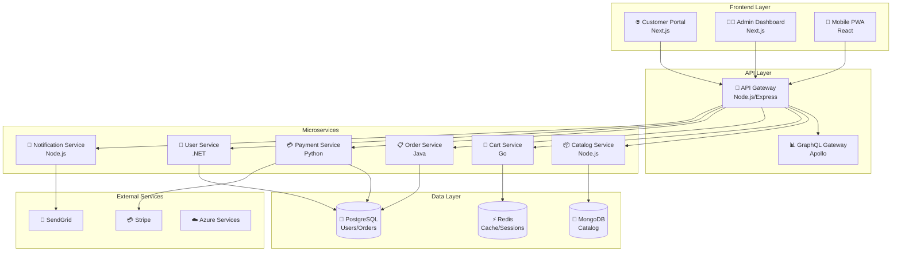

# 🛍️ H1-007-D: Guia Completo de Desenvolvimento da Aplicação E-commerce

## 📋 Índice

1. [🎯 Visão Geral](#visao-geral)
2. [🏗️ Arquitetura da Aplicação](#arquitetura-aplicacao)
3. [🌐 Frontend Portal](#frontend-portal)
4. [👨‍💼 Frontend Admin](#frontend-admin)
5. [🚪 API Gateway](#api-gateway)
6. [📦 Catalog Service](#catalog-service)
7. [🛒 Cart Service](#cart-service)
8. [📋 Order Service](#order-service)
9. [💳 Payment Service](#payment-service)
10. [👤 User Service](#user-service)
11. [📧 Notification Service](#notification-service)
12. [🗄️ Database Schemas](#database-schemas)
13. [🧪 Testing Strategy](#testing-strategy)
14. [🚀 Local Development](#local-development)

## 🎯 Visão Geral {#visao-geral}

Este guia fornece instruções detalhadas para desenvolver a aplicação e-commerce completa da demonstração Three Horizons AI Platform.

### 📊 Stack Tecnológica

- **Frontend**: Next.js 14, React 18, TypeScript, Tailwind CSS
- **Backend**: Node.js, Go, Java, Python, .NET
- **Databases**: PostgreSQL, MongoDB, Redis
- **Messaging**: RabbitMQ/Azure Service Bus
- **API**: REST + GraphQL
- **Authentication**: JWT/OAuth2

## 🏗️ Arquitetura da Aplicação {#arquitetura-aplicacao}

### Diagrama de Arquitetura



## 🌐 Frontend Portal {#frontend-portal}

### Estrutura do Projeto

```
frontend/portal/
├── src/
│   ├── app/                    # App Router (Next.js 14)
│   │   ├── layout.tsx          # Root layout
│   │   ├── page.tsx           # Home page
│   │   ├── products/
│   │   ├── cart/
│   │   ├── checkout/
│   │   └── account/
│   ├── components/
│   │   ├── ui/                # Shadcn/ui components
│   │   ├── layout/
│   │   ├── products/
│   │   └── cart/
│   ├── hooks/                 # Custom React hooks
│   ├── lib/                   # Utilities
│   ├── services/              # API services
│   └── types/                 # TypeScript types
├── public/
├── next.config.js
├── tailwind.config.js
└── package.json
```

### package.json

```json
{
  "name": "ecommerce-portal",
  "version": "1.0.0",
  "private": true,
  "scripts": {
    "dev": "next dev",
    "build": "next build",
    "start": "next start",
    "lint": "next lint",
    "test": "jest",
    "test:watch": "jest --watch",
    "test:e2e": "cypress run",
    "storybook": "storybook dev -p 6006"
  },
  "dependencies": {
    "next": "^14.0.4",
    "react": "^18.2.0",
    "react-dom": "^18.2.0",
    "@tanstack/react-query": "^5.17.0",
    "zustand": "^4.4.7",
    "@hookform/resolvers": "^3.3.2",
    "react-hook-form": "^7.48.2",
    "zod": "^3.22.4",
    "axios": "^1.6.5",
    "@radix-ui/react-accordion": "^1.1.2",
    "@radix-ui/react-alert-dialog": "^1.0.5",
    "@radix-ui/react-dialog": "^1.0.5",
    "@radix-ui/react-dropdown-menu": "^2.0.6",
    "@radix-ui/react-toast": "^1.1.5",
    "class-variance-authority": "^0.7.0",
    "clsx": "^2.1.0",
    "tailwind-merge": "^2.2.0",
    "lucide-react": "^0.303.0",
    "date-fns": "^3.2.0",
    "stripe": "^14.12.0",
    "@stripe/stripe-js": "^2.3.0",
    "next-auth": "^4.24.5",
    "sharp": "^0.33.2"
  },
  "devDependencies": {
    "@types/node": "^20.11.0",
    "@types/react": "^18.2.47",
    "@types/react-dom": "^18.2.18",
    "typescript": "^5.3.3",
    "eslint": "^8.56.0",
    "eslint-config-next": "^14.0.4",
    "postcss": "^8.4.33",
    "tailwindcss": "^3.4.1",
    "autoprefixer": "^10.4.16",
    "@testing-library/react": "^14.1.2",
    "@testing-library/jest-dom": "^6.2.0",
    "jest": "^29.7.0",
    "jest-environment-jsdom": "^29.7.0",
    "cypress": "^13.6.3",
    "@storybook/react": "^7.6.7"
  }
}
```

### Componente Principal - Homepage

```tsx
// src/app/page.tsx
import { HeroSection } from '@/components/sections/hero-section'
import { FeaturedProducts } from '@/components/sections/featured-products'
import { CategoryGrid } from '@/components/sections/category-grid'
import { Newsletter } from '@/components/sections/newsletter'
import { TestimonialCarousel } from '@/components/sections/testimonial-carousel'

export default function HomePage() {
  return (
    <main className="min-h-screen">
      <HeroSection />
      <FeaturedProducts />
      <CategoryGrid />
      <TestimonialCarousel />
      <Newsletter />
    </main>
  )
}

export const metadata = {
  title: 'Home - Three Horizons E-commerce',
  description: 'Discover amazing products with AI-powered recommendations'
}
```

### Hook de Carrinho

```tsx
// src/hooks/use-cart.ts
import { create } from 'zustand'
import { persist } from 'zustand/middleware'
import { CartItem, Product } from '@/types'
import { cartService } from '@/services/cart'

interface CartStore {
  items: CartItem[]
  isLoading: boolean
  error: string | null
  
  // Actions
  addItem: (product: Product, quantity?: number) => Promise<void>
  removeItem: (productId: string) => Promise<void>
  updateQuantity: (productId: string, quantity: number) => Promise<void>
  clearCart: () => Promise<void>
  loadCart: () => Promise<void>
  
  // Computed
  getItemCount: () => number
  getSubtotal: () => number
}

export const useCart = create<CartStore>()(
  persist(
    (set, get) => ({
      items: [],
      isLoading: false,
      error: null,
      
      addItem: async (product, quantity = 1) => {
        set({ isLoading: true, error: null })
        try {
          const response = await cartService.addItem({
            productId: product.id,
            quantity
          })
          set({ items: response.items })
        } catch (error) {
          set({ error: error.message })
        } finally {
          set({ isLoading: false })
        }
      },
      
      removeItem: async (productId) => {
        set({ isLoading: true, error: null })
        try {
          const response = await cartService.removeItem(productId)
          set({ items: response.items })
        } catch (error) {
          set({ error: error.message })
        } finally {
          set({ isLoading: false })
        }
      },
      
      updateQuantity: async (productId, quantity) => {
        if (quantity <= 0) {
          return get().removeItem(productId)
        }
        
        set({ isLoading: true, error: null })
        try {
          const response = await cartService.updateQuantity(productId, quantity)
          set({ items: response.items })
        } catch (error) {
          set({ error: error.message })
        } finally {
          set({ isLoading: false })
        }
      },
      
      clearCart: async () => {
        set({ isLoading: true, error: null })
        try {
          await cartService.clear()
          set({ items: [] })
        } catch (error) {
          set({ error: error.message })
        } finally {
          set({ isLoading: false })
        }
      },
      
      loadCart: async () => {
        set({ isLoading: true, error: null })
        try {
          const response = await cartService.getCart()
          set({ items: response.items })
        } catch (error) {
          set({ error: error.message })
        } finally {
          set({ isLoading: false })
        }
      },
      
      getItemCount: () => {
        return get().items.reduce((total, item) => total + item.quantity, 0)
      },
      
      getSubtotal: () => {
        return get().items.reduce((total, item) => total + (item.price * item.quantity), 0)
      }
    }),
    {
      name: 'cart-storage',
      partialize: (state) => ({ items: state.items })
    }
  )
)
```

### Serviço de API

```tsx
// src/services/api-client.ts
import axios, { AxiosInstance } from 'axios'
import { getSession } from 'next-auth/react'

class ApiClient {
  private client: AxiosInstance
  
  constructor() {
    this.client = axios.create({
      baseURL: process.env.NEXT_PUBLIC_API_URL || 'http://localhost:8080/api/v1',
      timeout: 15000,
      headers: {
        'Content-Type': 'application/json'
      }
    })
    
    // Request interceptor for auth
    this.client.interceptors.request.use(async (config) => {
      const session = await getSession()
      if (session?.accessToken) {
        config.headers.Authorization = `Bearer ${session.accessToken}`
      }
      return config
    })
    
    // Response interceptor for errors
    this.client.interceptors.response.use(
      (response) => response,
      (error) => {
        if (error.response?.status === 401) {
          // Handle token refresh or redirect to login
          window.location.href = '/auth/signin'
        }
        return Promise.reject(error)
      }
    )
  }
  
  get<T>(url: string, config = {}) {
    return this.client.get<T>(url, config)
  }
  
  post<T>(url: string, data?: any, config = {}) {
    return this.client.post<T>(url, data, config)
  }
  
  put<T>(url: string, data?: any, config = {}) {
    return this.client.put<T>(url, data, config)
  }
  
  delete<T>(url: string, config = {}) {
    return this.client.delete<T>(url, config)
  }
}

export const apiClient = new ApiClient()
```

## 👨‍💼 Frontend Admin {#frontend-admin}

### Dashboard Principal

```tsx
// frontend/admin/src/app/dashboard/page.tsx
import { Card, CardContent, CardHeader, CardTitle } from '@/components/ui/card'
import { Overview } from '@/components/dashboard/overview'
import { RecentOrders } from '@/components/dashboard/recent-orders'
import { TopProducts } from '@/components/dashboard/top-products'
import { getDashboardMetrics } from '@/services/analytics'

export default async function DashboardPage() {
  const metrics = await getDashboardMetrics()
  
  return (
    <div className="space-y-8">
      <div>
        <h1 className="text-3xl font-bold">Dashboard</h1>
        <p className="text-muted-foreground">
          Welcome back! Here's what's happening with your store.
        </p>
      </div>
      
      <div className="grid gap-4 md:grid-cols-2 lg:grid-cols-4">
        <Card>
          <CardHeader className="flex flex-row items-center justify-between space-y-0 pb-2">
            <CardTitle className="text-sm font-medium">Total Revenue</CardTitle>
            <DollarSign className="h-4 w-4 text-muted-foreground" />
          </CardHeader>
          <CardContent>
            <div className="text-2xl font-bold">${metrics.revenue.toLocaleString()}</div>
            <p className="text-xs text-muted-foreground">
              +20.1% from last month
            </p>
          </CardContent>
        </Card>
        
        <Card>
          <CardHeader className="flex flex-row items-center justify-between space-y-0 pb-2">
            <CardTitle className="text-sm font-medium">Orders</CardTitle>
            <ShoppingCart className="h-4 w-4 text-muted-foreground" />
          </CardHeader>
          <CardContent>
            <div className="text-2xl font-bold">{metrics.orders}</div>
            <p className="text-xs text-muted-foreground">
              +12.5% from last month
            </p>
          </CardContent>
        </Card>
        
        <Card>
          <CardHeader className="flex flex-row items-center justify-between space-y-0 pb-2">
            <CardTitle className="text-sm font-medium">Active Users</CardTitle>
            <Users className="h-4 w-4 text-muted-foreground" />
          </CardHeader>
          <CardContent>
            <div className="text-2xl font-bold">{metrics.activeUsers}</div>
            <p className="text-xs text-muted-foreground">
              +5.2% from last month
            </p>
          </CardContent>
        </Card>
        
        <Card>
          <CardHeader className="flex flex-row items-center justify-between space-y-0 pb-2">
            <CardTitle className="text-sm font-medium">Conversion Rate</CardTitle>
            <TrendingUp className="h-4 w-4 text-muted-foreground" />
          </CardHeader>
          <CardContent>
            <div className="text-2xl font-bold">{metrics.conversionRate}%</div>
            <p className="text-xs text-muted-foreground">
              +2.4% from last month
            </p>
          </CardContent>
        </Card>
      </div>
      
      <div className="grid gap-4 md:grid-cols-2 lg:grid-cols-7">
        <Card className="col-span-4">
          <CardHeader>
            <CardTitle>Overview</CardTitle>
          </CardHeader>
          <CardContent className="pl-2">
            <Overview data={metrics.overview} />
          </CardContent>
        </Card>
        
        <Card className="col-span-3">
          <CardHeader>
            <CardTitle>Recent Orders</CardTitle>
          </CardHeader>
          <CardContent>
            <RecentOrders orders={metrics.recentOrders} />
          </CardContent>
        </Card>
      </div>
      
      <Card>
        <CardHeader>
          <CardTitle>Top Products</CardTitle>
        </CardHeader>
        <CardContent>
          <TopProducts products={metrics.topProducts} />
        </CardContent>
      </Card>
    </div>
  )
}
```

## 🚪 API Gateway {#api-gateway}

### Configuração Express

```typescript
// backend/api-gateway/src/app.ts
import express from 'express'
import cors from 'cors'
import helmet from 'helmet'
import compression from 'compression'
import rateLimit from 'express-rate-limit'
import { createProxyMiddleware } from 'http-proxy-middleware'
import { logger } from './utils/logger'
import { authMiddleware } from './middleware/auth'
import { errorHandler } from './middleware/error-handler'
import { requestLogger } from './middleware/request-logger'
import { config } from './config'

const app = express()

// Security middleware
app.use(helmet({
  contentSecurityPolicy: {
    directives: {
      defaultSrc: ["'self'"],
      styleSrc: ["'self'", "'unsafe-inline'"],
      scriptSrc: ["'self'", "'unsafe-inline'", "'unsafe-eval'"],
      imgSrc: ["'self'", "data:", "https:"],
    },
  },
}))

// CORS configuration
app.use(cors({
  origin: config.cors.origins,
  credentials: true,
  methods: ['GET', 'POST', 'PUT', 'DELETE', 'PATCH', 'OPTIONS'],
  allowedHeaders: ['Content-Type', 'Authorization', 'X-Request-ID'],
}))

// General middleware
app.use(compression())
app.use(express.json({ limit: '10mb' }))
app.use(express.urlencoded({ extended: true, limit: '10mb' }))
app.use(requestLogger)

// Rate limiting
const limiter = rateLimit({
  windowMs: 15 * 60 * 1000, // 15 minutes
  max: 100, // limit each IP to 100 requests per windowMs
  message: 'Too many requests from this IP',
  standardHeaders: true,
  legacyHeaders: false,
})

app.use('/api/', limiter)

// Health check
app.get('/health', (req, res) => {
  res.json({
    status: 'healthy',
    timestamp: new Date().toISOString(),
    version: process.env.npm_package_version || '1.0.0',
    uptime: process.uptime(),
  })
})

// Service routing configuration
const services = {
  '/api/v1/products': {
    target: config.services.catalog,
    changeOrigin: true,
    pathRewrite: { '^/api/v1/products': '/products' },
  },
  '/api/v1/cart': {
    target: config.services.cart,
    changeOrigin: true,
    pathRewrite: { '^/api/v1/cart': '/cart' },
    onProxyReq: (proxyReq, req) => {
      if (req.user) {
        proxyReq.setHeader('X-User-ID', req.user.id)
      }
    },
  },
  '/api/v1/orders': {
    target: config.services.orders,
    changeOrigin: true,
    pathRewrite: { '^/api/v1/orders': '/orders' },
  },
  '/api/v1/payments': {
    target: config.services.payments,
    changeOrigin: true,
    pathRewrite: { '^/api/v1/payments': '/payments' },
  },
  '/api/v1/users': {
    target: config.services.users,
    changeOrigin: true,
    pathRewrite: { '^/api/v1/users': '/users' },
  },
  '/api/v1/notifications': {
    target: config.services.notifications,
    changeOrigin: true,
    pathRewrite: { '^/api/v1/notifications': '/notifications' },
  },
}

// Apply authentication to protected routes
const protectedRoutes = ['/api/v1/cart', '/api/v1/orders', '/api/v1/payments', '/api/v1/users/profile']
protectedRoutes.forEach(route => {
  app.use(route, authMiddleware)
})

// Set up proxy middleware
Object.entries(services).forEach(([path, config]) => {
  app.use(path, createProxyMiddleware(config))
})

// Error handling
app.use(errorHandler)

// 404 handler
app.use('*', (req, res) => {
  res.status(404).json({
    error: 'Not Found',
    message: `Route ${req.originalUrl} not found`,
    path: req.originalUrl,
  })
})

export default app
```

### Middleware de Autenticação

```typescript
// backend/api-gateway/src/middleware/auth.ts
import { Request, Response, NextFunction } from 'express'
import jwt from 'jsonwebtoken'
import { logger } from '../utils/logger'

export interface AuthUser {
  id: string
  email: string
  name: string
  roles: string[]
}

declare global {
  namespace Express {
    interface Request {
      user?: AuthUser
    }
  }
}

export const authMiddleware = async (
  req: Request,
  res: Response,
  next: NextFunction
) => {
  try {
    const authHeader = req.headers.authorization
    
    if (!authHeader || !authHeader.startsWith('Bearer ')) {
      return res.status(401).json({
        error: 'Unauthorized',
        message: 'Missing or invalid authorization header',
      })
    }
    
    const token = authHeader.substring(7)
    
    try {
      const decoded = jwt.verify(token, process.env.JWT_SECRET!) as any
      
      req.user = {
        id: decoded.sub || decoded.userId,
        email: decoded.email,
        name: decoded.name,
        roles: decoded.roles || ['user'],
      }
      
      next()
    } catch (error) {
      logger.error('Token verification failed:', error)
      return res.status(401).json({
        error: 'Unauthorized',
        message: 'Invalid or expired token',
      })
    }
  } catch (error) {
    logger.error('Auth middleware error:', error)
    return res.status(500).json({
      error: 'Internal Server Error',
      message: 'Authentication failed',
    })
  }
}

export const requireRole = (roles: string[]) => {
  return (req: Request, res: Response, next: NextFunction) => {
    if (!req.user) {
      return res.status(401).json({
        error: 'Unauthorized',
        message: 'Authentication required',
      })
    }
    
    const hasRole = roles.some(role => req.user!.roles.includes(role))
    
    if (!hasRole) {
      return res.status(403).json({
        error: 'Forbidden',
        message: 'Insufficient permissions',
      })
    }
    
    next()
  }
}
```

## 📦 Catalog Service {#catalog-service}

### Modelo de Produto

```typescript
// backend/catalog-service/src/models/product.model.ts
import mongoose, { Document, Schema } from 'mongoose'

export interface IProduct extends Document {
  name: string
  slug: string
  description: string
  shortDescription: string
  price: number
  compareAtPrice?: number
  images: string[]
  category: mongoose.Types.ObjectId
  categoryName: string
  stock: number
  sku: string
  barcode?: string
  weight?: number
  dimensions?: {
    length: number
    width: number
    height: number
  }
  tags: string[]
  rating: number
  reviewCount: number
  variants?: IProductVariant[]
  specifications?: Map<string, string>
  isActive: boolean
  isFeatured: boolean
  seoTitle?: string
  seoDescription?: string
  seoKeywords?: string[]
  createdAt: Date
  updatedAt: Date
}

export interface IProductVariant {
  name: string
  sku: string
  price: number
  stock: number
  attributes: Map<string, string>
  images?: string[]
}

const productVariantSchema = new Schema<IProductVariant>({
  name: { type: String, required: true },
  sku: { type: String, required: true },
  price: { type: Number, required: true, min: 0 },
  stock: { type: Number, required: true, min: 0 },
  attributes: {
    type: Map,
    of: String,
  },
  images: [String],
})

const productSchema = new Schema<IProduct>({
  name: {
    type: String,
    required: true,
    trim: true,
    maxlength: 200,
  },
  slug: {
    type: String,
    required: true,
    unique: true,
    lowercase: true,
  },
  description: {
    type: String,
    required: true,
    maxlength: 5000,
  },
  shortDescription: {
    type: String,
    maxlength: 500,
  },
  price: {
    type: Number,
    required: true,
    min: 0,
  },
  compareAtPrice: {
    type: Number,
    min: 0,
  },
  images: {
    type: [String],
    validate: [arrayMinLength, 'At least one image is required'],
  },
  category: {
    type: Schema.Types.ObjectId,
    ref: 'Category',
    required: true,
  },
  categoryName: {
    type: String,
    required: true,
  },
  stock: {
    type: Number,
    required: true,
    min: 0,
  },
  sku: {
    type: String,
    required: true,
    unique: true,
    uppercase: true,
  },
  barcode: String,
  weight: {
    type: Number,
    min: 0,
  },
  dimensions: {
    length: { type: Number, min: 0 },
    width: { type: Number, min: 0 },
    height: { type: Number, min: 0 },
  },
  tags: {
    type: [String],
    lowercase: true,
  },
  rating: {
    type: Number,
    min: 0,
    max: 5,
    default: 0,
  },
  reviewCount: {
    type: Number,
    min: 0,
    default: 0,
  },
  variants: [productVariantSchema],
  specifications: {
    type: Map,
    of: String,
  },
  isActive: {
    type: Boolean,
    default: true,
  },
  isFeatured: {
    type: Boolean,
    default: false,
  },
  seoTitle: String,
  seoDescription: String,
  seoKeywords: [String],
}, {
  timestamps: true,
  toJSON: { virtuals: true },
  toObject: { virtuals: true },
})

// Indexes
productSchema.index({ name: 'text', description: 'text', tags: 'text' })
productSchema.index({ slug: 1 }, { unique: true })
productSchema.index({ sku: 1 }, { unique: true })
productSchema.index({ category: 1, isActive: 1 })
productSchema.index({ price: 1 })
productSchema.index({ rating: -1 })
productSchema.index({ isFeatured: 1, createdAt: -1 })
productSchema.index({ isActive: 1, stock: 1 })

// Virtuals
productSchema.virtual('isInStock').get(function() {
  return this.stock > 0
})

productSchema.virtual('isOnSale').get(function() {
  return this.compareAtPrice && this.compareAtPrice > this.price
})

productSchema.virtual('salePercentage').get(function() {
  if (!this.isOnSale) return 0
  return Math.round(((this.compareAtPrice - this.price) / this.compareAtPrice) * 100)
})

// Helper functions
function arrayMinLength(val: any[]) {
  return val.length > 0
}

// Pre-save middleware
productSchema.pre('save', function(next) {
  // Generate slug if not provided
  if (!this.slug) {
    this.slug = this.name
      .toLowerCase()
      .replace(/[^a-z0-9]+/g, '-')
      .replace(/(^-|-$)/g, '')
  }
  
  // Auto-generate SKU if not provided
  if (!this.sku) {
    this.sku = this.name
      .toUpperCase()
      .replace(/[^A-Z0-9]/g, '')
      .substring(0, 10) + 
      Date.now().toString().slice(-4)
  }
  
  next()
})

export const Product = mongoose.model<IProduct>('Product', productSchema)
```

### Controller de Produtos

```typescript
// backend/catalog-service/src/controllers/product.controller.ts
import { Request, Response } from 'express'
import { Product } from '../models/product.model'
import { searchService } from '../services/search.service'
import { recommendationService } from '../services/recommendation.service'
import { cacheService } from '../services/cache.service'
import { logger } from '../utils/logger'

export class ProductController {
  async getProducts(req: Request, res: Response) {
    try {
      const {
        page = 1,
        limit = 20,
        category,
        minPrice,
        maxPrice,
        tags,
        sort = 'createdAt:desc',
        search,
        featured,
      } = req.query
      
      // Check cache
      const cacheKey = `products:${JSON.stringify(req.query)}`
      const cached = await cacheService.get(cacheKey)
      if (cached) {
        return res.json(cached)
      }
      
      // Build query
      const query: any = { isActive: true }
      
      if (category) {
        query.categoryName = new RegExp(category as string, 'i')
      }
      
      if (minPrice || maxPrice) {
        query.price = {}
        if (minPrice) query.price.$gte = parseFloat(minPrice as string)
        if (maxPrice) query.price.$lte = parseFloat(maxPrice as string)
      }
      
      if (tags) {
        const tagArray = (tags as string).split(',')
        query.tags = { $in: tagArray }
      }
      
      if (featured === 'true') {
        query.isFeatured = true
      }
      
      // Handle search
      if (search) {
        const searchResults = await searchService.searchProducts(search as string)
        query._id = { $in: searchResults.map(r => r.id) }
      }
      
      // Build sort
      const sortOptions: any = {}
      const [field, order] = (sort as string).split(':')
      sortOptions[field] = order === 'asc' ? 1 : -1
      
      // Execute query
      const skip = (parseInt(page as string) - 1) * parseInt(limit as string)
      
      const [products, total] = await Promise.all([
        Product.find(query)
          .populate('category', 'name slug')
          .sort(sortOptions)
          .skip(skip)
          .limit(parseInt(limit as string))
          .lean(),
        Product.countDocuments(query),
      ])
      
      const result = {
        products,
        pagination: {
          page: parseInt(page as string),
          limit: parseInt(limit as string),
          total,
          pages: Math.ceil(total / parseInt(limit as string)),
        },
      }
      
      // Cache result
      await cacheService.set(cacheKey, result, 300) // 5 minutes
      
      res.json(result)
    } catch (error) {
      logger.error('Error fetching products:', error)
      res.status(500).json({
        error: 'Internal Server Error',
        message: 'Failed to fetch products',
      })
    }
  }
  
  async getProduct(req: Request, res: Response) {
    try {
      const { id } = req.params
      
      // Check cache
      const cacheKey = `product:${id}`
      const cached = await cacheService.get(cacheKey)
      if (cached) {
        return res.json(cached)
      }
      
      const product = await Product.findOne({
        _id: id,
        isActive: true,
      })
      .populate('category', 'name slug description')
      .lean()
      
      if (!product) {
        return res.status(404).json({
          error: 'Not Found',
          message: 'Product not found',
        })
      }
      
      // Cache result
      await cacheService.set(cacheKey, product, 600) // 10 minutes
      
      res.json(product)
    } catch (error) {
      logger.error('Error fetching product:', error)
      res.status(500).json({
        error: 'Internal Server Error',
        message: 'Failed to fetch product',
      })
    }
  }
  
  async getRelatedProducts(req: Request, res: Response) {
    try {
      const { id } = req.params
      const { limit = 6 } = req.query
      
      const product = await Product.findById(id).lean()
      
      if (!product) {
        return res.status(404).json({
          error: 'Not Found',
          message: 'Product not found',
        })
      }
      
      // Get AI recommendations if enabled
      if (process.env.ENABLE_AI_RECOMMENDATIONS === 'true') {
        const recommendations = await recommendationService.getRelatedProducts(
          id,
          parseInt(limit as string)
        )
        return res.json({ products: recommendations })
      }
      
      // Fallback to category/tag based recommendations
      const relatedProducts = await Product.find({
        _id: { $ne: id },
        isActive: true,
        stock: { $gt: 0 },
        $or: [
          { category: product.category },
          { tags: { $in: product.tags } },
        ],
      })
      .populate('category', 'name slug')
      .sort({ rating: -1 })
      .limit(parseInt(limit as string))
      .lean()
      
      res.json({ products: relatedProducts })
    } catch (error) {
      logger.error('Error fetching related products:', error)
      res.status(500).json({
        error: 'Internal Server Error',
        message: 'Failed to fetch related products',
      })
    }
  }
}
```

## 🛒 Cart Service {#cart-service}

### Implementação em Go

```go
// backend/cart-service/internal/models/cart.go
package models

import (
    "time"
    "github.com/shopspring/decimal"
)

type Cart struct {
    UserID    string     `json:"userId" redis:"user_id"`
    Items     []CartItem `json:"items" redis:"items"`
    Total     float64    `json:"total" redis:"total"`
    UpdatedAt time.Time  `json:"updatedAt" redis:"updated_at"`
}

type CartItem struct {
    ProductID   string          `json:"productId" redis:"product_id"`
    Name        string          `json:"name" redis:"name"`
    Price       decimal.Decimal `json:"price" redis:"price"`
    Quantity    int             `json:"quantity" redis:"quantity"`
    Image       string          `json:"image" redis:"image"`
    Variant     string          `json:"variant,omitempty" redis:"variant"`
    MaxQuantity int             `json:"maxQuantity,omitempty" redis:"max_quantity"`
}

func (c *Cart) CalculateTotal() {
    total := decimal.NewFromFloat(0)
    for _, item := range c.Items {
        itemTotal := item.Price.Mul(decimal.NewFromInt(int64(item.Quantity)))
        total = total.Add(itemTotal)
    }
    c.Total, _ = total.Float64()
    c.UpdatedAt = time.Now()
}

func (c *Cart) AddItem(item CartItem) {
    // Check if item already exists
    for i, existingItem := range c.Items {
        if existingItem.ProductID == item.ProductID && existingItem.Variant == item.Variant {
            c.Items[i].Quantity += item.Quantity
            c.CalculateTotal()
            return
        }
    }
    
    // Add new item
    c.Items = append(c.Items, item)
    c.CalculateTotal()
}

func (c *Cart) UpdateItem(productID string, quantity int) bool {
    for i, item := range c.Items {
        if item.ProductID == productID {
            if quantity <= 0 {
                // Remove item
                c.Items = append(c.Items[:i], c.Items[i+1:]...)
            } else {
                c.Items[i].Quantity = quantity
            }
            c.CalculateTotal()
            return true
        }
    }
    return false
}

func (c *Cart) RemoveItem(productID string) bool {
    for i, item := range c.Items {
        if item.ProductID == productID {
            c.Items = append(c.Items[:i], c.Items[i+1:]...)
            c.CalculateTotal()
            return true
        }
    }
    return false
}

func (c *Cart) Clear() {
    c.Items = []CartItem{}
    c.Total = 0
    c.UpdatedAt = time.Now()
}

func (c *Cart) IsEmpty() bool {
    return len(c.Items) == 0
}

func (c *Cart) GetItemCount() int {
    count := 0
    for _, item := range c.Items {
        count += item.Quantity
    }
    return count
}
```

### Repository do Carrinho

```go
// backend/cart-service/internal/repository/cart_repository.go
package repository

import (
    "context"
    "encoding/json"
    "fmt"
    "time"
    
    "github.com/go-redis/redis/v8"
    "github.com/three-horizons/cart-service/internal/models"
    "github.com/three-horizons/cart-service/pkg/logger"
)

type CartRepository interface {
    GetCart(ctx context.Context, userID string) (*models.Cart, error)
    SaveCart(ctx context.Context, cart *models.Cart) error
    DeleteCart(ctx context.Context, userID string) error
    GetAllCarts(ctx context.Context) ([]*models.Cart, error)
}

type cartRepository struct {
    redis  *redis.Client
    logger logger.Logger
}

func NewCartRepository(redis *redis.Client, logger logger.Logger) CartRepository {
    return &cartRepository{
        redis:  redis,
        logger: logger,
    }
}

func (r *cartRepository) GetCart(ctx context.Context, userID string) (*models.Cart, error) {
    key := r.getCartKey(userID)
    
    data, err := r.redis.Get(ctx, key).Result()
    if err == redis.Nil {
        // Return empty cart if not found
        return &models.Cart{
            UserID:    userID,
            Items:     []models.CartItem{},
            Total:     0,
            UpdatedAt: time.Now(),
        }, nil
    } else if err != nil {
        r.logger.Error("Failed to get cart from Redis", "error", err, "userID", userID)
        return nil, fmt.Errorf("failed to get cart: %w", err)
    }
    
    var cart models.Cart
    if err := json.Unmarshal([]byte(data), &cart); err != nil {
        r.logger.Error("Failed to unmarshal cart", "error", err, "userID", userID)
        return nil, fmt.Errorf("failed to unmarshal cart: %w", err)
    }
    
    return &cart, nil
}

func (r *cartRepository) SaveCart(ctx context.Context, cart *models.Cart) error {
    key := r.getCartKey(cart.UserID)
    
    data, err := json.Marshal(cart)
    if err != nil {
        r.logger.Error("Failed to marshal cart", "error", err, "userID", cart.UserID)
        return fmt.Errorf("failed to marshal cart: %w", err)
    }
    
    // Set with expiration (7 days)
    expiration := 7 * 24 * time.Hour
    if err := r.redis.Set(ctx, key, data, expiration).Err(); err != nil {
        r.logger.Error("Failed to save cart to Redis", "error", err, "userID", cart.UserID)
        return fmt.Errorf("failed to save cart: %w", err)
    }
    
    return nil
}

func (r *cartRepository) DeleteCart(ctx context.Context, userID string) error {
    key := r.getCartKey(userID)
    
    if err := r.redis.Del(ctx, key).Err(); err != nil {
        r.logger.Error("Failed to delete cart from Redis", "error", err, "userID", userID)
        return fmt.Errorf("failed to delete cart: %w", err)
    }
    
    return nil
}

func (r *cartRepository) GetAllCarts(ctx context.Context) ([]*models.Cart, error) {
    pattern := "cart:*"
    
    keys, err := r.redis.Keys(ctx, pattern).Result()
    if err != nil {
        r.logger.Error("Failed to get cart keys", "error", err)
        return nil, fmt.Errorf("failed to get cart keys: %w", err)
    }
    
    carts := make([]*models.Cart, 0, len(keys))
    
    for _, key := range keys {
        data, err := r.redis.Get(ctx, key).Result()
        if err != nil {
            r.logger.Error("Failed to get cart", "error", err, "key", key)
            continue
        }
        
        var cart models.Cart
        if err := json.Unmarshal([]byte(data), &cart); err != nil {
            r.logger.Error("Failed to unmarshal cart", "error", err, "key", key)
            continue
        }
        
        carts = append(carts, &cart)
    }
    
    return carts, nil
}

func (r *cartRepository) getCartKey(userID string) string {
    return fmt.Sprintf("cart:%s", userID)
}
```

## 🗄️ Database Schemas {#database-schemas}

### PostgreSQL Schema

```sql
-- Users Database Schema
CREATE SCHEMA IF NOT EXISTS users;

-- Users table
CREATE TABLE users.users (
    id UUID PRIMARY KEY DEFAULT uuid_generate_v4(),
    email VARCHAR(255) UNIQUE NOT NULL,
    password_hash VARCHAR(255),
    first_name VARCHAR(100) NOT NULL,
    last_name VARCHAR(100) NOT NULL,
    phone VARCHAR(20),
    date_of_birth DATE,
    avatar_url TEXT,
    email_verified BOOLEAN DEFAULT FALSE,
    status VARCHAR(20) DEFAULT 'active',
    role VARCHAR(20) DEFAULT 'customer',
    preferences JSONB DEFAULT '{}',
    created_at TIMESTAMPTZ DEFAULT NOW(),
    updated_at TIMESTAMPTZ DEFAULT NOW(),
    last_login TIMESTAMPTZ,
    search_vector TSVECTOR
);

-- Addresses table
CREATE TABLE users.addresses (
    id UUID PRIMARY KEY DEFAULT uuid_generate_v4(),
    user_id UUID NOT NULL REFERENCES users.users(id) ON DELETE CASCADE,
    type VARCHAR(20) NOT NULL CHECK (type IN ('shipping', 'billing')),
    is_default BOOLEAN DEFAULT FALSE,
    name VARCHAR(200) NOT NULL,
    street_line1 VARCHAR(255) NOT NULL,
    street_line2 VARCHAR(255),
    city VARCHAR(100) NOT NULL,
    state_province VARCHAR(100) NOT NULL,
    postal_code VARCHAR(20) NOT NULL,
    country_code VARCHAR(2) NOT NULL,
    phone VARCHAR(20),
    created_at TIMESTAMPTZ DEFAULT NOW(),
    updated_at TIMESTAMPTZ DEFAULT NOW()
);

-- Orders Schema
CREATE SCHEMA IF NOT EXISTS orders;

-- Orders table
CREATE TABLE orders.orders (
    id UUID PRIMARY KEY DEFAULT uuid_generate_v4(),
    order_number VARCHAR(50) UNIQUE NOT NULL,
    user_id UUID NOT NULL,
    status VARCHAR(20) DEFAULT 'pending',
    currency VARCHAR(3) DEFAULT 'USD',
    subtotal DECIMAL(10,2) NOT NULL,
    tax_amount DECIMAL(10,2) DEFAULT 0,
    shipping_amount DECIMAL(10,2) DEFAULT 0,
    discount_amount DECIMAL(10,2) DEFAULT 0,
    total_amount DECIMAL(10,2) NOT NULL,
    shipping_address JSONB NOT NULL,
    billing_address JSONB NOT NULL,
    payment_method JSONB,
    notes TEXT,
    tracking_number VARCHAR(100),
    shipping_carrier VARCHAR(50),
    created_at TIMESTAMPTZ DEFAULT NOW(),
    updated_at TIMESTAMPTZ DEFAULT NOW(),
    confirmed_at TIMESTAMPTZ,
    shipped_at TIMESTAMPTZ,
    delivered_at TIMESTAMPTZ,
    cancelled_at TIMESTAMPTZ
);

-- Order items table
CREATE TABLE orders.order_items (
    id UUID PRIMARY KEY DEFAULT uuid_generate_v4(),
    order_id UUID NOT NULL REFERENCES orders.orders(id) ON DELETE CASCADE,
    product_id VARCHAR(100) NOT NULL,
    product_name VARCHAR(200) NOT NULL,
    product_sku VARCHAR(100),
    product_image TEXT,
    variant_info JSONB,
    unit_price DECIMAL(10,2) NOT NULL,
    quantity INTEGER NOT NULL CHECK (quantity > 0),
    discount_amount DECIMAL(10,2) DEFAULT 0,
    tax_amount DECIMAL(10,2) DEFAULT 0,
    total_amount DECIMAL(10,2) NOT NULL,
    created_at TIMESTAMPTZ DEFAULT NOW()
);

-- Create indexes
CREATE INDEX idx_users_email ON users.users(email);
CREATE INDEX idx_users_search ON users.users USING GIN(search_vector);
CREATE INDEX idx_addresses_user_id ON users.addresses(user_id);
CREATE INDEX idx_orders_user_id ON orders.orders(user_id);
CREATE INDEX idx_orders_status ON orders.orders(status);
CREATE INDEX idx_orders_created_at ON orders.orders(created_at DESC);
CREATE INDEX idx_order_items_order_id ON orders.order_items(order_id);

-- Triggers
CREATE OR REPLACE FUNCTION update_updated_at()
RETURNS TRIGGER AS $$
BEGIN
    NEW.updated_at = NOW();
    RETURN NEW;
END;
$$ LANGUAGE plpgsql;

CREATE TRIGGER update_users_updated_at BEFORE UPDATE ON users.users
    FOR EACH ROW EXECUTE FUNCTION update_updated_at();
    
CREATE TRIGGER update_addresses_updated_at BEFORE UPDATE ON users.addresses
    FOR EACH ROW EXECUTE FUNCTION update_updated_at();
    
CREATE TRIGGER update_orders_updated_at BEFORE UPDATE ON orders.orders
    FOR EACH ROW EXECUTE FUNCTION update_updated_at();
```

### MongoDB Collections

```javascript
// MongoDB Collections and Indexes
db.createCollection("products", {
  validator: {
    $jsonSchema: {
      bsonType: "object",
      required: ["name", "slug", "price", "categoryId", "stock", "sku"],
      properties: {
        name: {
          bsonType: "string",
          description: "Product name is required"
        },
        slug: {
          bsonType: "string",
          pattern: "^[a-z0-9-]+$"
        },
        price: {
          bsonType: "number",
          minimum: 0
        },
        stock: {
          bsonType: "int",
          minimum: 0
        },
        images: {
          bsonType: "array",
          minItems: 1
        }
      }
    }
  }
});

// Create indexes
db.products.createIndex({ slug: 1 }, { unique: true });
db.products.createIndex({ sku: 1 }, { unique: true });
db.products.createIndex({ name: "text", description: "text", tags: "text" });
db.products.createIndex({ categoryId: 1, isActive: 1 });
db.products.createIndex({ price: 1 });
db.products.createIndex({ rating: -1 });
db.products.createIndex({ isFeatured: -1, createdAt: -1 });

// Categories collection
db.createCollection("categories", {
  validator: {
    $jsonSchema: {
      bsonType: "object",
      required: ["name", "slug"],
      properties: {
        name: {
          bsonType: "string"
        },
        slug: {
          bsonType: "string",
          pattern: "^[a-z0-9-]+$"
        },
        parentId: {
          bsonType: ["objectId", "null"]
        }
      }
    }
  }
});

db.categories.createIndex({ slug: 1 }, { unique: true });
db.categories.createIndex({ parentId: 1 });
```

## 🧪 Testing Strategy {#testing-strategy}

### Unit Tests - Frontend

```typescript
// frontend/portal/src/components/products/__tests__/product-card.test.tsx
import { render, screen, fireEvent } from '@testing-library/react'
import { ProductCard } from '../product-card'
import { useCart } from '@/hooks/use-cart'

jest.mock('@/hooks/use-cart')

describe('ProductCard', () => {
  const mockProduct = {
    id: '1',
    name: 'Test Product',
    slug: 'test-product',
    price: 99.99,
    images: ['/test-image.jpg'],
    rating: 4.5,
    reviewCount: 10,
  }
  
  const mockAddItem = jest.fn()
  
  beforeEach(() => {
    (useCart as jest.Mock).mockReturnValue({
      addItem: mockAddItem,
    })
  })
  
  it('renders product information correctly', () => {
    render(<ProductCard product={mockProduct} />)
    
    expect(screen.getByText('Test Product')).toBeInTheDocument()
    expect(screen.getByText('$99.99')).toBeInTheDocument()
    expect(screen.getByText('4.5')).toBeInTheDocument()
    expect(screen.getByText('(10 reviews)')).toBeInTheDocument()
  })
  
  it('calls addItem when add to cart is clicked', () => {
    render(<ProductCard product={mockProduct} />)
    
    const addButton = screen.getByText('Add to Cart')
    fireEvent.click(addButton)
    
    expect(mockAddItem).toHaveBeenCalledWith(mockProduct, 1)
  })
  
  it('shows loading state when adding to cart', async () => {
    (useCart as jest.Mock).mockReturnValue({
      addItem: mockAddItem,
      isLoading: true,
    })
    
    render(<ProductCard product={mockProduct} />)
    
    expect(screen.getByText('Adding...')).toBeInTheDocument()
  })
})
```

### Integration Tests - API

```typescript
// backend/api-gateway/src/__tests__/integration/products.test.ts
import request from 'supertest'
import app from '../../app'
import { setupTestDatabase, teardownTestDatabase } from '../utils/test-db'

describe('Products API Integration Tests', () => {
  beforeAll(async () => {
    await setupTestDatabase()
  })
  
  afterAll(async () => {
    await teardownTestDatabase()
  })
  
  describe('GET /api/v1/products', () => {
    it('should return paginated products', async () => {
      const response = await request(app)
        .get('/api/v1/products')
        .expect(200)
      
      expect(response.body).toHaveProperty('products')
      expect(response.body).toHaveProperty('pagination')
      expect(Array.isArray(response.body.products)).toBe(true)
      expect(response.body.pagination).toMatchObject({
        page: 1,
        limit: 20,
        total: expect.any(Number),
        pages: expect.any(Number),
      })
    })
    
    it('should filter products by category', async () => {
      const response = await request(app)
        .get('/api/v1/products?category=electronics')
        .expect(200)
      
      const products = response.body.products
      products.forEach((product: any) => {
        expect(product.categoryName.toLowerCase()).toContain('electronics')
      })
    })
    
    it('should search products', async () => {
      const response = await request(app)
        .get('/api/v1/products?search=laptop')
        .expect(200)
      
      expect(response.body.products.length).toBeGreaterThan(0)
    })
  })
  
  describe('POST /api/v1/cart/items', () => {
    it('should require authentication', async () => {
      await request(app)
        .post('/api/v1/cart/items')
        .send({
          productId: '123',
          quantity: 1,
        })
        .expect(401)
    })
    
    it('should add item to cart with valid token', async () => {
      const token = generateTestToken()
      
      const response = await request(app)
        .post('/api/v1/cart/items')
        .set('Authorization', `Bearer ${token}`)
        .send({
          productId: '123',
          quantity: 1,
        })
        .expect(200)
      
      expect(response.body).toHaveProperty('items')
      expect(response.body.items).toHaveLength(1)
    })
  })
})
```

## 🚀 Local Development {#local-development}

### Docker Compose Setup

```yaml
# docker-compose.yml
version: '3.8'

services:
  # Frontend
  frontend-portal:
    build:
      context: ./frontend/portal
      dockerfile: Dockerfile.dev
    volumes:
      - ./frontend/portal:/app
      - /app/node_modules
    ports:
      - "3000:3000"
    environment:
      - NODE_ENV=development
      - NEXT_PUBLIC_API_URL=http://localhost:8080
    depends_on:
      - api-gateway

  # API Gateway
  api-gateway:
    build:
      context: ./backend/api-gateway
      dockerfile: Dockerfile.dev
    volumes:
      - ./backend/api-gateway:/app
      - /app/node_modules
    ports:
      - "8080:8080"
    environment:
      - NODE_ENV=development
      - PORT=8080
      - CATALOG_SERVICE_URL=http://catalog-service:3001
      - CART_SERVICE_URL=http://cart-service:8081
    depends_on:
      - postgres
      - mongodb
      - redis

  # Microservices
  catalog-service:
    build:
      context: ./backend/catalog-service
      dockerfile: Dockerfile.dev
    volumes:
      - ./backend/catalog-service:/app
      - /app/node_modules
    ports:
      - "3001:3001"
    environment:
      - NODE_ENV=development
      - PORT=3001
      - MONGO_URI=mongodb://mongo:27017/ecommerce_catalog
    depends_on:
      - mongodb

  cart-service:
    build:
      context: ./backend/cart-service
      dockerfile: Dockerfile.dev
    volumes:
      - ./backend/cart-service:/app
    ports:
      - "8081:8081"
    environment:
      - PORT=8081
      - REDIS_ADDRESS=redis:6379
    depends_on:
      - redis

  # Databases
  postgres:
    image: postgres:15-alpine
    environment:
      - POSTGRES_USER=postgres
      - POSTGRES_PASSWORD=postgres
      - POSTGRES_DB=ecommerce
    volumes:
      - postgres_data:/var/lib/postgresql/data
      - ./data/sql/init.sql:/docker-entrypoint-initdb.d/init.sql
    ports:
      - "5432:5432"

  mongodb:
    image: mongo:7
    environment:
      - MONGO_INITDB_ROOT_USERNAME=admin
      - MONGO_INITDB_ROOT_PASSWORD=admin
      - MONGO_INITDB_DATABASE=ecommerce_catalog
    volumes:
      - mongo_data:/data/db
      - ./data/mongo/init.js:/docker-entrypoint-initdb.d/init.js:ro
    ports:
      - "27017:27017"

  redis:
    image: redis:7-alpine
    command: redis-server --appendonly yes
    volumes:
      - redis_data:/data
    ports:
      - "6379:6379"

  # Development tools
  mailhog:
    image: mailhog/mailhog
    ports:
      - "1025:1025"
      - "8025:8025"

volumes:
  postgres_data:
  mongo_data:
  redis_data:
```

### Makefile para Desenvolvimento

```makefile
# Makefile
.PHONY: help dev stop clean test build

help: ## Show this help
	@grep -E '^[a-zA-Z_-]+:.*?## .*$$' $(MAKEFILE_LIST) | sort | awk 'BEGIN {FS = ":.*?## "}; {printf "\033[36m%-30s\033[0m %s\n", $$1, $$2}'

dev: ## Start development environment
	docker-compose up -d
	@echo "🚀 Development environment is running!"
	@echo "Frontend: http://localhost:3000"
	@echo "API: http://localhost:8080"
	@echo "MailHog: http://localhost:8025"

stop: ## Stop development environment
	docker-compose down

clean: ## Clean up everything
	docker-compose down -v
	rm -rf node_modules
	rm -rf frontend/*/node_modules
	rm -rf backend/*/node_modules

test: ## Run tests
	npm run test:frontend
	npm run test:backend
	npm run test:e2e

build: ## Build all services
	docker-compose build

logs: ## Show logs
	docker-compose logs -f

db-seed: ## Seed databases
	docker-compose exec postgres psql -U postgres -d ecommerce -f /docker-entrypoint-initdb.d/seed.sql
	docker-compose exec mongodb mongosh ecommerce_catalog /docker-entrypoint-initdb.d/seed.js

migrate: ## Run database migrations
	cd backend && npm run migrate

frontend-dev: ## Start only frontend in dev mode
	cd frontend/portal && npm run dev

backend-dev: ## Start only backend services
	docker-compose up -d postgres mongodb redis
	cd backend/api-gateway && npm run dev
```

---

## 🎯 Próximos Passos

Com a aplicação desenvolvida:

1. **[H1-007-E: DevBox Setup](./H1-007-E-devbox-setup.md)** - Configurar ambiente de desenvolvimento
2. **[H1-007-F: CI/CD Pipeline](./H1-007-F-cicd-pipeline.md)** - Implementar pipelines
3. **[H1-007-G: GitOps Deployment](./H1-007-G-gitops-deployment.md)** - Configurar deployments

---

**📝 Checklist de Desenvolvimento**

- [ ] Frontend portal implementado
- [ ] Frontend admin implementado
- [ ] API Gateway configurado
- [ ] Todos os microsserviços criados
- [ ] Schemas de banco de dados aplicados
- [ ] Testes unitários escritos
- [ ] Testes de integração funcionando
- [ ] Ambiente local funcional
- [ ] Documentação da API completa