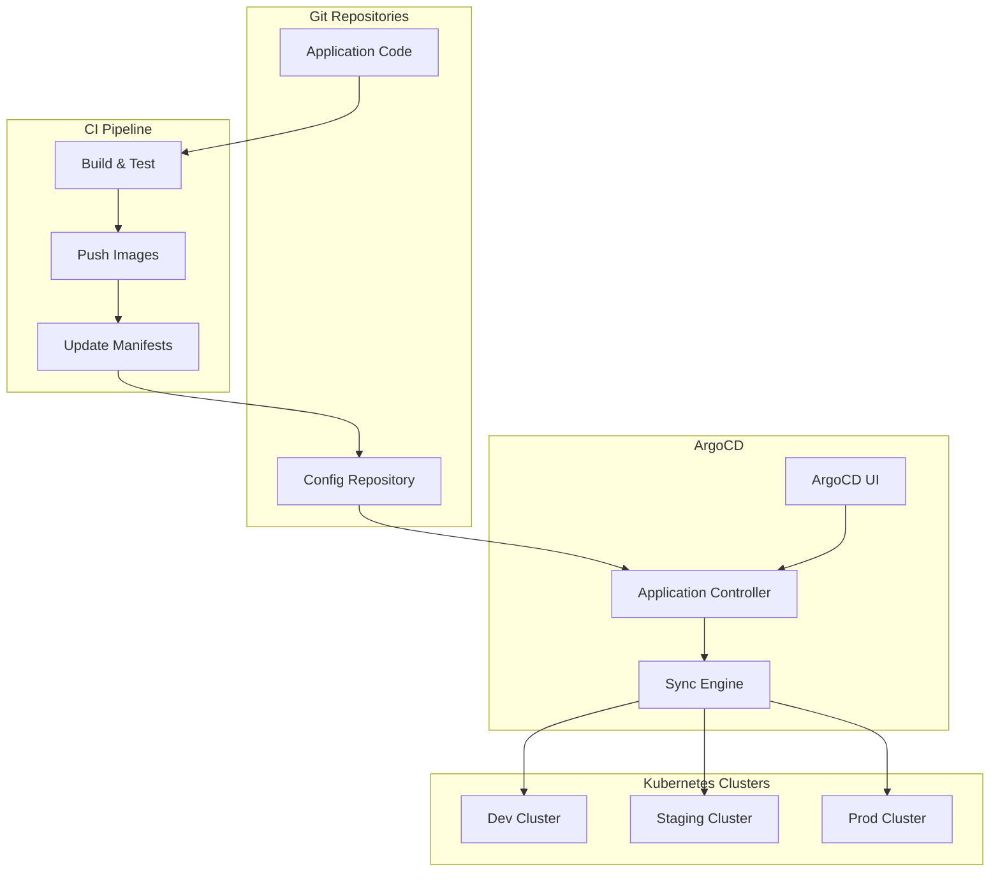

# 🔄 H1-007-G: Guia Completo de GitOps Deployment

## 📋 Índice

1. [🎯 Visão Geral](#visao-geral)
2. [🛠️ Instalação do ArgoCD](#instalacao-argocd)
3. [📁 Estrutura GitOps](#estrutura-gitops)
4. [🚀 Configuração de Aplicações](#configuracao-aplicacoes)
5. [🔄 Sincronização Automática](#sincronizacao-automatica)
6. [🌍 Multi-Environment](#multi-environment)
7. [🔐 Segurança e RBAC](#seguranca-rbac)
8. [📊 Monitoramento GitOps](#monitoramento-gitops)
9. [🔧 Progressive Delivery](#progressive-delivery)
10. [🐛 Troubleshooting](#troubleshooting)

## 🎯 Visão Geral {#visao-geral}

Este guia implementa GitOps completo usando ArgoCD para gerenciar deployments no Three Horizons Platform.

### 📊 Arquitetura GitOps



## 🛠️ Instalação do ArgoCD {#instalacao-argocd}

### Script de Instalação Completo

```bash
#!/bin/bash
# scripts/install-argocd.sh

set -euo pipefail

# Configurações
ARGOCD_VERSION="v2.9.3"
NAMESPACE="argocd"
DOMAIN="argocd.demo.threehorizons.io"

# Cores para output
GREEN='\033[0;32m'
BLUE='\033[0;34m'
YELLOW='\033[1;33m'
NC='\033[0m'

log() { echo -e "${BLUE}[$(date +'%H:%M:%S')] $1${NC}"; }
success() { echo -e "${GREEN}[SUCCESS] $1${NC}"; }
warn() { echo -e "${YELLOW}[WARNING] $1${NC}"; }

# Instalação do ArgoCD
install_argocd() {
    log "🚀 Installing ArgoCD ${ARGOCD_VERSION}..."
    
    # Criar namespace
    kubectl create namespace ${NAMESPACE} --dry-run=client -o yaml | kubectl apply -f -
    
    # Instalar ArgoCD
    kubectl apply -n ${NAMESPACE} -f https://raw.githubusercontent.com/argoproj/argo-cd/${ARGOCD_VERSION}/manifests/install.yaml
    
    # Aguardar pods ficarem prontos
    log "⏳ Waiting for ArgoCD pods..."
    kubectl wait --for=condition=ready pod -l app.kubernetes.io/name=argocd-server -n ${NAMESPACE} --timeout=300s
    
    success "ArgoCD installed!"
}

# Configurar acesso externo
configure_ingress() {
    log "🌐 Configuring ingress..."
    
    cat <<EOF | kubectl apply -f -
apiVersion: networking.k8s.io/v1
kind: Ingress
metadata:
  name: argocd-server-ingress
  namespace: ${NAMESPACE}
  annotations:
    cert-manager.io/cluster-issuer: letsencrypt-prod
    nginx.ingress.kubernetes.io/ssl-redirect: "true"
    nginx.ingress.kubernetes.io/backend-protocol: "HTTPS"
    nginx.ingress.kubernetes.io/force-ssl-redirect: "true"
spec:
  ingressClassName: nginx
  tls:
  - hosts:
    - ${DOMAIN}
    secretName: argocd-server-tls
  rules:
  - host: ${DOMAIN}
    http:
      paths:
      - path: /
        pathType: Prefix
        backend:
          service:
            name: argocd-server
            port:
              number: 443
EOF
    
    success "Ingress configured!"
}

# Configurar ArgoCD CLI
setup_cli() {
    log "💻 Setting up ArgoCD CLI..."
    
    # Download CLI
    curl -sSL -o /tmp/argocd https://github.com/argoproj/argo-cd/releases/download/${ARGOCD_VERSION}/argocd-linux-amd64
    chmod +x /tmp/argocd
    sudo mv /tmp/argocd /usr/local/bin/argocd
    
    # Get initial admin password
    INITIAL_PASSWORD=$(kubectl -n ${NAMESPACE} get secret argocd-initial-admin-secret -o jsonpath="{.data.password}" | base64 -d)
    
    log "Initial admin password: ${INITIAL_PASSWORD}"
    log "Please change this password after first login!"
    
    # Login
    argocd login ${DOMAIN} --username admin --password "${INITIAL_PASSWORD}" --insecure
    
    # Update password
    argocd account update-password --current-password "${INITIAL_PASSWORD}" --new-password "${ARGOCD_ADMIN_PASSWORD:-ThreeHorizons2024!}"
    
    success "CLI configured!"
}

# Configurar repositórios
configure_repositories() {
    log "📁 Configuring repositories..."
    
    # Adicionar repositório de aplicações
    argocd repo add https://github.com/three-horizon-ai/Three-Horizons-AI-Developer-Platform.git \
        --name three-horizons-config \
        --type git
    
    # Adicionar Helm repos
    cat <<EOF | kubectl apply -f -
apiVersion: v1
kind: Secret
metadata:
  name: helm-repos
  namespace: ${NAMESPACE}
  labels:
    argocd.argoproj.io/secret-type: repository
stringData:
  type: helm
  name: bitnami
  url: https://charts.bitnami.com/bitnami
---
apiVersion: v1
kind: Secret
metadata:
  name: azure-acr
  namespace: ${NAMESPACE}
  labels:
    argocd.argoproj.io/secret-type: repository
stringData:
  type: helm
  name: threehorizons
  url: https://acrthreehorizonsdemo.azurecr.io/helm/v1/repo
  username: ${ACR_USERNAME}
  password: ${ACR_PASSWORD}
  enableOCI: "true"
EOF
    
    success "Repositories configured!"
}

# Main
main() {
    log "🔄 Three Horizons GitOps Setup"
    log "=============================="
    
    install_argocd
    configure_ingress
    setup_cli
    configure_repositories
    
    success "✅ ArgoCD installation complete!"
    log ""
    log "🔗 Access ArgoCD at: https://${DOMAIN}"
    log "👤 Username: admin"
    log "🔑 Password: ${ARGOCD_ADMIN_PASSWORD:-ThreeHorizons2024!}"
}

# Execute
main "$@"
```

### Configuração Avançada do ArgoCD

```yaml
# argocd/argocd-cm.yaml
apiVersion: v1
kind: ConfigMap
metadata:
  name: argocd-cm
  namespace: argocd
data:
  # Configurações gerais
  url: https://argocd.demo.threehorizons.io
  
  # Configuração OIDC (Azure AD)
  oidc.config: |
    name: Azure AD
    issuer: https://login.microsoftonline.com/${AZURE_TENANT_ID}/v2.0
    clientId: ${AZURE_CLIENT_ID}
    clientSecret: $oidc.azuread.clientSecret
    requestedScopes: ["openid", "profile", "email", "offline_access"]
    requestedIDTokenClaims: {"groups": {"essential": true}}
    
  # Configuração RBAC
  policy.default: role:readonly
  policy.csv: |
    p, role:admin, applications, *, */*, allow
    p, role:admin, clusters, *, *, allow
    p, role:admin, repositories, *, *, allow
    p, role:developer, applications, get, */*, allow
    p, role:developer, applications, create, */*, allow
    p, role:developer, applications, update, */*, allow
    p, role:developer, applications, delete, */*, allow
    p, role:developer, applications, sync, */*, allow
    p, role:developer, applications, action/*, */*, allow
    g, platform-team, role:admin
    g, developers, role:developer
  
  # Resource customizations
  resource.customizations: |
    admissionregistration.k8s.io/MutatingWebhookConfiguration:
      ignoreDifferences: |
        jsonPointers:
        - /webhooks/0/clientConfig/caBundle
    apps/Deployment:
      actions: |
        discovery.lua: |
          actions = {}
          actions["restart"] = {}
          return actions
        definitions:
        - name: restart
          action.lua: |
            local os = require("os")
            if obj.spec.template.metadata == nil then
                obj.spec.template.metadata = {}
            end
            if obj.spec.template.metadata.annotations == nil then
                obj.spec.template.metadata.annotations = {}
            end
            obj.spec.template.metadata.annotations["kubectl.kubernetes.io/restartedAt"] = os.date("!%Y-%m-%dT%XZ")
            return obj
  
  # Configuração de notificações
  notifications.argoproj.io/subscribe.on-deployed.slack: threehorizons-deployments
  notifications.argoproj.io/subscribe.on-health-degraded.slack: threehorizons-alerts
  notifications.argoproj.io/subscribe.on-sync-failed.slack: threehorizons-alerts
  
  # Métricas
  server.metrics.enabled: "true"
  controller.metrics.enabled: "true"
  reposerver.metrics.enabled: "true"
  
  # Configuração de Dex
  dex.config: |
    connectors:
      - type: github
        id: github
        name: GitHub
        config:
          clientID: ${GITHUB_CLIENT_ID}
          clientSecret: $dex.github.clientSecret
          orgs:
          - name: three-horizon-ai
```

## 📁 Estrutura GitOps {#estrutura-gitops}

### Organização dos Repositórios

```bash
# Estrutura do repositório de configuração
gitops-config/
├── apps/                           # Definições de aplicações ArgoCD
│   ├── dev/
│   │   ├── ecommerce-portal.yaml
│   │   ├── backend-services.yaml
│   │   └── infrastructure.yaml
│   ├── staging/
│   │   └── ...
│   └── prod/
│       └── ...
├── base/                          # Configurações base Kustomize
│   ├── frontend/
│   ├── backend/
│   └── infrastructure/
├── overlays/                      # Overlays por ambiente
│   ├── dev/
│   ├── staging/
│   └── prod/
├── clusters/                      # Configurações específicas de cluster
│   ├── dev-cluster/
│   ├── staging-cluster/
│   └── prod-cluster/
└── charts/                        # Helm charts customizados
    ├── ecommerce-portal/
    └── microservice-base/
```

### App of Apps Pattern

```yaml
# apps/dev/app-of-apps.yaml
apiVersion: argoproj.io/v1alpha1
kind: Application
metadata:
  name: dev-apps
  namespace: argocd
  finalizers:
    - resources-finalizer.argocd.argoproj.io
spec:
  project: default
  source:
    repoURL: https://github.com/three-horizon-ai/gitops-config
    targetRevision: main
    path: apps/dev
  destination:
    server: https://kubernetes.default.svc
  syncPolicy:
    automated:
      prune: true
      selfHeal: true
      allowEmpty: false
    syncOptions:
    - CreateNamespace=true
    retry:
      limit: 5
      backoff:
        duration: 5s
        factor: 2
        maxDuration: 3m
```

### Aplicação E-commerce Portal

```yaml
# apps/dev/ecommerce-portal.yaml
apiVersion: argoproj.io/v1alpha1
kind: Application
metadata:
  name: ecommerce-portal-dev
  namespace: argocd
  annotations:
    argocd-image-updater.argoproj.io/image-list: |
      frontend=acrthreehorizonsdemo.azurecr.io/frontend-portal:~1.0
      admin=acrthreehorizonsdemo.azurecr.io/frontend-admin:~1.0
    argocd-image-updater.argoproj.io/write-back-method: git
    argocd-image-updater.argoproj.io/git-branch: main
  labels:
    environment: dev
    team: platform
    component: frontend
spec:
  project: default
  
  source:
    repoURL: https://github.com/three-horizon-ai/gitops-config
    targetRevision: main
    path: overlays/dev/frontend
    
    # Helm specific
    helm:
      releaseName: ecommerce-portal
      valueFiles:
        - values-dev.yaml
      parameters:
        - name: image.tag
          value: latest
        - name: ingress.enabled
          value: "true"
        - name: ingress.hostname
          value: portal-dev.demo.threehorizons.io
  
  destination:
    server: https://kubernetes.default.svc
    namespace: ecommerce-dev
  
  syncPolicy:
    automated:
      prune: true
      selfHeal: true
    syncOptions:
    - CreateNamespace=true
    - ServerSideApply=true
    retry:
      limit: 3
      backoff:
        duration: 5s
        factor: 2
        maxDuration: 1m
  
  # Health checks
  ignoreDifferences:
  - group: apps
    kind: Deployment
    jsonPointers:
    - /spec/replicas
  
  revisionHistoryLimit: 3
```

### Backend Services ApplicationSet

```yaml
# apps/backend-services-appset.yaml
apiVersion: argoproj.io/v1alpha1
kind: ApplicationSet
metadata:
  name: backend-services
  namespace: argocd
spec:
  generators:
  - matrix:
      generators:
      - git:
          repoURL: https://github.com/three-horizon-ai/gitops-config
          revision: main
          directories:
          - path: base/backend/*
      - list:
          elements:
          - env: dev
            cluster: https://kubernetes.default.svc
            namespace: ecommerce-dev
            values: values-dev.yaml
          - env: staging
            cluster: https://staging.k8s.local
            namespace: ecommerce-staging
            values: values-staging.yaml
          - env: prod
            cluster: https://prod.k8s.local
            namespace: ecommerce-prod
            values: values-prod.yaml
  
  template:
    metadata:
      name: '{{path.basename}}-{{env}}'
      labels:
        environment: '{{env}}'
        service: '{{path.basename}}'
    spec:
      project: default
      source:
        repoURL: https://github.com/three-horizon-ai/gitops-config
        targetRevision: main
        path: '{{path}}'
        helm:
          valueFiles:
          - '{{values}}'
          parameters:
          - name: environment
            value: '{{env}}'
      destination:
        server: '{{cluster}}'
        namespace: '{{namespace}}'
      syncPolicy:
        automated:
          prune: true
          selfHeal: true
        syncOptions:
        - CreateNamespace=true
```

## 🚀 Configuração de Aplicações {#configuracao-aplicacoes}

### Helm Chart Base para Microsserviços

```yaml
# charts/microservice-base/values.yaml
replicaCount: 2

image:
  repository: acrthreehorizonsdemo.azurecr.io
  pullPolicy: IfNotPresent
  tag: ""

imagePullSecrets:
  - name: acr-secret

nameOverride: ""
fullnameOverride: ""

serviceAccount:
  create: true
  annotations: {}
  name: ""

podAnnotations:
  prometheus.io/scrape: "true"
  prometheus.io/port: "8080"
  prometheus.io/path: "/metrics"

podSecurityContext:
  fsGroup: 1001
  runAsNonRoot: true
  runAsUser: 1001

securityContext:
  allowPrivilegeEscalation: false
  capabilities:
    drop:
    - ALL
  readOnlyRootFilesystem: true
  runAsNonRoot: true
  runAsUser: 1001

service:
  type: ClusterIP
  port: 80
  targetPort: 8080

ingress:
  enabled: false
  className: nginx
  annotations:
    cert-manager.io/cluster-issuer: letsencrypt-prod
  hosts:
    - host: api.example.com
      paths:
        - path: /
          pathType: Prefix
  tls: []

resources:
  limits:
    cpu: 500m
    memory: 512Mi
  requests:
    cpu: 100m
    memory: 128Mi

autoscaling:
  enabled: true
  minReplicas: 2
  maxReplicas: 10
  targetCPUUtilizationPercentage: 80
  targetMemoryUtilizationPercentage: 80

nodeSelector: {}
tolerations: []
affinity:
  podAntiAffinity:
    preferredDuringSchedulingIgnoredDuringExecution:
    - weight: 100
      podAffinityTerm:
        labelSelector:
          matchExpressions:
          - key: app.kubernetes.io/name
            operator: In
            values:
            - "{{ include \"microservice-base.name\" . }}"
        topologyKey: kubernetes.io/hostname

livenessProbe:
  httpGet:
    path: /health/live
    port: http
  initialDelaySeconds: 30
  periodSeconds: 10

readinessProbe:
  httpGet:
    path: /health/ready
    port: http
  initialDelaySeconds: 5
  periodSeconds: 5

# ConfigMaps and Secrets
config:
  LOG_LEVEL: info
  NODE_ENV: production
  
secrets:
  DATABASE_URL: ""
  JWT_SECRET: ""
  
# External services
postgresql:
  enabled: false
  auth:
    database: myapp
    username: myuser
    
redis:
  enabled: false
  auth:
    enabled: true
    
mongodb:
  enabled: false
  auth:
    enabled: true
    database: myapp
    
# Monitoring
serviceMonitor:
  enabled: true
  interval: 30s
  path: /metrics
  
# Network Policies
networkPolicy:
  enabled: true
  ingress:
    - from:
      - namespaceSelector:
          matchLabels:
            name: ingress-nginx
      - podSelector:
          matchLabels:
            app.kubernetes.io/name: api-gateway
```

### Kustomization para Ambientes

```yaml
# overlays/dev/frontend/kustomization.yaml
apiVersion: kustomize.config.k8s.io/v1beta1
kind: Kustomization

namespace: ecommerce-dev

resources:
  - ../../../base/frontend/portal
  - ../../../base/frontend/admin

patchesStrategicMerge:
  - deployment-patch.yaml
  - service-patch.yaml

configMapGenerator:
  - name: frontend-config
    literals:
      - NEXT_PUBLIC_API_URL=https://api-dev.demo.threehorizons.io
      - NEXT_PUBLIC_ENV=development
      - NEXT_PUBLIC_FEATURES_PAYMENTS=true
      - NEXT_PUBLIC_FEATURES_AI=true

secretGenerator:
  - name: frontend-secrets
    literals:
      - NEXTAUTH_SECRET=dev-secret-change-me
      - STRIPE_PUBLIC_KEY=pk_test_12345

images:
  - name: frontend-portal
    newName: acrthreehorizonsdemo.azurecr.io/frontend-portal
    newTag: dev-latest
  - name: frontend-admin
    newName: acrthreehorizonsdemo.azurecr.io/frontend-admin
    newTag: dev-latest

replicas:
  - name: frontend-portal
    count: 2
  - name: frontend-admin
    count: 1

patches:
  - target:
      kind: Deployment
      name: frontend-portal
    patch: |-
      - op: add
        path: /spec/template/spec/containers/0/env/-
        value:
          name: DD_AGENT_HOST
          valueFrom:
            fieldRef:
              fieldPath: status.hostIP
```

## 🔄 Sincronização Automática {#sincronizacao-automatica}

### Configuração de Auto-sync

```yaml
# apps/sync-policy.yaml
apiVersion: v1
kind: ConfigMap
metadata:
  name: argocd-sync-policy
  namespace: argocd
data:
  policy.yaml: |
    # Sync policies por ambiente
    policies:
      dev:
        automated:
          prune: true
          selfHeal: true
          allowEmpty: false
        syncOptions:
          - CreateNamespace=true
          - ServerSideApply=true
          - PrunePropagationPolicy=foreground
          - PruneLast=true
        retry:
          limit: 5
          backoff:
            duration: 5s
            factor: 2
            maxDuration: 3m
            
      staging:
        automated:
          prune: true
          selfHeal: false  # Manual intervention for staging
        syncOptions:
          - CreateNamespace=true
          - ServerSideApply=true
        retry:
          limit: 3
          backoff:
            duration: 10s
            factor: 2
            maxDuration: 5m
            
      prod:
        automated:
          prune: false  # Never auto-prune in prod
          selfHeal: false
        syncOptions:
          - CreateNamespace=true
          - ServerSideApply=true
          - RespectIgnoreDifferences=true
        retry:
          limit: 1
```

### Webhook Configuration

```yaml
# argocd/webhook-config.yaml
apiVersion: v1
kind: ConfigMap
metadata:
  name: argocd-webhook-config
  namespace: argocd
data:
  github.webhook.url: https://argocd.demo.threehorizons.io/api/webhook
  github.webhook.secret: ${GITHUB_WEBHOOK_SECRET}
  
  webhook-handler.js: |
    const crypto = require('crypto');
    
    function validateWebhook(payload, signature, secret) {
      const hmac = crypto.createHmac('sha256', secret);
      hmac.update(payload);
      const digest = 'sha256=' + hmac.digest('hex');
      return crypto.timingSafeEqual(Buffer.from(signature), Buffer.from(digest));
    }
    
    module.exports = async (req, res) => {
      const signature = req.headers['x-hub-signature-256'];
      const event = req.headers['x-github-event'];
      
      if (!validateWebhook(req.body, signature, process.env.WEBHOOK_SECRET)) {
        return res.status(401).send('Unauthorized');
      }
      
      if (event === 'push') {
        const branch = req.body.ref.split('/').pop();
        const repo = req.body.repository.full_name;
        
        // Trigger ArgoCD sync
        await triggerSync(repo, branch);
      }
      
      res.status(200).send('OK');
    };
```

## 🌍 Multi-Environment {#multi-environment}

### Environment Promotion Pipeline

```yaml
# .github/workflows/promote-environments.yml
name: 🌍 Environment Promotion

on:
  workflow_dispatch:
    inputs:
      version:
        description: 'Version to promote'
        required: true
      from_env:
        description: 'Source environment'
        required: true
        type: choice
        options:
          - dev
          - staging
      to_env:
        description: 'Target environment'
        required: true
        type: choice
        options:
          - staging
          - prod

jobs:
  promote:
    name: Promote ${{ inputs.version }} from ${{ inputs.from_env }} to ${{ inputs.to_env }}
    runs-on: ubuntu-latest
    steps:
      - uses: actions/checkout@v4
        with:
          repository: three-horizon-ai/gitops-config
          token: ${{ secrets.GITOPS_TOKEN }}

      - name: 🔍 Validate Version
        run: |
          # Check if version exists in source environment
          if ! grep -q "${{ inputs.version }}" overlays/${{ inputs.from_env }}/kustomization.yaml; then
            echo "❌ Version ${{ inputs.version }} not found in ${{ inputs.from_env }}"
            exit 1
          fi

      - name: 📝 Update Target Environment
        run: |
          # Update kustomization.yaml
          cd overlays/${{ inputs.to_env }}
          
          # Update image tags
          kustomize edit set image *:${{ inputs.version }}
          
          # Update config
          yq e '.configMapGenerator[0].literals[] |= sub("ENV=.*", "ENV=${{ inputs.to_env }}")' -i kustomization.yaml

      - name: 🧪 Validate Manifests
        run: |
          kustomize build overlays/${{ inputs.to_env }} | kubectl apply --dry-run=server -f -

      - name: 📤 Commit and Push
        run: |
          git config --global user.name 'Three Horizons Bot'
          git config --global user.email 'bot@threehorizons.ai'
          
          git add .
          git commit -m "chore: promote ${{ inputs.version }} to ${{ inputs.to_env }}
          
          From: ${{ inputs.from_env }}
          To: ${{ inputs.to_env }}
          Version: ${{ inputs.version }}
          Triggered by: ${{ github.actor }}"
          
          git push

      - name: 🔄 Trigger ArgoCD Sync
        run: |
          argocd app sync ecommerce-${{ inputs.to_env }} \
            --revision main \
            --prune \
            --retry-limit 3
```

### Environment-specific Configurations

```yaml
# overlays/prod/config-patch.yaml
apiVersion: v1
kind: ConfigMap
metadata:
  name: app-config
data:
  # Production specific configurations
  LOG_LEVEL: "warn"
  NODE_ENV: "production"
  ENABLE_DEBUG: "false"
  
  # Feature flags
  FEATURE_PAYMENTS: "true"
  FEATURE_AI_RECOMMENDATIONS: "true"
  FEATURE_ADVANCED_SEARCH: "true"
  FEATURE_B2B_PORTAL: "false"
  
  # Performance
  CACHE_TTL: "3600"
  CONNECTION_POOL_SIZE: "50"
  
  # Security
  CORS_ORIGINS: "https://portal.threehorizons.io,https://admin.threehorizons.io"
  RATE_LIMIT_WINDOW: "60000"
  RATE_LIMIT_MAX_REQUESTS: "100"
---
apiVersion: apps/v1
kind: Deployment
metadata:
  name: api-gateway
spec:
  replicas: 5  # More replicas in prod
  template:
    spec:
      affinity:
        podAntiAffinity:
          requiredDuringSchedulingIgnoredDuringExecution:
          - labelSelector:
              matchExpressions:
              - key: app
                operator: In
                values:
                - api-gateway
            topologyKey: kubernetes.io/hostname
      resources:
        requests:
          memory: "512Mi"
          cpu: "500m"
        limits:
          memory: "2Gi"
          cpu: "2000m"
```

## 🔐 Segurança e RBAC {#seguranca-rbac}

### RBAC Configuration

```yaml
# argocd/rbac-config.yaml
apiVersion: v1
kind: ConfigMap
metadata:
  name: argocd-rbac-cm
  namespace: argocd
data:
  policy.default: role:readonly
  policy.csv: |
    # Admins - full access
    p, role:admin, applications, *, */*, allow
    p, role:admin, clusters, *, *, allow
    p, role:admin, repositories, *, *, allow
    p, role:admin, certificates, *, *, allow
    p, role:admin, projects, *, *, allow
    p, role:admin, accounts, *, *, allow
    p, role:admin, gpgkeys, *, *, allow
    p, role:admin, exec, create, */*, allow
    
    # Developers - limited access
    p, role:developer, applications, get, */*, allow
    p, role:developer, applications, create, dev/*, allow
    p, role:developer, applications, update, dev/*, allow
    p, role:developer, applications, delete, dev/*, allow
    p, role:developer, applications, sync, dev/*, allow
    p, role:developer, applications, action/*, dev/*, allow
    p, role:developer, logs, get, dev/*, allow
    p, role:developer, exec, create, dev/*, deny
    
    # SRE - operational access
    p, role:sre, applications, get, */*, allow
    p, role:sre, applications, sync, */*, allow
    p, role:sre, applications, action/*, */*, allow
    p, role:sre, logs, get, */*, allow
    p, role:sre, exec, create, */*, allow
    
    # QA - read and sync staging
    p, role:qa, applications, get, */*, allow
    p, role:qa, applications, sync, staging/*, allow
    p, role:qa, logs, get, staging/*, allow
    
    # Groups mapping
    g, platform-team, role:admin
    g, three-horizon-ai:developers, role:developer
    g, three-horizon-ai:sre, role:sre
    g, three-horizon-ai:qa, role:qa
    
  scopes: '[groups]'
---
apiVersion: v1
kind: ConfigMap
metadata:
  name: argocd-app-project-default
  namespace: argocd
data:
  project.yaml: |
    apiVersion: argoproj.io/v1alpha1
    kind: AppProject
    metadata:
      name: default
      namespace: argocd
    spec:
      description: Default project
      sourceRepos:
      - 'https://github.com/three-horizon-ai/*'
      - 'https://acrthreehorizonsdemo.azurecr.io/*'
      destinations:
      - namespace: 'ecommerce-*'
        server: https://kubernetes.default.svc
      - namespace: 'argocd'
        server: https://kubernetes.default.svc
      clusterResourceWhitelist:
      - group: ''
        kind: Namespace
      namespaceResourceWhitelist:
      - group: '*'
        kind: '*'
      roles:
      - name: admin
        policies:
        - p, proj:default:admin, applications, *, default/*, allow
        groups:
        - platform-team
      - name: developer
        policies:
        - p, proj:default:developer, applications, get, default/*, allow
        - p, proj:default:developer, applications, sync, default/*, allow
        groups:
        - three-horizon-ai:developers
```

### Secrets Management

```yaml
# argocd/sealed-secrets.yaml
apiVersion: v1
kind: ServiceAccount
metadata:
  name: sealed-secrets-controller
  namespace: kube-system
---
apiVersion: apps/v1
kind: Deployment
metadata:
  name: sealed-secrets-controller
  namespace: kube-system
spec:
  selector:
    matchLabels:
      name: sealed-secrets-controller
  template:
    metadata:
      labels:
        name: sealed-secrets-controller
    spec:
      serviceAccountName: sealed-secrets-controller
      containers:
      - name: sealed-secrets-controller
        image: bitnami/sealed-secrets-controller:latest
        command:
        - controller
        ports:
        - containerPort: 8080
          name: http
        volumeMounts:
        - name: tmp
          mountPath: /tmp
        securityContext:
          runAsNonRoot: true
          runAsUser: 1001
          readOnlyRootFilesystem: true
      volumes:
      - name: tmp
        emptyDir: {}
---
# Example sealed secret
apiVersion: bitnami.com/v1alpha1
kind: SealedSecret
metadata:
  name: database-credentials
  namespace: ecommerce-prod
spec:
  encryptedData:
    DATABASE_URL: AgBvqM5Zr1... # Encrypted value
    API_KEY: AgCJKw8TqP... # Encrypted value
  template:
    metadata:
      name: database-credentials
      namespace: ecommerce-prod
    type: Opaque
```

## 📊 Monitoramento GitOps {#monitoramento-gitops}

### ArgoCD Metrics

```yaml
# monitoring/argocd-metrics.yaml
apiVersion: v1
kind: Service
metadata:
  name: argocd-metrics
  namespace: argocd
  labels:
    app.kubernetes.io/name: argocd-metrics
    app.kubernetes.io/part-of: argocd
spec:
  ports:
  - name: metrics
    port: 8082
    protocol: TCP
    targetPort: 8082
  selector:
    app.kubernetes.io/name: argocd-application-controller
---
apiVersion: monitoring.coreos.com/v1
kind: ServiceMonitor
metadata:
  name: argocd-metrics
  namespace: argocd
spec:
  selector:
    matchLabels:
      app.kubernetes.io/name: argocd-metrics
  endpoints:
  - port: metrics
    interval: 30s
    path: /metrics
---
apiVersion: monitoring.coreos.com/v1
kind: ServiceMonitor
metadata:
  name: argocd-server-metrics
  namespace: argocd
spec:
  selector:
    matchLabels:
      app.kubernetes.io/name: argocd-server
  endpoints:
  - port: metrics
    interval: 30s
    path: /metrics
---
apiVersion: monitoring.coreos.com/v1
kind: ServiceMonitor
metadata:
  name: argocd-repo-server-metrics
  namespace: argocd
spec:
  selector:
    matchLabels:
      app.kubernetes.io/name: argocd-repo-server
  endpoints:
  - port: metrics
    interval: 30s
    path: /metrics
```

### Grafana Dashboard

```json
{
  "dashboard": {
    "title": "ArgoCD GitOps Dashboard",
    "panels": [
      {
        "title": "Applications Health Status",
        "targets": [
          {
            "expr": "sum by (health_status) (argocd_app_health_total)"
          }
        ],
        "type": "piechart"
      },
      {
        "title": "Sync Operations",
        "targets": [
          {
            "expr": "sum(rate(argocd_app_sync_total[5m])) by (dest_server, name)"
          }
        ],
        "type": "graph"
      },
      {
        "title": "Failed Syncs",
        "targets": [
          {
            "expr": "sum(rate(argocd_app_sync_total{phase=\"Failed\"}[5m])) by (name)"
          }
        ],
        "type": "table"
      },
      {
        "title": "Git Requests Rate",
        "targets": [
          {
            "expr": "sum(rate(argocd_git_request_total[5m])) by (repo)"
          }
        ],
        "type": "graph"
      },
      {
        "title": "Application Sync State",
        "targets": [
          {
            "expr": "sum by (sync_status) (argocd_app_info)"
          }
        ],
        "type": "stat"
      }
    ]
  }
}
```

### Alerting Rules

```yaml
# monitoring/argocd-alerts.yaml
apiVersion: monitoring.coreos.com/v1
kind: PrometheusRule
metadata:
  name: argocd-alerts
  namespace: argocd
spec:
  groups:
  - name: argocd
    interval: 30s
    rules:
    - alert: ArgoAppHealthDegraded
      expr: argocd_app_health_total{health_status!="Healthy"} > 0
      for: 5m
      labels:
        severity: warning
        team: platform
      annotations:
        summary: "ArgoCD Application {{$labels.name}} is {{$labels.health_status}}"
        description: "Application {{$labels.name}} in {{$labels.dest_server}} has been {{$labels.health_status}} for more than 5 minutes"
        
    - alert: ArgoAppSyncFailed
      expr: argocd_app_info{operation_initiated_by_username!="",sync_status="OutOfSync"} > 0
      for: 10m
      labels:
        severity: critical
        team: platform
      annotations:
        summary: "ArgoCD Application {{$labels.name}} sync failed"
        description: "Application {{$labels.name}} has been out of sync for more than 10 minutes"
        
    - alert: ArgoAppNotSynced
      expr: argocd_app_info{sync_status!="Synced"} > 0
      for: 30m
      labels:
        severity: warning
        team: platform
      annotations:
        summary: "ArgoCD Application {{$labels.name}} not synced"
        description: "Application {{$labels.name}} has not been synced for 30 minutes"
```

## 🔧 Progressive Delivery {#progressive-delivery}

### Flagger Configuration

```yaml
# progressive-delivery/flagger-install.yaml
apiVersion: v1
kind: Namespace
metadata:
  name: flagger-system
---
apiVersion: argoproj.io/v1alpha1
kind: Application
metadata:
  name: flagger
  namespace: argocd
spec:
  project: default
  source:
    repoURL: https://flagger.app
    targetRevision: 1.35.0
    chart: flagger
    helm:
      values: |
        crd:
          create: true
        prometheus:
          install: false
        meshProvider: nginx
        ingressClass: nginx
        metrics:
          address: http://prometheus:9090
  destination:
    server: https://kubernetes.default.svc
    namespace: flagger-system
  syncPolicy:
    automated:
      prune: true
      selfHeal: true
```

### Canary Deployment

```yaml
# progressive-delivery/frontend-canary.yaml
apiVersion: flagger.app/v1beta1
kind: Canary
metadata:
  name: frontend-portal
  namespace: ecommerce-prod
spec:
  targetRef:
    apiVersion: apps/v1
    kind: Deployment
    name: frontend-portal
  progressDeadlineSeconds: 60
  service:
    port: 80
    targetPort: 3000
    gateways:
    - public-gateway.istio-system.svc.cluster.local
    hosts:
    - portal.threehorizons.io
  analysis:
    interval: 1m
    threshold: 5
    maxWeight: 50
    stepWeight: 10
    metrics:
    - name: request-success-rate
      thresholdRange:
        min: 99
      interval: 1m
    - name: request-duration
      thresholdRange:
        max: 500
      interval: 30s
    webhooks:
    - name: load-test
      url: http://flagger-loadtester.flagger-system/
      timeout: 5s
      metadata:
        cmd: "hey -z 1m -q 10 -c 2 http://portal.threehorizons.io/"
    - name: acceptance-test
      type: pre-rollout
      url: http://flagger-loadtester.flagger-system/
      timeout: 30s
      metadata:
        type: bash
        cmd: "curl -sd 'test' http://portal-canary.ecommerce-prod:80/health | grep ok"
```

### Blue-Green Deployment

```yaml
# progressive-delivery/backend-bluegreen.yaml
apiVersion: flagger.app/v1beta1
kind: Canary
metadata:
  name: api-gateway
  namespace: ecommerce-prod
spec:
  targetRef:
    apiVersion: apps/v1
    kind: Deployment
    name: api-gateway
  progressDeadlineSeconds: 120
  service:
    port: 80
    targetPort: 8080
  analysis:
    interval: 1m
    threshold: 5
    iterations: 10
    metrics:
    - name: request-success-rate
      thresholdRange:
        min: 99
      interval: 1m
    webhooks:
    - name: smoke-test
      type: pre-rollout
      url: http://flagger-loadtester.flagger-system/
      timeout: 60s
      metadata:
        type: bash
        cmd: "curl -f http://api-gateway-canary.ecommerce-prod/health"
    - name: load-test
      type: rollout
      url: http://flagger-loadtester.flagger-system/
      metadata:
        cmd: "hey -z 2m -q 10 -c 2 http://api-gateway-canary.ecommerce-prod/"
  # Blue-Green specific
  canaryAnalysis:
    interval: 1m
    threshold: 5
    iterations: 10
    # Switch all traffic at once
    stepWeight: 100
```

## 🐛 Troubleshooting {#troubleshooting}

### Common Issues and Solutions

```bash
#!/bin/bash
# scripts/argocd-troubleshoot.sh

# Check ArgoCD health
check_argocd_health() {
    echo "🔍 Checking ArgoCD components..."
    
    kubectl get pods -n argocd
    kubectl get svc -n argocd
    
    # Check if API is responsive
    argocd version
}

# Fix out-of-sync applications
fix_sync_issues() {
    APP=$1
    echo "🔧 Fixing sync issues for $APP..."
    
    # Get app details
    argocd app get $APP
    
    # Check for differences
    argocd app diff $APP
    
    # Hard refresh
    argocd app get $APP --hard-refresh
    
    # Force sync
    argocd app sync $APP --force --prune
}

# Debug webhook issues
debug_webhooks() {
    echo "🔍 Checking webhook configuration..."
    
    # Get webhook events
    kubectl logs -n argocd deployment/argocd-server -c argocd-server | grep webhook
    
    # Test webhook
    curl -X POST https://argocd.demo.threehorizons.io/api/webhook \
        -H "Content-Type: application/json" \
        -H "X-GitHub-Event: ping" \
        -d '{"zen": "Testing webhook"}'
}

# Clean up failed syncs
cleanup_failed_syncs() {
    echo "🧹 Cleaning up failed syncs..."
    
    # Get all apps with sync issues
    argocd app list --output json | jq -r '.[] | select(.status.sync.status != "Synced") | .metadata.name' | while read app; do
        echo "Processing $app..."
        argocd app terminate-op $app
    done
}

# Main menu
echo "ArgoCD Troubleshooting Tool"
echo "=========================="
echo "1. Check ArgoCD Health"
echo "2. Fix Sync Issues"
echo "3. Debug Webhooks"
echo "4. Cleanup Failed Syncs"
echo "5. Exit"

read -p "Select option: " option

case $option in
    1) check_argocd_health ;;
    2) read -p "App name: " app && fix_sync_issues $app ;;
    3) debug_webhooks ;;
    4) cleanup_failed_syncs ;;
    5) exit 0 ;;
    *) echo "Invalid option" ;;
esac
```

### Performance Tuning

```yaml
# argocd/argocd-server-config.yaml
apiVersion: v1
kind: ConfigMap
metadata:
  name: argocd-cmd-params-cm
  namespace: argocd
data:
  # Controller settings
  controller.status.processors: "50"
  controller.operation.processors: "25"
  controller.self.heal.timeout.seconds: "5"
  controller.repo.server.timeout.seconds: "60"
  
  # Server settings
  server.insecure: "false"
  server.grpc.keepalive.time: "2h"
  server.grpc.keepalive.timeout: "20s"
  server.grpc.keepalive.min.time: "10s"
  server.grpc.max.age: "12h"
  
  # Repo server settings
  reposerver.parallelism.limit: "10"
  reposerver.git.lsremote.parallelism.limit: "50"
  
  # Redis settings
  redis.compression: "gzip"
  
  # Application controller settings
  application.instanceLabelKey: "argocd.argoproj.io/instance"
  
  # Webhook settings
  webhook.github.secret: $webhook.github.secret
  webhook.gitlab.secret: $webhook.gitlab.secret
```

---

## 🎯 Próximos Passos

Com o GitOps configurado:

1. **[H1-007-H: Monitoring Setup](./H1-007-H-monitoring-setup.md)** - Configurar monitoramento completo

---

**📝 Checklist GitOps**

- [ ] ArgoCD instalado e configurado
- [ ] Repositório GitOps estruturado
- [ ] Aplicações configuradas
- [ ] Sincronização automática funcionando
- [ ] Multi-environment configurado
- [ ] RBAC e segurança implementados
- [ ] Monitoramento de GitOps ativo
- [ ] Progressive delivery configurado