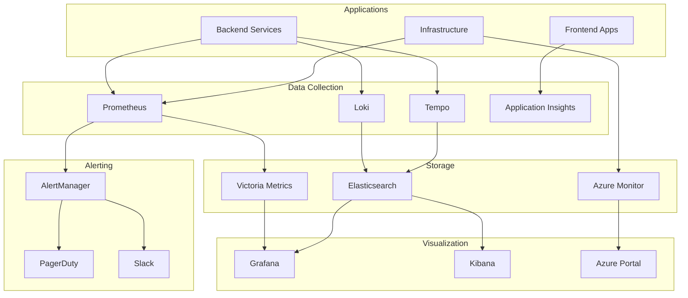

# 📊 H1-007-H: Guia Completo de Monitoring Setup

## 📋 Índice

1. [🎯 Visão Geral](#visao-geral)
2. [📈 Stack de Monitoramento](#stack-monitoramento)
3. [⚡ Prometheus Setup](#prometheus-setup)
4. [📊 Grafana Configuration](#grafana-configuration)
5. [🔍 Application Insights](#application-insights)
6. [📝 Logging com ELK](#logging-elk)
7. [🚨 Alerting e On-Call](#alerting-oncall)
8. [🎯 SLO/SLI Implementation](#slo-sli)
9. [🔄 APM e Distributed Tracing](#apm-tracing)
10. [📱 Status Page](#status-page)

## 🎯 Visão Geral {#visao-geral}

Este guia implementa monitoramento completo end-to-end para o Three Horizons Platform, incluindo métricas, logs, traces e alertas.

### 📊 Arquitetura de Observabilidade



## 📈 Stack de Monitoramento {#stack-monitoramento}

### Instalação Completa com Helm

```bash
#!/bin/bash
# scripts/install-monitoring-stack.sh

set -euo pipefail

# Configurações
NAMESPACE="monitoring"
GRAFANA_ADMIN_PASSWORD="${GRAFANA_ADMIN_PASSWORD:-ThreeHorizons2024!}"
DOMAIN="demo.threehorizons.io"

# Cores para output
GREEN='\033[0;32m'
BLUE='\033[0;34m'
NC='\033[0m'

log() { echo -e "${BLUE}[$(date +'%H:%M:%S')] $1${NC}"; }
success() { echo -e "${GREEN}[SUCCESS] $1${NC}"; }

# Criar namespace
create_namespace() {
    log "📁 Creating namespace..."
    kubectl create namespace ${NAMESPACE} --dry-run=client -o yaml | kubectl apply -f -
}

# Instalar kube-prometheus-stack
install_prometheus_stack() {
    log "📈 Installing Prometheus Stack..."
    
    helm repo add prometheus-community https://prometheus-community.github.io/helm-charts
    helm repo update
    
    cat > values-prometheus-stack.yaml <<EOF
# Prometheus Configuration
prometheus:
  prometheusSpec:
    retention: 30d
    retentionSize: "50GB"
    storageSpec:
      volumeClaimTemplate:
        spec:
          accessModes: ["ReadWriteOnce"]
          resources:
            requests:
              storage: 100Gi
    resources:
      requests:
        cpu: 1000m
        memory: 2Gi
      limits:
        cpu: 2000m
        memory: 4Gi
    
    # Service Monitors
    serviceMonitorSelectorNilUsesHelmValues: false
    podMonitorSelectorNilUsesHelmValues: false
    ruleSelectorNilUsesHelmValues: false
    
    # Remote Write to Victoria Metrics
    remoteWrite:
    - url: http://victoria-metrics:8428/api/v1/write
      writeRelabelConfigs:
      - sourceLabels: [__name__]
        regex: 'kubernetes_.*'
        action: drop

# Grafana Configuration
grafana:
  enabled: true
  adminPassword: ${GRAFANA_ADMIN_PASSWORD}
  
  ingress:
    enabled: true
    annotations:
      cert-manager.io/cluster-issuer: letsencrypt-prod
      nginx.ingress.kubernetes.io/ssl-redirect: "true"
    hosts:
      - grafana.${DOMAIN}
    tls:
      - secretName: grafana-tls
        hosts:
          - grafana.${DOMAIN}
  
  persistence:
    enabled: true
    size: 10Gi
  
  datasources:
    datasources.yaml:
      apiVersion: 1
      datasources:
      - name: Prometheus
        type: prometheus
        url: http://prometheus-prometheus:9090
        access: proxy
        isDefault: true
      - name: Loki
        type: loki
        url: http://loki:3100
        access: proxy
      - name: Tempo
        type: tempo
        url: http://tempo:3100
        access: proxy
      - name: Azure Monitor
        type: grafana-azure-monitor-datasource
        access: proxy
        jsonData:
          azureAuthType: msi
          subscriptionId: ${AZURE_SUBSCRIPTION_ID}
  
  dashboardProviders:
    dashboardproviders.yaml:
      apiVersion: 1
      providers:
      - name: 'default'
        orgId: 1
        folder: ''
        type: file
        disableDeletion: true
        editable: true
        options:
          path: /var/lib/grafana/dashboards/default
  
  dashboards:
    default:
      kubernetes-cluster:
        url: https://grafana.com/api/dashboards/7249/revisions/1/download
      kubernetes-pods:
        url: https://grafana.com/api/dashboards/6336/revisions/1/download
      nginx-ingress:
        url: https://grafana.com/api/dashboards/9614/revisions/1/download

# AlertManager Configuration
alertmanager:
  alertmanagerSpec:
    storage:
      volumeClaimTemplate:
        spec:
          accessModes: ["ReadWriteOnce"]
          resources:
            requests:
              storage: 10Gi
  
  config:
    global:
      resolve_timeout: 5m
      slack_api_url: '${SLACK_WEBHOOK_URL}'
      pagerduty_url: 'https://events.pagerduty.com/v2/enqueue'
    
    route:
      group_by: ['alertname', 'cluster', 'service']
      group_wait: 10s
      group_interval: 10s
      repeat_interval: 12h
      receiver: 'default'
      routes:
      - match:
          severity: critical
        receiver: pagerduty
      - match:
          severity: warning
        receiver: slack
    
    receivers:
    - name: 'default'
      slack_configs:
      - channel: '#alerts'
        title: 'Alert: {{ .GroupLabels.alertname }}'
        text: '{{ range .Alerts }}{{ .Annotations.description }}{{ end }}'
    
    - name: 'pagerduty'
      pagerduty_configs:
      - service_key: '${PAGERDUTY_SERVICE_KEY}'
        description: '{{ .GroupLabels.alertname }}: {{ .CommonAnnotations.description }}'
    
    - name: 'slack'
      slack_configs:
      - channel: '#alerts-warning'
        title: 'Warning: {{ .GroupLabels.alertname }}'

# Additional Components
kubeStateMetrics:
  enabled: true

nodeExporter:
  enabled: true

prometheusOperator:
  enabled: true
EOF

    helm upgrade --install prometheus-stack prometheus-community/kube-prometheus-stack \
        --namespace ${NAMESPACE} \
        --values values-prometheus-stack.yaml \
        --wait
    
    success "Prometheus Stack installed!"
}

# Instalar Loki
install_loki() {
    log "📝 Installing Loki..."
    
    helm repo add grafana https://grafana.github.io/helm-charts
    
    cat > values-loki.yaml <<EOF
loki:
  auth_enabled: false
  
  storage:
    type: azure
    azure:
      accountName: ${AZURE_STORAGE_ACCOUNT}
      accountKey: ${AZURE_STORAGE_KEY}
      containerName: loki
      requestTimeout: 0
  
  schema_config:
    configs:
    - from: 2024-01-01
      store: boltdb-shipper
      object_store: azure
      schema: v12
      index:
        prefix: loki_index_
        period: 24h
  
  limits_config:
    enforce_metric_name: false
    reject_old_samples: true
    reject_old_samples_max_age: 168h
    max_cache_freshness_per_query: 10m
    ingestion_rate_mb: 10
    ingestion_burst_size_mb: 20
  
  chunk_store_config:
    chunk_cache_config:
      memcached:
        batch_size: 100
        parallelism: 100
      memcached_client:
        consistent_hash: true
        host: memcached.monitoring.svc.cluster.local
        service: memcached-client

gateway:
  enabled: true
  ingress:
    enabled: true
    hosts:
      - host: loki.${DOMAIN}
        paths:
          - path: /
            pathType: Prefix
    tls:
      - secretName: loki-tls
        hosts:
          - loki.${DOMAIN}

promtail:
  enabled: true
  config:
    clients:
      - url: http://loki-gateway/loki/api/v1/push
    
    snippets:
      pipelineStages:
        - docker: {}
        - drop:
            source: namespace
            value: kube-system
        - regex:
            expression: '.*(?P<pod_uid>[0-9a-f]{8}-[0-9a-f]{4}-[0-9a-f]{4}-[0-9a-f]{4}-[0-9a-f]{12}).*'
            source: filename
        - labels:
            pod_uid:
EOF

    helm upgrade --install loki grafana/loki-stack \
        --namespace ${NAMESPACE} \
        --values values-loki.yaml \
        --wait
    
    success "Loki installed!"
}

# Instalar Tempo
install_tempo() {
    log "🔍 Installing Tempo..."
    
    cat > values-tempo.yaml <<EOF
tempo:
  extraEnvFrom:
    - secretRef:
        name: tempo-azure-secret
  
  storage:
    trace:
      backend: azure
      azure:
        container_name: tempo
        storage_account_name: ${AZURE_STORAGE_ACCOUNT}
        storage_account_key: ${AZURE_STORAGE_KEY}
  
  receiver:
    jaeger:
      protocols:
        grpc:
          enabled: true
        thrift_http:
          enabled: true
        thrift_binary:
          enabled: true
        thrift_compact:
          enabled: true
    zipkin:
      enabled: true
    otlp:
      protocols:
        grpc:
          enabled: true
        http:
          enabled: true
    opencensus:
      enabled: true

  querier:
    enabled: true

  ingester:
    replicas: 3
    max_block_duration: 5m

  distributor:
    receivers:
      jaeger:
        protocols:
          grpc:
            endpoint: 0.0.0.0:14250
          thrift_http:
            endpoint: 0.0.0.0:14268
          thrift_binary:
            endpoint: 0.0.0.0:6832
          thrift_compact:
            endpoint: 0.0.0.0:6831

  global_overrides:
    max_traces_per_user: 100000

serviceMonitor:
  enabled: true
EOF

    helm upgrade --install tempo grafana/tempo-distributed \
        --namespace ${NAMESPACE} \
        --values values-tempo.yaml \
        --wait
    
    success "Tempo installed!"
}

# Main
main() {
    log "📊 Installing Three Horizons Monitoring Stack"
    log "==========================================="
    
    create_namespace
    install_prometheus_stack
    install_loki
    install_tempo
    
    success "✅ Monitoring stack installation complete!"
    log ""
    log "🔗 Access points:"
    log "  Grafana: https://grafana.${DOMAIN}"
    log "  Prometheus: https://prometheus.${DOMAIN}"
    log "  AlertManager: https://alertmanager.${DOMAIN}"
}

# Execute
main "$@"
```

## ⚡ Prometheus Setup {#prometheus-setup}

### Custom Service Monitors

```yaml
# monitoring/service-monitors/application-monitors.yaml
apiVersion: monitoring.coreos.com/v1
kind: ServiceMonitor
metadata:
  name: frontend-apps
  namespace: monitoring
  labels:
    team: platform
spec:
  namespaceSelector:
    matchNames:
    - ecommerce-dev
    - ecommerce-staging
    - ecommerce-prod
  selector:
    matchLabels:
      app.kubernetes.io/component: frontend
  endpoints:
  - port: metrics
    interval: 30s
    path: /metrics
    scrapeTimeout: 10s
    relabelings:
    - sourceLabels: [__meta_kubernetes_pod_label_version]
      targetLabel: version
    - sourceLabels: [__meta_kubernetes_namespace]
      targetLabel: environment
      regex: 'ecommerce-(.*)'
      replacement: '$1'
---
apiVersion: monitoring.coreos.com/v1
kind: ServiceMonitor
metadata:
  name: backend-services
  namespace: monitoring
  labels:
    team: platform
spec:
  namespaceSelector:
    matchNames:
    - ecommerce-dev
    - ecommerce-staging
    - ecommerce-prod
  selector:
    matchLabels:
      app.kubernetes.io/component: backend
  endpoints:
  - port: metrics
    interval: 30s
    path: /metrics
    scrapeTimeout: 10s
    metricRelabelings:
    - sourceLabels: [__name__]
      regex: 'go_memstats_.*'
      action: drop
    - sourceLabels: [__name__]
      regex: 'process_.*'
      action: drop
```

### Recording Rules

```yaml
# monitoring/prometheus-rules/recording-rules.yaml
apiVersion: monitoring.coreos.com/v1
kind: PrometheusRule
metadata:
  name: application-recording-rules
  namespace: monitoring
spec:
  groups:
  - name: application_metrics
    interval: 30s
    rules:
    # Request rate
    - record: app:request_rate:5m
      expr: |
        sum by (service, method, status_code, environment) (
          rate(http_requests_total[5m])
        )
    
    # Error rate
    - record: app:error_rate:5m
      expr: |
        sum by (service, environment) (
          rate(http_requests_total{status_code=~"5.."}[5m])
        ) / sum by (service, environment) (
          rate(http_requests_total[5m])
        )
    
    # P95 latency
    - record: app:request_duration_p95:5m
      expr: |
        histogram_quantile(0.95,
          sum by (service, method, environment, le) (
            rate(http_request_duration_seconds_bucket[5m])
          )
        )
    
    # Active users
    - record: app:active_users:5m
      expr: |
        count by (environment) (
          count by (user_id, environment) (
            increase(user_activity_total[5m]) > 0
          )
        )
    
    # Business metrics
    - record: business:orders_per_minute
      expr: |
        sum by (environment) (
          rate(orders_created_total[1m])
        ) * 60
    
    - record: business:revenue_per_hour
      expr: |
        sum by (environment, currency) (
          increase(revenue_total[1h])
        )
```

### Alerting Rules

```yaml
# monitoring/prometheus-rules/alerting-rules.yaml
apiVersion: monitoring.coreos.com/v1
kind: PrometheusRule
metadata:
  name: application-alerts
  namespace: monitoring
spec:
  groups:
  - name: availability
    interval: 30s
    rules:
    - alert: HighErrorRate
      expr: app:error_rate:5m > 0.05
      for: 5m
      labels:
        severity: critical
        team: platform
      annotations:
        summary: "High error rate on {{ $labels.service }}"
        description: "{{ $labels.service }} in {{ $labels.environment }} has error rate of {{ $value | humanizePercentage }}"
        runbook_url: "https://wiki.threehorizons.io/runbooks/high-error-rate"
    
    - alert: HighLatency
      expr: app:request_duration_p95:5m > 1
      for: 10m
      labels:
        severity: warning
        team: platform
      annotations:
        summary: "High latency on {{ $labels.service }}"
        description: "P95 latency for {{ $labels.service }} is {{ $value | humanizeDuration }}"
    
    - alert: PodCrashLooping
      expr: rate(kube_pod_container_status_restarts_total[1h]) > 5
      for: 5m
      labels:
        severity: critical
        team: platform
      annotations:
        summary: "Pod {{ $labels.pod }} is crash looping"
        description: "Pod {{ $labels.pod }} in namespace {{ $labels.namespace }} has restarted {{ $value }} times in the last hour"
    
  - name: capacity
    interval: 60s
    rules:
    - alert: HighMemoryUsage
      expr: |
        (1 - (node_memory_MemAvailable_bytes / node_memory_MemTotal_bytes)) > 0.85
      for: 15m
      labels:
        severity: warning
        team: infrastructure
      annotations:
        summary: "High memory usage on {{ $labels.instance }}"
        description: "Memory usage is {{ $value | humanizePercentage }}"
    
    - alert: DiskSpaceLow
      expr: |
        (1 - (node_filesystem_avail_bytes{mountpoint="/"} / node_filesystem_size_bytes{mountpoint="/"})) > 0.85
      for: 15m
      labels:
        severity: warning
        team: infrastructure
      annotations:
        summary: "Low disk space on {{ $labels.instance }}"
        description: "Disk usage is {{ $value | humanizePercentage }}"
    
  - name: business
    interval: 60s
    rules:
    - alert: LowOrderRate
      expr: business:orders_per_minute < 1
      for: 30m
      labels:
        severity: warning
        team: business
      annotations:
        summary: "Low order rate in {{ $labels.environment }}"
        description: "Order rate is {{ $value }} per minute (expected > 1)"
    
    - alert: PaymentFailureHigh
      expr: |
        rate(payment_failures_total[5m]) / rate(payment_attempts_total[5m]) > 0.1
      for: 10m
      labels:
        severity: critical
        team: payments
      annotations:
        summary: "High payment failure rate"
        description: "Payment failure rate is {{ $value | humanizePercentage }}"
```

## 📊 Grafana Configuration {#grafana-configuration}

### Dashboard Provisioning

```yaml
# monitoring/grafana/dashboards/ecommerce-overview.json
{
  "dashboard": {
    "title": "E-commerce Platform Overview",
    "uid": "ecommerce-overview",
    "tags": ["platform", "overview"],
    "timezone": "browser",
    "schemaVersion": 30,
    "panels": [
      {
        "gridPos": {"h": 8, "w": 6, "x": 0, "y": 0},
        "id": 1,
        "title": "Total Revenue (24h)",
        "type": "stat",
        "targets": [
          {
            "expr": "sum(increase(revenue_total[24h]))",
            "legendFormat": "Revenue"
          }
        ],
        "fieldConfig": {
          "defaults": {
            "unit": "currencyUSD",
            "thresholds": {
              "mode": "absolute",
              "steps": [
                {"color": "red", "value": 0},
                {"color": "yellow", "value": 10000},
                {"color": "green", "value": 50000}
              ]
            }
          }
        }
      },
      {
        "gridPos": {"h": 8, "w": 6, "x": 6, "y": 0},
        "id": 2,
        "title": "Orders Per Minute",
        "type": "timeseries",
        "targets": [
          {
            "expr": "sum(rate(orders_created_total[5m])) * 60",
            "legendFormat": "Orders/min"
          }
        ],
        "fieldConfig": {
          "defaults": {
            "custom": {
              "lineInterpolation": "smooth",
              "lineWidth": 2,
              "fillOpacity": 20
            }
          }
        }
      },
      {
        "gridPos": {"h": 8, "w": 12, "x": 12, "y": 0},
        "id": 3,
        "title": "Service Health",
        "type": "state-timeline",
        "targets": [
          {
            "expr": "up{job=~\".*service.*\"}",
            "legendFormat": "{{job}}"
          }
        ]
      },
      {
        "gridPos": {"h": 10, "w": 12, "x": 0, "y": 8},
        "id": 4,
        "title": "API Response Times",
        "type": "heatmap",
        "targets": [
          {
            "expr": "sum(increase(http_request_duration_seconds_bucket[5m])) by (le)",
            "format": "heatmap",
            "legendFormat": "{{le}}"
          }
        ]
      },
      {
        "gridPos": {"h": 10, "w": 12, "x": 12, "y": 8},
        "id": 5,
        "title": "Error Rate by Service",
        "type": "timeseries",
        "targets": [
          {
            "expr": "sum by (service) (rate(http_requests_total{status_code=~\"5..\"}[5m]))",
            "legendFormat": "{{service}}"
          }
        ],
        "fieldConfig": {
          "defaults": {
            "unit": "reqps",
            "custom": {
              "drawStyle": "bars",
              "fillOpacity": 50
            }
          }
        }
      }
    ]
  }
}
```

### Custom Plugins Installation

```bash
#!/bin/bash
# scripts/install-grafana-plugins.sh

# List of plugins to install
PLUGINS=(
    "grafana-piechart-panel"
    "grafana-worldmap-panel"
    "natel-discrete-panel"
    "btplc-status-dot-panel"
    "vonage-status-panel"
    "grafana-polystat-panel"
    "blackmirror1-statusbygroup-panel"
    "flant-statusmap-panel"
)

# Install plugins
for plugin in "${PLUGINS[@]}"; do
    kubectl exec -n monitoring deployment/prometheus-stack-grafana -- \
        grafana-cli plugins install $plugin
done

# Restart Grafana
kubectl rollout restart deployment/prometheus-stack-grafana -n monitoring
```

## 🔍 Application Insights {#application-insights}

### SDK Configuration - Node.js

```typescript
// src/monitoring/app-insights.ts
import { ApplicationInsights } from '@azure/monitor-opentelemetry-node';
import { Resource } from '@opentelemetry/resources';
import { SemanticResourceAttributes } from '@opentelemetry/semantic-conventions';

export function initializeMonitoring() {
  const resource = new Resource({
    [SemanticResourceAttributes.SERVICE_NAME]: process.env.SERVICE_NAME || 'unknown-service',
    [SemanticResourceAttributes.SERVICE_VERSION]: process.env.SERVICE_VERSION || '1.0.0',
    [SemanticResourceAttributes.DEPLOYMENT_ENVIRONMENT]: process.env.ENVIRONMENT || 'development',
  });

  const appInsights = new ApplicationInsights({
    azureMonitorExporterOptions: {
      connectionString: process.env.APPLICATIONINSIGHTS_CONNECTION_STRING,
    },
    resource,
    samplingRatio: process.env.NODE_ENV === 'production' ? 0.1 : 1,
    instrumentationOptions: {
      http: { enabled: true },
      azureSdk: { enabled: true },
      mongoDb: { enabled: true },
      mySql: { enabled: true },
      postgreSql: { enabled: true },
      redis: { enabled: true },
    },
  });

  // Custom telemetry
  const telemetryClient = appInsights.getTelemetryClient();

  // Track custom events
  telemetryClient.trackEvent({
    name: 'ServiceStarted',
    properties: {
      service: process.env.SERVICE_NAME,
      version: process.env.SERVICE_VERSION,
      environment: process.env.ENVIRONMENT,
    },
  });

  // Custom metrics
  setInterval(() => {
    telemetryClient.trackMetric({
      name: 'ActiveConnections',
      value: getActiveConnections(),
    });
  }, 60000);

  return telemetryClient;
}

// Middleware for Express
export function createTelemetryMiddleware(telemetryClient: any) {
  return (req: any, res: any, next: any) => {
    const startTime = Date.now();

    res.on('finish', () => {
      const duration = Date.now() - startTime;
      
      telemetryClient.trackRequest({
        name: `${req.method} ${req.route?.path || req.path}`,
        url: req.url,
        duration,
        resultCode: res.statusCode,
        success: res.statusCode < 400,
        properties: {
          userId: req.user?.id,
          correlationId: req.headers['x-correlation-id'],
        },
      });

      // Track custom metrics
      if (res.statusCode >= 500) {
        telemetryClient.trackEvent({
          name: 'ServerError',
          properties: {
            path: req.path,
            method: req.method,
            statusCode: res.statusCode,
            error: res.locals.error?.message,
          },
        });
      }
    });

    next();
  };
}
```

### Application Insights Queries

```kql
// Kusto queries for Application Insights

// Request performance by operation
requests
| where timestamp > ago(1h)
| summarize 
    avg_duration = avg(duration),
    p95_duration = percentile(duration, 95),
    p99_duration = percentile(duration, 99),
    count = count()
    by operation_Name
| order by avg_duration desc

// Error analysis
exceptions
| where timestamp > ago(24h)
| extend parsed = parse_json(customDimensions)
| project 
    timestamp,
    operation_Name,
    exception_type = type,
    message,
    stack = details[0].rawStack,
    userId = parsed.userId,
    environment = parsed.environment
| summarize count() by exception_type, operation_Name
| order by count_ desc

// User journey analysis
let user_sessions = customEvents
| where timestamp > ago(7d)
| extend user = tostring(customDimensions.userId)
| summarize session_start = min(timestamp), session_end = max(timestamp) by user, session_Id;

customEvents
| where timestamp > ago(7d)
| join kind=inner user_sessions on session_Id
| extend duration = datetime_diff('minute', session_end, session_start)
| summarize 
    avg_session_duration = avg(duration),
    events_per_session = count()
    by bin(timestamp, 1d)
| render timechart

// Performance degradation detection
let baseline = requests
| where timestamp between(ago(8d) .. ago(1d))
| summarize p95_baseline = percentile(duration, 95) by operation_Name;

requests
| where timestamp > ago(1d)
| summarize p95_current = percentile(duration, 95) by operation_Name
| join kind=inner baseline on operation_Name
| extend degradation = (p95_current - p95_baseline) / p95_baseline * 100
| where degradation > 20
| order by degradation desc
```

## 📝 Logging com ELK {#logging-elk}

### Elasticsearch Configuration

```yaml
# monitoring/elasticsearch/elasticsearch.yaml
apiVersion: elasticsearch.k8s.elastic.co/v1
kind: Elasticsearch
metadata:
  name: elasticsearch
  namespace: monitoring
spec:
  version: 8.11.1
  nodeSets:
  - name: master
    count: 3
    config:
      node.roles: ["master"]
      node.store.allow_mmap: false
    podTemplate:
      spec:
        containers:
        - name: elasticsearch
          resources:
            requests:
              memory: 2Gi
              cpu: 1
            limits:
              memory: 2Gi
              cpu: 2
    volumeClaimTemplates:
    - metadata:
        name: elasticsearch-data
      spec:
        accessModes:
        - ReadWriteOnce
        resources:
          requests:
            storage: 10Gi
  
  - name: data
    count: 3
    config:
      node.roles: ["data", "ingest"]
      node.store.allow_mmap: false
    podTemplate:
      spec:
        containers:
        - name: elasticsearch
          resources:
            requests:
              memory: 4Gi
              cpu: 2
            limits:
              memory: 8Gi
              cpu: 4
    volumeClaimTemplates:
    - metadata:
        name: elasticsearch-data
      spec:
        accessModes:
        - ReadWriteOnce
        resources:
          requests:
            storage: 100Gi
  
  http:
    service:
      spec:
        type: LoadBalancer
    tls:
      selfSignedCertificate:
        disabled: true
```

### Logstash Pipeline

```ruby
# monitoring/logstash/pipeline/logstash.conf
input {
  beats {
    port => 5044
  }
  
  http {
    port => 8080
    codec => json
  }
  
  kafka {
    bootstrap_servers => "kafka:9092"
    topics => ["application-logs"]
    group_id => "logstash"
    codec => json
  }
}

filter {
  # Parse JSON logs
  if [message] =~ /^{.*}$/ {
    json {
      source => "message"
      target => "parsed"
    }
    
    mutate {
      remove_field => ["message"]
    }
  }
  
  # Extract Kubernetes metadata
  if [kubernetes] {
    mutate {
      add_field => {
        "environment" => "%{[kubernetes][namespace]}"
        "service" => "%{[kubernetes][labels][app]}"
        "version" => "%{[kubernetes][labels][version]}"
      }
    }
  }
  
  # Parse application logs
  if [parsed][level] {
    mutate {
      add_field => {
        "log_level" => "%{[parsed][level]}"
      }
    }
    
    if [parsed][level] == "ERROR" or [parsed][level] == "FATAL" {
      mutate {
        add_tag => ["alert"]
      }
    }
  }
  
  # Extract trace information
  if [parsed][trace_id] {
    mutate {
      add_field => {
        "trace_id" => "%{[parsed][trace_id]}"
        "span_id" => "%{[parsed][span_id]}"
      }
    }
  }
  
  # Geoip enrichment
  if [parsed][client_ip] {
    geoip {
      source => "[parsed][client_ip]"
      target => "geoip"
    }
  }
  
  # Performance metrics extraction
  if [parsed][duration] {
    ruby {
      code => "
        duration = event.get('[parsed][duration]')
        if duration
          event.set('duration_ms', duration * 1000)
        end
      "
    }
  }
}

output {
  elasticsearch {
    hosts => ["elasticsearch:9200"]
    index => "logs-%{environment}-%{+YYYY.MM.dd}"
    template_name => "logs"
    template => "/usr/share/logstash/templates/logs.json"
    template_overwrite => true
  }
  
  # Alert on errors
  if "alert" in [tags] {
    http {
      url => "http://alertmanager:9093/api/v1/alerts"
      http_method => "post"
      format => "json"
      mapping => {
        "labels" => {
          "alertname" => "ApplicationError"
          "service" => "%{service}"
          "environment" => "%{environment}"
          "severity" => "warning"
        }
        "annotations" => {
          "description" => "%{[parsed][message]}"
          "log_level" => "%{log_level}"
        }
      }
    }
  }
  
  # Send metrics to Prometheus
  if [duration_ms] {
    statsd {
      host => "statsd-exporter"
      port => 9125
      timing => {
        "request_duration" => "%{duration_ms}"
      }
      sender => "%{service}"
    }
  }
}
```

### Kibana Dashboards

```json
// monitoring/kibana/dashboards/application-logs.json
{
  "version": "8.11.1",
  "objects": [
    {
      "id": "application-logs-dashboard",
      "type": "dashboard",
      "attributes": {
        "title": "Application Logs Dashboard",
        "panels": [
          {
            "gridData": {"x": 0, "y": 0, "w": 24, "h": 8},
            "type": "visualization",
            "id": "log-levels-over-time"
          },
          {
            "gridData": {"x": 24, "y": 0, "w": 24, "h": 8},
            "type": "visualization",
            "id": "errors-by-service"
          },
          {
            "gridData": {"x": 0, "y": 8, "w": 48, "h": 16},
            "type": "search",
            "id": "recent-errors"
          }
        ]
      }
    },
    {
      "id": "log-levels-over-time",
      "type": "visualization",
      "attributes": {
        "title": "Log Levels Over Time",
        "visState": {
          "type": "line",
          "aggs": [
            {
              "id": "1",
              "type": "count",
              "schema": "metric"
            },
            {
              "id": "2",
              "type": "date_histogram",
              "schema": "segment",
              "params": {
                "field": "@timestamp",
                "interval": "5m"
              }
            },
            {
              "id": "3",
              "type": "terms",
              "schema": "group",
              "params": {
                "field": "log_level.keyword",
                "size": 5
              }
            }
          ]
        }
      }
    }
  ]
}
```

## 🚨 Alerting e On-Call {#alerting-oncall}

### PagerDuty Integration

```yaml
# monitoring/pagerduty/pagerduty-config.yaml
apiVersion: v1
kind: ConfigMap
metadata:
  name: pagerduty-config
  namespace: monitoring
data:
  config.yaml: |
    services:
      - name: platform-critical
        integration_key: ${PAGERDUTY_PLATFORM_KEY}
        escalation_policy: platform-oncall
        
      - name: business-critical
        integration_key: ${PAGERDUTY_BUSINESS_KEY}
        escalation_policy: business-oncall
    
    escalation_policies:
      platform-oncall:
        - level: 1
          users: ["platform-primary"]
          delay: 0
        - level: 2
          users: ["platform-secondary"]
          delay: 15
        - level: 3
          users: ["platform-manager"]
          delay: 30
      
      business-oncall:
        - level: 1
          users: ["business-primary"]
          delay: 0
        - level: 2
          users: ["business-manager"]
          delay: 30
    
    schedules:
      platform-primary:
        - user: john@threehorizons.ai
          start: "2024-01-01T00:00:00Z"
          end: "2024-01-07T23:59:59Z"
        - user: sarah@threehorizons.ai
          start: "2024-01-08T00:00:00Z"
          end: "2024-01-14T23:59:59Z"
---
apiVersion: batch/v1
kind: CronJob
metadata:
  name: pagerduty-sync
  namespace: monitoring
spec:
  schedule: "0 * * * *"  # Every hour
  jobTemplate:
    spec:
      template:
        spec:
          containers:
          - name: sync
            image: threehorizons/pagerduty-sync:latest
            env:
            - name: PAGERDUTY_TOKEN
              valueFrom:
                secretKeyRef:
                  name: pagerduty-secret
                  key: token
            command:
            - python
            - sync.py
          restartPolicy: OnFailure
```

### Slack Notifications

```yaml
# monitoring/slack/slack-config.yaml
apiVersion: v1
kind: ConfigMap
metadata:
  name: slack-config
  namespace: monitoring
data:
  config.yaml: |
    channels:
      alerts-critical:
        webhook_url: ${SLACK_CRITICAL_WEBHOOK}
        mention: "@channel"
        
      alerts-warning:
        webhook_url: ${SLACK_WARNING_WEBHOOK}
        mention: "@oncall"
        
      alerts-info:
        webhook_url: ${SLACK_INFO_WEBHOOK}
        
    templates:
      critical: |
        {
          "attachments": [{
            "color": "danger",
            "title": ":rotating_light: {{ .GroupLabels.alertname }}",
            "text": "{{ .CommonAnnotations.description }}",
            "fields": [
              {"title": "Severity", "value": "{{ .CommonLabels.severity }}", "short": true},
              {"title": "Environment", "value": "{{ .CommonLabels.environment }}", "short": true},
              {"title": "Service", "value": "{{ .CommonLabels.service }}", "short": true},
              {"title": "Time", "value": "{{ .Alerts.Firing | len }} firing", "short": true}
            ],
            "actions": [
              {
                "type": "button",
                "text": "View in Grafana",
                "url": "{{ .CommonAnnotations.grafana_url }}"
              },
              {
                "type": "button",
                "text": "Runbook",
                "url": "{{ .CommonAnnotations.runbook_url }}"
              }
            ]
          }]
        }
```

## 🎯 SLO/SLI Implementation {#slo-sli}

### SLI Definitions

```yaml
# monitoring/slos/sli-definitions.yaml
apiVersion: sloth.slok.dev/v1
kind: PrometheusServiceLevel
metadata:
  name: platform-slos
  namespace: monitoring
spec:
  service: "three-horizons-platform"
  labels:
    team: "platform"
  slos:
    # Availability SLO
    - name: "availability"
      objective: 99.9
      description: "99.9% of requests should be successful"
      sli:
        events:
          error_query: |
            sum(rate(http_requests_total{status_code=~"5.."}[5m]))
          total_query: |
            sum(rate(http_requests_total[5m]))
      alerting:
        name: PlatformAvailabilitySLO
        page_alert:
          labels:
            severity: critical
        ticket_alert:
          labels:
            severity: warning
    
    # Latency SLO
    - name: "latency"
      objective: 99
      description: "99% of requests should be faster than 1s"
      sli:
        events:
          error_query: |
            sum(rate(http_request_duration_seconds_bucket{le="1"}[5m]))
          total_query: |
            sum(rate(http_request_duration_seconds_count[5m]))
      alerting:
        name: PlatformLatencySLO
        page_alert:
          labels:
            severity: critical
    
    # Error Budget
    - name: "error-budget"
      objective: 99.9
      description: "Track error budget consumption"
      sli:
        events:
          error_query: |
            1 - (
              sum(rate(http_requests_total{status_code!~"5.."}[30d]))
              /
              sum(rate(http_requests_total[30d]))
            )
          total_query: "1"
```

### SLO Dashboard

```json
// monitoring/grafana/dashboards/slo-dashboard.json
{
  "dashboard": {
    "title": "SLO/SLI Dashboard",
    "panels": [
      {
        "title": "Availability SLO",
        "type": "gauge",
        "targets": [
          {
            "expr": "1 - (sum(rate(http_requests_total{status_code=~\"5..\"}[1h])) / sum(rate(http_requests_total[1h])))"
          }
        ],
        "fieldConfig": {
          "defaults": {
            "unit": "percentunit",
            "thresholds": {
              "steps": [
                {"color": "red", "value": 0},
                {"color": "yellow", "value": 0.999},
                {"color": "green", "value": 0.9999}
              ]
            }
          }
        }
      },
      {
        "title": "Error Budget Remaining",
        "type": "stat",
        "targets": [
          {
            "expr": "(1 - 0.999) - (1 - (sum(increase(http_requests_total{status_code!~\"5..\"}[30d])) / sum(increase(http_requests_total[30d]))))"
          }
        ],
        "fieldConfig": {
          "defaults": {
            "unit": "percentunit",
            "custom": {
              "fillOpacity": 70,
              "lineWidth": 2
            }
          }
        }
      },
      {
        "title": "SLO Compliance History",
        "type": "timeseries",
        "targets": [
          {
            "expr": "slo_availability_sli",
            "legendFormat": "Availability"
          },
          {
            "expr": "slo_latency_sli",
            "legendFormat": "Latency"
          }
        ]
      }
    ]
  }
}
```

## 🔄 APM e Distributed Tracing {#apm-tracing}

### OpenTelemetry Configuration

```yaml
# monitoring/opentelemetry/otel-collector.yaml
apiVersion: v1
kind: ConfigMap
metadata:
  name: otel-collector-config
  namespace: monitoring
data:
  config.yaml: |
    receivers:
      otlp:
        protocols:
          grpc:
            endpoint: 0.0.0.0:4317
          http:
            endpoint: 0.0.0.0:4318
      
      prometheus:
        config:
          scrape_configs:
            - job_name: 'otel-collector'
              scrape_interval: 10s
              static_configs:
                - targets: ['0.0.0.0:8888']
      
      jaeger:
        protocols:
          grpc:
            endpoint: 0.0.0.0:14250
          thrift_http:
            endpoint: 0.0.0.0:14268
          thrift_compact:
            endpoint: 0.0.0.0:6831
          thrift_binary:
            endpoint: 0.0.0.0:6832
    
    processors:
      batch:
        timeout: 10s
        send_batch_size: 1024
      
      memory_limiter:
        check_interval: 1s
        limit_mib: 512
      
      attributes:
        actions:
          - key: environment
            from_attribute: deployment.environment
            action: insert
          - key: service.name
            from_attribute: service
            action: upsert
      
      resource:
        attributes:
          - key: cluster
            value: threehorizons-aks
            action: insert
      
      span:
        name:
          from_attributes: ["http.method", "http.route"]
          separator: " "
      
      probabilistic_sampler:
        sampling_percentage: 10
    
    exporters:
      prometheus:
        endpoint: "0.0.0.0:8889"
        namespace: otel
        const_labels:
          environment: ${ENVIRONMENT}
      
      tempo:
        endpoint: tempo:4317
        tls:
          insecure: true
      
      azuremonitor:
        connection_string: ${APPLICATIONINSIGHTS_CONNECTION_STRING}
      
      logging:
        loglevel: info
    
    extensions:
      health_check:
        endpoint: 0.0.0.0:13133
      pprof:
        endpoint: 0.0.0.0:1777
      zpages:
        endpoint: 0.0.0.0:55679
    
    service:
      extensions: [health_check, pprof, zpages]
      pipelines:
        traces:
          receivers: [otlp, jaeger]
          processors: [memory_limiter, batch, attributes, resource, span, probabilistic_sampler]
          exporters: [tempo, azuremonitor, logging]
        
        metrics:
          receivers: [otlp, prometheus]
          processors: [memory_limiter, batch, attributes, resource]
          exporters: [prometheus, azuremonitor]
        
        logs:
          receivers: [otlp]
          processors: [memory_limiter, batch, attributes, resource]
          exporters: [logging]
---
apiVersion: apps/v1
kind: Deployment
metadata:
  name: otel-collector
  namespace: monitoring
spec:
  replicas: 3
  selector:
    matchLabels:
      app: otel-collector
  template:
    metadata:
      labels:
        app: otel-collector
    spec:
      containers:
      - name: otel-collector
        image: otel/opentelemetry-collector-contrib:0.91.0
        args: ["--config=/etc/otel-collector-config.yaml"]
        resources:
          requests:
            cpu: 200m
            memory: 512Mi
          limits:
            cpu: 1000m
            memory: 2Gi
        volumeMounts:
        - name: config
          mountPath: /etc/otel-collector-config.yaml
          subPath: config.yaml
        env:
        - name: ENVIRONMENT
          value: production
        - name: APPLICATIONINSIGHTS_CONNECTION_STRING
          valueFrom:
            secretKeyRef:
              name: monitoring-secrets
              key: appinsights-connection-string
      volumes:
      - name: config
        configMap:
          name: otel-collector-config
```

### Trace Instrumentation

```typescript
// src/tracing/instrumentation.ts
import { NodeSDK } from '@opentelemetry/sdk-node';
import { getNodeAutoInstrumentations } from '@opentelemetry/auto-instrumentations-node';
import { Resource } from '@opentelemetry/resources';
import { SemanticResourceAttributes } from '@opentelemetry/semantic-conventions';
import { OTLPTraceExporter } from '@opentelemetry/exporter-trace-otlp-grpc';
import { OTLPMetricExporter } from '@opentelemetry/exporter-metrics-otlp-grpc';
import { PeriodicExportingMetricReader } from '@opentelemetry/sdk-metrics';
import { BatchSpanProcessor } from '@opentelemetry/sdk-trace-base';
import { W3CTraceContextPropagator } from '@opentelemetry/core';

export function initializeTracing() {
  const resource = new Resource({
    [SemanticResourceAttributes.SERVICE_NAME]: process.env.SERVICE_NAME,
    [SemanticResourceAttributes.SERVICE_VERSION]: process.env.SERVICE_VERSION,
    [SemanticResourceAttributes.DEPLOYMENT_ENVIRONMENT]: process.env.ENVIRONMENT,
    [SemanticResourceAttributes.K8S_NAMESPACE_NAME]: process.env.K8S_NAMESPACE,
    [SemanticResourceAttributes.K8S_POD_NAME]: process.env.K8S_POD_NAME,
  });

  const traceExporter = new OTLPTraceExporter({
    url: process.env.OTEL_EXPORTER_OTLP_ENDPOINT || 'grpc://otel-collector:4317',
  });

  const metricExporter = new OTLPMetricExporter({
    url: process.env.OTEL_EXPORTER_OTLP_ENDPOINT || 'grpc://otel-collector:4317',
  });

  const sdk = new NodeSDK({
    resource,
    textMapPropagator: new W3CTraceContextPropagator(),
    instrumentations: [
      getNodeAutoInstrumentations({
        '@opentelemetry/instrumentation-fs': {
          enabled: false,
        },
        '@opentelemetry/instrumentation-http': {
          requestHook: (span, request) => {
            span.setAttribute('http.request.body', JSON.stringify(request.body));
          },
          responseHook: (span, response) => {
            span.setAttribute('http.response.size', response.headers['content-length']);
          },
        },
      }),
    ],
    spanProcessor: new BatchSpanProcessor(traceExporter),
    metricReader: new PeriodicExportingMetricReader({
      exporter: metricExporter,
      exportIntervalMillis: 10000,
    }),
  });

  sdk.start();

  // Graceful shutdown
  process.on('SIGTERM', () => {
    sdk.shutdown()
      .then(() => console.log('Tracing terminated'))
      .catch((error) => console.log('Error terminating tracing', error))
      .finally(() => process.exit(0));
  });

  return sdk;
}
```

## 📱 Status Page {#status-page}

### Status Page Configuration

```yaml
# monitoring/statuspage/statuspile.yaml
apiVersion: v1
kind: ConfigMap
metadata:
  name: statuspage-config
  namespace: monitoring
data:
  config.yaml: |
    title: "Three Horizons Platform Status"
    url: "https://status.threehorizons.io"
    
    services:
      - name: "Customer Portal"
        url: "https://portal.threehorizons.io/health"
        method: GET
        expectedStatusCode: 200
        timeout: 5s
        interval: 60s
        
      - name: "API Gateway"
        url: "https://api.threehorizons.io/health"
        method: GET
        expectedStatusCode: 200
        timeout: 5s
        interval: 30s
        
      - name: "Payment Service"
        url: "https://api.threehorizons.io/payments/health"
        method: GET
        expectedStatusCode: 200
        timeout: 5s
        interval: 60s
        critical: true
        
      - name: "Database"
        type: "tcp"
        url: "postgres.threehorizons.io:5432"
        timeout: 5s
        interval: 60s
        critical: true
    
    incidents:
      autoCreate: true
      autoResolve: true
      
    notifications:
      - type: webhook
        url: ${SLACK_WEBHOOK_URL}
        events: ["down", "up"]
        
      - type: email
        smtp:
          host: smtp.sendgrid.net
          port: 587
          username: apikey
          password: ${SENDGRID_API_KEY}
        from: status@threehorizons.io
        to:
          - ops@threehorizons.io
        events: ["down"]
---
apiVersion: apps/v1
kind: Deployment
metadata:
  name: statuspage
  namespace: monitoring
spec:
  replicas: 2
  selector:
    matchLabels:
      app: statuspage
  template:
    metadata:
      labels:
        app: statuspage
    spec:
      containers:
      - name: statuspage
        image: cachethq/cachet:latest
        env:
        - name: APP_KEY
          valueFrom:
            secretKeyRef:
              name: statuspage-secret
              key: app-key
        - name: DB_DRIVER
          value: pgsql
        - name: DB_HOST
          value: postgres
        - name: DB_DATABASE
          value: statuspage
        - name: DB_USERNAME
          value: statuspage
        - name: DB_PASSWORD
          valueFrom:
            secretKeyRef:
              name: statuspage-secret
              key: db-password
        ports:
        - containerPort: 8000
        resources:
          requests:
            cpu: 100m
            memory: 256Mi
          limits:
            cpu: 500m
            memory: 512Mi
```

### Automated Status Updates

```typescript
// src/monitoring/status-updater.ts
import axios from 'axios';
import { ServiceHealth } from './types';

export class StatusPageUpdater {
  private readonly apiUrl: string;
  private readonly apiKey: string;

  constructor(apiUrl: string, apiKey: string) {
    this.apiUrl = apiUrl;
    this.apiKey = apiKey;
  }

  async updateComponentStatus(componentId: number, status: ServiceHealth) {
    const statusMap = {
      operational: 1,
      performance_issues: 2,
      partial_outage: 3,
      major_outage: 4,
    };

    await axios.put(
      `${this.apiUrl}/api/v1/components/${componentId}`,
      {
        status: statusMap[status.status],
        enabled: true,
      },
      {
        headers: {
          'X-Cachet-Token': this.apiKey,
          'Content-Type': 'application/json',
        },
      }
    );
  }

  async createIncident(title: string, message: string, componentId: number, status: string) {
    const incident = await axios.post(
      `${this.apiUrl}/api/v1/incidents`,
      {
        name: title,
        message,
        status: status === 'investigating' ? 1 : 2,
        visible: 1,
        component_id: componentId,
        component_status: status === 'resolved' ? 1 : 4,
        notify: true,
      },
      {
        headers: {
          'X-Cachet-Token': this.apiKey,
          'Content-Type': 'application/json',
        },
      }
    );

    return incident.data.data;
  }

  async updateIncident(incidentId: number, update: string, status: string) {
    await axios.post(
      `${this.apiUrl}/api/v1/incidents/${incidentId}/updates`,
      {
        status: status === 'resolved' ? 4 : 3,
        message: update,
      },
      {
        headers: {
          'X-Cachet-Token': this.apiKey,
          'Content-Type': 'application/json',
        },
      }
    );
  }
}

// Automated health check and status update
export async function performHealthCheck() {
  const updater = new StatusPageUpdater(
    process.env.STATUS_PAGE_URL!,
    process.env.STATUS_PAGE_API_KEY!
  );

  const services = [
    { id: 1, name: 'API Gateway', url: 'https://api.threehorizons.io/health' },
    { id: 2, name: 'Portal', url: 'https://portal.threehorizons.io/health' },
    { id: 3, name: 'Payment Service', url: 'https://api.threehorizons.io/payments/health' },
  ];

  for (const service of services) {
    try {
      const response = await axios.get(service.url, { timeout: 5000 });
      
      if (response.status === 200) {
        await updater.updateComponentStatus(service.id, { status: 'operational' });
      } else {
        await updater.updateComponentStatus(service.id, { status: 'partial_outage' });
        await updater.createIncident(
          `${service.name} Performance Issues`,
          `${service.name} is experiencing degraded performance`,
          service.id,
          'investigating'
        );
      }
    } catch (error) {
      await updater.updateComponentStatus(service.id, { status: 'major_outage' });
      await updater.createIncident(
        `${service.name} Outage`,
        `${service.name} is currently unavailable`,
        service.id,
        'investigating'
      );
    }
  }
}
```

---

## 🎯 Próximos Passos

Com o monitoramento configurado, você tem uma plataforma completa! Para continuar:

1. **Executar a demonstração completa**
2. **Criar documentação de operações**
3. **Configurar runbooks automatizados**
4. **Implementar chaos engineering**

---

**📝 Checklist de Monitoramento**

- [ ] Prometheus e Grafana instalados
- [ ] Application Insights configurado
- [ ] Logging centralizado funcionando
- [ ] Alertas configurados
- [ ] SLOs/SLIs implementados
- [ ] Distributed tracing ativo
- [ ] Status page online
- [ ] Dashboards criados