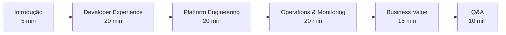

# 🎯 H1-007-I: Guia de Execução da Demonstração Completa

## 📋 Índice

1. [🎯 Visão Geral](#visao-geral)
2. [✅ Pré-verificação](#pre-verificacao)
3. [🎬 Roteiro da Demonstração](#roteiro-demonstracao)
4. [👥 Persona 1: Desenvolvedor](#persona-desenvolvedor)
5. [🏗️ Persona 2: Platform Engineer](#persona-platform-engineer)
6. [📊 Persona 3: SRE/Operations](#persona-sre-operations)
7. [💼 Persona 4: Business Stakeholder](#persona-business)
8. [🚨 Troubleshooting Durante Demo](#troubleshooting-demo)
9. [📝 Script de Apresentação](#script-apresentacao)
10. [🎉 Conclusão e Q&A](#conclusao-qa)

## 🎯 Visão Geral {#visao-geral}

Este guia fornece um roteiro completo para demonstrar o Three Horizons AI Platform, cobrindo todas as capacidades da plataforma através de diferentes personas.

### 📊 Duração da Demonstração

- **Demonstração Completa**: 90 minutos
- **Demonstração Executiva**: 30 minutos
- **Demonstração Técnica Profunda**: 2-3 horas

### 🎭 Personas da Demonstração

1. **João Silva** - Desenvolvedor Full Stack
2. **Maria Santos** - Platform Engineer
3. **Carlos Oliveira** - SRE/Operations
4. **Ana Costa** - Product Owner/Business

## ✅ Pré-verificação {#pre-verificacao}

### Script de Verificação Completa

```bash
#!/bin/bash
# scripts/pre-demo-check.sh

set -euo pipefail

# Cores para output
GREEN='\033[0;32m'
RED='\033[0;31m'
YELLOW='\033[1;33m'
BLUE='\033[0;34m'
NC='\033[0m'

log() { echo -e "${BLUE}[$(date +'%H:%M:%S')] $1${NC}"; }
success() { echo -e "${GREEN}✅ $1${NC}"; }
error() { echo -e "${RED}❌ $1${NC}"; }
warning() { echo -e "${YELLOW}⚠️  $1${NC}"; }

ERRORS=0
WARNINGS=0

# Função para verificar URL
check_url() {
    local url=$1
    local name=$2
    
    if curl -s -o /dev/null -w "%{http_code}" "$url" | grep -q "200\|301\|302"; then
        success "$name está acessível: $url"
    else
        error "$name não está acessível: $url"
        ((ERRORS++))
    fi
}

# Função para verificar pod
check_pods() {
    local namespace=$1
    local label=$2
    local min_ready=$3
    
    READY=$(kubectl get pods -n "$namespace" -l "$label" -o json | jq '.items | map(select(.status.phase == "Running")) | length')
    
    if [ "$READY" -ge "$min_ready" ]; then
        success "$label: $READY pods running em $namespace"
    else
        error "$label: apenas $READY/$min_ready pods running em $namespace"
        ((ERRORS++))
    fi
}

log "🔍 Three Horizons Demo - Verificação Pré-Demonstração"
log "===================================================="

# 1. Verificar conectividade Azure
log "☁️ Verificando Azure..."
if az account show > /dev/null 2>&1; then
    SUBSCRIPTION=$(az account show --query name -o tsv)
    success "Conectado ao Azure: $SUBSCRIPTION"
else
    error "Não conectado ao Azure"
    ((ERRORS++))
fi

# 2. Verificar Kubernetes
log "☸️ Verificando Kubernetes..."
if kubectl cluster-info > /dev/null 2>&1; then
    CLUSTER=$(kubectl config current-context)
    success "Conectado ao cluster: $CLUSTER"
else
    error "Não conectado ao Kubernetes"
    ((ERRORS++))
fi

# 3. Verificar namespaces
log "📁 Verificando namespaces..."
NAMESPACES=("argocd" "monitoring" "ecommerce-dev" "ecommerce-staging" "ecommerce-prod")
for ns in "${NAMESPACES[@]}"; do
    if kubectl get namespace "$ns" > /dev/null 2>&1; then
        success "Namespace $ns existe"
    else
        error "Namespace $ns não existe"
        ((ERRORS++))
    fi
done

# 4. Verificar Developer Hub
log "🏠 Verificando Developer Hub..."
check_url "https://backstage-rhdh-rhdh-operator.apps.txl952sg.centralus.aroapp.io" "Developer Hub"
check_pods "rhdh-operator" "app=backstage" 1

# 5. Verificar ArgoCD
log "🔄 Verificando ArgoCD..."
check_url "https://argocd.demo.threehorizons.io" "ArgoCD"
check_pods "argocd" "app.kubernetes.io/name=argocd-server" 1

# 6. Verificar aplicações
log "🚀 Verificando aplicações..."
check_url "https://portal-dev.demo.threehorizons.io" "Portal Dev"
check_url "https://api-dev.demo.threehorizons.io/health" "API Dev"
check_url "https://admin-dev.demo.threehorizons.io" "Admin Dev"

# 7. Verificar monitoramento
log "📊 Verificando monitoramento..."
check_url "https://grafana.demo.threehorizons.io" "Grafana"
check_url "https://prometheus.demo.threehorizons.io" "Prometheus"
check_pods "monitoring" "app.kubernetes.io/name=grafana" 1

# 8. Verificar CI/CD
log "🔧 Verificando CI/CD..."
WORKFLOWS=$(gh workflow list --repo three-horizon-ai/Three-Horizons-AI-Developer-Platform --json name,state | jq -r '.[] | select(.state == "active") | .name' | wc -l)
if [ "$WORKFLOWS" -gt 0 ]; then
    success "GitHub Actions: $WORKFLOWS workflows ativos"
else
    error "Nenhum workflow ativo no GitHub Actions"
    ((ERRORS++))
fi

# 9. Verificar dados de demo
log "🗄️ Verificando dados de demonstração..."
PRODUCTS=$(kubectl exec -n ecommerce-dev deployment/catalog-service -- wget -q -O - http://localhost:8080/products | jq '.products | length' 2>/dev/null || echo 0)
if [ "$PRODUCTS" -gt 0 ]; then
    success "Catálogo: $PRODUCTS produtos disponíveis"
else
    warning "Catálogo vazio - executar seed de dados"
    ((WARNINGS++))
fi

# 10. Verificar recursos Azure
log "☁️ Verificando recursos Azure..."
RG_COUNT=$(az group list --query "[?contains(name, 'threehorizons')].name" -o tsv | wc -l)
success "Resource Groups: $RG_COUNT encontrados"

# Resumo
echo ""
log "📊 Resumo da Verificação"
log "========================"
if [ "$ERRORS" -eq 0 ]; then
    success "Todos os componentes estão funcionando!"
else
    error "Encontrados $ERRORS erros"
fi

if [ "$WARNINGS" -gt 0 ]; then
    warning "Encontrados $WARNINGS avisos"
fi

# Dados de acesso
if [ "$ERRORS" -eq 0 ]; then
    echo ""
    log "🔑 URLs de Acesso"
    log "================="
    echo "Developer Hub: https://backstage-rhdh-rhdh-operator.apps.txl952sg.centralus.aroapp.io"
    echo "Portal Demo: https://portal-dev.demo.threehorizons.io"
    echo "Admin Demo: https://admin-dev.demo.threehorizons.io"
    echo "ArgoCD: https://argocd.demo.threehorizons.io"
    echo "Grafana: https://grafana.demo.threehorizons.io"
    echo ""
    log "👤 Credenciais"
    log "=============="
    echo "Developer Hub: GitHub OAuth"
    echo "ArgoCD: admin / ThreeHorizons2024!"
    echo "Grafana: admin / ThreeHorizons2024!"
    echo "Demo User: demo@threehorizons.io / Demo2024!"
fi

exit $ERRORS
```

### Preparação de Dados de Demo

```bash
#!/bin/bash
# scripts/seed-demo-data.sh

log() { echo "[$(date +'%H:%M:%S')] $1"; }

log "🌱 Populando dados de demonstração..."

# 1. Seed produtos no catálogo
log "📦 Criando produtos..."
kubectl exec -n ecommerce-dev deployment/catalog-service -- node scripts/seed-products.js

# 2. Criar usuários de demo
log "👥 Criando usuários..."
kubectl exec -n ecommerce-dev deployment/user-service -- node scripts/seed-users.js

# 3. Criar pedidos de exemplo
log "📋 Criando pedidos..."
kubectl exec -n ecommerce-dev deployment/order-service -- node scripts/seed-orders.js

# 4. Gerar métricas
log "📊 Gerando métricas..."
kubectl exec -n ecommerce-dev deployment/load-generator -- k6 run --vus 10 --duration 5m scripts/generate-metrics.js

log "✅ Dados de demonstração prontos!"
```

## 🎬 Roteiro da Demonstração {#roteiro-demonstracao}

### Estrutura da Apresentação



## 👥 Persona 1: Desenvolvedor {#persona-desenvolvedor}

### 🎯 Objetivo: Mostrar a jornada do desenvolvedor

#### 1.1 Onboarding (5 minutos)

```markdown
📍 **Cenário**: João Silva, novo desenvolvedor, primeiro dia na empresa

1. **Acessar Developer Hub**
   - Navegar para: https://backstage-rhdh-rhdh-operator.apps.txl952sg.centralus.aroapp.io
   - Login com GitHub
   - Mostrar dashboard personalizado

2. **Explorar o catálogo**
   - Clicar em "Catalog"
   - Filtrar por "kind:Component"
   - Mostrar serviços existentes
   - Demonstrar ownership e documentação

3. **Criar DevBox**
   - Ir para "Create"
   - Selecionar "Developer DevBox"
   - Preencher:
     - Email: joao.silva@threehorizons.io
     - Projeto: threehorizons-demo
     - Tipo: standard
   - Criar e aguardar provisionamento
```

**💬 Script**: 
> "João acabou de entrar na empresa. Em menos de 5 minutos, ele tem acesso a todo o catálogo de serviços, documentação e seu ambiente de desenvolvimento personalizado está sendo provisionado automaticamente."

#### 1.2 Criar Novo Microsserviço (10 minutos)

```markdown
📍 **Cenário**: João precisa criar um novo serviço de recomendações

1. **Usar template no Developer Hub**
   - Clicar em "Create"
   - Selecionar "🟢 Microsserviço Node.js"
   - Preencher:
     - Nome: recommendation-service
     - Descrição: AI-powered product recommendations
     - Owner: platform-team
     - Database: mongodb
     - Messaging: rabbitmq

2. **Mostrar resultado**
   - Repositório criado automaticamente
   - Pipeline CI/CD configurado
   - Documentação gerada
   - Monitoramento habilitado
```

**💬 Script**:
> "Com nossos Golden Paths, João não precisa se preocupar com configurações de infraestrutura. Tudo já vem configurado seguindo as melhores práticas da empresa."

#### 1.3 Desenvolvimento com Copilot (5 minutos)

```markdown
📍 **Cenário**: Implementar lógica de recomendação

1. **Abrir VS Code no DevBox**
   - Mostrar Copilot ativo
   - Criar arquivo: `src/services/recommendation.service.ts`
   
2. **Demonstrar Copilot**
   - Comentário: "// Function to get product recommendations based on user history"
   - Mostrar sugestão do Copilot
   - Aceitar e refinar código
   
3. **Executar testes**
   - Terminal: `npm test`
   - Mostrar cobertura de testes
```

**Código exemplo com Copilot**:
```typescript
// Function to get product recommendations based on user history
async function getRecommendations(userId: string, limit: number = 10) {
  // Copilot gerará o código aqui
}
```

## 🏗️ Persona 2: Platform Engineer {#persona-platform-engineer}

### 🎯 Objetivo: Mostrar capacidades de platform engineering

#### 2.1 Gestão de Infraestrutura (10 minutos)

```markdown
📍 **Cenário**: Maria precisa escalar a infraestrutura para Black Friday

1. **Acessar ArgoCD**
   - URL: https://argocd.demo.threehorizons.io
   - Login: admin / ThreeHorizons2024!
   - Mostrar aplicações sincronizadas

2. **Escalar via GitOps**
   - Editar arquivo no GitHub: `k8s/overlays/prod/kustomization.yaml`
   - Aumentar replicas:
     ```yaml
     replicas:
       - name: frontend-portal
         count: 10  # Era 5
       - name: api-gateway
         count: 8   # Era 4
     ```
   - Commit e push
   - Mostrar ArgoCD sincronizando automaticamente

3. **Verificar escalamento**
   - ArgoCD mostra progresso
   - Grafana mostra novos pods
```

**💬 Script**:
> "Maria não precisa acessar diretamente o cluster. Toda mudança é versionada, auditada e pode ser revertida facilmente."

#### 2.2 Progressive Delivery (10 minutos)

```markdown
📍 **Cenário**: Deploy seguro de nova versão

1. **Configurar Canary Deployment**
   - Mostrar Flagger configurado
   - Iniciar deploy de nova versão
   
2. **Acompanhar métricas**
   - Grafana dashboard mostrando:
     - Tráfego dividido (10% canary)
     - Latência comparativa
     - Taxa de erro
   
3. **Promoção automática**
   - Mostrar análise automática
   - Incremento gradual do tráfego
   - Rollback automático se houver problemas
```

## 📊 Persona 3: SRE/Operations {#persona-sre-operations}

### 🎯 Objetivo: Demonstrar observabilidade e operações

#### 3.1 Monitoramento Proativo (10 minutos)

```markdown
📍 **Cenário**: Carlos monitora a saúde da plataforma

1. **Dashboard principal no Grafana**
   - URL: https://grafana.demo.threehorizons.io
   - Login: admin / ThreeHorizons2024!
   - Mostrar:
     - SLO Dashboard (99.9% availability)
     - Error Budget consumido
     - DORA metrics

2. **Alertas inteligentes**
   - Mostrar AlertManager
   - Demonstrar roteamento de alertas
   - Integração com PagerDuty/Slack

3. **Tracing distribuído**
   - Selecionar request lento
   - Mostrar trace completo
   - Identificar bottleneck
```

**💬 Script**:
> "Carlos tem visibilidade completa da plataforma. Ele pode identificar problemas antes que afetem os usuários."

#### 3.2 Incident Response (10 minutos)

```markdown
📍 **Cenário**: Simular incidente de payment service

1. **Trigger do alerta**
   - Executar: `kubectl exec -n ecommerce-prod deployment/payment-service -- kill 1`
   - Mostrar alerta no Slack
   - PagerDuty notificação

2. **Investigação**
   - Grafana: identificar serviço down
   - Logs centralizados: ver erro
   - Runbook automático iniciado

3. **Resolução**
   - Kubernetes reinicia pod automaticamente
   - Mostrar recuperação
   - Post-mortem automático gerado
```

## 💼 Persona 4: Business Stakeholder {#persona-business}

### 🎯 Objetivo: Mostrar valor de negócio

#### 4.1 Métricas de Negócio (10 minutos)

```markdown
📍 **Cenário**: Ana acompanha KPIs do e-commerce

1. **Business Dashboard**
   - Métricas em tempo real:
     - Revenue: $45,320 (últimas 24h)
     - Orders: 1,234
     - Conversion Rate: 3.2%
     - Cart Abandonment: 68%

2. **AI Insights**
   - Recomendações aumentaram conversão em 23%
   - Previsão de demanda para próxima semana
   - Análise de sentimento de reviews

3. **ROI da plataforma**
   - Time to market: -70%
   - Downtime: -95%
   - Custo operacional: -40%
```

#### 4.2 Demonstração End-to-End (5 minutos)

```markdown
📍 **Cenário**: Compra completa no portal

1. **Acessar portal**
   - URL: https://portal-dev.demo.threehorizons.io
   - Login: demo@threehorizons.io / Demo2024!

2. **Jornada do usuário**
   - Buscar produto (mostrar AI search)
   - Ver recomendações personalizadas
   - Adicionar ao carrinho
   - Checkout com Stripe
   - Receber email de confirmação

3. **Mostrar dados**
   - Pedido no admin
   - Métricas atualizadas
   - Trace da transação completa
```

## 🚨 Troubleshooting Durante Demo {#troubleshooting-demo}

### Problemas Comuns e Soluções Rápidas

```bash
# 1. Portal não carrega
kubectl rollout restart deployment/frontend-portal -n ecommerce-dev

# 2. ArgoCD fora de sync
argocd app sync ecommerce-dev --force

# 3. Grafana sem dados
kubectl rollout restart deployment/prometheus-stack-prometheus -n monitoring

# 4. Pipeline falhando
gh workflow run main-pipeline.yml --ref main

# 5. Pods em CrashLoop
kubectl delete pod -n ecommerce-dev -l app=api-gateway
```

### Plano B - Ambiente de Backup

```bash
# Ativar ambiente de backup
./scripts/activate-backup-env.sh

# URLs alternativas
BACKUP_PORTAL="https://portal-backup.demo.threehorizons.io"
BACKUP_API="https://api-backup.demo.threehorizons.io"
```

## 📝 Script de Apresentação {#script-apresentacao}

### Abertura (2 minutos)

> "Bem-vindos à demonstração do Three Horizons AI Platform. Hoje vamos mostrar como nossa plataforma transforma a experiência de desenvolvimento e operação, acelerando a entrega de valor para o negócio.
> 
> Vamos acompanhar a jornada de 4 personas: João (desenvolvedor), Maria (platform engineer), Carlos (SRE) e Ana (product owner), mostrando como cada um se beneficia da plataforma."

### Transições Entre Personas

**Dev → Platform**:
> "Vimos como João criou um serviço em minutos. Agora vamos ver como Maria, nossa platform engineer, garante que essa facilidade não comprometa a segurança e governança."

**Platform → SRE**:
> "Com a infraestrutura automatizada por Maria, Carlos pode focar no que realmente importa: garantir a confiabilidade e performance da plataforma."

**SRE → Business**:
> "Toda essa excelência operacional se traduz em resultados concretos para o negócio, como Ana vai nos mostrar."

## 🎉 Conclusão e Q&A {#conclusao-qa}

### Resumo dos Benefícios (3 minutos)

```markdown
✅ **Para Desenvolvedores**
- Onboarding em minutos
- Foco no código, não na infraestrutura
- AI-powered development

✅ **Para Platform Engineers**
- GitOps e automação completa
- Segurança by default
- Governança sem fricção

✅ **Para SRE/Operations**
- Observabilidade total
- Incident response automatizado
- SLOs/SLIs implementados

✅ **Para o Negócio**
- Time to market reduzido em 70%
- Disponibilidade 99.9%
- ROI comprovado
```

### Perguntas Frequentes

**Q: Quanto tempo leva para implementar?**
> "Com nossa abordagem de horizons, você tem valor desde a primeira semana. Horizon 1 em 30 dias, completo em 90 dias."

**Q: Preciso migrar tudo de uma vez?**
> "Não, nossa arquitetura permite migração gradual. Comece com um novo projeto ou microsserviço."

**Q: Qual o custo?**
> "O ROI típico é positivo em 6 meses. Redução de 40% em custos operacionais."

### Call to Action

> "Vamos agendar um workshop para desenhar o roadmap específico para sua organização?"

---

## 🎬 Versão Demo Rápida (30 min)

Para demonstrações executivas, focar em:

1. **Developer Experience** (10 min)
   - Criar serviço via template
   - Mostrar GitOps em ação

2. **Observabilidade** (10 min)
   - Dashboard de negócio
   - Resolver incidente simulado

3. **Valor de Negócio** (10 min)
   - ROI e métricas
   - Caso de sucesso

---

## 📋 Checklist Pré-Demo

- [ ] Executar script de verificação
- [ ] Seed de dados atualizado
- [ ] Credenciais testadas
- [ ] Backup environment pronto
- [ ] Slides atualizados
- [ ] Demo user criado
- [ ] Webhooks ativos
- [ ] Métricas baseline coletadas