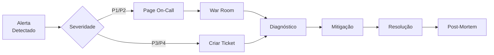

# 📚 H1-007-J: Documentação de Operações

## 📋 Índice

1. [🎯 Visão Geral](#visao-geral)
2. [🏗️ Arquitetura Operacional](#arquitetura-operacional)
3. [📋 Procedimentos Operacionais Padrão](#procedimentos-operacionais)
4. [🚨 Gestão de Incidentes](#gestao-incidentes)
5. [🔄 Manutenção Preventiva](#manutencao-preventiva)
6. [📊 Monitoramento e Alertas](#monitoramento-alertas)
7. [🔒 Segurança Operacional](#seguranca-operacional)
8. [💾 Backup e Recuperação](#backup-recuperacao)
9. [📈 Capacity Planning](#capacity-planning)
10. [📝 Runbooks Manuais](#runbooks-manuais)

## 🎯 Visão Geral {#visao-geral}

Esta documentação fornece todos os procedimentos operacionais necessários para manter o Three Horizons AI Platform funcionando com alta disponibilidade e performance.

### 🎯 Objetivos Operacionais

- **Disponibilidade**: 99.9% (43.2 minutos downtime/mês)
- **MTTR**: < 30 minutos
- **RPO**: 1 hora
- **RTO**: 2 horas

### 👥 Equipe de Operações

| Papel | Responsabilidades | Contato |
|-------|------------------|---------|
| SRE Lead | Arquitetura e escalação | sre-lead@threehorizons.io |
| SRE On-Call | Resposta a incidentes 24/7 | +55 11 99999-0000 |
| Platform Engineer | Manutenção de infraestrutura | platform@threehorizons.io |
| Security Engineer | Segurança e compliance | security@threehorizons.io |

## 🏗️ Arquitetura Operacional {#arquitetura-operacional}

### Diagrama de Componentes

```mermaid
graph TB
    subgraph "External Access"
        Users[Users]
        CDN[Azure CDN]
        WAF[Web Application Firewall]
    end
    
    subgraph "Azure Resources"
        subgraph "AKS Cluster"
            Ingress[NGINX Ingress]
            Frontend[Frontend Pods]
            Backend[Backend Pods]
            Jobs[CronJobs]
        end
        
        subgraph "Data Layer"
            PostgreSQL[(PostgreSQL)]
            MongoDB[(MongoDB)]
            Redis[(Redis)]
            Storage[Blob Storage]
        end
        
        subgraph "Supporting Services"
            KeyVault[Key Vault]
            Monitor[Azure Monitor]
            LogAnalytics[Log Analytics]
        end
    end
    
    Users --> CDN --> WAF --> Ingress
    Ingress --> Frontend & Backend
    Backend --> PostgreSQL & MongoDB & Redis
    Backend --> Storage & KeyVault
    AKS Cluster --> Monitor & LogAnalytics
```

### Informações de Acesso

```yaml
# Cluster AKS
Cluster: threehorizons-aks
Resource Group: rg-threehorizons-prod
Region: Central US
Node Pools:
  - system: 3 nodes (Standard_D4s_v3)
  - user: 5-20 nodes (Standard_D8s_v3)
  - gpu: 0-5 nodes (Standard_NC6s_v3)

# Databases
PostgreSQL:
  Host: psql-threehorizons-prod.postgres.database.azure.com
  Port: 5432
  Admin: psqladmin

MongoDB (Cosmos DB):
  Host: threehorizons-cosmos-prod.mongo.cosmos.azure.com
  Port: 10255
  
Redis:
  Host: redis-threehorizons-prod.redis.cache.windows.net
  Port: 6380
  SSL: Required
```

## 📋 Procedimentos Operacionais Padrão {#procedimentos-operacionais}

### SOP-001: Deployment de Produção

```bash
#!/bin/bash
# procedures/sop-001-production-deployment.sh

# 1. Pre-deployment checks
echo "🔍 Executando verificações pré-deploy..."

# Verificar saúde do cluster
kubectl get nodes
kubectl top nodes

# Verificar espaço em disco
df -h

# Backup do estado atual
kubectl get all --all-namespaces -o yaml > pre-deploy-backup-$(date +%Y%m%d-%H%M%S).yaml

# 2. Criar release notes
cat > release-notes.md << EOF
# Release $(date +%Y%m%d-%H%M%S)

## Changes
- Feature: [Description]
- Fix: [Description]
- Performance: [Description]

## Rollback procedure
\`\`\`bash
kubectl rollout undo deployment/[deployment-name] -n [namespace]
\`\`\`
EOF

# 3. Deploy via ArgoCD
argocd app sync ecommerce-prod --prune

# 4. Verificar deploy
kubectl rollout status deployment --timeout=10m -n ecommerce-prod

# 5. Smoke tests
./scripts/smoke-tests-prod.sh

# 6. Notificar equipe
curl -X POST $SLACK_WEBHOOK -d '{"text":"✅ Deploy de produção concluído com sucesso"}'
```

### SOP-002: Rollback de Emergência

```bash
#!/bin/bash
# procedures/sop-002-emergency-rollback.sh

DEPLOYMENT=$1
NAMESPACE=${2:-ecommerce-prod}

echo "🚨 Iniciando rollback de emergência para $DEPLOYMENT..."

# 1. Pausar tráfego
kubectl patch ingress $DEPLOYMENT-ingress -n $NAMESPACE \
  --type='json' -p='[{"op": "add", "path": "/metadata/annotations/nginx.ingress.kubernetes.io~1configuration-snippet", "value": "return 503;"}]'

# 2. Rollback
kubectl rollout undo deployment/$DEPLOYMENT -n $NAMESPACE

# 3. Aguardar estabilização
kubectl rollout status deployment/$DEPLOYMENT -n $NAMESPACE --timeout=5m

# 4. Verificar saúde
HEALTH_CHECK=$(curl -s -o /dev/null -w "%{http_code}" http://$DEPLOYMENT.$NAMESPACE.svc.cluster.local/health)
if [ "$HEALTH_CHECK" != "200" ]; then
    echo "❌ Health check falhou após rollback!"
    exit 1
fi

# 5. Restaurar tráfego
kubectl patch ingress $DEPLOYMENT-ingress -n $NAMESPACE \
  --type='json' -p='[{"op": "remove", "path": "/metadata/annotations/nginx.ingress.kubernetes.io~1configuration-snippet"}]'

echo "✅ Rollback concluído com sucesso"
```

### SOP-003: Scaling Manual

```bash
#!/bin/bash
# procedures/sop-003-manual-scaling.sh

SERVICE=$1
REPLICAS=$2
NAMESPACE=${3:-ecommerce-prod}

echo "📈 Escalando $SERVICE para $REPLICAS replicas..."

# 1. Verificar recursos disponíveis
NODES=$(kubectl get nodes | grep Ready | wc -l)
echo "Nodes disponíveis: $NODES"

# 2. Escalar deployment
kubectl scale deployment/$SERVICE --replicas=$REPLICAS -n $NAMESPACE

# 3. Aguardar pods ficarem prontos
kubectl wait --for=condition=ready pod -l app=$SERVICE -n $NAMESPACE --timeout=300s

# 4. Verificar distribuição
kubectl get pods -n $NAMESPACE -l app=$SERVICE -o wide

# 5. Atualizar HPA se necessário
kubectl patch hpa $SERVICE-hpa -n $NAMESPACE -p '{"spec":{"minReplicas":'$REPLICAS'}}'
```

## 🚨 Gestão de Incidentes {#gestao-incidentes}

### Classificação de Incidentes

| Severidade | Descrição | SLA | Exemplo |
|------------|-----------|-----|---------|
| P1 - Crítico | Sistema completamente inoperante | 15 min | Site fora do ar |
| P2 - Alto | Funcionalidade crítica afetada | 1 hora | Pagamentos falhando |
| P3 - Médio | Degradação de performance | 4 horas | Lentidão no checkout |
| P4 - Baixo | Problema cosmético | 2 dias | Erro de layout |

### Processo de Resposta a Incidentes



### Template de War Room

```markdown
# 🚨 War Room - [INCIDENT_ID]

**Iniciado**: [TIMESTAMP]
**Severidade**: P[1-4]
**Impacto**: [Descrição do impacto no negócio]

## 👥 Participantes
- **Incident Commander**: [Nome]
- **Tech Lead**: [Nome]
- **Communications**: [Nome]
- **Scribe**: [Nome]

## 📊 Status
- [ ] Problema identificado
- [ ] Mitigação aplicada
- [ ] Serviço restaurado
- [ ] Monitoramento confirmado

## 🔍 Timeline
- **HH:MM** - Alerta inicial recebido
- **HH:MM** - War room iniciado
- **HH:MM** - Causa raiz identificada
- **HH:MM** - Mitigação aplicada
- **HH:MM** - Serviço restaurado

## 🛠️ Ações Tomadas
1. [Ação 1]
2. [Ação 2]

## 📝 Follow-up
- [ ] Post-mortem agendado
- [ ] Runbook atualizado
- [ ] Alertas melhorados
```

### Script de Comunicação de Incidentes

```python
#!/usr/bin/env python3
# scripts/incident-communication.py

import requests
import json
from datetime import datetime

class IncidentCommunicator:
    def __init__(self):
        self.slack_webhook = os.environ['SLACK_INCIDENT_WEBHOOK']
        self.statuspage_api = os.environ['STATUSPAGE_API_URL']
        self.statuspage_key = os.environ['STATUSPAGE_API_KEY']
    
    def notify_incident_start(self, severity, service, impact):
        # Slack notification
        slack_message = {
            "attachments": [{
                "color": "danger" if severity in ["P1", "P2"] else "warning",
                "title": f"🚨 Incidente {severity} - {service}",
                "text": impact,
                "fields": [
                    {"title": "Serviço", "value": service, "short": True},
                    {"title": "Severidade", "value": severity, "short": True},
                    {"title": "Iniciado", "value": datetime.now().strftime("%H:%M"), "short": True},
                    {"title": "Status", "value": "Investigando", "short": True}
                ],
                "actions": [
                    {
                        "type": "button",
                        "text": "Juntar War Room",
                        "url": "https://meet.google.com/abc-defg-hij"
                    }
                ]
            }]
        }
        
        requests.post(self.slack_webhook, json=slack_message)
        
        # Status page update
        if severity in ["P1", "P2"]:
            self.update_statuspage("investigating", service, impact)
    
    def update_incident(self, update_text, status="investigating"):
        # Thread update in Slack
        slack_update = {
            "text": f"📝 Update: {update_text}\nStatus: {status}"
        }
        requests.post(self.slack_webhook, json=slack_update)
    
    def notify_incident_resolved(self, service, resolution_time, root_cause):
        message = {
            "attachments": [{
                "color": "good",
                "title": f"✅ Incidente Resolvido - {service}",
                "text": f"Root cause: {root_cause}",
                "fields": [
                    {"title": "Tempo de Resolução", "value": resolution_time, "short": True},
                    {"title": "Status", "value": "Resolvido", "short": True}
                ]
            }]
        }
        requests.post(self.slack_webhook, json=message)
        self.update_statuspage("resolved", service, "Serviço restaurado")

if __name__ == "__main__":
    comm = IncidentCommunicator()
    # Exemplo de uso
    comm.notify_incident_start("P1", "Payment Service", "Pagamentos falhando para todos os usuários")
```

## 🔄 Manutenção Preventiva {#manutencao-preventiva}

### Cronograma de Manutenção

| Frequência | Atividade | Responsável | Duração |
|------------|-----------|-------------|---------|
| Diária | Verificação de backups | SRE On-Call | 15 min |
| Semanal | Análise de logs de erro | SRE Team | 1 hora |
| Mensal | Atualização de dependências | Platform Team | 4 horas |
| Trimestral | Disaster Recovery Drill | Toda equipe | 1 dia |
| Semestral | Security Audit | Security Team | 1 semana |

### Script de Manutenção Semanal

```bash
#!/bin/bash
# maintenance/weekly-maintenance.sh

log() { echo "[$(date +'%Y-%m-%d %H:%M:%S')] $1"; }

log "🔧 Iniciando manutenção semanal..."

# 1. Limpeza de recursos órfãos
log "🧹 Limpando recursos órfãos..."
kubectl get pods --all-namespaces | grep Evicted | awk '{print $2 " --namespace=" $1}' | xargs kubectl delete pod
kubectl get pvc --all-namespaces | grep Released | awk '{print $2 " --namespace=" $1}' | xargs kubectl delete pvc

# 2. Compactação de logs
log "📦 Compactando logs antigos..."
find /var/log/containers -name "*.log" -mtime +7 -exec gzip {} \;

# 3. Análise de certificados
log "🔐 Verificando certificados SSL..."
kubectl get certificates --all-namespaces -o json | jq -r '.items[] | select(.status.notAfter < (now + 2592000)) | .metadata.name + " expires in less than 30 days"'

# 4. Otimização de banco de dados
log "🗄️ Executando VACUUM no PostgreSQL..."
kubectl exec -n ecommerce-prod deployment/postgres -- psql -U postgres -c "VACUUM ANALYZE;"

# 5. Verificação de imagens desatualizadas
log "🐳 Verificando imagens de containers..."
kubectl get pods --all-namespaces -o jsonpath="{.items[*].spec.containers[*].image}" | tr -s '[[:space:]]' '\n' | sort | uniq | while read image; do
    echo "Checking: $image"
    # Verificar se há atualizações disponíveis
done

# 6. Teste de alertas
log "🚨 Testando sistema de alertas..."
curl -X POST http://alertmanager:9093/api/v1/alerts -d '[{
    "labels": {
        "alertname": "TestAlert",
        "severity": "info"
    },
    "annotations": {
        "description": "Teste semanal do sistema de alertas"
    }
}]'

log "✅ Manutenção semanal concluída!"
```

## 📊 Monitoramento e Alertas {#monitoramento-alertas}

### Dashboard Operacional Principal

```yaml
# monitoring/dashboards/operations-main.json
{
  "dashboard": {
    "title": "Operations Command Center",
    "panels": [
      {
        "title": "🟢 Service Health Matrix",
        "type": "state-timeline",
        "targets": [{
          "expr": "up{job=~\".*service.*\"}"
        }]
      },
      {
        "title": "🚨 Active Alerts",
        "type": "table",
        "targets": [{
          "expr": "ALERTS{alertstate=\"firing\"}"
        }]
      },
      {
        "title": "📈 Request Rate",
        "type": "graph",
        "targets": [{
          "expr": "sum(rate(http_requests_total[5m])) by (service)"
        }]
      },
      {
        "title": "⚡ Response Time P95",
        "type": "graph",
        "targets": [{
          "expr": "histogram_quantile(0.95, rate(http_request_duration_seconds_bucket[5m]))"
        }]
      },
      {
        "title": "❌ Error Rate",
        "type": "graph",
        "targets": [{
          "expr": "sum(rate(http_requests_total{status=~\"5..\"}[5m])) by (service)"
        }]
      },
      {
        "title": "💾 Resource Utilization",
        "type": "heatmap",
        "targets": [{
          "expr": "100 - (node_memory_MemAvailable_bytes / node_memory_MemTotal_bytes * 100)"
        }]
      }
    ]
  }
}
```

### Alertas Críticos

```yaml
# monitoring/alerts/critical-alerts.yaml
groups:
  - name: critical_operations
    interval: 30s
    rules:
      # Site Down
      - alert: SiteDown
        expr: probe_http_status_code{job="blackbox"} != 200
        for: 2m
        labels:
          severity: P1
          team: platform
        annotations:
          summary: "Site {{ $labels.instance }} está fora do ar"
          description: "O site não está respondendo há mais de 2 minutos"
          runbook: "https://wiki.threehorizons.io/runbooks/site-down"
          
      # Database Connection Failed
      - alert: DatabaseConnectionFailed
        expr: pg_up == 0
        for: 1m
        labels:
          severity: P1
          team: platform
        annotations:
          summary: "Conexão com PostgreSQL falhou"
          description: "Não é possível conectar ao banco de dados"
          
      # High Memory Pressure
      - alert: HighMemoryPressure
        expr: (1 - (node_memory_MemAvailable_bytes / node_memory_MemTotal_bytes)) > 0.95
        for: 5m
        labels:
          severity: P2
          team: platform
        annotations:
          summary: "Memória crítica no node {{ $labels.node }}"
          description: "Uso de memória acima de 95%"
          
      # Disk Space Critical
      - alert: DiskSpaceCritical
        expr: (1 - (node_filesystem_avail_bytes / node_filesystem_size_bytes)) > 0.90
        for: 5m
        labels:
          severity: P2
          team: platform
        annotations:
          summary: "Espaço em disco crítico"
          description: "Menos de 10% de espaço disponível em {{ $labels.mountpoint }}"
```

## 🔒 Segurança Operacional {#seguranca-operacional}

### Checklist de Segurança Diária

```bash
#!/bin/bash
# security/daily-security-check.sh

echo "🔒 Executando verificações de segurança..."

# 1. Verificar pods com privilégios elevados
echo "Checking for privileged pods..."
kubectl get pods --all-namespaces -o json | jq -r '.items[] | select(.spec.containers[].securityContext.privileged == true) | .metadata.namespace + "/" + .metadata.name'

# 2. Verificar secrets expostos
echo "Checking for exposed secrets..."
kubectl get pods --all-namespaces -o json | jq -r '.items[].spec.containers[].env[]? | select(.value | test("password|secret|key|token"; "i"))'

# 3. Scan de vulnerabilidades
echo "Running vulnerability scan..."
trivy image --severity HIGH,CRITICAL $(kubectl get pods --all-namespaces -o jsonpath="{.items[*].spec.containers[*].image}" | tr -s '[[:space:]]' '\n' | sort | uniq)

# 4. Verificar políticas de rede
echo "Checking network policies..."
kubectl get networkpolicies --all-namespaces

# 5. Auditoria de RBAC
echo "Auditing RBAC..."
kubectl auth can-i --list --as=system:serviceaccount:default:default
```

### Resposta a Incidentes de Segurança

```python
#!/usr/bin/env python3
# security/security-incident-response.py

import subprocess
import json
import datetime

class SecurityIncidentResponse:
    def __init__(self):
        self.incident_log = []
        
    def isolate_pod(self, namespace, pod_name):
        """Isola um pod comprometido"""
        print(f"🔒 Isolando pod {namespace}/{pod_name}...")
        
        # 1. Adicionar network policy para bloquear tráfego
        network_policy = {
            "apiVersion": "networking.k8s.io/v1",
            "kind": "NetworkPolicy",
            "metadata": {
                "name": f"isolate-{pod_name}",
                "namespace": namespace
            },
            "spec": {
                "podSelector": {
                    "matchLabels": {
                        "name": pod_name
                    }
                },
                "policyTypes": ["Ingress", "Egress"],
                "ingress": [],
                "egress": []
            }
        }
        
        # Aplicar policy
        subprocess.run([
            "kubectl", "apply", "-f", "-"
        ], input=json.dumps(network_policy), text=True)
        
        # 2. Capturar logs e estado
        self.capture_forensics(namespace, pod_name)
        
        # 3. Notificar equipe de segurança
        self.notify_security_team(namespace, pod_name)
        
    def capture_forensics(self, namespace, pod_name):
        """Captura evidências forenses"""
        timestamp = datetime.datetime.now().strftime("%Y%m%d-%H%M%S")
        
        # Logs do pod
        subprocess.run([
            "kubectl", "logs", "-n", namespace, pod_name,
            "--all-containers", "--previous",
            f"> /forensics/{pod_name}-{timestamp}.log"
        ])
        
        # Descrição do pod
        subprocess.run([
            "kubectl", "describe", "pod", "-n", namespace, pod_name,
            f"> /forensics/{pod_name}-{timestamp}-describe.txt"
        ])
        
        # Processos em execução
        subprocess.run([
            "kubectl", "exec", "-n", namespace, pod_name, "--",
            "ps", "aux",
            f"> /forensics/{pod_name}-{timestamp}-processes.txt"
        ])
```

## 💾 Backup e Recuperação {#backup-recuperacao}

### Estratégia de Backup

```yaml
# Backup Strategy
Databases:
  PostgreSQL:
    - Full backup: Daily at 02:00 UTC
    - Incremental: Every 4 hours
    - Retention: 30 days
    - Location: Azure Blob Storage (geo-redundant)
  
  MongoDB:
    - Full backup: Daily at 03:00 UTC
    - Oplog backup: Continuous
    - Retention: 30 days
    - Location: Azure Blob Storage
  
  Redis:
    - Snapshot: Every hour
    - AOF: Enabled
    - Retention: 7 days

Application Data:
  - Persistent Volumes: Daily snapshots
  - Config/Secrets: Git repository (encrypted)
  - Container Images: ACR with geo-replication

Cluster State:
  - ETCD backup: Every 6 hours
  - Cluster config: Git repository
```

### Script de Backup Automatizado

```bash
#!/bin/bash
# backup/automated-backup.sh

TIMESTAMP=$(date +%Y%m%d-%H%M%S)
BACKUP_DIR="/backup/${TIMESTAMP}"
STORAGE_ACCOUNT="threehorizonsbackup"
CONTAINER="backups"

log() { echo "[$(date +'%Y-%m-%d %H:%M:%S')] $1"; }

# 1. Backup PostgreSQL
backup_postgresql() {
    log "📦 Backing up PostgreSQL..."
    
    kubectl exec -n ecommerce-prod deployment/postgres -- \
        pg_dumpall -U postgres | \
        gzip > ${BACKUP_DIR}/postgresql-${TIMESTAMP}.sql.gz
    
    # Upload to Azure
    az storage blob upload \
        --account-name ${STORAGE_ACCOUNT} \
        --container-name ${CONTAINER} \
        --name postgresql/${TIMESTAMP}/postgresql-${TIMESTAMP}.sql.gz \
        --file ${BACKUP_DIR}/postgresql-${TIMESTAMP}.sql.gz
}

# 2. Backup MongoDB
backup_mongodb() {
    log "📦 Backing up MongoDB..."
    
    kubectl exec -n ecommerce-prod deployment/mongodb -- \
        mongodump --archive=/tmp/mongodb-backup.gz --gzip
    
    kubectl cp ecommerce-prod/$(kubectl get pod -n ecommerce-prod -l app=mongodb -o jsonpath='{.items[0].metadata.name}'):/tmp/mongodb-backup.gz \
        ${BACKUP_DIR}/mongodb-${TIMESTAMP}.gz
    
    az storage blob upload \
        --account-name ${STORAGE_ACCOUNT} \
        --container-name ${CONTAINER} \
        --name mongodb/${TIMESTAMP}/mongodb-${TIMESTAMP}.gz \
        --file ${BACKUP_DIR}/mongodb-${TIMESTAMP}.gz
}

# 3. Backup Persistent Volumes
backup_pvs() {
    log "📦 Backing up Persistent Volumes..."
    
    kubectl get pv -o json | jq -r '.items[] | .metadata.name' | while read pv; do
        # Create volume snapshot
        kubectl apply -f - <<EOF
apiVersion: snapshot.storage.k8s.io/v1
kind: VolumeSnapshot
metadata:
  name: snapshot-${pv}-${TIMESTAMP}
spec:
  volumeSnapshotClassName: azure-disk
  source:
    persistentVolumeClaimName: ${pv}
EOF
    done
}

# 4. Backup ETCD
backup_etcd() {
    log "📦 Backing up ETCD..."
    
    ETCD_POD=$(kubectl get pods -n kube-system -l component=etcd -o jsonpath='{.items[0].metadata.name}')
    
    kubectl exec -n kube-system ${ETCD_POD} -- \
        etcdctl snapshot save /tmp/etcd-backup.db \
        --endpoints=https://127.0.0.1:2379 \
        --cacert=/etc/kubernetes/pki/etcd/ca.crt \
        --cert=/etc/kubernetes/pki/etcd/server.crt \
        --key=/etc/kubernetes/pki/etcd/server.key
    
    kubectl cp kube-system/${ETCD_POD}:/tmp/etcd-backup.db \
        ${BACKUP_DIR}/etcd-${TIMESTAMP}.db
}

# Main execution
main() {
    log "🚀 Starting backup process..."
    
    mkdir -p ${BACKUP_DIR}
    
    backup_postgresql
    backup_mongodb
    backup_pvs
    backup_etcd
    
    # Verify backups
    log "✅ Verifying backups..."
    az storage blob list \
        --account-name ${STORAGE_ACCOUNT} \
        --container-name ${CONTAINER} \
        --prefix ${TIMESTAMP} \
        --output table
    
    # Cleanup old backups
    log "🧹 Cleaning old backups..."
    find /backup -type d -mtime +30 -exec rm -rf {} \;
    
    log "✅ Backup completed successfully!"
}

main
```

### Procedimento de Restore

```bash
#!/bin/bash
# restore/restore-procedure.sh

RESTORE_POINT=$1  # Formato: YYYYMMDD-HHMMSS

if [ -z "$RESTORE_POINT" ]; then
    echo "Usage: $0 <restore-point>"
    echo "Example: $0 20240115-020000"
    exit 1
fi

log() { echo "[$(date +'%Y-%m-%d %H:%M:%S')] $1"; }

# 1. Confirmar restore
read -p "⚠️  Tem certeza que deseja restaurar para $RESTORE_POINT? (yes/no): " confirm
if [ "$confirm" != "yes" ]; then
    echo "Restore cancelado."
    exit 0
fi

# 2. Parar aplicações
log "🛑 Parando aplicações..."
kubectl scale deployment --all --replicas=0 -n ecommerce-prod

# 3. Restore PostgreSQL
restore_postgresql() {
    log "📥 Restaurando PostgreSQL..."
    
    # Download backup
    az storage blob download \
        --account-name threehorizonsbackup \
        --container-name backups \
        --name postgresql/${RESTORE_POINT}/postgresql-${RESTORE_POINT}.sql.gz \
        --file /tmp/postgresql-restore.sql.gz
    
    # Restore
    gunzip -c /tmp/postgresql-restore.sql.gz | \
        kubectl exec -i -n ecommerce-prod deployment/postgres -- \
        psql -U postgres
}

# 4. Restore MongoDB
restore_mongodb() {
    log "📥 Restaurando MongoDB..."
    
    # Download backup
    az storage blob download \
        --account-name threehorizonsbackup \
        --container-name backups \
        --name mongodb/${RESTORE_POINT}/mongodb-${RESTORE_POINT}.gz \
        --file /tmp/mongodb-restore.gz
    
    # Copy to pod
    POD=$(kubectl get pod -n ecommerce-prod -l app=mongodb -o jsonpath='{.items[0].metadata.name}')
    kubectl cp /tmp/mongodb-restore.gz ecommerce-prod/${POD}:/tmp/
    
    # Restore
    kubectl exec -n ecommerce-prod ${POD} -- \
        mongorestore --archive=/tmp/mongodb-restore.gz --gzip --drop
}

# 5. Restore volumes
restore_volumes() {
    log "📥 Restaurando volumes..."
    
    kubectl get volumesnapshot | grep ${RESTORE_POINT} | awk '{print $1}' | while read snapshot; do
        # Create PVC from snapshot
        kubectl apply -f - <<EOF
apiVersion: v1
kind: PersistentVolumeClaim
metadata:
  name: restored-${snapshot}
spec:
  dataSource:
    name: ${snapshot}
    kind: VolumeSnapshot
    apiGroup: snapshot.storage.k8s.io
  accessModes:
    - ReadWriteOnce
  resources:
    requests:
      storage: 10Gi
EOF
    done
}

# Main restore
main() {
    log "🔄 Iniciando processo de restore..."
    
    restore_postgresql
    restore_mongodb
    restore_volumes
    
    # Restart applications
    log "🚀 Reiniciando aplicações..."
    kubectl scale deployment --all --replicas=3 -n ecommerce-prod
    
    # Verificar saúde
    log "🔍 Verificando saúde das aplicações..."
    sleep 60
    kubectl get pods -n ecommerce-prod
    
    log "✅ Restore concluído!"
}

main
```

## 📈 Capacity Planning {#capacity-planning}

### Métricas de Capacity

```python
#!/usr/bin/env python3
# capacity/capacity-analyzer.py

import pandas as pd
import numpy as np
from datetime import datetime, timedelta
import requests

class CapacityAnalyzer:
    def __init__(self, prometheus_url):
        self.prometheus = prometheus_url
        
    def get_metric(self, query, start, end, step='1h'):
        """Busca métricas do Prometheus"""
        response = requests.get(
            f"{self.prometheus}/api/v1/query_range",
            params={
                'query': query,
                'start': start.timestamp(),
                'end': end.timestamp(),
                'step': step
            }
        )
        return response.json()['data']['result']
    
    def analyze_growth(self):
        """Analisa crescimento de recursos"""
        end = datetime.now()
        start = end - timedelta(days=90)
        
        # CPU Usage
        cpu_data = self.get_metric(
            'avg(rate(container_cpu_usage_seconds_total[5m])) by (namespace)',
            start, end
        )
        
        # Memory Usage
        memory_data = self.get_metric(
            'avg(container_memory_usage_bytes) by (namespace)',
            start, end
        )
        
        # Storage Usage
        storage_data = self.get_metric(
            'sum(kubelet_volume_stats_used_bytes) by (persistentvolumeclaim)',
            start, end
        )
        
        return self.project_growth(cpu_data, memory_data, storage_data)
    
    def project_growth(self, cpu, memory, storage):
        """Projeta necessidades futuras"""
        projections = {
            'cpu': self.linear_projection(cpu, 90),
            'memory': self.linear_projection(memory, 90),
            'storage': self.linear_projection(storage, 90)
        }
        
        recommendations = []
        
        # CPU recommendations
        if projections['cpu']['growth_rate'] > 0.1:  # >10% growth
            recommendations.append({
                'resource': 'CPU',
                'action': 'Add nodes',
                'when': f"In {projections['cpu']['days_to_limit']} days",
                'quantity': f"{projections['cpu']['needed_capacity']} cores"
            })
        
        return {
            'projections': projections,
            'recommendations': recommendations
        }
    
    def generate_report(self):
        """Gera relatório de capacity planning"""
        analysis = self.analyze_growth()
        
        report = f"""
# 📊 Capacity Planning Report - {datetime.now().strftime('%Y-%m-%d')}

## Current Usage
- CPU: {analysis['current']['cpu']}%
- Memory: {analysis['current']['memory']}%
- Storage: {analysis['current']['storage']}%

## 90-Day Projections
- CPU: {analysis['projections']['cpu']['projected']}%
- Memory: {analysis['projections']['memory']['projected']}%
- Storage: {analysis['projections']['storage']['projected']}%

## Recommendations
"""
        for rec in analysis['recommendations']:
            report += f"\n### {rec['resource']}\n"
            report += f"- Action: {rec['action']}\n"
            report += f"- When: {rec['when']}\n"
            report += f"- Quantity: {rec['quantity']}\n"
        
        return report

if __name__ == "__main__":
    analyzer = CapacityAnalyzer("http://prometheus:9090")
    print(analyzer.generate_report())
```

### Dashboard de Capacity Planning

```json
{
  "dashboard": {
    "title": "Capacity Planning Dashboard",
    "panels": [
      {
        "title": "Resource Usage Trend",
        "type": "graph",
        "targets": [
          {
            "expr": "avg(rate(container_cpu_usage_seconds_total[5m])) * 100",
            "legendFormat": "CPU %"
          },
          {
            "expr": "(1 - (node_memory_MemAvailable_bytes / node_memory_MemTotal_bytes)) * 100",
            "legendFormat": "Memory %"
          }
        ]
      },
      {
        "title": "Growth Projection",
        "type": "graph",
        "targets": [
          {
            "expr": "predict_linear(avg(rate(container_cpu_usage_seconds_total[5m]))[30d:1h], 90*24*60*60)",
            "legendFormat": "CPU projection"
          }
        ]
      },
      {
        "title": "Node Capacity",
        "type": "table",
        "targets": [
          {
            "expr": "kube_node_status_capacity{resource=\"cpu\"} - kube_node_status_allocatable{resource=\"cpu\"}",
            "format": "table"
          }
        ]
      }
    ]
  }
}
```

## 📝 Runbooks Manuais {#runbooks-manuais}

### RB-001: Site Fora do Ar

```markdown
# Runbook: Site Fora do Ar

## Sintomas
- Site não responde
- Health check falhando
- Alertas de uptime

## Diagnóstico Rápido
1. Verificar status dos pods:
   ```bash
   kubectl get pods -n ecommerce-prod
   ```

2. Verificar ingress:
   ```bash
   kubectl get ingress -n ecommerce-prod
   kubectl describe ingress main-ingress -n ecommerce-prod
   ```

3. Verificar logs:
   ```bash
   kubectl logs -f deployment/frontend-portal -n ecommerce-prod
   ```

## Ações de Mitigação
1. **Se pods estão em CrashLoop**:
   ```bash
   kubectl rollout restart deployment/frontend-portal -n ecommerce-prod
   ```

2. **Se problema é no Ingress**:
   ```bash
   kubectl delete pod -n ingress-nginx -l app.kubernetes.io/name=ingress-nginx
   ```

3. **Se problema é DNS**:
   - Verificar Azure DNS
   - Verificar CDN
   - Flush DNS cache

## Escalação
- Após 15 minutos: Chamar Platform Lead
- Após 30 minutos: Chamar CTO
```

### RB-002: Database Connection Issues

```markdown
# Runbook: Problemas de Conexão com Banco

## Sintomas
- Erros de conexão nos logs
- Timeout em queries
- Pool de conexões esgotado

## Diagnóstico
1. Verificar conectividade:
   ```bash
   kubectl exec -it deployment/api-gateway -n ecommerce-prod -- \
     pg_isready -h psql-threehorizons-prod.postgres.database.azure.com
   ```

2. Verificar conexões ativas:
   ```sql
   SELECT count(*) FROM pg_stat_activity;
   SELECT state, count(*) FROM pg_stat_activity GROUP BY state;
   ```

3. Verificar locks:
   ```sql
   SELECT * FROM pg_locks WHERE NOT granted;
   ```

## Ações
1. **Matar conexões idle**:
   ```sql
   SELECT pg_terminate_backend(pid) 
   FROM pg_stat_activity 
   WHERE state = 'idle' 
   AND state_change < current_timestamp - INTERVAL '10 minutes';
   ```

2. **Aumentar pool temporariamente**:
   ```bash
   kubectl set env deployment/api-gateway -n ecommerce-prod \
     DB_POOL_SIZE=50
   ```

3. **Reiniciar serviços afetados**:
   ```bash
   kubectl rollout restart deployment/api-gateway -n ecommerce-prod
   ```
```

---

## 📋 Checklist de Operações

### Daily Checklist
- [ ] Verificar dashboard de saúde
- [ ] Revisar alertas das últimas 24h
- [ ] Verificar backups completados
- [ ] Analisar logs de erro
- [ ] Verificar certificados SSL

### Weekly Checklist
- [ ] Executar manutenção preventiva
- [ ] Revisar métricas de capacity
- [ ] Atualizar documentação
- [ ] Teste de restore
- [ ] Security scan

### Monthly Checklist
- [ ] Disaster recovery drill
- [ ] Revisar SLOs/SLIs
- [ ] Atualizar runbooks
- [ ] Capacity planning review
- [ ] Security audit