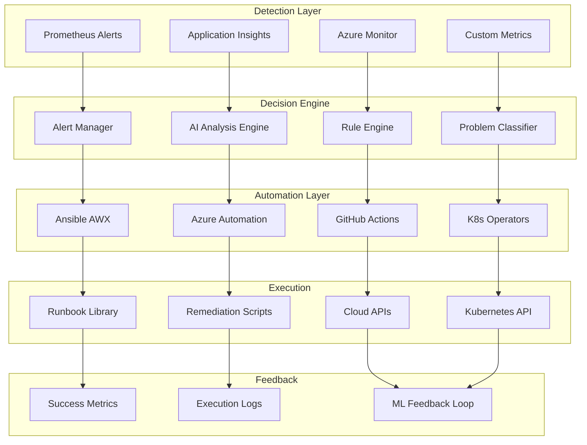

# 🤖 H1-007-K: Runbooks Automatizados

## 📋 Índice

1. [🎯 Visão Geral](#visao-geral)
2. [🏗️ Arquitetura de Automação](#arquitetura-automacao)
3. [🔧 Configuração do Ansible](#configuracao-ansible)
4. [📚 Biblioteca de Runbooks](#biblioteca-runbooks)
5. [🚨 Auto-remediação](#auto-remediacao)
6. [🤖 Integração com AI](#integracao-ai)
7. [📊 Dashboards de Automação](#dashboards-automacao)
8. [🧪 Testes de Runbooks](#testes-runbooks)
9. [📈 Métricas e Relatórios](#metricas-relatorios)
10. [🔄 Evolução Contínua](#evolucao-continua)

## 🎯 Visão Geral {#visao-geral}

Este guia implementa runbooks automatizados que detectam, diagnosticam e resolvem problemas automaticamente, reduzindo MTTR e melhorando a confiabilidade.

### 🎯 Objetivos da Automação

- **MTTR**: < 5 minutos para problemas conhecidos
- **Automação**: 80% dos incidentes resolvidos sem intervenção
- **Precisão**: 95% de taxa de sucesso
- **Aprendizado**: Melhoria contínua com ML

### 🏗️ Stack de Automação

- **Ansible AWX**: Orquestração de runbooks
- **Prometheus**: Detecção de problemas
- **Azure Automation**: Runbooks nativos Azure
- **GitHub Actions**: Workflows automatizados
- **Azure AI**: Análise preditiva

## 🏗️ Arquitetura de Automação {#arquitetura-automacao}

### Diagrama de Fluxo



### Instalação do Sistema de Automação

```bash
#!/bin/bash
# setup/install-automation-stack.sh

set -euo pipefail

log() { echo "[$(date +'%H:%M:%S')] $1"; }

# 1. Instalar Ansible AWX
install_awx() {
    log "📦 Installing Ansible AWX..."
    
    # Create namespace
    kubectl create namespace automation --dry-run=client -o yaml | kubectl apply -f -
    
    # Install AWX Operator
    kubectl apply -f https://raw.githubusercontent.com/ansible/awx-operator/devel/deploy/awx-operator.yaml
    
    # Create AWX instance
    cat <<EOF | kubectl apply -f -
apiVersion: awx.ansible.com/v1beta1
kind: AWX
metadata:
  name: awx
  namespace: automation
spec:
  service_type: LoadBalancer
  ingress_type: ingress
  hostname: awx.demo.threehorizons.io
  
  postgres_configuration_secret: awx-postgres-configuration
  
  extra_volumes: |
    - name: ansible-cfg
      configMap:
        defaultMode: 420
        items:
          - key: ansible.cfg
            path: ansible.cfg
        name: awx-ansible-cfg
        
  ee_extra_volume_mounts: |
    - name: ansible-cfg
      mountPath: /etc/ansible/ansible.cfg
      subPath: ansible.cfg
      
  task_extra_env: |
    - name: ANSIBLE_HOST_KEY_CHECKING
      value: "False"
    - name: AZURE_SUBSCRIPTION_ID
      valueFrom:
        secretKeyRef:
          name: azure-credentials
          key: subscription_id
EOF
    
    log "✅ AWX installed!"
}

# 2. Configurar Azure Automation
setup_azure_automation() {
    log "☁️ Setting up Azure Automation..."
    
    RESOURCE_GROUP="rg-automation"
    AUTOMATION_ACCOUNT="threehorizons-automation"
    
    # Create resource group
    az group create --name $RESOURCE_GROUP --location centralus
    
    # Create automation account
    az automation account create \
        --resource-group $RESOURCE_GROUP \
        --name $AUTOMATION_ACCOUNT \
        --location centralus
    
    # Import modules
    MODULES=("Az.Accounts" "Az.Compute" "Az.Network" "Az.Storage" "Az.KeyVault" "Az.Monitor")
    for module in "${MODULES[@]}"; do
        az automation module create \
            --resource-group $RESOURCE_GROUP \
            --automation-account-name $AUTOMATION_ACCOUNT \
            --name $module \
            --content-link "https://www.powershellgallery.com/api/v2/package/$module"
    done
    
    # Create webhook for alert integration
    WEBHOOK_URI=$(az automation webhook create \
        --resource-group $RESOURCE_GROUP \
        --automation-account-name $AUTOMATION_ACCOUNT \
        --name "alert-webhook" \
        --runbook-name "Handle-Alert" \
        --query uri -o tsv)
    
    echo "Webhook URI: $WEBHOOK_URI"
    
    log "✅ Azure Automation configured!"
}

# 3. Setup Kubernetes Operators
setup_k8s_operators() {
    log "☸️ Setting up Kubernetes Operators..."
    
    # Install Prometheus Operator (if not already installed)
    helm repo add prometheus-community https://prometheus-community.github.io/helm-charts
    helm upgrade --install prometheus prometheus-community/kube-prometheus-stack \
        --namespace monitoring \
        --create-namespace
    
    # Install custom operator for auto-remediation
    kubectl apply -f - <<EOF
apiVersion: v1
kind: Namespace
metadata:
  name: remediation-system
---
apiVersion: apps/v1
kind: Deployment
metadata:
  name: remediation-operator
  namespace: remediation-system
spec:
  replicas: 1
  selector:
    matchLabels:
      app: remediation-operator
  template:
    metadata:
      labels:
        app: remediation-operator
    spec:
      serviceAccountName: remediation-operator
      containers:
      - name: operator
        image: threehorizons/remediation-operator:latest
        env:
        - name: WATCH_NAMESPACE
          value: ""
        - name: ANSIBLE_TOWER_URL
          value: "https://awx.demo.threehorizons.io"
        - name: ANSIBLE_TOWER_TOKEN
          valueFrom:
            secretKeyRef:
              name: awx-token
              key: token
EOF
    
    log "✅ Kubernetes operators configured!"
}

# Main installation
main() {
    log "🤖 Installing Automated Runbook System"
    log "======================================"
    
    install_awx
    setup_azure_automation
    setup_k8s_operators
    
    log "✅ Installation complete!"
}

main "$@"
```

## 🔧 Configuração do Ansible {#configuracao-ansible}

### Ansible AWX Configuration

```yaml
# ansible/awx-config.yaml
---
- name: Configure AWX for Three Horizons
  hosts: localhost
  gather_facts: no
  tasks:
    # Create organization
    - name: Create Three Horizons Organization
      awx.awx.organization:
        name: "Three Horizons"
        description: "Three Horizons AI Platform"
        state: present
      register: org

    # Create credentials
    - name: Create Azure Credential
      awx.awx.credential:
        name: "Azure Service Principal"
        organization: "Three Horizons"
        credential_type: "Microsoft Azure Resource Manager"
        inputs:
          subscription: "{{ azure_subscription_id }}"
          client: "{{ azure_client_id }}"
          secret: "{{ azure_client_secret }}"
          tenant: "{{ azure_tenant_id }}"

    - name: Create Kubernetes Credential
      awx.awx.credential:
        name: "Kubernetes Cluster"
        organization: "Three Horizons"
        credential_type: "Kubernetes/OpenShift API Bearer Token"
        inputs:
          host: "https://kubernetes.default.svc"
          bearer_token: "{{ k8s_token }}"
          verify_ssl: false

    # Create inventories
    - name: Create Dynamic Azure Inventory
      awx.awx.inventory:
        name: "Azure Resources"
        organization: "Three Horizons"
        kind: ""
        variables:
          azure_rm:
            plugin: azure.azcollection.azure_rm
            auth_source: credential
            include_vm_resource_groups:
              - "*"

    - name: Create Kubernetes Inventory
      awx.awx.inventory:
        name: "Kubernetes Clusters"
        organization: "Three Horizons"
        kind: ""

    # Create projects
    - name: Create Runbooks Project
      awx.awx.project:
        name: "Runbooks Library"
        organization: "Three Horizons"
        scm_type: "git"
        scm_url: "https://github.com/three-horizon-ai/runbooks"
        scm_branch: "main"
        scm_update_on_launch: true

    # Create notification templates
    - name: Create Slack Notification
      awx.awx.notification_template:
        name: "Slack Alerts"
        organization: "Three Horizons"
        notification_type: "slack"
        notification_configuration:
          token: "{{ slack_token }}"
          channels: ["#alerts", "#automation"]
```

### Estrutura de Playbooks

```yaml
# ansible/playbooks/auto-scale.yaml
---
- name: Auto Scale Based on Load
  hosts: localhost
  gather_facts: no
  vars:
    threshold_cpu: 80
    threshold_memory: 85
    scale_factor: 1.5
    max_replicas: 20
    
  tasks:
    - name: Get current metrics
      uri:
        url: "http://prometheus:9090/api/v1/query"
        method: GET
        body_format: json
        body:
          query: |
            avg(rate(container_cpu_usage_seconds_total[5m])) by (deployment) * 100
      register: cpu_metrics
      
    - name: Get current replica count
      k8s_info:
        api_version: apps/v1
        kind: Deployment
        namespace: "{{ namespace }}"
        name: "{{ deployment }}"
      register: deployment_info
      
    - name: Calculate new replica count
      set_fact:
        current_replicas: "{{ deployment_info.resources[0].spec.replicas }}"
        new_replicas: "{{ (current_replicas * scale_factor) | int }}"
        
    - name: Scale deployment if needed
      k8s_scale:
        api_version: apps/v1
        kind: Deployment
        name: "{{ deployment }}"
        namespace: "{{ namespace }}"
        replicas: "{{ [new_replicas, max_replicas] | min }}"
      when: cpu_metrics.json.data.result[0].value[1] | float > threshold_cpu
      
    - name: Send notification
      uri:
        url: "{{ slack_webhook }}"
        method: POST
        body_format: json
        body:
          text: |
            🚀 Auto-scaled {{ deployment }} from {{ current_replicas }} to {{ new_replicas }} replicas
            CPU Usage: {{ cpu_metrics.json.data.result[0].value[1] }}%
```

## 📚 Biblioteca de Runbooks {#biblioteca-runbooks}

### Runbook: Pod Recovery

```yaml
# runbooks/pod-recovery.yaml
---
- name: Automated Pod Recovery
  hosts: localhost
  gather_facts: no
  vars:
    problem_types:
      - CrashLoopBackOff
      - ImagePullBackOff
      - OOMKilled
      - Evicted
      
  tasks:
    - name: Identify problematic pods
      k8s_info:
        api_version: v1
        kind: Pod
        namespace: "{{ target_namespace | default('all') }}"
      register: all_pods
      
    - name: Filter pods with issues
      set_fact:
        problem_pods: "{{ all_pods.resources | selectattr('status.phase', 'ne', 'Running') | list }}"
        
    - name: Analyze each problematic pod
      include_tasks: analyze_pod.yaml
      loop: "{{ problem_pods }}"
      loop_control:
        loop_var: pod
        
    - name: Generate report
      template:
        src: pod_recovery_report.j2
        dest: "/tmp/pod_recovery_{{ ansible_date_time.epoch }}.html"
        
    - name: Send report
      mail:
        to: "{{ ops_email }}"
        subject: "Pod Recovery Report - {{ ansible_date_time.date }}"
        body: "{{ lookup('file', '/tmp/pod_recovery_' + ansible_date_time.epoch + '.html') }}"
        subtype: html

# analyze_pod.yaml
---
- name: Analyze pod issue
  set_fact:
    pod_name: "{{ pod.metadata.name }}"
    pod_namespace: "{{ pod.metadata.namespace }}"
    pod_status: "{{ pod.status.phase }}"
    
- name: Get pod events
  k8s_info:
    api_version: v1
    kind: Event
    namespace: "{{ pod_namespace }}"
    field_selectors:
      - involvedObject.name={{ pod_name }}
  register: pod_events
  
- name: Determine root cause
  set_fact:
    root_cause: >-
      
        memory_limit
      
        image_pull
      
        application_crash
      
        unknown
      
      
- name: Apply remediation
  include_tasks: "remediate_{{ root_cause }}.yaml"
  when: root_cause != "unknown"

# remediate_memory_limit.yaml
---
- name: Increase memory limit
  k8s:
    state: present
    definition:
      apiVersion: apps/v1
      kind: Deployment
      metadata:
        name: "{{ pod.metadata.labels.app }}"
        namespace: "{{ pod_namespace }}"
      spec:
        template:
          spec:
            containers:
            - name: "{{ pod.spec.containers[0].name }}"
              resources:
                limits:
                  memory: "{{ (pod.spec.containers[0].resources.limits.memory | regex_replace('Mi', '') | int * 1.5) | int }}Mi"
                requests:
                  memory: "{{ (pod.spec.containers[0].resources.requests.memory | regex_replace('Mi', '') | int * 1.5) | int }}Mi"
                  
- name: Delete failed pod
  k8s:
    name: "{{ pod_name }}"
    namespace: "{{ pod_namespace }}"
    api_version: v1
    kind: Pod
    state: absent
```

### Runbook: Database Performance

```python
#!/usr/bin/env python3
# runbooks/database_performance.py

import psycopg2
import subprocess
import json
from datetime import datetime

class DatabasePerformanceRunbook:
    def __init__(self, connection_string):
        self.conn = psycopg2.connect(connection_string)
        self.issues = []
        self.actions_taken = []
        
    def diagnose(self):
        """Run diagnostic queries"""
        print("🔍 Running database diagnostics...")
        
        # Check slow queries
        self.check_slow_queries()
        
        # Check connection count
        self.check_connections()
        
        # Check table bloat
        self.check_table_bloat()
        
        # Check missing indexes
        self.check_missing_indexes()
        
        return self.issues
        
    def check_slow_queries(self):
        """Identify slow running queries"""
        cur = self.conn.cursor()
        cur.execute("""
            SELECT 
                pid,
                now() - pg_stat_activity.query_start AS duration,
                query,
                state
            FROM pg_stat_activity
            WHERE (now() - pg_stat_activity.query_start) > interval '5 minutes'
            AND state != 'idle'
            ORDER BY duration DESC;
        """)
        
        slow_queries = cur.fetchall()
        if slow_queries:
            self.issues.append({
                'type': 'slow_queries',
                'severity': 'high',
                'count': len(slow_queries),
                'queries': slow_queries[:5]  # Top 5
            })
            
    def check_connections(self):
        """Check connection pool usage"""
        cur = self.conn.cursor()
        cur.execute("""
            SELECT count(*) as total,
                   state,
                   count(*) * 100.0 / (SELECT setting::int FROM pg_settings WHERE name='max_connections') as percentage
            FROM pg_stat_activity
            GROUP BY state;
        """)
        
        connections = cur.fetchall()
        total_connections = sum(row[0] for row in connections)
        
        cur.execute("SELECT setting::int FROM pg_settings WHERE name='max_connections'")
        max_connections = cur.fetchone()[0]
        
        if total_connections > max_connections * 0.8:
            self.issues.append({
                'type': 'high_connection_count',
                'severity': 'critical',
                'current': total_connections,
                'max': max_connections,
                'percentage': (total_connections / max_connections) * 100
            })
            
    def check_table_bloat(self):
        """Check for table bloat"""
        cur = self.conn.cursor()
        cur.execute("""
            SELECT
                schemaname,
                tablename,
                pg_size_pretty(pg_total_relation_size(schemaname||'.'||tablename)) AS total_size,
                pg_size_pretty(pg_relation_size(schemaname||'.'||tablename)) AS table_size,
                ROUND(100 * pg_total_relation_size(schemaname||'.'||tablename) / 
                      NULLIF(pg_relation_size(schemaname||'.'||tablename), 0) - 100, 2) AS bloat_ratio
            FROM pg_tables
            WHERE schemaname NOT IN ('pg_catalog', 'information_schema')
            AND pg_total_relation_size(schemaname||'.'||tablename) > 1048576
            ORDER BY bloat_ratio DESC
            LIMIT 10;
        """)
        
        bloated_tables = cur.fetchall()
        critical_bloat = [t for t in bloated_tables if t[4] and t[4] > 50]
        
        if critical_bloat:
            self.issues.append({
                'type': 'table_bloat',
                'severity': 'medium',
                'tables': critical_bloat
            })
            
    def remediate(self):
        """Apply automatic remediation"""
        print("🔧 Applying remediations...")
        
        for issue in self.issues:
            if issue['type'] == 'slow_queries':
                self.remediate_slow_queries(issue)
            elif issue['type'] == 'high_connection_count':
                self.remediate_connections(issue)
            elif issue['type'] == 'table_bloat':
                self.remediate_bloat(issue)
                
    def remediate_slow_queries(self, issue):
        """Kill long-running queries"""
        if issue['severity'] == 'high':
            cur = self.conn.cursor()
            for query in issue['queries']:
                pid = query[0]
                duration = query[1]
                
                if duration.total_seconds() > 600:  # 10 minutes
                    print(f"Killing query {pid} (running for {duration})")
                    cur.execute(f"SELECT pg_terminate_backend({pid})")
                    self.actions_taken.append({
                        'action': 'kill_query',
                        'pid': pid,
                        'duration': str(duration)
                    })
                    
    def remediate_connections(self, issue):
        """Clean up idle connections"""
        cur = self.conn.cursor()
        cur.execute("""
            SELECT pg_terminate_backend(pid)
            FROM pg_stat_activity
            WHERE state = 'idle'
            AND state_change < current_timestamp - INTERVAL '10 minutes';
        """)
        
        terminated = cur.rowcount
        self.actions_taken.append({
            'action': 'terminate_idle_connections',
            'count': terminated
        })
        
    def remediate_bloat(self, issue):
        """Run VACUUM on bloated tables"""
        cur = self.conn.cursor()
        for table in issue['tables'][:3]:  # Top 3 only
            schema, tablename = table[0], table[1]
            print(f"Running VACUUM ANALYZE on {schema}.{tablename}")
            
            # Note: VACUUM must be run outside transaction
            self.conn.autocommit = True
            cur.execute(f"VACUUM ANALYZE {schema}.{tablename}")
            self.conn.autocommit = False
            
            self.actions_taken.append({
                'action': 'vacuum_table',
                'table': f"{schema}.{tablename}",
                'bloat_ratio': table[4]
            })
            
    def report(self):
        """Generate report"""
        report = {
            'timestamp': datetime.now().isoformat(),
            'issues_found': len(self.issues),
            'actions_taken': len(self.actions_taken),
            'issues': self.issues,
            'remediations': self.actions_taken
        }
        
        # Send to monitoring
        subprocess.run([
            'curl', '-X', 'POST',
            'http://prometheus-pushgateway:9091/metrics/job/db_runbook',
            '--data-binary', f'db_issues_found {len(self.issues)}\ndb_actions_taken {len(self.actions_taken)}'
        ])
        
        return json.dumps(report, indent=2)

if __name__ == "__main__":
    import os
    
    runbook = DatabasePerformanceRunbook(os.environ['DATABASE_URL'])
    runbook.diagnose()
    runbook.remediate()
    print(runbook.report())
```

### Runbook: SSL Certificate Renewal

```yaml
# runbooks/ssl-certificate-renewal.yaml
---
- name: Automated SSL Certificate Renewal
  hosts: localhost
  gather_facts: no
  vars:
    cert_manager_namespace: cert-manager
    days_before_expiry: 30
    
  tasks:
    - name: Get all certificates
      k8s_info:
        api_version: cert-manager.io/v1
        kind: Certificate
        namespace: all
      register: all_certs
      
    - name: Check certificate expiration
      set_fact:
        expiring_certs: []
        
    - name: Identify expiring certificates
      set_fact:
        expiring_certs: "{{ expiring_certs + [item] }}"
      when: 
        - item.status.notAfter is defined
        - (item.status.notAfter | to_datetime('%Y-%m-%dT%H:%M:%SZ') - ansible_date_time.iso8601 | to_datetime('%Y-%m-%dT%H:%M:%S.%fZ')).days < days_before_expiry
      loop: "{{ all_certs.resources }}"
      
    - name: Renew expiring certificates
      k8s:
        state: present
        definition:
          apiVersion: cert-manager.io/v1
          kind: Certificate
          metadata:
            name: "{{ item.metadata.name }}"
            namespace: "{{ item.metadata.namespace }}"
            annotations:
              cert-manager.io/issue-temporary-certificate: "true"
          spec: "{{ item.spec }}"
      loop: "{{ expiring_certs }}"
      
    - name: Force renewal by deleting secret
      k8s:
        api_version: v1
        kind: Secret
        name: "{{ item.spec.secretName }}"
        namespace: "{{ item.metadata.namespace }}"
        state: absent
      loop: "{{ expiring_certs }}"
      
    - name: Wait for new certificates
      k8s_info:
        api_version: cert-manager.io/v1
        kind: Certificate
        name: "{{ item.metadata.name }}"
        namespace: "{{ item.metadata.namespace }}"
        wait: true
        wait_condition:
          type: Ready
          status: "True"
        wait_timeout: 300
      loop: "{{ expiring_certs }}"
      
    - name: Verify new certificates
      k8s_info:
        api_version: v1
        kind: Secret
        name: "{{ item.spec.secretName }}"
        namespace: "{{ item.metadata.namespace }}"
      register: cert_secrets
      loop: "{{ expiring_certs }}"
      
    - name: Send renewal notification
      uri:
        url: "{{ slack_webhook }}"
        method: POST
        body_format: json
        body:
          text: |
            🔐 SSL Certificates Renewed:
            
            - {{ cert.metadata.name }} ({{ cert.metadata.namespace }})
            
            Total: {{ expiring_certs | length }} certificates
```

## 🚨 Auto-remediação {#auto-remediacao}

### Kubernetes Operator para Auto-remediação

```go
// operators/remediation-operator/main.go
package main

import (
    "context"
    "fmt"
    "time"
    
    corev1 "k8s.io/api/core/v1"
    metav1 "k8s.io/apimachinery/pkg/apis/meta/v1"
    "k8s.io/apimachinery/pkg/runtime"
    "k8s.io/client-go/kubernetes"
    "sigs.k8s.io/controller-runtime/pkg/client"
    "sigs.k8s.io/controller-runtime/pkg/controller"
    "sigs.k8s.io/controller-runtime/pkg/handler"
    "sigs.k8s.io/controller-runtime/pkg/manager"
    "sigs.k8s.io/controller-runtime/pkg/reconcile"
    "sigs.k8s.io/controller-runtime/pkg/source"
)

type RemediationReconciler struct {
    client.Client
    Scheme *runtime.Scheme
    ClientSet *kubernetes.Clientset
}

func (r *RemediationReconciler) Reconcile(ctx context.Context, req reconcile.Request) (reconcile.Result, error) {
    // Get the pod
    pod := &corev1.Pod{}
    err := r.Get(ctx, req.NamespacedName, pod)
    if err != nil {
        return reconcile.Result{}, client.IgnoreNotFound(err)
    }
    
    // Check if pod needs remediation
    if needsRemediation(pod) {
        fmt.Printf("Pod %s/%s needs remediation\n", pod.Namespace, pod.Name)
        
        // Determine remediation action
        action := determineAction(pod)
        
        // Execute remediation
        switch action {
        case "restart":
            err = r.restartPod(ctx, pod)
        case "scale":
            err = r.scaleDeployment(ctx, pod)
        case "migrate":
            err = r.migratePod(ctx, pod)
        case "increase_resources":
            err = r.increaseResources(ctx, pod)
        }
        
        if err != nil {
            return reconcile.Result{}, err
        }
        
        // Record remediation
        r.recordRemediation(pod, action)
    }
    
    return reconcile.Result{RequeueAfter: time.Minute}, nil
}

func needsRemediation(pod *corev1.Pod) bool {
    // Check various conditions
    if pod.Status.Phase == corev1.PodFailed {
        return true
    }
    
    // Check container statuses
    for _, cs := range pod.Status.ContainerStatuses {
        if cs.RestartCount > 5 {
            return true
        }
        
        if cs.State.Waiting != nil {
            reason := cs.State.Waiting.Reason
            if reason == "CrashLoopBackOff" || reason == "ImagePullBackOff" {
                return true
            }
        }
        
        if cs.LastTerminationState.Terminated != nil {
            if cs.LastTerminationState.Terminated.Reason == "OOMKilled" {
                return true
            }
        }
    }
    
    return false
}

func determineAction(pod *corev1.Pod) string {
    // Logic to determine best remediation action
    for _, cs := range pod.Status.ContainerStatuses {
        if cs.LastTerminationState.Terminated != nil {
            if cs.LastTerminationState.Terminated.Reason == "OOMKilled" {
                return "increase_resources"
            }
        }
        
        if cs.RestartCount > 10 {
            return "migrate"
        }
    }
    
    return "restart"
}

func (r *RemediationReconciler) restartPod(ctx context.Context, pod *corev1.Pod) error {
    // Delete pod to force restart
    return r.Delete(ctx, pod)
}

func (r *RemediationReconciler) scaleDeployment(ctx context.Context, pod *corev1.Pod) error {
    // Get deployment
    deploymentName := pod.Labels["app"]
    deployment, err := r.ClientSet.AppsV1().Deployments(pod.Namespace).Get(ctx, deploymentName, metav1.GetOptions{})
    if err != nil {
        return err
    }
    
    // Scale up
    replicas := *deployment.Spec.Replicas + 1
    deployment.Spec.Replicas = &replicas
    
    _, err = r.ClientSet.AppsV1().Deployments(pod.Namespace).Update(ctx, deployment, metav1.UpdateOptions{})
    return err
}

func (r *RemediationReconciler) increaseResources(ctx context.Context, pod *corev1.Pod) error {
    // Get deployment
    deploymentName := pod.Labels["app"]
    deployment, err := r.ClientSet.AppsV1().Deployments(pod.Namespace).Get(ctx, deploymentName, metav1.GetOptions{})
    if err != nil {
        return err
    }
    
    // Increase memory limits by 50%
    for i := range deployment.Spec.Template.Spec.Containers {
        container := &deployment.Spec.Template.Spec.Containers[i]
        if container.Resources.Limits != nil {
            memory := container.Resources.Limits.Memory()
            newMemory := memory.Value() * 150 / 100
            container.Resources.Limits["memory"] = *resource.NewQuantity(newMemory, resource.BinarySI)
        }
    }
    
    _, err = r.ClientSet.AppsV1().Deployments(pod.Namespace).Update(ctx, deployment, metav1.UpdateOptions{})
    return err
}
```

### Alert Rules para Auto-remediação

```yaml
# monitoring/auto-remediation-rules.yaml
apiVersion: monitoring.coreos.com/v1
kind: PrometheusRule
metadata:
  name: auto-remediation-rules
  namespace: monitoring
spec:
  groups:
    - name: auto_remediation
      interval: 30s
      rules:
        # Auto-scale on high load
        - alert: AutoScaleOnHighCPU
          expr: |
            avg by (deployment, namespace) (
              rate(container_cpu_usage_seconds_total[5m])
            ) > 0.8
          for: 3m
          labels:
            severity: info
            action: auto_scale
          annotations:
            description: "CPU usage for {{ $labels.deployment }} is above 80%"
            runbook: "ansible-playbook auto-scale.yaml -e deployment={{ $labels.deployment }}"
            
        # Restart on repeated crashes
        - alert: AutoRestartCrashingPod
          expr: |
            rate(kube_pod_container_status_restarts_total[15m]) > 0.5
          for: 5m
          labels:
            severity: warning
            action: auto_restart
          annotations:
            description: "Pod {{ $labels.pod }} is crashing repeatedly"
            runbook: "kubectl delete pod {{ $labels.pod }} -n {{ $labels.namespace }}"
            
        # Clear disk space
        - alert: AutoClearDiskSpace
          expr: |
            (node_filesystem_avail_bytes{mountpoint="/"} / node_filesystem_size_bytes{mountpoint="/"}) < 0.1
          for: 5m
          labels:
            severity: warning
            action: auto_cleanup
          annotations:
            description: "Disk space on {{ $labels.instance }} is below 10%"
            runbook: "ansible-playbook disk-cleanup.yaml -e target={{ $labels.instance }}"
```

## 🤖 Integração com AI {#integracao-ai}

### Azure AI Analysis Engine

```python
#!/usr/bin/env python3
# ai/anomaly_detection.py

import os
import json
import pandas as pd
from datetime import datetime, timedelta
from azure.ai.anomalydetector import AnomalyDetectorClient
from azure.core.credentials import AzureKeyCredential
from prometheus_api_client import PrometheusConnect

class AIAnomalyDetector:
    def __init__(self):
        self.anomaly_client = AnomalyDetectorClient(
            endpoint=os.environ['ANOMALY_DETECTOR_ENDPOINT'],
            credential=AzureKeyCredential(os.environ['ANOMALY_DETECTOR_KEY'])
        )
        self.prometheus = PrometheusConnect(url='http://prometheus:9090')
        
    def detect_anomalies(self, metric_name, lookback_hours=24):
        """Detect anomalies in metrics using Azure AI"""
        
        # Get metric data from Prometheus
        end_time = datetime.now()
        start_time = end_time - timedelta(hours=lookback_hours)
        
        query = f'{metric_name}[{lookback_hours}h]'
        metric_data = self.prometheus.custom_query(query)
        
        # Prepare data for anomaly detection
        series_data = []
        for result in metric_data:
            for value in result['values']:
                series_data.append({
                    'timestamp': datetime.fromtimestamp(value[0]).isoformat(),
                    'value': float(value[1])
                })
        
        # Call anomaly detector
        request = {
            'series': series_data,
            'granularity': 'minutely',
            'maxAnomalyRatio': 0.25,
            'sensitivity': 95
        }
        
        response = self.anomaly_client.detect_entire_series(request)
        
        # Process results
        anomalies = []
        for i, (point, is_anomaly) in enumerate(zip(series_data, response.is_anomaly)):
            if is_anomaly:
                anomalies.append({
                    'timestamp': point['timestamp'],
                    'value': point['value'],
                    'expected_value': response.expected_values[i],
                    'severity': self.calculate_severity(
                        point['value'], 
                        response.expected_values[i]
                    )
                })
        
        return anomalies
    
    def calculate_severity(self, actual, expected):
        """Calculate anomaly severity"""
        deviation = abs(actual - expected) / expected
        
        if deviation > 0.5:
            return 'critical'
        elif deviation > 0.3:
            return 'high'
        elif deviation > 0.1:
            return 'medium'
        else:
            return 'low'
    
    def predict_issues(self):
        """Predict potential issues using ML"""
        
        # Analyze patterns
        patterns = {
            'memory_leak': self.detect_memory_leak_pattern(),
            'traffic_surge': self.predict_traffic_surge(),
            'disk_exhaustion': self.predict_disk_exhaustion(),
            'performance_degradation': self.detect_performance_degradation()
        }
        
        predictions = []
        for issue_type, prediction in patterns.items():
            if prediction['probability'] > 0.7:
                predictions.append({
                    'type': issue_type,
                    'probability': prediction['probability'],
                    'timeframe': prediction['timeframe'],
                    'affected_services': prediction['services'],
                    'recommended_action': self.get_recommended_action(issue_type)
                })
        
        return predictions
    
    def get_recommended_action(self, issue_type):
        """Get AI-recommended action"""
        actions = {
            'memory_leak': {
                'runbook': 'memory-leak-detection.yaml',
                'preventive_action': 'Increase memory limits by 20%',
                'monitoring': 'Enable detailed memory profiling'
            },
            'traffic_surge': {
                'runbook': 'auto-scale-preventive.yaml',
                'preventive_action': 'Pre-scale to handle predicted load',
                'monitoring': 'Alert on traffic patterns'
            },
            'disk_exhaustion': {
                'runbook': 'disk-cleanup-preventive.yaml',
                'preventive_action': 'Clean up logs and temp files',
                'monitoring': 'Set up disk usage alerts at 70%'
            },
            'performance_degradation': {
                'runbook': 'performance-optimization.yaml',
                'preventive_action': 'Analyze query patterns and optimize',
                'monitoring': 'Enable APM detailed tracing'
            }
        }
        
        return actions.get(issue_type, {})

# Integration with runbook system
class AIRunbookOrchestrator:
    def __init__(self):
        self.detector = AIAnomalyDetector()
        self.awx_client = AWXClient()
        
    def run_continuous_analysis(self):
        """Continuous AI analysis and remediation"""
        
        while True:
            try:
                # Detect anomalies
                anomalies = self.detector.detect_anomalies('http_request_duration_seconds')
                
                # Predict issues
                predictions = self.detector.predict_issues()
                
                # Trigger preventive actions
                for prediction in predictions:
                    if prediction['probability'] > 0.8:
                        self.trigger_preventive_action(prediction)
                
                # Handle current anomalies
                for anomaly in anomalies:
                    if anomaly['severity'] in ['critical', 'high']:
                        self.trigger_remediation(anomaly)
                
                # Wait before next analysis
                time.sleep(300)  # 5 minutes
                
            except Exception as e:
                print(f"Error in AI analysis: {e}")
                time.sleep(60)
    
    def trigger_preventive_action(self, prediction):
        """Trigger preventive runbook"""
        
        job_template = prediction['recommended_action']['runbook']
        
        job = self.awx_client.launch_job(
            job_template=job_template,
            extra_vars={
                'prediction': prediction,
                'automated': True,
                'triggered_by': 'ai_prediction'
            }
        )
        
        # Log the action
        self.log_ai_action({
            'type': 'preventive',
            'prediction': prediction,
            'job_id': job['id'],
            'timestamp': datetime.now().isoformat()
        })
```

## 📊 Dashboards de Automação {#dashboards-automacao}

### Dashboard de Runbooks

```json
{
  "dashboard": {
    "title": "Automated Runbooks Dashboard",
    "panels": [
      {
        "title": "Runbook Executions (24h)",
        "type": "stat",
        "targets": [{
          "expr": "sum(increase(runbook_executions_total[24h]))"
        }]
      },
      {
        "title": "Success Rate",
        "type": "gauge",
        "targets": [{
          "expr": "sum(rate(runbook_executions_total{status=\"success\"}[1h])) / sum(rate(runbook_executions_total[1h])) * 100"
        }]
      },
      {
        "title": "Auto-Remediation Triggers",
        "type": "graph",
        "targets": [{
          "expr": "sum by (runbook) (increase(runbook_executions_total[1h]))"
        }]
      },
      {
        "title": "MTTR by Issue Type",
        "type": "table",
        "targets": [{
          "expr": "avg by (issue_type) (runbook_resolution_time_seconds)"
        }]
      },
      {
        "title": "AI Predictions Accuracy",
        "type": "timeseries",
        "targets": [{
          "expr": "ai_prediction_accuracy_percentage"
        }]
      },
      {
        "title": "Prevented Incidents",
        "type": "stat",
        "targets": [{
          "expr": "sum(increase(incidents_prevented_total[7d]))"
        }]
      }
    ]
  }
}
```

### Automation Metrics

```yaml
# monitoring/automation-metrics.yaml
apiVersion: v1
kind: ConfigMap
metadata:
  name: automation-metrics
  namespace: monitoring
data:
  metrics.yaml: |
    # Runbook metrics
    - name: runbook_executions_total
      help: Total number of runbook executions
      type: counter
      labels:
        - runbook
        - trigger_type
        - status
        
    - name: runbook_execution_duration_seconds
      help: Duration of runbook execution
      type: histogram
      labels:
        - runbook
        
    - name: runbook_resolution_time_seconds
      help: Time to resolve issue
      type: histogram
      labels:
        - issue_type
        - runbook
        
    - name: auto_remediation_success_rate
      help: Success rate of auto-remediation
      type: gauge
      labels:
        - issue_type
        
    # AI metrics
    - name: ai_anomalies_detected_total
      help: Total anomalies detected by AI
      type: counter
      labels:
        - severity
        - service
        
    - name: ai_predictions_total
      help: Total predictions made by AI
      type: counter
      labels:
        - prediction_type
        - confidence_level
        
    - name: ai_prediction_accuracy_percentage
      help: Accuracy of AI predictions
      type: gauge
      labels:
        - prediction_type
        
    - name: incidents_prevented_total
      help: Incidents prevented by proactive action
      type: counter
      labels:
        - prevention_type
```

## 🧪 Testes de Runbooks {#testes-runbooks}

### Framework de Testes

```python
#!/usr/bin/env python3
# tests/test_runbooks.py

import pytest
import yaml
import subprocess
from unittest.mock import Mock, patch
import kubernetes
from datetime import datetime

class TestRunbooks:
    
    @pytest.fixture
    def mock_k8s_client(self):
        """Mock Kubernetes client"""
        client = Mock()
        return client
    
    @pytest.fixture
    def test_environment(self):
        """Setup test environment"""
        return {
            'namespace': 'test-automation',
            'dry_run': True,
            'mock_alerts': True
        }
    
    def test_pod_recovery_runbook(self, mock_k8s_client, test_environment):
        """Test pod recovery runbook"""
        
        # Mock problematic pod
        mock_pod = {
            'metadata': {
                'name': 'test-pod',
                'namespace': 'test-automation'
            },
            'status': {
                'phase': 'Failed',
                'containerStatuses': [{
                    'state': {
                        'terminated': {
                            'reason': 'OOMKilled'
                        }
                    }
                }]
            },
            'spec': {
                'containers': [{
                    'name': 'app',
                    'resources': {
                        'limits': {'memory': '512Mi'},
                        'requests': {'memory': '256Mi'}
                    }
                }]
            }
        }
        
        # Run runbook
        result = run_ansible_playbook(
            'runbooks/pod-recovery.yaml',
            extra_vars={
                'target_namespace': test_environment['namespace'],
                'dry_run': True
            }
        )
        
        # Assertions
        assert result['status'] == 'success'
        assert 'memory_limit' in result['root_cause_detected']
        assert result['actions_taken'][0]['type'] == 'increase_memory'
        assert '768Mi' in result['actions_taken'][0]['new_limit']
    
    def test_database_performance_runbook(self):
        """Test database performance runbook"""
        
        with patch('psycopg2.connect') as mock_connect:
            # Mock database connection
            mock_conn = Mock()
            mock_cursor = Mock()
            mock_connect.return_value = mock_conn
            mock_conn.cursor.return_value = mock_cursor
            
            # Mock slow queries
            mock_cursor.fetchall.return_value = [
                (123, '00:15:00', 'SELECT * FROM large_table', 'active'),
                (456, '00:20:00', 'UPDATE users SET ...', 'active')
            ]
            
            # Run runbook
            from runbooks.database_performance import DatabasePerformanceRunbook
            runbook = DatabasePerformanceRunbook('mock://connection')
            runbook.diagnose()
            runbook.remediate()
            
            # Assertions
            assert len(runbook.issues) > 0
            assert runbook.issues[0]['type'] == 'slow_queries'
            assert len(runbook.actions_taken) > 0
            assert runbook.actions_taken[0]['action'] == 'kill_query'
    
    def test_ssl_renewal_runbook(self, mock_k8s_client):
        """Test SSL certificate renewal runbook"""
        
        # Mock expiring certificate
        mock_cert = {
            'metadata': {
                'name': 'test-cert',
                'namespace': 'default'
            },
            'status': {
                'notAfter': '2024-02-01T00:00:00Z'  # Expires soon
            },
            'spec': {
                'secretName': 'test-cert-secret',
                'dnsNames': ['test.example.com']
            }
        }
        
        with patch('kubernetes.client.CustomObjectsApi') as mock_api:
            mock_api.list_cluster_custom_object.return_value = {
                'items': [mock_cert]
            }
            
            # Run runbook
            result = run_ansible_playbook(
                'runbooks/ssl-certificate-renewal.yaml',
                extra_vars={
                    'days_before_expiry': 30,
                    'dry_run': True
                }
            )
            
            # Assertions
            assert result['status'] == 'success'
            assert len(result['renewed_certificates']) == 1
            assert result['renewed_certificates'][0] == 'test-cert'

def run_ansible_playbook(playbook_path, extra_vars=None):
    """Helper to run ansible playbook"""
    
    cmd = ['ansible-playbook', playbook_path]
    
    if extra_vars:
        cmd.extend(['-e', yaml.dump(extra_vars)])
    
    # Add check mode for tests
    cmd.append('--check')
    
    result = subprocess.run(cmd, capture_output=True, text=True)
    
    return {
        'status': 'success' if result.returncode == 0 else 'failed',
        'stdout': result.stdout,
        'stderr': result.stderr
    }

# Chaos testing for runbooks
class ChaosTestRunbooks:
    
    def test_runbook_under_load(self):
        """Test runbook performance under high load"""
        
        # Simulate multiple simultaneous issues
        issues = []
        for i in range(50):
            issues.append({
                'type': 'pod_crash',
                'pod': f'test-pod-{i}',
                'namespace': 'chaos-test'
            })
        
        # Trigger runbooks concurrently
        import concurrent.futures
        
        with concurrent.futures.ThreadPoolExecutor(max_workers=10) as executor:
            futures = []
            for issue in issues:
                future = executor.submit(
                    trigger_runbook,
                    'pod-recovery',
                    issue
                )
                futures.append(future)
            
            # Wait for completion
            results = [f.result() for f in futures]
        
        # Verify results
        successful = sum(1 for r in results if r['status'] == 'success')
        assert successful >= len(issues) * 0.95  # 95% success rate
        
        # Check execution time
        avg_time = sum(r['duration'] for r in results) / len(results)
        assert avg_time < 60  # Less than 1 minute average

def trigger_runbook(runbook_name, parameters):
    """Trigger a runbook and return result"""
    
    start_time = datetime.now()
    
    # Simulate runbook execution
    # In real implementation, this would call AWX API
    
    result = {
        'status': 'success',
        'duration': (datetime.now() - start_time).total_seconds(),
        'runbook': runbook_name,
        'parameters': parameters
    }
    
    return result
```

### Integration Tests

```yaml
# tests/integration/test-automation-stack.yaml
---
- name: Test Automation Stack Integration
  hosts: localhost
  gather_facts: no
  tasks:
    # Test Prometheus alerts trigger runbooks
    - name: Create test alert
      uri:
        url: http://prometheus:9090/api/v1/alerts
        method: POST
        body_format: json
        body:
          alerts:
            - labels:
                alertname: TestHighCPU
                severity: warning
                namespace: test
                deployment: test-app
      register: alert_result
      
    - name: Wait for runbook trigger
      pause:
        seconds: 30
        
    - name: Check if runbook was triggered
      uri:
        url: http://awx:8080/api/v2/jobs/
        method: GET
        headers:
          Authorization: "Bearer {{ awx_token }}"
      register: jobs
      
    - name: Verify runbook execution
      assert:
        that:
          - jobs.json.results | selectattr('name', 'match', 'auto-scale') | list | length > 0
        fail_msg: "Runbook was not triggered by alert"
        
    # Test AI predictions trigger preventive actions
    - name: Simulate anomaly for AI detection
      shell: |
        # Generate anomalous metric data
        for i in {1..100}; do
          curl -X POST http://prometheus-pushgateway:9091/metrics/job/test_anomaly \
            --data-binary "test_metric $((RANDOM % 1000 + 5000))"
          sleep 1
        done
      async: 120
      poll: 0
      
    - name: Wait for AI analysis
      pause:
        seconds: 60
        
    - name: Check AI predictions
      uri:
        url: http://ai-service:8080/api/predictions
        method: GET
      register: predictions
      
    - name: Verify preventive action triggered
      assert:
        that:
          - predictions.json.predictions | length > 0
          - predictions.json.predictions[0].probability > 0.7
```

## 📈 Métricas e Relatórios {#metricas-relatorios}

### Relatório de Automação

```python
#!/usr/bin/env python3
# reporting/automation_report.py

import pandas as pd
import matplotlib.pyplot as plt
import seaborn as sns
from datetime import datetime, timedelta
from prometheus_api_client import PrometheusConnect
import smtplib
from email.mime.multipart import MIMEMultipart
from email.mime.text import MIMEText
from email.mime.image import MIMEImage

class AutomationReporter:
    def __init__(self):
        self.prometheus = PrometheusConnect(url='http://prometheus:9090')
        self.report_data = {}
        
    def generate_weekly_report(self):
        """Generate weekly automation report"""
        
        end_time = datetime.now()
        start_time = end_time - timedelta(days=7)
        
        # Collect metrics
        self.report_data['total_executions'] = self.get_metric(
            'sum(increase(runbook_executions_total[7d]))'
        )
        
        self.report_data['success_rate'] = self.get_metric(
            'sum(increase(runbook_executions_total{status="success"}[7d])) / sum(increase(runbook_executions_total[7d])) * 100'
        )
        
        self.report_data['mttr_by_type'] = self.get_metric(
            'avg by (issue_type) (runbook_resolution_time_seconds[7d])'
        )
        
        self.report_data['incidents_prevented'] = self.get_metric(
            'sum(increase(incidents_prevented_total[7d]))'
        )
        
        self.report_data['top_runbooks'] = self.get_metric(
            'topk(10, sum by (runbook) (increase(runbook_executions_total[7d])))'
        )
        
        # Generate visualizations
        self.create_visualizations()
        
        # Create HTML report
        html_report = self.create_html_report()
        
        # Send report
        self.send_report(html_report)
        
    def create_visualizations(self):
        """Create charts for report"""
        
        # Success rate over time
        plt.figure(figsize=(10, 6))
        success_data = self.get_time_series(
            'sum(rate(runbook_executions_total{status="success"}[1h])) / sum(rate(runbook_executions_total[1h])) * 100',
            days=7
        )
        plt.plot(success_data.index, success_data.values)
        plt.title('Runbook Success Rate Over Time')
        plt.ylabel('Success Rate (%)')
        plt.xlabel('Date')
        plt.savefig('/tmp/success_rate.png')
        plt.close()
        
        # MTTR by issue type
        plt.figure(figsize=(10, 6))
        mttr_data = pd.DataFrame(self.report_data['mttr_by_type'])
        mttr_data.plot(kind='bar')
        plt.title('Mean Time to Resolution by Issue Type')
        plt.ylabel('Time (seconds)')
        plt.xlabel('Issue Type')
        plt.savefig('/tmp/mttr_by_type.png')
        plt.close()
        
        # Top runbooks
        plt.figure(figsize=(10, 6))
        top_runbooks = pd.DataFrame(self.report_data['top_runbooks'])
        top_runbooks.plot(kind='horizontal_bar')
        plt.title('Top 10 Most Executed Runbooks')
        plt.xlabel('Executions')
        plt.savefig('/tmp/top_runbooks.png')
        plt.close()
        
    def create_html_report(self):
        """Create HTML report"""
        
        html = f"""
        <html>
        <head>
            <style>
                body {{ font-family: Arial, sans-serif; margin: 20px; }}
                h1 {{ color: #333; }}
                .metric {{ 
                    display: inline-block; 
                    padding: 20px; 
                    margin: 10px;
                    background: #f0f0f0;
                    border-radius: 5px;
                }}
                .metric-value {{ 
                    font-size: 2em; 
                    font-weight: bold; 
                    color: #007bff;
                }}
                img {{ max-width: 100%; height: auto; }}
            </style>
        </head>
        <body>
            <h1>🤖 Weekly Automation Report</h1>
            <p>Report Period: {datetime.now() - timedelta(days=7)} to {datetime.now()}</p>
            
            <h2>📊 Key Metrics</h2>
            
            <div class="metric">
                <div>Total Runbook Executions</div>
                <div class="metric-value">{self.report_data['total_executions']}</div>
            </div>
            
            <div class="metric">
                <div>Success Rate</div>
                <div class="metric-value">{self.report_data['success_rate']:.1f}%</div>
            </div>
            
            <div class="metric">
                <div>Incidents Prevented</div>
                <div class="metric-value">{self.report_data['incidents_prevented']}</div>
            </div>
            
            <h2>📈 Trends</h2>
            
            
            <h2>⏱️ Resolution Times</h2>
            
            
            <h2>🏆 Top Runbooks</h2>
            
            
            <h2>💡 Insights</h2>
            <ul>
                <li>Automation prevented an estimated {self.report_data['incidents_prevented'] * 30} minutes of downtime</li>
                <li>Most common issue type: {self.get_most_common_issue()}</li>
                <li>Average resolution time improved by {self.calculate_improvement()}%</li>
            </ul>
            
            <h2>🎯 Recommendations</h2>
            <ul>
                <li>Consider adding runbooks for: {self.suggest_new_runbooks()}</li>
                <li>Optimize runbooks with low success rates</li>
                <li>Increase AI prediction threshold for better accuracy</li>
            </ul>
        </body>
        </html>
        """
        
        return html
```

## 🔄 Evolução Contínua {#evolucao-continua}

### Machine Learning para Runbooks

```python
#!/usr/bin/env python3
# ml/runbook_optimizer.py

import pandas as pd
import numpy as np
from sklearn.ensemble import RandomForestClassifier
from sklearn.model_selection import train_test_split
import joblib

class RunbookOptimizer:
    def __init__(self):
        self.model = None
        self.feature_importance = None
        
    def train_model(self, historical_data):
        """Train ML model on historical runbook executions"""
        
        # Prepare features
        features = self.extract_features(historical_data)
        
        # Labels: success/failure
        labels = historical_data['success'].astype(int)
        
        # Split data
        X_train, X_test, y_train, y_test = train_test_split(
            features, labels, test_size=0.2, random_state=42
        )
        
        # Train model
        self.model = RandomForestClassifier(n_estimators=100, random_state=42)
        self.model.fit(X_train, y_train)
        
        # Feature importance
        self.feature_importance = pd.DataFrame({
            'feature': features.columns,
            'importance': self.model.feature_importances_
        }).sort_values('importance', ascending=False)
        
        # Save model
        joblib.dump(self.model, 'models/runbook_optimizer.pkl')
        
        return self.model.score(X_test, y_test)
    
    def predict_success(self, issue_context):
        """Predict runbook success probability"""
        
        features = self.extract_features_from_context(issue_context)
        probability = self.model.predict_proba(features)[0][1]
        
        return {
            'success_probability': probability,
            'recommended_runbook': self.recommend_runbook(issue_context, probability),
            'optimization_suggestions': self.suggest_optimizations(issue_context)
        }
    
    def recommend_runbook(self, context, success_prob):
        """Recommend best runbook for the situation"""
        
        if success_prob < 0.7:
            # Low success probability, recommend alternative
            return self.find_alternative_runbook(context)
        
        return context['default_runbook']
    
    def suggest_optimizations(self, context):
        """Suggest runbook optimizations"""
        
        suggestions = []
        
        # Based on feature importance
        for feature, importance in self.feature_importance.head(5).values:
            if context.get(feature) is not None:
                suggestions.append({
                    'feature': feature,
                    'current_value': context[feature],
                    'optimal_range': self.get_optimal_range(feature),
                    'impact': importance
                })
        
        return suggestions

# Continuous improvement loop
class ContinuousImprovement:
    def __init__(self):
        self.optimizer = RunbookOptimizer()
        self.feedback_loop = FeedbackLoop()
        
    def run_improvement_cycle(self):
        """Run continuous improvement cycle"""
        
        # Collect execution data
        execution_data = self.collect_execution_data()
        
        # Train/update model
        accuracy = self.optimizer.train_model(execution_data)
        print(f"Model accuracy: {accuracy:.2%}")
        
        # Analyze failures
        failures = execution_data[execution_data['success'] == False]
        
        for _, failure in failures.iterrows():
            # Generate improvement
            improvement = self.generate_improvement(failure)
            
            # Test improvement
            if self.test_improvement(improvement):
                # Deploy improvement
                self.deploy_improvement(improvement)
                
                # Track results
                self.feedback_loop.track_improvement(improvement)
```

---

## 📋 Checklist de Implementação

### Setup Inicial
- [ ] Ansible AWX instalado
- [ ] Azure Automation configurado
- [ ] Kubernetes operators deployados
- [ ] Integração com Prometheus
- [ ] AI services configurados

### Runbooks Básicos
- [ ] Pod recovery
- [ ] Database performance
- [ ] SSL renewal
- [ ] Disk cleanup
- [ ] Auto-scaling

### Automação Avançada
- [ ] AI anomaly detection
- [ ] Predictive remediation
- [ ] ML optimization
- [ ] Feedback loop
- [ ] Continuous improvement

### Monitoramento
- [ ] Dashboards criados
- [ ] Métricas configuradas
- [ ] Alertas definidos
- [ ] Relatórios automatizados
- [ ] Success tracking