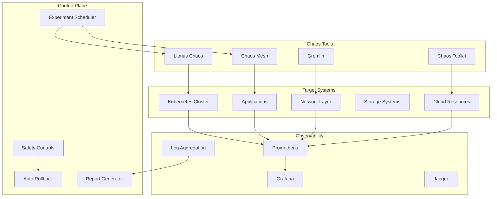

# 🌪️ H1-007-L: Implementação de Chaos Engineering

## 📋 Índice

1. [🎯 Visão Geral](#visao-geral)
2. [🏗️ Arquitetura Chaos](#arquitetura-chaos)
3. [🔧 Instalação do Chaos Toolkit](#instalacao-toolkit)
4. [📚 Biblioteca de Experimentos](#biblioteca-experimentos)
5. [🎮 Game Days](#game-days)
6. [🤖 Chaos Automatizado](#chaos-automatizado)
7. [📊 Métricas de Resiliência](#metricas-resiliencia)
8. [🛡️ Segurança e Controles](#seguranca-controles)
9. [📈 Evolução da Resiliência](#evolucao-resiliencia)
10. [🎓 Treinamento e Cultura](#treinamento-cultura)

## 🎯 Visão Geral {#visao-geral}

Este guia implementa práticas de Chaos Engineering para testar e melhorar continuamente a resiliência do Three Horizons AI Platform.

### 🎯 Objetivos do Chaos Engineering

- **Descobrir fraquezas** antes que causem problemas em produção
- **Construir confiança** na capacidade do sistema de resistir a falhas
- **Melhorar a resiliência** através de testes controlados
- **Criar cultura** de preparação para falhas

### 🌟 Princípios

1. **Começar pequeno**: Experimentos simples primeiro
2. **Minimizar blast radius**: Controlar o impacto
3. **Executar em produção**: Testar o ambiente real
4. **Automatizar experimentos**: Testes contínuos
5. **Aprender sempre**: Cada falha é uma oportunidade

## 🏗️ Arquitetura Chaos {#arquitetura-chaos}

### Stack de Chaos Engineering



### Instalação da Stack Completa

```bash
#!/bin/bash
# chaos/install-chaos-stack.sh

set -euo pipefail

log() { echo "[$(date +'%H:%M:%S')] $1"; }

# 1. Instalar Litmus Chaos
install_litmus() {
    log "🌪️ Installing Litmus Chaos..."
    
    # Add Litmus Helm repo
    helm repo add litmus https://litmuschaos.github.io/litmus-helm/
    helm repo update
    
    # Create namespace
    kubectl create namespace litmus --dry-run=client -o yaml | kubectl apply -f -
    
    # Install Litmus
    helm install litmus litmus/litmus \
        --namespace litmus \
        --set portal.frontend.service.type=LoadBalancer \
        --set portal.server.service.type=LoadBalancer \
        --set mongodb.enabled=true \
        --set mongodb.auth.enabled=false
    
    # Wait for pods
    kubectl wait --for=condition=ready pod -l app.kubernetes.io/instance=litmus -n litmus --timeout=300s
    
    log "✅ Litmus Chaos installed!"
}

# 2. Instalar Chaos Mesh
install_chaos_mesh() {
    log "🌀 Installing Chaos Mesh..."
    
    # Add Chaos Mesh Helm repo
    helm repo add chaos-mesh https://charts.chaos-mesh.org
    helm repo update
    
    # Create namespace
    kubectl create namespace chaos-mesh --dry-run=client -o yaml | kubectl apply -f -
    
    # Install Chaos Mesh
    helm install chaos-mesh chaos-mesh/chaos-mesh \
        --namespace chaos-mesh \
        --set dashboard.enabled=true \
        --set dashboard.service.type=LoadBalancer \
        --set chaosDaemon.runtime=containerd \
        --set chaosDaemon.socketPath=/run/containerd/containerd.sock
    
    log "✅ Chaos Mesh installed!"
}

# 3. Instalar Chaos Toolkit
install_chaos_toolkit() {
    log "🔧 Installing Chaos Toolkit..."
    
    # Create deployment for Chaos Toolkit
    cat <<EOF | kubectl apply -f -
apiVersion: v1
kind: Namespace
metadata:
  name: chaos-toolkit
---
apiVersion: apps/v1
kind: Deployment
metadata:
  name: chaos-toolkit
  namespace: chaos-toolkit
spec:
  replicas: 1
  selector:
    matchLabels:
      app: chaos-toolkit
  template:
    metadata:
      labels:
        app: chaos-toolkit
    spec:
      serviceAccountName: chaos-toolkit
      containers:
      - name: toolkit
        image: chaostoolkit/chaostoolkit:latest
        command: ["/bin/sh"]
        args: ["-c", "while true; do sleep 30; done"]
        env:
        - name: CHAOSTOOLKIT_IN_POD
          value: "true"
        volumeMounts:
        - name: experiments
          mountPath: /experiments
        - name: settings
          mountPath: /root/.chaostoolkit
      volumes:
      - name: experiments
        configMap:
          name: chaos-experiments
      - name: settings
        secret:
          secretName: chaostoolkit-settings
---
apiVersion: v1
kind: ServiceAccount
metadata:
  name: chaos-toolkit
  namespace: chaos-toolkit
---
apiVersion: rbac.authorization.k8s.io/v1
kind: ClusterRoleBinding
metadata:
  name: chaos-toolkit
roleRef:
  apiGroup: rbac.authorization.k8s.io
  kind: ClusterRole
  name: cluster-admin
subjects:
- kind: ServiceAccount
  name: chaos-toolkit
  namespace: chaos-toolkit
EOF
    
    log "✅ Chaos Toolkit installed!"
}

# 4. Configurar Safety Controls
setup_safety_controls() {
    log "🛡️ Setting up safety controls..."
    
    cat <<EOF | kubectl apply -f -
apiVersion: v1
kind: ConfigMap
metadata:
  name: chaos-safety-rules
  namespace: chaos-mesh
data:
  rules.yaml: |
    # Safety rules for chaos experiments
    rules:
      # Never target production critical services
      - name: protect-critical-services
        selector:
          namespaces:
            - kube-system
            - monitoring
            - cert-manager
        action: deny
        
      # Limit blast radius
      - name: limit-blast-radius
        maxTargets: 3
        maxDuration: 600  # 10 minutes max
        
      # Time-based restrictions
      - name: business-hours-only
        schedule:
          weekdays: ["mon", "tue", "wed", "thu", "fri"]
          hours: ["09:00-17:00"]
        environments: ["production"]
        
      # Automatic rollback conditions
      - name: auto-rollback
        conditions:
          - metric: error_rate
            threshold: 0.1  # 10% error rate
          - metric: latency_p99
            threshold: 1000  # 1 second
          - metric: availability
            threshold: 0.99  # 99%
EOF
    
    log "✅ Safety controls configured!"
}

# Main installation
main() {
    log "🌪️ Installing Chaos Engineering Stack"
    log "===================================="
    
    install_litmus
    install_chaos_mesh
    install_chaos_toolkit
    setup_safety_controls
    
    log "✅ Chaos Engineering stack ready!"
    
    # Get access URLs
    LITMUS_URL=$(kubectl get svc litmusportal-frontend -n litmus -o jsonpath='{.status.loadBalancer.ingress[0].ip}')
    CHAOS_MESH_URL=$(kubectl get svc chaos-dashboard -n chaos-mesh -o jsonpath='{.status.loadBalancer.ingress[0].ip}')
    
    log "🔗 Access URLs:"
    log "  Litmus Portal: http://$LITMUS_URL:9091"
    log "  Chaos Mesh Dashboard: http://$CHAOS_MESH_URL:2333"
}

main "$@"
```

## 🔧 Instalação do Chaos Toolkit {#instalacao-toolkit}

### Configuração do Chaos Toolkit

```python
# chaos/chaostoolkit-settings.py
"""Chaos Toolkit settings for Three Horizons"""

import os

# Kubernetes configuration
KUBERNETES_CONTEXT = os.environ.get("K8S_CONTEXT", "threehorizons-aks")

# Azure configuration
AZURE_SUBSCRIPTION_ID = os.environ.get("AZURE_SUBSCRIPTION_ID")
AZURE_TENANT_ID = os.environ.get("AZURE_TENANT_ID")
AZURE_CLIENT_ID = os.environ.get("AZURE_CLIENT_ID")
AZURE_CLIENT_SECRET = os.environ.get("AZURE_CLIENT_SECRET")

# Experiment defaults
DEFAULT_STEADY_STATE_TOLERANCE = {
    "type": "probe",
    "name": "service-is-healthy",
    "tolerance": {
        "type": "http",
        "status": 200,
        "timeout": 5
    }
}

# Safety controls
SAFETY_CONTROLS = {
    "max_duration": 600,  # 10 minutes
    "rollback_on_error": True,
    "dry_run_first": True,
    "require_approval": ["production"],
    "excluded_namespaces": ["kube-system", "monitoring", "cert-manager"],
    "excluded_services": ["database", "payment-gateway"]
}

# Notifications
NOTIFICATIONS = {
    "slack": {
        "webhook_url": os.environ.get("SLACK_WEBHOOK_URL"),
        "channel": "#chaos-engineering"
    },
    "email": {
        "smtp_host": "smtp.sendgrid.net",
        "smtp_port": 587,
        "from": "chaos@threehorizons.io",
        "to": ["sre@threehorizons.io"]
    }
}

# Reporting
REPORTING = {
    "prometheus_pushgateway": "http://prometheus-pushgateway:9091",
    "elasticsearch": "http://elasticsearch:9200",
    "report_bucket": "chaos-engineering-reports"
}
```

### Extensões Customizadas

```python
# chaos/extensions/custom_probes.py
"""Custom probes for Three Horizons chaos experiments"""

import requests
import time
from chaoslib.types import Configuration, Secrets
from typing import Dict, Any

def probe_business_metrics(
    metric_name: str,
    threshold: float,
    configuration: Configuration = None,
    secrets: Secrets = None
) -> Dict[str, Any]:
    """Probe business metrics during chaos experiments"""
    
    prometheus_url = configuration.get("prometheus_url", "http://prometheus:9090")
    
    # Query Prometheus
    response = requests.get(
        f"{prometheus_url}/api/v1/query",
        params={"query": metric_name}
    )
    
    result = response.json()
    
    if result["status"] != "success":
        return {
            "status": "failed",
            "reason": "Failed to query metrics"
        }
    
    current_value = float(result["data"]["result"][0]["value"][1])
    
    return {
        "status": "healthy" if current_value >= threshold else "unhealthy",
        "metric": metric_name,
        "value": current_value,
        "threshold": threshold
    }

def probe_slo_compliance(
    slo_name: str,
    configuration: Configuration = None,
    secrets: Secrets = None
) -> Dict[str, Any]:
    """Check if SLOs are being met during chaos"""
    
    slos = {
        "availability": {
            "query": '1 - (sum(rate(http_requests_total{status=~"5.."}[5m])) / sum(rate(http_requests_total[5m])))',
            "threshold": 0.999
        },
        "latency": {
            "query": 'histogram_quantile(0.95, rate(http_request_duration_seconds_bucket[5m]))',
            "threshold": 1.0
        }
    }
    
    slo_config = slos.get(slo_name)
    if not slo_config:
        return {"status": "failed", "reason": f"Unknown SLO: {slo_name}"}
    
    return probe_business_metrics(
        slo_config["query"],
        slo_config["threshold"],
        configuration,
        secrets
    )

def action_gradual_traffic_shift(
    service: str,
    namespace: str,
    percentage: int,
    duration: int = 60,
    configuration: Configuration = None,
    secrets: Secrets = None
) -> Dict[str, Any]:
    """Gradually shift traffic to test canary behavior"""
    
    from kubernetes import client, config
    
    config.load_incluster_config()
    v1 = client.CoreV1Api()
    
    # Get service
    svc = v1.read_namespaced_service(service, namespace)
    
    # Implement gradual traffic shift
    original_selector = svc.spec.selector.copy()
    
    # Add canary selector
    svc.spec.selector["version"] = "canary"
    v1.patch_namespaced_service(service, namespace, svc)
    
    # Wait and monitor
    time.sleep(duration)
    
    # Restore original selector
    svc.spec.selector = original_selector
    v1.patch_namespaced_service(service, namespace, svc)
    
    return {
        "status": "completed",
        "service": service,
        "traffic_percentage": percentage,
        "duration": duration
    }
```

## 📚 Biblioteca de Experimentos {#biblioteca-experimentos}

### Experimento: Pod Failure

```json
{
  "version": "1.0.0",
  "title": "Pod Failure Resilience Test",
  "description": "Test system resilience when pods fail unexpectedly",
  "tags": ["kubernetes", "pod", "availability"],
  
  "steady-state-hypothesis": {
    "title": "System remains available",
    "probes": [
      {
        "type": "probe",
        "name": "api-gateway-healthy",
        "provider": {
          "type": "http",
          "url": "http://api-gateway.ecommerce-prod/health",
          "timeout": 5
        }
      },
      {
        "type": "probe",
        "name": "frontend-accessible",
        "provider": {
          "type": "http",
          "url": "http://frontend-portal.ecommerce-prod",
          "timeout": 5
        }
      },
      {
        "type": "python",
        "name": "error-rate-acceptable",
        "provider": {
          "module": "custom_probes",
          "func": "probe_business_metrics",
          "arguments": {
            "metric_name": "http_requests_error_rate",
            "threshold": 0.05
          }
        }
      }
    ]
  },
  
  "method": [
    {
      "type": "action",
      "name": "kill-api-gateway-pod",
      "provider": {
        "type": "kubernetes",
        "module": "chaosk8s.pod.actions",
        "func": "terminate_pods",
        "arguments": {
          "label_selector": "app=api-gateway",
          "namespace": "ecommerce-prod",
          "qty": 1,
          "grace_period": 0
        }
      }
    },
    {
      "type": "probe",
      "name": "wait-for-recovery",
      "provider": {
        "type": "python",
        "module": "time",
        "func": "sleep",
        "arguments": {
          "seconds": 30
        }
      }
    }
  ],
  
  "rollbacks": [
    {
      "type": "action",
      "name": "scale-up-if-needed",
      "provider": {
        "type": "kubernetes",
        "module": "chaosk8s.deployment.actions",
        "func": "scale_deployment",
        "arguments": {
          "name": "api-gateway",
          "namespace": "ecommerce-prod",
          "replicas": 3
        }
      }
    }
  ]
}
```

### Experimento: Network Latency

```yaml
# experiments/network-latency.yaml
apiVersion: chaos-mesh.org/v1alpha1
kind: NetworkChaos
metadata:
  name: network-latency-test
  namespace: chaos-testing
spec:
  action: delay
  mode: all
  selector:
    namespaces:
      - ecommerce-prod
    labelSelectors:
      app: api-gateway
  delay:
    latency: "200ms"
    correlation: "25"
    jitter: "50ms"
  duration: "5m"
  scheduler:
    cron: "@daily"
---
# Accompanying test
apiVersion: v1
kind: ConfigMap
metadata:
  name: network-latency-test-validation
  namespace: chaos-testing
data:
  test.sh: |
    #!/bin/bash
    
    # Monitor during chaos
    echo "Starting network latency chaos test..."
    
    # Check baseline latency
    BASELINE=$(curl -w "%{time_total}" -o /dev/null -s http://api-gateway.ecommerce-prod/health)
    echo "Baseline latency: ${BASELINE}s"
    
    # Apply chaos
    kubectl apply -f network-latency.yaml
    
    # Monitor impact
    for i in {1..30}; do
      CURRENT=$(curl -w "%{time_total}" -o /dev/null -s http://api-gateway.ecommerce-prod/health)
      echo "Current latency: ${CURRENT}s"
      
      # Check if circuit breaker activated
      CIRCUIT_STATUS=$(curl -s http://api-gateway.ecommerce-prod/metrics | grep circuit_breaker_open)
      echo "Circuit breaker: ${CIRCUIT_STATUS}"
      
      sleep 10
    done
    
    # Verify recovery
    kubectl delete -f network-latency.yaml
    sleep 30
    
    RECOVERY=$(curl -w "%{time_total}" -o /dev/null -s http://api-gateway.ecommerce-prod/health)
    echo "Recovery latency: ${RECOVERY}s"
```

### Experimento: Database Failure

```python
# experiments/database_failure.py
"""Database failure chaos experiment"""

import json
from chaoslib.experiment import run_experiment

experiment = {
    "version": "1.0.0",
    "title": "Database Connection Failure Test",
    "description": "Simulate database connection failures to test application resilience",
    
    "configuration": {
        "prometheus_url": "http://prometheus:9090",
        "db_connection_string": {
            "type": "env",
            "key": "DATABASE_URL"
        }
    },
    
    "steady-state-hypothesis": {
        "title": "Application handles database failures gracefully",
        "probes": [
            {
                "name": "api-returns-degraded-response",
                "type": "http",
                "provider": {
                    "url": "http://api-gateway.ecommerce-prod/health",
                    "timeout": 5,
                    "expected_status": [200, 503]
                }
            },
            {
                "name": "circuit-breaker-activates",
                "type": "python",
                "provider": {
                    "module": "custom_probes",
                    "func": "probe_business_metrics",
                    "arguments": {
                        "metric_name": "circuit_breaker_open{service=\"database\"}",
                        "threshold": 1.0
                    }
                }
            }
        ]
    },
    
    "method": [
        {
            "name": "block-database-traffic",
            "type": "action",
            "provider": {
                "type": "python",
                "module": "network_actions",
                "func": "block_traffic",
                "arguments": {
                    "source_selector": "app=api-gateway",
                    "destination": "postgres.database.svc.cluster.local",
                    "port": 5432,
                    "duration": 300
                }
            }
        },
        {
            "name": "monitor-fallback-behavior",
            "type": "probe",
            "provider": {
                "type": "python",
                "module": "application_probes",
                "func": "check_cache_usage",
                "arguments": {
                    "expected_increase": 50
                }
            }
        }
    ],
    
    "rollbacks": [
        {
            "name": "restore-database-access",
            "type": "action",
            "provider": {
                "type": "python",
                "module": "network_actions",
                "func": "unblock_traffic",
                "arguments": {
                    "source_selector": "app=api-gateway",
                    "destination": "postgres.database.svc.cluster.local"
                }
            }
        }
    ]
}

# Run with safety checks
def run_database_chaos():
    """Run database chaos experiment with safety checks"""
    
    # Pre-flight checks
    if not verify_backup_recent():
        print("❌ Recent backup not found. Aborting experiment.")
        return
    
    if get_current_traffic() > 1000:
        print("❌ Traffic too high for chaos experiment. Aborting.")
        return
    
    # Run experiment
    journal = run_experiment(experiment)
    
    # Analyze results
    analyze_experiment_results(journal)
    
    return journal

def verify_backup_recent():
    """Verify database backup is recent"""
    # Implementation here
    pass

def analyze_experiment_results(journal):
    """Analyze chaos experiment results"""
    
    # Check if steady state was maintained
    if journal.get("steady_state_met", False):
        print("✅ System maintained steady state during chaos")
    else:
        print("❌ Steady state violated during chaos")
        
    # Analyze performance impact
    degradation = calculate_performance_degradation(journal)
    print(f"Performance degradation: {degradation}%")
    
    # Generate recommendations
    recommendations = generate_recommendations(journal)
    for rec in recommendations:
        print(f"💡 Recommendation: {rec}")
```

### Experimento: Cloud Provider Failure

```yaml
# experiments/azure-region-failure.yaml
apiVersion: v1
kind: ConfigMap
metadata:
  name: azure-region-failure
  namespace: chaos-testing
data:
  experiment.json: |
    {
      "version": "1.0.0",
      "title": "Azure Region Failure Simulation",
      "description": "Simulate Azure region failure to test multi-region failover",
      
      "configuration": {
        "azure_subscription_id": "${AZURE_SUBSCRIPTION_ID}",
        "primary_region": "centralus",
        "secondary_region": "eastus"
      },
      
      "steady-state-hypothesis": {
        "title": "Application remains available during region failure",
        "probes": [
          {
            "name": "global-load-balancer-healthy",
            "type": "http",
            "provider": {
              "url": "https://portal.threehorizons.io/health",
              "timeout": 10
            }
          },
          {
            "name": "traffic-shifts-to-secondary",
            "type": "python",
            "provider": {
              "module": "azure_probes",
              "func": "check_traffic_distribution",
              "arguments": {
                "expected_secondary_percentage": 95
              }
            }
          }
        ]
      },
      
      "method": [
        {
          "name": "simulate-region-failure",
          "type": "python",
          "provider": {
            "module": "azure_chaos",
            "func": "simulate_region_outage",
            "arguments": {
              "region": "centralus",
              "services": ["compute", "storage", "network"],
              "duration": 600
            }
          }
        },
        {
          "name": "verify-failover",
          "type": "probe",
          "pauses": {
            "after": 60
          },
          "provider": {
            "type": "python",
            "module": "azure_probes",
            "func": "verify_failover_complete",
            "arguments": {
              "target_region": "eastus"
            }
          }
        }
      ]
    }
```

## 🎮 Game Days {#game-days}

### Planejamento de Game Day

```markdown
# 🎮 Game Day: Black Friday Simulation

## 📅 Informações do Evento
- **Data**: 15 de Janeiro de 2024
- **Horário**: 09:00 - 17:00
- **Participantes**: SRE, Development, Product, Security
- **Ambiente**: Production (com safety controls)

## 🎯 Objetivos
1. Testar resiliência sob carga extrema
2. Validar auto-scaling
3. Verificar circuit breakers
4. Treinar resposta a incidentes

## 📋 Cenários

### Cenário 1: Traffic Surge (09:00 - 10:30)
- Simular 10x tráfego normal
- Gradual ramp-up over 30 minutes
- Monitor auto-scaling behavior
- Verify CDN offloading

### Cenário 2: Payment Service Degradation (11:00 - 12:00)
- Inject 500ms latency in payment service
- Monitor checkout completion rate
- Verify timeout configurations
- Test fallback payment methods

### Cenário 3: Database Connection Pool Exhaustion (13:00 - 14:00)
- Limit connection pool to 50%
- Monitor query queuing
- Test connection retry logic
- Verify read-replica failover

### Cenário 4: Multi-Region Failure (15:00 - 16:00)
- Simulate primary region outage
- Monitor DNS failover time
- Verify data consistency
- Test recovery procedures

## 📊 Métricas de Sucesso
- ✅ Disponibilidade > 99.9%
- ✅ Checkout success rate > 95%
- ✅ P95 latency < 2 seconds
- ✅ Zero data loss
- ✅ Recovery time < 5 minutes

## 🛠️ Ferramentas
- Load testing: K6 + Locust
- Chaos injection: Litmus + Chaos Mesh
- Monitoring: Grafana + Datadog
- Communication: Slack + Zoom
```

### Script de Game Day

```python
#!/usr/bin/env python3
# gameday/black_friday_simulation.py

import time
import threading
import requests
from datetime import datetime
from typing import List, Dict

class GameDayOrchestrator:
    def __init__(self):
        self.scenarios = []
        self.metrics = {}
        self.start_time = None
        self.participants = []
        
    def add_scenario(self, scenario):
        """Add a chaos scenario to the game day"""
        self.scenarios.append(scenario)
        
    def run_game_day(self):
        """Execute the game day simulation"""
        
        print("🎮 Starting Game Day: Black Friday Simulation")
        print("=" * 50)
        
        self.start_time = datetime.now()
        
        # Pre-flight checks
        if not self.pre_flight_checks():
            print("❌ Pre-flight checks failed. Aborting.")
            return
        
        # Notify participants
        self.notify_participants("Game Day starting now!")
        
        # Run scenarios
        for i, scenario in enumerate(self.scenarios, 1):
            print(f"\n📍 Scenario {i}: {scenario['name']}")
            print(f"Duration: {scenario['duration']} minutes")
            
            # Start monitoring
            monitor_thread = threading.Thread(
                target=self.monitor_metrics,
                args=(scenario['duration'] * 60,)
            )
            monitor_thread.start()
            
            # Execute scenario
            self.execute_scenario(scenario)
            
            # Wait for completion
            monitor_thread.join()
            
            # Analyze results
            self.analyze_scenario_results(scenario)
            
            # Cool down period
            print("⏸️  Cool down period (5 minutes)")
            time.sleep(300)
        
        # Generate report
        self.generate_game_day_report()
        
    def pre_flight_checks(self):
        """Perform pre-flight safety checks"""
        
        checks = [
            self.check_backup_status(),
            self.check_monitoring_systems(),
            self.check_rollback_procedures(),
            self.check_communication_channels(),
            self.verify_participant_readiness()
        ]
        
        return all(checks)
    
    def execute_scenario(self, scenario):
        """Execute a specific chaos scenario"""
        
        if scenario['type'] == 'traffic_surge':
            self.simulate_traffic_surge(scenario['parameters'])
        elif scenario['type'] == 'service_degradation':
            self.inject_service_degradation(scenario['parameters'])
        elif scenario['type'] == 'infrastructure_failure':
            self.simulate_infrastructure_failure(scenario['parameters'])
            
    def simulate_traffic_surge(self, params):
        """Simulate massive traffic increase"""
        
        from locust import HttpUser, task, between
        from locust.env import Environment
        from locust.stats import stats_printer, stats_history
        
        class BlackFridayUser(HttpUser):
            wait_time = between(1, 3)
            
            @task(3)
            def browse_products(self):
                self.client.get("/api/products")
                
            @task(2)
            def view_product(self):
                product_id = random.choice(range(1, 1000))
                self.client.get(f"/api/products/{product_id}")
                
            @task(1)
            def checkout(self):
                # Simulate checkout flow
                cart = self.client.post("/api/cart", json={
                    "product_id": random.choice(range(1, 1000)),
                    "quantity": random.randint(1, 3)
                })
                
                if cart.status_code == 200:
                    self.client.post("/api/checkout", json={
                        "cart_id": cart.json()["cart_id"],
                        "payment_method": "credit_card"
                    })
        
        # Setup Locust environment
        env = Environment(user_classes=[BlackFridayUser])
        env.create_local_runner()
        
        # Start load test
        env.runner.start(
            user_count=params['user_count'],
            spawn_rate=params['spawn_rate']
        )
        
        # Run for specified duration
        time.sleep(params['duration'])
        
        # Stop load test
        env.runner.quit()
        
        # Collect metrics
        self.metrics['traffic_surge'] = {
            'total_requests': env.stats.total.num_requests,
            'failure_rate': env.stats.total.fail_ratio,
            'avg_response_time': env.stats.total.avg_response_time,
            'max_response_time': env.stats.total.max_response_time
        }
    
    def monitor_metrics(self, duration):
        """Continuously monitor metrics during scenario"""
        
        start_time = time.time()
        metrics_log = []
        
        while time.time() - start_time < duration:
            current_metrics = {
                'timestamp': datetime.now().isoformat(),
                'availability': self.check_availability(),
                'latency_p95': self.get_latency_percentile(95),
                'error_rate': self.get_error_rate(),
                'active_users': self.get_active_users(),
                'throughput': self.get_throughput()
            }
            
            metrics_log.append(current_metrics)
            
            # Display real-time metrics
            print(f"\r⏱️  {current_metrics['timestamp']} | "
                  f"Availability: {current_metrics['availability']:.2%} | "
                  f"P95 Latency: {current_metrics['latency_p95']:.0f}ms | "
                  f"Error Rate: {current_metrics['error_rate']:.2%}", end='')
            
            time.sleep(5)
        
        self.metrics['monitoring_log'] = metrics_log
    
    def generate_game_day_report(self):
        """Generate comprehensive game day report"""
        
        report = f"""
# 🎮 Game Day Report: Black Friday Simulation

**Date**: {self.start_time.strftime('%Y-%m-%d')}
**Duration**: {(datetime.now() - self.start_time).total_seconds() / 3600:.1f} hours

## 📊 Executive Summary

### Overall Results
- **Scenarios Completed**: {len(self.scenarios)}
- **System Availability**: {self.calculate_overall_availability():.2%}
- **Success Rate**: {self.calculate_success_rate():.2%}

## 📈 Scenario Results

"""
        
        for i, scenario in enumerate(self.scenarios, 1):
            report += f"""
### Scenario {i}: {scenario['name']}
- **Objective**: {scenario['objective']}
- **Duration**: {scenario['duration']} minutes
- **Result**: {scenario.get('result', 'Completed')}

#### Key Metrics
- Availability: {scenario.get('availability', 'N/A')}
- Max Latency: {scenario.get('max_latency', 'N/A')}ms
- Error Rate: {scenario.get('error_rate', 'N/A')}%

#### Findings
{scenario.get('findings', '- No issues identified')}

#### Improvements Identified
{scenario.get('improvements', '- None')}

---
"""
        
        report += """
## 🎯 Action Items

1. **High Priority**
   - [ ] Increase payment service timeout to 3 seconds
   - [ ] Add circuit breaker to inventory service
   - [ ] Implement request queuing for checkout

2. **Medium Priority**
   - [ ] Optimize database connection pooling
   - [ ] Add caching for product catalog
   - [ ] Improve auto-scaling triggers

3. **Low Priority**
   - [ ] Update monitoring dashboards
   - [ ] Document new runbook procedures
   - [ ] Schedule follow-up game day

## 👥 Participants
""" + "\n".join([f"- {p['name']} ({p['role']})" for p in self.participants])
        
        # Save report
        with open(f"gameday_report_{datetime.now().strftime('%Y%m%d')}.md", 'w') as f:
            f.write(report)
        
        # Send report
        self.send_report(report)
        
        print("\n\n✅ Game Day completed! Report generated.")

# Example usage
if __name__ == "__main__":
    orchestrator = GameDayOrchestrator()
    
    # Define scenarios
    orchestrator.add_scenario({
        'name': 'Traffic Surge',
        'type': 'traffic_surge',
        'duration': 30,
        'objective': 'Test auto-scaling under 10x load',
        'parameters': {
            'user_count': 10000,
            'spawn_rate': 100,
            'duration': 1800
        }
    })
    
    orchestrator.add_scenario({
        'name': 'Payment Service Degradation',
        'type': 'service_degradation',
        'duration': 30,
        'objective': 'Test checkout resilience with slow payments',
        'parameters': {
            'service': 'payment-service',
            'latency': 500,
            'error_rate': 0.1
        }
    })
    
    # Run game day
    orchestrator.run_game_day()
```

## 🤖 Chaos Automatizado {#chaos-automatizado}

### Continuous Chaos Platform

```python
# chaos/continuous_chaos.py
"""Continuous chaos engineering platform"""

import schedule
import random
import time
from datetime import datetime
from typing import List, Dict

class ContinuousChaos:
    def __init__(self):
        self.experiments = []
        self.safety_checks = SafetyChecks()
        self.scheduler = ChaosScheduler()
        
    def register_experiment(self, experiment):
        """Register a chaos experiment"""
        
        # Validate experiment
        if not self.validate_experiment(experiment):
            raise ValueError(f"Invalid experiment: {experiment['name']}")
        
        self.experiments.append(experiment)
        
        # Schedule based on type
        if experiment['schedule']['type'] == 'continuous':
            self.scheduler.add_continuous(experiment)
        elif experiment['schedule']['type'] == 'periodic':
            self.scheduler.add_periodic(experiment)
        elif experiment['schedule']['type'] == 'conditional':
            self.scheduler.add_conditional(experiment)
    
    def start(self):
        """Start continuous chaos"""
        
        print("🤖 Starting Continuous Chaos Engineering")
        
        # Start safety monitor
        safety_thread = threading.Thread(target=self.safety_monitor)
        safety_thread.daemon = True
        safety_thread.start()
        
        # Start experiment scheduler
        self.scheduler.start()
        
        # Main loop
        while True:
            schedule.run_pending()
            time.sleep(60)
    
    def safety_monitor(self):
        """Continuous safety monitoring"""
        
        while True:
            # Check system health
            if not self.safety_checks.is_system_healthy():
                print("⚠️  System unhealthy - pausing chaos experiments")
                self.scheduler.pause_all()
                
                # Wait for recovery
                while not self.safety_checks.is_system_healthy():
                    time.sleep(60)
                
                print("✅ System recovered - resuming chaos experiments")
                self.scheduler.resume_all()
            
            # Check business hours
            if self.safety_checks.is_business_hours() and self.scheduler.has_risky_experiments():
                print("🕐 Business hours detected - limiting chaos scope")
                self.scheduler.limit_blast_radius()
            
            time.sleep(30)

class ChaosScheduler:
    def __init__(self):
        self.continuous_experiments = []
        self.periodic_experiments = []
        self.conditional_experiments = []
        self.paused = False
        
    def add_continuous(self, experiment):
        """Add continuous chaos experiment"""
        
        def run_continuous():
            if self.paused:
                return
                
            # Random delay to avoid patterns
            delay = random.randint(
                experiment['schedule']['min_interval'],
                experiment['schedule']['max_interval']
            )
            
            time.sleep(delay)
            
            # Run experiment
            self.execute_experiment(experiment)
            
            # Reschedule
            threading.Timer(0, run_continuous).start()
        
        # Start first run
        threading.Timer(60, run_continuous).start()
    
    def add_periodic(self, experiment):
        """Add periodic chaos experiment"""
        
        schedule_expr = experiment['schedule']['cron']
        
        def run_periodic():
            if self.paused:
                return
            self.execute_experiment(experiment)
        
        # Parse cron expression and schedule
        if schedule_expr == '@hourly':
            schedule.every().hour.do(run_periodic)
        elif schedule_expr == '@daily':
            schedule.every().day.at("10:00").do(run_periodic)
        elif schedule_expr == '@weekly':
            schedule.every().monday.at("10:00").do(run_periodic)
    
    def execute_experiment(self, experiment):
        """Execute a chaos experiment with safety checks"""
        
        print(f"\n🌪️  Executing: {experiment['name']}")
        
        # Pre-execution checks
        if not self.pre_execution_checks(experiment):
            print(f"❌ Pre-execution checks failed for {experiment['name']}")
            return
        
        # Record start
        start_time = datetime.now()
        
        try:
            # Execute based on type
            if experiment['type'] == 'pod_chaos':
                result = self.execute_pod_chaos(experiment)
            elif experiment['type'] == 'network_chaos':
                result = self.execute_network_chaos(experiment)
            elif experiment['type'] == 'stress_chaos':
                result = self.execute_stress_chaos(experiment)
            else:
                result = self.execute_custom_chaos(experiment)
            
            # Record result
            self.record_experiment_result(experiment, result, start_time)
            
            print(f"✅ Completed: {experiment['name']}")
            
        except Exception as e:
            print(f"❌ Failed: {experiment['name']} - {str(e)}")
            self.record_experiment_failure(experiment, e, start_time)
            
            # Rollback if needed
            if experiment.get('rollback'):
                self.execute_rollback(experiment)
    
    def execute_pod_chaos(self, experiment):
        """Execute pod-based chaos"""
        
        from kubernetes import client, config
        
        config.load_incluster_config()
        v1 = client.CoreV1Api()
        
        # Get target pods
        pods = v1.list_namespaced_pod(
            namespace=experiment['target']['namespace'],
            label_selector=experiment['target']['selector']
        )
        
        # Select random pod(s)
        targets = random.sample(
            pods.items,
            min(experiment['target']['count'], len(pods.items))
        )
        
        results = []
        for pod in targets:
            if experiment['action'] == 'delete':
                v1.delete_namespaced_pod(
                    name=pod.metadata.name,
                    namespace=pod.metadata.namespace,
                    grace_period_seconds=0
                )
                results.append(f"Deleted pod: {pod.metadata.name}")
            
            elif experiment['action'] == 'stress':
                # Inject stress using exec
                self.inject_stress(pod, experiment['stress_config'])
                results.append(f"Stressed pod: {pod.metadata.name}")
        
        return {
            'targets': len(targets),
            'actions': results,
            'status': 'success'
        }

class SafetyChecks:
    def __init__(self):
        self.prometheus = PrometheusConnect(url='http://prometheus:9090')
        
    def is_system_healthy(self):
        """Check if system is healthy for chaos"""
        
        checks = [
            self.check_error_rate() < 0.05,  # Less than 5% errors
            self.check_latency_p99() < 2000,  # P99 < 2 seconds
            self.check_cpu_usage() < 0.8,     # CPU < 80%
            self.check_memory_usage() < 0.85,  # Memory < 85%
            self.check_active_incidents() == 0  # No active incidents
        ]
        
        return all(checks)
    
    def is_business_hours(self):
        """Check if current time is business hours"""
        
        now = datetime.now()
        
        # Monday-Friday, 9 AM - 6 PM
        if now.weekday() < 5 and 9 <= now.hour < 18:
            return True
        
        return False
    
    def check_error_rate(self):
        """Get current error rate"""
        
        query = 'sum(rate(http_requests_total{status=~"5.."}[5m])) / sum(rate(http_requests_total[5m]))'
        result = self.prometheus.custom_query(query)
        
        if result:
            return float(result[0]['value'][1])
        
        return 0
```

### Chaos Policies

```yaml
# chaos/policies/chaos-policy.yaml
apiVersion: chaos-mesh.org/v1alpha1
kind: ChaosMeshPolicy
metadata:
  name: production-chaos-policy
  namespace: chaos-mesh
spec:
  # Target selection rules
  targetRules:
    - name: protect-critical
      namespaces:
        exclude: ["kube-system", "monitoring", "cert-manager"]
      labels:
        exclude:
          tier: "critical"
          chaos: "disabled"
    
    - name: limit-blast-radius
      maxTargets: 2  # Max 2 targets per experiment
      percentage: 25  # Max 25% of pods
  
  # Time restrictions
  timeRules:
    - name: business-hours
      timezone: "America/Sao_Paulo"
      allowedHours:
        weekdays: ["mon", "tue", "wed", "thu", "fri"]
        hours: ["09:00-12:00", "14:00-17:00"]
      environments: ["production"]
      severity: ["low", "medium"]
    
    - name: maintenance-window
      timezone: "America/Sao_Paulo"
      allowedHours:
        weekdays: ["sun"]
        hours: ["02:00-06:00"]
      environments: ["production"]
      severity: ["high", "critical"]
  
  # Safety thresholds
  safetyRules:
    - name: error-rate-threshold
      metric: error_rate
      threshold: 0.1  # 10%
      action: abort
      
    - name: latency-threshold
      metric: latency_p99
      threshold: 2000  # 2 seconds
      action: rollback
      
    - name: availability-threshold
      metric: availability
      threshold: 0.99  # 99%
      action: pause
  
  # Approval requirements
  approvalRules:
    - name: high-risk-approval
      severity: ["high", "critical"]
      environments: ["production"]
      approvers: ["sre-team", "platform-lead"]
      
    - name: database-approval
      targetType: ["database", "statefulset"]
      approvers: ["dba-team", "sre-team"]
```

## 📊 Métricas de Resiliência {#metricas-resiliencia}

### Dashboard de Chaos Engineering

```json
{
  "dashboard": {
    "title": "Chaos Engineering Metrics",
    "panels": [
      {
        "title": "Chaos Experiments Run",
        "type": "stat",
        "targets": [{
          "expr": "sum(increase(chaos_experiments_total[24h]))"
        }]
      },
      {
        "title": "System Resilience Score",
        "type": "gauge",
        "targets": [{
          "expr": "chaos_resilience_score"
        }],
        "fieldConfig": {
          "defaults": {
            "min": 0,
            "max": 100,
            "thresholds": {
              "steps": [
                {"color": "red", "value": 0},
                {"color": "yellow", "value": 70},
                {"color": "green", "value": 90}
              ]
            }
          }
        }
      },
      {
        "title": "Experiments by Type",
        "type": "piechart",
        "targets": [{
          "expr": "sum by (experiment_type) (increase(chaos_experiments_total[7d]))"
        }]
      },
      {
        "title": "Mean Time to Recovery",
        "type": "graph",
        "targets": [{
          "expr": "chaos_mttr_seconds",
          "legendFormat": "{{ experiment_type }}"
        }]
      },
      {
        "title": "Chaos Success Rate",
        "type": "timeseries",
        "targets": [{
          "expr": "rate(chaos_experiments_total{result=\"success\"}[1h]) / rate(chaos_experiments_total[1h])"
        }]
      },
      {
        "title": "Safety Violations",
        "type": "table",
        "targets": [{
          "expr": "increase(chaos_safety_violations_total[24h])"
        }]
      }
    ]
  }
}
```

### Resilience Scoring System

```python
# chaos/resilience_scoring.py
"""Calculate and track system resilience score"""

class ResilienceScorer:
    def __init__(self):
        self.weights = {
            'recovery_time': 0.3,
            'failure_isolation': 0.25,
            'graceful_degradation': 0.25,
            'observability': 0.1,
            'automation': 0.1
        }
        
    def calculate_score(self, experiment_results):
        """Calculate resilience score based on chaos experiments"""
        
        scores = {}
        
        # Recovery time score
        avg_recovery = self.calculate_avg_recovery_time(experiment_results)
        scores['recovery_time'] = self.score_recovery_time(avg_recovery)
        
        # Failure isolation score
        blast_radius = self.calculate_blast_radius(experiment_results)
        scores['failure_isolation'] = self.score_blast_radius(blast_radius)
        
        # Graceful degradation score
        degradation = self.analyze_degradation(experiment_results)
        scores['graceful_degradation'] = self.score_degradation(degradation)
        
        # Observability score
        detection_time = self.calculate_detection_time(experiment_results)
        scores['observability'] = self.score_detection_time(detection_time)
        
        # Automation score
        auto_recovery = self.calculate_auto_recovery_rate(experiment_results)
        scores['automation'] = self.score_automation(auto_recovery)
        
        # Calculate weighted score
        total_score = sum(
            score * self.weights[component]
            for component, score in scores.items()
        )
        
        return {
            'total_score': round(total_score, 2),
            'components': scores,
            'recommendations': self.generate_recommendations(scores)
        }
    
    def generate_recommendations(self, scores):
        """Generate improvement recommendations"""
        
        recommendations = []
        
        # Find weakest areas
        weak_areas = [
            component for component, score in scores.items()
            if score < 70
        ]
        
        for area in weak_areas:
            if area == 'recovery_time':
                recommendations.append({
                    'area': 'Recovery Time',
                    'priority': 'high',
                    'actions': [
                        'Implement circuit breakers',
                        'Add retry logic with exponential backoff',
                        'Optimize health check intervals'
                    ]
                })
            elif area == 'failure_isolation':
                recommendations.append({
                    'area': 'Failure Isolation',
                    'priority': 'high',
                    'actions': [
                        'Implement bulkheads pattern',
                        'Add network segmentation',
                        'Use service mesh for traffic control'
                    ]
                })
        
        return recommendations
```

## 🛡️ Segurança e Controles {#seguranca-controles}

### Chaos Security Framework

```yaml
# chaos/security/chaos-rbac.yaml
apiVersion: v1
kind: ServiceAccount
metadata:
  name: chaos-controller
  namespace: chaos-mesh
---
apiVersion: rbac.authorization.k8s.io/v1
kind: ClusterRole
metadata:
  name: chaos-controller-role
rules:
  # Read permissions
  - apiGroups: [""]
    resources: ["pods", "services", "configmaps"]
    verbs: ["get", "list", "watch"]
  
  # Limited write permissions
  - apiGroups: [""]
    resources: ["pods"]
    verbs: ["delete"]
    # Resource names restriction
    resourceNames: []
  
  # Network policies for chaos
  - apiGroups: ["networking.k8s.io"]
    resources: ["networkpolicies"]
    verbs: ["create", "delete", "get", "list", "watch"]
  
  # Chaos Mesh resources
  - apiGroups: ["chaos-mesh.org"]
    resources: ["*"]
    verbs: ["*"]
---
# Restricted role for production
apiVersion: rbac.authorization.k8s.io/v1
kind: Role
metadata:
  name: chaos-prod-limited
  namespace: ecommerce-prod
rules:
  - apiGroups: [""]
    resources: ["pods"]
    verbs: ["get", "list"]
    # Only allow targeting specific labels
    resourceNames: []
  
  - apiGroups: [""]
    resources: ["pods"]
    verbs: ["delete"]
    # Require specific label
    labelSelector:
      matchLabels:
        chaos-enabled: "true"
```

### Audit and Compliance

```python
# chaos/audit/chaos_auditor.py
"""Audit all chaos engineering activities"""

class ChaosAuditor:
    def __init__(self):
        self.audit_log = []
        self.compliance_rules = self.load_compliance_rules()
        
    def audit_experiment(self, experiment, context):
        """Audit chaos experiment execution"""
        
        audit_entry = {
            'timestamp': datetime.now().isoformat(),
            'experiment': {
                'name': experiment['name'],
                'type': experiment['type'],
                'target': experiment['target'],
                'severity': experiment.get('severity', 'medium')
            },
            'context': {
                'user': context.get('user'),
                'approval': context.get('approval'),
                'environment': context.get('environment'),
                'reason': context.get('reason')
            },
            'compliance': self.check_compliance(experiment, context)
        }
        
        # Log to persistent storage
        self.store_audit_log(audit_entry)
        
        # Check for violations
        if not audit_entry['compliance']['compliant']:
            self.handle_compliance_violation(audit_entry)
        
        return audit_entry
    
    def check_compliance(self, experiment, context):
        """Check if experiment meets compliance requirements"""
        
        violations = []
        
        # Check approval requirements
        if experiment.get('severity') == 'high':
            if not context.get('approval'):
                violations.append({
                    'rule': 'high-severity-approval',
                    'message': 'High severity experiments require approval'
                })
        
        # Check time restrictions
        if context.get('environment') == 'production':
            if not self.is_allowed_time():
                violations.append({
                    'rule': 'production-time-restriction',
                    'message': 'Production chaos only allowed during maintenance windows'
                })
        
        # Check target restrictions
        if experiment['target'].get('namespace') in self.compliance_rules['protected_namespaces']:
            violations.append({
                'rule': 'protected-namespace',
                'message': f"Namespace {experiment['target']['namespace']} is protected"
            })
        
        return {
            'compliant': len(violations) == 0,
            'violations': violations
        }
    
    def generate_compliance_report(self, period='monthly'):
        """Generate compliance report"""
        
        report = {
            'period': period,
            'summary': {
                'total_experiments': len(self.audit_log),
                'compliant': sum(1 for log in self.audit_log if log['compliance']['compliant']),
                'violations': sum(1 for log in self.audit_log if not log['compliance']['compliant'])
            },
            'violations_by_rule': self.aggregate_violations(),
            'experiments_by_type': self.aggregate_by_type(),
            'risk_assessment': self.assess_risk()
        }
        
        return report
```

## 📈 Evolução da Resiliência {#evolucao-resiliencia}

### Maturity Model

```python
# chaos/maturity/resilience_maturity.py
"""Track and improve resilience maturity"""

class ResilienceMaturityModel:
    def __init__(self):
        self.levels = {
            1: "Initial",
            2: "Managed",
            3: "Defined",
            4: "Quantified",
            5: "Optimizing"
        }
        
        self.criteria = {
            "Initial": {
                "description": "Ad-hoc chaos experiments",
                "requirements": [
                    "Basic failure testing",
                    "Manual execution",
                    "Limited scope"
                ]
            },
            "Managed": {
                "description": "Planned chaos engineering",
                "requirements": [
                    "Regular game days",
                    "Basic automation",
                    "Defined experiments library"
                ]
            },
            "Defined": {
                "description": "Systematic chaos practice",
                "requirements": [
                    "Continuous chaos in non-prod",
                    "Automated safety checks",
                    "Resilience metrics tracking"
                ]
            },
            "Quantified": {
                "description": "Data-driven resilience",
                "requirements": [
                    "Production chaos engineering",
                    "SLO-based experiments",
                    "Predictive failure analysis"
                ]
            },
            "Optimizing": {
                "description": "Self-improving resilience",
                "requirements": [
                    "AI-driven chaos experiments",
                    "Automatic remediation",
                    "Continuous improvement loop"
                ]
            }
        }
    
    def assess_maturity(self, organization_data):
        """Assess current maturity level"""
        
        assessment = {
            'current_level': self.calculate_level(organization_data),
            'strengths': self.identify_strengths(organization_data),
            'gaps': self.identify_gaps(organization_data),
            'roadmap': self.generate_roadmap(organization_data)
        }
        
        return assessment
    
    def generate_roadmap(self, current_state):
        """Generate improvement roadmap"""
        
        current_level = current_state['maturity_level']
        target_level = min(current_level + 1, 5)
        
        roadmap = {
            'current': self.levels[current_level],
            'target': self.levels[target_level],
            'timeline': '6 months',
            'initiatives': []
        }
        
        # Generate specific initiatives
        if current_level == 1:
            roadmap['initiatives'] = [
                {
                    'name': 'Establish Chaos Engineering Team',
                    'duration': '1 month',
                    'outcomes': ['Dedicated team', 'Charter defined']
                },
                {
                    'name': 'Build Experiment Library',
                    'duration': '2 months',
                    'outcomes': ['20+ experiments', 'Categorized by risk']
                },
                {
                    'name': 'Implement Safety Framework',
                    'duration': '1 month',
                    'outcomes': ['Automated checks', 'Rollback procedures']
                }
            ]
        
        return roadmap
```

## 🎓 Treinamento e Cultura {#treinamento-cultura}

### Chaos Engineering Training Program

```markdown
# 🎓 Chaos Engineering Training Program

## 📚 Curriculum

### Level 1: Chaos Fundamentals (2 days)
- **Day 1: Theory**
  - Principles of Chaos Engineering
  - Failure modes and effects
  - Steady state definition
  - Hypothesis development
  
- **Day 2: Hands-on**
  - Basic experiments
  - Using Chaos Toolkit
  - Safety controls
  - Monitoring during chaos

### Level 2: Advanced Chaos (3 days)
- **Day 1: Complex Failures**
  - Cascading failures
  - Thundering herd
  - Split brain scenarios
  - Byzantine failures
  
- **Day 2: Automation**
  - Continuous chaos
  - CI/CD integration
  - Automated rollbacks
  - Chaos as code
  
- **Day 3: Production Chaos**
  - Risk assessment
  - Blast radius control
  - Communication protocols
  - Incident management

### Level 3: Chaos Leadership (2 days)
- **Day 1: Strategy**
  - Building chaos culture
  - ROI of chaos engineering
  - Maturity assessment
  - Tool selection
  
- **Day 2: Implementation**
  - Team structure
  - Process definition
  - Metrics and KPIs
  - Executive communication

## 🧪 Lab Exercises

### Lab 1: First Chaos Experiment
```bash
# Simple pod deletion experiment
cat > first-chaos.yaml << EOF
apiVersion: chaos-mesh.org/v1alpha1
kind: PodChaos
metadata:
  name: pod-deletion-example
spec:
  action: pod-kill
  mode: one
  selector:
    namespaces:
      - chaos-lab
    labelSelectors:
      "app": "test-app"
  duration: "60s"
EOF

kubectl apply -f first-chaos.yaml
```

### Lab 2: Network Chaos
```python
# Network latency injection
experiment = {
    "title": "Network Latency Test",
    "steady-state-hypothesis": {
        "title": "System handles network delays",
        "probes": [{
            "type": "http",
            "url": "http://app.chaos-lab/health",
            "timeout": 10
        }]
    },
    "method": [{
        "type": "action",
        "name": "inject-latency",
        "provider": {
            "type": "python",
            "module": "chaosnetwork",
            "func": "add_latency",
            "arguments": {
                "delay": 300,
                "targets": ["app.chaos-lab"]
            }
        }
    }]
}
```

## 🏆 Certification Path

### Chaos Practitioner
- Complete Level 1 training
- Run 10+ experiments
- Pass written exam (70%)

### Chaos Engineer
- Complete Level 2 training
- Design game day scenario
- Lead 3+ game days
- Pass practical exam

### Chaos Architect
- Complete Level 3 training
- Implement chaos program
- Measurable improvements
- Case study presentation
```

### Culture Building Activities

```python
# chaos/culture/chaos_champions.py
"""Build chaos engineering culture"""

class ChaosChampions:
    def __init__(self):
        self.champions = []
        self.activities = []
        
    def monthly_chaos_hour(self):
        """Monthly chaos engineering hour"""
        
        activities = [
            {
                'name': 'Chaos Coffee',
                'description': 'Informal discussion about failures',
                'format': 'Virtual coffee break',
                'duration': '30 minutes'
            },
            {
                'name': 'Failure Friday',
                'description': 'Weekly chaos experiment',
                'format': 'Live experiment with commentary',
                'duration': '1 hour'
            },
            {
                'name': 'Chaos Cinema',
                'description': 'Watch and discuss failure scenarios',
                'format': 'Video + discussion',
                'duration': '90 minutes'
            }
        ]
        
        return random.choice(activities)
    
    def gamification(self):
        """Gamify chaos engineering adoption"""
        
        badges = {
            'first_chaos': {
                'name': 'Chaos Initiate',
                'criteria': 'Run first chaos experiment',
                'points': 10
            },
            'production_chaos': {
                'name': 'Chaos Warrior',
                'criteria': 'Run chaos in production',
                'points': 50
            },
            'prevent_outage': {
                'name': 'Chaos Hero',
                'criteria': 'Prevent real outage with chaos finding',
                'points': 100
            }
        }
        
        leaderboard = self.calculate_leaderboard()
        
        return {
            'badges': badges,
            'leaderboard': leaderboard,
            'monthly_winner': leaderboard[0] if leaderboard else None
        }
```

---

## 📋 Checklist de Implementação

### Setup Inicial
- [ ] Litmus Chaos instalado
- [ ] Chaos Mesh configurado
- [ ] Chaos Toolkit preparado
- [ ] Safety controls ativos
- [ ] RBAC configurado

### Experimentos Básicos
- [ ] Pod failure tests
- [ ] Network chaos tests
- [ ] Resource stress tests
- [ ] Time manipulation tests
- [ ] I/O chaos tests

### Processos Estabelecidos
- [ ] Game days agendados
- [ ] Runbooks de experimentos
- [ ] Processo de aprovação
- [ ] Relatórios automatizados
- [ ] Métricas de resiliência

### Cultura
- [ ] Champions identificados
- [ ] Treinamento realizado
- [ ] Documentação completa
- [ ] Compartilhamento de aprendizados
- [ ] Celebração de melhorias

### Evolução Contínua
- [ ] Chaos automatizado
- [ ] ML para predição
- [ ] Integração com CI/CD
- [ ] Feedback loops
- [ ] Maturity tracking