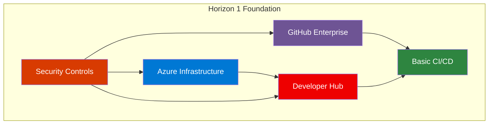

# 🏗️ Horizon 1: Foundation Platform

## Overview

Horizon 1 establishes the foundational capabilities of the Three Horizons AI Platform. This horizon focuses on setting up the core infrastructure, basic security, and essential developer tools needed to begin your transformation journey.

## Learning Path

Complete these documents in sequence for optimal results:

### 1. [📖 Platform Introduction](001-platform-intro.md)
**Duration**: 30 minutes  
**Purpose**: Understand the platform vision and business case  
**Prerequisites**: None

### 2. [🏗️ Infrastructure Setup](002-infrastructure-setup.md)
**Duration**: 2-4 hours  
**Purpose**: Deploy Azure infrastructure foundations  
**Prerequisites**: Azure subscription, admin access

### 3. [🔒 Security Foundation](003-security-foundation.md)
**Duration**: 1-2 hours  
**Purpose**: Implement core security controls  
**Prerequisites**: Infrastructure deployment complete

### 4. [🐙 GitHub Setup](004-github-setup.md)
**Duration**: 1 hour  
**Purpose**: Configure GitHub Enterprise integration  
**Prerequisites**: GitHub Enterprise license

### 5. [📚 Developer Hub Deployment](005-developer-hub-deployment.md)
**Duration**: 2-3 hours  
**Purpose**: Deploy Red Hat Developer Hub  
**Prerequisites**: Kubernetes cluster ready

### 6. [🔄 Basic CI/CD](006-basic-cicd.md)
**Duration**: 1-2 hours  
**Purpose**: Implement basic deployment pipelines  
**Prerequisites**: All previous steps complete

### 7. [🎬 Demo Environment](007-demo-environment.md)
**Duration**: 1 hour  
**Purpose**: Validate complete setup with demonstration  
**Prerequisites**: All components deployed

## Success Criteria

By the end of Horizon 1, you should have:

- ✅ **Functional Platform**: Core infrastructure deployed and operational
- ✅ **Developer Access**: Developers can access and use the platform
- ✅ **Basic Security**: Essential security controls implemented
- ✅ **Working Pipelines**: Applications can be built and deployed
- ✅ **Validation Complete**: Demo environment proves functionality

## Architecture Overview

## Quick Navigation

| Previous | Current | Next |
|----------|---------|------|
| [🏠 Documentation Home](../README.md) | **H1: Foundation** | [⚡ H2: Optimization](../h2-horizon-optimization/README.md) |

---

**Ready to start?** Begin with [📖 Platform Introduction](001-platform-intro.md)
