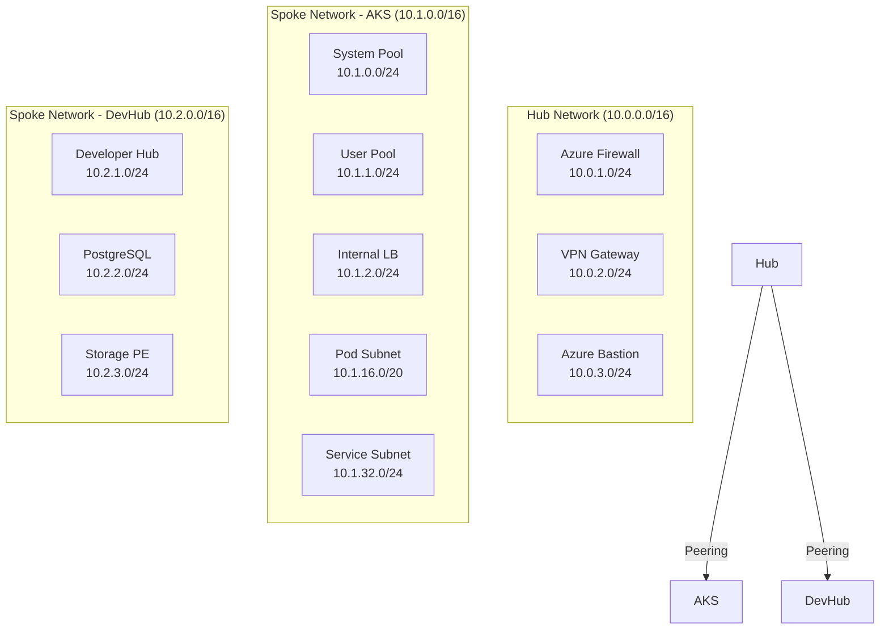

# 🔧 H1-002: Infrastructure Setup - Complete Implementation Guide

<div align="center">

**Step-by-Step Azure Infrastructure Provisioning for Three Horizons AI Platform**

</div>

## 📋 Table of Contents

1. [Prerequisites](#-prerequisites)
2. [Azure Subscription Preparation](#-azure-subscription-preparation)
3. [Network Architecture](#-network-architecture)
4. [AKS Cluster Deployment](#-aks-cluster-deployment)
5. [ARO Cluster Deployment](#-aro-cluster-deployment-alternative)
6. [Container Registry Setup](#-container-registry-setup)
7. [Storage Configuration](#-storage-configuration)
8. [Infrastructure Validation](#-infrastructure-validation)
9. [Cost Optimization](#-cost-optimization)
10. [Troubleshooting](#-troubleshooting)

## ✅ Prerequisites

### Required Tools

| Tool | Version | Installation | Verification |
|------|---------|--------------|--------------|
| **Azure CLI** | 2.57.0+ | [Install Guide](https://docs.microsoft.com/azure/cli/install) | `az --version` |
| **kubectl** | 1.28.0+ | [Install Guide](https://kubernetes.io/docs/tasks/tools/) | `kubectl version --client` |
| **Helm** | 3.14.0+ | [Install Guide](https://helm.sh/docs/intro/install/) | `helm version` |
| **Bicep** | 0.25.0+ | `az bicep install` | `bicep --version` |
| **Git** | 2.40.0+ | [Install Guide](https://git-scm.com/downloads) | `git --version` |
| **jq** | 1.6+ | [Install Guide](https://jqlang.github.io/jq/download/) | `jq --version` |

### Azure Requirements

```bash
# Login to Azure
az login

# Set subscription
az account set --subscription "YOUR_SUBSCRIPTION_ID"

# Verify subscription
az account show --output table
```

### Required Azure Permissions

```json
{
  "Name": "Three Horizons Platform Admin",
  "Description": "Permissions for Three Horizons AI Platform deployment",
  "Actions": [
    "Microsoft.Resources/subscriptions/resourceGroups/*",
    "Microsoft.ContainerService/*",
    "Microsoft.Network/*",
    "Microsoft.Storage/*",
    "Microsoft.ContainerRegistry/*",
    "Microsoft.KeyVault/*",
    "Microsoft.Monitor/*",
    "Microsoft.Authorization/roleAssignments/*"
  ],
  "AssignableScopes": ["/subscriptions/YOUR_SUBSCRIPTION_ID"]
}
```

## 🌐 Azure Subscription Preparation

### 1. Register Required Resource Providers

```bash
# Register required providers
az provider register --namespace Microsoft.ContainerService
az provider register --namespace Microsoft.Network
az provider register --namespace Microsoft.Storage
az provider register --namespace Microsoft.ContainerRegistry
az provider register --namespace Microsoft.KeyVault
az provider register --namespace Microsoft.Monitor
az provider register --namespace Microsoft.OperationalInsights
az provider register --namespace Microsoft.Insights

# Verify registration status
az provider list --query "[?contains(namespace, 'Microsoft.')].{Provider:namespace, Status:registrationState}" \
  --output table | grep -E "(ContainerService|Network|Storage|ContainerRegistry|KeyVault|Monitor)"
```

### 2. Check Quotas and Limits

```bash
# Check VM quota for AKS nodes
az vm list-usage --location "centralus" --output table \
  --query "[?contains(name.value, 'Standard D') || contains(name.value, 'Standard F')].{Name:name.value, Current:currentValue, Limit:limit}"

# Check networking quota
az network list-usages --location "centralus" --output table

# If quotas are insufficient, request increase
echo "To request quota increase, visit: https://portal.azure.com/#blade/Microsoft_Azure_Support/NewSupportRequestBlade"
```

### 3. Create Resource Groups

```bash
# Set variables
ENVIRONMENT="dev"
LOCATION="centralus"
BASE_NAME="threehorizons"

# Create resource groups
az group create \
  --name "rg-${BASE_NAME}-${ENVIRONMENT}-infra" \
  --location $LOCATION \
  --tags Environment=$ENVIRONMENT Platform="Three Horizons AI" Purpose="Infrastructure"

az group create \
  --name "rg-${BASE_NAME}-${ENVIRONMENT}-compute" \
  --location $LOCATION \
  --tags Environment=$ENVIRONMENT Platform="Three Horizons AI" Purpose="Compute"

az group create \
  --name "rg-${BASE_NAME}-${ENVIRONMENT}-data" \
  --location $LOCATION \
  --tags Environment=$ENVIRONMENT Platform="Three Horizons AI" Purpose="Data"
```

## 🌐 Network Architecture

### Network Design



### Deploy Network Infrastructure

#### Option 1: Using Bicep Templates (Recommended)

```bash
# Clone the repository
git clone https://github.com/three-horizon-ai/Three-Horizons-AI-Developer-Platform.git
cd Three-Horizons-AI-Developer-Platform

# Deploy network infrastructure
az deployment group create \
  --resource-group "rg-${BASE_NAME}-${ENVIRONMENT}-infra" \
  --template-file resources/bicep/modules/network.bicep \
  --parameters \
    environmentName=$ENVIRONMENT \
    location=$LOCATION \
    addressPrefixes='["10.0.0.0/8"]' \
  --name "network-deployment-$(date +%Y%m%d-%H%M%S)"

# Capture outputs
VNET_ID=$(az deployment group show \
  --resource-group "rg-${BASE_NAME}-${ENVIRONMENT}-infra" \
  --name "network-deployment-*" \
  --query "properties.outputs.vnetId.value" -o tsv | head -1)

SUBNET_AKS_ID=$(az deployment group show \
  --resource-group "rg-${BASE_NAME}-${ENVIRONMENT}-infra" \
  --name "network-deployment-*" \
  --query "properties.outputs.aksSubnetId.value" -o tsv | head -1)
```

#### Option 2: Using Azure CLI (Step-by-Step)

```bash
# Create Hub Virtual Network
az network vnet create \
  --resource-group "rg-${BASE_NAME}-${ENVIRONMENT}-infra" \
  --name "vnet-${BASE_NAME}-${ENVIRONMENT}-hub" \
  --address-prefixes "10.0.0.0/16" \
  --location $LOCATION

# Create Hub Subnets
az network vnet subnet create \
  --resource-group "rg-${BASE_NAME}-${ENVIRONMENT}-infra" \
  --vnet-name "vnet-${BASE_NAME}-${ENVIRONMENT}-hub" \
  --name "AzureFirewallSubnet" \
  --address-prefixes "10.0.1.0/24"

az network vnet subnet create \
  --resource-group "rg-${BASE_NAME}-${ENVIRONMENT}-infra" \
  --vnet-name "vnet-${BASE_NAME}-${ENVIRONMENT}-hub" \
  --name "GatewaySubnet" \
  --address-prefixes "10.0.2.0/24"

# Create AKS Spoke Network
az network vnet create \
  --resource-group "rg-${BASE_NAME}-${ENVIRONMENT}-infra" \
  --name "vnet-${BASE_NAME}-${ENVIRONMENT}-aks" \
  --address-prefixes "10.1.0.0/16" \
  --location $LOCATION

# Create AKS Subnets
az network vnet subnet create \
  --resource-group "rg-${BASE_NAME}-${ENVIRONMENT}-infra" \
  --vnet-name "vnet-${BASE_NAME}-${ENVIRONMENT}-aks" \
  --name "snet-aks-system" \
  --address-prefixes "10.1.0.0/24"

az network vnet subnet create \
  --resource-group "rg-${BASE_NAME}-${ENVIRONMENT}-infra" \
  --vnet-name "vnet-${BASE_NAME}-${ENVIRONMENT}-aks" \
  --name "snet-aks-user" \
  --address-prefixes "10.1.1.0/24"

# Create Network Peering
# Hub to AKS
az network vnet peering create \
  --resource-group "rg-${BASE_NAME}-${ENVIRONMENT}-infra" \
  --name "hub-to-aks" \
  --vnet-name "vnet-${BASE_NAME}-${ENVIRONMENT}-hub" \
  --remote-vnet "vnet-${BASE_NAME}-${ENVIRONMENT}-aks" \
  --allow-vnet-access

# AKS to Hub
az network vnet peering create \
  --resource-group "rg-${BASE_NAME}-${ENVIRONMENT}-infra" \
  --name "aks-to-hub" \
  --vnet-name "vnet-${BASE_NAME}-${ENVIRONMENT}-aks" \
  --remote-vnet "vnet-${BASE_NAME}-${ENVIRONMENT}-hub" \
  --allow-vnet-access
```

### Network Security Groups (NSGs)

```bash
# Create NSG for AKS
az network nsg create \
  --resource-group "rg-${BASE_NAME}-${ENVIRONMENT}-infra" \
  --name "nsg-${BASE_NAME}-${ENVIRONMENT}-aks" \
  --location $LOCATION

# Add security rules
# Allow HTTPS inbound
az network nsg rule create \
  --resource-group "rg-${BASE_NAME}-${ENVIRONMENT}-infra" \
  --nsg-name "nsg-${BASE_NAME}-${ENVIRONMENT}-aks" \
  --name "AllowHTTPS" \
  --priority 100 \
  --direction Inbound \
  --access Allow \
  --protocol Tcp \
  --source-address-prefixes "*" \
  --source-port-ranges "*" \
  --destination-address-prefixes "*" \
  --destination-port-ranges 443

# Allow kubectl access from specific IPs (replace with your IP)
az network nsg rule create \
  --resource-group "rg-${BASE_NAME}-${ENVIRONMENT}-infra" \
  --nsg-name "nsg-${BASE_NAME}-${ENVIRONMENT}-aks" \
  --name "AllowKubectl" \
  --priority 110 \
  --direction Inbound \
  --access Allow \
  --protocol Tcp \
  --source-address-prefixes "YOUR_PUBLIC_IP/32" \
  --source-port-ranges "*" \
  --destination-address-prefixes "*" \
  --destination-port-ranges 6443
```

## ☸️ AKS Cluster Deployment

### AKS Configuration

```yaml
# aks-config.yaml
apiVersion: containerservice.azure.com/v1
kind: ManagedCluster
metadata:
  name: aks-threehorizons-dev
spec:
  kubernetesVersion: "1.28.5"
  dnsPrefix: "threehorizons-dev"
  
  # Identity
  identity:
    type: SystemAssigned
  
  # Network Profile
  networkProfile:
    networkPlugin: azure
    networkPolicy: calico
    serviceCidr: "10.1.32.0/24"
    dnsServiceIP: "10.1.32.10"
    podCidr: "10.1.16.0/20"
    loadBalancerSku: standard
    outboundType: loadBalancer
  
  # Add-ons
  addonProfiles:
    azureKeyvaultSecretsProvider:
      enabled: true
    azurepolicy:
      enabled: true
    httpApplicationRouting:
      enabled: false
    omsAgent:
      enabled: true
      config:
        logAnalyticsWorkspaceResourceID: "/subscriptions/.../workspace"
  
  # Node Pools
  agentPoolProfiles:
  - name: system
    count: 3
    vmSize: Standard_D4s_v5
    osDiskSizeGB: 128
    osDiskType: Managed
    maxPods: 30
    type: VirtualMachineScaleSets
    mode: System
    nodeTaints:
    - key: CriticalAddonsOnly
      value: "true"
      effect: NoSchedule
  
  - name: user
    count: 3
    vmSize: Standard_D8s_v5
    osDiskSizeGB: 256
    osDiskType: Managed
    maxPods: 40
    type: VirtualMachineScaleSets
    mode: User
    enableAutoScaling: true
    minCount: 3
    maxCount: 10
```

### Deploy AKS Cluster

#### Option 1: Using Bicep Template

```bash
# Create Log Analytics Workspace first
az deployment group create \
  --resource-group "rg-${BASE_NAME}-${ENVIRONMENT}-infra" \
  --template-file resources/bicep/modules/loganalytics.bicep \
  --parameters \
    workspaceName="log-${BASE_NAME}-${ENVIRONMENT}" \
    location=$LOCATION \
  --name "loganalytics-deployment-$(date +%Y%m%d-%H%M%S)"

# Get Log Analytics Workspace ID
LOG_ANALYTICS_ID=$(az deployment group show \
  --resource-group "rg-${BASE_NAME}-${ENVIRONMENT}-infra" \
  --name "loganalytics-deployment-*" \
  --query "properties.outputs.workspaceId.value" -o tsv | head -1)

# Deploy AKS cluster
az deployment group create \
  --resource-group "rg-${BASE_NAME}-${ENVIRONMENT}-compute" \
  --template-file resources/bicep/modules/aks-cluster.bicep \
  --parameters \
    clusterName="aks-${BASE_NAME}-${ENVIRONMENT}" \
    location=$LOCATION \
    subnetId=$SUBNET_AKS_ID \
    logAnalyticsWorkspaceId=$LOG_ANALYTICS_ID \
    systemNodeCount=3 \
    userNodeCount=3 \
  --name "aks-deployment-$(date +%Y%m%d-%H%M%S)"
```

#### Option 2: Using Azure CLI

```bash
# Create Log Analytics Workspace
az monitor log-analytics workspace create \
  --resource-group "rg-${BASE_NAME}-${ENVIRONMENT}-infra" \
  --workspace-name "log-${BASE_NAME}-${ENVIRONMENT}" \
  --location $LOCATION \
  --sku PerGB2018

# Get workspace ID
WORKSPACE_ID=$(az monitor log-analytics workspace show \
  --resource-group "rg-${BASE_NAME}-${ENVIRONMENT}-infra" \
  --workspace-name "log-${BASE_NAME}-${ENVIRONMENT}" \
  --query id -o tsv)

# Create AKS cluster
az aks create \
  --resource-group "rg-${BASE_NAME}-${ENVIRONMENT}-compute" \
  --name "aks-${BASE_NAME}-${ENVIRONMENT}" \
  --location $LOCATION \
  --kubernetes-version "1.28.5" \
  --node-count 3 \
  --node-vm-size "Standard_D4s_v5" \
  --node-osdisk-size 128 \
  --nodepool-name system \
  --enable-addons monitoring,azure-keyvault-secrets-provider,azure-policy \
  --workspace-resource-id $WORKSPACE_ID \
  --network-plugin azure \
  --network-policy calico \
  --service-cidr "10.1.32.0/24" \
  --dns-service-ip "10.1.32.10" \
  --pod-cidr "10.1.16.0/20" \
  --vnet-subnet-id $SUBNET_AKS_ID \
  --enable-managed-identity \
  --generate-ssh-keys \
  --tier standard \
  --zones 1 2 3

# Add user node pool
az aks nodepool add \
  --resource-group "rg-${BASE_NAME}-${ENVIRONMENT}-compute" \
  --cluster-name "aks-${BASE_NAME}-${ENVIRONMENT}" \
  --name user \
  --node-count 3 \
  --node-vm-size "Standard_D8s_v5" \
  --node-osdisk-size 256 \
  --max-pods 40 \
  --mode User \
  --enable-cluster-autoscaler \
  --min-count 3 \
  --max-count 10 \
  --zones 1 2 3
```

### Configure kubectl Access

```bash
# Get AKS credentials
az aks get-credentials \
  --resource-group "rg-${BASE_NAME}-${ENVIRONMENT}-compute" \
  --name "aks-${BASE_NAME}-${ENVIRONMENT}" \
  --overwrite-existing

# Verify connection
kubectl get nodes
kubectl get pods --all-namespaces

# Create namespaces
kubectl create namespace three-horizons-dev
kubectl create namespace three-horizons-staging
kubectl create namespace three-horizons-prod
kubectl create namespace rhdh
kubectl create namespace monitoring
kubectl create namespace security
```

### Install Essential Components

```bash
# Install NGINX Ingress Controller
helm repo add ingress-nginx https://kubernetes.github.io/ingress-nginx
helm repo update

helm install ingress-nginx ingress-nginx/ingress-nginx \
  --namespace ingress-nginx \
  --create-namespace \
  --set controller.service.type=LoadBalancer \
  --set controller.service.annotations."service\.beta\.kubernetes\.io/azure-load-balancer-health-probe-request-path"=/healthz

# Install cert-manager for SSL
helm repo add jetstack https://charts.jetstack.io
helm repo update

helm install cert-manager jetstack/cert-manager \
  --namespace cert-manager \
  --create-namespace \
  --version v1.14.0 \
  --set installCRDs=true

# Create ClusterIssuer for Let's Encrypt
cat <<EOF | kubectl apply -f -
apiVersion: cert-manager.io/v1
kind: ClusterIssuer
metadata:
  name: letsencrypt-prod
spec:
  acme:
    server: https://acme-v02.api.letsencrypt.org/directory
    email: admin@threehorizon.ai
    privateKeySecretRef:
      name: letsencrypt-prod
    solvers:
    - http01:
        ingress:
          class: nginx
EOF
```

## 🔴 ARO Cluster Deployment (Alternative)

### Prerequisites for ARO

```bash
# Register ARO resource providers
az provider register --namespace Microsoft.RedHatOpenShift
az provider register --namespace Microsoft.Compute
az provider register --namespace Microsoft.Storage
az provider register --namespace Microsoft.Authorization

# Install ARO extension
az extension add --name aro
az extension update --name aro

# Get Red Hat pull secret
echo "Download your pull secret from: https://console.redhat.com/openshift/install/azure/aro-provisioned"
read -p "Enter path to pull secret file: " PULL_SECRET_FILE
```

### Deploy ARO Cluster

```bash
# Create ARO cluster
az aro create \
  --resource-group "rg-${BASE_NAME}-${ENVIRONMENT}-compute" \
  --name "aro-${BASE_NAME}-${ENVIRONMENT}" \
  --location $LOCATION \
  --vnet "vnet-${BASE_NAME}-${ENVIRONMENT}-aks" \
  --master-subnet "snet-aro-master" \
  --worker-subnet "snet-aro-worker" \
  --pull-secret @$PULL_SECRET_FILE \
  --worker-count 3 \
  --worker-vm-size "Standard_D8s_v4" \
  --master-vm-size "Standard_D8s_v4"

# Get credentials
az aro show \
  --resource-group "rg-${BASE_NAME}-${ENVIRONMENT}-compute" \
  --name "aro-${BASE_NAME}-${ENVIRONMENT}" \
  --query "consoleProfile.url" -o tsv

# Get kubeadmin password
az aro list-credentials \
  --resource-group "rg-${BASE_NAME}-${ENVIRONMENT}-compute" \
  --name "aro-${BASE_NAME}-${ENVIRONMENT}" \
  --query "kubeadminPassword" -o tsv
```

## 📦 Container Registry Setup

### Create Azure Container Registry

```bash
# Create ACR
az acr create \
  --resource-group "rg-${BASE_NAME}-${ENVIRONMENT}-infra" \
  --name "acr${BASE_NAME}${ENVIRONMENT}" \
  --location $LOCATION \
  --sku Premium \
  --admin-enabled false \
  --zone-redundancy Enabled

# Enable features
az acr update \
  --name "acr${BASE_NAME}${ENVIRONMENT}" \
  --anonymous-pull-enabled false \
  --data-endpoint-enabled true \
  --public-network-enabled true

# Configure networking
az acr network-rule add \
  --name "acr${BASE_NAME}${ENVIRONMENT}" \
  --subnet $SUBNET_AKS_ID
```

### Connect ACR to AKS

```bash
# Get ACR ID
ACR_ID=$(az acr show \
  --name "acr${BASE_NAME}${ENVIRONMENT}" \
  --resource-group "rg-${BASE_NAME}-${ENVIRONMENT}-infra" \
  --query id -o tsv)

# Attach ACR to AKS
az aks update \
  --resource-group "rg-${BASE_NAME}-${ENVIRONMENT}-compute" \
  --name "aks-${BASE_NAME}-${ENVIRONMENT}" \
  --attach-acr $ACR_ID

# Verify connection
az aks check-acr \
  --resource-group "rg-${BASE_NAME}-${ENVIRONMENT}-compute" \
  --name "aks-${BASE_NAME}-${ENVIRONMENT}" \
  --acr "acr${BASE_NAME}${ENVIRONMENT}"
```

## 💾 Storage Configuration

### Create Storage Accounts

```bash
# Create storage for Developer Hub
az storage account create \
  --name "st${BASE_NAME}${ENVIRONMENT}devhub" \
  --resource-group "rg-${BASE_NAME}-${ENVIRONMENT}-data" \
  --location $LOCATION \
  --sku Standard_ZRS \
  --kind StorageV2 \
  --access-tier Hot \
  --https-only true \
  --allow-blob-public-access false \
  --min-tls-version TLS1_2

# Create storage for backups
az storage account create \
  --name "st${BASE_NAME}${ENVIRONMENT}backup" \
  --resource-group "rg-${BASE_NAME}-${ENVIRONMENT}-data" \
  --location $LOCATION \
  --sku Standard_GRS \
  --kind StorageV2 \
  --access-tier Cool \
  --https-only true \
  --allow-blob-public-access false \
  --min-tls-version TLS1_2
```

### Configure Blob Containers

```bash
# Get storage account keys
STORAGE_KEY=$(az storage account keys list \
  --account-name "st${BASE_NAME}${ENVIRONMENT}devhub" \
  --resource-group "rg-${BASE_NAME}-${ENVIRONMENT}-data" \
  --query "[0].value" -o tsv)

# Create containers
az storage container create \
  --name "techdocs" \
  --account-name "st${BASE_NAME}${ENVIRONMENT}devhub" \
  --account-key $STORAGE_KEY \
  --public-access off

az storage container create \
  --name "catalog" \
  --account-name "st${BASE_NAME}${ENVIRONMENT}devhub" \
  --account-key $STORAGE_KEY \
  --public-access off

az storage container create \
  --name "templates" \
  --account-name "st${BASE_NAME}${ENVIRONMENT}devhub" \
  --account-key $STORAGE_KEY \
  --public-access off
```

## ✅ Infrastructure Validation

### Automated Validation Script

```bash
#!/bin/bash
# save as validate-infrastructure.sh

echo "🔍 Validating Three Horizons Infrastructure..."

# Colors
GREEN='\033[0;32m'
RED='\033[0;31m'
YELLOW='\033[1;33m'
NC='\033[0m'

# Validation functions
check_resource_group() {
    if az group show --name "$1" &>/dev/null; then
        echo -e "${GREEN}✓${NC} Resource Group: $1"
        return 0
    else
        echo -e "${RED}✗${NC} Resource Group: $1"
        return 1
    fi
}

check_aks_cluster() {
    if az aks show --resource-group "$1" --name "$2" &>/dev/null; then
        echo -e "${GREEN}✓${NC} AKS Cluster: $2"
        STATE=$(az aks show --resource-group "$1" --name "$2" --query "powerState.code" -o tsv)
        if [ "$STATE" == "Running" ]; then
            echo -e "${GREEN}  └─ State: Running${NC}"
        else
            echo -e "${YELLOW}  └─ State: $STATE${NC}"
        fi
        return 0
    else
        echo -e "${RED}✗${NC} AKS Cluster: $2"
        return 1
    fi
}

check_acr() {
    if az acr show --name "$1" &>/dev/null; then
        echo -e "${GREEN}✓${NC} Container Registry: $1"
        return 0
    else
        echo -e "${RED}✗${NC} Container Registry: $1"
        return 1
    fi
}

# Run validations
echo "1️⃣ Checking Resource Groups..."
check_resource_group "rg-${BASE_NAME}-${ENVIRONMENT}-infra"
check_resource_group "rg-${BASE_NAME}-${ENVIRONMENT}-compute"
check_resource_group "rg-${BASE_NAME}-${ENVIRONMENT}-data"

echo -e "\n2️⃣ Checking AKS Cluster..."
check_aks_cluster "rg-${BASE_NAME}-${ENVIRONMENT}-compute" "aks-${BASE_NAME}-${ENVIRONMENT}"

echo -e "\n3️⃣ Checking Container Registry..."
check_acr "acr${BASE_NAME}${ENVIRONMENT}"

echo -e "\n4️⃣ Checking Kubernetes Connection..."
if kubectl cluster-info &>/dev/null; then
    echo -e "${GREEN}✓${NC} Kubernetes API accessible"
    NODE_COUNT=$(kubectl get nodes --no-headers | wc -l)
    echo -e "${GREEN}  └─ Nodes: $NODE_COUNT${NC}"
else
    echo -e "${RED}✗${NC} Cannot connect to Kubernetes"
fi

echo -e "\n5️⃣ Checking Ingress Controller..."
if kubectl get svc -n ingress-nginx ingress-nginx-controller &>/dev/null; then
    echo -e "${GREEN}✓${NC} NGINX Ingress Controller installed"
    EXTERNAL_IP=$(kubectl get svc -n ingress-nginx ingress-nginx-controller -o jsonpath='{.status.loadBalancer.ingress[0].ip}')
    if [ -n "$EXTERNAL_IP" ]; then
        echo -e "${GREEN}  └─ External IP: $EXTERNAL_IP${NC}"
    else
        echo -e "${YELLOW}  └─ External IP: Pending${NC}"
    fi
else
    echo -e "${RED}✗${NC} NGINX Ingress Controller not found"
fi

echo -e "\n✅ Infrastructure validation complete!"
```

### Manual Validation Checklist

- [ ] **Azure Resources**
  ```bash
  az resource list --resource-group "rg-${BASE_NAME}-${ENVIRONMENT}-*" --output table
  ```

- [ ] **Network Connectivity**
  ```bash
  # Test AKS API server
  kubectl cluster-info
  
  # Test internal DNS
  kubectl run test-dns --image=busybox --rm -it --restart=Never -- nslookup kubernetes.default
  ```

- [ ] **Storage Access**
  ```bash
  # Test storage account access
  az storage container list \
    --account-name "st${BASE_NAME}${ENVIRONMENT}devhub" \
    --account-key $STORAGE_KEY \
    --output table
  ```

- [ ] **Security Policies**
  ```bash
  # Check Azure Policy compliance
  az policy state list \
    --resource-group "rg-${BASE_NAME}-${ENVIRONMENT}-compute" \
    --query "[?complianceState=='NonCompliant'].{Policy:policyDefinitionName,Resource:resourceId}" \
    --output table
  ```

## 💰 Cost Optimization

### Estimated Monthly Costs

| Component | Configuration | Estimated Cost |
|-----------|--------------|----------------|
| **AKS Cluster** | 6 nodes (D4s_v5 + D8s_v5) | $1,200 |
| **Container Registry** | Premium SKU | $50 |
| **Storage Accounts** | 2x Standard | $100 |
| **Log Analytics** | 50GB/month | $150 |
| **Network** | Bandwidth + LB | $200 |
| **Total** | | **~$1,700/month** |

### Cost Optimization Strategies

1. **Node Pool Autoscaling**
   ```bash
   # Enable autoscaling on user pool
   az aks nodepool update \
     --resource-group "rg-${BASE_NAME}-${ENVIRONMENT}-compute" \
     --cluster-name "aks-${BASE_NAME}-${ENVIRONMENT}" \
     --name user \
     --enable-cluster-autoscaler \
     --min-count 1 \
     --max-count 10
   ```

2. **Spot Instances for Dev/Test**
   ```bash
   # Add spot node pool for non-critical workloads
   az aks nodepool add \
     --resource-group "rg-${BASE_NAME}-${ENVIRONMENT}-compute" \
     --cluster-name "aks-${BASE_NAME}-${ENVIRONMENT}" \
     --name spot \
     --priority Spot \
     --eviction-policy Delete \
     --spot-max-price -1 \
     --node-count 2 \
     --node-vm-size "Standard_D4s_v5"
   ```

3. **Reserved Instances**
   - Purchase 1-year or 3-year reservations for production nodes
   - Savings: Up to 72% compared to pay-as-you-go

4. **Resource Tagging**
   ```bash
   # Tag all resources for cost tracking
   az tag create --resource-id $RESOURCE_ID \
     --tags CostCenter="Engineering" \
            Project="ThreeHorizons" \
            Environment=$ENVIRONMENT
   ```

## 🔧 Troubleshooting

### Common Issues and Solutions

#### Issue: AKS creation fails with quota error
```bash
# Solution: Check and increase quotas
az vm list-usage --location $LOCATION --output table

# Request quota increase via Azure Portal
echo "Navigate to: Subscriptions > Usage + quotas > Request increase"
```

#### Issue: Cannot connect to AKS cluster
```bash
# Solution: Re-download credentials
az aks get-credentials \
  --resource-group "rg-${BASE_NAME}-${ENVIRONMENT}-compute" \
  --name "aks-${BASE_NAME}-${ENVIRONMENT}" \
  --overwrite-existing --admin

# Check firewall rules
az aks show \
  --resource-group "rg-${BASE_NAME}-${ENVIRONMENT}-compute" \
  --name "aks-${BASE_NAME}-${ENVIRONMENT}" \
  --query "apiServerAccessProfile"
```

#### Issue: ACR push fails with authentication error
```bash
# Solution: Re-attach ACR to AKS
ACR_ID=$(az acr show --name "acr${BASE_NAME}${ENVIRONMENT}" --query id -o tsv)
az aks update \
  --resource-group "rg-${BASE_NAME}-${ENVIRONMENT}-compute" \
  --name "aks-${BASE_NAME}-${ENVIRONMENT}" \
  --attach-acr $ACR_ID
```

### Diagnostic Commands

```bash
# AKS diagnostics
az aks show \
  --resource-group "rg-${BASE_NAME}-${ENVIRONMENT}-compute" \
  --name "aks-${BASE_NAME}-${ENVIRONMENT}" \
  --query "{Name:name, State:powerState.code, Version:kubernetesVersion, Nodes:agentPoolProfiles[].count}" \
  --output table

# Network diagnostics
az network vnet show \
  --resource-group "rg-${BASE_NAME}-${ENVIRONMENT}-infra" \
  --name "vnet-${BASE_NAME}-${ENVIRONMENT}-aks" \
  --query "{Name:name, AddressSpace:addressSpace.addressPrefixes, Subnets:subnets[].name}" \
  --output json

# Storage diagnostics
az storage account show \
  --name "st${BASE_NAME}${ENVIRONMENT}devhub" \
  --query "{Name:name, Status:statusOfPrimary, Kind:kind, Tier:accessTier}" \
  --output table
```

## 📋 Next Steps

### Immediate Actions
1. ✅ Validate all infrastructure components using the validation script
2. ✅ Document all resource names and IDs for future reference
3. ✅ Set up monitoring alerts for critical resources
4. ✅ Configure backup policies for stateful components

### Continue to Next Phase
- [**H1-003: Security Foundation**](h1-003-security-foundation.md) - Set up Azure AD, RBAC, and security policies
- [**H1-004: GitHub Enterprise Setup**](h1-004-github-setup.md) - Configure source control and CI/CD
- [**H1-005: Developer Hub Deployment**](h1-005-developer-hub-deployment.md) - Install Red Hat Developer Hub

---

<div align="center">

**Infrastructure Ready! 🎉**

Your Azure infrastructure is now prepared for the Three Horizons AI Platform.

[← Previous: Platform Introduction](h1-001-platform-introduction.md) | [Next: Security Foundation →](h1-003-security-foundation.md)

</div>
