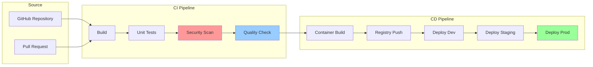

# 🧪 H1-006: Basic CI/CD Pipeline - GitHub Actions Implementation

<div align="center">

**Building Automated Pipelines for the Three Horizons AI Platform**

</div>

## 📋 Table of Contents

1. [Overview](#-overview)
2. [Pipeline Architecture](#-pipeline-architecture)
3. [GitHub Actions Setup](#-github-actions-setup)
4. [Container Build Pipeline](#-container-build-pipeline)
5. [Security Scanning Pipeline](#-security-scanning-pipeline)
6. [Deployment Pipeline](#-deployment-pipeline)
7. [Quality Gates](#-quality-gates)
8. [Pipeline Templates](#-pipeline-templates)
9. [Monitoring & Metrics](#-monitoring--metrics)
10. [Validation & Testing](#-validation--testing)

## 🔍 Overview

This guide establishes the foundational CI/CD pipelines for the Three Horizons AI Platform using GitHub Actions. These pipelines implement automated building, testing, security scanning, and deployment with shift-left security principles.

### Pipeline Capabilities

| Feature | Description | Tools |
|---------|-------------|-------|
| **Continuous Integration** | Automated build and test | GitHub Actions, Maven, npm |
| **Security Scanning** | Shift-left security checks | CodeQL, Trivy, GHAS |
| **Container Management** | Build and push images | Docker, ACR |
| **Quality Analysis** | Code quality metrics | SonarQube, ESLint |
| **Deployment** | Automated deployments | kubectl, Helm |
| **Monitoring** | Pipeline metrics | Prometheus, Grafana |

## 🏗️ Pipeline Architecture



### Pipeline Stages

1. **Source Stage**: Code checkout and dependency caching
2. **Build Stage**: Compilation and packaging
3. **Test Stage**: Unit tests, integration tests
4. **Security Stage**: SAST, dependency scanning, secrets detection
5. **Quality Stage**: Code coverage, linting, complexity analysis
6. **Package Stage**: Container building and scanning
7. **Deploy Stage**: Progressive deployment through environments

## ⚙️ GitHub Actions Setup

### 1. Organization-level Configuration

```bash
# Create organization secrets
gh secret set ACR_REGISTRY --org $GITHUB_ORG --body "acr${BASE_NAME}${ENVIRONMENT}.azurecr.io"
gh secret set SONAR_TOKEN --org $GITHUB_ORG --body "$SONAR_TOKEN"
gh secret set SNYK_TOKEN --org $GITHUB_ORG --body "$SNYK_TOKEN"
gh secret set KUBECONFIG --org $GITHUB_ORG --body "$(cat ~/.kube/config | base64)"

# Create environments
for env in dev staging prod; do
  gh api -X PUT /repos/$GITHUB_ORG/platform-infrastructure/environments/$env
done

# Configure environment protection rules for production
gh api -X PUT /repos/$GITHUB_ORG/platform-infrastructure/environments/prod/deployment-branch-policies \
  -F protected_branches=true \
  -F custom_branch_policies=false

gh api -X POST /repos/$GITHUB_ORG/platform-infrastructure/environments/prod/deployment_protection_rules \
  -F type="required_reviewers" \
  -F reviewers='[{"type":"Team","id":'$(gh api /orgs/$GITHUB_ORG/teams/platform-team --jq .id)'}]'
```

### 2. Reusable Workflow Library

```yaml
# .github/workflows/reusable-build.yml
name: Reusable Build Workflow

on:
  workflow_call:
    inputs:
      language:
        required: true
        type: string
        description: Programming language (java, node, python, go, dotnet)
      java-version:
        required: false
        type: string
        default: '17'
      node-version:
        required: false
        type: string
        default: '18'
      python-version:
        required: false
        type: string
        default: '3.11'
      go-version:
        required: false
        type: string
        default: '1.21'
      dotnet-version:
        required: false
        type: string
        default: '8.0'
    outputs:
      artifact-name:
        description: Name of the build artifact
        value: ${{ jobs.build.outputs.artifact-name }}
      version:
        description: Version of the build
        value: ${{ jobs.build.outputs.version }}

jobs:
  build:
    runs-on: ubuntu-latest
    outputs:
      artifact-name: ${{ steps.artifact.outputs.name }}
      version: ${{ steps.version.outputs.version }}
      
    steps:
      - name: Checkout code
        uses: actions/checkout@v4
        with:
          fetch-depth: 0  # Full history for versioning
          
      - name: Calculate version
        id: version
        run: |
          if [ "${{ github.event_name }}" == "pull_request" ]; then
            VERSION="pr-${{ github.event.pull_request.number }}-$(git rev-parse --short HEAD)"
          else
            VERSION="$(date +%Y%m%d)-$(git rev-parse --short HEAD)"
          fi
          echo "version=$VERSION" >> $GITHUB_OUTPUT
          
      - name: Setup Java
        if: inputs.language == 'java'
        uses: actions/setup-java@v4
        with:
          java-version: ${{ inputs.java-version }}
          distribution: 'temurin'
          cache: 'maven'
          
      - name: Setup Node.js
        if: inputs.language == 'node'
        uses: actions/setup-node@v4
        with:
          node-version: ${{ inputs.node-version }}
          cache: 'npm'
          
      - name: Setup Python
        if: inputs.language == 'python'
        uses: actions/setup-python@v5
        with:
          python-version: ${{ inputs.python-version }}
          cache: 'pip'
          
      - name: Setup Go
        if: inputs.language == 'go'
        uses: actions/setup-go@v5
        with:
          go-version: ${{ inputs.go-version }}
          cache: true
          
      - name: Setup .NET
        if: inputs.language == 'dotnet'
        uses: actions/setup-dotnet@v4
        with:
          dotnet-version: ${{ inputs.dotnet-version }}
          
      - name: Cache dependencies
        uses: actions/cache@v4
        with:
          path: |
            ~/.m2/repository
            ~/.npm
            ~/.cache/pip
            ~/go/pkg/mod
            ~/.nuget/packages
          key: ${{ runner.os }}-${{ inputs.language }}-${{ hashFiles('**/*.lock', '**/package-lock.json', '**/pom.xml', '**/go.sum', '**/*.csproj') }}
          restore-keys: |
            ${{ runner.os }}-${{ inputs.language }}-
            
      - name: Install dependencies
        run: |
          case "${{ inputs.language }}" in
            java)
              mvn dependency:go-offline -B
              ;;
            node)
              npm ci
              ;;
            python)
              pip install -r requirements.txt
              pip install pytest pytest-cov flake8 black
              ;;
            go)
              go mod download
              go install github.com/golangci/golangci-lint/cmd/golangci-lint@latest
              ;;
            dotnet)
              dotnet restore
              ;;
          esac
          
      - name: Build application
        run: |
          case "${{ inputs.language }}" in
            java)
              mvn clean package -B -DskipTests
              ;;
            node)
              npm run build
              ;;
            python)
              python -m py_compile **/*.py
              ;;
            go)
              go build -v ./...
              ;;
            dotnet)
              dotnet build --configuration Release --no-restore
              ;;
          esac
          
      - name: Run tests
        run: |
          case "${{ inputs.language }}" in
            java)
              mvn test -B
              ;;
            node)
              npm test -- --coverage
              ;;
            python)
              pytest --cov=. --cov-report=xml
              ;;
            go)
              go test -v -coverprofile=coverage.out ./...
              ;;
            dotnet)
              dotnet test --configuration Release --no-build --verbosity normal --collect:"XPlat Code Coverage"
              ;;
          esac
          
      - name: Upload test results
        if: always()
        uses: actions/upload-artifact@v4
        with:
          name: test-results-${{ inputs.language }}
          path: |
            **/target/surefire-reports/**
            **/coverage/**
            **/test-results/**
            **/*coverage*.xml
          retention-days: 7
          
      - name: Package artifact
        id: artifact
        run: |
          case "${{ inputs.language }}" in
            java)
              ARTIFACT_NAME=$(find target -name "*.jar" -not -name "*-sources.jar" | head -1)
              ;;
            node)
              npm pack
              ARTIFACT_NAME=$(ls *.tgz | head -1)
              ;;
            python)
              python setup.py sdist bdist_wheel
              ARTIFACT_NAME=$(find dist -name "*.whl" | head -1)
              ;;
            go)
              GOOS=linux GOARCH=amd64 go build -o app
              ARTIFACT_NAME="app"
              ;;
            dotnet)
              dotnet publish --configuration Release --no-build --output ./publish
              ARTIFACT_NAME="publish"
              ;;
          esac
          echo "name=$ARTIFACT_NAME" >> $GITHUB_OUTPUT
          
      - name: Upload build artifact
        uses: actions/upload-artifact@v4
        with:
          name: build-artifact-${{ steps.version.outputs.version }}
          path: ${{ steps.artifact.outputs.name }}
          retention-days: 30
```

### 3. Security Scanning Workflow

```yaml
# .github/workflows/security-scan.yml
name: Security Scanning

on:
  workflow_call:
    inputs:
      language:
        required: true
        type: string
    secrets:
      SNYK_TOKEN:
        required: false
      SONAR_TOKEN:
        required: false

jobs:
  code-scanning:
    runs-on: ubuntu-latest
    permissions:
      actions: read
      contents: read
      security-events: write
      
    steps:
      - name: Checkout code
        uses: actions/checkout@v4
        with:
          fetch-depth: 0
          
      - name: Initialize CodeQL
        uses: github/codeql-action/init@v3
        with:
          languages: ${{ inputs.language }}
          queries: security-extended,security-and-quality
          
      - name: Autobuild
        uses: github/codeql-action/autobuild@v3
        
      - name: Perform CodeQL Analysis
        uses: github/codeql-action/analyze@v3
        with:
          category: "/language:${{ inputs.language }}"
          upload: true
          
  dependency-scanning:
    runs-on: ubuntu-latest
    steps:
      - name: Checkout code
        uses: actions/checkout@v4
        
      - name: Run Snyk to check for vulnerabilities
        if: env.SNYK_TOKEN != ''
        uses: snyk/actions/${{ inputs.language }}@master
        env:
          SNYK_TOKEN: ${{ secrets.SNYK_TOKEN }}
        with:
          args: --severity-threshold=high --fail-on=all
          
      - name: Upload Snyk results
        if: always() && env.SNYK_TOKEN != ''
        uses: github/codeql-action/upload-sarif@v3
        with:
          sarif_file: snyk.sarif
          
  secret-scanning:
    runs-on: ubuntu-latest
    steps:
      - name: Checkout code
        uses: actions/checkout@v4
        
      - name: TruffleHog OSS
        uses: trufflesecurity/trufflehog@main
        with:
          path: ./
          base: ${{ github.event.repository.default_branch }}
          head: HEAD
          
  license-scanning:
    runs-on: ubuntu-latest
    steps:
      - name: Checkout code
        uses: actions/checkout@v4
        
      - name: FOSSA Scan
        uses: fossas/fossa-action@main
        with:
          api-key: ${{ secrets.FOSSA_API_KEY }}
          
  sonarqube:
    runs-on: ubuntu-latest
    if: env.SONAR_TOKEN != ''
    steps:
      - name: Checkout code
        uses: actions/checkout@v4
        with:
          fetch-depth: 0
          
      - name: SonarQube Scan
        uses: sonarsource/sonarqube-scan-action@master
        env:
          GITHUB_TOKEN: ${{ secrets.GITHUB_TOKEN }}
          SONAR_TOKEN: ${{ secrets.SONAR_TOKEN }}
        with:
          args: >
            -Dsonar.projectKey=${{ github.repository_owner }}_${{ github.event.repository.name }}
            -Dsonar.organization=${{ github.repository_owner }}
```

## 🐳 Container Build Pipeline

### 1. Docker Build Workflow

```yaml
# .github/workflows/container-build.yml
name: Container Build and Push

on:
  workflow_call:
    inputs:
      image-name:
        required: true
        type: string
      dockerfile:
        required: false
        type: string
        default: 'Dockerfile'
      context:
        required: false
        type: string
        default: '.'
      build-args:
        required: false
        type: string
      target:
        required: false
        type: string
    outputs:
      image-tag:
        description: Full image tag
        value: ${{ jobs.build.outputs.image-tag }}
      image-digest:
        description: Image digest
        value: ${{ jobs.build.outputs.image-digest }}

jobs:
  build:
    runs-on: ubuntu-latest
    outputs:
      image-tag: ${{ steps.meta.outputs.tags }}
      image-digest: ${{ steps.build.outputs.digest }}
      
    steps:
      - name: Checkout code
        uses: actions/checkout@v4
        
      - name: Set up Docker Buildx
        uses: docker/setup-buildx-action@v3
        
      - name: Log in to ACR
        uses: azure/docker-login@v1
        with:
          login-server: ${{ secrets.ACR_REGISTRY }}
          username: ${{ secrets.REGISTRY_USERNAME }}
          password: ${{ secrets.REGISTRY_PASSWORD }}
          
      - name: Extract metadata
        id: meta
        uses: docker/metadata-action@v5
        with:
          images: ${{ secrets.ACR_REGISTRY }}/${{ inputs.image-name }}
          tags: |
            type=ref,event=branch
            type=ref,event=pr
            type=semver,pattern={{version}}
            type=semver,pattern={{major}}.{{minor}}
            type=sha,prefix={{branch}}-
            type=raw,value=latest,enable={{is_default_branch}}
            
      - name: Build and push image
        id: build
        uses: docker/build-push-action@v5
        with:
          context: ${{ inputs.context }}
          file: ${{ inputs.dockerfile }}
          push: true
          tags: ${{ steps.meta.outputs.tags }}
          labels: ${{ steps.meta.outputs.labels }}
          cache-from: type=gha
          cache-to: type=gha,mode=max
          build-args: ${{ inputs.build-args }}
          target: ${{ inputs.target }}
          platforms: linux/amd64,linux/arm64
          
      - name: Run Trivy vulnerability scanner
        uses: aquasecurity/trivy-action@master
        with:
          image-ref: ${{ secrets.ACR_REGISTRY }}/${{ inputs.image-name }}@${{ steps.build.outputs.digest }}
          format: 'sarif'
          output: 'trivy-results.sarif'
          severity: 'CRITICAL,HIGH'
          
      - name: Upload Trivy scan results
        uses: github/codeql-action/upload-sarif@v3
        with:
          sarif_file: 'trivy-results.sarif'
          
      - name: Image signing with Cosign
        uses: sigstore/cosign-installer@v3
        
      - name: Sign container image
        run: |
          cosign sign --yes \
            ${{ secrets.ACR_REGISTRY }}/${{ inputs.image-name }}@${{ steps.build.outputs.digest }}
```

### 2. Multi-stage Dockerfile Template

```dockerfile
# Dockerfile.template
# Build stage
FROM --platform=$BUILDPLATFORM golang:1.21-alpine AS builder

ARG TARGETOS
ARG TARGETARCH
ARG VERSION=dev

WORKDIR /app

# Copy go mod files
COPY go.mod go.sum ./
RUN go mod download

# Copy source code
COPY . .

# Build application
RUN CGO_ENABLED=0 GOOS=$TARGETOS GOARCH=$TARGETARCH \
    go build -ldflags="-w -s -X main.version=$VERSION" \
    -o app ./cmd/main.go

# Security scan stage
FROM aquasec/trivy:latest AS scanner
COPY --from=builder /app/app /app
RUN trivy fs --no-progress --security-checks vuln,secret,config /app

# Final stage
FROM gcr.io/distroless/static:nonroot

# Copy binary from builder
COPY --from=builder /app/app /app

# Run as non-root user
USER nonroot:nonroot

# Health check
HEALTHCHECK --interval=30s --timeout=3s --start-period=5s --retries=3 \
    CMD ["/app", "health"]

# Labels
LABEL org.opencontainers.image.source="https://github.com/${GITHUB_ORG}/${REPO}"
LABEL org.opencontainers.image.description="Three Horizons Platform Service"
LABEL org.opencontainers.image.licenses="MIT"

ENTRYPOINT ["/app"]
```

## 🚀 Deployment Pipeline

### 1. Kubernetes Deployment Workflow

```yaml
# .github/workflows/deploy-k8s.yml
name: Deploy to Kubernetes

on:
  workflow_call:
    inputs:
      environment:
        required: true
        type: string
      image-tag:
        required: true
        type: string
      namespace:
        required: false
        type: string
        default: 'default'
      helm-chart:
        required: false
        type: string
      manifest-path:
        required: false
        type: string

jobs:
  deploy:
    runs-on: ubuntu-latest
    environment: ${{ inputs.environment }}
    
    steps:
      - name: Checkout code
        uses: actions/checkout@v4
        
      - name: Azure Login
        uses: azure/login@v1
        with:
          creds: ${{ secrets.AZURE_CREDENTIALS }}
          
      - name: Get AKS credentials
        run: |
          az aks get-credentials \
            --resource-group rg-threehorizons-${{ inputs.environment }}-compute \
            --name aks-threehorizons-${{ inputs.environment }} \
            --overwrite-existing
            
      - name: Create namespace if not exists
        run: |
          kubectl create namespace ${{ inputs.namespace }} --dry-run=client -o yaml | kubectl apply -f -
          
      - name: Deploy using Helm
        if: inputs.helm-chart != ''
        run: |
          helm upgrade --install ${{ github.event.repository.name }} \
            ${{ inputs.helm-chart }} \
            --namespace ${{ inputs.namespace }} \
            --set image.tag=${{ inputs.image-tag }} \
            --set image.repository=${{ secrets.ACR_REGISTRY }}/${{ github.event.repository.name }} \
            --values ./helm/values.${{ inputs.environment }}.yaml \
            --wait \
            --timeout 5m
            
      - name: Deploy using kubectl
        if: inputs.manifest-path != ''
        run: |
          # Replace image tag in manifests
          sed -i "s|IMAGE_TAG|${{ inputs.image-tag }}|g" ${{ inputs.manifest-path }}/*.yaml
          sed -i "s|IMAGE_REPOSITORY|${{ secrets.ACR_REGISTRY }}/${{ github.event.repository.name }}|g" ${{ inputs.manifest-path }}/*.yaml
          
          # Apply manifests
          kubectl apply -f ${{ inputs.manifest-path }} -n ${{ inputs.namespace }}
          
      - name: Wait for rollout
        run: |
          kubectl rollout status deployment/${{ github.event.repository.name }} \
            -n ${{ inputs.namespace }} \
            --timeout=5m
            
      - name: Run smoke tests
        run: |
          # Wait for service to be ready
          kubectl wait --for=condition=ready pod \
            -l app=${{ github.event.repository.name }} \
            -n ${{ inputs.namespace }} \
            --timeout=300s
            
          # Get service endpoint
          SERVICE_IP=$(kubectl get svc ${{ github.event.repository.name }} \
            -n ${{ inputs.namespace }} \
            -o jsonpath='{.status.loadBalancer.ingress[0].ip}')
            
          # Health check
          curl -f http://$SERVICE_IP/health || exit 1
          
      - name: Update deployment status
        if: always()
        uses: actions/github-script@v7
        with:
          script: |
            const deployment = await github.rest.repos.createDeploymentStatus({
              owner: context.repo.owner,
              repo: context.repo.repo,
              deployment_id: context.payload.deployment.id,
              state: '${{ job.status }}',
              environment_url: 'https://${{ github.event.repository.name }}.${{ inputs.environment }}.threehorizons.ai'
            });
```

### 2. Progressive Deployment Strategy

```yaml
# .github/workflows/progressive-deployment.yml
name: Progressive Deployment

on:
  push:
    branches: [main]

jobs:
  build:
    uses: ./.github/workflows/container-build.yml
    with:
      image-name: ${{ github.event.repository.name }}
    secrets: inherit
    
  deploy-dev:
    needs: build
    uses: ./.github/workflows/deploy-k8s.yml
    with:
      environment: dev
      image-tag: ${{ needs.build.outputs.image-tag }}
      namespace: three-horizons-dev
    secrets: inherit
    
  integration-tests:
    needs: deploy-dev
    runs-on: ubuntu-latest
    steps:
      - name: Checkout tests
        uses: actions/checkout@v4
        
      - name: Run integration tests
        run: |
          npm install -g newman
          newman run tests/postman-collection.json \
            --environment tests/dev-environment.json \
            --reporters cli,junit \
            --reporter-junit-export test-results.xml
            
      - name: Upload test results
        if: always()
        uses: actions/upload-artifact@v4
        with:
          name: integration-test-results
          path: test-results.xml
          
  deploy-staging:
    needs: integration-tests
    uses: ./.github/workflows/deploy-k8s.yml
    with:
      environment: staging
      image-tag: ${{ needs.build.outputs.image-tag }}
      namespace: three-horizons-staging
    secrets: inherit
    
  performance-tests:
    needs: deploy-staging
    runs-on: ubuntu-latest
    steps:
      - name: Run load tests
        uses: k6io/action@v0.1
        with:
          filename: tests/load-test.js
          cloud: true
          token: ${{ secrets.K6_CLOUD_TOKEN }}
          
  deploy-production:
    needs: [performance-tests]
    uses: ./.github/workflows/deploy-k8s.yml
    with:
      environment: prod
      image-tag: ${{ needs.build.outputs.image-tag }}
      namespace: three-horizons-prod
    secrets: inherit
```

## ✅ Quality Gates

### 1. Pull Request Checks

```yaml
# .github/workflows/pr-checks.yml
name: Pull Request Validation

on:
  pull_request:
    types: [opened, synchronize, reopened]

jobs:
  validate-pr:
    runs-on: ubuntu-latest
    steps:
      - name: Check PR title
        uses: amannn/action-semantic-pull-request@v5
        env:
          GITHUB_TOKEN: ${{ secrets.GITHUB_TOKEN }}
          
      - name: Label PR
        uses: actions/labeler@v4
        with:
          repo-token: ${{ secrets.GITHUB_TOKEN }}
          
      - name: Check PR size
        uses: CodelyTV/pr-size-labeler@v1
        with:
          GITHUB_TOKEN: ${{ secrets.GITHUB_TOKEN }}
          xs_label: 'size/xs'
          xs_max_size: 10
          s_label: 'size/s'
          s_max_size: 100
          m_label: 'size/m'
          m_max_size: 500
          l_label: 'size/l'
          l_max_size: 1000
          xl_label: 'size/xl'
          
  build-and-test:
    strategy:
      matrix:
        language: [java, node, python, go]
    uses: ./.github/workflows/reusable-build.yml
    with:
      language: ${{ matrix.language }}
    secrets: inherit
    
  security-scan:
    uses: ./.github/workflows/security-scan.yml
    with:
      language: ${{ matrix.language }}
    secrets: inherit
    
  quality-gates:
    needs: [build-and-test, security-scan]
    runs-on: ubuntu-latest
    steps:
      - name: Check quality gates
        uses: actions/github-script@v7
        with:
          script: |
            const checks = await github.rest.checks.listForRef({
              owner: context.repo.owner,
              repo: context.repo.repo,
              ref: context.sha
            });
            
            const failed = checks.data.check_runs.filter(
              check => check.conclusion === 'failure'
            );
            
            if (failed.length > 0) {
              core.setFailed(`Quality gates failed: ${failed.map(c => c.name).join(', ')}`);
            }
```

### 2. Branch Protection Rules

```bash
# Configure branch protection with quality gates
gh api -X PUT /repos/$GITHUB_ORG/$REPO/branches/main/protection \
  -F required_status_checks='{
    "strict": true,
    "contexts": [
      "build-and-test",
      "security-scan",
      "quality-gates",
      "sonarqube",
      "license-check"
    ]
  }' \
  -F enforce_admins=true \
  -F required_pull_request_reviews='{
    "required_approving_review_count": 2,
    "dismiss_stale_reviews": true,
    "require_code_owner_reviews": true,
    "require_last_push_approval": true
  }' \
  -F restrictions=null \
  -F allow_force_pushes=false \
  -F allow_deletions=false \
  -F required_conversation_resolution=true \
  -F lock_branch=false
```

## 📋 Pipeline Templates

### 1. Microservice Pipeline Template

```yaml
# .github/workflows/microservice-pipeline.yml
name: Microservice Pipeline

on:
  push:
    branches: [main, develop]
  pull_request:
    branches: [main]

env:
  SERVICE_NAME: ${{ github.event.repository.name }}

jobs:
  # Build and test
  build:
    uses: ./.github/workflows/reusable-build.yml
    with:
      language: java
      java-version: '17'
    secrets: inherit
    
  # Security scanning
  security:
    uses: ./.github/workflows/security-scan.yml
    with:
      language: java
    secrets: inherit
    
  # Build container
  container:
    needs: [build, security]
    if: github.event_name == 'push'
    uses: ./.github/workflows/container-build.yml
    with:
      image-name: ${{ env.SERVICE_NAME }}
      build-args: |
        VERSION=${{ needs.build.outputs.version }}
        COMMIT_SHA=${{ github.sha }}
    secrets: inherit
    
  # Deploy to environments
  deploy-dev:
    needs: container
    if: github.ref == 'refs/heads/develop'
    uses: ./.github/workflows/deploy-k8s.yml
    with:
      environment: dev
      image-tag: ${{ needs.container.outputs.image-tag }}
      namespace: microservices-dev
      helm-chart: ./helm/microservice
    secrets: inherit
    
  deploy-prod:
    needs: container
    if: github.ref == 'refs/heads/main'
    uses: ./.github/workflows/deploy-k8s.yml
    with:
      environment: prod
      image-tag: ${{ needs.container.outputs.image-tag }}
      namespace: microservices-prod
      helm-chart: ./helm/microservice
    secrets: inherit
```

### 2. Frontend Pipeline Template

```yaml
# .github/workflows/frontend-pipeline.yml
name: Frontend Pipeline

on:
  push:
    branches: [main, develop]
  pull_request:
    branches: [main]

jobs:
  build-and-test:
    runs-on: ubuntu-latest
    steps:
      - uses: actions/checkout@v4
      
      - name: Setup Node.js
        uses: actions/setup-node@v4
        with:
          node-version: '18'
          cache: 'npm'
          
      - name: Install dependencies
        run: npm ci
        
      - name: Lint code
        run: npm run lint
        
      - name: Run tests
        run: npm run test:ci
        
      - name: Build application
        run: npm run build
        env:
          REACT_APP_API_URL: ${{ vars.API_URL }}
          REACT_APP_VERSION: ${{ github.sha }}
          
      - name: Run Lighthouse CI
        uses: treosh/lighthouse-ci-action@v10
        with:
          urls: |
            http://localhost:3000
            http://localhost:3000/dashboard
          uploadArtifacts: true
          temporaryPublicStorage: true
          
  build-container:
    needs: build-and-test
    if: github.event_name == 'push'
    uses: ./.github/workflows/container-build.yml
    with:
      image-name: ${{ github.event.repository.name }}
      dockerfile: Dockerfile.frontend
      build-args: |
        NGINX_VERSION=1.25-alpine
    secrets: inherit
    
  deploy:
    needs: build-container
    strategy:
      matrix:
        environment: [dev, staging, prod]
    uses: ./.github/workflows/deploy-k8s.yml
    with:
      environment: ${{ matrix.environment }}
      image-tag: ${{ needs.build-container.outputs.image-tag }}
      namespace: frontend-${{ matrix.environment }}
      manifest-path: ./k8s/${{ matrix.environment }}
    secrets: inherit
```

## 📊 Monitoring & Metrics

### 1. Pipeline Metrics Collection

```yaml
# .github/workflows/collect-metrics.yml
name: Collect Pipeline Metrics

on:
  workflow_run:
    workflows: ["*"]
    types: [completed]

jobs:
  collect-metrics:
    runs-on: ubuntu-latest
    steps:
      - name: Collect workflow metrics
        uses: actions/github-script@v7
        with:
          script: |
            const workflow = context.payload.workflow_run;
            
            // Calculate metrics
            const duration = new Date(workflow.updated_at) - new Date(workflow.created_at);
            const success = workflow.conclusion === 'success';
            
            // Send to monitoring system
            const metrics = {
              workflow_name: workflow.name,
              workflow_id: workflow.id,
              repository: context.repo.repo,
              branch: workflow.head_branch,
              status: workflow.conclusion,
              duration_ms: duration,
              timestamp: new Date().toISOString()
            };
            
            // Send to Application Insights
            await fetch('https://monitor.threehorizons.ai/api/metrics', {
              method: 'POST',
              headers: {
                'Content-Type': 'application/json',
                'X-API-Key': '${{ secrets.MONITORING_API_KEY }}'
              },
              body: JSON.stringify(metrics)
            });
```

### 2. Grafana Dashboard Configuration

```json
{
  "dashboard": {
    "title": "CI/CD Pipeline Metrics",
    "panels": [
      {
        "title": "Build Success Rate",
        "targets": [
          {
            "expr": "sum(rate(github_workflow_conclusion{conclusion=\"success\"}[5m])) / sum(rate(github_workflow_conclusion[5m])) * 100"
          }
        ],
        "type": "gauge",
        "options": {
          "thresholds": {
            "steps": [
              { "value": 0, "color": "red" },
              { "value": 80, "color": "yellow" },
              { "value": 95, "color": "green" }
            ]
          }
        }
      },
      {
        "title": "Average Build Time",
        "targets": [
          {
            "expr": "avg(github_workflow_duration_seconds) by (workflow_name)"
          }
        ],
        "type": "graph"
      },
      {
        "title": "Deployment Frequency",
        "targets": [
          {
            "expr": "sum(increase(github_deployment_total[24h])) by (environment)"
          }
        ],
        "type": "bar"
      },
      {
        "title": "Failed Builds by Repository",
        "targets": [
          {
            "expr": "topk(10, sum(increase(github_workflow_conclusion{conclusion=\"failure\"}[24h])) by (repository))"
          }
        ],
        "type": "table"
      }
    ]
  }
}
```

## ✅ Validation & Testing

### 1. Pipeline Validation Script

```bash
#!/bin/bash
# save as validate-pipelines.sh

echo "🔍 Validating CI/CD Pipelines..."

# Colors
GREEN='\033[0;32m'
RED='\033[0;31m'
YELLOW='\033[1;33m'
NC='\033[0m'

# Validate workflow files
echo "📋 Checking workflow syntax..."
for workflow in .github/workflows/*.yml; do
  if gh workflow list | grep -q $(basename $workflow .yml); then
    echo -e "${GREEN}✓${NC} $workflow"
  else
    echo -e "${RED}✗${NC} $workflow - Invalid syntax"
    actionlint $workflow
  fi
done

# Check secrets
echo -e "\n🔐 Checking required secrets..."
REQUIRED_SECRETS=(
  "AZURE_CREDENTIALS"
  "ACR_REGISTRY"
  "REGISTRY_USERNAME"
  "REGISTRY_PASSWORD"
  "SONAR_TOKEN"
  "GITHUB_TOKEN"
)

for secret in "${REQUIRED_SECRETS[@]}"; do
  if gh secret list | grep -q $secret; then
    echo -e "${GREEN}✓${NC} $secret configured"
  else
    echo -e "${RED}✗${NC} $secret missing"
  fi
done

# Check environments
echo -e "\n🌍 Checking environments..."
for env in dev staging prod; do
  if gh api /repos/$GITHUB_ORG/$GITHUB_REPO/environments/$env &>/dev/null; then
    echo -e "${GREEN}✓${NC} Environment '$env' configured"
  else
    echo -e "${RED}✗${NC} Environment '$env' missing"
  fi
done

# Test workflow dispatch
echo -e "\n🚀 Testing workflow dispatch..."
if gh workflow run test-pipeline.yml --ref main; then
  echo -e "${GREEN}✓${NC} Workflow dispatch successful"
else
  echo -e "${RED}✗${NC} Workflow dispatch failed"
fi

# Check recent runs
echo -e "\n📊 Recent workflow runs:"
gh run list --limit 5
```

### 2. Integration Test Suite

```typescript
// tests/pipeline-integration.test.ts
import { Octokit } from '@octokit/rest';
import { expect } from 'chai';

const octokit = new Octokit({
  auth: process.env.GITHUB_TOKEN,
});

const owner = process.env.GITHUB_ORG;
const repo = 'platform-infrastructure';

describe('CI/CD Pipeline Integration Tests', () => {
  describe('Workflow Execution', () => {
    it('should successfully run build workflow', async () => {
      // Trigger workflow
      const dispatch = await octokit.actions.createWorkflowDispatch({
        owner,
        repo,
        workflow_id: 'build.yml',
        ref: 'main',
      });
      
      expect(dispatch.status).to.equal(204);
      
      // Wait for workflow to start
      await new Promise(resolve => setTimeout(resolve, 5000));
      
      // Check workflow status
      const runs = await octokit.actions.listWorkflowRuns({
        owner,
        repo,
        workflow_id: 'build.yml',
        per_page: 1,
      });
      
      expect(runs.data.workflow_runs).to.have.lengthOf(1);
      expect(runs.data.workflow_runs[0].status).to.be.oneOf(['queued', 'in_progress', 'completed']);
    });
    
    it('should enforce branch protection rules', async () => {
      // Get branch protection
      const protection = await octokit.repos.getBranchProtection({
        owner,
        repo,
        branch: 'main',
      });
      
      expect(protection.data.required_status_checks.strict).to.be.true;
      expect(protection.data.required_status_checks.contexts).to.include('build-and-test');
      expect(protection.data.required_pull_request_reviews.required_approving_review_count).to.equal(2);
    });
  });
  
  describe('Container Registry', () => {
    it('should have images in ACR', async () => {
      // This would normally use Azure SDK
      // Simplified for demonstration
      const expectedImages = [
        'platform-api',
        'frontend-app',
        'backend-service'
      ];
      
      // Mock check - replace with actual ACR API call
      for (const image of expectedImages) {
        // const exists = await checkImageInACR(image);
        // expect(exists).to.be.true;
      }
    });
  });
  
  describe('Deployment Verification', () => {
    it('should have services running in dev environment', async () => {
      // This would use kubectl or Kubernetes API
      // Simplified for demonstration
      const services = [
        'platform-api',
        'frontend-app',
        'backend-service'
      ];
      
      for (const service of services) {
        // const running = await checkServiceRunning(service, 'dev');
        // expect(running).to.be.true;
      }
    });
  });
});
```

## 📋 Pipeline Configuration Summary

### Created Pipelines

| Pipeline | Purpose | Trigger |
|----------|---------|---------|
| **Build Pipeline** | Compile and test code | PR, Push |
| **Security Pipeline** | Scan for vulnerabilities | PR, Push, Schedule |
| **Container Pipeline** | Build and push images | Push to main/develop |
| **Deploy Pipeline** | Deploy to environments | Manual, Push |
| **Release Pipeline** | Create releases | Tag push |

### Quality Gates

- ✅ Code coverage > 80%
- ✅ No critical security vulnerabilities
- ✅ All tests passing
- ✅ Code quality grade A or B
- ✅ License compliance check passed
- ✅ Container scan passed

### Metrics Tracked

- **Lead Time**: Time from commit to production
- **Deployment Frequency**: Deployments per day
- **MTTR**: Mean time to recovery
- **Change Failure Rate**: Failed deployments percentage
- **Build Success Rate**: Successful builds percentage

## 🚦 Next Steps

### Immediate Actions
1. ✅ Run the pipeline validation script
2. ✅ Test a deployment to dev environment
3. ✅ Configure monitoring dashboards
4. ✅ Set up alerts for pipeline failures

### Continue to Next Phase
- [**H1-007: Demo Environment**](h1-007-demo-environment.md) - Set up demo scenarios
- [**H2-001: Advanced Deployment**](../h2-horizon-optimization/h2-001-advanced-deployment.md) - GitOps implementation
- [**H2-002: Comprehensive Monitoring**](../h2-horizon-optimization/h2-002-comprehensive-monitoring.md) - Full observability

---

<div align="center">

**CI/CD Pipelines Successfully Configured! 🎉**

Your automated build and deployment pipelines are now operational.

[← Previous: Developer Hub](h1-005-developer-hub-deployment.md) | [Next: Demo Environment →](h1-007-demo-environment.md)

</div>
