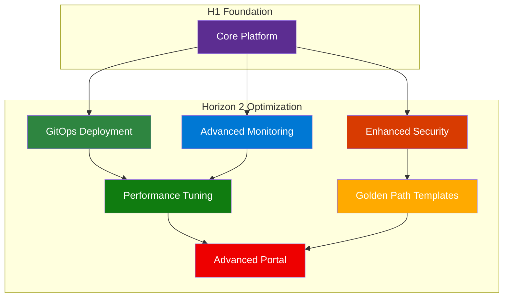

# ⚡ Horizon 2: Optimization Platform

## Overview

Horizon 2 builds upon the foundation established in Horizon 1, introducing advanced capabilities that optimize performance, enhance security, and improve the developer experience. This horizon focuses on scaling your platform and implementing best practices.

## Learning Path

Complete these documents in sequence after finishing Horizon 1:

### 1. [🚀 Advanced Deployment](001-advanced-deployment.md)
**Duration**: 3-4 hours  
**Purpose**: Implement GitOps and multi-cloud deployment strategies  
**Prerequisites**: H1 Foundation complete

### 2. [📊 Comprehensive Monitoring](002-comprehensive-monitoring.md)
**Duration**: 2-3 hours  
**Purpose**: Deploy advanced observability and monitoring  
**Prerequisites**: H1 Foundation + Advanced Deployment

### 3. [🛡️ Enhanced Security](003-enhanced-security.md)
**Duration**: 2-3 hours  
**Purpose**: Implement advanced security controls and policies  
**Prerequisites**: H1 Foundation + Monitoring

### 4. [⚡ Performance Optimization](004-performance-optimization.md)
**Duration**: 2-3 hours  
**Purpose**: Optimize platform performance and resource usage  
**Prerequisites**: H1 Foundation + Monitoring

### 5. [🛣️ Golden Paths](005-golden-paths.md)
**Duration**: 2-3 hours  
**Purpose**: Create standardized development templates  
**Prerequisites**: H1 Foundation + Security

### 6. [🏛️ Advanced Developer Hub](006-advanced-devhub.md)
**Duration**: 2-3 hours  
**Purpose**: Enhance portal with advanced features  
**Prerequisites**: H1 Foundation + Golden Paths

### 7. [🎭 Enhanced Demo](007-enhanced-demo.md)
**Duration**: 1-2 hours  
**Purpose**: Demonstrate optimized platform capabilities  
**Prerequisites**: All H2 components complete

## Success Criteria

By the end of Horizon 2, you should have:

- ✅ **GitOps Workflows**: Automated, declarative deployments
- ✅ **Comprehensive Monitoring**: Full observability stack deployed
- ✅ **Enhanced Security**: Advanced security policies and controls
- ✅ **Optimized Performance**: Tuned for scale and efficiency
- ✅ **Golden Path Templates**: Standardized development workflows
- ✅ **Advanced Portal**: Rich developer experience features
- ✅ **Production Ready**: Platform ready for enterprise workloads

## Architecture Overview

## Key Capabilities Added

### 🚀 Advanced Deployment
- **GitOps Integration**: Flux/ArgoCD for declarative deployments
- **Multi-Cloud Support**: Deploy across Azure, AWS, GCP
- **Progressive Delivery**: Canary and blue-green deployments
- **Environment Promotion**: Automated staging workflows

### 📊 Comprehensive Monitoring
- **Full Stack Observability**: Metrics, logs, traces, and alerts
- **Custom Dashboards**: Business and technical KPI visualization
- **Predictive Analytics**: AI-powered anomaly detection
- **SRE Automation**: Self-healing and auto-scaling

### 🛡️ Enhanced Security
- **Zero Trust Architecture**: Comprehensive security model
- **Policy as Code**: Automated governance with OPA
- **Advanced Scanning**: Container, IaC, and runtime security
- **Compliance Automation**: SOC2, PCI, HIPAA frameworks

### ⚡ Performance Optimization
- **Auto-scaling**: Intelligent resource management
- **Cost Optimization**: FinOps integration and optimization
- **Performance Tuning**: Platform and application optimization
- **Capacity Planning**: Predictive resource planning

### 🛣️ Golden Paths
- **Template Library**: Standardized project templates
- **Best Practices**: Embedded organizational standards
- **Self-Service**: Developer independence and speed
- **Governance**: Automated compliance and quality gates

### 🏛️ Advanced Developer Hub
- **Enhanced UI/UX**: Customized portal experience
- **Advanced Catalogs**: Rich service and API discovery
- **Analytics Integration**: Developer productivity insights
- **Plugin Ecosystem**: Extensible platform capabilities

## Quick Navigation

| Previous | Current | Next |
|----------|---------|------|
| [🏗️ H1: Foundation](../h1-horizon-foundation/README.md) | **H2: Optimization** | [🤖 H3: Innovation](../h3-horizon-innovation/README.md) |

---

**Ready to optimize?** Begin with [🚀 Advanced Deployment](001-advanced-deployment.md)
