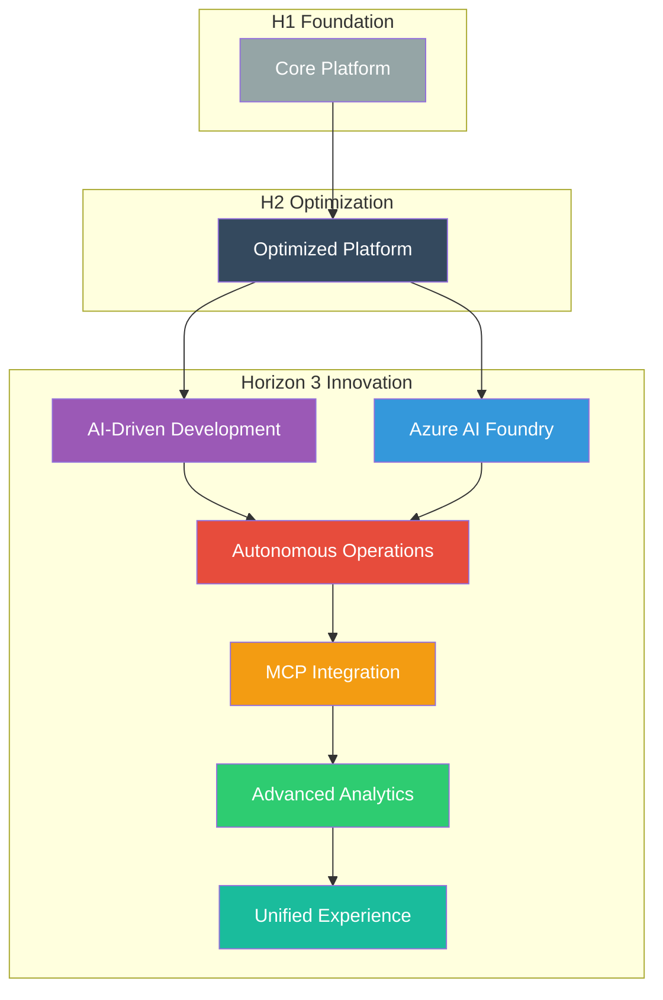
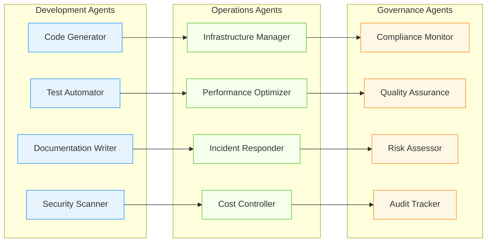

# 🤖 Horizon 3: Innovation Platform

## Overview

Horizon 3 represents the pinnacle of the Three Horizons AI Platform, introducing cutting-edge AI-driven capabilities that enable autonomous development and operations. This horizon transforms your platform into a truly intelligent, self-operating system.

## Learning Path

Complete these documents in sequence after finishing Horizons 1 and 2:

### 1. [🧠 AI-Driven Development](001-ai-driven-development.md)
**Duration**: 2-3 hours  
**Purpose**: Integrate GitHub Copilot and AI-powered development tools  
**Prerequisites**: H1 & H2 complete

### 2. [🧪 Azure AI Foundry](002-azure-ai-foundry.md)
**Duration**: 3-4 hours  
**Purpose**: Deploy and integrate Azure AI services and models  
**Prerequisites**: H1 & H2 complete + AI Development

### 3. [🤖 Autonomous Operations](003-autonomous-operations.md)
**Duration**: 4-5 hours  
**Purpose**: Implement self-healing and autonomous platform management  
**Prerequisites**: H1 & H2 complete + AI Foundry

### 4. [🔌 MCP Implementation](004-mcp-implementation.md)
**Duration**: 3-4 hours  
**Purpose**: Deploy Multi-Cloud Protocol for seamless integrations  
**Prerequisites**: H1 & H2 complete + Autonomous Operations

### 5. [📈 Advanced Analytics](005-advanced-analytics.md)
**Duration**: 2-3 hours  
**Purpose**: Implement AI-powered insights and predictive analytics  
**Prerequisites**: H1 & H2 complete + MCP

### 6. [🎯 Unified Experience](006-unified-experience.md)
**Duration**: 2-3 hours  
**Purpose**: Create seamless, AI-enhanced developer experience  
**Prerequisites**: H1 & H2 complete + Analytics

### 7. [🎪 Innovation Showcase](007-innovation-showcase.md)
**Duration**: 1-2 hours  
**Purpose**: Demonstrate cutting-edge platform capabilities  
**Prerequisites**: All H3 components complete

## Success Criteria

By the end of Horizon 3, you should have:

- ✅ **AI-Powered Development**: GitHub Copilot fully integrated
- ✅ **Model Management**: Azure AI Foundry operational
- ✅ **Autonomous Operations**: Self-healing systems deployed
- ✅ **Universal Connectivity**: MCP enabling all integrations
- ✅ **Intelligent Analytics**: AI-driven insights and predictions
- ✅ **Seamless Experience**: Unified, AI-enhanced interface
- ✅ **Innovation Leadership**: Cutting-edge capabilities demonstrated

## Architecture Overview

## Revolutionary Capabilities

### 🧠 AI-Driven Development
- **GitHub Copilot Enterprise**: Advanced AI code assistance
- **Agent Mode**: Autonomous development agents
- **Code Agents**: AI-powered issue resolution
- **Intelligent Testing**: AI-generated test cases and validation

### 🧪 Azure AI Foundry
- **Model Hub**: Centralized AI model management
- **Custom Models**: Fine-tuned enterprise models
- **AI Orchestration**: Intelligent workflow automation
- **Responsible AI**: Built-in safety and compliance

### 🤖 Autonomous Operations
- **Self-Healing Systems**: Automatic issue detection and resolution
- **Predictive Maintenance**: AI-powered infrastructure management
- **Intelligent Scaling**: Context-aware resource optimization
- **Anomaly Detection**: ML-based security and performance monitoring

### 🔌 MCP Implementation
- **Universal Connectivity**: Seamless tool and service integration
- **Protocol Standardization**: Common interface for all platforms
- **Dynamic Discovery**: Automatic service detection and configuration
- **Federated Operations**: Multi-cloud and hybrid deployment support

### 📈 Advanced Analytics
- **Predictive Insights**: AI-powered trend analysis and forecasting
- **Real-time Dashboards**: Dynamic, context-aware visualizations
- **Behavioral Analytics**: Developer and system behavior insights
- **Business Intelligence**: Strategic decision support with AI

### 🎯 Unified Experience
- **Intelligent Portal**: AI-enhanced developer hub interface
- **Contextual Assistance**: Smart help and recommendations
- **Personalized Workflows**: Adaptive user experience
- **Voice and Natural Language**: Conversational platform interaction

## AI Agent Ecosystem

## Innovation Impact

### Transformational Outcomes

- **🚀 10x Developer Productivity**: AI assistance reduces coding time by 90%
- **🎯 Near-Zero Downtime**: Self-healing systems maintain 99.99% uptime
- **💡 Continuous Innovation**: Automated experimentation and optimization
- **🔮 Predictive Operations**: Issues prevented before they occur
- **🌟 Competitive Advantage**: Industry-leading development velocity

### Future-Ready Architecture

- **Quantum Computing Ready**: Prepared for next-generation computing
- **Edge AI Integration**: Distributed intelligence capabilities
- **Neuromorphic Computing**: Brain-inspired processing models
- **Sustainable Operations**: Carbon-negative platform operations

## Quick Navigation

| Previous | Current | Next |
|----------|---------|------|
| [⚡ H2: Optimization](../h2-horizon-optimization/README.md) | **H3: Innovation** | [🏠 Documentation Home](../README.md) |

---

**Ready to innovate?** Begin with [🧠 AI-Driven Development](001-ai-driven-development.md)
