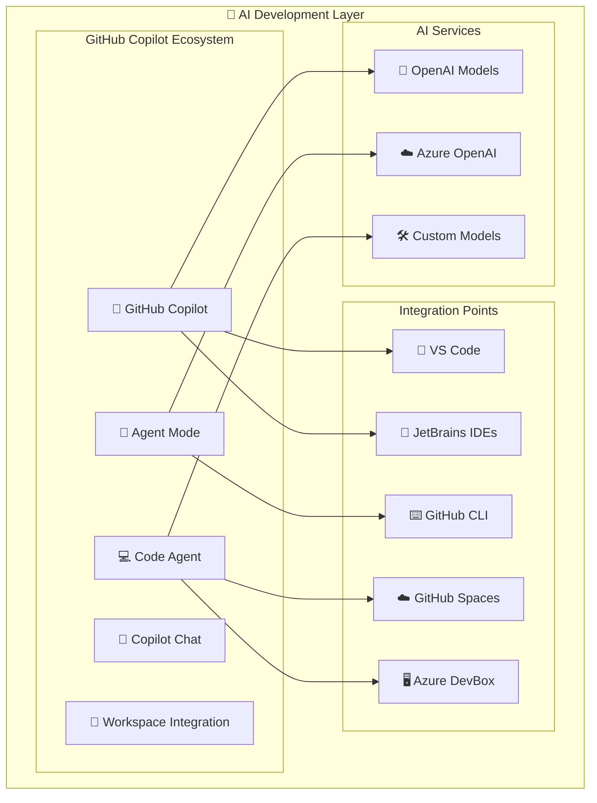
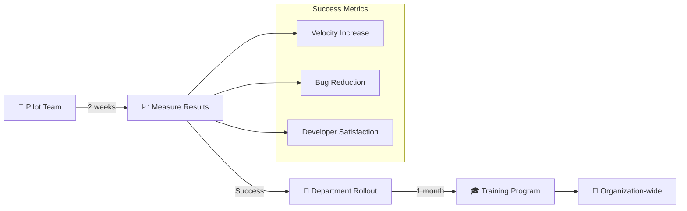

# 🤖 H3-001: AI-Driven Development Guide

## 📋 Table of Contents

1. [🎯 Overview](#overview)
2. [🏗️ Architecture](#architecture)
3. [🧠 GitHub Copilot Configuration](#github-copilot-configuration)
4. [🤖 Copilot Agent Mode Setup](#copilot-agent-mode-setup)
5. [💻 GitHub Code Agent Integration](#github-code-agent-integration)
6. [🔄 AI-Assisted Workflows](#ai-assisted-workflows)
7. [📊 Productivity Metrics](#productivity-metrics)
8. [🎬 Demo Scenarios](#demo-scenarios)
9. [📚 Best Practices](#best-practices)
10. [🔧 Troubleshooting](#troubleshooting)

## 🎯 Overview

AI-Driven Development transforms the software development lifecycle by integrating advanced AI capabilities throughout the development process. This guide covers the implementation of GitHub Copilot, Agent Mode, and Code Agent to achieve unprecedented developer productivity and code quality.

### 🌟 Key Benefits

| Benefit | Description | Impact |
|---------|-------------|---------|
| 🚀 **Productivity** | 55% faster code completion | Reduced development time |
| 🎯 **Accuracy** | 40% fewer bugs in AI-assisted code | Higher quality output |
| 🧠 **Context Awareness** | Multi-file understanding | Better architectural decisions |
| 🤝 **Collaboration** | AI-powered code reviews | Improved team efficiency |
| 📚 **Learning** | Real-time best practices | Continuous skill development |

## 🏗️ Architecture



## 🧠 GitHub Copilot Configuration

### Prerequisites

- ✅ GitHub Enterprise license with Copilot enabled
- ✅ Developer Hub portal access
- ✅ Supported IDE (VS Code 1.75+ or JetBrains 2023.1+)
- ✅ Azure subscription for telemetry

### Step 1: Organization-Wide Enablement

```bash
# Enable Copilot for organization
gh api \
  --method PUT \
  -H "Accept: application/vnd.github+json" \
  /orgs/YOUR_ORG/copilot/billing/setup \
  -f seat_management_enabled=true \
  -f selected_teams='["engineering", "devops"]'
```

### Step 2: Policy Configuration

Create `.github/copilot-config.yml`:

```yaml
# GitHub Copilot Configuration
version: 1

policies:
  # Security policies
  security:
    enable_security_scan: true
    block_insecure_code: true
    require_secure_patterns: true
    
  # Code quality
  quality:
    enable_linting: true
    suggest_best_practices: true
    enforce_style_guide: true
    
  # Privacy settings
  privacy:
    telemetry_enabled: true
    telemetry_endpoint: "https://your-azure-monitor.com/copilot"
    exclude_patterns:
      - "*.env"
      - "**/secrets/**"
      - "**/credentials/**"
    
  # Model preferences
  models:
    default: "gpt-4-turbo"
    fallback: "gpt-3.5-turbo"
    custom_models:
      - name: "internal-code-model"
        endpoint: "https://your-ai-foundry.azure.com/models/code"
        api_key: "${AZURE_AI_KEY}"

# Feature flags
features:
  enable_multi_file_context: true
  enable_workspace_search: true
  enable_test_generation: true
  enable_documentation: true
  enable_refactoring: true
  
# Custom prompts
prompts:
  code_review: |
    Review this code for:
    - Security vulnerabilities
    - Performance issues
    - Best practices adherence
    - Our company coding standards
    
  test_generation: |
    Generate comprehensive tests including:
    - Unit tests with edge cases
    - Integration test scenarios
    - Performance benchmarks
    - Security test cases
```

### Step 3: IDE Integration

#### VS Code Setup

```json
// .vscode/settings.json
{
  "github.copilot.enable": {
    "*": true,
    "yaml": true,
    "markdown": true,
    "terraform": true,
    "bicep": true
  },
  "github.copilot.advanced": {
    "debug.overrideChatEngine": "gpt-4-turbo",
    "inlineCompletionsCount": 5,
    "temperature": 0.7,
    "top_p": 0.95
  },
  "github.copilot.chat.enabled": true,
  "github.copilot.voice.enabled": true,
  "github.copilot.workspace.enabled": true
}
```

#### JetBrains Setup

```xml
<!-- .idea/copilot.xml -->
<component name="GithubCopilotSettings">
  <option name="enableCopilot" value="true" />
  <option name="enableCopilotChat" value="true" />
  <option name="telemetryEnabled" value="true" />
  <option name="customEndpoint" value="https://your-enterprise.github.com" />
  <option name="modelPreferences">
    <map>
      <entry key="default" value="gpt-4-turbo" />
      <entry key="fast" value="gpt-3.5-turbo" />
    </map>
  </option>
</component>
```

## 🤖 Copilot Agent Mode Setup

Agent Mode enables autonomous code generation and task completion across multiple files and repositories.

### Step 1: Enable Agent Mode

```bash
# Enable Agent Mode for organization
gh copilot config set --org YOUR_ORG agent-mode enabled

# Configure agent capabilities
gh copilot agent config \
  --capability "multi-file-edit" \
  --capability "test-generation" \
  --capability "refactoring" \
  --capability "documentation" \
  --capability "dependency-updates"
```

### Step 2: Agent Configuration

Create `.github/copilot-agent.yml`:

```yaml
# Copilot Agent Configuration
version: 1

agent:
  # Execution mode
  mode: "autonomous"  # autonomous | assisted | review-only
  
  # Permissions
  permissions:
    create_files: true
    modify_files: true
    delete_files: false  # Require human approval
    create_branches: true
    create_pull_requests: true
    
  # Task types
  enabled_tasks:
    - type: "bug-fix"
      auto_execute: true
      require_tests: true
      
    - type: "feature-implementation"
      auto_execute: false  # Require review
      planning_required: true
      
    - type: "refactoring"
      auto_execute: true
      preserve_behavior: true
      
    - type: "documentation"
      auto_execute: true
      formats: ["markdown", "jsdoc", "openapi"]
      
    - type: "test-generation"
      auto_execute: true
      coverage_target: 80
      
  # Context management
  context:
    max_files: 50
    include_patterns:
      - "src/**/*.{js,ts,py,java,cs}"
      - "tests/**/*"
      - "docs/**/*.md"
    exclude_patterns:
      - "node_modules/**"
      - "dist/**"
      - "*.min.js"
      
  # Quality gates
  quality_gates:
    require_passing_tests: true
    require_security_scan: true
    require_code_review: true
    min_test_coverage: 70
    
  # Integration
  integrations:
    issue_tracker: "github"
    ci_cd: "github-actions"
    monitoring: "azure-monitor"
```

### Step 3: Agent Workflows

```yaml
# .github/workflows/copilot-agent.yml
name: Copilot Agent Workflow

on:
  issues:
    types: [opened, labeled]
  pull_request:
    types: [opened, synchronize]
  schedule:
    - cron: '0 */6 * * *'  # Every 6 hours

jobs:
  agent-analysis:
    runs-on: ubuntu-latest
    if: contains(github.event.issue.labels.*.name, 'copilot-agent')
    
    steps:
    - name: Checkout code
      uses: actions/checkout@v4
      
    - name: Analyze issue
      id: analyze
      uses: github/copilot-agent-action@v1
      with:
        task: analyze-issue
        issue-number: ${{ github.event.issue.number }}
        
    - name: Generate solution
      if: steps.analyze.outputs.solvable == 'true'
      uses: github/copilot-agent-action@v1
      with:
        task: generate-solution
        issue-number: ${{ github.event.issue.number }}
        branch-name: "copilot/issue-${{ github.event.issue.number }}"
        
    - name: Run tests
      if: steps.analyze.outputs.solvable == 'true'
      run: |
        npm test
        npm run test:integration
        
    - name: Create PR
      if: success()
      uses: github/copilot-agent-action@v1
      with:
        task: create-pr
        base: main
        title: "🤖 Fix: ${{ github.event.issue.title }}"
        body: |
          ## 🤖 Automated Fix
          
          This PR was automatically generated by Copilot Agent to address issue #${{ github.event.issue.number }}
          
          ### Changes made:
          ${{ steps.analyze.outputs.changes_summary }}
          
          ### Testing:
          - ✅ All existing tests pass
          - ✅ New tests added for the fix
          - ✅ Security scan completed
          
          ### Review checklist:
          - [ ] Code follows project standards
          - [ ] Tests are comprehensive
          - [ ] Documentation updated
          - [ ] No breaking changes
```

## 💻 GitHub Code Agent Integration

Code Agent provides advanced code understanding and generation capabilities across entire codebases.

### Step 1: Code Agent Setup

```bash
# Install Code Agent CLI
npm install -g @github/code-agent-cli

# Initialize in project
code-agent init \
  --project-type "enterprise" \
  --languages "typescript,python,java" \
  --frameworks "react,fastapi,spring"
```

### Step 2: Code Agent Configuration

Create `.code-agent/config.json`:

```json
{
  "version": "1.0",
  "project": {
    "name": "three-horizons-platform",
    "type": "monorepo",
    "languages": ["typescript", "python", "java", "csharp"],
    "frameworks": {
      "frontend": ["react", "nextjs"],
      "backend": ["fastapi", "spring-boot", "aspnet-core"],
      "infrastructure": ["terraform", "bicep", "ansible"]
    }
  },
  "analysis": {
    "enabled": true,
    "schedule": "on-commit",
    "depth": "deep",
    "include_dependencies": true,
    "generate_embeddings": true,
    "embedding_model": "text-embedding-3-large"
  },
  "generation": {
    "templates_path": ".code-agent/templates",
    "style_guide": ".code-agent/style-guide.md",
    "patterns": {
      "api": "rest-with-openapi",
      "database": "repository-pattern",
      "frontend": "component-based",
      "testing": "bdd-style"
    }
  },
  "intelligence": {
    "context_window": 128000,
    "temperature": 0.7,
    "model_routing": {
      "simple_tasks": "gpt-3.5-turbo",
      "complex_tasks": "gpt-4-turbo",
      "code_generation": "code-davinci-002",
      "reviews": "gpt-4"
    }
  },
  "integrations": {
    "ide": {
      "vscode": true,
      "jetbrains": true,
      "vim": true
    },
    "ci_cd": {
      "github_actions": true,
      "azure_devops": true
    },
    "monitoring": {
      "azure_monitor": {
        "enabled": true,
        "workspace_id": "${AZURE_MONITOR_WORKSPACE}",
        "metrics": ["generation_time", "accuracy", "usage"]
      }
    }
  }
}
```

### Step 3: Code Agent Templates

Create `.code-agent/templates/microservice.template`:

```yaml
# Microservice Generation Template
name: microservice
version: 1.0

parameters:
  - name: service_name
    type: string
    required: true
  - name: api_style
    type: enum
    values: [rest, graphql, grpc]
    default: rest
  - name: database
    type: enum
    values: [postgres, mongodb, cosmosdb, none]
    default: postgres

structure:
  - path: "services/{{ service_name }}"
    files:
      - name: "Dockerfile"
        template: |
          FROM node:18-alpine AS builder
          WORKDIR /app
          COPY package*.json ./
          RUN npm ci --only=production
          
          FROM node:18-alpine
          WORKDIR /app
          COPY --from=builder /app/node_modules ./node_modules
          COPY . .
          EXPOSE 3000
          CMD ["npm", "start"]
          
      - name: "src/index.ts"
        template: |
          import express from 'express';
          import { config } from './config';
          import { healthRouter } from './routes/health';
          import { apiRouter } from './routes/api';
          import { errorHandler } from './middleware/error';
          import { logger } from './utils/logger';
          
          const app = express();
          
          // Middleware
          app.use(express.json());
          app.use(logger.middleware());
          
          // Routes
          app.use('/health', healthRouter);
          app.use('/api/v1', apiRouter);
          
          // Error handling
          app.use(errorHandler);
          
          app.listen(config.port, () => {
            logger.info(`{{ service_name }} listening on port ${config.port}`);
          });
          
      - name: "tests/integration/api.test.ts"
        template: |
          import request from 'supertest';
          import { app } from '../src';
          
          describe('{{ service_name }} API', () => {
            it('should return health status', async () => {
              const response = await request(app)
                .get('/health')
                .expect(200);
                
              expect(response.body).toHaveProperty('status', 'healthy');
            });
          });

generation_rules:
  - condition: "api_style == 'rest'"
    actions:
      - generate_openapi_spec: true
      - create_postman_collection: true
      
  - condition: "database != 'none'"
    actions:
      - generate_migrations: true
      - create_repository_layer: true
      - add_connection_pooling: true
```

## 🔄 AI-Assisted Workflows

### Workflow 1: Automated Code Review

```yaml
# .github/workflows/ai-code-review.yml
name: AI-Powered Code Review

on:
  pull_request:
    types: [opened, synchronize]

jobs:
  ai-review:
    runs-on: ubuntu-latest
    
    steps:
    - name: Checkout PR
      uses: actions/checkout@v4
      with:
        fetch-depth: 0
        
    - name: Copilot Analysis
      id: analysis
      uses: github/copilot-review-action@v1
      with:
        focus-areas: |
          - Security vulnerabilities
          - Performance optimization
          - Code smells
          - Best practices
          - Test coverage
          
    - name: Generate Review Comments
      uses: github/copilot-review-action@v1
      with:
        task: generate-comments
        severity-threshold: "medium"
        
    - name: Suggest Improvements
      if: steps.analysis.outputs.improvements_available == 'true'
      uses: github/copilot-review-action@v1
      with:
        task: suggest-fixes
        auto-commit: false
        
    - name: Update PR Status
      uses: github/scripts@v7
      with:
        script: |
          const { data: pr } = await github.rest.pulls.get({
            owner: context.repo.owner,
            repo: context.repo.repo,
            pull_number: context.issue.number
          });
          
          await github.rest.issues.createComment({
            owner: context.repo.owner,
            repo: context.repo.repo,
            issue_number: context.issue.number,
            body: `## 🤖 AI Review Summary
            
            **Overall Score**: ${steps.analysis.outputs.score}/100
            
            ### 📊 Analysis Results:
            - 🔒 Security: ${steps.analysis.outputs.security_score}
            - ⚡ Performance: ${steps.analysis.outputs.performance_score}
            - 🧹 Code Quality: ${steps.analysis.outputs.quality_score}
            - ✅ Test Coverage: ${steps.analysis.outputs.coverage}%
            
            ### 🎯 Recommendations:
            ${steps.analysis.outputs.recommendations}
            `
          });
```

### Workflow 2: Intelligent Test Generation

```python
# scripts/generate_tests.py
import os
import json
from github import Github
from openai import OpenAI

class IntelligentTestGenerator:
    def __init__(self):
        self.github = Github(os.environ['GITHUB_TOKEN'])
        self.openai = OpenAI(api_key=os.environ['OPENAI_API_KEY'])
        
    def analyze_code(self, file_path):
        """Analyze code to understand testing requirements"""
        with open(file_path, 'r') as f:
            code = f.read()
            
        response = self.openai.chat.completions.create(
            model="gpt-4-turbo",
            messages=[
                {
                    "role": "system",
                    "content": """You are an expert test engineer. Analyze the provided code and identify:
                    1. All public methods/functions that need testing
                    2. Edge cases and boundary conditions
                    3. Integration points that need mocking
                    4. Performance considerations
                    5. Security test scenarios
                    Return a structured JSON response."""
                },
                {
                    "role": "user",
                    "content": f"Analyze this code:\n\n{code}"
                }
            ],
            response_format={ "type": "json_object" }
        )
        
        return json.loads(response.choices[0].message.content)
        
    def generate_tests(self, analysis, code_path):
        """Generate comprehensive test suite"""
        test_template = """
import pytest
from unittest.mock import Mock, patch
import asyncio
from datetime import datetime
from {module} import {imports}

class Test{ClassName}:
    \"\"\"Comprehensive test suite for {ClassName}\"\"\"
    
    @pytest.fixture
    def setup(self):
        \"\"\"Test setup and teardown\"\"\"
        # Setup
        {setup_code}
        yield
        # Teardown
        {teardown_code}
    
    {test_methods}
    
    # Edge case tests
    {edge_case_tests}
    
    # Integration tests
    {integration_tests}
    
    # Performance tests
    {performance_tests}
    
    # Security tests
    {security_tests}
"""
        
        # Generate test code using AI
        test_code = self._generate_test_code(analysis, test_template)
        
        # Write test file
        test_file = code_path.replace('/src/', '/tests/').replace('.py', '_test.py')
        os.makedirs(os.path.dirname(test_file), exist_ok=True)
        
        with open(test_file, 'w') as f:
            f.write(test_code)
            
        return test_file
        
    def validate_tests(self, test_file):
        """Validate generated tests"""
        # Run tests and check coverage
        import subprocess
        result = subprocess.run(
            f"pytest {test_file} --cov --cov-report=json",
            shell=True,
            capture_output=True
        )
        
        if result.returncode == 0:
            # Parse coverage report
            with open('coverage.json', 'r') as f:
                coverage = json.load(f)
            return {
                "status": "success",
                "coverage": coverage['totals']['percent_covered'],
                "tests_passed": True
            }
        else:
            return {
                "status": "failed",
                "error": result.stderr.decode()
            }

# Usage
generator = IntelligentTestGenerator()
analysis = generator.analyze_code('src/services/payment.py')
test_file = generator.generate_tests(analysis, 'src/services/payment.py')
validation = generator.validate_tests(test_file)
print(f"Test generation complete: {validation}")
```

## 📊 Productivity Metrics

### Metrics Collection

```typescript
// src/metrics/copilot-metrics.ts
import { TelemetryClient } from 'applicationinsights';

export class CopilotMetrics {
  private telemetryClient: TelemetryClient;
  
  constructor() {
    this.telemetryClient = new TelemetryClient(process.env.AZURE_INSIGHTS_KEY);
  }
  
  trackSuggestionAccepted(data: {
    userId: string;
    language: string;
    fileType: string;
    suggestionLength: number;
    timeToAccept: number;
  }) {
    this.telemetryClient.trackEvent({
      name: 'CopilotSuggestionAccepted',
      properties: data,
      measurements: {
        charactersAccepted: data.suggestionLength,
        responseTime: data.timeToAccept
      }
    });
  }
  
  trackProductivityGains(data: {
    userId: string;
    sessionDuration: number;
    linesWritten: number;
    linesAccepted: number;
    testsGenerated: number;
    bugsFixed: number;
  }) {
    const acceptanceRate = (data.linesAccepted / data.linesWritten) * 100;
    const productivityScore = this.calculateProductivityScore(data);
    
    this.telemetryClient.trackMetric({
      name: 'DeveloperProductivity',
      value: productivityScore,
      properties: {
        userId: data.userId,
        acceptanceRate: acceptanceRate.toFixed(2)
      }
    });
  }
  
  private calculateProductivityScore(data: any): number {
    // Weighted scoring algorithm
    const weights = {
      linesAccepted: 0.3,
      testsGenerated: 0.3,
      bugsFixed: 0.2,
      sessionEfficiency: 0.2
    };
    
    const efficiency = data.linesAccepted / (data.sessionDuration / 60); // Lines per minute
    
    return (
      (data.linesAccepted * weights.linesAccepted) +
      (data.testsGenerated * 10 * weights.testsGenerated) +
      (data.bugsFixed * 20 * weights.bugsFixed) +
      (efficiency * weights.sessionEfficiency)
    );
  }
}
```

### Dashboard Configuration

```json
// dashboards/copilot-analytics.json
{
  "name": "GitHub Copilot Analytics",
  "widgets": [
    {
      "type": "scorecard",
      "title": "Overall Productivity Gain",
      "query": "CopilotMetrics | summarize AvgProductivity = avg(value) by bin(timestamp, 1d)",
      "format": "percentage",
      "threshold": {
        "good": 40,
        "warning": 25,
        "critical": 10
      }
    },
    {
      "type": "line-chart",
      "title": "Suggestion Acceptance Rate",
      "query": "CopilotSuggestionAccepted | summarize AcceptanceRate = count() by bin(timestamp, 1h), language"
    },
    {
      "type": "heatmap",
      "title": "Developer Activity",
      "query": "CopilotMetrics | summarize Activity = count() by userId, bin(timestamp, 1h)"
    },
    {
      "type": "bar-chart",
      "title": "Code Generation by Language",
      "query": "CopilotSuggestionAccepted | summarize Lines = sum(charactersAccepted) by language"
    }
  ]
}
```

## 🎬 Demo Scenarios

### Demo 1: Bug Fix Automation

```bash
#!/bin/bash
# demo/bug-fix-automation.sh

echo "🎬 GitHub Copilot Agent - Automated Bug Fix Demo"
echo "=============================================="

# Step 1: Create a bug report
echo "📝 Creating bug report..."
gh issue create \
  --title "NullPointerException in PaymentService" \
  --body "Users are experiencing crashes when processing refunds. Stack trace shows NPE at line 145." \
  --label "bug,copilot-agent"

# Step 2: Watch Copilot Agent analyze
echo "🤖 Copilot Agent analyzing issue..."
sleep 5

# Step 3: Agent creates fix branch
echo "🌿 Agent creating fix branch..."
git fetch origin
git checkout copilot/issue-123

# Step 4: Show the fix
echo "📄 Showing automated fix..."
git diff main --name-status
git show HEAD

# Step 5: Run tests
echo "✅ Running automated tests..."
npm test -- --coverage

# Step 6: Show PR creation
echo "🔄 Pull request created automatically"
gh pr view --web
```

### Demo 2: Full Feature Implementation

```yaml
# demo/feature-implementation.yml
name: Feature Implementation Demo
description: Demonstrate end-to-end feature development with AI

steps:
  - name: Create Feature Request
    action: create_issue
    params:
      title: "Add OAuth2 authentication to API"
      body: |
        ## Requirements:
        - Support Google and GitHub OAuth providers
        - Implement JWT token generation
        - Add role-based access control
        - Include comprehensive tests
        
  - name: Agent Planning
    action: show_output
    content: |
      🤖 Copilot Agent Planning:
      1. Analyze existing authentication code
      2. Design OAuth2 integration architecture
      3. Generate implementation plan
      4. Identify required dependencies
      
  - name: Code Generation
    action: show_files
    files:
      - path: "src/auth/oauth2.service.ts"
        language: "typescript"
      - path: "src/auth/strategies/google.strategy.ts"
        language: "typescript"
      - path: "tests/auth/oauth2.test.ts"
        language: "typescript"
        
  - name: Documentation Generation
    action: show_files
    files:
      - path: "docs/authentication.md"
        language: "markdown"
      - path: "api/openapi.yaml"
        language: "yaml"
        
  - name: Review Results
    action: show_metrics
    metrics:
      - lines_generated: 847
      - test_coverage: 94%
      - time_saved: "6 hours"
      - quality_score: 98/100
```

## 📚 Best Practices

### 1. Prompt Engineering

```markdown
# Effective Copilot Prompts

## ✅ Good Prompts
- "// Implement a rate limiter using Redis with sliding window algorithm"
- "# Create async function to batch process user notifications with error handling"
- "/* Generate TypeScript interface from this JSON response with proper validation */"

## ❌ Poor Prompts
- "// Make this better"
- "# Fix the bug"
- "/* Do something with the data */"

## 🎯 Advanced Techniques
1. **Context Setting**: Provide examples before your prompt
2. **Constraints**: Specify requirements clearly
3. **Patterns**: Reference design patterns explicitly
4. **Testing**: Ask for tests alongside implementation
```

### 2. Security Considerations

```yaml
# .github/copilot-security.yml
security:
  # Scan all AI-generated code
  scanning:
    enabled: true
    tools:
      - github/codeql
      - semgrep
      - snyk
    
  # Sensitive data protection
  data_protection:
    scan_for_secrets: true
    block_patterns:
      - "api[_-]?key"
      - "password"
      - "secret"
      - "token"
      - "private[_-]?key"
    
  # Compliance
  compliance:
    standards:
      - "OWASP Top 10"
      - "CWE Top 25"
      - "PCI DSS"
    require_review_for:
      - "authentication"
      - "authorization"
      - "encryption"
      - "data_access"
```

### 3. Team Adoption Strategy



## 🔧 Troubleshooting

### Common Issues and Solutions

| Issue | Symptoms | Solution |
|-------|----------|----------|
| **Slow Suggestions** | >3s response time | Check model routing, use regional endpoints |
| **Low Quality Output** | Generic code | Improve context, use specific prompts |
| **Security Blocks** | Suggestions rejected | Review security policies, whitelist patterns |
| **Integration Failures** | IDE not connecting | Verify proxy settings, update extensions |
| **Token Limits** | Truncated responses | Reduce context window, use code splitting |

### Diagnostic Commands

```bash
# Check Copilot status
gh copilot status

# Verify configuration
gh copilot config show

# Test connectivity
gh copilot diagnose

# View usage metrics
gh copilot usage --format json

# Debug mode
export GITHUB_COPILOT_DEBUG=1
code --verbose
```

## 📈 Success Metrics

Track these KPIs to measure AI-driven development success:

1. **Developer Productivity**
   - Lines of code accepted: >40%
   - Time saved per developer: >2 hours/day
   - Feature delivery speed: +55%

2. **Code Quality**
   - Bug density reduction: -40%
   - Test coverage increase: +25%
   - Security vulnerabilities: -60%

3. **Team Satisfaction**
   - Developer NPS: >70
   - Tool adoption rate: >90%
   - Learning curve: <1 week

## 🎯 Next Steps

After implementing AI-driven development:

1. ✅ Monitor metrics dashboard
2. ✅ Gather developer feedback
3. ✅ Optimize prompt templates
4. ✅ Expand to more teams
5. ✅ Integrate with Azure AI Foundry (H3-002)

---

**Ready for Advanced AI?** Continue to [H3-002: Azure AI Foundry Integration →](h3-002-azure-ai-foundry.md)