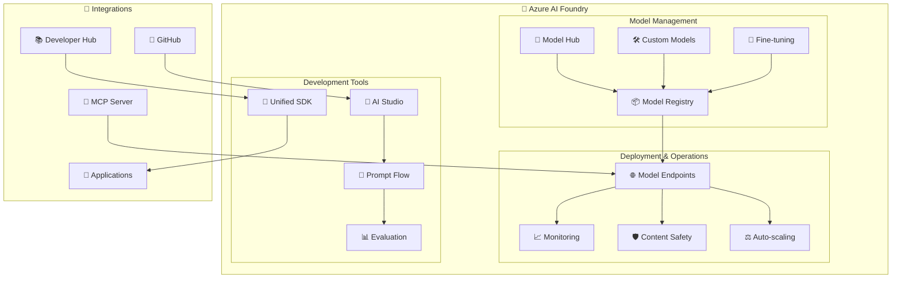

# 🧪 H3-002: Azure AI Foundry Integration Guide

## 📋 Table of Contents

1. [🎯 Overview](#overview)
2. [🏗️ Architecture](#architecture)
3. [🚀 Model Deployment](#model-deployment)
4. [🔧 Unified SDK Implementation](#unified-sdk-implementation)
5. [⚙️ GenAIOps Workflows](#genaiops-workflows)
6. [📱 AI Application Templates](#ai-application-templates)
7. [🔌 Integration with Developer Hub](#integration-with-developer-hub)
8. [📊 Model Monitoring](#model-monitoring)
9. [🎬 Demo Scenarios](#demo-scenarios)
10. [📚 Best Practices](#best-practices)

## 🎯 Overview

Azure AI Foundry provides a comprehensive platform for building, deploying, and managing AI applications at enterprise scale. This guide covers the integration of AI Foundry with the Three Horizons platform to enable GenAIOps workflows and accelerate AI application development.

### 🌟 Key Capabilities

| Capability | Description | Business Value |
|------------|-------------|----------------|
| 🧠 **Model Hub** | Pre-trained and custom models | Reduced time to market |
| 🔧 **Unified SDK** | Single interface for all AI services | Simplified development |
| 🚀 **GenAIOps** | MLOps for generative AI | Reliable AI deployments |
| 📊 **Responsible AI** | Built-in safety and monitoring | Compliance and trust |
| 🔌 **MCP Integration** | Model Context Protocol support | Enhanced AI capabilities |

## 🏗️ Architecture



## 🚀 Model Deployment

### Prerequisites

```bash
# Install Azure CLI AI extension
az extension add --name ai

# Install AI Foundry SDK
pip install azure-ai-foundry azure-ai-ml promptflow

# Set up authentication
az login
az account set --subscription "YOUR_SUBSCRIPTION"
```

### Step 1: Create AI Foundry Workspace

```bicep
// infrastructure/ai-foundry.bicep
param location string = resourceGroup().location
param workspaceName string = 'ai-foundry-${uniqueString(resourceGroup().id)}'
param storageAccountName string = 'aifoundry${uniqueString(resourceGroup().id)}'
param keyVaultName string = 'aifoundry-kv-${uniqueString(resourceGroup().id)}'

// Storage Account
resource storageAccount 'Microsoft.Storage/storageAccounts@2023-01-01' = {
  name: storageAccountName
  location: location
  sku: {
    name: 'Standard_LRS'
  }
  kind: 'StorageV2'
  properties: {
    encryption: {
      services: {
        blob: {
          enabled: true
        }
        file: {
          enabled: true
        }
      }
      keySource: 'Microsoft.Storage'
    }
  }
}

// Key Vault
resource keyVault 'Microsoft.KeyVault/vaults@2023-07-01' = {
  name: keyVaultName
  location: location
  properties: {
    sku: {
      family: 'A'
      name: 'standard'
    }
    tenantId: subscription().tenantId
    enableSoftDelete: true
    enablePurgeProtection: true
    accessPolicies: []
  }
}

// AI Foundry Workspace
resource aiWorkspace 'Microsoft.MachineLearningServices/workspaces@2024-01-01' = {
  name: workspaceName
  location: location
  identity: {
    type: 'SystemAssigned'
  }
  properties: {
    friendlyName: 'Three Horizons AI Foundry'
    description: 'Enterprise AI platform for Three Horizons'
    storageAccount: storageAccount.id
    keyVault: keyVault.id
    applicationInsights: monitoring.outputs.appInsightsId
    hbiWorkspace: true
    v1LegacyMode: false
    publicNetworkAccess: 'Enabled'
    managedNetwork: {
      isolationMode: 'AllowInternetOutbound'
      outboundRules: {
        github: {
          type: 'FQDN'
          destination: 'github.com'
        }
        dockerhub: {
          type: 'FQDN'
          destination: 'hub.docker.com'
        }
      }
    }
  }
}

// Compute Resources
resource computeCluster 'Microsoft.MachineLearningServices/workspaces/computes@2024-01-01' = {
  parent: aiWorkspace
  name: 'gpu-cluster'
  location: location
  properties: {
    computeType: 'AmlCompute'
    properties: {
      scaleSettings: {
        minNodeCount: 0
        maxNodeCount: 10
        nodeIdleTimeBeforeScaleDown: 'PT5M'
      }
      vmSize: 'Standard_NC24ads_A100_v4'
      vmPriority: 'Dedicated'
      osType: 'Linux'
      remoteLoginPortPublicAccess: 'Disabled'
      enableNodePublicIp: false
    }
  }
}

output workspaceId string = aiWorkspace.id
output workspaceName string = aiWorkspace.name
```

### Step 2: Deploy Foundation Models

```python
# scripts/deploy_models.py
from azure.ai.foundry import AIFoundryClient
from azure.ai.ml import MLClient
from azure.identity import DefaultAzureCredential
import json

class ModelDeploymentManager:
    def __init__(self, workspace_name: str, resource_group: str):
        self.credential = DefaultAzureCredential()
        self.ml_client = MLClient(
            credential=self.credential,
            subscription_id="YOUR_SUBSCRIPTION",
            resource_group_name=resource_group,
            workspace_name=workspace_name
        )
        self.ai_client = AIFoundryClient(
            credential=self.credential,
            workspace=workspace_name
        )
        
    def deploy_foundation_model(self, model_config: dict):
        """Deploy a foundation model from the model hub"""
        
        # Get model from registry
        model = self.ai_client.models.get(
            name=model_config['name'],
            version=model_config['version']
        )
        
        # Create online endpoint
        endpoint_name = f"{model_config['name']}-endpoint"
        endpoint = self.ml_client.online_endpoints.begin_create_or_update(
            name=endpoint_name,
            properties={
                "auth_mode": "key",
                "description": f"Endpoint for {model_config['name']}",
                "tags": {
                    "model": model_config['name'],
                    "purpose": model_config['purpose']
                }
            }
        ).result()
        
        # Create deployment
        deployment = self.ml_client.online_deployments.begin_create_or_update(
            name=f"{model_config['name']}-deployment",
            endpoint_name=endpoint_name,
            model=model,
            instance_type=model_config['instance_type'],
            instance_count=model_config['instance_count'],
            request_settings={
                "max_concurrent_requests_per_instance": 3,
                "request_timeout_ms": 90000,
                "max_queue_wait_ms": 60000
            },
            liveness_probe={
                "failure_threshold": 30,
                "success_threshold": 1,
                "period": 100,
                "initial_delay": 600
            },
            readiness_probe={
                "failure_threshold": 30,
                "success_threshold": 1,
                "period": 100,
                "initial_delay": 600
            }
        ).result()
        
        # Enable monitoring
        self._configure_monitoring(endpoint_name, model_config)
        
        return {
            "endpoint_url": endpoint.properties.scoring_uri,
            "api_key": self.ml_client.online_endpoints.get_keys(endpoint_name).primary_key,
            "model": model_config['name'],
            "status": "deployed"
        }
        
    def _configure_monitoring(self, endpoint_name: str, model_config: dict):
        """Configure monitoring for deployed model"""
        
        monitoring_config = {
            "data_collection": {
                "enabled": True,
                "sampling_rate": 1.0,
                "collect_model_data": True,
                "collect_request_response": True
            },
            "content_safety": {
                "enabled": True,
                "hate_speech_threshold": 0.7,
                "violence_threshold": 0.7,
                "self_harm_threshold": 0.7,
                "sexual_threshold": 0.7
            },
            "performance_monitoring": {
                "enabled": True,
                "latency_threshold_ms": 1000,
                "error_rate_threshold": 0.05
            }
        }
        
        self.ml_client.online_endpoints.update(
            name=endpoint_name,
            monitoring=monitoring_config
        )

# Deployment configuration
models_to_deploy = [
    {
        "name": "gpt-4-turbo",
        "version": "latest",
        "purpose": "general-ai",
        "instance_type": "Standard_NC24ads_A100_v4",
        "instance_count": 2
    },
    {
        "name": "phi-3-mini",
        "version": "latest",
        "purpose": "edge-ai",
        "instance_type": "Standard_DS3_v2",
        "instance_count": 3
    },
    {
        "name": "stable-diffusion-xl",
        "version": "latest",
        "purpose": "image-generation",
        "instance_type": "Standard_NC6s_v3",
        "instance_count": 1
    },
    {
        "name": "whisper-large",
        "version": "latest",
        "purpose": "speech-to-text",
        "instance_type": "Standard_NC6s_v3",
        "instance_count": 1
    }
]

# Deploy models
deployment_manager = ModelDeploymentManager(
    workspace_name="ai-foundry-workspace",
    resource_group="three-horizons-rg"
)

deployment_results = []
for model in models_to_deploy:
    result = deployment_manager.deploy_foundation_model(model)
    deployment_results.append(result)
    print(f"✅ Deployed {model['name']}: {result['endpoint_url']}")

# Save deployment information
with open('deployments.json', 'w') as f:
    json.dump(deployment_results, f, indent=2)
```

## 🔧 Unified SDK Implementation

### Step 1: SDK Configuration

```typescript
// src/ai/unified-sdk-config.ts
import { AIFoundryClient, ModelEndpoint } from '@azure/ai-foundry';
import { DefaultAzureCredential } from '@azure/identity';
import { SecretClient } from '@azure/keyvault-secrets';

export class UnifiedAIClient {
  private client: AIFoundryClient;
  private endpoints: Map<string, ModelEndpoint>;
  private secretClient: SecretClient;
  
  constructor() {
    const credential = new DefaultAzureCredential();
    this.secretClient = new SecretClient(
      process.env.KEY_VAULT_URL!,
      credential
    );
    
    this.client = new AIFoundryClient({
      credential,
      workspace: process.env.AI_FOUNDRY_WORKSPACE!,
      subscriptionId: process.env.AZURE_SUBSCRIPTION_ID!,
      resourceGroup: process.env.RESOURCE_GROUP!
    });
    
    this.endpoints = new Map();
  }
  
  async initialize() {
    // Load model endpoints from Key Vault
    const deployments = await this.secretClient.getSecret('ai-deployments');
    const endpointData = JSON.parse(deployments.value || '[]');
    
    for (const endpoint of endpointData) {
      this.endpoints.set(endpoint.model, {
        url: endpoint.endpoint_url,
        apiKey: endpoint.api_key,
        model: endpoint.model
      });
    }
  }
  
  async chat(messages: any[], options: ChatOptions = {}) {
    const model = options.model || 'gpt-4-turbo';
    const endpoint = this.endpoints.get(model);
    
    if (!endpoint) {
      throw new Error(`Model ${model} not deployed`);
    }
    
    return this.client.chat.completions.create({
      endpoint: endpoint.url,
      apiKey: endpoint.apiKey,
      messages,
      temperature: options.temperature || 0.7,
      maxTokens: options.maxTokens || 2000,
      topP: options.topP || 0.95,
      frequencyPenalty: options.frequencyPenalty || 0,
      presencePenalty: options.presencePenalty || 0,
      stream: options.stream || false,
      functions: options.functions,
      tools: options.tools
    });
  }
  
  async generateImage(prompt: string, options: ImageOptions = {}) {
    const endpoint = this.endpoints.get('stable-diffusion-xl');
    
    return this.client.images.generate({
      endpoint: endpoint.url,
      apiKey: endpoint.apiKey,
      prompt,
      n: options.count || 1,
      size: options.size || '1024x1024',
      quality: options.quality || 'standard',
      style: options.style || 'natural'
    });
  }
  
  async transcribe(audioFile: Buffer, options: TranscriptionOptions = {}) {
    const endpoint = this.endpoints.get('whisper-large');
    
    return this.client.audio.transcriptions.create({
      endpoint: endpoint.url,
      apiKey: endpoint.apiKey,
      file: audioFile,
      language: options.language,
      prompt: options.prompt,
      responseFormat: options.format || 'json',
      temperature: options.temperature || 0
    });
  }
  
  async embed(texts: string[], options: EmbeddingOptions = {}) {
    const model = options.model || 'text-embedding-3-large';
    const endpoint = this.endpoints.get(model);
    
    return this.client.embeddings.create({
      endpoint: endpoint.url,
      apiKey: endpoint.apiKey,
      input: texts,
      model,
      dimensions: options.dimensions
    });
  }
  
  // Prompt flow integration
  async runPromptFlow(flowId: string, inputs: any) {
    return this.client.flows.run({
      flowId,
      inputs,
      runtime: 'automatic'
    });
  }
  
  // Evaluation capabilities
  async evaluate(
    predictions: any[],
    groundTruth: any[],
    metrics: string[]
  ) {
    return this.client.evaluation.compute({
      predictions,
      groundTruth,
      metrics,
      model: 'gpt-4-turbo'
    });
  }
}

// Interfaces
interface ChatOptions {
  model?: string;
  temperature?: number;
  maxTokens?: number;
  topP?: number;
  frequencyPenalty?: number;
  presencePenalty?: number;
  stream?: boolean;
  functions?: any[];
  tools?: any[];
}

interface ImageOptions {
  count?: number;
  size?: string;
  quality?: 'standard' | 'hd';
  style?: 'natural' | 'artistic';
}

interface TranscriptionOptions {
  language?: string;
  prompt?: string;
  format?: 'json' | 'text' | 'srt' | 'vtt';
  temperature?: number;
}

interface EmbeddingOptions {
  model?: string;
  dimensions?: number;
}
```

### Step 2: SDK Usage Examples

```typescript
// src/ai/examples/unified-sdk-usage.ts
import { UnifiedAIClient } from '../unified-sdk-config';

export class AIApplicationExamples {
  private aiClient: UnifiedAIClient;
  
  constructor() {
    this.aiClient = new UnifiedAIClient();
  }
  
  async documentSummarization(document: string) {
    const response = await this.aiClient.chat([
      {
        role: 'system',
        content: 'You are an expert at creating concise, accurate summaries.'
      },
      {
        role: 'user',
        content: `Summarize this document in 3-5 bullet points:\n\n${document}`
      }
    ], {
      model: 'gpt-4-turbo',
      temperature: 0.3,
      maxTokens: 500
    });
    
    return response.choices[0].message.content;
  }
  
  async codeGeneration(requirements: string, language: string) {
    const response = await this.aiClient.chat([
      {
        role: 'system',
        content: `You are an expert ${language} developer. Generate clean, efficient, well-documented code.`
      },
      {
        role: 'user',
        content: requirements
      }
    ], {
      model: 'gpt-4-turbo',
      temperature: 0.7,
      functions: [
        {
          name: 'save_code',
          description: 'Save generated code to file',
          parameters: {
            type: 'object',
            properties: {
              filename: { type: 'string' },
              content: { type: 'string' },
              language: { type: 'string' }
            }
          }
        }
      ]
    });
    
    return response;
  }
  
  async semanticSearch(query: string, documents: string[]) {
    // Generate embeddings for documents
    const docEmbeddings = await this.aiClient.embed(documents);
    
    // Generate embedding for query
    const queryEmbedding = await this.aiClient.embed([query]);
    
    // Calculate cosine similarity
    const similarities = docEmbeddings.data.map((docEmb, index) => ({
      document: documents[index],
      similarity: this.cosineSimilarity(
        queryEmbedding.data[0].embedding,
        docEmb.embedding
      )
    }));
    
    // Sort by similarity
    return similarities.sort((a, b) => b.similarity - a.similarity);
  }
  
  async multiModalAnalysis(imageUrl: string, question: string) {
    const response = await this.aiClient.chat([
      {
        role: 'user',
        content: [
          { type: 'text', text: question },
          { type: 'image_url', image_url: { url: imageUrl } }
        ]
      }
    ], {
      model: 'gpt-4-vision',
      maxTokens: 1000
    });
    
    return response.choices[0].message.content;
  }
  
  private cosineSimilarity(a: number[], b: number[]): number {
    const dotProduct = a.reduce((sum, val, i) => sum + val * b[i], 0);
    const magnitudeA = Math.sqrt(a.reduce((sum, val) => sum + val * val, 0));
    const magnitudeB = Math.sqrt(b.reduce((sum, val) => sum + val * val, 0));
    return dotProduct / (magnitudeA * magnitudeB);
  }
}
```

## ⚙️ GenAIOps Workflows

### Step 1: Prompt Flow Pipeline

```yaml
# .promptflow/evaluation-pipeline.yaml
name: GenAI Evaluation Pipeline
description: Automated evaluation and deployment for GenAI models

inputs:
  - name: test_dataset
    type: uri_file
    path: azureml:test_data:latest
  - name: model_name
    type: string
    default: gpt-4-turbo

outputs:
  - name: evaluation_report
    type: uri_folder
  - name: deployment_decision
    type: string

nodes:
  - name: data_preparation
    type: python
    source:
      type: code
      path: prepare_data.py
    inputs:
      dataset: ${inputs.test_dataset}
    outputs:
      prepared_data: ${output}
      
  - name: model_inference
    type: llm
    source:
      type: code
      path: inference.py
    inputs:
      data: ${data_preparation.outputs.prepared_data}
      model: ${inputs.model_name}
    outputs:
      predictions: ${output}
      
  - name: quality_evaluation
    type: python
    source:
      type: code
      path: evaluate_quality.py
    inputs:
      predictions: ${model_inference.outputs.predictions}
      ground_truth: ${data_preparation.outputs.prepared_data}
    outputs:
      quality_metrics: ${output}
      
  - name: safety_evaluation
    type: python
    source:
      type: code
      path: evaluate_safety.py
    inputs:
      predictions: ${model_inference.outputs.predictions}
    outputs:
      safety_metrics: ${output}
      
  - name: deployment_decision
    type: python
    source:
      type: code
      path: deployment_decision.py
    inputs:
      quality: ${quality_evaluation.outputs.quality_metrics}
      safety: ${safety_evaluation.outputs.safety_metrics}
    outputs:
      decision: ${output}
      report: ${outputs.evaluation_report}
```

### Step 2: GenAIOps GitHub Actions

```yaml
# .github/workflows/genaiops.yml
name: GenAIOps Pipeline

on:
  push:
    paths:
      - 'prompts/**'
      - 'models/**'
      - 'data/**'
  schedule:
    - cron: '0 0 * * *'  # Daily evaluation

env:
  AZURE_CREDENTIALS: ${{ secrets.AZURE_CREDENTIALS }}
  AI_FOUNDRY_WORKSPACE: ${{ secrets.AI_FOUNDRY_WORKSPACE }}

jobs:
  prompt-testing:
    runs-on: ubuntu-latest
    
    steps:
    - name: Checkout code
      uses: actions/checkout@v4
      
    - name: Setup Python
      uses: actions/setup-python@v4
      with:
        python-version: '3.10'
        
    - name: Install dependencies
      run: |
        pip install azure-ai-foundry promptflow pytest
        
    - name: Run prompt tests
      run: |
        python -m pytest tests/prompts/ \
          --junitxml=test-results/prompt-tests.xml \
          --cov=prompts \
          --cov-report=xml
          
    - name: Evaluate prompt quality
      run: |
        python scripts/evaluate_prompts.py \
          --prompts-dir ./prompts \
          --output-dir ./evaluation-results
          
    - name: Upload results
      uses: actions/upload-artifact@v3
      with:
        name: prompt-evaluation
        path: evaluation-results/
        
  model-evaluation:
    runs-on: ubuntu-latest
    needs: prompt-testing
    
    steps:
    - name: Download prompt results
      uses: actions/download-artifact@v3
      with:
        name: prompt-evaluation
        
    - name: Setup AI Foundry
      run: |
        az login --service-principal \
          -u ${{ secrets.AZURE_CLIENT_ID }} \
          -p ${{ secrets.AZURE_CLIENT_SECRET }} \
          --tenant ${{ secrets.AZURE_TENANT_ID }}
          
        az ml workspace set -n $AI_FOUNDRY_WORKSPACE
        
    - name: Run evaluation pipeline
      run: |
        pf run create \
          --flow .promptflow/evaluation-pipeline.yaml \
          --data ./test-data.json \
          --column-mapping test_dataset='${data.test_dataset}' \
          --stream
          
    - name: Check evaluation results
      id: eval_check
      run: |
        EVAL_RESULT=$(pf run show-metrics --name latest)
        echo "evaluation_result=$EVAL_RESULT" >> $GITHUB_OUTPUT
        
        # Check if metrics meet thresholds
        python scripts/check_thresholds.py \
          --metrics "$EVAL_RESULT" \
          --config ./thresholds.yaml
          
  model-deployment:
    runs-on: ubuntu-latest
    needs: model-evaluation
    if: needs.model-evaluation.outputs.evaluation_result == 'passed'
    
    steps:
    - name: Deploy to staging
      run: |
        az ml online-deployment update \
          --name staging-deployment \
          --endpoint genai-endpoint \
          --traffic 100
          
    - name: Run integration tests
      run: |
        python tests/integration/test_deployed_model.py \
          --endpoint ${{ secrets.STAGING_ENDPOINT }} \
          --api-key ${{ secrets.STAGING_API_KEY }}
          
    - name: Gradual rollout
      run: |
        # 10% traffic to new version
        az ml online-deployment update \
          --name production-deployment-v2 \
          --endpoint genai-endpoint \
          --traffic 10
          
        # Monitor for 1 hour
        sleep 3600
        
        # Check metrics
        python scripts/check_production_metrics.py
        
        # If successful, increase to 50%
        az ml online-deployment update \
          --name production-deployment-v2 \
          --endpoint genai-endpoint \
          --traffic 50
```

### Step 3: Monitoring Configuration

```python
# scripts/genai_monitoring.py
from azure.monitor import MetricsAdvisorClient
from azure.ai.foundry import AIFoundryClient
import pandas as pd
from datetime import datetime, timedelta

class GenAIMonitor:
    def __init__(self):
        self.metrics_client = MetricsAdvisorClient(
            endpoint=os.environ['METRICS_ADVISOR_ENDPOINT'],
            credential=DefaultAzureCredential()
        )
        self.ai_client = AIFoundryClient(
            workspace=os.environ['AI_FOUNDRY_WORKSPACE']
        )
        
    def setup_anomaly_detection(self, model_name: str):
        """Configure anomaly detection for GenAI metrics"""
        
        # Create data feed
        data_feed = self.metrics_client.create_data_feed(
            name=f"{model_name}-metrics-feed",
            source={
                "dataSourceType": "AzureApplicationInsights",
                "dataSourceParameter": {
                    "applicationId": os.environ['APP_INSIGHTS_ID'],
                    "apiKey": os.environ['APP_INSIGHTS_API_KEY'],
                    "query": f"""
                        customMetrics
                        | where name startswith '{model_name}'
                        | summarize 
                            AvgLatency = avg(valueSum),
                            ErrorRate = countif(success == false) / count(),
                            TokenUsage = sum(tokens),
                            SafetyViolations = sum(safety_violations)
                        by bin(timestamp, 5m)
                    """
                }
            },
            granularity="PT5M",
            schema={
                "metrics": [
                    {"name": "AvgLatency", "displayName": "Average Latency"},
                    {"name": "ErrorRate", "displayName": "Error Rate"},
                    {"name": "TokenUsage", "displayName": "Token Usage"},
                    {"name": "SafetyViolations", "displayName": "Safety Violations"}
                ],
                "timestamp_column": "timestamp"
            }
        )
        
        # Configure anomaly detection
        detection_config = self.metrics_client.create_anomaly_detection_configuration(
            name=f"{model_name}-anomaly-detection",
            metric_id=data_feed.metric_ids[0],
            whole_series_detection_condition={
                "smartDetectionCondition": {
                    "sensitivity": 85,
                    "anomalyDetectorDirection": "Both",
                    "suppressCondition": {
                        "minNumber": 2,
                        "minRatio": 0.5
                    }
                }
            }
        )
        
        # Set up alerts
        alert_config = self.metrics_client.create_anomaly_alert_configuration(
            name=f"{model_name}-alerts",
            hook_ids=[self.create_webhook_hook()],
            cross_metrics_operator="AND",
            metric_alert_configurations=[
                {
                    "detection_configuration_id": detection_config.id,
                    "alert_scope": {"scope_type": "WholeSeries"},
                    "alert_conditions": {
                        "severity_condition": {
                            "min_alert_severity": "Medium"
                        }
                    }
                }
            ]
        )
        
        return {
            "data_feed_id": data_feed.id,
            "detection_config_id": detection_config.id,
            "alert_config_id": alert_config.id
        }
        
    def create_webhook_hook(self):
        """Create webhook for alerts"""
        return self.metrics_client.create_hook(
            hook_type="Webhook",
            name="genai-alerts-webhook",
            description="Webhook for GenAI anomaly alerts",
            config={
                "endpoint": os.environ['ALERT_WEBHOOK_URL'],
                "username": "genai-monitor",
                "password": os.environ['WEBHOOK_SECRET'],
                "headers": {
                    "X-API-Key": os.environ['WEBHOOK_API_KEY']
                }
            }
        )
        
    def generate_performance_report(self, model_name: str, period_days: int = 7):
        """Generate performance report for GenAI model"""
        
        end_time = datetime.utcnow()
        start_time = end_time - timedelta(days=period_days)
        
        # Query metrics
        metrics = self.ai_client.monitoring.query_metrics(
            model_name=model_name,
            start_time=start_time,
            end_time=end_time,
            metrics=[
                "request_count",
                "average_latency",
                "token_usage",
                "error_rate",
                "content_safety_violations"
            ],
            granularity="PT1H"
        )
        
        # Create report
        report = {
            "model": model_name,
            "period": f"{start_time} to {end_time}",
            "summary": {
                "total_requests": sum(m['request_count'] for m in metrics),
                "average_latency_ms": sum(m['average_latency'] for m in metrics) / len(metrics),
                "total_tokens": sum(m['token_usage'] for m in metrics),
                "error_rate": sum(m['error_rate'] for m in metrics) / len(metrics),
                "safety_violations": sum(m['content_safety_violations'] for m in metrics)
            },
            "recommendations": self._generate_recommendations(metrics)
        }
        
        return report
        
    def _generate_recommendations(self, metrics):
        """Generate optimization recommendations based on metrics"""
        recommendations = []
        
        avg_latency = sum(m['average_latency'] for m in metrics) / len(metrics)
        if avg_latency > 1000:
            recommendations.append({
                "type": "performance",
                "severity": "high",
                "message": "High latency detected. Consider scaling up instances or optimizing prompts.",
                "action": "scale_up"
            })
            
        error_rate = sum(m['error_rate'] for m in metrics) / len(metrics)
        if error_rate > 0.05:
            recommendations.append({
                "type": "reliability",
                "severity": "high",
                "message": "High error rate. Review recent deployments and model configuration.",
                "action": "investigate_errors"
            })
            
        return recommendations

# Usage
monitor = GenAIMonitor()
monitor.setup_anomaly_detection("gpt-4-turbo")
report = monitor.generate_performance_report("gpt-4-turbo", period_days=30)
print(json.dumps(report, indent=2))
```

## 📱 AI Application Templates

### Template 1: Intelligent Document Processing

```typescript
// templates/document-processor/src/index.ts
import { UnifiedAIClient } from '@azure/ai-foundry';
import { BlobServiceClient } from '@azure/storage-blob';
import { FormRecognizerClient } from '@azure/ai-form-recognizer';
import express from 'express';

export class DocumentProcessingApp {
  private aiClient: UnifiedAIClient;
  private storageClient: BlobServiceClient;
  private formRecognizer: FormRecognizerClient;
  
  constructor() {
    this.aiClient = new UnifiedAIClient();
    this.storageClient = BlobServiceClient.fromConnectionString(
      process.env.STORAGE_CONNECTION_STRING!
    );
    this.formRecognizer = new FormRecognizerClient(
      process.env.FORM_RECOGNIZER_ENDPOINT!,
      new DefaultAzureCredential()
    );
  }
  
  async processDocument(documentUrl: string, processingOptions: any) {
    // Step 1: Extract content using Form Recognizer
    const poller = await this.formRecognizer.beginAnalyzeDocumentFromUrl(
      'prebuilt-document',
      documentUrl
    );
    const result = await poller.pollUntilDone();
    
    // Step 2: Extract text and structure
    const extractedText = this.extractTextFromResult(result);
    const documentStructure = this.analyzeStructure(result);
    
    // Step 3: Generate embeddings for semantic search
    const chunks = this.chunkText(extractedText, 1000);
    const embeddings = await this.aiClient.embed(chunks);
    
    // Step 4: Analyze content with AI
    const analysis = await this.aiClient.chat([
      {
        role: 'system',
        content: `You are an expert document analyst. Analyze the following document and provide:
        1. Executive summary
        2. Key findings
        3. Action items
        4. Risks or concerns`
      },
      {
        role: 'user',
        content: extractedText
      }
    ]);
    
    // Step 5: Generate structured output
    const structuredOutput = await this.generateStructuredOutput(
      analysis.choices[0].message.content,
      documentStructure,
      processingOptions
    );
    
    // Step 6: Store results
    await this.storeResults({
      originalDocument: documentUrl,
      extractedText,
      embeddings: embeddings.data,
      analysis: structuredOutput,
      metadata: {
        processedAt: new Date(),
        processingTime: Date.now() - startTime,
        documentType: result.documentType
      }
    });
    
    return structuredOutput;
  }
  
  private extractTextFromResult(result: any): string {
    // Implementation to extract text from Form Recognizer result
    let text = '';
    for (const page of result.pages) {
      for (const line of page.lines) {
        text += line.content + '\n';
      }
    }
    return text;
  }
  
  private analyzeStructure(result: any): any {
    // Extract document structure (headings, tables, lists)
    return {
      pageCount: result.pages.length,
      tables: result.tables,
      keyValuePairs: result.keyValuePairs,
      entities: result.entities
    };
  }
  
  private chunkText(text: string, chunkSize: number): string[] {
    // Smart chunking that respects sentence boundaries
    const sentences = text.match(/[^.!?]+[.!?]+/g) || [];
    const chunks: string[] = [];
    let currentChunk = '';
    
    for (const sentence of sentences) {
      if (currentChunk.length + sentence.length > chunkSize) {
        chunks.push(currentChunk.trim());
        currentChunk = sentence;
      } else {
        currentChunk += ' ' + sentence;
      }
    }
    
    if (currentChunk) {
      chunks.push(currentChunk.trim());
    }
    
    return chunks;
  }
  
  private async generateStructuredOutput(
    analysis: string,
    structure: any,
    options: any
  ): Promise<any> {
    // Generate structured output based on options
    const outputFormat = options.outputFormat || 'json';
    
    if (outputFormat === 'json') {
      return {
        summary: this.extractSection(analysis, 'Executive summary'),
        findings: this.extractSection(analysis, 'Key findings'),
        actionItems: this.extractSection(analysis, 'Action items'),
        risks: this.extractSection(analysis, 'Risks or concerns'),
        documentMetadata: structure
      };
    } else if (outputFormat === 'markdown') {
      return this.formatAsMarkdown(analysis, structure);
    }
  }
  
  private extractSection(text: string, sectionName: string): string {
    const regex = new RegExp(`${sectionName}:?\\s*([\\s\\S]*?)(?=\\n\\d+\\.|$)`, 'i');
    const match = text.match(regex);
    return match ? match[1].trim() : '';
  }
}

// Express API
const app = express();
app.use(express.json());

const processor = new DocumentProcessingApp();

app.post('/api/process-document', async (req, res) => {
  try {
    const { documentUrl, options } = req.body;
    const result = await processor.processDocument(documentUrl, options);
    res.json({ success: true, result });
  } catch (error) {
    res.status(500).json({ success: false, error: error.message });
  }
});

app.listen(3000, () => {
  console.log('Document Processing API running on port 3000');
});
```

### Template 2: Conversational AI Assistant

```python
# templates/conversational-assistant/main.py
from fastapi import FastAPI, WebSocket, HTTPException
from fastapi.responses import StreamingResponse
from azure.ai.foundry import UnifiedAIClient
from azure.cosmos import CosmosClient
from typing import List, Dict, Any
import asyncio
import json
import uuid
from datetime import datetime

app = FastAPI(title="Conversational AI Assistant")

class ConversationalAssistant:
    def __init__(self):
        self.ai_client = UnifiedAIClient()
        self.cosmos_client = CosmosClient.from_connection_string(
            os.environ["COSMOS_CONNECTION_STRING"]
        )
        self.database = self.cosmos_client.get_database_client("conversations")
        self.container = self.database.get_container_client("sessions")
        
    async def create_session(self, user_id: str) -> str:
        """Create a new conversation session"""
        session_id = str(uuid.uuid4())
        session = {
            "id": session_id,
            "userId": user_id,
            "created": datetime.utcnow().isoformat(),
            "messages": [],
            "context": {},
            "metadata": {
                "model": "gpt-4-turbo",
                "temperature": 0.7
            }
        }
        self.container.create_item(session)
        return session_id
        
    async def process_message(
        self,
        session_id: str,
        message: str,
        stream: bool = False
    ):
        """Process user message and generate response"""
        
        # Load session
        session = self.container.read_item(
            item=session_id,
            partition_key=session_id
        )
        
        # Add user message
        session["messages"].append({
            "role": "user",
            "content": message,
            "timestamp": datetime.utcnow().isoformat()
        })
        
        # Prepare conversation history
        messages = self._prepare_messages(session)
        
        # Get AI response
        if stream:
            return self._stream_response(session, messages)
        else:
            response = await self.ai_client.chat(
                messages=messages,
                **session["metadata"]
            )
            
            # Save assistant response
            assistant_message = response.choices[0].message
            session["messages"].append({
                "role": "assistant",
                "content": assistant_message.content,
                "timestamp": datetime.utcnow().isoformat()
            })
            
            # Update session
            self.container.upsert_item(session)
            
            return assistant_message.content
            
    async def _stream_response(self, session: Dict, messages: List[Dict]):
        """Stream response tokens as they're generated"""
        
        stream = await self.ai_client.chat(
            messages=messages,
            stream=True,
            **session["metadata"]
        )
        
        full_response = ""
        async for chunk in stream:
            if chunk.choices[0].delta.content:
                token = chunk.choices[0].delta.content
                full_response += token
                yield f"data: {json.dumps({'token': token})}\n\n"
                
        # Save complete response
        session["messages"].append({
            "role": "assistant",
            "content": full_response,
            "timestamp": datetime.utcnow().isoformat()
        })
        self.container.upsert_item(session)
        
        yield f"data: {json.dumps({'done': True})}\n\n"
        
    def _prepare_messages(self, session: Dict) -> List[Dict]:
        """Prepare messages with context and system prompt"""
        
        system_prompt = """You are a helpful AI assistant with the following capabilities:
        1. Answer questions accurately and thoroughly
        2. Maintain context throughout the conversation
        3. Ask clarifying questions when needed
        4. Provide sources when making factual claims
        5. Admit when you don't know something
        
        Always be professional, friendly, and helpful."""
        
        messages = [{"role": "system", "content": system_prompt}]
        
        # Add conversation history (last 10 messages for context)
        history = session["messages"][-10:]
        messages.extend(history)
        
        return messages
        
    async def add_context(self, session_id: str, context: Dict[str, Any]):
        """Add context information to session"""
        session = self.container.read_item(
            item=session_id,
            partition_key=session_id
        )
        session["context"].update(context)
        self.container.upsert_item(session)
        
    async def get_analytics(self, user_id: str) -> Dict[str, Any]:
        """Get conversation analytics for user"""
        query = """
        SELECT 
            COUNT(1) as total_sessions,
            COUNT(DISTINCT c.id) as unique_sessions,
            AVG(ARRAY_LENGTH(c.messages)) as avg_messages_per_session,
            MAX(c.created) as last_session
        FROM c
        WHERE c.userId = @userId
        """
        
        items = list(self.container.query_items(
            query=query,
            parameters=[{"name": "@userId", "value": user_id}],
            enable_cross_partition_query=True
        ))
        
        return items[0] if items else {}

# Initialize assistant
assistant = ConversationalAssistant()

# API Endpoints
@app.post("/api/sessions")
async def create_session(user_id: str):
    session_id = await assistant.create_session(user_id)
    return {"sessionId": session_id}

@app.post("/api/sessions/{session_id}/messages")
async def send_message(session_id: str, message: dict):
    response = await assistant.process_message(
        session_id,
        message["content"],
        stream=message.get("stream", False)
    )
    
    if message.get("stream", False):
        return StreamingResponse(
            response,
            media_type="text/event-stream"
        )
    else:
        return {"response": response}

@app.websocket("/ws/{session_id}")
async def websocket_endpoint(websocket: WebSocket, session_id: str):
    await websocket.accept()
    
    try:
        while True:
            # Receive message
            data = await websocket.receive_text()
            message = json.loads(data)
            
            # Process message
            response = await assistant.process_message(
                session_id,
                message["content"]
            )
            
            # Send response
            await websocket.send_json({
                "type": "response",
                "content": response
            })
            
    except Exception as e:
        await websocket.send_json({
            "type": "error",
            "error": str(e)
        })
        await websocket.close()

@app.get("/api/users/{user_id}/analytics")
async def get_user_analytics(user_id: str):
    analytics = await assistant.get_analytics(user_id)
    return analytics

if __name__ == "__main__":
    import uvicorn
    uvicorn.run(app, host="0.0.0.0", port=8000)
```

## 🔌 Integration with Developer Hub

### Step 1: AI Service Catalog

```yaml
# developer-hub/ai-services-catalog.yaml
apiVersion: backstage.io/v1alpha1
kind: Component
metadata:
  name: ai-foundry-services
  description: Azure AI Foundry Services Catalog
  tags:
    - ai
    - azure
    - genai
  annotations:
    backstage.io/techdocs-ref: dir:.
spec:
  type: service
  lifecycle: production
  owner: platform-team
  system: three-horizons
  providesApis:
    - unified-ai-api
    - model-management-api
    - prompt-flow-api
    
---
apiVersion: backstage.io/v1alpha1
kind: API
metadata:
  name: unified-ai-api
  description: Unified SDK for all AI services
spec:
  type: openapi
  lifecycle: production
  owner: ai-team
  definition:
    $text: ./apis/unified-ai-openapi.yaml
    
---
apiVersion: backstage.io/v1alpha1
kind: Template
metadata:
  name: ai-app-template
  title: AI Application Template
  description: Create a new AI-powered application
  tags:
    - ai
    - genai
    - recommended
spec:
  owner: platform-team
  type: service
  parameters:
    - title: Application Details
      required:
        - name
        - description
        - appType
      properties:
        name:
          title: Name
          type: string
          pattern: '^[a-zA-Z0-9-]+$'
        description:
          title: Description
          type: string
        appType:
          title: Application Type
          type: string
          enum:
            - conversational-ai
            - document-processing
            - image-generation
            - custom
            
    - title: AI Configuration
      required:
        - primaryModel
        - features
      properties:
        primaryModel:
          title: Primary AI Model
          type: string
          enum:
            - gpt-4-turbo
            - gpt-3.5-turbo
            - phi-3-mini
            - custom
        features:
          title: AI Features
          type: array
          items:
            type: string
            enum:
              - chat-completion
              - embeddings
              - image-generation
              - speech-to-text
              - content-safety
              
    - title: Infrastructure
      required:
        - region
        - environment
      properties:
        region:
          title: Azure Region
          type: string
          default: eastus
        environment:
          title: Environment
          type: string
          enum:
            - development
            - staging
            - production
            
  steps:
    - id: fetch
      name: Fetch Base Template
      action: fetch:template
      input:
        url: ./templates/${{ parameters.appType }}
        values:
          name: ${{ parameters.name }}
          description: ${{ parameters.description }}
          
    - id: generate-config
      name: Generate AI Configuration
      action: run:script
      input:
        script: |
          node scripts/generate-ai-config.js \
            --model ${{ parameters.primaryModel }} \
            --features ${{ parameters.features | join(',') }}
            
    - id: provision-resources
      name: Provision Azure Resources
      action: azure:provision
      input:
        template: ai-app-infrastructure
        parameters:
          appName: ${{ parameters.name }}
          region: ${{ parameters.region }}
          environment: ${{ parameters.environment }}
          
    - id: deploy-model
      name: Deploy AI Model
      action: ai-foundry:deploy
      input:
        model: ${{ parameters.primaryModel }}
        endpoint: ${{ parameters.name }}-endpoint
        
    - id: publish
      name: Publish to Catalog
      action: catalog:register
      input:
        repoContentsUrl: ${{ steps.publish.output.repoContentsUrl }}
        catalogInfoPath: '/catalog-info.yaml'
```

### Step 2: Developer Portal Plugin

```typescript
// plugins/ai-foundry-plugin/src/components/AIModelDashboard.tsx
import React, { useState, useEffect } from 'react';
import {
  Content,
  Header,
  Page,
  Progress,
  InfoCard,
  StructuredMetadataTable
} from '@backstage/core-components';
import { useApi } from '@backstage/core-plugin-api';
import { Grid, Card, CardContent, Typography } from '@material-ui/core';
import { LineChart, Line, XAxis, YAxis, Tooltip, ResponsiveContainer } from 'recharts';
import { aiFoundryApiRef } from '../api';

export const AIModelDashboard = () => {
  const aiFoundryApi = useApi(aiFoundryApiRef);
  const [models, setModels] = useState([]);
  const [metrics, setMetrics] = useState({});
  const [loading, setLoading] = useState(true);
  
  useEffect(() => {
    const fetchData = async () => {
      try {
        const [modelsData, metricsData] = await Promise.all([
          aiFoundryApi.getDeployedModels(),
          aiFoundryApi.getModelMetrics()
        ]);
        
        setModels(modelsData);
        setMetrics(metricsData);
      } finally {
        setLoading(false);
      }
    };
    
    fetchData();
    const interval = setInterval(fetchData, 30000); // Refresh every 30s
    
    return () => clearInterval(interval);
  }, [aiFoundryApi]);
  
  if (loading) {
    return <Progress />;
  }
  
  return (
    <Page themeId="tool">
      <Header title="AI Model Dashboard" subtitle="Monitor and manage AI models" />
      <Content>
        <Grid container spacing={3}>
          {/* Model Status Cards */}
          {models.map((model) => (
            <Grid item xs={12} md={6} lg={4} key={model.name}>
              <InfoCard
                title={model.name}
                subheader={`Version: ${model.version}`}
              >
                <StructuredMetadataTable
                  metadata={{
                    Status: model.status,
                    Endpoint: model.endpoint,
                    'Requests/min': metrics[model.name]?.requestsPerMinute || 0,
                    'Avg Latency': `${metrics[model.name]?.avgLatency || 0}ms`,
                    'Error Rate': `${(metrics[model.name]?.errorRate || 0) * 100}%`
                  }}
                />
              </InfoCard>
            </Grid>
          ))}
          
          {/* Performance Chart */}
          <Grid item xs={12}>
            <Card>
              <CardContent>
                <Typography variant="h6" gutterBottom>
                  Model Performance (Last 24 Hours)
                </Typography>
                <ResponsiveContainer width="100%" height={300}>
                  <LineChart data={metrics.timeline || []}>
                    <XAxis dataKey="timestamp" />
                    <YAxis />
                    <Tooltip />
                    {models.map((model, index) => (
                      <Line
                        key={model.name}
                        type="monotone"
                        dataKey={model.name}
                        stroke={['#8884d8', '#82ca9d', '#ffc658'][index % 3]}
                      />
                    ))}
                  </LineChart>
                </ResponsiveContainer>
              </CardContent>
            </Card>
          </Grid>
          
          {/* Quick Actions */}
          <Grid item xs={12}>
            <Card>
              <CardContent>
                <Typography variant="h6" gutterBottom>
                  Quick Actions
                </Typography>
                <Grid container spacing={2}>
                  <Grid item>
                    <Button
                      variant="contained"
                      color="primary"
                      onClick={() => window.open('/ai-studio', '_blank')}
                    >
                      Open AI Studio
                    </Button>
                  </Grid>
                  <Grid item>
                    <Button
                      variant="outlined"
                      onClick={() => window.open('/prompt-flow', '_blank')}
                    >
                      Create Prompt Flow
                    </Button>
                  </Grid>
                  <Grid item>
                    <Button
                      variant="outlined"
                      onClick={() => navigate('/create/ai-app-template')}
                    >
                      New AI Application
                    </Button>
                  </Grid>
                </Grid>
              </CardContent>
            </Card>
          </Grid>
        </Grid>
      </Content>
    </Page>
  );
};
```

## 📊 Model Monitoring

### Monitoring Dashboard Configuration

```yaml
# monitoring/ai-foundry-dashboard.json
{
  "version": 1,
  "dashboard": {
    "title": "AI Foundry Model Monitoring",
    "panels": [
      {
        "id": "model-health",
        "type": "stat-panel",
        "title": "Model Health Score",
        "targets": [
          {
            "query": "avg(ai_model_health_score{workspace=\"$workspace\"})",
            "legend": "Overall Health"
          }
        ],
        "thresholds": {
          "mode": "absolute",
          "steps": [
            { "color": "red", "value": 0 },
            { "color": "yellow", "value": 70 },
            { "color": "green", "value": 90 }
          ]
        }
      },
      {
        "id": "request-latency",
        "type": "graph-panel",
        "title": "Request Latency by Model",
        "targets": [
          {
            "query": "histogram_quantile(0.95, ai_request_duration_seconds{workspace=\"$workspace\"})",
            "legend": "{{model}} - p95"
          }
        ]
      },
      {
        "id": "token-usage",
        "type": "graph-panel",
        "title": "Token Usage",
        "targets": [
          {
            "query": "sum(rate(ai_tokens_used_total{workspace=\"$workspace\"}[5m])) by (model)",
            "legend": "{{model}}"
          }
        ]
      },
      {
        "id": "safety-violations",
        "type": "table-panel",
        "title": "Content Safety Violations",
        "targets": [
          {
            "query": "sum(ai_safety_violations_total{workspace=\"$workspace\"}) by (model, category)",
            "format": "table"
          }
        ]
      },
      {
        "id": "error-analysis",
        "type": "heatmap-panel",
        "title": "Error Distribution",
        "targets": [
          {
            "query": "sum(rate(ai_errors_total{workspace=\"$workspace\"}[5m])) by (model, error_type)"
          }
        ]
      }
    ]
  }
}
```

## 🎬 Demo Scenarios

### Demo 1: End-to-End AI Application Development

```bash
#!/bin/bash
# demo/ai-app-development.sh

echo "🎬 Azure AI Foundry - AI Application Development Demo"
echo "===================================================="

# Step 1: Create new AI application from template
echo "📱 Creating new conversational AI application..."
backstage-cli create \
  --template ai-app-template \
  --name customer-support-ai \
  --type conversational-ai \
  --model gpt-4-turbo

# Step 2: Deploy model endpoint
echo "🚀 Deploying AI model..."
az ml online-endpoint create \
  --name customer-support-endpoint \
  --auth-mode key

az ml online-deployment create \
  --name gpt4-deployment \
  --endpoint customer-support-endpoint \
  --model gpt-4-turbo:latest \
  --instance-type Standard_DS3_v2 \
  --instance-count 2

# Step 3: Test the deployment
echo "🧪 Testing AI endpoint..."
curl -X POST https://customer-support-endpoint.azureml.net/score \
  -H "Authorization: Bearer $API_KEY" \
  -H "Content-Type: application/json" \
  -d '{
    "messages": [
      {"role": "system", "content": "You are a helpful customer support agent."},
      {"role": "user", "content": "I need help with my order #12345"}
    ]
  }'

# Step 4: Show monitoring dashboard
echo "📊 Opening monitoring dashboard..."
open https://portal.azure.com/#blade/ai-foundry/monitoring

# Step 5: Run evaluation
echo "📈 Running model evaluation..."
pf run create \
  --flow evaluation/customer-support-eval.yaml \
  --data test-conversations.jsonl \
  --stream

echo "✅ Demo completed successfully!"
```

### Demo 2: GenAIOps Pipeline

```yaml
# demo/genaiops-pipeline-demo.yaml
name: GenAIOps Pipeline Demo
description: Demonstrate GenAIOps workflow from development to production

stages:
  - name: Development
    steps:
      - action: create_prompt_flow
        config:
          name: product-recommendation-flow
          nodes:
            - type: prompt
              template: |
                Based on the customer profile: {{profile}}
                And their purchase history: {{history}}
                Recommend 5 products with explanations.
                
      - action: test_locally
        config:
          test_data: sample-customers.json
          metrics:
            - relevance
            - coherence
            - safety
            
  - name: Evaluation
    steps:
      - action: run_evaluation
        config:
          dataset: evaluation-set-1000.json
          metrics:
            quality:
              - bleu_score
              - rouge_score
              - semantic_similarity
            safety:
              - hate_speech
              - violence
              - pii_detection
            performance:
              - latency_p95
              - tokens_per_second
              
      - action: generate_report
        output: evaluation-report.html
        
  - name: Staging
    steps:
      - action: deploy_to_staging
        config:
          endpoint: staging-recommendation-api
          traffic_percentage: 100
          
      - action: integration_tests
        config:
          test_suite: tests/integration/
          load_test: true
          concurrent_users: 100
          
  - name: Production
    steps:
      - action: canary_deployment
        config:
          initial_traffic: 10
          increment: 20
          interval: 1h
          success_criteria:
            error_rate: "< 0.01"
            latency_p95: "< 500ms"
            
      - action: monitor_metrics
        duration: 24h
        alerts:
          - metric: error_rate
            threshold: 0.02
            action: rollback
            
      - action: full_deployment
        condition: all_checks_passed
```

## 📚 Best Practices

### 1. Model Selection Guidelines

| Use Case | Recommended Model | Key Considerations |
|----------|-------------------|-------------------|
| **Chat/Conversation** | GPT-4 Turbo | Context window, response quality |
| **Code Generation** | Code-Davinci-002 | Language support, security |
| **Document Analysis** | GPT-4 Vision | Multi-modal capabilities |
| **Edge Deployment** | Phi-3 Mini | Latency, resource constraints |
| **Image Generation** | DALL-E 3 / SDXL | Quality vs speed trade-off |

### 2. Prompt Engineering Best Practices

```python
# best_practices/prompt_engineering.py

class PromptEngineeringGuide:
    
    @staticmethod
    def structure_prompt(task: str, context: str, constraints: List[str]) -> str:
        """Create well-structured prompts"""
        
        template = """
        Task: {task}
        
        Context:
        {context}
        
        Constraints:
        {constraints}
        
        Instructions:
        1. Be specific and detailed in your response
        2. Follow all constraints strictly
        3. If uncertain, ask for clarification
        4. Provide examples when applicable
        
        Response:
        """
        
        return template.format(
            task=task,
            context=context,
            constraints="\n".join(f"- {c}" for c in constraints)
        )
    
    @staticmethod
    def optimize_for_consistency(base_prompt: str) -> str:
        """Add consistency instructions"""
        
        return f"""{base_prompt}
        
        Consistency Requirements:
        - Use the same terminology throughout
        - Maintain the same level of detail
        - Follow the established format strictly
        - Reference previous responses when applicable
        """
    
    @staticmethod
    def add_safety_guidelines(prompt: str) -> str:
        """Add safety and ethical guidelines"""
        
        return f"""{prompt}
        
        Safety Guidelines:
        - Do not generate harmful or offensive content
        - Protect user privacy and confidential information
        - Refuse requests for illegal or unethical activities
        - Provide balanced and factual information
        """
```

### 3. Cost Optimization Strategies

```yaml
# cost-optimization/strategies.yaml
strategies:
  model_selection:
    - name: "Use appropriate model sizes"
      description: "Select smaller models for simple tasks"
      example:
        simple_task: "phi-3-mini"  # For basic Q&A
        complex_task: "gpt-4-turbo"  # For reasoning
        
  caching:
    - name: "Implement response caching"
      description: "Cache common queries and responses"
      implementation: |
        from functools import lru_cache
        import hashlib
        
        @lru_cache(maxsize=1000)
        def get_cached_response(prompt_hash):
            return ai_client.get_from_cache(prompt_hash)
            
  batching:
    - name: "Batch similar requests"
      description: "Group requests to reduce API calls"
      max_batch_size: 25
      max_wait_time: "100ms"
      
  token_optimization:
    - name: "Optimize token usage"
      techniques:
        - "Compress prompts"
        - "Remove redundant context"
        - "Use efficient formats (JSON vs verbose text)"
        
  monitoring:
    - name: "Set up cost alerts"
      thresholds:
        daily: "$1000"
        weekly: "$5000"
        monthly: "$15000"
```

## 🔧 Troubleshooting

### Common Issues and Solutions

| Issue | Symptoms | Solution |
|-------|----------|----------|
| **Model Timeout** | Requests timing out | Increase timeout, check model health |
| **High Latency** | Slow responses | Scale up instances, optimize prompts |
| **Token Limits** | Truncated responses | Implement chunking, use larger context models |
| **Safety Blocks** | Responses filtered | Review content safety settings |
| **Cost Overruns** | High usage bills | Implement caching, optimize token usage |

### Diagnostic Tools

```bash
# Check model health
az ml online-endpoint show --name my-endpoint

# View deployment logs
az ml online-deployment get-logs \
  --name my-deployment \
  --endpoint my-endpoint \
  --lines 100

# Test endpoint connectivity
curl -X GET https://my-endpoint.azureml.net/health

# Monitor token usage
az monitor metrics list \
  --resource $ENDPOINT_ID \
  --metric-names "TokensProcessed" \
  --aggregation Total \
  --interval PT1H
```

## 🎯 Success Metrics

Monitor these KPIs for AI Foundry success:

1. **Model Performance**
   - Response latency: <500ms p95
   - Availability: >99.9%
   - Error rate: <0.1%

2. **Quality Metrics**
   - User satisfaction: >90%
   - Response accuracy: >95%
   - Safety compliance: 100%

3. **Business Impact**
   - Development velocity: +40%
   - Time to market: -50%
   - Cost per request: Optimized

## 🚀 Next Steps

After implementing Azure AI Foundry:

1. ✅ Deploy initial models
2. ✅ Create first AI applications
3. ✅ Set up monitoring dashboards
4. ✅ Implement GenAIOps workflows
5. ✅ Continue to [H3-003: Autonomous Operations →](h3-003-autonomous-operations.md)

---

**Ready for Autonomous Operations?** Continue to H3-003 to implement ML-powered automation and self-healing systems.