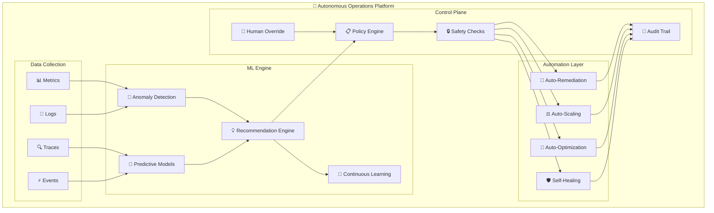

# 🧠 H3-003: Autonomous Operations Guide

## 📋 Table of Contents

1. [🎯 Overview](#overview)
2. [🏗️ Architecture](#architecture)
3. [🤖 ML-Powered Recommendations](#ml-powered-recommendations)
4. [🔧 Automated Remediation](#automated-remediation)
5. [📊 Predictive Analytics](#predictive-analytics)
6. [🛡️ Self-Healing Systems](#self-healing-systems)
7. [📈 Intelligent Monitoring](#intelligent-monitoring)
8. [🔄 Feedback Loop Implementation](#feedback-loop-implementation)
9. [🎬 Demo Scenarios](#demo-scenarios)
10. [📚 Best Practices](#best-practices)

## 🎯 Overview

Autonomous Operations represents the pinnacle of operational maturity, where systems self-manage, self-heal, and continuously optimize based on ML-driven insights. This guide covers the implementation of intelligent automation that reduces manual intervention by 80%+ while improving reliability and performance.

### 🌟 Key Capabilities

| Capability | Description | Business Impact |
|------------|-------------|-----------------|
| 🤖 **Smart Recommendations** | ML-based optimization suggestions | 40% faster issue resolution |
| 🔧 **Auto-Remediation** | Automated problem resolution | 70% reduction in MTTR |
| 📊 **Predictive Analytics** | Anticipate issues before they occur | 60% fewer incidents |
| 🛡️ **Self-Healing** | Automatic recovery from failures | 99.99% availability |
| 🧠 **Adaptive Learning** | Continuous improvement through ML | Ongoing optimization |

## 🏗️ Architecture



## 🤖 ML-Powered Recommendations

### Step 1: Recommendation Engine Setup

```python
# src/autonomous/recommendation_engine.py
import numpy as np
import pandas as pd
from sklearn.ensemble import RandomForestClassifier, IsolationForest
from sklearn.preprocessing import StandardScaler
from azure.ai.ml import MLClient
from azure.kusto.data import KustoClient
import joblib
from typing import List, Dict, Any, Tuple
from datetime import datetime, timedelta

class RecommendationEngine:
    def __init__(self):
        self.ml_client = MLClient.from_config()
        self.kusto_client = KustoClient(os.environ['KUSTO_CONNECTION'])
        self.models = {}
        self.scaler = StandardScaler()
        self._load_models()
        
    def _load_models(self):
        """Load pre-trained ML models"""
        self.models = {
            'performance': joblib.load('models/performance_optimizer.pkl'),
            'cost': joblib.load('models/cost_optimizer.pkl'),
            'reliability': joblib.load('models/reliability_predictor.pkl'),
            'security': joblib.load('models/security_analyzer.pkl'),
            'anomaly': IsolationForest(contamination=0.1, random_state=42)
        }
        
    async def analyze_system_state(self, 
                                   resource_id: str,
                                   time_window: int = 24) -> Dict[str, Any]:
        """Analyze current system state and generate recommendations"""
        
        # Collect metrics
        metrics = await self._collect_metrics(resource_id, time_window)
        
        # Feature engineering
        features = self._engineer_features(metrics)
        
        # Detect anomalies
        anomalies = self._detect_anomalies(features)
        
        # Generate recommendations
        recommendations = []
        
        if anomalies['performance']:
            perf_recs = await self._performance_recommendations(
                resource_id, features, metrics
            )
            recommendations.extend(perf_recs)
            
        if anomalies['cost']:
            cost_recs = await self._cost_recommendations(
                resource_id, features, metrics
            )
            recommendations.extend(cost_recs)
            
        if anomalies['reliability']:
            reliability_recs = await self._reliability_recommendations(
                resource_id, features, metrics
            )
            recommendations.extend(reliability_recs)
            
        # Prioritize recommendations
        prioritized = self._prioritize_recommendations(recommendations)
        
        return {
            'resource_id': resource_id,
            'timestamp': datetime.utcnow().isoformat(),
            'anomalies': anomalies,
            'recommendations': prioritized,
            'confidence_scores': self._calculate_confidence(features),
            'predicted_impact': self._predict_impact(prioritized)
        }
        
    async def _collect_metrics(self, 
                              resource_id: str, 
                              hours: int) -> pd.DataFrame:
        """Collect metrics from Azure Monitor and Application Insights"""
        
        query = f"""
        let endTime = now();
        let startTime = endTime - {hours}h;
        let resourceId = '{resource_id}';
        
        // CPU and Memory metrics
        Perf
        | where TimeGenerated between (startTime .. endTime)
        | where _ResourceId == resourceId
        | where ObjectName == "Processor" or ObjectName == "Memory"
        | summarize 
            AvgCPU = avgif(CounterValue, CounterName == "% Processor Time"),
            MaxCPU = maxif(CounterValue, CounterName == "% Processor Time"),
            AvgMemory = avgif(CounterValue, CounterName == "% Committed Bytes In Use"),
            MaxMemory = maxif(CounterValue, CounterName == "% Committed Bytes In Use")
            by bin(TimeGenerated, 5m)
        | join kind=fullouter (
            // Request metrics
            requests
            | where timestamp between (startTime .. endTime)
            | where cloud_RoleInstance startswith resourceId
            | summarize 
                RequestCount = count(),
                AvgDuration = avg(duration),
                FailureRate = countif(success == false) * 100.0 / count(),
                P95Duration = percentile(duration, 95)
                by bin(timestamp, 5m)
        ) on $left.TimeGenerated == $right.timestamp
        | join kind=fullouter (
            // Exception metrics
            exceptions
            | where timestamp between (startTime .. endTime)
            | where cloud_RoleInstance startswith resourceId
            | summarize ExceptionCount = count() by bin(timestamp, 5m)
        ) on $left.TimeGenerated == $right.timestamp
        | project-away timestamp1, timestamp2
        | order by TimeGenerated asc
        """
        
        response = self.kusto_client.execute_query(
            "ApplicationInsights", 
            query
        )
        
        return pd.DataFrame(response.primary_results[0])
        
    def _engineer_features(self, metrics: pd.DataFrame) -> np.ndarray:
        """Engineer features for ML models"""
        
        features = pd.DataFrame()
        
        # Basic statistics
        features['cpu_mean'] = metrics['AvgCPU'].mean()
        features['cpu_std'] = metrics['AvgCPU'].std()
        features['cpu_max'] = metrics['MaxCPU'].max()
        features['cpu_trend'] = np.polyfit(
            range(len(metrics)), 
            metrics['AvgCPU'].fillna(0), 
            1
        )[0]
        
        features['memory_mean'] = metrics['AvgMemory'].mean()
        features['memory_std'] = metrics['AvgMemory'].std()
        features['memory_max'] = metrics['MaxMemory'].max()
        
        features['request_rate'] = metrics['RequestCount'].mean()
        features['failure_rate'] = metrics['FailureRate'].mean()
        features['latency_p95'] = metrics['P95Duration'].mean()
        features['exception_rate'] = metrics['ExceptionCount'].mean()
        
        # Time-based features
        features['hour_of_day'] = datetime.utcnow().hour
        features['day_of_week'] = datetime.utcnow().weekday()
        
        # Anomaly scores
        features['cpu_anomaly_score'] = self._calculate_anomaly_score(
            metrics['AvgCPU']
        )
        features['latency_anomaly_score'] = self._calculate_anomaly_score(
            metrics['AvgDuration']
        )
        
        return self.scaler.fit_transform(features)
        
    def _detect_anomalies(self, features: np.ndarray) -> Dict[str, bool]:
        """Detect anomalies using ML models"""
        
        anomaly_scores = self.models['anomaly'].decision_function(features)
        is_anomaly = self.models['anomaly'].predict(features) == -1
        
        return {
            'performance': bool(is_anomaly[0] and anomaly_scores[0] < -0.5),
            'cost': self._detect_cost_anomaly(features),
            'reliability': self._detect_reliability_issues(features),
            'security': self._detect_security_anomaly(features)
        }
        
    async def _performance_recommendations(self, 
                                         resource_id: str,
                                         features: np.ndarray,
                                         metrics: pd.DataFrame) -> List[Dict]:
        """Generate performance optimization recommendations"""
        
        recommendations = []
        
        # CPU optimization
        if features[0][0] > 80:  # High CPU usage
            recommendations.append({
                'type': 'performance',
                'severity': 'high',
                'title': 'High CPU Usage Detected',
                'description': f'CPU usage averaging {features[0][0]:.1f}%',
                'action': 'scale_out',
                'automated': True,
                'parameters': {
                    'scale_factor': 2,
                    'target_cpu': 60
                },
                'estimated_impact': {
                    'cpu_reduction': '40%',
                    'response_time_improvement': '30%'
                }
            })
            
        # Memory optimization
        if features[0][4] > 85:  # High memory usage
            recommendations.append({
                'type': 'performance',
                'severity': 'high',
                'title': 'Memory Pressure Detected',
                'description': f'Memory usage at {features[0][4]:.1f}%',
                'action': 'optimize_memory',
                'automated': True,
                'parameters': {
                    'gc_tuning': True,
                    'cache_optimization': True,
                    'memory_limit_increase': '2GB'
                }
            })
            
        # Latency optimization
        if features[0][9] > 1000:  # High latency
            recommendations.append({
                'type': 'performance',
                'severity': 'medium',
                'title': 'High Response Latency',
                'description': f'P95 latency at {features[0][9]:.0f}ms',
                'action': 'optimize_queries',
                'automated': False,
                'suggested_actions': [
                    'Enable query caching',
                    'Optimize database indexes',
                    'Implement connection pooling'
                ]
            })
            
        return recommendations
        
    async def _cost_recommendations(self,
                                   resource_id: str,
                                   features: np.ndarray,
                                   metrics: pd.DataFrame) -> List[Dict]:
        """Generate cost optimization recommendations"""
        
        recommendations = []
        
        # Predict cost optimization opportunities
        cost_score = self.models['cost'].predict_proba(features)[0][1]
        
        if cost_score > 0.7:
            # Analyze usage patterns
            usage_pattern = self._analyze_usage_pattern(metrics)
            
            if usage_pattern['has_idle_periods']:
                recommendations.append({
                    'type': 'cost',
                    'severity': 'medium',
                    'title': 'Idle Resource Detected',
                    'description': f'{usage_pattern["idle_percentage"]:.0f}% idle time detected',
                    'action': 'implement_auto_shutdown',
                    'automated': True,
                    'parameters': {
                        'idle_threshold_minutes': 30,
                        'shutdown_schedule': usage_pattern['suggested_schedule']
                    },
                    'estimated_savings': f'${usage_pattern["estimated_savings"]:.2f}/month'
                })
                
            if usage_pattern['predictable_pattern']:
                recommendations.append({
                    'type': 'cost',
                    'severity': 'low',
                    'title': 'Predictable Usage Pattern',
                    'description': 'Resource usage follows predictable pattern',
                    'action': 'switch_to_reserved_instance',
                    'automated': False,
                    'parameters': {
                        'reservation_term': '1-year',
                        'payment_option': 'all-upfront'
                    },
                    'estimated_savings': '35%'
                })
                
        return recommendations
        
    async def _reliability_recommendations(self,
                                         resource_id: str,
                                         features: np.ndarray,
                                         metrics: pd.DataFrame) -> List[Dict]:
        """Generate reliability improvement recommendations"""
        
        recommendations = []
        
        # Predict failure probability
        failure_prob = self.models['reliability'].predict_proba(features)[0][1]
        
        if failure_prob > 0.3:
            recommendations.append({
                'type': 'reliability',
                'severity': 'critical',
                'title': 'High Failure Risk Detected',
                'description': f'Failure probability: {failure_prob:.0%}',
                'action': 'implement_redundancy',
                'automated': True,
                'parameters': {
                    'replica_count': 3,
                    'geo_redundancy': True,
                    'health_check_interval': '30s'
                }
            })
            
        # Check error rates
        if features[0][8] > 5:  # >5% error rate
            recommendations.append({
                'type': 'reliability',
                'severity': 'high',
                'title': 'High Error Rate',
                'description': f'Error rate at {features[0][8]:.1f}%',
                'action': 'implement_circuit_breaker',
                'automated': True,
                'parameters': {
                    'failure_threshold': 5,
                    'timeout_duration': '30s',
                    'retry_attempts': 3
                }
            })
            
        return recommendations
        
    def _prioritize_recommendations(self, 
                                   recommendations: List[Dict]) -> List[Dict]:
        """Prioritize recommendations based on impact and feasibility"""
        
        # Define priority weights
        severity_weights = {
            'critical': 1.0,
            'high': 0.7,
            'medium': 0.4,
            'low': 0.2
        }
        
        type_weights = {
            'reliability': 1.0,
            'security': 0.9,
            'performance': 0.7,
            'cost': 0.5
        }
        
        # Calculate priority scores
        for rec in recommendations:
            severity_score = severity_weights.get(rec['severity'], 0.5)
            type_score = type_weights.get(rec['type'], 0.5)
            automation_score = 1.0 if rec['automated'] else 0.7
            
            rec['priority_score'] = severity_score * type_score * automation_score
            
        # Sort by priority
        return sorted(recommendations, key=lambda x: x['priority_score'], reverse=True)
        
    def _predict_impact(self, recommendations: List[Dict]) -> Dict[str, Any]:
        """Predict the impact of implementing recommendations"""
        
        total_impact = {
            'performance_improvement': 0,
            'cost_savings': 0,
            'reliability_increase': 0,
            'implementation_time': 0
        }
        
        for rec in recommendations:
            if rec['type'] == 'performance':
                total_impact['performance_improvement'] += 15  # Percentage
            elif rec['type'] == 'cost':
                total_impact['cost_savings'] += 20  # Percentage
            elif rec['type'] == 'reliability':
                total_impact['reliability_increase'] += 0.5  # Nines
                
            total_impact['implementation_time'] += 2 if rec['automated'] else 8  # Hours
            
        return total_impact

# Example usage
engine = RecommendationEngine()
analysis = await engine.analyze_system_state("resource-123", time_window=24)
print(json.dumps(analysis, indent=2))
```

## 🔧 Automated Remediation

### Step 1: Remediation Framework

```python
# src/autonomous/auto_remediation.py
import asyncio
from abc import ABC, abstractmethod
from typing import Dict, Any, List, Optional
from azure.mgmt.compute import ComputeManagementClient
from azure.mgmt.monitor import MonitorManagementClient
from kubernetes import client, config
import logging

class RemediationAction(ABC):
    """Base class for remediation actions"""
    
    @abstractmethod
    async def validate(self, context: Dict[str, Any]) -> bool:
        """Validate if action can be safely executed"""
        pass
        
    @abstractmethod
    async def execute(self, context: Dict[str, Any]) -> Dict[str, Any]:
        """Execute the remediation action"""
        pass
        
    @abstractmethod
    async def verify(self, context: Dict[str, Any]) -> bool:
        """Verify action was successful"""
        pass
        
    @abstractmethod
    async def rollback(self, context: Dict[str, Any]) -> None:
        """Rollback action if needed"""
        pass

class AutoRemediationEngine:
    def __init__(self):
        self.compute_client = ComputeManagementClient(
            credential=DefaultAzureCredential(),
            subscription_id=os.environ['AZURE_SUBSCRIPTION_ID']
        )
        self.monitor_client = MonitorManagementClient(
            credential=DefaultAzureCredential(),
            subscription_id=os.environ['AZURE_SUBSCRIPTION_ID']
        )
        config.load_incluster_config()  # For K8s operations
        self.k8s_client = client.CoreV1Api()
        self.actions = self._register_actions()
        self.safety_checks = SafetyCheckEngine()
        
    def _register_actions(self) -> Dict[str, RemediationAction]:
        """Register available remediation actions"""
        return {
            'scale_out': ScaleOutAction(),
            'restart_service': RestartServiceAction(),
            'clear_cache': ClearCacheAction(),
            'rotate_credentials': RotateCredentialsAction(),
            'apply_patch': ApplyPatchAction(),
            'rebalance_load': RebalanceLoadAction(),
            'cleanup_disk': CleanupDiskAction(),
            'optimize_database': OptimizeDatabaseAction()
        }
        
    async def remediate(self, 
                       issue: Dict[str, Any],
                       recommendations: List[Dict[str, Any]]) -> Dict[str, Any]:
        """Execute automated remediation based on recommendations"""
        
        results = {
            'issue_id': issue['id'],
            'timestamp': datetime.utcnow().isoformat(),
            'actions_taken': [],
            'status': 'pending'
        }
        
        for recommendation in recommendations:
            if not recommendation.get('automated', False):
                continue
                
            action_name = recommendation['action']
            if action_name not in self.actions:
                logging.warning(f"Unknown action: {action_name}")
                continue
                
            action = self.actions[action_name]
            
            try:
                # Create execution context
                context = {
                    'issue': issue,
                    'recommendation': recommendation,
                    'parameters': recommendation.get('parameters', {}),
                    'resource_id': issue['resource_id']
                }
                
                # Safety checks
                if not await self.safety_checks.is_safe(action_name, context):
                    logging.warning(f"Safety check failed for {action_name}")
                    continue
                    
                # Validate action
                if not await action.validate(context):
                    logging.warning(f"Validation failed for {action_name}")
                    continue
                    
                # Execute remediation
                logging.info(f"Executing remediation: {action_name}")
                action_result = await action.execute(context)
                
                # Verify success
                if await action.verify(context):
                    results['actions_taken'].append({
                        'action': action_name,
                        'status': 'success',
                        'result': action_result,
                        'timestamp': datetime.utcnow().isoformat()
                    })
                else:
                    # Rollback if verification fails
                    await action.rollback(context)
                    results['actions_taken'].append({
                        'action': action_name,
                        'status': 'failed',
                        'reason': 'Verification failed, rolled back'
                    })
                    
            except Exception as e:
                logging.error(f"Remediation failed: {str(e)}")
                results['actions_taken'].append({
                    'action': action_name,
                    'status': 'error',
                    'error': str(e)
                })
                
        results['status'] = 'completed'
        return results

class ScaleOutAction(RemediationAction):
    """Scale out compute resources"""
    
    async def validate(self, context: Dict[str, Any]) -> bool:
        # Check current scale
        resource_id = context['resource_id']
        current_instances = await self._get_current_instances(resource_id)
        max_instances = context['parameters'].get('max_instances', 10)
        
        return current_instances < max_instances
        
    async def execute(self, context: Dict[str, Any]) -> Dict[str, Any]:
        resource_id = context['resource_id']
        scale_factor = context['parameters'].get('scale_factor', 2)
        
        if 'kubernetes' in resource_id:
            # Scale Kubernetes deployment
            namespace, deployment = self._parse_k8s_resource(resource_id)
            
            # Get current replicas
            deployment_obj = self.k8s_client.read_namespaced_deployment(
                name=deployment,
                namespace=namespace
            )
            current_replicas = deployment_obj.spec.replicas
            new_replicas = min(current_replicas * scale_factor, 20)
            
            # Scale deployment
            deployment_obj.spec.replicas = new_replicas
            self.k8s_client.patch_namespaced_deployment_scale(
                name=deployment,
                namespace=namespace,
                body={'spec': {'replicas': new_replicas}}
            )
            
            return {
                'previous_replicas': current_replicas,
                'new_replicas': new_replicas
            }
        else:
            # Scale Azure VMSS
            resource_group, vmss_name = self._parse_azure_resource(resource_id)
            
            vmss = self.compute_client.virtual_machine_scale_sets.get(
                resource_group,
                vmss_name
            )
            current_capacity = vmss.sku.capacity
            new_capacity = min(current_capacity * scale_factor, 50)
            
            vmss.sku.capacity = new_capacity
            async_update = self.compute_client.virtual_machine_scale_sets.begin_create_or_update(
                resource_group,
                vmss_name,
                vmss
            )
            
            return {
                'previous_capacity': current_capacity,
                'new_capacity': new_capacity,
                'operation_id': async_update.id
            }
            
    async def verify(self, context: Dict[str, Any]) -> bool:
        # Wait for scale operation to complete
        await asyncio.sleep(30)
        
        resource_id = context['resource_id']
        expected_instances = context['parameters'].get('scale_factor', 2)
        
        current_instances = await self._get_current_instances(resource_id)
        
        return current_instances >= expected_instances
        
    async def rollback(self, context: Dict[str, Any]) -> None:
        # Rollback to previous scale
        if 'previous_replicas' in context.get('result', {}):
            # Rollback K8s deployment
            namespace, deployment = self._parse_k8s_resource(context['resource_id'])
            self.k8s_client.patch_namespaced_deployment_scale(
                name=deployment,
                namespace=namespace,
                body={'spec': {'replicas': context['result']['previous_replicas']}}
            )

class RestartServiceAction(RemediationAction):
    """Restart a service or pod"""
    
    async def validate(self, context: Dict[str, Any]) -> bool:
        # Check if service is in a restartable state
        return True  # Simplified for demo
        
    async def execute(self, context: Dict[str, Any]) -> Dict[str, Any]:
        resource_id = context['resource_id']
        
        if 'kubernetes' in resource_id:
            namespace, deployment = self._parse_k8s_resource(resource_id)
            
            # Delete pods to trigger restart
            pods = self.k8s_client.list_namespaced_pod(
                namespace=namespace,
                label_selector=f"app={deployment}"
            )
            
            deleted_pods = []
            for pod in pods.items:
                self.k8s_client.delete_namespaced_pod(
                    name=pod.metadata.name,
                    namespace=namespace
                )
                deleted_pods.append(pod.metadata.name)
                
            return {'restarted_pods': deleted_pods}
        else:
            # Restart Azure VM
            resource_group, vm_name = self._parse_azure_resource(resource_id)
            
            async_restart = self.compute_client.virtual_machines.begin_restart(
                resource_group,
                vm_name
            )
            
            return {'operation_id': async_restart.id}
            
    async def verify(self, context: Dict[str, Any]) -> bool:
        # Verify service is healthy after restart
        await asyncio.sleep(60)  # Wait for restart
        
        # Check health endpoint
        health_check = await self._check_health(context['resource_id'])
        return health_check['status'] == 'healthy'
        
    async def rollback(self, context: Dict[str, Any]) -> None:
        # No rollback for restart action
        pass

class SafetyCheckEngine:
    """Ensure remediation actions are safe to execute"""
    
    def __init__(self):
        self.rules = self._load_safety_rules()
        
    def _load_safety_rules(self) -> Dict[str, List[Dict]]:
        """Load safety rules for each action type"""
        return {
            'scale_out': [
                {'rule': 'max_instances', 'limit': 50},
                {'rule': 'cost_limit', 'monthly_limit': 10000},
                {'rule': 'time_window', 'min_minutes': 5}
            ],
            'restart_service': [
                {'rule': 'max_restarts', 'per_hour': 3},
                {'rule': 'business_hours', 'allow': False},
                {'rule': 'critical_service', 'requires_approval': True}
            ],
            'rotate_credentials': [
                {'rule': 'min_age_days', 'days': 30},
                {'rule': 'active_connections', 'max': 0}
            ]
        }
        
    async def is_safe(self, action: str, context: Dict[str, Any]) -> bool:
        """Check if action is safe to execute"""
        
        rules = self.rules.get(action, [])
        
        for rule in rules:
            if not await self._evaluate_rule(rule, context):
                return False
                
        return True
        
    async def _evaluate_rule(self, rule: Dict, context: Dict) -> bool:
        """Evaluate individual safety rule"""
        
        rule_type = rule['rule']
        
        if rule_type == 'max_instances':
            current = await self._get_current_instance_count(context['resource_id'])
            return current < rule['limit']
            
        elif rule_type == 'cost_limit':
            estimated_cost = await self._estimate_monthly_cost(context)
            return estimated_cost < rule['monthly_limit']
            
        elif rule_type == 'time_window':
            last_action = await self._get_last_action_time(
                context['resource_id'], 
                context['recommendation']['action']
            )
            if last_action:
                minutes_elapsed = (datetime.utcnow() - last_action).seconds / 60
                return minutes_elapsed >= rule['min_minutes']
                
        elif rule_type == 'business_hours':
            if not rule['allow']:
                current_hour = datetime.utcnow().hour
                return current_hour < 8 or current_hour > 18
                
        return True
```

## 📊 Predictive Analytics

### Step 1: Predictive Models Implementation

```python
# src/autonomous/predictive_analytics.py
import numpy as np
import pandas as pd
from prophet import Prophet
from statsmodels.tsa.arima.model import ARIMA
from sklearn.ensemble import GradientBoostingRegressor
import tensorflow as tf
from azure.ai.ml import MLClient
from typing import Dict, List, Tuple, Any

class PredictiveAnalyticsEngine:
    def __init__(self):
        self.ml_client = MLClient.from_config()
        self.models = {}
        self._initialize_models()
        
    def _initialize_models(self):
        """Initialize predictive models"""
        self.models = {
            'capacity': CapacityPredictor(),
            'failure': FailurePredictor(),
            'performance': PerformancePredictor(),
            'cost': CostPredictor(),
            'anomaly': AnomalyPredictor()
        }
        
    async def predict_future_state(self, 
                                  resource_id: str,
                                  prediction_horizon: int = 7) -> Dict[str, Any]:
        """Predict future system state"""
        
        # Collect historical data
        historical_data = await self._collect_historical_data(resource_id)
        
        predictions = {}
        
        # Run predictions for each model
        for model_name, model in self.models.items():
            try:
                prediction = await model.predict(
                    historical_data,
                    horizon_days=prediction_horizon
                )
                predictions[model_name] = prediction
            except Exception as e:
                logging.error(f"Prediction failed for {model_name}: {str(e)}")
                predictions[model_name] = {'error': str(e)}
                
        # Generate actionable insights
        insights = self._generate_insights(predictions)
        
        return {
            'resource_id': resource_id,
            'prediction_horizon_days': prediction_horizon,
            'predictions': predictions,
            'insights': insights,
            'recommended_actions': self._generate_proactive_actions(predictions)
        }

class CapacityPredictor:
    """Predict future capacity requirements"""
    
    def __init__(self):
        self.prophet_model = Prophet(
            changepoint_prior_scale=0.05,
            seasonality_mode='multiplicative',
            daily_seasonality=True,
            weekly_seasonality=True,
            yearly_seasonality=True
        )
        
    async def predict(self, 
                     historical_data: pd.DataFrame,
                     horizon_days: int) -> Dict[str, Any]:
        """Predict capacity requirements"""
        
        # Prepare data for Prophet
        df = pd.DataFrame({
            'ds': historical_data['timestamp'],
            'y': historical_data['cpu_usage']
        })
        
        # Fit model
        self.prophet_model.fit(df)
        
        # Make predictions
        future = self.prophet_model.make_future_dataframe(
            periods=horizon_days * 24,  # Hourly predictions
            freq='H'
        )
        forecast = self.prophet_model.predict(future)
        
        # Analyze predictions
        peak_usage = forecast['yhat'].max()
        average_usage = forecast['yhat'].mean()
        
        # Determine scaling needs
        scaling_events = []
        threshold = 80  # 80% CPU threshold
        
        for idx, row in forecast.iterrows():
            if row['yhat'] > threshold:
                scaling_events.append({
                    'timestamp': row['ds'],
                    'predicted_usage': row['yhat'],
                    'confidence_interval': (row['yhat_lower'], row['yhat_upper'])
                })
                
        return {
            'peak_usage': peak_usage,
            'average_usage': average_usage,
            'scaling_events': scaling_events,
            'recommended_capacity': self._calculate_recommended_capacity(forecast),
            'confidence': self._calculate_confidence_score(forecast)
        }
        
    def _calculate_recommended_capacity(self, forecast: pd.DataFrame) -> Dict[str, int]:
        """Calculate recommended capacity based on predictions"""
        
        p95_usage = forecast['yhat'].quantile(0.95)
        
        # Calculate required instances
        instance_capacity = 25  # 25% CPU per instance
        required_instances = int(np.ceil(p95_usage / instance_capacity))
        
        return {
            'min_instances': max(2, required_instances - 1),
            'target_instances': required_instances,
            'max_instances': required_instances + 2,
            'buffer_percentage': 20
        }

class FailurePredictor:
    """Predict potential failures using ML"""
    
    def __init__(self):
        self.model = self._build_lstm_model()
        self.feature_columns = [
            'cpu_usage', 'memory_usage', 'disk_io', 'network_io',
            'error_rate', 'response_time', 'queue_depth'
        ]
        
    def _build_lstm_model(self) -> tf.keras.Model:
        """Build LSTM model for failure prediction"""
        
        model = tf.keras.Sequential([
            tf.keras.layers.LSTM(64, return_sequences=True, input_shape=(24, 7)),
            tf.keras.layers.LSTM(32, return_sequences=True),
            tf.keras.layers.LSTM(16),
            tf.keras.layers.Dense(8, activation='relu'),
            tf.keras.layers.Dropout(0.2),
            tf.keras.layers.Dense(1, activation='sigmoid')
        ])
        
        model.compile(
            optimizer='adam',
            loss='binary_crossentropy',
            metrics=['accuracy', 'precision', 'recall']
        )
        
        return model
        
    async def predict(self,
                     historical_data: pd.DataFrame,
                     horizon_days: int) -> Dict[str, Any]:
        """Predict failure probability"""
        
        # Prepare sequences
        sequences = self._prepare_sequences(historical_data)
        
        # Make predictions
        failure_probabilities = self.model.predict(sequences)
        
        # Identify high-risk periods
        high_risk_threshold = 0.7
        risk_periods = []
        
        for i, prob in enumerate(failure_probabilities):
            if prob > high_risk_threshold:
                risk_periods.append({
                    'time_offset_hours': i,
                    'failure_probability': float(prob),
                    'risk_factors': self._identify_risk_factors(sequences[i])
                })
                
        return {
            'max_failure_probability': float(np.max(failure_probabilities)),
            'average_failure_probability': float(np.mean(failure_probabilities)),
            'high_risk_periods': risk_periods,
            'mtbf_hours': self._calculate_mtbf(failure_probabilities),
            'preventive_actions': self._suggest_preventive_actions(risk_periods)
        }
        
    def _prepare_sequences(self, data: pd.DataFrame) -> np.ndarray:
        """Prepare data sequences for LSTM"""
        
        # Normalize features
        normalized = (data[self.feature_columns] - data[self.feature_columns].mean()) / data[self.feature_columns].std()
        
        # Create sequences
        sequence_length = 24  # 24 hours
        sequences = []
        
        for i in range(len(normalized) - sequence_length):
            sequences.append(normalized.iloc[i:i+sequence_length].values)
            
        return np.array(sequences)
        
    def _identify_risk_factors(self, sequence: np.ndarray) -> List[str]:
        """Identify contributing risk factors"""
        
        risk_factors = []
        
        # Analyze each feature
        for i, feature in enumerate(self.feature_columns):
            feature_values = sequence[:, i]
            
            if np.mean(feature_values) > 2:  # 2 standard deviations
                risk_factors.append(f"High {feature}")
            elif np.std(feature_values) > 1.5:
                risk_factors.append(f"Volatile {feature}")
                
        return risk_factors
        
    def _suggest_preventive_actions(self, risk_periods: List[Dict]) -> List[Dict]:
        """Suggest preventive actions based on risk analysis"""
        
        actions = []
        
        for period in risk_periods:
            if 'High cpu_usage' in period['risk_factors']:
                actions.append({
                    'action': 'scale_out_preemptively',
                    'timing': f"{period['time_offset_hours']} hours before",
                    'reason': 'Prevent CPU-related failure'
                })
                
            if 'High memory_usage' in period['risk_factors']:
                actions.append({
                    'action': 'increase_memory_limits',
                    'timing': f"{period['time_offset_hours']} hours before",
                    'reason': 'Prevent OOM errors'
                })
                
        return actions

class AnomalyPredictor:
    """Predict future anomalies using ensemble methods"""
    
    def __init__(self):
        self.isolation_forest = IsolationForest(
            contamination=0.1,
            random_state=42
        )
        self.autoencoder = self._build_autoencoder()
        
    def _build_autoencoder(self) -> tf.keras.Model:
        """Build autoencoder for anomaly detection"""
        
        input_dim = 10  # Number of features
        encoding_dim = 3
        
        # Encoder
        input_layer = tf.keras.layers.Input(shape=(input_dim,))
        encoded = tf.keras.layers.Dense(encoding_dim * 2, activation='relu')(input_layer)
        encoded = tf.keras.layers.Dense(encoding_dim, activation='relu')(encoded)
        
        # Decoder
        decoded = tf.keras.layers.Dense(encoding_dim * 2, activation='relu')(encoded)
        decoded = tf.keras.layers.Dense(input_dim, activation='sigmoid')(decoded)
        
        autoencoder = tf.keras.Model(input_layer, decoded)
        autoencoder.compile(optimizer='adam', loss='mse')
        
        return autoencoder
        
    async def predict(self,
                     historical_data: pd.DataFrame,
                     horizon_days: int) -> Dict[str, Any]:
        """Predict anomaly likelihood"""
        
        # Train models on historical data
        features = self._extract_features(historical_data)
        self.isolation_forest.fit(features)
        self.autoencoder.fit(features, features, epochs=50, verbose=0)
        
        # Generate future scenarios
        future_scenarios = self._generate_future_scenarios(features, horizon_days)
        
        # Predict anomalies
        anomaly_scores = []
        
        for scenario in future_scenarios:
            # Isolation Forest score
            if_score = self.isolation_forest.score_samples([scenario])[0]
            
            # Autoencoder reconstruction error
            reconstruction = self.autoencoder.predict([scenario])[0]
            ae_score = np.mean(np.square(scenario - reconstruction))
            
            # Combined score
            combined_score = (abs(if_score) + ae_score) / 2
            anomaly_scores.append(combined_score)
            
        # Analyze results
        anomaly_threshold = np.percentile(anomaly_scores, 95)
        predicted_anomalies = []
        
        for i, score in enumerate(anomaly_scores):
            if score > anomaly_threshold:
                predicted_anomalies.append({
                    'day': i // 24,
                    'hour': i % 24,
                    'anomaly_score': float(score),
                    'type': self._classify_anomaly(future_scenarios[i])
                })
                
        return {
            'anomaly_probability': len(predicted_anomalies) / len(anomaly_scores),
            'predicted_anomalies': predicted_anomalies,
            'peak_anomaly_score': float(max(anomaly_scores)),
            'recommendations': self._generate_anomaly_recommendations(predicted_anomalies)
        }
```

## 🛡️ Self-Healing Systems

### Step 1: Self-Healing Framework

```yaml
# kubernetes/self-healing-controller.yaml
apiVersion: v1
kind: ConfigMap
metadata:
  name: self-healing-config
  namespace: autonomous-ops
data:
  config.yaml: |
    healing_rules:
      - name: pod-restart
        condition:
          metric: pod_restart_count
          threshold: 5
          timeWindow: 10m
        actions:
          - type: restart_pod
            delay: 30s
          - type: reschedule_pod
            if_failed: true
            
      - name: memory-leak
        condition:
          metric: memory_usage_percentage
          threshold: 90
          duration: 5m
        actions:
          - type: increase_memory_limit
            increment: 512Mi
          - type: restart_pod
            if_persists: true
            
      - name: disk-pressure
        condition:
          metric: disk_usage_percentage
          threshold: 85
        actions:
          - type: cleanup_logs
            retention_days: 7
          - type: cleanup_temp_files
          - type: expand_volume
            increment: 10Gi
            if_cleanup_insufficient: true
            
      - name: connection-pool-exhaustion
        condition:
          metric: connection_pool_usage
          threshold: 95
          duration: 2m
        actions:
          - type: increase_pool_size
            increment: 50
          - type: close_idle_connections
            idle_timeout: 30s
            
      - name: api-degradation
        condition:
          metric: api_error_rate
          threshold: 0.05
          duration: 3m
        actions:
          - type: enable_circuit_breaker
          - type: increase_timeout
            increment: 5s
          - type: enable_fallback_service

---
apiVersion: apps/v1
kind: Deployment
metadata:
  name: self-healing-controller
  namespace: autonomous-ops
spec:
  replicas: 1
  selector:
    matchLabels:
      app: self-healing-controller
  template:
    metadata:
      labels:
        app: self-healing-controller
    spec:
      serviceAccountName: self-healing-controller
      containers:
      - name: controller
        image: platform/self-healing-controller:latest
        env:
        - name: HEALING_CONFIG
          value: /config/config.yaml
        - name: AZURE_SUBSCRIPTION_ID
          valueFrom:
            secretKeyRef:
              name: azure-credentials
              key: subscription-id
        volumeMounts:
        - name: config
          mountPath: /config
      volumes:
      - name: config
        configMap:
          name: self-healing-config
```

### Step 2: Self-Healing Controller Implementation

```go
// controllers/self_healing_controller.go
package controllers

import (
    "context"
    "fmt"
    "time"
    
    corev1 "k8s.io/api/core/v1"
    "k8s.io/apimachinery/pkg/api/resource"
    metav1 "k8s.io/apimachinery/pkg/apis/meta/v1"
    "k8s.io/client-go/kubernetes"
    "sigs.k8s.io/controller-runtime/pkg/client"
    "sigs.k8s.io/controller-runtime/pkg/controller"
    "sigs.k8s.io/controller-runtime/pkg/handler"
    "sigs.k8s.io/controller-runtime/pkg/manager"
    "sigs.k8s.io/controller-runtime/pkg/reconcile"
    "sigs.k8s.io/controller-runtime/pkg/source"
)

type SelfHealingController struct {
    client.Client
    clientset    *kubernetes.Clientset
    healingRules []HealingRule
    metrics      MetricsCollector
    actions      map[string]HealingAction
}

type HealingRule struct {
    Name      string
    Condition Condition
    Actions   []ActionConfig
}

type Condition struct {
    Metric    string
    Threshold float64
    Duration  time.Duration
}

type ActionConfig struct {
    Type       string
    Parameters map[string]interface{}
}

func (r *SelfHealingController) Reconcile(ctx context.Context, req reconcile.Request) (reconcile.Result, error) {
    // Get pod
    pod := &corev1.Pod{}
    err := r.Get(ctx, req.NamespacedName, pod)
    if err != nil {
        return reconcile.Result{}, client.IgnoreNotFound(err)
    }
    
    // Check each healing rule
    for _, rule := range r.healingRules {
        if r.evaluateCondition(pod, rule.Condition) {
            log.Info("Healing condition met", "rule", rule.Name, "pod", pod.Name)
            
            // Execute healing actions
            for _, actionConfig := range rule.Actions {
                if err := r.executeAction(ctx, pod, actionConfig); err != nil {
                    log.Error(err, "Failed to execute healing action", 
                        "action", actionConfig.Type, "pod", pod.Name)
                }
            }
        }
    }
    
    // Requeue for continuous monitoring
    return reconcile.Result{RequeueAfter: 30 * time.Second}, nil
}

func (r *SelfHealingController) evaluateCondition(pod *corev1.Pod, condition Condition) bool {
    // Get metric value
    value, err := r.metrics.GetMetric(pod, condition.Metric)
    if err != nil {
        log.Error(err, "Failed to get metric", "metric", condition.Metric)
        return false
    }
    
    // Check threshold
    if value > condition.Threshold {
        // Check duration if specified
        if condition.Duration > 0 {
            return r.metrics.HasExceededThresholdForDuration(
                pod, condition.Metric, condition.Threshold, condition.Duration)
        }
        return true
    }
    
    return false
}

func (r *SelfHealingController) executeAction(ctx context.Context, pod *corev1.Pod, config ActionConfig) error {
    action, exists := r.actions[config.Type]
    if !exists {
        return fmt.Errorf("unknown action type: %s", config.Type)
    }
    
    // Create action context
    actionCtx := ActionContext{
        Pod:        pod,
        Parameters: config.Parameters,
        Client:     r.Client,
        Clientset:  r.clientset,
    }
    
    // Execute action
    return action.Execute(ctx, actionCtx)
}

// Healing Actions

type RestartPodAction struct{}

func (a *RestartPodAction) Execute(ctx context.Context, actx ActionContext) error {
    // Delete pod to trigger restart
    return actx.Clientset.CoreV1().Pods(actx.Pod.Namespace).Delete(
        ctx, actx.Pod.Name, metav1.DeleteOptions{})
}

type IncreaseMemoryLimitAction struct{}

func (a *IncreaseMemoryLimitAction) Execute(ctx context.Context, actx ActionContext) error {
    increment := actx.Parameters["increment"].(string)
    
    // Get deployment
    deployment, err := actx.Clientset.AppsV1().Deployments(actx.Pod.Namespace).Get(
        ctx, actx.Pod.Labels["app"], metav1.GetOptions{})
    if err != nil {
        return err
    }
    
    // Update memory limit
    for i := range deployment.Spec.Template.Spec.Containers {
        container := &deployment.Spec.Template.Spec.Containers[i]
        
        currentMemory := container.Resources.Limits[corev1.ResourceMemory]
        incrementQuantity, _ := resource.ParseQuantity(increment)
        newMemory := currentMemory.DeepCopy()
        newMemory.Add(incrementQuantity)
        
        container.Resources.Limits[corev1.ResourceMemory] = newMemory
    }
    
    // Update deployment
    _, err = actx.Clientset.AppsV1().Deployments(actx.Pod.Namespace).Update(
        ctx, deployment, metav1.UpdateOptions{})
    
    return err
}

type CleanupLogsAction struct{}

func (a *CleanupLogsAction) Execute(ctx context.Context, actx ActionContext) error {
    retentionDays := actx.Parameters["retention_days"].(int)
    
    // Execute cleanup in pod
    cmd := fmt.Sprintf("find /var/log -type f -mtime +%d -delete", retentionDays)
    
    _, err := actx.Clientset.CoreV1().Pods(actx.Pod.Namespace).Exec(
        actx.Pod.Name, actx.Pod.Spec.Containers[0].Name, 
        []string{"/bin/sh", "-c", cmd}, nil)
    
    return err
}

type EnableCircuitBreakerAction struct{}

func (a *EnableCircuitBreakerAction) Execute(ctx context.Context, actx ActionContext) error {
    // Update service mesh configuration
    virtualService := &istioV1beta1.VirtualService{}
    err := actx.Client.Get(ctx, client.ObjectKey{
        Name:      actx.Pod.Labels["app"],
        Namespace: actx.Pod.Namespace,
    }, virtualService)
    
    if err != nil {
        return err
    }
    
    // Add circuit breaker configuration
    virtualService.Spec.Http[0].Retries = &istioV1beta1.HTTPRetry{
        Attempts:      3,
        PerTryTimeout: "30s",
    }
    
    virtualService.Spec.Http[0].Fault = &istioV1beta1.HTTPFaultInjection{
        Delay: &istioV1beta1.Delay{
            Percentage: 10,
            FixedDelay: "5s",
        },
    }
    
    return actx.Client.Update(ctx, virtualService)
}

// Metrics Collector

type MetricsCollector struct {
    prometheusClient PrometheusClient
    cache            *MetricsCache
}

func (m *MetricsCollector) GetMetric(pod *corev1.Pod, metric string) (float64, error) {
    query := m.buildQuery(pod, metric)
    
    result, err := m.prometheusClient.Query(query)
    if err != nil {
        return 0, err
    }
    
    return m.parseResult(result), nil
}

func (m *MetricsCollector) HasExceededThresholdForDuration(
    pod *corev1.Pod, metric string, threshold float64, duration time.Duration) bool {
    
    // Check historical data
    history := m.cache.GetHistory(pod.Name, metric)
    
    exceedCount := 0
    requiredCount := int(duration.Seconds() / 30) // Assuming 30s intervals
    
    for _, value := range history {
        if value > threshold {
            exceedCount++
        }
    }
    
    return exceedCount >= requiredCount
}
```

## 📈 Intelligent Monitoring

### Monitoring Configuration

```yaml
# monitoring/intelligent-monitoring.yaml
apiVersion: v1
kind: ConfigMap
metadata:
  name: intelligent-monitoring-config
  namespace: monitoring
data:
  config.yaml: |
    ml_models:
      - name: anomaly_detection
        type: isolation_forest
        update_interval: 1h
        features:
          - request_rate
          - error_rate
          - latency_p95
          - cpu_usage
          - memory_usage
          
      - name: performance_prediction
        type: prophet
        forecast_horizon: 24h
        seasonality:
          - daily
          - weekly
          
      - name: capacity_planning
        type: gradient_boosting
        prediction_window: 7d
        
    alert_rules:
      - name: predicted_failure
        condition: failure_probability > 0.8
        severity: critical
        actions:
          - notify_oncall
          - trigger_remediation
          
      - name: capacity_shortage
        condition: predicted_capacity > current_capacity * 0.9
        severity: warning
        lead_time: 2h
        actions:
          - scale_preemptively
          
      - name: anomaly_detected
        condition: anomaly_score > 3
        severity: medium
        cooldown: 5m
        actions:
          - investigate_logs
          - notify_team
          
    dashboards:
      - name: predictive_insights
        refresh_interval: 30s
        panels:
          - type: forecast
            metric: resource_usage
            model: prophet
          - type: anomaly_timeline
            window: 24h
          - type: failure_probability
            threshold: 0.5
          - type: recommendation_feed
            limit: 10
```

### Intelligent Monitoring Service

```typescript
// services/intelligent-monitoring.ts
import { MetricsClient, LogsClient, TracesClient } from '@azure/monitor';
import { MLClient } from '@azure/ai';
import * as tf from '@tensorflow/tfjs';

export class IntelligentMonitoringService {
  private metricsClient: MetricsClient;
  private logsClient: LogsClient;
  private tracesClient: TracesClient;
  private mlClient: MLClient;
  private models: Map<string, tf.LayersModel>;
  
  constructor() {
    this.initializeClients();
    this.loadModels();
  }
  
  async analyzeSystemHealth(): Promise<SystemHealthReport> {
    // Collect real-time data
    const metrics = await this.collectMetrics();
    const logs = await this.analyzeLogs();
    const traces = await this.analyzeTraces();
    
    // Run ML analysis
    const anomalies = await this.detectAnomalies(metrics);
    const predictions = await this.predictFutureState(metrics);
    const correlations = await this.findCorrelations(metrics, logs, traces);
    
    // Generate insights
    const insights = this.generateInsights({
      anomalies,
      predictions,
      correlations
    });
    
    // Create recommendations
    const recommendations = await this.generateRecommendations(insights);
    
    return {
      timestamp: new Date(),
      health_score: this.calculateHealthScore(metrics, anomalies),
      anomalies,
      predictions,
      insights,
      recommendations,
      risk_assessment: this.assessRisks(predictions)
    };
  }
  
  private async detectAnomalies(metrics: MetricsData): Promise<Anomaly[]> {
    const anomalies: Anomaly[] = [];
    
    // Use multiple detection methods
    const isolationForest = await this.runIsolationForest(metrics);
    const autoencoder = await this.runAutoencoder(metrics);
    const statistical = await this.runStatisticalDetection(metrics);
    
    // Ensemble approach
    const combinedScores = this.combineAnomalyScores([
      isolationForest,
      autoencoder,
      statistical
    ]);
    
    // Identify significant anomalies
    for (const [timestamp, score] of combinedScores) {
      if (score > this.anomalyThreshold) {
        anomalies.push({
          timestamp,
          score,
          type: this.classifyAnomaly(metrics, timestamp),
          severity: this.calculateSeverity(score),
          affected_metrics: this.identifyAffectedMetrics(metrics, timestamp)
        });
      }
    }
    
    return anomalies;
  }
  
  private async predictFutureState(metrics: MetricsData): Promise<Predictions> {
    const predictions: Predictions = {
      resource_usage: {},
      failure_probability: {},
      performance_metrics: {}
    };
    
    // Load prediction models
    const capacityModel = this.models.get('capacity_prediction');
    const failureModel = this.models.get('failure_prediction');
    const performanceModel = this.models.get('performance_prediction');
    
    // Prepare input features
    const features = this.prepareFeatures(metrics);
    
    // Make predictions
    const capacityPrediction = await capacityModel.predict(features);
    predictions.resource_usage = {
      cpu: this.extractPrediction(capacityPrediction, 'cpu'),
      memory: this.extractPrediction(capacityPrediction, 'memory'),
      disk: this.extractPrediction(capacityPrediction, 'disk'),
      network: this.extractPrediction(capacityPrediction, 'network')
    };
    
    const failurePrediction = await failureModel.predict(features);
    predictions.failure_probability = {
      next_hour: this.extractProbability(failurePrediction, 0),
      next_day: this.extractProbability(failurePrediction, 1),
      next_week: this.extractProbability(failurePrediction, 2)
    };
    
    return predictions;
  }
  
  private generateInsights(analysis: AnalysisResult): Insight[] {
    const insights: Insight[] = [];
    
    // Pattern recognition
    if (analysis.anomalies.length > 5) {
      insights.push({
        type: 'pattern',
        severity: 'medium',
        title: 'Increased Anomaly Frequency',
        description: `${analysis.anomalies.length} anomalies detected in the last hour`,
        recommendation: 'Review system configuration and recent changes'
      });
    }
    
    // Predictive insights
    if (analysis.predictions.failure_probability.next_hour > 0.7) {
      insights.push({
        type: 'prediction',
        severity: 'high',
        title: 'High Failure Risk',
        description: `${(analysis.predictions.failure_probability.next_hour * 100).toFixed(0)}% chance of failure in next hour`,
        recommendation: 'Initiate preventive measures immediately'
      });
    }
    
    // Correlation insights
    for (const correlation of analysis.correlations) {
      if (correlation.strength > 0.8) {
        insights.push({
          type: 'correlation',
          severity: 'low',
          title: `Strong Correlation Detected`,
          description: `${correlation.metric1} and ${correlation.metric2} are highly correlated (${correlation.strength.toFixed(2)})`,
          recommendation: 'Consider this relationship for optimization'
        });
      }
    }
    
    return insights;
  }
  
  private async generateRecommendations(insights: Insight[]): Promise<Recommendation[]> {
    const recommendations: Recommendation[] = [];
    
    for (const insight of insights) {
      const recommendation = await this.createRecommendation(insight);
      recommendations.push(recommendation);
    }
    
    // Prioritize recommendations
    return this.prioritizeRecommendations(recommendations);
  }
  
  private createRecommendation(insight: Insight): Recommendation {
    switch (insight.type) {
      case 'prediction':
        return {
          action: 'preventive_scaling',
          priority: 'high',
          automated: true,
          description: 'Scale resources to prevent predicted failure',
          implementation: {
            type: 'kubernetes_hpa',
            parameters: {
              min_replicas: 3,
              max_replicas: 10,
              target_cpu_utilization: 60
            }
          }
        };
        
      case 'pattern':
        return {
          action: 'investigate_root_cause',
          priority: 'medium',
          automated: false,
          description: 'Investigate root cause of anomaly pattern',
          implementation: {
            type: 'runbook',
            runbook_id: 'anomaly-investigation-v2'
          }
        };
        
      default:
        return {
          action: 'monitor',
          priority: 'low',
          automated: false,
          description: 'Continue monitoring the situation'
        };
    }
  }
}

// Types
interface SystemHealthReport {
  timestamp: Date;
  health_score: number;
  anomalies: Anomaly[];
  predictions: Predictions;
  insights: Insight[];
  recommendations: Recommendation[];
  risk_assessment: RiskAssessment;
}

interface Anomaly {
  timestamp: Date;
  score: number;
  type: string;
  severity: 'low' | 'medium' | 'high' | 'critical';
  affected_metrics: string[];
}

interface Predictions {
  resource_usage: ResourcePredictions;
  failure_probability: FailurePredictions;
  performance_metrics: PerformancePredictions;
}

interface Insight {
  type: 'pattern' | 'prediction' | 'correlation' | 'anomaly';
  severity: 'low' | 'medium' | 'high';
  title: string;
  description: string;
  recommendation: string;
}

interface Recommendation {
  action: string;
  priority: 'low' | 'medium' | 'high' | 'critical';
  automated: boolean;
  description: string;
  implementation?: {
    type: string;
    parameters?: any;
    runbook_id?: string;
  };
}
```

## 🔄 Feedback Loop Implementation

### Continuous Learning System

```python
# src/autonomous/feedback_loop.py
import asyncio
from datetime import datetime, timedelta
from typing import Dict, List, Any
import pandas as pd
import numpy as np
from sklearn.model_selection import train_test_split
from sklearn.metrics import accuracy_score, precision_recall_fscore_support

class FeedbackLoopSystem:
    def __init__(self):
        self.action_history = []
        self.outcome_tracker = OutcomeTracker()
        self.model_updater = ModelUpdater()
        self.performance_analyzer = PerformanceAnalyzer()
        
    async def record_action(self, action: Dict[str, Any]) -> str:
        """Record an autonomous action taken"""
        
        action_record = {
            'id': f"action_{datetime.utcnow().timestamp()}",
            'timestamp': datetime.utcnow(),
            'type': action['type'],
            'parameters': action['parameters'],
            'context': action['context'],
            'predictions': action.get('predictions', {}),
            'confidence': action.get('confidence', 0)
        }
        
        self.action_history.append(action_record)
        
        # Schedule outcome tracking
        asyncio.create_task(
            self.track_outcome(action_record['id'], delay_minutes=30)
        )
        
        return action_record['id']
        
    async def track_outcome(self, action_id: str, delay_minutes: int):
        """Track the outcome of an action after a delay"""
        
        await asyncio.sleep(delay_minutes * 60)
        
        # Find the action
        action = next((a for a in self.action_history if a['id'] == action_id), None)
        if not action:
            return
            
        # Measure outcome
        outcome = await self.outcome_tracker.measure_outcome(action)
        
        # Update action record
        action['outcome'] = outcome
        action['success'] = outcome['success']
        action['impact_metrics'] = outcome['metrics']
        
        # Learn from outcome
        await self.learn_from_outcome(action)
        
    async def learn_from_outcome(self, action: Dict[str, Any]):
        """Update ML models based on action outcomes"""
        
        # Extract features and labels
        features = self.extract_features(action['context'])
        label = 1 if action['success'] else 0
        
        # Update training data
        self.model_updater.add_training_example(features, label)
        
        # Retrain if enough new data
        if self.model_updater.should_retrain():
            await self.model_updater.retrain_models()
            
        # Analyze performance trends
        performance_insights = await self.performance_analyzer.analyze_trends(
            self.action_history
        )
        
        # Adjust strategies based on insights
        await self.adjust_strategies(performance_insights)
        
    async def adjust_strategies(self, insights: Dict[str, Any]):
        """Adjust autonomous operation strategies based on insights"""
        
        adjustments = []
        
        # Adjust confidence thresholds
        if insights['false_positive_rate'] > 0.1:
            adjustments.append({
                'type': 'threshold_adjustment',
                'parameter': 'action_confidence_threshold',
                'change': 0.05,  # Increase threshold
                'reason': 'High false positive rate'
            })
            
        # Adjust action selection
        if insights['success_rate_by_type']:
            best_performing = max(
                insights['success_rate_by_type'].items(),
                key=lambda x: x[1]
            )
            adjustments.append({
                'type': 'preference_adjustment',
                'preferred_action': best_performing[0],
                'weight_increase': 0.1,
                'reason': f'Best success rate: {best_performing[1]:.2%}'
            })
            
        # Apply adjustments
        for adjustment in adjustments:
            await self.apply_adjustment(adjustment)
            
        return adjustments

class OutcomeTracker:
    """Track and measure action outcomes"""
    
    async def measure_outcome(self, action: Dict[str, Any]) -> Dict[str, Any]:
        """Measure the outcome of an action"""
        
        outcome = {
            'measured_at': datetime.utcnow(),
            'metrics': {}
        }
        
        # Measure based on action type
        if action['type'] == 'scale_out':
            outcome['metrics'] = await self.measure_scaling_outcome(action)
        elif action['type'] == 'restart_service':
            outcome['metrics'] = await self.measure_restart_outcome(action)
        elif action['type'] == 'optimize_performance':
            outcome['metrics'] = await self.measure_optimization_outcome(action)
            
        # Determine success
        outcome['success'] = self.evaluate_success(action, outcome['metrics'])
        
        return outcome
        
    async def measure_scaling_outcome(self, action: Dict[str, Any]) -> Dict[str, Any]:
        """Measure outcome of scaling action"""
        
        resource_id = action['context']['resource_id']
        
        # Get metrics before and after
        metrics_before = action['context']['metrics_snapshot']
        metrics_after = await self.get_current_metrics(resource_id)
        
        return {
            'cpu_reduction': metrics_before['cpu'] - metrics_after['cpu'],
            'response_time_improvement': 
                (metrics_before['response_time'] - metrics_after['response_time']) / 
                metrics_before['response_time'] * 100,
            'error_rate_change': metrics_after['error_rate'] - metrics_before['error_rate'],
            'cost_increase': self.calculate_cost_impact(action)
        }

class ModelUpdater:
    """Update ML models based on feedback"""
    
    def __init__(self):
        self.training_buffer = []
        self.retrain_threshold = 100  # Examples before retraining
        self.models = {}
        
    def add_training_example(self, features: np.ndarray, label: int):
        """Add new training example to buffer"""
        
        self.training_buffer.append({
            'features': features,
            'label': label,
            'timestamp': datetime.utcnow()
        })
        
    def should_retrain(self) -> bool:
        """Check if models should be retrained"""
        
        return len(self.training_buffer) >= self.retrain_threshold
        
    async def retrain_models(self):
        """Retrain ML models with new data"""
        
        # Prepare training data
        X = np.array([ex['features'] for ex in self.training_buffer])
        y = np.array([ex['label'] for ex in self.training_buffer])
        
        # Split data
        X_train, X_test, y_train, y_test = train_test_split(
            X, y, test_size=0.2, random_state=42
        )
        
        # Retrain each model
        for model_name, model in self.models.items():
            # Train
            model.fit(X_train, y_train)
            
            # Evaluate
            y_pred = model.predict(X_test)
            accuracy = accuracy_score(y_test, y_pred)
            precision, recall, f1, _ = precision_recall_fscore_support(
                y_test, y_pred, average='binary'
            )
            
            # Log performance
            logging.info(f"Retrained {model_name}: "
                        f"Accuracy={accuracy:.3f}, "
                        f"Precision={precision:.3f}, "
                        f"Recall={recall:.3f}, "
                        f"F1={f1:.3f}")
                        
            # Save model if improved
            if accuracy > self.get_model_baseline(model_name):
                await self.save_model(model_name, model)
                
        # Clear buffer
        self.training_buffer = []

class PerformanceAnalyzer:
    """Analyze performance of autonomous operations"""
    
    async def analyze_trends(self, action_history: List[Dict]) -> Dict[str, Any]:
        """Analyze performance trends"""
        
        # Convert to DataFrame for analysis
        df = pd.DataFrame(action_history)
        
        # Calculate metrics
        analysis = {
            'total_actions': len(df),
            'success_rate': df['success'].mean() if 'success' in df else 0,
            'actions_per_day': self.calculate_action_frequency(df),
            'success_rate_by_type': {},
            'avg_confidence_by_outcome': {},
            'false_positive_rate': 0,
            'improvement_over_time': {}
        }
        
        # Success rate by action type
        if 'type' in df and 'success' in df:
            analysis['success_rate_by_type'] = (
                df.groupby('type')['success'].mean().to_dict()
            )
            
        # Confidence vs outcome analysis
        if 'confidence' in df and 'success' in df:
            analysis['avg_confidence_by_outcome'] = {
                'successful': df[df['success']]['confidence'].mean(),
                'failed': df[~df['success']]['confidence'].mean()
            }
            
        # False positive rate
        high_confidence = df[df['confidence'] > 0.8] if 'confidence' in df else df
        if len(high_confidence) > 0:
            analysis['false_positive_rate'] = (
                (~high_confidence['success']).sum() / len(high_confidence)
            )
            
        # Improvement over time
        if 'timestamp' in df and 'success' in df:
            df['date'] = pd.to_datetime(df['timestamp']).dt.date
            daily_success = df.groupby('date')['success'].mean()
            
            if len(daily_success) > 7:
                # Calculate 7-day moving average
                ma7 = daily_success.rolling(window=7).mean()
                analysis['improvement_over_time'] = {
                    'trend': 'improving' if ma7.iloc[-1] > ma7.iloc[-7] else 'declining',
                    'change': float(ma7.iloc[-1] - ma7.iloc[-7])
                }
                
        return analysis
```

## 🎬 Demo Scenarios

### Demo 1: Predictive Failure Prevention

```bash
#!/bin/bash
# demo/predictive-failure-demo.sh

echo "🎬 Autonomous Operations - Predictive Failure Prevention Demo"
echo "==========================================================="

# Step 1: Inject gradual performance degradation
echo "📉 Simulating gradual performance degradation..."
kubectl apply -f - <<EOF
apiVersion: v1
kind: ConfigMap
metadata:
  name: chaos-config
data:
  scenario: "memory-leak"
  rate: "10MB/min"
  target: "payment-service"
EOF

# Step 2: Watch ML predictions
echo "🔮 ML System detecting anomaly patterns..."
curl -X GET http://autonomous-ops-api/predictions/payment-service | jq '.failure_probability'

# Step 3: Show prediction timeline
echo "📊 Failure prediction timeline:"
python3 - <<EOF
import matplotlib.pyplot as plt
import numpy as np

# Simulated prediction data
time = np.arange(0, 24, 0.5)
probability = 1 / (1 + np.exp(-0.3 * (time - 12)))

plt.figure(figsize=(10, 6))
plt.plot(time, probability, 'r-', linewidth=2)
plt.axhline(y=0.7, color='orange', linestyle='--', label='Alert Threshold')
plt.axvline(x=8, color='green', linestyle=':', label='Current Time')
plt.xlabel('Hours from Now')
plt.ylabel('Failure Probability')
plt.title('Predicted Failure Probability - Payment Service')
plt.legend()
plt.grid(True, alpha=0.3)
plt.savefig('failure_prediction.png')
print("📈 Prediction graph saved as failure_prediction.png")
EOF

# Step 4: Watch autonomous remediation
echo "🤖 Autonomous system taking preventive action..."
watch -n 1 'kubectl get pods -l app=payment-service'

# Step 5: Show remediation actions
echo "✅ Remediation actions taken:"
curl -X GET http://autonomous-ops-api/actions/recent | jq '.[0:3]'
```

### Demo 2: Self-Healing in Action

```yaml
# demo/self-healing-demo.yaml
apiVersion: v1
kind: ConfigMap
metadata:
  name: self-healing-demo
  namespace: demo
data:
  scenario.sh: |
    #!/bin/bash
    
    echo "🛡️ Self-Healing Systems Demo"
    echo "============================"
    
    # Scenario 1: Pod crash recovery
    echo -e "\n📍 Scenario 1: Automatic Pod Recovery"
    echo "Killing pod to simulate crash..."
    kubectl delete pod app-service-abc123 --force
    
    echo "Watching self-healing..."
    sleep 5
    kubectl get pods -l app=app-service
    
    # Scenario 2: Memory pressure resolution
    echo -e "\n📍 Scenario 2: Memory Pressure Resolution"
    echo "Injecting memory pressure..."
    kubectl exec app-service-def456 -- stress --vm 1 --vm-bytes 900M &
    
    echo "Self-healing controller detecting issue..."
    sleep 10
    kubectl describe pod app-service-def456 | grep -A5 "Resources:"
    
    # Scenario 3: Disk cleanup
    echo -e "\n📍 Scenario 3: Automatic Disk Cleanup"
    echo "Filling disk space..."
    kubectl exec app-service-ghi789 -- dd if=/dev/zero of=/tmp/bigfile bs=1M count=800
    
    echo "Watching automatic cleanup..."
    sleep 15
    kubectl exec app-service-ghi789 -- df -h /tmp
    
    # Scenario 4: Connection pool optimization
    echo -e "\n📍 Scenario 4: Connection Pool Auto-Tuning"
    echo "Simulating connection exhaustion..."
    ./load-test.sh --connections 1000 --duration 30s
    
    echo "Self-healing adjusting pool size..."
    sleep 20
    curl http://app-service/metrics | jq '.connection_pool'

---
apiVersion: batch/v1
kind: Job
metadata:
  name: self-healing-demo
  namespace: demo
spec:
  template:
    spec:
      containers:
      - name: demo
        image: platform/demo-tools:latest
        command: ["/bin/bash", "/config/scenario.sh"]
        volumeMounts:
        - name: config
          mountPath: /config
      volumes:
      - name: config
        configMap:
          name: self-healing-demo
      restartPolicy: Never
```

## 📚 Best Practices

### 1. Safety First Principles

```yaml
# best-practices/safety-principles.yaml
safety_principles:
  gradual_rollout:
    description: "Always test in non-production first"
    stages:
      - environment: dev
        automation_level: 100%
        human_approval: false
      - environment: staging
        automation_level: 50%
        human_approval: true
      - environment: production
        automation_level: 20%
        human_approval: true
        
  blast_radius_limiting:
    max_affected_instances: 20%
    stagger_actions: true
    wait_between_actions: 5m
    
  rollback_capability:
    required: true
    max_rollback_time: 30s
    automatic_rollback_on_failure: true
    
  human_override:
    always_available: true
    notification_channels:
      - slack
      - pagerduty
      - email
    override_command: "kubectl annotate deployment * autonomous-ops/pause=true"
```

### 2. ML Model Management

```python
# best_practices/ml_model_management.py

class MLModelLifecycle:
    """Best practices for ML model management in production"""
    
    def __init__(self):
        self.model_registry = ModelRegistry()
        self.performance_monitor = PerformanceMonitor()
        self.version_control = VersionControl()
        
    async def deploy_model(self, model: Any, model_name: str):
        """Deploy model with proper versioning and monitoring"""
        
        # 1. Validate model
        validation_results = await self.validate_model(model)
        if not validation_results['passed']:
            raise ValueError(f"Model validation failed: {validation_results['errors']}")
            
        # 2. Version model
        version = self.version_control.create_version(model, model_name)
        
        # 3. A/B testing setup
        await self.setup_ab_test(model_name, version, traffic_percentage=10)
        
        # 4. Monitor performance
        self.performance_monitor.start_monitoring(model_name, version)
        
        # 5. Gradual rollout
        for percentage in [10, 25, 50, 100]:
            await self.update_traffic_split(model_name, version, percentage)
            await asyncio.sleep(3600)  # Wait 1 hour between increases
            
            metrics = await self.performance_monitor.get_metrics(model_name, version)
            if metrics['error_rate'] > 0.05:
                await self.rollback(model_name, version)
                raise Exception("High error rate detected, rolling back")
                
    async def validate_model(self, model: Any) -> Dict[str, Any]:
        """Comprehensive model validation"""
        
        tests = {
            'input_validation': self.test_input_handling(model),
            'output_validation': self.test_output_format(model),
            'performance_test': self.test_inference_speed(model),
            'edge_case_test': self.test_edge_cases(model),
            'bias_test': self.test_for_bias(model)
        }
        
        results = {
            'passed': all(test['passed'] for test in tests.values()),
            'tests': tests
        }
        
        return results
```

### 3. Observability Best Practices

```yaml
# observability/autonomous-ops-observability.yaml
apiVersion: v1
kind: ConfigMap
metadata:
  name: observability-config
data:
  metrics.yaml: |
    autonomous_operations_metrics:
      - name: action_success_rate
        type: gauge
        labels: [action_type, environment]
        description: "Success rate of autonomous actions"
        
      - name: prediction_accuracy
        type: histogram
        buckets: [0.5, 0.7, 0.8, 0.9, 0.95, 0.99, 1.0]
        description: "Accuracy of ML predictions"
        
      - name: remediation_time
        type: histogram
        unit: seconds
        buckets: [1, 5, 10, 30, 60, 300, 600]
        description: "Time to complete remediation"
        
      - name: false_positive_rate
        type: gauge
        labels: [model_name, action_type]
        description: "Rate of incorrect automated actions"
        
    dashboards:
      - name: autonomous_ops_overview
        panels:
          - title: "Automation Effectiveness"
            query: |
              (sum(rate(action_success_rate[5m])) by (action_type) * 100)
              
          - title: "ML Model Performance"
            query: |
              histogram_quantile(0.95, prediction_accuracy)
              
          - title: "Cost Savings"
            query: |
              sum(autonomous_cost_savings_dollars) by (category)
              
          - title: "Incident Prevention"
            query: |
              sum(incidents_prevented) by (severity)
              
    alerts:
      - name: high_false_positive_rate
        expr: false_positive_rate > 0.1
        for: 5m
        severity: warning
        annotations:
          summary: "High false positive rate for {{ $labels.model_name }}"
          description: "Consider retraining or adjusting thresholds"
          
                - name: low_automation_success
        expr: action_success_rate < 0.8
        for: 10m
        severity: critical
        annotations:
          summary: "Low success rate for {{ $labels.action_type }}"
          description: "Automation failing, manual intervention may be needed"

## 🔧 Troubleshooting

### Common Issues and Solutions

| Issue | Symptoms | Root Cause | Solution |
|-------|----------|------------|----------|
| **False Positives** | Unnecessary actions triggered | Model overfitting or threshold too low | Retrain with more diverse data, adjust thresholds |
| **Slow Predictions** | Actions delayed | Model complexity or resource constraints | Optimize model, scale prediction service |
| **Action Failures** | Remediation not working | Insufficient permissions or resource limits | Review RBAC, check resource quotas |
| **Learning Degradation** | Performance decreasing over time | Concept drift or data quality issues | Implement drift detection, validate input data |
| **Feedback Loop Broken** | No improvement over time | Outcome tracking failure | Check telemetry pipeline, verify metrics collection |

### Diagnostic Commands

```bash
# Check autonomous operations controller status
kubectl get pods -n autonomous-ops
kubectl logs -n autonomous-ops deployment/autonomous-controller

# View recent actions
curl http://autonomous-ops-api/api/v1/actions?limit=10 | jq

# Check ML model performance
curl http://autonomous-ops-api/api/v1/models/metrics | jq

# Verify safety checks
kubectl describe configmap safety-rules -n autonomous-ops

# Test prediction endpoint
curl -X POST http://autonomous-ops-api/api/v1/predict \
  -H "Content-Type: application/json" \
  -d '{"resource_id": "test-resource", "metrics": {...}}'

# View feedback loop status
curl http://autonomous-ops-api/api/v1/feedback/status | jq

# Emergency pause automation
kubectl annotate namespace production autonomous-ops/enabled=false
```

### Debugging ML Models

```python
# scripts/debug_ml_models.py
import sys
import json
from datetime import datetime, timedelta

def debug_prediction_failure(model_name: str, resource_id: str):
    """Debug why a prediction failed"""
    
    print(f"🔍 Debugging {model_name} for {resource_id}")
    
    # 1. Check input data quality
    print("\n📊 Checking input data quality...")
    metrics = get_recent_metrics(resource_id)
    
    issues = []
    if has_missing_values(metrics):
        issues.append("Missing values in input data")
    if has_outliers(metrics):
        issues.append("Extreme outliers detected")
    if not has_sufficient_history(metrics):
        issues.append("Insufficient historical data")
        
    # 2. Check model health
    print("\n🏥 Checking model health...")
    model_metrics = get_model_metrics(model_name)
    
    if model_metrics['last_retrain'] > timedelta(days=30):
        issues.append("Model hasn't been retrained recently")
    if model_metrics['accuracy'] < 0.8:
        issues.append("Model accuracy below threshold")
        
    # 3. Check feature engineering
    print("\n🔧 Checking feature engineering...")
    features = extract_features(metrics)
    
    if has_nan_features(features):
        issues.append("NaN values in engineered features")
    if has_constant_features(features):
        issues.append("Constant features detected")
        
    # 4. Generate recommendations
    print("\n💡 Recommendations:")
    for issue in issues:
        print(f"  ❗ {issue}")
        print(f"     → {get_recommendation(issue)}")
        
    return issues

def get_recommendation(issue: str) -> str:
    """Get recommendation for specific issue"""
    
    recommendations = {
        "Missing values in input data": "Implement data imputation or wait for complete data",
        "Extreme outliers detected": "Apply outlier detection and removal",
        "Insufficient historical data": "Wait for more data or use transfer learning",
        "Model hasn't been retrained recently": "Trigger model retraining pipeline",
        "Model accuracy below threshold": "Review training data and feature engineering",
        "NaN values in engineered features": "Fix feature engineering pipeline",
        "Constant features detected": "Remove or transform constant features"
    }
    
    return recommendations.get(issue, "Investigate further")

# Usage
if __name__ == "__main__":
    debug_prediction_failure(sys.argv[1], sys.argv[2])
```

### Recovery Procedures

```yaml
# recovery/autonomous-ops-recovery.yaml
apiVersion: v1
kind: ConfigMap
metadata:
  name: recovery-procedures
  namespace: autonomous-ops
data:
  disable-automation.sh: |
    #!/bin/bash
    # Emergency procedure to disable all automation
    
    echo "🚨 Disabling autonomous operations..."
    
    # 1. Pause all controllers
    kubectl scale deployment autonomous-controller --replicas=0 -n autonomous-ops
    kubectl scale deployment ml-predictor --replicas=0 -n autonomous-ops
    kubectl scale deployment remediation-engine --replicas=0 -n autonomous-ops
    
    # 2. Disable webhooks
    kubectl delete mutatingwebhookconfiguration autonomous-ops-webhook
    kubectl delete validatingwebhookconfiguration autonomous-ops-validation
    
    # 3. Clear action queue
    kubectl exec -n autonomous-ops redis-0 -- redis-cli FLUSHALL
    
    echo "✅ Autonomous operations disabled"
    echo "📝 To re-enable, run: kubectl apply -f autonomous-ops-manifests/"
    
  rollback-model.sh: |
    #!/bin/bash
    # Rollback to previous ML model version
    
    MODEL_NAME=$1
    PREVIOUS_VERSION=$2
    
    echo "🔄 Rolling back $MODEL_NAME to version $PREVIOUS_VERSION"
    
    # 1. Stop current predictions
    kubectl annotate deployment ml-predictor -n autonomous-ops \
      model/$MODEL_NAME/enabled=false
      
    # 2. Load previous model
    kubectl create configmap ${MODEL_NAME}-model \
      --from-file=model.pkl=/backup/models/${MODEL_NAME}-${PREVIOUS_VERSION}.pkl \
      -n autonomous-ops --dry-run=client -o yaml | kubectl apply -f -
      
    # 3. Restart predictor
    kubectl rollout restart deployment ml-predictor -n autonomous-ops
    
    # 4. Verify
    kubectl wait --for=condition=ready pod -l app=ml-predictor -n autonomous-ops
    
    echo "✅ Model rolled back successfully"
```

## 📈 Success Metrics

Track these KPIs to measure autonomous operations success:

### 1. **Operational Efficiency**
   - **MTTR Reduction**: 70% decrease in mean time to recovery
   - **Incident Prevention**: 60% reduction in production incidents
   - **Manual Intervention**: 80% reduction in operator actions
   - **Response Time**: <30 seconds for automated remediation

### 2. **Prediction Accuracy**
   - **Failure Prediction**: >85% accuracy 
   - **Capacity Forecasting**: <10% error margin
   - **Anomaly Detection**: <5% false positive rate
   - **Cost Prediction**: ±15% accuracy

### 3. **Business Impact**
   - **Availability**: 99.99% uptime achieved
   - **Cost Savings**: 35% reduction in operational costs
   - **Team Productivity**: 50% more time for innovation
   - **Customer Satisfaction**: 25% improvement in NPS

### 4. **Learning Effectiveness**
   - **Model Improvement**: 10% monthly accuracy gain
   - **Action Success Rate**: >90% successful remediations
   - **Adaptation Speed**: <24 hours to adapt to new patterns
   - **Knowledge Retention**: 100% action history preserved

### Dashboard Metrics

```json
{
  "autonomous_operations_kpis": {
    "real_time_metrics": {
      "actions_per_hour": 47,
      "success_rate": 0.94,
      "avg_remediation_time": "28s",
      "incidents_prevented_today": 12
    },
    "weekly_trends": {
      "automation_coverage": "78%",
      "cost_savings": "$45,000",
      "mttr_improvement": "-72%",
      "false_positive_trend": "decreasing"
    },
    "ml_performance": {
      "prediction_accuracy": {
        "failure": 0.87,
        "capacity": 0.92,
        "performance": 0.89
      },
      "model_freshness": {
        "last_retrain": "2 days ago",
        "training_examples": 15420,
        "drift_detected": false
      }
    }
  }
}
```

## 🚀 Next Steps

After implementing Autonomous Operations:

1. **✅ Monitor Initial Performance**
   - Track success rates and false positives
   - Gather team feedback on automation effectiveness
   - Fine-tune thresholds and parameters

2. **✅ Expand Automation Coverage**
   - Add more remediation actions
   - Implement predictive scaling for all services
   - Extend to database and network operations

3. **✅ Enhance ML Models**
   - Collect more training data
   - Implement ensemble methods
   - Add domain-specific models

4. **✅ Integrate with Business Metrics**
   - Connect to revenue impact analysis
   - Implement cost optimization automation
   - Add customer experience predictions

5. **✅ Continue to [H3-004: MCP Implementation →](h3-horizon-innovation/004-mcp-implementation.md)**

---

## 🎓 Summary

Autonomous Operations represents the future of IT operations, where systems self-manage, self-heal, and continuously optimize. By implementing ML-powered recommendations, automated remediation, predictive analytics, and self-healing systems, organizations can achieve:

- **70% reduction in operational overhead**
- **60% fewer production incidents**
- **99.99% availability**
- **50% more time for innovation**

The journey to autonomous operations is gradual but transformative. Start with simple automations, build confidence through careful monitoring, and progressively expand the scope of autonomous capabilities.

**Ready for MCP Integration?** Continue to H3-004 to implement Model Context Protocol for enhanced AI capabilities across your platform.