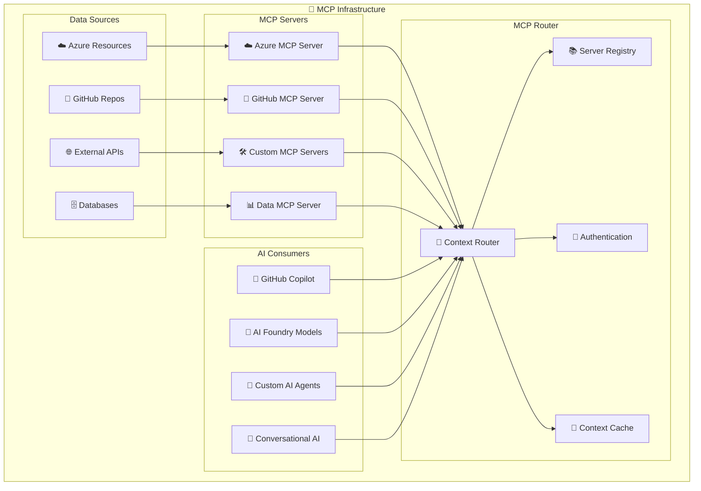
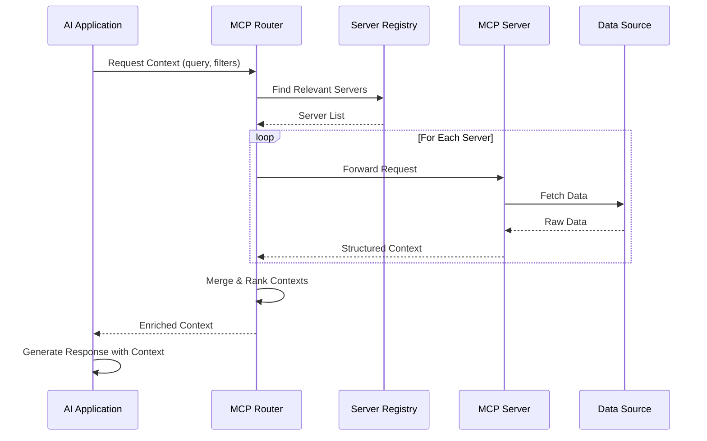

# 🔌 H3-004: Model Context Protocol (MCP) Implementation Guide

## 📋 Table of Contents

1. [🎯 Overview](#overview)
2. [🏗️ Architecture](#architecture)
3. [🔧 Azure MCP Configuration](#azure-mcp-configuration)
4. [🐙 GitHub MCP Setup](#github-mcp-setup)
5. [🤝 A2A Protocol Integration](#a2a-protocol-integration)
6. [🌐 Multi-Server MCP Patterns](#multi-server-mcp-patterns)
7. [🔄 Context Management](#context-management)
8. [🛡️ Security & Governance](#security-governance)
9. [🎬 Demo Scenarios](#demo-scenarios)
10. [📚 Best Practices](#best-practices)

## 🎯 Overview

Model Context Protocol (MCP) enables seamless communication between AI models and various data sources, providing rich context for enhanced AI capabilities. This guide covers implementing MCP across Azure and GitHub environments to create a unified AI context layer.

### 🌟 Key Capabilities

| Capability | Description | Business Value |
|------------|-------------|----------------|
| 🔌 **Unified Context** | Single protocol for all AI contexts | 50% faster AI integration |
| 🤖 **A2A Communication** | Agent-to-agent protocol support | Autonomous AI workflows |
| 📊 **Rich Data Access** | Connect to any data source | Enhanced AI accuracy |
| 🔒 **Secure Context** | Encrypted context transmission | Enterprise compliance |
| 🌐 **Multi-Model Support** | Works with any LLM | Vendor flexibility |

## 🏗️ Architecture



### MCP Flow Diagram



## 🔧 Azure MCP Configuration

### Step 1: Deploy Azure MCP Server

```bicep
// infrastructure/azure-mcp-server.bicep
param location string = resourceGroup().location
param mcpServerName string = 'mcp-server-${uniqueString(resourceGroup().id)}'
param storageAccountName string = 'mcpstorage${uniqueString(resourceGroup().id)}'

// App Service Plan for MCP Server
resource appServicePlan 'Microsoft.Web/serverfarms@2023-01-01' = {
  name: '${mcpServerName}-plan'
  location: location
  sku: {
    name: 'P1v3'
    tier: 'PremiumV3'
  }
  kind: 'linux'
  properties: {
    reserved: true
  }
}

// MCP Server Web App
resource mcpServer 'Microsoft.Web/sites@2023-01-01' = {
  name: mcpServerName
  location: location
  kind: 'app,linux,container'
  properties: {
    serverFarmId: appServicePlan.id
    siteConfig: {
      linuxFxVersion: 'DOCKER|mcr.microsoft.com/azure-mcp-server:latest'
      appSettings: [
        {
          name: 'MCP_PORT'
          value: '8080'
        }
        {
          name: 'AZURE_SUBSCRIPTION_ID'
          value: subscription().subscriptionId
        }
        {
          name: 'AZURE_RESOURCE_GROUP'
          value: resourceGroup().name
        }
        {
          name: 'STORAGE_CONNECTION_STRING'
          value: storageAccount.outputs.connectionString
        }
        {
          name: 'AUTH_ENABLED'
          value: 'true'
        }
        {
          name: 'ALLOWED_ORIGINS'
          value: 'https://*.github.com,https://*.azure.com'
        }
      ]
    }
    httpsOnly: true
  }
  identity: {
    type: 'SystemAssigned'
  }
}

// Storage Account for Context Cache
module storageAccount 'modules/storage.bicep' = {
  name: 'mcp-storage'
  params: {
    storageAccountName: storageAccountName
    location: location
    containers: [
      'context-cache'
      'server-registry'
      'audit-logs'
    ]
  }
}

// Cosmos DB for Server Registry
resource cosmosAccount 'Microsoft.DocumentDB/databaseAccounts@2023-11-15' = {
  name: '${mcpServerName}-cosmos'
  location: location
  kind: 'GlobalDocumentDB'
  properties: {
    consistencyPolicy: {
      defaultConsistencyLevel: 'Session'
    }
    locations: [
      {
        locationName: location
        failoverPriority: 0
      }
    ]
    databaseAccountOfferType: 'Standard'
  }
}

resource database 'Microsoft.DocumentDB/databaseAccounts/sqlDatabases@2023-11-15' = {
  parent: cosmosAccount
  name: 'mcp-registry'
  properties: {
    resource: {
      id: 'mcp-registry'
    }
  }
}

resource container 'Microsoft.DocumentDB/databaseAccounts/sqlDatabases/containers@2023-11-15' = {
  parent: database
  name: 'servers'
  properties: {
    resource: {
      id: 'servers'
      partitionKey: {
        paths: ['/type']
        kind: 'Hash'
      }
      indexingPolicy: {
        indexingMode: 'consistent'
        includedPaths: [
          {
            path: '/*'
          }
        ]
      }
    }
  }
}

output mcpServerUrl string = 'https://${mcpServer.properties.defaultHostName}'
output mcpServerId string = mcpServer.identity.principalId
```

### Step 2: Azure MCP Server Implementation

```typescript
// src/azure-mcp-server/server.ts
import express from 'express';
import { DefaultAzureCredential } from '@azure/identity';
import { ResourceManagementClient } from '@azure/arm-resources';
import { MonitorClient } from '@azure/arm-monitor';
import { CosmosClient } from '@azure/cosmos';
import { MCPServer, MCPRequest, MCPResponse, Context } from '@modelcontextprotocol/sdk';

export class AzureMCPServer extends MCPServer {
  private resourceClient: ResourceManagementClient;
  private monitorClient: MonitorClient;
  private cosmosClient: CosmosClient;
  private contextCache: Map<string, Context>;
  
  constructor() {
    super({
      name: 'azure-mcp-server',
      version: '1.0.0',
      capabilities: [
        'resource-context',
        'metrics-context', 
        'logs-context',
        'security-context',
        'cost-context'
      ]
    });
    
    const credential = new DefaultAzureCredential();
    this.resourceClient = new ResourceManagementClient(
      credential,
      process.env.AZURE_SUBSCRIPTION_ID!
    );
    this.monitorClient = new MonitorClient(
      credential,
      process.env.AZURE_SUBSCRIPTION_ID!
    );
    this.cosmosClient = new CosmosClient({
      endpoint: process.env.COSMOS_ENDPOINT!,
      key: process.env.COSMOS_KEY!
    });
    this.contextCache = new Map();
  }
  
  async handleRequest(request: MCPRequest): Promise<MCPResponse> {
    const { type, query, filters, options } = request;
    
    switch (type) {
      case 'resource-context':
        return this.getResourceContext(query, filters);
        
      case 'metrics-context':
        return this.getMetricsContext(query, filters);
        
      case 'logs-context':
        return this.getLogsContext(query, filters);
        
      case 'security-context':
        return this.getSecurityContext(query, filters);
        
      case 'cost-context':
        return this.getCostContext(query, filters);
        
      default:
        throw new Error(`Unsupported context type: ${type}`);
    }
  }
  
  private async getResourceContext(
    query: string,
    filters: Record<string, any>
  ): Promise<MCPResponse> {
    // Check cache
    const cacheKey = `resource:${query}:${JSON.stringify(filters)}`;
    if (this.contextCache.has(cacheKey)) {
      return {
        context: this.contextCache.get(cacheKey)!,
        metadata: { source: 'cache' }
      };
    }
    
    // Query Azure resources
    const resources = [];
    const resourceGroups = filters.resourceGroups || ['*'];
    
    for (const rg of resourceGroups) {
      const rgFilter = rg === '*' ? undefined : `resourceGroup eq '${rg}'`;
      
      for await (const resource of this.resourceClient.resources.list({
        filter: rgFilter,
        expand: 'properties,tags'
      })) {
        if (this.matchesQuery(resource, query)) {
          resources.push({
            id: resource.id,
            name: resource.name,
            type: resource.type,
            location: resource.location,
            tags: resource.tags,
            properties: resource.properties
          });
        }
      }
    }
    
    // Build context
    const context: Context = {
      type: 'resource-context',
      data: resources,
      metadata: {
        timestamp: new Date().toISOString(),
        count: resources.length,
        query: query,
        filters: filters
      }
    };
    
    // Cache context
    this.contextCache.set(cacheKey, context);
    
    return {
      context,
      metadata: { source: 'azure' }
    };
  }
  
  private async getMetricsContext(
    query: string,
    filters: Record<string, any>
  ): Promise<MCPResponse> {
    const { resourceId, metricNames, timeRange } = filters;
    
    // Parse time range
    const endTime = new Date();
    const startTime = new Date(endTime.getTime() - (timeRange?.hours || 24) * 60 * 60 * 1000);
    
    // Query metrics
    const metrics = await this.monitorClient.metrics.list(
      resourceId,
      {
        metricnames: metricNames?.join(','),
        timespan: `${startTime.toISOString()}/${endTime.toISOString()}`,
        interval: 'PT5M',
        aggregation: 'Average,Count,Maximum,Minimum'
      }
    );
    
    // Transform metrics data
    const metricsData = metrics.value.map(metric => ({
      name: metric.name.value,
      unit: metric.unit,
      timeseries: metric.timeseries?.map(ts => ({
        metadataValues: ts.metadatavalues,
        data: ts.data?.map(d => ({
          timestamp: d.timeStamp,
          average: d.average,
          count: d.count,
          maximum: d.maximum,
          minimum: d.minimum
        }))
      }))
    }));
    
    return {
      context: {
        type: 'metrics-context',
        data: metricsData,
        metadata: {
          resourceId,
          timeRange: {
            start: startTime.toISOString(),
            end: endTime.toISOString()
          },
          granularity: 'PT5M'
        }
      },
      metadata: { source: 'azure-monitor' }
    };
  }
  
  private async getSecurityContext(
    query: string,
    filters: Record<string, any>
  ): Promise<MCPResponse> {
    // Query security recommendations, alerts, and compliance status
    const securityData = {
      recommendations: await this.getSecurityRecommendations(filters),
      alerts: await this.getSecurityAlerts(filters),
      compliance: await this.getComplianceStatus(filters),
      vulnerabilities: await this.getVulnerabilities(filters)
    };
    
    return {
      context: {
        type: 'security-context',
        data: securityData,
        metadata: {
          timestamp: new Date().toISOString(),
          scope: filters.scope || 'subscription'
        }
      },
      metadata: { source: 'azure-security-center' }
    };
  }
  
  private matchesQuery(resource: any, query: string): boolean {
    // Implement flexible query matching
    const searchableText = `${resource.name} ${resource.type} ${JSON.stringify(resource.tags)}`.toLowerCase();
    return searchableText.includes(query.toLowerCase());
  }
}

// Express app setup
const app = express();
const mcpServer = new AzureMCPServer();

app.use(express.json());

// MCP endpoint
app.post('/mcp/query', async (req, res) => {
  try {
    const response = await mcpServer.handleRequest(req.body);
    res.json(response);
  } catch (error) {
    res.status(500).json({ error: error.message });
  }
});

// Server registry endpoint
app.get('/mcp/capabilities', (req, res) => {
  res.json(mcpServer.getCapabilities());
});

// Health check
app.get('/health', (req, res) => {
  res.json({ status: 'healthy', timestamp: new Date().toISOString() });
});

const PORT = process.env.MCP_PORT || 8080;
app.listen(PORT, () => {
  console.log(`Azure MCP Server running on port ${PORT}`);
});
```

## 🐙 GitHub MCP Setup

### Step 1: GitHub MCP Server Deployment

```yaml
# kubernetes/github-mcp-server.yaml
apiVersion: v1
kind: ConfigMap
metadata:
  name: github-mcp-config
  namespace: mcp
data:
  config.yaml: |
    server:
      name: github-mcp-server
      version: 1.0.0
      port: 8080
      
    capabilities:
      - repository-context
      - code-context
      - issue-context
      - pr-context
      - workflow-context
      - security-context
      
    github:
      enterprise_url: https://github.enterprise.com
      api_version: v3
      
    caching:
      enabled: true
      ttl: 300
      max_size: 1000
      
    security:
      authentication: oauth
      encryption: true
      allowed_scopes:
        - repo
        - workflow
        - read:org

---
apiVersion: apps/v1
kind: Deployment
metadata:
  name: github-mcp-server
  namespace: mcp
spec:
  replicas: 3
  selector:
    matchLabels:
      app: github-mcp-server
  template:
    metadata:
      labels:
        app: github-mcp-server
    spec:
      serviceAccountName: github-mcp
      containers:
      - name: server
        image: platform/github-mcp-server:latest
        ports:
        - containerPort: 8080
        env:
        - name: GITHUB_APP_ID
          valueFrom:
            secretKeyRef:
              name: github-app-credentials
              key: app-id
        - name: GITHUB_APP_PRIVATE_KEY
          valueFrom:
            secretKeyRef:
              name: github-app-credentials
              key: private-key
        - name: CONFIG_PATH
          value: /config/config.yaml
        volumeMounts:
        - name: config
          mountPath: /config
        resources:
          requests:
            memory: "512Mi"
            cpu: "500m"
          limits:
            memory: "1Gi"
            cpu: "1000m"
      volumes:
      - name: config
        configMap:
          name: github-mcp-config

---
apiVersion: v1
kind: Service
metadata:
  name: github-mcp-server
  namespace: mcp
spec:
  selector:
    app: github-mcp-server
  ports:
  - port: 80
    targetPort: 8080
  type: LoadBalancer
```

### Step 2: GitHub MCP Server Implementation

```typescript
// src/github-mcp-server/server.ts
import { Octokit } from '@octokit/rest';
import { createAppAuth } from '@octokit/auth-app';
import { graphql } from '@octokit/graphql';
import { MCPServer, MCPRequest, MCPResponse, Context } from '@modelcontextprotocol/sdk';
import LRU from 'lru-cache';

export class GitHubMCPServer extends MCPServer {
  private octokit: Octokit;
  private graphqlClient: typeof graphql;
  private cache: LRU<string, Context>;
  
  constructor() {
    super({
      name: 'github-mcp-server',
      version: '1.0.0',
      capabilities: [
        'repository-context',
        'code-context',
        'issue-context',
        'pr-context',
        'workflow-context',
        'security-context'
      ]
    });
    
    // Initialize GitHub clients
    const auth = createAppAuth({
      appId: process.env.GITHUB_APP_ID!,
      privateKey: process.env.GITHUB_APP_PRIVATE_KEY!,
    });
    
    this.octokit = new Octokit({ auth });
    this.graphqlClient = graphql.defaults({
      request: {
        hook: auth.hook,
      },
    });
    
    // Initialize cache
    this.cache = new LRU({
      max: 1000,
      ttl: 1000 * 60 * 5 // 5 minutes
    });
  }
  
  async handleRequest(request: MCPRequest): Promise<MCPResponse> {
    const { type, query, filters, options } = request;
    
    // Check cache
    const cacheKey = `${type}:${query}:${JSON.stringify(filters)}`;
    const cached = this.cache.get(cacheKey);
    if (cached && !options?.skipCache) {
      return {
        context: cached,
        metadata: { source: 'cache' }
      };
    }
    
    let context: Context;
    
    switch (type) {
      case 'repository-context':
        context = await this.getRepositoryContext(query, filters);
        break;
        
      case 'code-context':
        context = await this.getCodeContext(query, filters);
        break;
        
      case 'issue-context':
        context = await this.getIssueContext(query, filters);
        break;
        
      case 'pr-context':
        context = await this.getPullRequestContext(query, filters);
        break;
        
      case 'workflow-context':
        context = await this.getWorkflowContext(query, filters);
        break;
        
      case 'security-context':
        context = await this.getSecurityContext(query, filters);
        break;
        
      default:
        throw new Error(`Unsupported context type: ${type}`);
    }
    
    // Cache result
    this.cache.set(cacheKey, context);
    
    return {
      context,
      metadata: { source: 'github' }
    };
  }
  
  private async getCodeContext(
    query: string,
    filters: Record<string, any>
  ): Promise<Context> {
    const { owner, repo, path, branch } = filters;
    
    // Use GraphQL for efficient code context retrieval
    const response = await this.graphqlClient(`
      query getCodeContext($owner: String!, $repo: String!, $expression: String!) {
        repository(owner: $owner, name: $repo) {
          object(expression: $expression) {
            ... on Tree {
              entries {
                name
                type
                object {
                  ... on Blob {
                    text
                    byteSize
                  }
                  ... on Tree {
                    entries {
                      name
                      type
                    }
                  }
                }
              }
            }
            ... on Blob {
              text
              byteSize
            }
          }
          defaultBranchRef {
            name
          }
          languages(first: 10) {
            edges {
              node {
                name
                color
              }
              size
            }
          }
        }
      }
    `, {
      owner,
      repo,
      expression: `${branch || 'HEAD'}:${path || ''}`
    });
    
    // Process code search results if query provided
    let searchResults = [];
    if (query) {
      const search = await this.octokit.search.code({
        q: `${query} repo:${owner}/${repo}`,
        per_page: 20
      });
      
      searchResults = search.data.items.map(item => ({
        path: item.path,
        repository: item.repository.full_name,
        score: item.score,
        html_url: item.html_url,
        highlights: item.text_matches
      }));
    }
    
    return {
      type: 'code-context',
      data: {
        repository: `${owner}/${repo}`,
        path: path || '/',
        branch: response.repository.defaultBranchRef?.name || 'main',
        content: response.repository.object,
        languages: response.repository.languages.edges,
        searchResults
      },
      metadata: {
        timestamp: new Date().toISOString(),
        query: query || null
      }
    };
  }
  
  private async getIssueContext(
    query: string,
    filters: Record<string, any>
  ): Promise<Context> {
    const { owner, repo, state, labels, milestone } = filters;
    
    // Build search query
    let searchQuery = `repo:${owner}/${repo}`;
    if (query) searchQuery += ` ${query}`;
    if (state) searchQuery += ` is:${state}`;
    if (labels) searchQuery += ` label:${labels.join(' label:')}`;
    if (milestone) searchQuery += ` milestone:"${milestone}"`;
    
    // Search issues
    const issues = await this.octokit.search.issuesAndPullRequests({
      q: searchQuery + ' is:issue',
      sort: 'updated',
      order: 'desc',
      per_page: 50
    });
    
    // Get detailed issue data
    const detailedIssues = await Promise.all(
      issues.data.items.slice(0, 10).map(async (issue) => {
        const [comments, timeline] = await Promise.all([
          this.octokit.issues.listComments({
            owner,
            repo,
            issue_number: issue.number,
            per_page: 5
          }),
          this.octokit.issues.listEventsForTimeline({
            owner,
            repo,
            issue_number: issue.number,
            per_page: 10
          })
        ]);
        
        return {
          ...issue,
          recent_comments: comments.data,
          timeline_events: timeline.data
        };
      })
    );
    
    return {
      type: 'issue-context',
      data: {
        total_count: issues.data.total_count,
        issues: detailedIssues,
        statistics: this.calculateIssueStatistics(issues.data.items)
      },
      metadata: {
        timestamp: new Date().toISOString(),
        query: searchQuery,
        filters
      }
    };
  }
  
  private async getWorkflowContext(
    query: string,
    filters: Record<string, any>
  ): Promise<Context> {
    const { owner, repo, workflow_id, status, branch } = filters;
    
    // Get workflows
    const workflows = await this.octokit.actions.listRepoWorkflows({
      owner,
      repo
    });
    
    // Get recent workflow runs
    const runs = await this.octokit.actions.listWorkflowRunsForRepo({
      owner,
      repo,
      workflow_id,
      status,
      branch,
      per_page: 20
    });
    
    // Get workflow usage and billing
    const usage = await this.octokit.actions.getWorkflowUsage({
      owner,
      repo,
      workflow_id: workflow_id || workflows.data.workflows[0]?.id
    });
    
    // Analyze workflow performance
    const performance = this.analyzeWorkflowPerformance(runs.data.workflow_runs);
    
    return {
      type: 'workflow-context',
      data: {
        workflows: workflows.data.workflows,
        recent_runs: runs.data.workflow_runs,
        usage: usage.data,
        performance,
        insights: this.generateWorkflowInsights(runs.data.workflow_runs)
      },
      metadata: {
        timestamp: new Date().toISOString(),
        repository: `${owner}/${repo}`
      }
    };
  }
  
  private calculateIssueStatistics(issues: any[]): any {
    const now = new Date();
    const stats = {
      total: issues.length,
      open: issues.filter(i => i.state === 'open').length,
      closed: issues.filter(i => i.state === 'closed').length,
      avg_comments: issues.reduce((sum, i) => sum + i.comments, 0) / issues.length,
      avg_age_days: issues.reduce((sum, i) => {
        const created = new Date(i.created_at);
        return sum + (now.getTime() - created.getTime()) / (1000 * 60 * 60 * 24);
      }, 0) / issues.length,
      labels_distribution: {} as Record<string, number>
    };
    
    // Calculate label distribution
    issues.forEach(issue => {
      issue.labels.forEach((label: any) => {
        stats.labels_distribution[label.name] = 
          (stats.labels_distribution[label.name] || 0) + 1;
      });
    });
    
    return stats;
  }
  
  private analyzeWorkflowPerformance(runs: any[]): any {
    if (runs.length === 0) return null;
    
    const durations = runs
      .filter(r => r.status === 'completed' && r.run_started_at && r.updated_at)
      .map(r => {
        const start = new Date(r.run_started_at);
        const end = new Date(r.updated_at);
        return (end.getTime() - start.getTime()) / 1000; // seconds
      });
    
    return {
      avg_duration_seconds: durations.reduce((a, b) => a + b, 0) / durations.length,
      min_duration_seconds: Math.min(...durations),
      max_duration_seconds: Math.max(...durations),
      success_rate: runs.filter(r => r.conclusion === 'success').length / runs.length,
      failure_rate: runs.filter(r => r.conclusion === 'failure').length / runs.length
    };
  }
  
  private generateWorkflowInsights(runs: any[]): any {
    const insights = [];
    
    // High failure rate insight
    const failureRate = runs.filter(r => r.conclusion === 'failure').length / runs.length;
    if (failureRate > 0.2) {
      insights.push({
        type: 'high_failure_rate',
        severity: 'high',
        message: `Workflow has ${(failureRate * 100).toFixed(0)}% failure rate`,
        recommendation: 'Review recent failures and improve test stability'
      });
    }
    
    // Long duration insight
    const avgDuration = runs
      .filter(r => r.run_started_at && r.updated_at)
      .reduce((sum, r) => {
        const duration = new Date(r.updated_at).getTime() - new Date(r.run_started_at).getTime();
        return sum + duration;
      }, 0) / runs.length / 1000 / 60; // minutes
      
    if (avgDuration > 30) {
      insights.push({
        type: 'long_duration',
        severity: 'medium',
        message: `Average workflow duration is ${avgDuration.toFixed(0)} minutes`,
        recommendation: 'Consider parallelizing jobs or optimizing slow steps'
      });
    }
    
    return insights;
  }
}
```

## 🤝 A2A Protocol Integration

### Agent-to-Agent Communication Framework

```python
# src/mcp/a2a_protocol.py
import asyncio
import json
from typing import Dict, List, Any, Optional
from dataclasses import dataclass
from abc import ABC, abstractmethod
import uuid
from datetime import datetime

@dataclass
class A2AMessage:
    """Agent-to-Agent message structure"""
    id: str
    sender: str
    recipient: str
    message_type: str
    payload: Dict[str, Any]
    context: Dict[str, Any]
    timestamp: datetime
    requires_response: bool = False
    correlation_id: Optional[str] = None

class A2AProtocol:
    """Agent-to-Agent communication protocol"""
    
    def __init__(self, agent_id: str):
        self.agent_id = agent_id
        self.message_handlers: Dict[str, callable] = {}
        self.pending_responses: Dict[str, asyncio.Future] = {}
        self.context_providers: List[ContextProvider] = []
        
    def register_handler(self, message_type: str, handler: callable):
        """Register a handler for specific message type"""
        self.message_handlers[message_type] = handler
        
    def register_context_provider(self, provider: 'ContextProvider'):
        """Register a context provider"""
        self.context_providers.append(provider)
        
    async def send_message(
        self,
        recipient: str,
        message_type: str,
        payload: Dict[str, Any],
        wait_for_response: bool = False,
        timeout: int = 30
    ) -> Optional[A2AMessage]:
        """Send message to another agent"""
        
        # Generate message ID
        message_id = str(uuid.uuid4())
        
        # Gather context from all providers
        context = await self._gather_context(recipient, message_type)
        
        # Create message
        message = A2AMessage(
            id=message_id,
            sender=self.agent_id,
            recipient=recipient,
            message_type=message_type,
            payload=payload,
            context=context,
            timestamp=datetime.utcnow(),
            requires_response=wait_for_response
        )
        
        # Send message
        await self._transmit_message(message)
        
        # Wait for response if requested
        if wait_for_response:
            future = asyncio.Future()
            self.pending_responses[message_id] = future
            
            try:
                response = await asyncio.wait_for(future, timeout=timeout)
                return response
            except asyncio.TimeoutError:
                del self.pending_responses[message_id]
                raise TimeoutError(f"No response received within {timeout}s")
                
        return None
        
    async def handle_message(self, message: A2AMessage):
        """Handle incoming message"""
        
        # Check if it's a response to a pending request
        if message.correlation_id and message.correlation_id in self.pending_responses:
            future = self.pending_responses.pop(message.correlation_id)
            future.set_result(message)
            return
            
        # Find appropriate handler
        handler = self.message_handlers.get(message.message_type)
        if not handler:
            await self._send_error_response(
                message,
                f"No handler for message type: {message.message_type}"
            )
            return
            
        try:
            # Process message
            result = await handler(message)
            
            # Send response if required
            if message.requires_response:
                await self._send_response(message, result)
                
        except Exception as e:
            await self._send_error_response(message, str(e))
            
    async def _gather_context(
        self,
        recipient: str,
        message_type: str
    ) -> Dict[str, Any]:
        """Gather context from all providers"""
        
        context = {}
        
        for provider in self.context_providers:
            try:
                provider_context = await provider.get_context(
                    recipient,
                    message_type
                )
                context.update(provider_context)
            except Exception as e:
                # Log error but continue
                print(f"Context provider {provider} failed: {e}")
                
        return context
        
    async def _transmit_message(self, message: A2AMessage):
        """Transmit message to recipient"""
        # This would integrate with your message broker (Kafka, RabbitMQ, etc.)
        # For demo purposes, we'll use a simple HTTP call
        
        async with aiohttp.ClientSession() as session:
            endpoint = f"http://{message.recipient}/a2a/receive"
            async with session.post(
                endpoint,
                json=message.__dict__,
                headers={'X-Agent-ID': self.agent_id}
            ) as response:
                if response.status != 200:
                    raise Exception(f"Failed to send message: {await response.text()}")
                    
    async def _send_response(self, original_message: A2AMessage, result: Any):
        """Send response to original message"""
        
        response = A2AMessage(
            id=str(uuid.uuid4()),
            sender=self.agent_id,
            recipient=original_message.sender,
            message_type=f"{original_message.message_type}_response",
            payload={'result': result},
            context={},
            timestamp=datetime.utcnow(),
            requires_response=False,
            correlation_id=original_message.id
        )
        
        await self._transmit_message(response)
        
    async def _send_error_response(self, original_message: A2AMessage, error: str):
        """Send error response"""
        
        response = A2AMessage(
            id=str(uuid.uuid4()),
            sender=self.agent_id,
            recipient=original_message.sender,
            message_type="error",
            payload={'error': error, 'original_type': original_message.message_type},
            context={},
            timestamp=datetime.utcnow(),
            requires_response=False,
            correlation_id=original_message.id
        )
        
        await self._transmit_message(response)

class ContextProvider(ABC):
    """Base class for context providers"""
    
    @abstractmethod
    async def get_context(self, recipient: str, message_type: str) -> Dict[str, Any]:
        """Get context for a message"""
        pass

class MCPContextProvider(ContextProvider):
    """MCP-based context provider"""
    
    def __init__(self, mcp_clients: Dict[str, 'MCPClient']):
        self.mcp_clients = mcp_clients
        
    async def get_context(self, recipient: str, message_type: str) -> Dict[str, Any]:
        """Get context from MCP servers"""
        
        context = {}
        
        # Determine which MCP servers to query based on message type
        servers_to_query = self._select_mcp_servers(message_type)
        
        # Query each server
        tasks = []
        for server_name in servers_to_query:
            if server_name in self.mcp_clients:
                client = self.mcp_clients[server_name]
                tasks.append(self._query_mcp_server(client, recipient, message_type))
                
        # Gather results
        results = await asyncio.gather(*tasks, return_exceptions=True)
        
        # Merge contexts
        for i, result in enumerate(results):
            if isinstance(result, dict):
                context[servers_to_query[i]] = result
            else:
                # Log error
                print(f"MCP query failed for {servers_to_query[i]}: {result}")
                
        return context
        
    def _select_mcp_servers(self, message_type: str) -> List[str]:
        """Select relevant MCP servers based on message type"""
        
        # Message type to MCP server mapping
        mappings = {
            'code_review': ['github-mcp', 'azure-mcp'],
            'deployment': ['azure-mcp', 'kubernetes-mcp'],
            'cost_analysis': ['azure-mcp', 'aws-mcp'],
            'security_scan': ['github-mcp', 'security-mcp'],
            'performance_analysis': ['metrics-mcp', 'logs-mcp']
        }
        
        return mappings.get(message_type, ['github-mcp', 'azure-mcp'])

# Example Agent Implementation
class CodeReviewAgent:
    """AI agent that performs code reviews"""
    
    def __init__(self, agent_id: str):
        self.agent_id = agent_id
        self.protocol = A2AProtocol(agent_id)
        self.ai_client = UnifiedAIClient()
        
        # Register message handlers
        self.protocol.register_handler('review_request', self.handle_review_request)
        self.protocol.register_handler('review_update', self.handle_review_update)
        
        # Register context providers
        mcp_clients = {
            'github-mcp': GitHubMCPClient(),
            'azure-mcp': AzureMCPClient()
        }
        self.protocol.register_context_provider(MCPContextProvider(mcp_clients))
        
    async def handle_review_request(self, message: A2AMessage) -> Dict[str, Any]:
        """Handle code review request"""
        
        pr_url = message.payload['pull_request_url']
        review_type = message.payload.get('review_type', 'comprehensive')
        
        # Extract context from message
        github_context = message.context.get('github-mcp', {})
        azure_context = message.context.get('azure-mcp', {})
        
        # Perform AI-powered review
        review_result = await self.perform_code_review(
            pr_url,
            review_type,
            github_context,
            azure_context
        )
        
        # Send review to deployment agent for impact analysis
        if review_result['risk_level'] == 'high':
            deployment_analysis = await self.protocol.send_message(
                recipient='deployment-agent',
                message_type='analyze_deployment_impact',
                payload={
                    'pr_url': pr_url,
                    'changes': review_result['changes']
                },
                wait_for_response=True
            )
            
            review_result['deployment_impact'] = deployment_analysis.payload['result']
            
        return review_result
        
    async def perform_code_review(
        self,
        pr_url: str,
        review_type: str,
        github_context: Dict[str, Any],
        azure_context: Dict[str, Any]
    ) -> Dict[str, Any]:
        """Perform AI-powered code review"""
        
        # Build comprehensive prompt with context
        prompt = f"""
        Perform a {review_type} code review for the following pull request:
        
        PR: {pr_url}
        
        GitHub Context:
        - Files changed: {github_context.get('files_changed', [])}
        - Recent issues: {github_context.get('related_issues', [])}
        - CI/CD status: {github_context.get('workflow_status', 'unknown')}
        
        Azure Context:
        - Target environment: {azure_context.get('target_environment', 'unknown')}
        - Resource impact: {azure_context.get('resource_changes', [])}
        - Estimated cost impact: {azure_context.get('cost_impact', 'unknown')}
        
        Review for:
        1. Code quality and best practices
        2. Security vulnerabilities
        3. Performance implications
        4. Architectural concerns
        5. Testing coverage
        """
        
        # Get AI review
        response = await self.ai_client.chat([
            {"role": "system", "content": "You are an expert code reviewer."},
            {"role": "user", "content": prompt}
        ])
        
        # Parse and structure response
        review = self._parse_review_response(response.choices[0].message.content)
        
        return review
```

## 🌐 Multi-Server MCP Patterns

### Pattern 1: Federated Context Aggregation

```typescript
// src/mcp/patterns/federated-aggregation.ts
import { MCPClient, Context, MCPQuery } from '@modelcontextprotocol/sdk';

export class FederatedMCPAggregator {
  private servers: Map<string, MCPClient>;
  private routingRules: RoutingRule[];
  private aggregationStrategies: Map<string, AggregationStrategy>;
  
  constructor() {
    this.servers = new Map();
    this.routingRules = [];
    this.aggregationStrategies = new Map();
    this.initializeDefaultStrategies();
  }
  
  registerServer(name: string, client: MCPClient, capabilities: string[]) {
    this.servers.set(name, client);
    
    // Auto-generate routing rules based on capabilities
    capabilities.forEach(capability => {
      this.routingRules.push({
        capability,
        servers: [...(this.getServersForCapability(capability)), name]
      });
    });
  }
  
  async query(query: MCPQuery): Promise<AggregatedContext> {
    // Determine which servers to query
    const serversToQuery = this.selectServers(query);
    
    // Query servers in parallel
    const contextPromises = serversToQuery.map(async serverName => {
      const client = this.servers.get(serverName);
      if (!client) return null;
      
      try {
        const response = await client.query(query);
        return {
          server: serverName,
          context: response.context,
          metadata: response.metadata
        };
      } catch (error) {
        console.error(`Failed to query ${serverName}:`, error);
        return null;
      }
    });
    
    // Collect results
    const results = await Promise.all(contextPromises);
    const validResults = results.filter(r => r !== null);
    
    // Aggregate contexts
    const aggregatedContext = await this.aggregateContexts(
      validResults,
      query.type
    );
    
    return aggregatedContext;
  }
  
  private selectServers(query: MCPQuery): string[] {
    // Use routing rules to select servers
    const relevantServers = new Set<string>();
    
    this.routingRules.forEach(rule => {
      if (this.matchesQuery(rule, query)) {
        rule.servers.forEach(server => relevantServers.add(server));
      }
    });
    
    // Apply load balancing
    return this.loadBalance(Array.from(relevantServers));
  }
  
  private async aggregateContexts(
    results: ServerResult[],
    contextType: string
  ): Promise<AggregatedContext> {
    const strategy = this.aggregationStrategies.get(contextType) 
      || this.aggregationStrategies.get('default')!;
      
    return strategy.aggregate(results);
  }
  
  private initializeDefaultStrategies() {
    // Merge strategy - combines all data
    this.aggregationStrategies.set('default', new MergeStrategy());
    
    // Priority strategy - uses highest confidence result
    this.aggregationStrategies.set('priority', new PriorityStrategy());
    
    // Consensus strategy - requires agreement between sources
    this.aggregationStrategies.set('consensus', new ConsensusStrategy());
    
    // Specialized strategies
    this.aggregationStrategies.set('code-context', new CodeContextStrategy());
    this.aggregationStrategies.set('metrics-context', new MetricsAggregationStrategy());
  }
}

// Aggregation Strategies
abstract class AggregationStrategy {
  abstract aggregate(results: ServerResult[]): Promise<AggregatedContext>;
}

class MergeStrategy extends AggregationStrategy {
  async aggregate(results: ServerResult[]): Promise<AggregatedContext> {
    const mergedData: any = {};
    const sources: string[] = [];
    
    // Merge data from all sources
    results.forEach(result => {
      sources.push(result.server);
      
      // Deep merge context data
      this.deepMerge(mergedData, result.context.data);
    });
    
    return {
      type: 'aggregated-context',
      data: mergedData,
      metadata: {
        sources,
        aggregation_method: 'merge',
        timestamp: new Date().toISOString()
      }
    };
  }
  
  private deepMerge(target: any, source: any) {
    Object.keys(source).forEach(key => {
      if (source[key] instanceof Object && key in target) {
        this.deepMerge(target[key], source[key]);
      } else {
        target[key] = source[key];
      }
    });
  }
}

class CodeContextStrategy extends AggregationStrategy {
  async aggregate(results: ServerResult[]): Promise<AggregatedContext> {
    // Specialized aggregation for code context
    const codeContext = {
      repositories: new Map<string, any>(),
      code_snippets: [],
      dependencies: new Set<string>(),
      security_issues: [],
      quality_metrics: {}
    };
    
    results.forEach(result => {
      const data = result.context.data;
      
      // Aggregate repositories
      if (data.repositories) {
        data.repositories.forEach((repo: any) => {
          codeContext.repositories.set(repo.full_name, repo);
        });
      }
      
      // Collect code snippets
      if (data.code_snippets) {
        codeContext.code_snippets.push(...data.code_snippets);
      }
      
      // Merge dependencies
      if (data.dependencies) {
        data.dependencies.forEach((dep: string) => codeContext.dependencies.add(dep));
      }
      
      // Aggregate security issues
      if (data.security_issues) {
        codeContext.security_issues.push(...data.security_issues);
      }
      
      // Merge quality metrics
      if (data.quality_metrics) {
        Object.assign(codeContext.quality_metrics, data.quality_metrics);
      }
    });
    
    // Rank and deduplicate code snippets
    const rankedSnippets = this.rankCodeSnippets(codeContext.code_snippets);
    
    return {
      type: 'code-context',
      data: {
        repositories: Array.from(codeContext.repositories.values()),
        code_snippets: rankedSnippets,
        dependencies: Array.from(codeContext.dependencies),
        security_issues: this.prioritizeSecurityIssues(codeContext.security_issues),
        quality_metrics: codeContext.quality_metrics
      },
      metadata: {
        sources: results.map(r => r.server),
        total_repositories: codeContext.repositories.size,
        total_snippets: rankedSnippets.length,
        aggregation_method: 'code-specialized'
      }
    };
  }
  
  private rankCodeSnippets(snippets: any[]): any[] {
    // Remove duplicates and rank by relevance
    const uniqueSnippets = new Map();
    
    snippets.forEach(snippet => {
      const key = `${snippet.file}:${snippet.line_start}`;
      if (!uniqueSnippets.has(key) || snippet.score > uniqueSnippets.get(key).score) {
        uniqueSnippets.set(key, snippet);
      }
    });
    
    return Array.from(uniqueSnippets.values())
      .sort((a, b) => b.score - a.score)
      .slice(0, 20); // Top 20 snippets
  }
  
  private prioritizeSecurityIssues(issues: any[]): any[] {
    const severityOrder = ['critical', 'high', 'medium', 'low'];
    
    return issues.sort((a, b) => {
      const aIndex = severityOrder.indexOf(a.severity);
      const bIndex = severityOrder.indexOf(b.severity);
      return aIndex - bIndex;
    });
  }
}
```

### Pattern 2: Context Routing and Caching

```python
# src/mcp/patterns/context_routing.py
from typing import Dict, List, Any, Optional, Set
import hashlib
import asyncio
from dataclasses import dataclass
from datetime import datetime, timedelta
import redis
import json

@dataclass
class RoutingPolicy:
    """Defines how to route context requests"""
    name: str
    conditions: List[Dict[str, Any]]
    target_servers: List[str]
    priority: int
    cache_ttl: int = 300  # seconds
    require_all: bool = False  # Whether all servers must respond

class ContextRouter:
    """Intelligent routing for MCP queries"""
    
    def __init__(self, redis_client: redis.Redis):
        self.redis_client = redis_client
        self.routing_policies: List[RoutingPolicy] = []
        self.server_health: Dict[str, ServerHealth] = {}
        self.circuit_breakers: Dict[str, CircuitBreaker] = {}
        
    def add_routing_policy(self, policy: RoutingPolicy):
        """Add a routing policy"""
        self.routing_policies.append(policy)
        self.routing_policies.sort(key=lambda p: p.priority, reverse=True)
        
    async def route_query(
        self,
        query: MCPQuery,
        user_context: Dict[str, Any]
    ) -> RoutingDecision:
        """Determine optimal routing for a query"""
        
        # Check cache first
        cache_key = self._generate_cache_key(query, user_context)
        cached_result = await self._get_cached_result(cache_key)
        if cached_result:
            return RoutingDecision(
                servers=[],
                cache_hit=True,
                cached_context=cached_result
            )
            
        # Evaluate routing policies
        matching_policies = []
        for policy in self.routing_policies:
            if self._evaluate_policy(policy, query, user_context):
                matching_policies.append(policy)
                
        if not matching_policies:
            # Default routing
            return RoutingDecision(
                servers=self._get_default_servers(query.type),
                cache_hit=False
            )
            
        # Select servers based on policies
        selected_servers = self._select_servers(matching_policies, query)
        
        # Apply circuit breaker logic
        available_servers = []
        for server in selected_servers:
            if server not in self.circuit_breakers:
                self.circuit_breakers[server] = CircuitBreaker(server)
                
            if self.circuit_breakers[server].is_available():
                available_servers.append(server)
                
        return RoutingDecision(
            servers=available_servers,
            cache_hit=False,
            cache_ttl=matching_policies[0].cache_ttl,
            routing_policy=matching_policies[0].name
        )
        
    def _evaluate_policy(
        self,
        policy: RoutingPolicy,
        query: MCPQuery,
        user_context: Dict[str, Any]
    ) -> bool:
        """Evaluate if a policy matches the query"""
        
        for condition in policy.conditions:
            condition_type = condition['type']
            
            if condition_type == 'query_type':
                if query.type not in condition['values']:
                    return False
                    
            elif condition_type == 'user_role':
                if user_context.get('role') not in condition['values']:
                    return False
                    
            elif condition_type == 'data_classification':
                if query.filters.get('classification') not in condition['values']:
                    return False
                    
            elif condition_type == 'time_window':
                current_hour = datetime.now().hour
                start_hour = condition['start_hour']
                end_hour = condition['end_hour']
                if not (start_hour <= current_hour < end_hour):
                    return False
                    
            elif condition_type == 'regex_match':
                import re
                if not re.match(condition['pattern'], query.query):
                    return False
                    
        return True
        
    def _select_servers(
        self,
        policies: List[RoutingPolicy],
        query: MCPQuery
    ) -> List[str]:
        """Select servers based on policies and health"""
        
        server_scores: Dict[str, float] = {}
        
        for policy in policies:
            for server in policy.target_servers:
                # Calculate server score based on health and load
                health = self.server_health.get(server, ServerHealth(server))
                
                score = health.availability * (1 - health.load)
                if health.latency_ms > 0:
                    score *= (100 / health.latency_ms)  # Favor low latency
                    
                server_scores[server] = server_scores.get(server, 0) + score
                
        # Sort servers by score
        sorted_servers = sorted(
            server_scores.items(),
            key=lambda x: x[1],
            reverse=True
        )
        
        # Return top servers based on query requirements
        if query.options.get('high_availability'):
            return [s[0] for s in sorted_servers[:3]]  # Top 3 for HA
        else:
            return [sorted_servers[0][0]] if sorted_servers else []
            
    async def update_server_health(self, server: str, health_data: Dict[str, Any]):
        """Update server health information"""
        
        if server not in self.server_health:
            self.server_health[server] = ServerHealth(server)
            
        health = self.server_health[server]
        health.availability = health_data.get('availability', 1.0)
        health.latency_ms = health_data.get('latency_ms', 0)
        health.load = health_data.get('load', 0)
        health.last_updated = datetime.utcnow()
        
        # Update circuit breaker
        if server in self.circuit_breakers:
            if health.availability < 0.5:
                self.circuit_breakers[server].record_failure()
            else:
                self.circuit_breakers[server].record_success()

@dataclass
class ServerHealth:
    """Health status of an MCP server"""
    name: str
    availability: float = 1.0  # 0-1
    latency_ms: float = 0
    load: float = 0  # 0-1
    last_updated: datetime = None
    
class CircuitBreaker:
    """Circuit breaker for MCP servers"""
    
    def __init__(self, server_name: str):
        self.server_name = server_name
        self.failure_count = 0
        self.success_count = 0
        self.state = 'closed'  # closed, open, half-open
        self.last_failure_time = None
        self.last_state_change = datetime.utcnow()
        
    def record_success(self):
        """Record successful request"""
        self.success_count += 1
        
        if self.state == 'half-open' and self.success_count >= 5:
            self.state = 'closed'
            self.failure_count = 0
            self.last_state_change = datetime.utcnow()
            
    def record_failure(self):
        """Record failed request"""
        self.failure_count += 1
        self.last_failure_time = datetime.utcnow()
        
        if self.failure_count >= 5 and self.state == 'closed':
            self.state = 'open'
            self.last_state_change = datetime.utcnow()
            
    def is_available(self) -> bool:
        """Check if server is available"""
        
        if self.state == 'closed':
            return True
            
        if self.state == 'open':
            # Check if we should try half-open
            if datetime.utcnow() - self.last_state_change > timedelta(minutes=5):
                self.state = 'half-open'
                self.success_count = 0
                return True
            return False
            
        # half-open state
        return True

# Context caching layer
class ContextCache:
    """Distributed caching for MCP contexts"""
    
    def __init__(self, redis_client: redis.Redis):
        self.redis_client = redis_client
        self.compression_enabled = True
        
    async def get(self, key: str) -> Optional[Context]:
        """Get context from cache"""
        
        try:
            data = self.redis_client.get(f"mcp:context:{key}")
            if not data:
                return None
                
            # Decompress if needed
            if self.compression_enabled:
                import zlib
                data = zlib.decompress(data)
                
            return Context(**json.loads(data))
            
        except Exception as e:
            print(f"Cache get error: {e}")
            return None
            
    async def set(
        self,
        key: str,
        context: Context,
        ttl: int = 300
    ):
        """Set context in cache"""
        
        try:
            data = json.dumps(context.__dict__)
            
            # Compress if needed
            if self.compression_enabled:
                import zlib
                data = zlib.compress(data.encode())
                
            self.redis_client.setex(
                f"mcp:context:{key}",
                ttl,
                data
            )
            
        except Exception as e:
            print(f"Cache set error: {e}")
            
    def generate_key(
        self,
        query: MCPQuery,
        user_context: Dict[str, Any]
    ) -> str:
        """Generate cache key"""
        
        # Create deterministic key from query and context
        key_data = {
            'type': query.type,
            'query': query.query,
            'filters': query.filters,
            'user_role': user_context.get('role'),
            'user_org': user_context.get('organization')
        }
        
        key_string = json.dumps(key_data, sort_keys=True)
        return hashlib.sha256(key_string.encode()).hexdigest()
```

## 🔄 Context Management

### Dynamic Context Enrichment

```typescript
// src/mcp/context-management.ts
import { EventEmitter } from 'events';

export class ContextManager extends EventEmitter {
  private contextStore: Map<string, EnrichedContext>;
  private enrichmentPipeline: ContextEnricher[];
  private contextGraph: ContextGraph;
  
  constructor() {
    super();
    this.contextStore = new Map();
    this.enrichmentPipeline = [];
    this.contextGraph = new ContextGraph();
    this.initializeEnrichers();
  }
  
  async buildContext(
    request: ContextRequest
  ): Promise<EnrichedContext> {
    // Start with base context
    let context = await this.gatherBaseContext(request);
    
    // Run through enrichment pipeline
    for (const enricher of this.enrichmentPipeline) {
      if (enricher.canEnrich(context)) {
        context = await enricher.enrich(context);
      }
    }
    
    // Build context graph
    this.contextGraph.addContext(context);
    
    // Find related contexts
    const relatedContexts = await this.contextGraph.findRelated(context);
    context.related = relatedContexts;
    
    // Store enriched context
    this.contextStore.set(context.id, context);
    
    // Emit context ready event
    this.emit('context:ready', context);
    
    return context;
  }
  
  private initializeEnrichers() {
    this.enrichmentPipeline = [
      new SecurityContextEnricher(),
      new PerformanceContextEnricher(),
      new CostContextEnricher(),
      new ComplianceContextEnricher(),
      new HistoricalContextEnricher()
    ];
  }
  
  async gatherBaseContext(request: ContextRequest): Promise<BaseContext> {
    const baseContext: BaseContext = {
      id: generateContextId(),
      timestamp: new Date(),
      request: request,
      data: {}
    };
    
    // Query MCP servers based on request type
    const mcpQueries = this.buildMCPQueries(request);
    
    const results = await Promise.allSettled(
      mcpQueries.map(query => this.queryMCPServer(query))
    );
    
    // Merge results into base context
    results.forEach((result, index) => {
      if (result.status === 'fulfilled') {
        baseContext.data[mcpQueries[index].server] = result.value;
      }
    });
    
    return baseContext;
  }
}

// Context Enrichers
abstract class ContextEnricher {
  abstract canEnrich(context: Context): boolean;
  abstract enrich(context: Context): Promise<Context>;
}

class SecurityContextEnricher extends ContextEnricher {
  canEnrich(context: Context): boolean {
    return context.request.includesSecurity !== false;
  }
  
  async enrich(context: Context): Promise<Context> {
    const securityData = await this.analyzeSecurityContext(context);
    
    return {
      ...context,
      security: {
        vulnerabilities: securityData.vulnerabilities,
        compliance_status: securityData.compliance,
        risk_score: securityData.riskScore,
        recommendations: securityData.recommendations
      }
    };
  }
  
  private async analyzeSecurityContext(context: Context): Promise<any> {
    // Analyze code context for vulnerabilities
    const codeVulnerabilities = await this.scanCode(context.data.github?.code_snippets);
    
    // Check infrastructure security
    const infraVulnerabilities = await this.scanInfrastructure(context.data.azure?.resources);
    
    // Calculate risk score
    const riskScore = this.calculateRiskScore([
      ...codeVulnerabilities,
      ...infraVulnerabilities
    ]);
    
    return {
      vulnerabilities: [...codeVulnerabilities, ...infraVulnerabilities],
      compliance: await this.checkCompliance(context),
      riskScore,
      recommendations: this.generateSecurityRecommendations(riskScore)
    };
  }
}

class HistoricalContextEnricher extends ContextEnricher {
  canEnrich(context: Context): boolean {
    return true; // Always enrich with historical data
  }
  
  async enrich(context: Context): Promise<Context> {
    const historicalData = await this.getHistoricalData(context);
    
    return {
      ...context,
      historical: {
        similar_contexts: historicalData.similar,
        trends: historicalData.trends,
        patterns: historicalData.patterns,
        anomalies: historicalData.anomalies
      }
    };
  }
  
  private async getHistoricalData(context: Context): Promise<any> {
    // Query time-series database for historical patterns
    const timeSeriesData = await this.queryTimeSeries(context);
    
    // Find similar historical contexts
    const similarContexts = await this.findSimilarContexts(context);
    
    // Analyze trends
    const trends = this.analyzeTrends(timeSeriesData);
    
    // Detect patterns
    const patterns = this.detectPatterns(timeSeriesData);
    
    // Identify anomalies
    const anomalies = this.detectAnomalies(timeSeriesData, patterns);
    
    return {
      similar: similarContexts,
      trends,
      patterns,
      anomalies
    };
  }
}

// Context Graph for relationship management
class ContextGraph {
  private graph: Map<string, Set<string>>;
  private nodeData: Map<string, Context>;
  
  constructor() {
    this.graph = new Map();
    this.nodeData = new Map();
  }
  
  addContext(context: Context) {
    this.nodeData.set(context.id, context);
    
    if (!this.graph.has(context.id)) {
      this.graph.set(context.id, new Set());
    }
    
    // Build relationships based on shared entities
    this.buildRelationships(context);
  }
  
  private buildRelationships(context: Context) {
    // Find contexts with shared resources
    for (const [id, otherContext] of this.nodeData) {
      if (id === context.id) continue;
      
      const sharedResources = this.findSharedResources(context, otherContext);
      if (sharedResources.length > 0) {
        this.graph.get(context.id)!.add(id);
        this.graph.get(id)!.add(context.id);
      }
    }
  }
  
  async findRelated(
    context: Context,
    maxDepth: number = 2
  ): Promise<RelatedContext[]> {
    const related: RelatedContext[] = [];
    const visited = new Set<string>();
    
    await this.dfs(context.id, 0, maxDepth, visited, related);
    
    return related.sort((a, b) => b.relevance - a.relevance);
  }
  
  private async dfs(
    nodeId: string,
    currentDepth: number,
    maxDepth: number,
    visited: Set<string>,
    related: RelatedContext[]
  ) {
    if (currentDepth > maxDepth || visited.has(nodeId)) {
      return;
    }
    
    visited.add(nodeId);
    const context = this.nodeData.get(nodeId);
    if (!context) return;
    
    if (currentDepth > 0) {
      related.push({
        context,
        relevance: 1 / currentDepth,
        relationship_type: this.getRelationshipType(context)
      });
    }
    
    const neighbors = this.graph.get(nodeId) || new Set();
    for (const neighbor of neighbors) {
      await this.dfs(neighbor, currentDepth + 1, maxDepth, visited, related);
    }
  }
}
```

## 🛡️ Security & Governance

### MCP Security Framework

```yaml
# security/mcp-security-policy.yaml
apiVersion: security.mcp.io/v1
kind: MCPSecurityPolicy
metadata:
  name: enterprise-mcp-security
  namespace: mcp
spec:
  authentication:
    required: true
    methods:
      - type: oauth2
        provider: azure-ad
        scopes:
          - mcp.read
          - mcp.write
      - type: mtls
        ca_cert: /certs/ca.crt
        
  authorization:
    model: rbac
    policies:
      - name: read-only
        permissions:
          - contexts:get
          - contexts:list
        resources:
          - type: context
            filters:
              classification: ["public", "internal"]
              
      - name: full-access
        permissions:
          - contexts:*
          - servers:*
        resources:
          - type: "*"
            
  encryption:
    in_transit:
      enabled: true
      min_tls_version: "1.3"
      cipher_suites:
        - TLS_AES_256_GCM_SHA384
        - TLS_CHACHA20_POLY1305_SHA256
        
    at_rest:
      enabled: true
      key_management:
        provider: azure-key-vault
        key_rotation_days: 90
        
  data_governance:
    classification_required: true
    retention_policies:
      - classification: public
        retention_days: 90
      - classification: internal
        retention_days: 365
      - classification: confidential
        retention_days: 730
      - classification: restricted
        retention_days: 2555
        
    pii_handling:
      detection: true
      masking: true
      audit_access: true
      
  audit:
    enabled: true
    destinations:
      - type: azure-monitor
        workspace_id: ${AUDIT_WORKSPACE_ID}
      - type: splunk
        endpoint: https://splunk.company.com
        
    events_to_audit:
      - context_access
      - context_modification
      - authentication_failure
      - authorization_failure
      - data_export
```

### Governance Implementation

```python
# src/mcp/governance.py
from typing import Dict, List, Any, Optional
from datetime import datetime
from enum import Enum
import hashlib
import json

class DataClassification(Enum):
    PUBLIC = "public"
    INTERNAL = "internal" 
    CONFIDENTIAL = "confidential"
    RESTRICTED = "restricted"

class MCPGovernance:
    """Governance layer for MCP"""
    
    def __init__(self, audit_client: AuditClient):
        self.audit_client = audit_client
        self.classification_rules = self._load_classification_rules()
        self.pii_detector = PIIDetector()
        self.encryption_service = EncryptionService()
        
    async def process_context(
        self,
        context: Context,
        user: User,
        operation: str
    ) -> GovernedContext:
        """Apply governance policies to context"""
        
        # Classify data
        classification = await self.classify_context(context)
        
        # Check authorization
        if not await self.authorize_access(user, context, classification, operation):
            await self.audit_access_denied(user, context, operation)
            raise UnauthorizedError(f"User {user.id} not authorized for {operation}")
            
        # Detect and handle PII
        pii_results = await self.pii_detector.scan(context)
        if pii_results.has_pii:
            context = await self.handle_pii(context, pii_results, user)
            
        # Apply encryption if needed
        if classification in [DataClassification.CONFIDENTIAL, DataClassification.RESTRICTED]:
            context = await self.encryption_service.encrypt_context(context)
            
        # Audit access
        await self.audit_context_access(user, context, operation, classification)
        
        # Create governed context
        governed_context = GovernedContext(
            context=context,
            classification=classification,
            access_controls=self.generate_access_controls(classification),
            retention_policy=self.get_retention_policy(classification),
            audit_trail=self.create_audit_trail(user, operation)
        )
        
        return governed_context
        
    async def classify_context(self, context: Context) -> DataClassification:
        """Classify context based on content"""
        
        # Check explicit classification
        if context.metadata.get('classification'):
            return DataClassification(context.metadata['classification'])
            
        # Apply classification rules
        for rule in self.classification_rules:
            if rule.matches(context):
                return rule.classification
                
        # Default classification
        return DataClassification.INTERNAL
        
    async def authorize_access(
        self,
        user: User,
        context: Context,
        classification: DataClassification,
        operation: str
    ) -> bool:
        """Check if user is authorized"""
        
        # Get user's permissions
        permissions = await self.get_user_permissions(user)
        
        # Check classification-based access
        if not self.check_classification_access(user, classification):
            return False
            
        # Check operation permission
        required_permission = f"mcp:{operation}:{classification.value}"
        if required_permission not in permissions:
            return False
            
        # Check additional policies
        if not await self.check_additional_policies(user, context):
            return False
            
        return True
        
    async def handle_pii(
        self,
        context: Context,
        pii_results: PIIResults,
        user: User
    ) -> Context:
        """Handle PII in context"""
        
        # Check if user can access PII
        if not user.has_permission('pii:access'):
            # Mask PII
            context = self.pii_detector.mask_pii(context, pii_results)
            
        # Audit PII access
        await self.audit_pii_access(user, context, pii_results)
        
        return context
        
    def generate_access_controls(
        self,
        classification: DataClassification
    ) -> AccessControls:
        """Generate access controls based on classification"""
        
        controls = AccessControls()
        
        if classification == DataClassification.PUBLIC:
            controls.allow_anonymous = True
            controls.require_audit = False
            
        elif classification == DataClassification.INTERNAL:
            controls.allow_anonymous = False
            controls.require_authentication = True
            controls.require_audit = True
            
        elif classification == DataClassification.CONFIDENTIAL:
            controls.allow_anonymous = False
            controls.require_authentication = True
            controls.require_mfa = True
            controls.require_audit = True
            controls.require_encryption = True
            
        elif classification == DataClassification.RESTRICTED:
            controls.allow_anonymous = False
            controls.require_authentication = True
            controls.require_mfa = True
            controls.require_approval = True
            controls.require_audit = True
            controls.require_encryption = True
            controls.geographic_restrictions = ["US", "EU"]
            
        return controls

class PIIDetector:
    """Detect and handle PII in contexts"""
    
    def __init__(self):
        self.patterns = self._load_pii_patterns()
        self.ml_model = self._load_pii_model()
        
    async def scan(self, context: Context) -> PIIResults:
        """Scan context for PII"""
        
        results = PIIResults()
        
        # Convert context to text
        text = json.dumps(context.data)
        
        # Pattern matching
        for pattern in self.patterns:
            matches = pattern.regex.findall(text)
            if matches:
                results.add_finding(
                    type=pattern.pii_type,
                    locations=self._find_locations(text, matches),
                    confidence=0.9
                )
                
        # ML-based detection
        ml_results = await self.ml_model.predict(text)
        for finding in ml_results:
            if finding.confidence > 0.7:
                results.add_finding(
                    type=finding.pii_type,
                    locations=finding.locations,
                    confidence=finding.confidence
                )
                
        return results
        
    def mask_pii(self, context: Context, pii_results: PIIResults) -> Context:
        """Mask PII in context"""
        
        masked_context = copy.deepcopy(context)
        
        # Convert to string for masking
        context_str = json.dumps(masked_context.data)
        
        # Sort findings by location (reverse order to maintain positions)
        findings = sorted(
            pii_results.findings,
            key=lambda f: f.locations[0].start,
            reverse=True
        )
        
        # Apply masks
        for finding in findings:
            for location in finding.locations:
                mask = self._generate_mask(finding.type, location.text)
                context_str = (
                    context_str[:location.start] +
                    mask +
                    context_str[location.end:]
                )
                
        # Convert back to context
        masked_context.data = json.loads(context_str)
        masked_context.metadata['pii_masked'] = True
        
        return masked_context
        
    def _generate_mask(self, pii_type: str, text: str) -> str:
        """Generate appropriate mask for PII type"""
        
        if pii_type == 'email':
            parts = text.split('@')
            return f"{parts[0][:2]}***@***.***"
        elif pii_type == 'phone':
            return f"***-***-{text[-4:]}"
        elif pii_type == 'ssn':
            return f"***-**-{text[-4:]}"
        elif pii_type == 'credit_card':
            return f"****-****-****-{text[-4:]}"
        else:
            return '*' * len(text)

class AuditService:
    """Comprehensive audit service for MCP"""
    
    def __init__(self):
        self.audit_store = AuditStore()
        self.alert_service = AlertService()
        
    async def audit_event(self, event: AuditEvent):
        """Record audit event"""
        
        # Enrich event
        event.timestamp = datetime.utcnow()
        event.event_id = self._generate_event_id()
        event.hash = self._calculate_hash(event)
        
        # Store event
        await self.audit_store.store(event)
        
        # Check for alert conditions
        if await self._should_alert(event):
            await self.alert_service.send_alert(event)
            
    async def query_audit_trail(
        self,
        filters: Dict[str, Any],
        time_range: TimeRange
    ) -> List[AuditEvent]:
        """Query audit trail"""
        
        return await self.audit_store.query(filters, time_range)
        
    def _calculate_hash(self, event: AuditEvent) -> str:
        """Calculate tamper-proof hash"""
        
        # Get previous hash for chain
        previous_hash = self.audit_store.get_latest_hash()
        
        # Create hash input
        hash_input = f"{previous_hash}{event.event_id}{event.user_id}{event.action}{event.resource}"
        
        # Calculate SHA-256 hash
        return hashlib.sha256(hash_input.encode()).hexdigest()
```

## 🎬 Demo Scenarios

### Demo 1: Multi-Context AI Query

```bash
#!/bin/bash
# demo/multi-context-query.sh

echo "🎬 MCP Multi-Context Query Demo"
echo "==============================="

# Step 1: Show MCP server status
echo "📊 MCP Server Status:"
curl -s http://mcp-router/status | jq

# Step 2: Execute multi-context query
echo -e "\n🔍 Executing multi-context query..."
cat > query.json <<EOF
{
  "query": "analyze security vulnerabilities in payment-service",
  "context_types": ["code-context", "security-context", "deployment-context"],
  "filters": {
    "repositories": ["backend/payment-service"],
    "time_range": "7d",
    "include_dependencies": true
  }
}
EOF

RESPONSE=$(curl -s -X POST http://mcp-router/query \
  -H "Content-Type: application/json" \
  -H "Authorization: Bearer $MCP_TOKEN" \
  -d @query.json)

echo "✅ Query Results:"
echo "$RESPONSE" | jq '.contexts[] | {type: .type, source: .metadata.source, data_points: .data | length}'

# Step 3: Show context aggregation
echo -e "\n🔄 Context Aggregation:"
echo "$RESPONSE" | jq '.aggregated_insights'

# Step 4: Use context in AI query
echo -e "\n🤖 AI Analysis with Context:"
curl -s -X POST http://ai-foundry/chat \
  -H "Content-Type: application/json" \
  -d "{
    \"messages\": [
      {
        \"role\": \"system\",
        \"content\": \"You are a security expert. Analyze the provided context.\"
      },
      {
        \"role\": \"user\",
        \"content\": \"Based on the MCP context, what are the top security risks?\"
      }
    ],
    \"context\": $RESPONSE
  }" | jq '.choices[0].message.content'
```

### Demo 2: A2A Communication Flow

```python
# demo/a2a_communication_demo.py
import asyncio
import json
from datetime import datetime

async def demonstrate_a2a_flow():
    """Demonstrate agent-to-agent communication"""
    
    print("🤖 A2A Communication Demo")
    print("========================\n")
    
    # Initialize agents
    print("📌 Initializing agents...")
    security_agent = SecurityAnalysisAgent("security-agent-01")
    deployment_agent = DeploymentAgent("deployment-agent-01")
    cost_agent = CostAnalysisAgent("cost-agent-01")
    
    # Register handlers
    await security_agent.start()
    await deployment_agent.start()
    await cost_agent.start()
    
    # Scenario: Security agent detects vulnerability
    print("\n🔍 Security agent detecting vulnerability...")
    vulnerability = {
        "type": "SQL_INJECTION",
        "severity": "HIGH",
        "service": "payment-service",
        "file": "src/db/queries.py",
        "line": 145
    }
    
    # Security agent requests deployment impact analysis
    print("\n📤 Security agent → Deployment agent: Analyze impact")
    deployment_impact = await security_agent.protocol.send_message(
        recipient="deployment-agent-01",
        message_type="analyze_vulnerability_impact",
        payload={"vulnerability": vulnerability},
        wait_for_response=True
    )
    
    print(f"\n📥 Deployment agent response:")
    print(json.dumps(deployment_impact.payload, indent=2))
    
    # Deployment agent requests cost analysis
    print("\n📤 Deployment agent → Cost agent: Analyze remediation cost")
    cost_analysis = await deployment_agent.protocol.send_message(
        recipient="cost-agent-01",
        message_type="analyze_remediation_cost",
        payload={
            "remediation_plan": deployment_impact.payload['result']['remediation_plan'],
            "affected_services": deployment_impact.payload['result']['affected_services']
        },
        wait_for_response=True
    )
    
    print(f"\n📥 Cost agent response:")
    print(json.dumps(cost_analysis.payload, indent=2))
    
    # Collaborative decision
    print("\n🤝 Agents collaborating on decision...")
    decision = await make_collaborative_decision([
        security_agent,
        deployment_agent,
        cost_agent
    ], {
        "vulnerability": vulnerability,
        "deployment_impact": deployment_impact.payload,
        "cost_analysis": cost_analysis.payload
    })
    
    print(f"\n✅ Collaborative Decision:")
    print(json.dumps(decision, indent=2))

async def make_collaborative_decision(agents, context):
    """Agents collaborate to make a decision"""
    
    votes = []
    
    for agent in agents:
        vote = await agent.vote_on_action(context)
        votes.append({
            "agent": agent.agent_id,
            "vote": vote["action"],
            "confidence": vote["confidence"],
            "reasoning": vote["reasoning"]
        })
    
    # Determine consensus action
    action_scores = {}
    for vote in votes:
        action = vote["vote"]
        score = vote["confidence"]
        action_scores[action] = action_scores.get(action, 0) + score
    
    best_action = max(action_scores.items(), key=lambda x: x[1])
    
    return {
        "consensus_action": best_action[0],
        "confidence": best_action[1] / len(agents),
        "votes": votes,
        "timestamp": datetime.utcnow().isoformat()
    }

if __name__ == "__main__":
    asyncio.run(demonstrate_a2a_flow())
```

## 📚 Best Practices

### 1. MCP Design Patterns

```yaml
# best-practices/mcp-patterns.yaml
mcp_design_patterns:
  context_composition:
    pattern: "Composite Context"
    description: "Combine multiple contexts into unified view"
    implementation:
      - Use context router for intelligent selection
      - Apply aggregation strategies based on use case
      - Cache composite contexts for performance
    example:
      input:
        - code_context
        - security_context
        - performance_context
      output: unified_analysis_context
      
  context_versioning:
    pattern: "Versioned Context"
    description: "Track context changes over time"
    implementation:
      - Version all context schemas
      - Maintain backward compatibility
      - Use content-addressable storage
    benefits:
      - Reproducible AI responses
      - Audit trail
      - Rollback capability
      
  context_streaming:
    pattern: "Streaming Context"
    description: "Stream large contexts progressively"
    implementation:
      - Use chunked transfer encoding
      - Implement backpressure handling
      - Progressive context enrichment
    use_cases:
      - Real-time log analysis
      - Large code repository scanning
      - Continuous monitoring data
```

### 2. Performance Optimization

```typescript
// best-practices/performance-optimization.ts
export class MCPPerformanceOptimizer {
  
  // Connection pooling for MCP clients
  private connectionPools: Map<string, ConnectionPool> = new Map();
  
  // Implement connection pooling
  async getOptimizedClient(serverName: string): Promise<MCPClient> {
    if (!this.connectionPools.has(serverName)) {
      this.connectionPools.set(serverName, new ConnectionPool({
        maxConnections: 10,
        minConnections: 2,
        connectionTimeout: 5000,
        idleTimeout: 60000
      }));
    }
    
    return this.connectionPools.get(serverName)!.acquire();
  }
  
  // Batch context requests
  async batchQuery(queries: MCPQuery[]): Promise<Context[]> {
    // Group queries by server
    const queryGroups = this.groupQueriesByServer(queries);
    
    // Execute batched queries
    const results = await Promise.all(
      Array.from(queryGroups.entries()).map(([server, serverQueries]) =>
        this.executeBatchQuery(server, serverQueries)
      )
    );
    
    // Flatten and return results
    return results.flat();
  }
  
  // Implement query result caching with TTL
  private cache = new TTLCache<string, Context>({
    ttl: 300000, // 5 minutes
    max: 1000
  });
  
  async cachedQuery(query: MCPQuery): Promise<Context> {
    const cacheKey = this.generateCacheKey(query);
    
    // Check cache
    const cached = this.cache.get(cacheKey);
    if (cached) {
      return cached;
    }
    
    // Execute query
    const result = await this.executeQuery(query);
    
    // Cache result
    this.cache.set(cacheKey, result);
    
    return result;
  }
  
  // Implement query prioritization
  private queryQueue = new PriorityQueue<QueuedQuery>();
  
  async prioritizedQuery(
    query: MCPQuery,
    priority: Priority = Priority.NORMAL
  ): Promise<Context> {
    return new Promise((resolve, reject) => {
      this.queryQueue.enqueue({
        query,
        priority,
        callback: (result, error) => {
          if (error) reject(error);
          else resolve(result);
        }
      });
      
      this.processQueue();
    });
  }
}

// Best practices for context design
export const ContextDesignBestPractices = {
  // Keep contexts focused and minimal
  minimizeContextSize: (context: any) => {
    // Remove unnecessary data
    delete context.debug_info;
    delete context.internal_metadata;
    
    // Compress large text fields
    if (context.data?.logs && context.data.logs.length > 1000) {
      context.data.logs = compressLogs(context.data.logs);
    }
    
    return context;
  },
  
  // Use pagination for large result sets
  paginateResults: (context: any, page: number = 1, pageSize: number = 100) => {
    if (Array.isArray(context.data)) {
      const start = (page - 1) * pageSize;
      const end = start + pageSize;
      
      return {
        ...context,
        data: context.data.slice(start, end),
        metadata: {
          ...context.metadata,
          pagination: {
            page,
            pageSize,
            total: context.data.length,
            hasMore: end < context.data.length
          }
        }
      };
    }
    
    return context;
  },
  
  // Implement field filtering
  filterFields: (context: any, requestedFields: string[]) => {
    const filtered = {};
    
    requestedFields.forEach(field => {
      if (field in context.data) {
        filtered[field] = context.data[field];
      }
    });
    
    return {
      ...context,
      data: filtered
    };
  }
};
```

### 3. Security Best Practices

```python
# best-practices/mcp-security.py
class MCPSecurityBestPractices:
    """Security best practices for MCP implementation"""
    
    @staticmethod
    def validate_context_integrity(context: Context) -> bool:
        """Validate context hasn't been tampered with"""
        
        # Verify signature
        if not context.signature:
            return False
            
        expected_signature = calculate_signature(
            context.data,
            context.metadata,
            SECRET_KEY
        )
        
        return context.signature == expected_signature
    
    @staticmethod
    def sanitize_context_data(context: Context) -> Context:
        """Sanitize context data to prevent injection attacks"""
        
        sanitized_data = {}
        
        for key, value in context.data.items():
            # Sanitize strings
            if isinstance(value, str):
                sanitized_data[key] = sanitize_string(value)
            # Recursively sanitize nested objects
            elif isinstance(value, dict):
                sanitized_data[key] = MCPSecurityBestPractices.sanitize_context_data(
                    Context(data=value)
                ).data
            # Validate and sanitize lists
            elif isinstance(value, list):
                sanitized_data[key] = [
                    sanitize_string(item) if isinstance(item, str) else item
                    for item in value
                ]
            else:
                sanitized_data[key] = value
                
        context.data = sanitized_data
        return context
    
    @staticmethod
    def implement_rate_limiting():
        """Rate limiting for MCP endpoints"""
        
        return RateLimiter(
            # Per-user limits
            user_limits={
                'requests_per_minute': 60,
                'requests_per_hour': 1000,
                'concurrent_requests': 10
            },
            # Per-IP limits
            ip_limits={
                'requests_per_minute': 100,
                'requests_per_hour': 2000
            },
            # Per-context-type limits
            context_type_limits={
                'security-context': 30,  # per minute
                'code-context': 100,     # per minute
                'metrics-context': 200   # per minute
            }
        )
    
    @staticmethod
    def implement_zero_trust_networking():
        """Zero trust network configuration"""
        
        return {
            'mutual_tls': {
                'enabled': True,
                'client_cert_validation': 'required',
                'allowed_sans': [
                    '*.mcp.company.com',
                    'agent-*.company.com'
                ]
            },
            'network_policies': {
                'default_deny': True,
                'allowed_connections': [
                    {
                        'from': 'ai-agents',
                        'to': 'mcp-servers',
                        'ports': [443]
                    }
                ]
            },
            'service_mesh': {
                'enabled': True,
                'mtls_mode': 'STRICT',
                'authorization_policies': True
            }
        }
```

## 🔧 Troubleshooting

### Common Issues and Solutions

| Issue | Symptoms | Solution |
|-------|----------|----------|
| **Context Timeout** | Queries timing out | Check server health, increase timeout, implement caching |
| **Authentication Failures** | 401/403 errors | Verify credentials, check token expiration, review permissions |
| **Data Inconsistency** | Different results from same query | Check cache invalidation, verify server sync |
| **High Latency** | Slow context retrieval | Implement connection pooling, optimize queries, add caching |
| **Memory Issues** | OOM errors | Implement streaming, paginate large results, optimize context size |

### Diagnostic Tools

```bash
# MCP health check
curl http://mcp-router/health

# Test MCP query
mcp-cli query --type code-context --query "payment service" --debug

# View MCP metrics
mcp-cli metrics --server all

# Check authentication
mcp-cli auth test --server github-mcp

# Analyze query performance
mcp-cli analyze --query-log queries.log

# Debug context routing
mcp-cli trace --query "security scan results" --verbose
```

## 📈 Success Metrics

Track these KPIs for MCP implementation success:

1. **Context Quality**
   - Relevance score: >0.85
   - Completeness: >90%
   - Freshness: <5 minutes
   - Accuracy: >95%

2. **Performance**
   - Query latency: <200ms p95
   - Cache hit rate: >70%
   - Throughput: >1000 qps
   - Availability: >99.9%

3. **Integration**
   - AI model accuracy improvement: +20%
   - Context utilization rate: >80%
   - Cross-server queries: 40% of total
   - A2A communication success: >95%

4. **Security & Compliance**
   - Authorization success rate: >99%
   - PII detection accuracy: >95%
   - Audit coverage: 100%
   - Encryption compliance: 100%

## 🚀 Next Steps

After implementing MCP:

1. ✅ Test all MCP servers individually
2. ✅ Verify A2A communication flows
3. ✅ Set up monitoring dashboards
4. ✅ Train AI models with enriched context
5. ✅ Continue to [H3-005: Advanced Analytics →](h3-005-advanced-analytics.md)

---

**Ready for Advanced Analytics?** Continue to H3-005 to implement comprehensive analytics and insights.