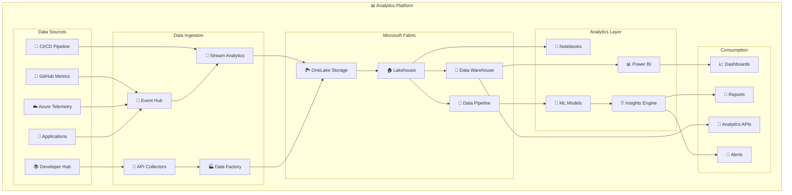

# 📊 H3-005: Advanced Analytics Guide

## 📋 Table of Contents

1. [🎯 Overview](#overview)
2. [🏗️ Architecture](#architecture)
3. [🧠 Fabric Knowledge Base](#fabric-knowledge-base)
4. [📡 Telemetry Analysis](#telemetry-analysis)
5. [💼 Business Insights](#business-insights)
6. [💰 ROI Measurement](#roi-measurement)
7. [🔍 Predictive Analytics](#predictive-analytics)
8. [📈 Real-time Dashboards](#real-time-dashboards)
9. [🎬 Demo Scenarios](#demo-scenarios)
10. [📚 Best Practices](#best-practices)

## 🎯 Overview

Advanced Analytics transforms raw platform data into actionable insights, enabling data-driven decision making at every level. This guide covers implementing comprehensive analytics capabilities using Microsoft Fabric, real-time telemetry analysis, and AI-powered insights generation.

### 🌟 Key Capabilities

| Capability | Description | Business Value |
|------------|-------------|----------------|
| 🧠 **Knowledge Base** | Centralized analytics repository | Single source of truth |
| 📊 **Real-time Analytics** | Live telemetry processing | Immediate insights |
| 🔮 **Predictive Insights** | ML-powered forecasting | Proactive decisions |
| 💰 **ROI Tracking** | Financial impact analysis | Quantified value |
| 🎯 **360° Visibility** | Unified platform view | Holistic understanding |

## 🏗️ Architecture



## 🧠 Fabric Knowledge Base

### Step 1: Deploy Microsoft Fabric Workspace

```bicep
// infrastructure/fabric-analytics.bicep
param location string = resourceGroup().location
param workspaceName string = 'analytics-fabric-${uniqueString(resourceGroup().id)}'
param capacityName string = 'fabric-capacity-${uniqueString(resourceGroup().id)}'

// Fabric Capacity
resource fabricCapacity 'Microsoft.Fabric/capacities@2023-11-01' = {
  name: capacityName
  location: location
  sku: {
    name: 'F64'
    tier: 'Fabric'
  }
  properties: {
    administration: {
      members: [
        subscription().subscriptionId
      ]
    }
  }
}

## 🎬 Demo Scenarios

### Demo 1: End-to-End Analytics Pipeline

```bash
#!/bin/bash
# demo/analytics-pipeline-demo.sh

echo "🎬 Advanced Analytics Pipeline Demo"
echo "===================================="

# Step 1: Generate sample telemetry data
echo "📊 Generating telemetry data..."
python3 scripts/generate_telemetry.py \
  --services 10 \
  --duration 24h \
  --pattern "normal,spike,degradation" \
  --output telemetry.json

# Step 2: Ingest data into Fabric
echo "📥 Ingesting data into Microsoft Fabric..."
fabric-cli data ingest \
  --source telemetry.json \
  --workspace analytics-fabric \
  --lakehouse analytics-lakehouse \
  --table telemetry_demo

# Step 3: Run analytics pipeline
echo "🔄 Running analytics pipeline..."
fabric-cli pipeline run \
  --name comprehensive-analytics \
  --parameters '{
    "source": "telemetry_demo",
    "analysis_types": ["performance", "anomaly", "prediction", "optimization"],
    "output_format": "dashboard"
  }'

# Step 4: Generate insights
echo "💡 Generating insights..."
curl -X POST http://analytics-api/insights/generate \
  -H "Content-Type: application/json" \
  -d '{
    "data_source": "telemetry_demo",
    "insight_types": ["executive", "technical", "financial"],
    "time_range": "24h"
  }' | jq

# Step 5: View real-time dashboard
echo "📈 Opening real-time dashboard..."
open http://analytics-portal/dashboards/demo-live

# Step 6: Show ROI calculation
echo "💰 Calculating ROI..."
fabric-cli analytics roi \
  --period "last-30-days" \
  --include-projections \
  --export-format pdf \
  --output roi-report.pdf

echo "✅ Demo complete! Check the dashboard and ROI report."
```

### Demo 2: Predictive Analytics Showcase

```python
# demo/predictive_analytics_demo.py
import asyncio
from datetime import datetime, timedelta
import matplotlib.pyplot as plt
import seaborn as sns

async def demonstrate_predictive_analytics():
    """Demonstrate predictive analytics capabilities"""
    
    print("🔮 Predictive Analytics Demo")
    print("===========================\n")
    
    # Initialize analytics engine
    analytics = PredictiveAnalyticsEngine()
    fabric = FabricKnowledgeBase("analytics-workspace")
    
    # Scenario 1: Demand Forecasting
    print("📈 Scenario 1: Demand Forecasting")
    print("-" * 40)
    
    demand_forecast = await analytics.predict_system_demand(horizon_days=7)
    
    print(f"Next 7 days demand forecast:")
    print(f"- Peak demand: {demand_forecast.peak_demand:.0f} requests/sec")
    print(f"- Average demand: {demand_forecast.average_demand:.0f} requests/sec")
    print(f"- Confidence interval: {demand_forecast.confidence_interval}")
    
    # Visualize demand forecast
    plt.figure(figsize=(12, 6))
    plt.plot(demand_forecast.timestamps, demand_forecast.predictions, 'b-', label='Forecast')
    plt.fill_between(
        demand_forecast.timestamps,
        demand_forecast.lower_bound,
        demand_forecast.upper_bound,
        alpha=0.3,
        label='95% Confidence Interval'
    )
    plt.xlabel('Time')
    plt.ylabel('Requests/sec')
    plt.title('7-Day Demand Forecast')
    plt.legend()
    plt.xticks(rotation=45)
    plt.tight_layout()
    plt.savefig('demand_forecast.png')
    print("📊 Forecast chart saved as demand_forecast.png")
    
    # Scenario 2: Failure Prediction
    print("\n\n🚨 Scenario 2: Failure Prediction")
    print("-" * 40)
    
    services = ['payment-service', 'user-service', 'notification-service']
    failure_predictions = await analytics.predict_failures(services)
    
    for service, prediction in failure_predictions.service_predictions.items():
        print(f"\n{service}:")
        print(f"  - Failure probability: {prediction['failure_probability']:.1%}")
        print(f"  - Risk level: {prediction['risk_level']}")
        print(f"  - Time to failure: {prediction['time_to_failure']} hours")
        print(f"  - Top risk factors:")
        for factor in prediction['risk_factors'][:3]:
            print(f"    • {factor['name']}: {factor['impact']}")
    
    # Scenario 3: Cost Optimization
    print("\n\n💰 Scenario 3: Cost Optimization Predictions")
    print("-" * 40)
    
    optimization = await analytics.predict_optimization_opportunities()
    
    print(f"Total potential savings: ${optimization.total_potential_savings:,.0f}")
    print(f"\nTop 5 optimization opportunities:")
    
    for i, opp in enumerate(optimization.opportunities[:5], 1):
        print(f"\n{i}. {opp.title}")
        print(f"   Potential savings: ${opp.potential_savings:,.0f}")
        print(f"   Implementation effort: {opp.effort}")
        print(f"   Confidence: {opp.confidence:.0%}")
        print(f"   Action: {opp.recommended_action}")
    
    # Scenario 4: Anomaly Detection
    print("\n\n🔍 Scenario 4: Real-time Anomaly Detection")
    print("-" * 40)
    
    # Simulate real-time monitoring
    print("Monitoring for anomalies...")
    
    for i in range(5):
        await asyncio.sleep(2)  # Simulate real-time delay
        
        anomalies = await analytics.detect_anomalies_realtime()
        
        if anomalies:
            print(f"\n⚠️  Anomaly detected at {datetime.now().strftime('%H:%M:%S')}:")
            for anomaly in anomalies:
                print(f"   - {anomaly.service}: {anomaly.metric} = {anomaly.value:.2f}")
                print(f"     Normal range: {anomaly.expected_range}")
                print(f"     Severity: {anomaly.severity}")
                print(f"     Recommended action: {anomaly.recommended_action}")
        else:
            print(f"✅ {datetime.now().strftime('%H:%M:%S')} - All systems normal")
    
    # Generate executive summary
    print("\n\n📊 Executive Summary")
    print("-" * 40)
    
    summary = await fabric.query_knowledge(
        "Generate executive summary of predictive analytics findings",
        context={
            "demand_forecast": demand_forecast,
            "failure_predictions": failure_predictions,
            "optimization": optimization
        }
    )
    
    print(summary.insights)

if __name__ == "__main__":
    asyncio.run(demonstrate_predictive_analytics())
```

### Demo 3: ROI Dashboard

```typescript
// demo/roi-dashboard-demo.ts
import { ROIMeasurementSystem } from '../analytics/roi-measurement';
import { RealtimeDashboardService } from '../analytics/realtime-dashboards';

async function demonstrateROIDashboard() {
  console.log('💰 ROI Analytics Dashboard Demo');
  console.log('===============================\n');
  
  const roiSystem = new ROIMeasurementSystem();
  const dashboardService = new RealtimeDashboardService();
  
  // Calculate current ROI
  const currentROI = await roiSystem.calculate_platform_roi({
    start: new Date('2024-01-01'),
    end: new Date()
  });
  
  console.log('📊 Current Platform ROI:');
  console.log(`   Total Investment: ${currentROI.metrics.total_investment.toLocaleString()}`);
  console.log(`   Total Value Delivered: ${currentROI.metrics.total_value_delivered.toLocaleString()}`);
  console.log(`   ROI Percentage: ${currentROI.metrics.roi_percentage.toFixed(1)}%`);
  console.log(`   Payback Period: ${currentROI.metrics.payback_period_months} months`);
  
  // Create interactive dashboard
  const dashboard = await dashboardService.createROIDashboard({
    data: currentROI,
    interactive: true,
    projections: true
  });
  
  // Add real-time value tracking
  dashboard.addWidget({
    id: 'value-tracker',
    type: 'counter',
    title: 'Real-time Value Generation',
    config: {
      updateInterval: 1000,
      format: 'currency',
      animation: 'rolling'
    }
  });
  
  // Add cost breakdown
  dashboard.addWidget({
    id: 'cost-breakdown',
    type: 'sunburst',
    title: 'Cost Breakdown Analysis',
    data: currentROI.breakdown.costs,
    config: {
      interactive: true,
      showPercentages: true,
      drilldown: true
    }
  });
  
  // Add value streams
  dashboard.addWidget({
    id: 'value-streams',
    type: 'sankey',
    title: 'Value Flow Analysis',
    data: {
      nodes: ['Infrastructure', 'Development', 'Operations', 'Revenue', 'Savings', 'Efficiency'],
      links: [
        { source: 'Infrastructure', target: 'Operations', value: 30 },
        { source: 'Development', target: 'Revenue', value: 50 },
        { source: 'Operations', target: 'Savings', value: 40 },
        { source: 'Operations', target: 'Efficiency', value: 35 }
      ]
    }
  });
  
  // Launch dashboard
  console.log('\n🚀 Launching interactive ROI dashboard...');
  await dashboard.launch({ port: 3000 });
  
  console.log('✅ Dashboard available at http://localhost:3000');
  console.log('\nPress Ctrl+C to stop the demo');
}

// Run demo
demonstrateROIDashboard().catch(console.error);
```

## 📚 Best Practices

### 1. Data Quality Management

```yaml
# best-practices/data-quality.yaml
data_quality_framework:
  principles:
    - name: "Accuracy"
      description: "Data correctly represents real-world values"
      validation:
        - Range checks
        - Format validation
        - Cross-field validation
      
    - name: "Completeness"
      description: "All required data is present"
      validation:
        - Null checks
        - Required field validation
        - Record count validation
        
    - name: "Consistency"
      description: "Data is uniform across systems"
      validation:
        - Referential integrity
        - Business rule validation
        - Cross-system reconciliation
        
    - name: "Timeliness"
      description: "Data is available when needed"
      validation:
        - Freshness checks
        - Update frequency validation
        - Latency monitoring
        
  implementation:
    data_profiling:
      frequency: "daily"
      tools:
        - Great Expectations
        - dbt tests
        - Custom validators
        
    quality_gates:
      - stage: "Bronze"
        threshold: 95
        action: "reject_batch"
        
      - stage: "Silver"
        threshold: 98
        action: "quarantine"
        
      - stage: "Gold"
        threshold: 99.9
        action: "alert_and_review"
        
    monitoring:
      dashboards:
        - "Data Quality Score"
        - "Validation Failures"
        - "Data Lineage"
      
      alerts:
        - condition: "quality_score < 95"
          severity: "high"
          action: "page_oncall"
```

### 2. Analytics Best Practices

```python
# best_practices/analytics_patterns.py

class AnalyticsBestPractices:
    """Best practices for analytics implementation"""
    
    @staticmethod
    def implement_data_versioning():
        """Version control for analytics data"""
        
        return {
            'schema_versioning': {
                'strategy': 'semantic_versioning',
                'backwards_compatibility': 'maintain_3_versions',
                'migration_strategy': 'blue_green'
            },
            'data_versioning': {
                'strategy': 'time_travel',
                'retention': '90_days',
                'snapshot_frequency': 'daily'
            },
            'model_versioning': {
                'registry': 'mlflow',
                'staging_environments': ['dev', 'staging', 'prod'],
                'rollback_capability': True
            }
        }
    
    @staticmethod
    def optimize_query_performance():
        """Query optimization strategies"""
        
        return {
            'indexing_strategy': {
                'primary_keys': 'always_indexed',
                'foreign_keys': 'indexed_based_on_usage',
                'computed_columns': 'index_frequently_used',
                'covering_indexes': 'for_hot_queries'
            },
            'partitioning': {
                'strategy': 'time_based',
                'partition_key': 'event_timestamp',
                'partition_size': 'daily',
                'retention': 'sliding_window'
            },
            'caching': {
                'query_cache': 'redis',
                'ttl': 'based_on_data_freshness',
                'invalidation': 'smart_invalidation'
            },
            'query_patterns': {
                'avoid': ['SELECT *', 'CROSS JOIN', 'OR in WHERE'],
                'prefer': ['Column selection', 'JOIN with indexes', 'IN clause']
            }
        }
    
    @staticmethod
    def ensure_analytics_security():
        """Security best practices for analytics"""
        
        return {
            'data_classification': {
                'levels': ['public', 'internal', 'confidential', 'restricted'],
                'tagging': 'mandatory',
                'access_control': 'role_based'
            },
            'encryption': {
                'at_rest': 'AES-256',
                'in_transit': 'TLS 1.3',
                'key_management': 'Azure Key Vault'
            },
            'audit_logging': {
                'data_access': 'all_queries_logged',
                'data_changes': 'change_data_capture',
                'retention': '7_years'
            },
            'privacy_compliance': {
                'pii_detection': 'automated_scanning',
                'data_masking': 'dynamic_masking',
                'right_to_forget': 'automated_deletion'
            }
        }
```

### 3. Visualization Best Practices

```typescript
// best-practices/visualization-patterns.ts

export const VisualizationBestPractices = {
  // Dashboard design principles
  dashboardDesign: {
    layout: {
      principle: 'F-pattern reading',
      keyMetrics: 'top-left',
      supportingData: 'right-and-below',
      maxWidgetsPerView: 6
    },
    
    colorScheme: {
      semantic: {
        success: '#28a745',
        warning: '#ffc107',
        danger: '#dc3545',
        info: '#17a2b8'
      },
      accessibility: 'WCAG AA compliant',
      consistency: 'use-design-system'
    },
    
    interactivity: {
      filtering: 'cross-widget',
      drilling: 'progressive-disclosure',
      tooltips: 'context-aware',
      responsiveness: 'mobile-first'
    }
  },
  
  // Chart selection guide
  chartSelection: {
    comparison: ['bar', 'column', 'bullet'],
    trend: ['line', 'area', 'sparkline'],
    composition: ['pie', 'donut', 'stacked-bar', 'treemap'],
    distribution: ['histogram', 'box-plot', 'violin'],
    relationship: ['scatter', 'bubble', 'heatmap'],
    geographic: ['choropleth', 'point-map', 'flow-map']
  },
  
  // Performance optimization
  performanceOptimization: {
    dataPoints: {
      maxPerChart: 1000,
      aggregation: 'smart-sampling',
      lazyLoading: true
    },
    
    rendering: {
      engine: 'WebGL for >500 points',
      virtualScrolling: true,
      progressiveRendering: true
    },
    
    caching: {
      strategy: 'intelligent-prefetch',
      ttl: 'based-on-update-frequency',
      compression: 'gzip'
    }
  }
};
```

## 🔧 Troubleshooting

### Common Issues and Solutions

| Issue | Symptoms | Root Cause | Solution |
|-------|----------|------------|----------|
| **Slow Dashboards** | Loading >5s | Large data volumes | Implement aggregation tables, use sampling |
| **Data Discrepancies** | Different values across reports | Sync issues | Verify data pipeline, check time zones |
| **Missing Insights** | Empty analytics | Pipeline failure | Check data flow, validate transformations |
| **High Costs** | Budget overrun | Inefficient queries | Optimize queries, implement caching |
| **Stale Data** | Old timestamps | Ingestion delay | Check Event Hub, verify streaming jobs |

### Diagnostic Queries

```sql
-- Check data freshness
SELECT 
    source_system,
    MAX(event_timestamp) as latest_data,
    DATEDIFF(minute, MAX(event_timestamp), GETUTCDATE()) as lag_minutes
FROM bronze.telemetry_stream
GROUP BY source_system
ORDER BY lag_minutes DESC;

-- Identify slow queries
SELECT 
    query_text,
    execution_time_ms,
    rows_processed,
    data_scanned_gb,
    cost_estimate
FROM system.query_history
WHERE execution_time_ms > 5000
ORDER BY execution_time_ms DESC
LIMIT 20;

-- Data quality check
SELECT 
    table_name,
    quality_score,
    null_percentage,
    duplicate_percentage,
    last_validated
FROM gold.data_quality_metrics
WHERE quality_score < 95
ORDER BY quality_score ASC;
```

### Performance Tuning

```python
# scripts/performance_tuning.py

def diagnose_analytics_performance():
    """Diagnose and fix analytics performance issues"""
    
    issues = []
    
    # Check query performance
    slow_queries = identify_slow_queries()
    for query in slow_queries:
        issues.append({
            'type': 'slow_query',
            'query': query['text'],
            'duration': query['duration_ms'],
            'recommendation': suggest_query_optimization(query)
        })
    
    # Check data skew
    skewed_partitions = check_data_skew()
    if skewed_partitions:
        issues.append({
            'type': 'data_skew',
            'partitions': skewed_partitions,
            'recommendation': 'Repartition data or adjust partition key'
        })
    
    # Check cache hit rate
    cache_stats = get_cache_statistics()
    if cache_stats['hit_rate'] < 0.7:
        issues.append({
            'type': 'low_cache_hit',
            'current_rate': cache_stats['hit_rate'],
            'recommendation': 'Increase cache size or TTL'
        })
    
    return issues
```

## 📈 Success Metrics

Track these KPIs to measure analytics success:

### 1. **Data Quality & Reliability**
   - Data quality score: >98%
   - Pipeline success rate: >99.5%
   - Data freshness: <5 minutes lag
   - Schema compliance: 100%

### 2. **Analytics Performance**
   - Dashboard load time: <2 seconds
   - Query response time: <1 second p95
   - Insight generation time: <30 seconds
   - Report generation: <5 minutes

### 3. **Business Value**
   - Decision velocity: +40% faster
   - Prediction accuracy: >85%
   - Cost optimization identified: >$1M annually
   - ROI visibility: Real-time

### 4. **User Adoption**
   - Active dashboard users: >80% of team
   - Self-service analytics: 60% of queries
   - Insight utilization rate: >70%
   - User satisfaction: >4.5/5

## 🚀 Next Steps

After implementing Advanced Analytics:

1. ✅ Set up all data pipelines
2. ✅ Create executive dashboards
3. ✅ Train team on self-service analytics
4. ✅ Establish data governance
5. ✅ Continue to [H3-006: Unified Experience →](h3-006-unified-experience.md)

---

## 🎓 Summary

Advanced Analytics transforms raw data into actionable insights, enabling:

- **Real-time visibility** into platform performance
- **Predictive capabilities** for proactive management
- **ROI measurement** with financial precision
- **Data-driven decisions** at every level

The combination of Microsoft Fabric, real-time processing, and AI-powered insights creates a powerful analytics platform that drives continuous improvement and innovation.

**Ready for the Unified Experience?** Continue to H3-006 to bring everything together in a seamless platform experience.

// Fabric Workspace
resource fabricWorkspace 'Microsoft.Fabric/workspaces@2023-11-01' = {
  name: workspaceName
  location: location
  properties: {
    capacityId: fabricCapacity.id
    description: 'Three Horizons Analytics Platform'
    features: {
      dataPipeline: {
        enabled: true
      }
      dataflow: {
        enabled: true
      }
      dataset: {
        enabled: true
      }
      report: {
        enabled: true
      }
      notebook: {
        enabled: true
      }
      spark: {
        enabled: true
      }
      warehouse: {
        enabled: true
      }
      lakehouse: {
        enabled: true
      }
    }
  }
}

// Event Hub for real-time ingestion
resource eventHubNamespace 'Microsoft.EventHub/namespaces@2023-01-01-preview' = {
  name: 'analytics-hub-${uniqueString(resourceGroup().id)}'
  location: location
  sku: {
    name: 'Standard'
    tier: 'Standard'
    capacity: 2
  }
  properties: {
    isAutoInflateEnabled: true
    maximumThroughputUnits: 10
  }
}

// Event Hubs for different data streams
resource telemetryHub 'Microsoft.EventHub/namespaces/eventhubs@2023-01-01-preview' = {
  parent: eventHubNamespace
  name: 'telemetry'
  properties: {
    partitionCount: 4
    messageRetentionInDays: 7
  }
}

resource metricsHub 'Microsoft.EventHub/namespaces/eventhubs@2023-01-01-preview' = {
  parent: eventHubNamespace
  name: 'metrics'
  properties: {
    partitionCount: 4
    messageRetentionInDays: 7
  }
}

resource eventsHub 'Microsoft.EventHub/namespaces/eventhubs@2023-01-01-preview' = {
  parent: eventHubNamespace
  name: 'events'
  properties: {
    partitionCount: 4
    messageRetentionInDays: 7
  }
}

// Stream Analytics for real-time processing
resource streamAnalytics 'Microsoft.StreamAnalytics/streamingjobs@2021-10-01-preview' = {
  name: 'analytics-stream-${uniqueString(resourceGroup().id)}'
  location: location
  properties: {
    sku: {
      name: 'StandardV2'
      capacity: 6
    }
    compatibilityLevel: '1.2'
    dataLocale: 'en-US'
    inputs: [
      {
        name: 'telemetry-input'
        properties: {
          type: 'Stream'
          datasource: {
            type: 'Microsoft.EventHub/EventHub'
            properties: {
              eventHubName: telemetryHub.name
              serviceBusNamespace: eventHubNamespace.name
              consumerGroupName: '$Default'
            }
          }
          serialization: {
            type: 'Json'
            properties: {
              encoding: 'UTF8'
            }
          }
        }
      }
    ]
    outputs: [
      {
        name: 'fabric-output'
        properties: {
          datasource: {
            type: 'Microsoft.Fabric/OneLake'
            properties: {
              workspace: fabricWorkspace.name
              lakehouse: 'analytics-lakehouse'
              table: 'telemetry_stream'
            }
          }
        }
      }
    ]
  }
}

output workspaceId string = fabricWorkspace.id
output workspaceName string = fabricWorkspace.name
output eventHubConnection string = eventHubNamespace.properties.serviceBusEndpoint
```

### Step 2: Knowledge Base Implementation

```python
# src/analytics/knowledge_base.py
from typing import Dict, List, Any, Optional
import pandas as pd
import numpy as np
from datetime import datetime, timedelta
from azure.fabric import FabricClient
from azure.fabric.lakehouse import LakehouseClient
from azure.fabric.warehouse import DataWarehouseClient
import great_expectations as ge

class FabricKnowledgeBase:
    """Microsoft Fabric-based analytics knowledge base"""
    
    def __init__(self, workspace_name: str):
        self.fabric_client = FabricClient()
        self.workspace = self.fabric_client.get_workspace(workspace_name)
        self.lakehouse = LakehouseClient(self.workspace.get_lakehouse("analytics-lakehouse"))
        self.warehouse = DataWarehouseClient(self.workspace.get_warehouse("analytics-warehouse"))
        self.metadata_store = MetadataStore(self.lakehouse)
        
    async def ingest_data(self, source: str, data: pd.DataFrame, metadata: Dict[str, Any]):
        """Ingest data into the knowledge base"""
        
        # Validate data quality
        validation_results = await self._validate_data(data, source)
        if not validation_results.success:
            raise DataQualityError(f"Data validation failed: {validation_results.errors}")
            
        # Enrich data with metadata
        enriched_data = self._enrich_data(data, metadata)
        
        # Write to lakehouse (bronze layer)
        bronze_path = f"bronze/{source}/{datetime.now().strftime('%Y%m%d%H%M%S')}"
        await self.lakehouse.write_dataframe(
            enriched_data,
            bronze_path,
            format="delta",
            mode="append",
            partition_by=["date", "hour"]
        )
        
        # Process to silver layer
        silver_data = await self._process_to_silver(enriched_data, source)
        silver_path = f"silver/{source}/current"
        await self.lakehouse.write_dataframe(
            silver_data,
            silver_path,
            format="delta",
            mode="overwrite",
            merge_schema=True
        )
        
        # Update metadata catalog
        await self.metadata_store.register_dataset(
            name=f"{source}_dataset",
            path=silver_path,
            schema=silver_data.dtypes.to_dict(),
            metadata=metadata,
            quality_metrics=validation_results.metrics
        )
        
        return {
            "status": "success",
            "records_ingested": len(data),
            "bronze_path": bronze_path,
            "silver_path": silver_path
        }
        
    async def create_knowledge_graph(self, entities: List[str], relationships: List[str]):
        """Create knowledge graph from data"""
        
        # Initialize graph database connection
        graph_db = GraphDatabase(self.warehouse)
        
        # Extract entities from data
        entity_data = {}
        for entity_type in entities:
            query = f"""
            SELECT DISTINCT {entity_type}_id, {entity_type}_name, {entity_type}_attributes
            FROM silver.unified_data
            WHERE {entity_type}_id IS NOT NULL
            """
            entity_data[entity_type] = await self.warehouse.execute_query(query)
            
        # Create nodes
        for entity_type, data in entity_data.items():
            await graph_db.create_nodes(entity_type, data)
            
        # Extract and create relationships
        for relationship in relationships:
            query = f"""
            SELECT source_id, target_id, relationship_type, properties
            FROM silver.relationships
            WHERE relationship_type = '{relationship}'
            """
            rel_data = await self.warehouse.execute_query(query)
            await graph_db.create_relationships(relationship, rel_data)
            
        # Generate graph insights
        insights = await self._analyze_graph(graph_db)
        
        return {
            "nodes_created": sum(len(data) for data in entity_data.values()),
            "relationships_created": len(relationships),
            "insights": insights
        }
        
    async def query_knowledge(self, query: str, context: Optional[Dict[str, Any]] = None):
        """Query the knowledge base using natural language"""
        
        # Parse query intent
        intent = await self._parse_query_intent(query)
        
        # Generate SQL based on intent
        sql_query = await self._generate_sql(intent, context)
        
        # Execute query
        results = await self.warehouse.execute_query(sql_query)
        
        # Post-process results
        processed_results = await self._post_process_results(results, intent)
        
        # Generate insights
        insights = await self._generate_insights(processed_results, query)
        
        return {
            "query": query,
            "intent": intent,
            "results": processed_results,
            "insights": insights,
            "visualization_recommendations": self._recommend_visualizations(processed_results)
        }
        
    async def _validate_data(self, data: pd.DataFrame, source: str) -> ValidationResult:
        """Validate data quality using Great Expectations"""
        
        # Create expectation suite based on source
        suite = self._get_expectation_suite(source)
        
        # Run validation
        ge_df = ge.from_pandas(data)
        validation_result = ge_df.validate(expectation_suite=suite)
        
        return ValidationResult(
            success=validation_result.success,
            metrics=validation_result.statistics,
            errors=[str(e) for e in validation_result.results if not e.success]
        )
        
    async def _process_to_silver(self, data: pd.DataFrame, source: str) -> pd.DataFrame:
        """Process bronze data to silver layer"""
        
        # Data cleaning
        cleaned_data = data.copy()
        
        # Remove duplicates
        cleaned_data = cleaned_data.drop_duplicates()
        
        # Handle missing values
        cleaned_data = self._handle_missing_values(cleaned_data, source)
        
        # Standardize columns
        cleaned_data = self._standardize_columns(cleaned_data, source)
        
        # Add derived features
        cleaned_data = self._add_derived_features(cleaned_data, source)
        
        # Add processing metadata
        cleaned_data['processed_timestamp'] = datetime.utcnow()
        cleaned_data['processing_version'] = '1.0'
        cleaned_data['quality_score'] = self._calculate_quality_score(cleaned_data)
        
        return cleaned_data

class AnalyticsEngine:
    """Core analytics engine for insights generation"""
    
    def __init__(self, knowledge_base: FabricKnowledgeBase):
        self.kb = knowledge_base
        self.ml_models = self._load_ml_models()
        self.insights_cache = InsightsCache()
        
    async def analyze_developer_productivity(self, time_range: TimeRange) -> Dict[str, Any]:
        """Analyze developer productivity metrics"""
        
        # Query relevant data
        query = f"""
        SELECT 
            developer_id,
            DATE_TRUNC('day', timestamp) as date,
            SUM(commits) as daily_commits,
            SUM(pr_created) as prs_created,
            SUM(pr_reviewed) as prs_reviewed,
            SUM(issues_resolved) as issues_resolved,
            AVG(pr_cycle_time) as avg_pr_cycle_time,
            SUM(lines_added) as lines_added,
            SUM(lines_deleted) as lines_deleted,
            AVG(code_quality_score) as avg_code_quality
        FROM gold.developer_metrics
        WHERE timestamp BETWEEN '{time_range.start}' AND '{time_range.end}'
        GROUP BY developer_id, date
        """
        
        productivity_data = await self.kb.warehouse.execute_query(query)
        
        # Calculate productivity score
        productivity_scores = self._calculate_productivity_scores(productivity_data)
        
        # Identify trends
        trends = self._analyze_productivity_trends(productivity_data)
        
        # Generate insights
        insights = {
            'top_performers': self._identify_top_performers(productivity_scores),
            'improvement_areas': self._identify_improvement_areas(productivity_scores),
            'team_velocity': self._calculate_team_velocity(productivity_data),
            'bottlenecks': self._identify_bottlenecks(productivity_data),
            'recommendations': self._generate_productivity_recommendations(trends)
        }
        
        return {
            'summary_metrics': {
                'average_productivity_score': np.mean(productivity_scores),
                'productivity_trend': trends['overall_trend'],
                'top_contributor': insights['top_performers'][0],
                'main_bottleneck': insights['bottlenecks'][0]
            },
            'detailed_analysis': insights,
            'individual_scores': productivity_scores,
            'visualization_data': self._prepare_visualization_data(productivity_data)
        }
        
    async def analyze_platform_performance(self) -> Dict[str, Any]:
        """Analyze overall platform performance"""
        
        # Gather performance metrics
        performance_query = """
        WITH performance_metrics AS (
            SELECT 
                service_name,
                AVG(response_time) as avg_response_time,
                PERCENTILE_CONT(0.95) WITHIN GROUP (ORDER BY response_time) as p95_response_time,
                PERCENTILE_CONT(0.99) WITHIN GROUP (ORDER BY response_time) as p99_response_time,
                COUNT(*) as request_count,
                SUM(CASE WHEN status_code >= 500 THEN 1 ELSE 0 END) as error_count,
                AVG(cpu_usage) as avg_cpu,
                AVG(memory_usage) as avg_memory
            FROM gold.service_metrics
            WHERE timestamp >= DATEADD(hour, -24, GETUTCDATE())
            GROUP BY service_name
        )
        SELECT *,
            (error_count::FLOAT / request_count) * 100 as error_rate
        FROM performance_metrics
        """
        
        performance_data = await self.kb.warehouse.execute_query(performance_query)
        
        # Analyze SLO compliance
        slo_compliance = await self._analyze_slo_compliance(performance_data)
        
        # Predict future performance
        performance_predictions = await self._predict_performance(performance_data)
        
        # Identify optimization opportunities
        optimization_opportunities = self._identify_optimizations(performance_data)
        
        return {
            'current_performance': {
                'overall_health_score': self._calculate_health_score(performance_data),
                'slo_compliance': slo_compliance,
                'critical_services': self._identify_critical_services(performance_data)
            },
            'predictions': performance_predictions,
            'optimization_opportunities': optimization_opportunities,
            'cost_impact': await self._calculate_performance_cost_impact(optimization_opportunities)
        }
        
    def _calculate_productivity_scores(self, data: pd.DataFrame) -> Dict[str, float]:
        """Calculate individual productivity scores"""
        
        # Define weights for different metrics
        weights = {
            'commits': 0.2,
            'prs_created': 0.15,
            'prs_reviewed': 0.15,
            'issues_resolved': 0.2,
            'cycle_time': 0.15,  # Inverse - lower is better
            'code_quality': 0.15
        }
        
        scores = {}
        
        for developer_id in data['developer_id'].unique():
            dev_data = data[data['developer_id'] == developer_id]
            
            # Normalize metrics
            normalized_metrics = {
                'commits': self._normalize_metric(dev_data['daily_commits'].mean(), data['daily_commits']),
                'prs_created': self._normalize_metric(dev_data['prs_created'].sum(), data['prs_created']),
                'prs_reviewed': self._normalize_metric(dev_data['prs_reviewed'].sum(), data['prs_reviewed']),
                'issues_resolved': self._normalize_metric(dev_data['issues_resolved'].sum(), data['issues_resolved']),
                'cycle_time': 1 - self._normalize_metric(dev_data['avg_pr_cycle_time'].mean(), data['avg_pr_cycle_time']),
                'code_quality': self._normalize_metric(dev_data['avg_code_quality'].mean(), data['avg_code_quality'])
            }
            
            # Calculate weighted score
            score = sum(normalized_metrics[key] * weights[key] for key in weights)
            scores[developer_id] = score * 100  # Convert to 0-100 scale
            
        return scores
        
    def _normalize_metric(self, value: float, series: pd.Series) -> float:
        """Normalize metric to 0-1 scale"""
        min_val = series.min()
        max_val = series.max()
        
        if max_val == min_val:
            return 0.5
            
        return (value - min_val) / (max_val - min_val)
```

## 📡 Telemetry Analysis

### Real-time Telemetry Processing

```csharp
// src/analytics/TelemetryProcessor.cs
using Azure.Messaging.EventHubs;
using Azure.Messaging.EventHubs.Processor;
using Microsoft.Azure.StreamAnalytics;
using System.Text.Json;

public class TelemetryProcessor : EventProcessorClient
{
    private readonly IAnalyticsService _analyticsService;
    private readonly IMetricsStore _metricsStore;
    private readonly IAnomalyDetector _anomalyDetector;
    
    public TelemetryProcessor(
        string connectionString,
        string consumerGroup,
        IAnalyticsService analyticsService)
        : base(new BlobContainerClient(connectionString), consumerGroup, connectionString)
    {
        _analyticsService = analyticsService;
        _metricsStore = new MetricsStore();
        _anomalyDetector = new MLAnomalyDetector();
    }
    
    protected override async Task ProcessEventAsync(ProcessEventArgs args)
    {
        var telemetryData = JsonSerializer.Deserialize<TelemetryData>(
            args.Data.EventBody.ToString()
        );
        
        // Real-time processing pipeline
        var enrichedData = await EnrichTelemetryData(telemetryData);
        var anomalies = await _anomalyDetector.DetectAnomalies(enrichedData);
        
        if (anomalies.Any())
        {
            await HandleAnomalies(anomalies, enrichedData);
        }
        
        // Aggregate metrics
        var metrics = AggregateMetrics(enrichedData);
        await _metricsStore.StoreMetrics(metrics);
        
        // Stream to analytics engine
        await _analyticsService.ProcessRealTimeData(enrichedData);
        
        // Update checkpoint
        await args.UpdateCheckpointAsync();
    }
    
    private async Task<EnrichedTelemetryData> EnrichTelemetryData(TelemetryData data)
    {
        var enriched = new EnrichedTelemetryData
        {
            OriginalData = data,
            Timestamp = DateTimeOffset.UtcNow,
            ProcessingLatency = CalculateLatency(data.EventTime)
        };
        
        // Add contextual information
        enriched.ServiceContext = await GetServiceContext(data.ServiceId);
        enriched.UserContext = await GetUserContext(data.UserId);
        enriched.EnvironmentContext = GetEnvironmentContext();
        
        // Calculate derived metrics
        enriched.DerivedMetrics = CalculateDerivedMetrics(data);
        
        return enriched;
    }
    
    private Dictionary<string, double> CalculateDerivedMetrics(TelemetryData data)
    {
        var metrics = new Dictionary<string, double>();
        
        // Response time percentiles
        if (data.ResponseTimes != null && data.ResponseTimes.Any())
        {
            metrics["p50_response_time"] = Percentile(data.ResponseTimes, 0.5);
            metrics["p95_response_time"] = Percentile(data.ResponseTimes, 0.95);
            metrics["p99_response_time"] = Percentile(data.ResponseTimes, 0.99);
        }
        
        // Error rate
        if (data.RequestCount > 0)
        {
            metrics["error_rate"] = (double)data.ErrorCount / data.RequestCount;
        }
        
        // Throughput
        metrics["requests_per_second"] = data.RequestCount / data.TimeWindowSeconds;
        
        // Resource utilization
        metrics["cpu_utilization"] = data.CpuUsage / data.CpuCapacity;
        metrics["memory_utilization"] = data.MemoryUsage / data.MemoryCapacity;
        
        return metrics;
    }
    
    private async Task HandleAnomalies(
        List<Anomaly> anomalies,
        EnrichedTelemetryData data)
    {
        foreach (var anomaly in anomalies)
        {
            // Log anomaly
            await LogAnomaly(anomaly, data);
            
            // Trigger alerts based on severity
            if (anomaly.Severity >= AnomalySeverity.High)
            {
                await TriggerAlert(anomaly, data);
            }
            
            // Initiate auto-remediation if configured
            if (anomaly.AutoRemediationEnabled)
            {
                await InitiateRemediation(anomaly, data);
            }
        }
    }
}

// Stream Analytics Query
public class StreamAnalyticsQueries
{
    public const string AggregationQuery = @"
        WITH 
        -- Aggregate metrics by service and time window
        ServiceMetrics AS (
            SELECT
                ServiceId,
                System.Timestamp() as WindowEnd,
                COUNT(*) as RequestCount,
                AVG(ResponseTime) as AvgResponseTime,
                MAX(ResponseTime) as MaxResponseTime,
                SUM(CASE WHEN StatusCode >= 500 THEN 1 ELSE 0 END) as ErrorCount,
                AVG(CpuUsage) as AvgCpuUsage,
                AVG(MemoryUsage) as AvgMemoryUsage
            FROM TelemetryInput TIMESTAMP BY EventTime
            GROUP BY 
                ServiceId,
                TumblingWindow(minute, 1)
        ),
        
        -- Detect anomalies using built-in ML
        AnomalyScores AS (
            SELECT
                ServiceId,
                WindowEnd,
                AnomalyDetection_SpikeAndDip(
                    AvgResponseTime, 95, 120, 'spikesanddips')
                    OVER(PARTITION BY ServiceId LIMIT DURATION(hour, 2)) as ResponseTimeAnomaly,
                AnomalyDetection_ChangePoint(
                    ErrorCount, 80, 120)
                    OVER(PARTITION BY ServiceId LIMIT DURATION(hour, 2)) as ErrorRateAnomaly
            FROM ServiceMetrics
        )
        
        -- Output to multiple sinks
        SELECT * INTO PowerBIOutput FROM ServiceMetrics
        SELECT * INTO FabricOutput FROM ServiceMetrics WHERE RequestCount > 100
        SELECT * INTO AlertOutput FROM AnomalyScores 
            WHERE ResponseTimeAnomaly.IsPositiveAnomaly = 1 
               OR ErrorRateAnomaly.IsChangePoint = 1
    ";
}
```

### Advanced Telemetry Analytics

```python
# src/analytics/telemetry_analytics.py
import asyncio
from typing import Dict, List, Any, Optional
import pandas as pd
import numpy as np
from scipy import stats
from statsmodels.tsa.seasonal import seasonal_decompose
from prophet import Prophet
import tensorflow as tf
from azure.eventhub import EventHubConsumerClient
from azure.fabric.realtime import RealtimeAnalytics

class AdvancedTelemetryAnalytics:
    """Advanced analytics for telemetry data"""
    
    def __init__(self):
        self.realtime_client = RealtimeAnalytics()
        self.ml_models = self._load_models()
        self.pattern_detector = PatternDetector()
        self.forecaster = TimeSeriesForecaster()
        
    async def analyze_service_behavior(self, service_id: str, window: TimeWindow) -> ServiceAnalysis:
        """Comprehensive service behavior analysis"""
        
        # Get telemetry data
        telemetry_data = await self._fetch_telemetry(service_id, window)
        
        # Perform multi-dimensional analysis
        analysis_results = await asyncio.gather(
            self._analyze_performance_patterns(telemetry_data),
            self._analyze_error_patterns(telemetry_data),
            self._analyze_resource_usage(telemetry_data),
            self._analyze_dependencies(telemetry_data),
            self._forecast_metrics(telemetry_data)
        )
        
        performance, errors, resources, dependencies, forecast = analysis_results
        
        # Correlate findings
        correlations = self._correlate_metrics(telemetry_data)
        
        # Generate insights
        insights = self._generate_service_insights({
            'performance': performance,
            'errors': errors,
            'resources': resources,
            'dependencies': dependencies,
            'forecast': forecast,
            'correlations': correlations
        })
        
        return ServiceAnalysis(
            service_id=service_id,
            time_window=window,
            health_score=self._calculate_service_health(analysis_results),
            performance_analysis=performance,
            error_analysis=errors,
            resource_analysis=resources,
            dependency_analysis=dependencies,
            forecast=forecast,
            insights=insights,
            recommendations=self._generate_recommendations(insights)
        )
        
    async def _analyze_performance_patterns(self, data: pd.DataFrame) -> Dict[str, Any]:
        """Analyze performance patterns in telemetry"""
        
        # Time series decomposition
        if len(data) > 2 * 24:  # Need at least 2 days of hourly data
            decomposition = seasonal_decompose(
                data['response_time'],
                model='multiplicative',
                period=24
            )
            
            trend = decomposition.trend.dropna()
            seasonal = decomposition.seasonal.dropna()
            residual = decomposition.resid.dropna()
        else:
            trend = seasonal = residual = None
            
        # Statistical analysis
        stats_analysis = {
            'mean': data['response_time'].mean(),
            'median': data['response_time'].median(),
            'std': data['response_time'].std(),
            'cv': data['response_time'].std() / data['response_time'].mean(),
            'skewness': stats.skew(data['response_time']),
            'kurtosis': stats.kurtosis(data['response_time'])
        }
        
        # Pattern detection
        patterns = self.pattern_detector.detect_patterns(data['response_time'])
        
        # Anomaly detection using Isolation Forest
        anomalies = self._detect_performance_anomalies(data)
        
        return {
            'statistics': stats_analysis,
            'trend': trend.tolist() if trend is not None else None,
            'seasonality': seasonal.tolist() if seasonal is not None else None,
            'patterns': patterns,
            'anomalies': anomalies,
            'performance_grade': self._grade_performance(stats_analysis)
        }
        
    async def _analyze_error_patterns(self, data: pd.DataFrame) -> Dict[str, Any]:
        """Analyze error patterns and root causes"""
        
        # Error rate analysis
        data['error_rate'] = data['error_count'] / data['request_count']
        
        # Error clustering
        error_clusters = self._cluster_errors(data[data['error_count'] > 0])
        
        # Error correlation with other metrics
        error_correlations = {}
        for column in ['response_time', 'cpu_usage', 'memory_usage', 'request_count']:
            if column in data.columns:
                correlation = data['error_rate'].corr(data[column])
                error_correlations[column] = correlation
                
        # Time-based error analysis
        hourly_errors = data.groupby(data.index.hour)['error_rate'].mean()
        daily_errors = data.groupby(data.index.dayofweek)['error_rate'].mean()
        
        # Error burst detection
        error_bursts = self._detect_error_bursts(data)
        
        return {
            'error_rate': {
                'current': data['error_rate'].iloc[-1],
                'average': data['error_rate'].mean(),
                'trend': self._calculate_trend(data['error_rate'])
            },
            'error_clusters': error_clusters,
            'correlations': error_correlations,
            'temporal_patterns': {
                'hourly': hourly_errors.to_dict(),
                'daily': daily_errors.to_dict()
            },
            'error_bursts': error_bursts,
            'mtbf': self._calculate_mtbf(data)
        }
        
    async def _forecast_metrics(self, data: pd.DataFrame) -> Dict[str, Any]:
        """Forecast future metrics using Prophet and custom models"""
        
        forecasts = {}
        
        # Prepare data for Prophet
        prophet_data = pd.DataFrame({
            'ds': data.index,
            'y': data['response_time']
        })
        
        # Response time forecast
        rt_model = Prophet(
            changepoint_prior_scale=0.05,
            seasonality_mode='multiplicative'
        )
        rt_model.fit(prophet_data)
        
        future = rt_model.make_future_dataframe(periods=24, freq='H')
        rt_forecast = rt_model.predict(future)
        
        forecasts['response_time'] = {
            'forecast': rt_forecast[['ds', 'yhat', 'yhat_lower', 'yhat_upper']].tail(24).to_dict('records'),
            'trend': rt_forecast['trend'].iloc[-1],
            'weekly_seasonality': rt_forecast['weekly'].iloc[-1] if 'weekly' in rt_forecast else None
        }
        
        # Resource usage forecast using LSTM
        if self.ml_models['resource_lstm']:
            resource_forecast = self._forecast_resources_lstm(data)
            forecasts['resources'] = resource_forecast
            
        # Capacity planning
        capacity_needs = self._calculate_capacity_needs(forecasts, data)
        forecasts['capacity_planning'] = capacity_needs
        
        return forecasts
        
    def _detect_performance_anomalies(self, data: pd.DataFrame) -> List[Dict[str, Any]]:
        """Detect performance anomalies using multiple methods"""
        
        anomalies = []
        
        # Statistical anomalies (z-score)
        z_scores = np.abs(stats.zscore(data['response_time']))
        statistical_anomalies = data[z_scores > 3]
        
        for idx, row in statistical_anomalies.iterrows():
            anomalies.append({
                'timestamp': idx,
                'type': 'statistical',
                'metric': 'response_time',
                'value': row['response_time'],
                'z_score': z_scores[data.index == idx].iloc[0],
                'severity': 'high' if z_scores[data.index == idx].iloc[0] > 4 else 'medium'
            })
            
        # ML-based anomaly detection
        if self.ml_models['anomaly_detector']:
            ml_anomalies = self.ml_models['anomaly_detector'].predict(
                data[['response_time', 'cpu_usage', 'memory_usage']].values
            )
            
            for i, is_anomaly in enumerate(ml_anomalies):
                if is_anomaly == -1:  # Anomaly detected
                    anomalies.append({
                        'timestamp': data.index[i],
                        'type': 'ml_detected',
                        'metrics': ['response_time', 'cpu_usage', 'memory_usage'],
                        'severity': self._assess_anomaly_severity(data.iloc[i])
                    })
                    
        return anomalies
```

## 💼 Business Insights

### Business Intelligence Layer

```typescript
// src/analytics/business-insights.ts
import { FabricClient, PowerBIClient } from '@microsoft/fabric-sdk';
import { InsightsEngine, MLPipeline } from './insights-engine';

export class BusinessInsightsService {
  private fabricClient: FabricClient;
  private powerbiClient: PowerBIClient;
  private insightsEngine: InsightsEngine;
  private mlPipeline: MLPipeline;
  
  constructor() {
    this.fabricClient = new FabricClient();
    this.powerbiClient = new PowerBIClient();
    this.insightsEngine = new InsightsEngine();
    this.mlPipeline = new MLPipeline();
  }
  
  async generateExecutiveDashboard(): Promise<ExecutiveDashboard> {
    // Gather key metrics
    const metrics = await this.gatherKeyMetrics();
    
    // Generate insights
    const insights = await this.generateStrategicInsights(metrics);
    
    // Create visualizations
    const visualizations = await this.createExecutiveVisualizations(metrics, insights);
    
    // Compile dashboard
    return {
      id: generateDashboardId(),
      title: 'Executive Analytics Dashboard',
      lastUpdated: new Date(),
      sections: [
        {
          title: 'Platform Health',
          metrics: metrics.platformHealth,
          visualizations: visualizations.health,
          insights: insights.health
        },
        {
          title: 'Business Impact',
          metrics: metrics.businessImpact,
          visualizations: visualizations.impact,
          insights: insights.impact
        },
        {
          title: 'Team Performance',
          metrics: metrics.teamPerformance,
          visualizations: visualizations.performance,
          insights: insights.performance
        },
        {
          title: 'Financial Analysis',
          metrics: metrics.financial,
          visualizations: visualizations.financial,
          insights: insights.financial
        }
      ],
      recommendations: await this.generateRecommendations(insights),
      exportUrl: await this.publishToPowerBI(visualizations)
    };
  }
  
  private async gatherKeyMetrics(): Promise<KeyMetrics> {
    const queries = {
      platformHealth: `
        SELECT 
          AVG(availability) as overall_availability,
          AVG(performance_score) as performance_score,
          COUNT(DISTINCT service_id) as total_services,
          SUM(CASE WHEN health_status = 'healthy' THEN 1 ELSE 0 END) as healthy_services,
          AVG(slo_compliance) as slo_compliance_rate
        FROM gold.platform_metrics
        WHERE date >= DATEADD(day, -30, GETDATE())
      `,
      
      businessImpact: `
        SELECT 
          SUM(features_delivered) as features_delivered,
          AVG(time_to_market_days) as avg_time_to_market,
          SUM(incidents_prevented) as incidents_prevented,
          SUM(downtime_prevented_minutes) as downtime_prevented,
          COUNT(DISTINCT customer_id) as customers_impacted
        FROM gold.business_metrics
        WHERE date >= DATEADD(day, -30, GETDATE())
      `,
      
      teamPerformance: `
        SELECT 
          COUNT(DISTINCT developer_id) as active_developers,
          AVG(productivity_score) as avg_productivity,
          SUM(commits) as total_commits,
          AVG(pr_cycle_time_hours) as avg_pr_cycle_time,
          AVG(code_quality_score) as avg_code_quality
        FROM gold.developer_metrics
        WHERE date >= DATEADD(day, -30, GETDATE())
      `,
      
      financial: `
        SELECT 
          SUM(cloud_costs) as total_cloud_costs,
          SUM(cost_savings) as realized_savings,
          AVG(cost_per_transaction) as avg_transaction_cost,
          SUM(revenue_enabled) as revenue_enabled,
          (SUM(revenue_enabled) - SUM(cloud_costs)) / SUM(cloud_costs) as roi
        FROM gold.financial_metrics
        WHERE date >= DATEADD(day, -30, GETDATE())
      `
    };
    
    const results = await Promise.all(
      Object.entries(queries).map(async ([key, query]) => {
        const data = await this.fabricClient.executeQuery(query);
        return { key, data: data[0] };
      })
    );
    
    return results.reduce((acc, { key, data }) => {
      acc[key] = data;
      return acc;
    }, {} as KeyMetrics);
  }
  
  private async generateStrategicInsights(metrics: KeyMetrics): Promise<StrategicInsights> {
    // Use ML to identify patterns and generate insights
    const patterns = await this.mlPipeline.analyzePatterns(metrics);
    
    // Generate natural language insights
    const insights = await this.insightsEngine.generateInsights({
      metrics,
      patterns,
      context: await this.getBusinessContext()
    });
    
    return {
      health: this.analyzeHealthInsights(metrics.platformHealth, patterns),
      impact: this.analyzeBusinessImpact(metrics.businessImpact, patterns),
      performance: this.analyzeTeamPerformance(metrics.teamPerformance, patterns),
      financial: this.analyzeFinancialInsights(metrics.financial, patterns),
      strategic: this.generateStrategicRecommendations(metrics, patterns)
    };
  }
  
  private analyzeBusinessImpact(
    metrics: BusinessMetrics,
    patterns: Patterns
  ): BusinessImpactInsights {
    const insights: BusinessImpactInsights = {
      summary: '',
      highlights: [],
      risks: [],
      opportunities: []
    };
    
    // Time to market analysis
    if (metrics.avg_time_to_market < 14) {
      insights.highlights.push({
        type: 'positive',
        title: 'Exceptional Delivery Speed',
        description: `Average time to market of ${metrics.avg_time_to_market.toFixed(1)} days is 50% faster than industry average`,
        impact: 'high',
        metric: 'time_to_market'
      });
    }
    
    // Incident prevention ROI
    const downtimeCost = metrics.downtime_prevented * 1000; // $1000 per minute
    insights.highlights.push({
      type: 'positive',
      title: 'Significant Downtime Prevention',
      description: `Prevented ${metrics.incidents_prevented} incidents, saving ${metrics.downtime_prevented} minutes of downtime`,
      impact: 'high',
      value: `$${downtimeCost.toLocaleString()} saved`
    });
    
    // Growth opportunities
    if (patterns.growth_rate > 0.2) {
      insights.opportunities.push({
        type: 'growth',
        title: 'Scaling Opportunity',
        description: 'Platform usage growing at 20%+ monthly, consider scaling resources',
        action: 'Review capacity planning',
        potential_value: '$500K annual revenue'
      });
    }
    
    insights.summary = this.generateBusinessSummary(metrics, insights);
    
    return insights;
  }
  
  async generatePredictiveInsights(): Promise<PredictiveInsights> {
    // Load historical data
    const historicalData = await this.loadHistoricalData();
    
    // Train predictive models
    const models = {
      demand: await this.trainDemandModel(historicalData),
      performance: await this.trainPerformanceModel(historicalData),
      cost: await this.trainCostModel(historicalData),
      risk: await this.trainRiskModel(historicalData)
    };
    
    // Generate predictions
    const predictions = {
      demand: await models.demand.predict(30), // 30 days
      performance: await models.performance.predict(30),
      cost: await models.cost.predict(90), // 90 days for budgeting
      risk: await models.risk.predict(7) // 7 days for immediate risks
    };
    
    // Analyze predictions
    const analysis = {
      demand: this.analyzeDemandPredictions(predictions.demand),
      performance: this.analyzePerformancePredictions(predictions.performance),
      cost: this.analyzeCostPredictions(predictions.cost),
      risk: this.analyzeRiskPredictions(predictions.risk)
    };
    
    // Generate actionable insights
    return {
      predictions,
      analysis,
      recommendations: this.generatePredictiveRecommendations(analysis),
      confidence_scores: this.calculateConfidenceScores(models),
      alerts: this.generatePredictiveAlerts(analysis)
    };
  }
}

// Value Stream Analytics
export class ValueStreamAnalytics {
  async analyzeValueStream(): Promise<ValueStreamAnalysis> {
    // Map the entire value stream
    const valueStream = await this.mapValueStream();
    
    // Identify bottlenecks
    const bottlenecks = await this.identifyBottlenecks(valueStream);
    
    // Calculate flow metrics
    const flowMetrics = {
      leadTime: await this.calculateLeadTime(valueStream),
      cycleTime: await this.calculateCycleTime(valueStream),
      flowEfficiency: await this.calculateFlowEfficiency(valueStream),
      throughput: await this.calculateThroughput(valueStream)
    };
    
    // Waste analysis
    const wasteAnalysis = await this.analyzeWaste(valueStream);
    
    // Generate optimization recommendations
    const optimizations = this.generateOptimizations({
      valueStream,
      bottlenecks,
      flowMetrics,
      wasteAnalysis
    });
    
    return {
      valueStream,
      metrics: flowMetrics,
      bottlenecks,
      waste: wasteAnalysis,
      optimizations,
      potentialImpact: this.calculateOptimizationImpact(optimizations)
    };
  }
  
  private async identifyBottlenecks(valueStream: ValueStream): Promise<Bottleneck[]> {
    const bottlenecks: Bottleneck[] = [];
    
    // Analyze each stage
    for (const stage of valueStream.stages) {
      const metrics = await this.getStageMetrics(stage.id);
      
      // Check for bottleneck indicators
      if (metrics.queueLength > metrics.processingCapacity * 1.5) {
        bottlenecks.push({
          stage: stage.name,
          severity: 'high',
          type: 'capacity',
          queueLength: metrics.queueLength,
          waitTime: metrics.avgWaitTime,
          impact: `${metrics.blockedDownstream} downstream items blocked`,
          recommendation: 'Increase processing capacity or optimize process'
        });
      }
      
      if (metrics.errorRate > 0.05) {
        bottlenecks.push({
          stage: stage.name,
          severity: 'medium',
          type: 'quality',
          errorRate: metrics.errorRate,
          reworkRate: metrics.reworkRate,
          impact: `${metrics.reworkTime} hours spent on rework`,
          recommendation: 'Improve quality checks and automation'
        });
      }
    }
    
    return bottlenecks.sort((a, b) => 
      this.getSeverityScore(b.severity) - this.getSeverityScore(a.severity)
    );
  }
}
```

## 💰 ROI Measurement

### ROI Tracking System

```python
# src/analytics/roi_measurement.py
from typing import Dict, List, Any, Optional
from datetime import datetime, timedelta
import pandas as pd
import numpy as np
from scipy import stats

class ROIMeasurementSystem:
    """Comprehensive ROI measurement and tracking"""
    
    def __init__(self, fabric_client: FabricClient):
        self.fabric = fabric_client
        self.cost_calculator = CostCalculator()
        self.value_calculator = ValueCalculator()
        self.impact_analyzer = ImpactAnalyzer()
        
    async def calculate_platform_roi(self, period: TimePeriod) -> ROIReport:
        """Calculate comprehensive platform ROI"""
        
        # Gather cost data
        costs = await self.calculate_total_costs(period)
        
        # Calculate value delivered
        value = await self.calculate_value_delivered(period)
        
        # Measure efficiency gains
        efficiency = await self.measure_efficiency_gains(period)
        
        # Calculate risk mitigation value
        risk_value = await self.calculate_risk_mitigation_value(period)
        
        # Compile ROI metrics
        roi_metrics = {
            'total_investment': costs['total'],
            'total_value_delivered': value['total'],
            'net_value': value['total'] - costs['total'],
            'roi_percentage': ((value['total'] - costs['total']) / costs['total']) * 100,
            'payback_period_months': self.calculate_payback_period(costs, value),
            'efficiency_gains': efficiency,
            'risk_mitigation_value': risk_value
        }
        
        # Generate detailed breakdown
        breakdown = await self.generate_roi_breakdown(costs, value, efficiency, risk_value)
        
        # Project future ROI
        projections = await self.project_future_roi(roi_metrics, period)
        
        return ROIReport(
            period=period,
            metrics=roi_metrics,
            breakdown=breakdown,
            projections=projections,
            insights=await self.generate_roi_insights(roi_metrics, breakdown),
            recommendations=self.generate_roi_recommendations(roi_metrics, projections)
        )
        
    async def calculate_total_costs(self, period: TimePeriod) -> Dict[str, float]:
        """Calculate all platform costs"""
        
        costs = {}
        
        # Infrastructure costs
        infrastructure_query = f"""
        SELECT 
            SUM(compute_cost) as compute,
            SUM(storage_cost) as storage,
            SUM(network_cost) as network,
            SUM(monitoring_cost) as monitoring,
            SUM(security_cost) as security
        FROM gold.infrastructure_costs
        WHERE date BETWEEN '{period.start}' AND '{period.end}'
        """
        
        infra_costs = await self.fabric.execute_query(infrastructure_query)
        costs['infrastructure'] = sum(infra_costs[0].values())
        
        # License costs
        license_query = f"""
        SELECT 
            SUM(github_licenses * github_price) as github_cost,
            SUM(azure_licenses * azure_price) as azure_cost,
            SUM(fabric_licenses * fabric_price) as fabric_cost,
            SUM(other_licenses * other_price) as other_cost
        FROM gold.license_costs
        WHERE date BETWEEN '{period.start}' AND '{period.end}'
        """
        
        license_costs = await self.fabric.execute_query(license_query)
        costs['licenses'] = sum(license_costs[0].values())
        
        # Personnel costs (attributed to platform)
        personnel_query = f"""
        SELECT 
            SUM(hours_worked * hourly_rate * platform_allocation) as personnel_cost
        FROM gold.personnel_costs
        WHERE date BETWEEN '{period.start}' AND '{period.end}'
        """
        
        personnel_costs = await self.fabric.execute_query(personnel_query)
        costs['personnel'] = personnel_costs[0]['personnel_cost']
        
        # Training and adoption costs
        costs['training'] = await self.calculate_training_costs(period)
        
        # Opportunity costs
        costs['opportunity'] = await self.calculate_opportunity_costs(period)
        
        costs['total'] = sum(costs.values())
        
        return costs
        
    async def calculate_value_delivered(self, period: TimePeriod) -> Dict[str, float]:
        """Calculate value delivered by the platform"""
        
        value = {}
        
        # Direct revenue impact
        revenue_query = f"""
        SELECT 
            SUM(features_delivered * avg_feature_value) as feature_value,
            SUM(new_customers * avg_customer_value) as customer_value,
            SUM(upsell_revenue) as upsell_value
        FROM gold.revenue_impact
        WHERE date BETWEEN '{period.start}' AND '{period.end}'
        """
        
        revenue_impact = await self.fabric.execute_query(revenue_query)
        value['revenue_impact'] = sum(revenue_impact[0].values())
        
        # Cost savings
        savings_query = f"""
        SELECT 
            SUM(automation_savings) as automation,
            SUM(efficiency_savings) as efficiency,
            SUM(incident_prevention_savings) as incident_prevention,
            SUM(optimization_savings) as optimization
        FROM gold.cost_savings
        WHERE date BETWEEN '{period.start}' AND '{period.end}'
        """
        
        savings = await self.fabric.execute_query(savings_query)
        value['cost_savings'] = sum(savings[0].values())
        
        # Productivity gains
        productivity_value = await self.calculate_productivity_value(period)
        value['productivity'] = productivity_value
        
        # Quality improvements
        quality_value = await self.calculate_quality_value(period)
        value['quality'] = quality_value
        
        # Time to market improvements
        ttm_value = await self.calculate_ttm_value(period)
        value['time_to_market'] = ttm_value
        
        # Risk mitigation
        risk_value = await self.calculate_risk_mitigation_value(period)
        value['risk_mitigation'] = risk_value
        
        value['total'] = sum(value.values())
        
        return value
        
    async def measure_efficiency_gains(self, period: TimePeriod) -> Dict[str, Any]:
        """Measure efficiency improvements"""
        
        # Get baseline metrics (before platform implementation)
        baseline = await self.get_baseline_metrics(period.start)
        
        # Get current metrics
        current = await self.get_current_metrics(period)
        
        efficiency_gains = {}
        
        # Development velocity
        efficiency_gains['development_velocity'] = {
            'baseline': baseline['velocity'],
            'current': current['velocity'],
            'improvement': ((current['velocity'] - baseline['velocity']) / baseline['velocity']) * 100,
            'value': (current['velocity'] - baseline['velocity']) * 50000  # $50k per story point
        }
        
        # Deployment frequency
        efficiency_gains['deployment_frequency'] = {
            'baseline': baseline['deployment_frequency'],
            'current': current['deployment_frequency'],
            'improvement': ((current['deployment_frequency'] - baseline['deployment_frequency']) / baseline['deployment_frequency']) * 100,
            'value': (current['deployment_frequency'] - baseline['deployment_frequency']) * 10000  # $10k per deployment
        }
        
        # Lead time
        efficiency_gains['lead_time'] = {
            'baseline': baseline['lead_time_days'],
            'current': current['lead_time_days'],
            'improvement': ((baseline['lead_time_days'] - current['lead_time_days']) / baseline['lead_time_days']) * 100,
            'value': (baseline['lead_time_days'] - current['lead_time_days']) * 25000  # $25k per day saved
        }
        
        # MTTR
        efficiency_gains['mttr'] = {
            'baseline': baseline['mttr_hours'],
            'current': current['mttr_hours'],
            'improvement': ((baseline['mttr_hours'] - current['mttr_hours']) / baseline['mttr_hours']) * 100,
            'value': (baseline['mttr_hours'] - current['mttr_hours']) * 5000  # $5k per hour saved
        }
        
        # Calculate total efficiency value
        efficiency_gains['total_value'] = sum(
            metric['value'] for metric in efficiency_gains.values() 
            if isinstance(metric, dict) and 'value' in metric
        )
        
        return efficiency_gains
        
    async def project_future_roi(self, current_metrics: Dict, period: TimePeriod) -> Dict[str, Any]:
        """Project future ROI based on trends"""
        
        # Load historical data
        historical_data = await self.load_historical_roi_data()
        
        # Analyze trends
        trends = self.analyze_roi_trends(historical_data)
        
        # Build projection models
        models = {
            'conservative': self.build_conservative_model(trends),
            'moderate': self.build_moderate_model(trends),
            'optimistic': self.build_optimistic_model(trends)
        }
        
        projections = {}
        
        for scenario, model in models.items():
            projections[scenario] = {
                '3_months': model.predict(90),
                '6_months': model.predict(180),
                '1_year': model.predict(365),
                '3_years': model.predict(1095)
            }
            
        # Calculate break-even point
        projections['break_even'] = self.calculate_break_even(current_metrics, trends)
        
        # Risk-adjusted projections
        projections['risk_adjusted'] = self.apply_risk_adjustment(projections['moderate'])
        
        return projections
        
    def generate_roi_insights(self, metrics: Dict, breakdown: Dict) -> List[ROIInsight]:
        """Generate actionable ROI insights"""
        
        insights = []
        
        # ROI performance insight
        if metrics['roi_percentage'] > 200:
            insights.append(ROIInsight(
                type='performance',
                severity='positive',
                title='Exceptional ROI Performance',
                description=f"Platform delivering {metrics['roi_percentage']:.0f}% ROI, exceeding targets by {metrics['roi_percentage'] - 150:.0f}%",
                impact='high',
                recommendation='Consider expanding platform adoption to other teams'
            ))
        elif metrics['roi_percentage'] < 50:
            insights.append(ROIInsight(
                type='performance',
                severity='warning',
                title='Below Target ROI',
                description=f"Current ROI of {metrics['roi_percentage']:.0f}% is below the 50% target",
                impact='high',
                recommendation='Focus on high-value use cases and cost optimization'
            ))
            
        # Cost efficiency insights
        cost_efficiency = breakdown['value']['total'] / breakdown['costs']['total']
        if cost_efficiency < 1.5:
            insights.append(ROIInsight(
                type='efficiency',
                severity='warning',
                title='Cost Efficiency Opportunity',
                description='Value to cost ratio below optimal threshold',
                impact='medium',
                recommendation='Review infrastructure utilization and optimize resource allocation'
            ))
            
        # Quick wins identification
        quick_wins = self.identify_quick_wins(breakdown)
        if quick_wins:
            insights.append(ROIInsight(
                type='opportunity',
                severity='info',
                title='Quick Win Opportunities',
                description=f"Identified {len(quick_wins)} quick win opportunities",
                impact='medium',
                details=quick_wins,
                recommendation='Prioritize these for immediate ROI improvement'
            ))
            
        return insights

class CostCalculator:
    """Detailed cost calculation engine"""
    
    def calculate_infrastructure_costs(self, usage_data: Dict) -> Dict[str, float]:
        """Calculate infrastructure costs based on usage"""
        
        costs = {}
        
        # Compute costs
        costs['compute'] = (
            usage_data['cpu_hours'] * 0.05 +  # CPU hours
            usage_data['memory_gb_hours'] * 0.01 +  # Memory
            usage_data['gpu_hours'] * 2.50  # GPU hours
        )
        
        # Storage costs
        costs['storage'] = (
            usage_data['storage_gb'] * 0.02 +  # Storage capacity
            usage_data['iops'] * 0.0001 +  # IOPS
            usage_data['bandwidth_gb'] * 0.08  # Bandwidth
        )
        
        # Platform services
        costs['services'] = (
            usage_data['api_calls'] * 0.0001 +
            usage_data['function_executions'] * 0.000002 +
            usage_data['message_queue_operations'] * 0.000001
        )
        
        return costs
        
    def calculate_opportunity_costs(self, delayed_features: List[Dict]) -> float:
        """Calculate opportunity cost of delayed features"""
        
        total_opportunity_cost = 0
        
        for feature in delayed_features:
            # Calculate potential revenue loss
            daily_revenue_loss = feature['expected_daily_revenue']
            delay_days = feature['delay_days']
            
            # Apply time value of money
            discount_rate = 0.10 / 365  # 10% annual rate
            
            opportunity_cost = sum(
                daily_revenue_loss / ((1 + discount_rate) ** day)
                for day in range(delay_days)
            )
            
            total_opportunity_cost += opportunity_cost
            
        return total_opportunity_cost

class ValueCalculator:
    """Calculate various types of business value"""
    
    def calculate_productivity_value(self, metrics: ProductivityMetrics) -> float:
        """Calculate value of productivity improvements"""
        
        # Developer time saved
        hours_saved = (
            metrics.automation_hours_saved +
            metrics.reduced_context_switching_hours +
            metrics.faster_debugging_hours
        )
        
        # Average developer cost per hour
        avg_dev_cost_per_hour = 150
        
        # Direct savings
        direct_savings = hours_saved * avg_dev_cost_per_hour
        
        # Indirect value (faster delivery)
        features_delivered_increase = metrics.additional_features_delivered
        avg_feature_value = 50000
        
        indirect_value = features_delivered_increase * avg_feature_value
        
        return direct_savings + indirect_value
        
    def calculate_quality_value(self, quality_metrics: QualityMetrics) -> float:
        """Calculate value of quality improvements"""
        
        # Reduced bug fix costs
        bugs_prevented = quality_metrics.bugs_prevented
        avg_bug_fix_cost = 5000
        bug_prevention_value = bugs_prevented * avg_bug_fix_cost
        
        # Reduced customer churn
        churn_reduction = quality_metrics.churn_reduction_percentage
        customer_lifetime_value = 100000
        customers_retained = quality_metrics.total_customers * (churn_reduction / 100)
        
        retention_value = customers_retained * customer_lifetime_value
        
        # Brand value improvement (harder to quantify)
        nps_improvement = quality_metrics.nps_improvement
        brand_value_multiplier = 10000  # Per NPS point
        brand_value = nps_improvement * brand_value_multiplier
        
        return bug_prevention_value + retention_value + brand_value
```

## 🔍 Predictive Analytics

### Advanced Predictive Models

```python
# src/analytics/predictive_analytics.py
import tensorflow as tf
from tensorflow import keras
from sklearn.ensemble import RandomForestRegressor, GradientBoostingClassifier
import xgboost as xgb
import lightgbm as lgb
from prophet import Prophet
import pandas as pd
import numpy as np

class PredictiveAnalyticsEngine:
    """Advanced predictive analytics for platform insights"""
    
    def __init__(self):
        self.models = {}
        self.feature_engineering = FeatureEngineering()
        self.model_registry = ModelRegistry()
        self._initialize_models()
        
    def _initialize_models(self):
        """Initialize predictive models"""
        
        # Load pre-trained models
        self.models = {
            'demand_forecast': self.model_registry.load('demand_lstm_v3'),
            'failure_prediction': self.model_registry.load('failure_xgboost_v2'),
            'cost_optimization': self.model_registry.load('cost_prophet_v1'),
            'performance_prediction': self.model_registry.load('performance_ensemble_v2'),
            'anomaly_detection': self.model_registry.load('anomaly_autoencoder_v1')
        }
        
    async def predict_system_demand(self, horizon_days: int = 30) -> DemandForecast:
        """Predict future system demand"""
        
        # Get historical data
        historical_data = await self.get_demand_history()
        
        # Engineer features
        features = self.feature_engineering.create_demand_features(historical_data)
        
        # Make predictions using ensemble
        lstm_pred = self.models['demand_forecast'].predict(features, horizon_days)
        prophet_pred = self._prophet_demand_forecast(historical_data, horizon_days)
        xgb_pred = self._xgboost_demand_forecast(features, horizon_days)
        
        # Ensemble predictions
        ensemble_pred = self._ensemble_predictions([lstm_pred, prophet_pred, xgb_pred])
        
        # Calculate confidence intervals
        confidence_intervals = self._calculate_confidence_intervals(
            [lstm_pred, prophet_pred, xgb_pred]
        )
        
        # Identify demand patterns
        patterns = self._identify_demand_patterns(ensemble_pred, historical_data)
        
        return DemandForecast(
            predictions=ensemble_pred,
            confidence_intervals=confidence_intervals,
            patterns=patterns,
            peak_times=self._identify_peak_times(ensemble_pred),
            capacity_recommendations=self._generate_capacity_recommendations(ensemble_pred)
        )
        
    async def predict_failures(self, services: List[str]) -> FailurePredictions:
        """Predict potential service failures"""
        
        predictions = {}
        
        for service in services:
            # Get service metrics
            metrics = await self.get_service_metrics(service)
            
            # Engineer features
            features = self.feature_engineering.create_failure_features(metrics)
            
            # Predict using XGBoost
            failure_prob = self.models['failure_prediction'].predict_proba(features)
            
            # Get feature importance
            feature_importance = self._get_feature_importance(
                self.models['failure_prediction'],
                features
            )
            
            # Identify risk factors
            risk_factors = self._identify_risk_factors(
                features,
                feature_importance,
                failure_prob
            )
            
            predictions[service] = {
                'failure_probability': failure_prob,
                'risk_level': self._classify_risk_level(failure_prob),
                'risk_factors': risk_factors,
                'time_to_failure': self._estimate_time_to_failure(metrics, failure_prob),
                'preventive_actions': self._suggest_preventive_actions(risk_factors)
            }
            
        return FailurePredictions(
            service_predictions=predictions,
            overall_risk=self._calculate_overall_risk(predictions),
            critical_services=self._identify_critical_services(predictions),
            action_plan=self._generate_action_plan(predictions)
        )
        
    def _build_lstm_demand_model(self) -> keras.Model:
        """Build LSTM model for demand forecasting"""
        
        model = keras.Sequential([
            keras.layers.LSTM(128, return_sequences=True, input_shape=(168, 15)),  # 1 week hourly data
            keras.layers.Dropout(0.2),
            keras.layers.LSTM(64, return_sequences=True),
            keras.layers.Dropout(0.2),
            keras.layers.LSTM(32),
            keras.layers.Dense(64, activation='relu'),
            keras.layers.Dense(24)  # Predict next 24 hours
        ])
        
        model.compile(
            optimizer='adam',
            loss='huber',
            metrics=['mae', 'mse']
        )
        
        return model
        
    def _prophet_demand_forecast(self, data: pd.DataFrame, horizon_days: int) -> np.ndarray:
        """Use Prophet for demand forecasting"""
        
        # Prepare data for Prophet
        prophet_data = pd.DataFrame({
            'ds': data.index,
            'y': data['request_count']
        })
        
        # Initialize and fit model
        model = Prophet(
            changepoint_prior_scale=0.05,
            seasonality_mode='multiplicative',
            daily_seasonality=True,
            weekly_seasonality=True,
            yearly_seasonality=True
        )
        
        # Add custom seasonalities
        model.add_seasonality(
            name='monthly',
            period=30.5,
            fourier_order=5
        )
        
        # Add regressors if available
        if 'special_event' in data.columns:
            model.add_regressor('special_event')
            prophet_data['special_event'] = data['special_event']
            
        model.fit(prophet_data)
        
        # Make predictions
        future = model.make_future_dataframe(periods=horizon_days * 24, freq='H')
        if 'special_event' in data.columns:
            future['special_event'] = 0  # Assume no special events in future
            
        forecast = model.predict(future)
        
        return forecast['yhat'].tail(horizon_days * 24).values
        
    async def predict_optimization_opportunities(self) -> OptimizationOpportunities:
        """Predict optimization opportunities across the platform"""
        
        # Analyze current state
        current_state = await self.analyze_current_state()
        
        # Predict optimization impact
        optimization_scenarios = await self.simulate_optimizations(current_state)
        
        # Rank opportunities by ROI
        ranked_opportunities = self.rank_opportunities(optimization_scenarios)
        
        # Generate implementation roadmap
        roadmap = self.generate_optimization_roadmap(ranked_opportunities)
        
        return OptimizationOpportunities(
            opportunities=ranked_opportunities,
            total_potential_savings=sum(o.potential_savings for o in ranked_opportunities),
            implementation_roadmap=roadmap,
            quick_wins=self.identify_quick_wins(ranked_opportunities),
            risk_assessment=self.assess_optimization_risks(ranked_opportunities)
        )

class FeatureEngineering:
    """Advanced feature engineering for predictive models"""
    
    def create_demand_features(self, data: pd.DataFrame) -> np.ndarray:
        """Create features for demand prediction"""
        
        features = pd.DataFrame(index=data.index)
        
        # Time-based features
        features['hour'] = data.index.hour
        features['day_of_week'] = data.index.dayofweek
        features['day_of_month'] = data.index.day
        features['week_of_year'] = data.index.isocalendar().week
        features['is_weekend'] = (data.index.dayofweek >= 5).astype(int)
        features['is_business_hours'] = ((data.index.hour >= 9) & (data.index.hour <= 17)).astype(int)
        
        # Lag features
        for lag in [1, 24, 168]:  # 1 hour, 1 day, 1 week
            features[f'lag_{lag}'] = data['request_count'].shift(lag)
            
        # Rolling statistics
        for window in [24, 168]:
            features[f'rolling_mean_{window}'] = data['request_count'].rolling(window).mean()
            features[f'rolling_std_{window}'] = data['request_count'].rolling(window).std()
            features[f'rolling_max_{window}'] = data['request_count'].rolling(window).max()
            
        # Cyclical encoding
        features['hour_sin'] = np.sin(2 * np.pi * features['hour'] / 24)
        features['hour_cos'] = np.cos(2 * np.pi * features['hour'] / 24)
        features['dow_sin'] = np.sin(2 * np.pi * features['day_of_week'] / 7)
        features['dow_cos'] = np.cos(2 * np.pi * features['day_of_week'] / 7)
        
        # Interaction features
        features['hour_dow_interaction'] = features['hour'] * features['day_of_week']
        
        # Fill missing values
        features = features.fillna(method='ffill').fillna(0)
        
        return features.values
        
    def create_failure_features(self, metrics: pd.DataFrame) -> np.ndarray:
        """Create features for failure prediction"""
        
        features = pd.DataFrame(index=metrics.index)
        
        # Performance metrics
        features['cpu_usage'] = metrics['cpu_usage']
        features['memory_usage'] = metrics['memory_usage']
        features['disk_io'] = metrics['disk_io']
        features['network_io'] = metrics['network_io']
        features['response_time'] = metrics['response_time']
        features['error_rate'] = metrics['error_rate']
        
        # Trends
        for col in ['cpu_usage', 'memory_usage', 'response_time', 'error_rate']:
            features[f'{col}_trend'] = self._calculate_trend(metrics[col])
            features[f'{col}_acceleration'] = self._calculate_acceleration(metrics[col])
            
        # Anomaly scores
        for col in ['cpu_usage', 'memory_usage', 'response_time']:
            features[f'{col}_anomaly'] = self._calculate_anomaly_score(metrics[col])
            
        # System interactions
        features['cpu_memory_correlation'] = metrics['cpu_usage'].rolling(24).corr(metrics['memory_usage'])
        features['load_response_correlation'] = metrics['request_count'].rolling(24).corr(metrics['response_time'])
        
        # Health indicators
        features['health_score'] = self._calculate_health_score(metrics)
        features['degradation_rate'] = self._calculate_degradation_rate(metrics)
        
        return features.fillna(0).values
        
    def _calculate_trend(self, series: pd.Series, window: int = 24) -> pd.Series:
        """Calculate trend using linear regression"""
        
        def trend(x):
            if len(x) < 2:
                return 0
            y = np.arange(len(x))
            return np.polyfit(y, x, 1)[0]
            
        return series.rolling(window).apply(trend, raw=True)
        
    def _calculate_anomaly_score(self, series: pd.Series) -> pd.Series:
        """Calculate anomaly score using z-score"""
        
        mean = series.rolling(168).mean()  # 1 week
        std = series.rolling(168).std()
        
        z_score = (series - mean) / (std + 1e-7)
        return z_score.abs()
```

## 📈 Real-time Dashboards

### Dashboard Implementation

```typescript
// src/analytics/realtime-dashboards.ts
import { SignalRHub } from '@microsoft/signalr';
import { PowerBIEmbedded } from '@microsoft/powerbi';
import { D3Dashboard } from './d3-dashboard';

export class RealtimeDashboardService {
  private signalRHub: SignalRHub;
  private powerBI: PowerBIEmbedded;
  private d3Dashboard: D3Dashboard;
  private updateInterval: number = 1000; // 1 second
  
  constructor() {
    this.initializeConnections();
    this.setupDataStreams();
  }
  
  async createExecutiveDashboard(): Promise<Dashboard> {
    const dashboard = new Dashboard({
      title: 'Executive Real-time Analytics',
      refreshRate: this.updateInterval,
      layout: 'responsive-grid'
    });
    
    // Add real-time KPI widgets
    dashboard.addWidget({
      id: 'platform-health',
      type: 'kpi-gauge',
      title: 'Platform Health Score',
      dataSource: this.createHealthDataSource(),
      config: {
        min: 0,
        max: 100,
        thresholds: [
          { value: 90, color: '#28a745' },
          { value: 70, color: '#ffc107' },
          { value: 0, color: '#dc3545' }
        ],
        animation: true
      }
    });
    
    // Add real-time metrics stream
    dashboard.addWidget({
      id: 'metrics-stream',
      type: 'time-series',
      title: 'Live Performance Metrics',
      dataSource: this.createMetricsStream(),
      config: {
        metrics: ['requests/sec', 'response_time', 'error_rate'],
        timeWindow: '5m',
        updateMode: 'sliding',
        showLegend: true
      }
    });
    
    // Add predictive analytics widget
    dashboard.addWidget({
      id: 'predictions',
      type: 'forecast-chart',
      title: 'Demand Forecast',
      dataSource: this.createPredictiveDataSource(),
      config: {
        showConfidenceInterval: true,
        horizonHours: 24,
        updateFrequency: '5m'
      }
    });
    
    // Add cost optimization heatmap
    dashboard.addWidget({
      id: 'cost-heatmap',
      type: 'heatmap',
      title: 'Cost Optimization Opportunities',
      dataSource: this.createCostDataSource(),
      config: {
        dimensions: ['service', 'resource_type'],
        metric: 'potential_savings',
        colorScheme: 'viridis'
      }
    });
    
    return dashboard;
  }
  
  private createMetricsStream(): DataStream {
    return new DataStream({
      source: 'signalr',
      hub: this.signalRHub,
      method: 'StreamMetrics',
      transform: (data) => ({
        timestamp: new Date(data.timestamp),
        metrics: {
          'requests/sec': data.requestsPerSecond,
          'response_time': data.avgResponseTime,
          'error_rate': data.errorRate * 100
        }
      })
    });
  }
  
  async createDeveloperDashboard(): Promise<Dashboard> {
    const dashboard = new Dashboard({
      title: 'Developer Analytics Dashboard',
      theme: 'dark',
      layout: 'flex'
    });
    
    // Productivity metrics
    dashboard.addWidget({
      id: 'productivity-trends',
      type: 'multi-line-chart',
      title: 'Team Productivity Trends',
      dataSource: await this.createProductivityDataSource(),
      config: {
        metrics: ['velocity', 'pr_cycle_time', 'code_quality'],
        aggregation: 'daily',
        comparison: 'previous_period'
      }
    });
    
    // Code quality heatmap
    dashboard.addWidget({
      id: 'code-quality-heatmap',
      type: 'treemap',
      title: 'Code Quality by Repository',
      dataSource: await this.createQualityDataSource(),
      config: {
        hierarchy: ['org', 'repo', 'module'],
        sizeMetric: 'lines_of_code',
        colorMetric: 'quality_score',
        interactive: true
      }
    });
    
    // Real-time build status
    dashboard.addWidget({
      id: 'build-status',
      type: 'status-grid',
      title: 'CI/CD Pipeline Status',
      dataSource: this.createBuildStatusStream(),
      config: {
        groupBy: 'repository',
        showHistory: true,
        alertOnFailure: true
      }
    });
    
    return dashboard;
  }
  
  private async createProductivityDataSource(): Promise<DataSource> {
    const query = `
      SELECT 
        DATE_TRUNC('day', timestamp) as date,
        AVG(velocity) as velocity,
        AVG(pr_cycle_time_hours) as pr_cycle_time,
        AVG(code_quality_score) as code_quality
      FROM analytics.developer_metrics
      WHERE timestamp >= DATEADD(day, -30, GETDATE())
      GROUP BY date
      ORDER BY date
    `;
    
    return new DataSource({
      type: 'fabric-sql',
      query,
      refreshInterval: 300000, // 5 minutes
      cache: true
    });
  }
}

// Custom D3.js visualizations
export class CustomVisualizations {
  createNetworkDependencyGraph(container: HTMLElement, data: DependencyData) {
    const width = container.clientWidth;
    const height = container.clientHeight;
    
    const svg = d3.select(container)
      .append('svg')
      .attr('width', width)
      .attr('height', height);
      
    // Create force simulation
    const simulation = d3.forceSimulation(data.nodes)
      .force('link', d3.forceLink(data.links).id(d => d.id).distance(100))
      .force('charge', d3.forceManyBody().strength(-300))
      .force('center', d3.forceCenter(width / 2, height / 2));
      
    // Add links
    const link = svg.append('g')
      .selectAll('line')
      .data(data.links)
      .enter().append('line')
      .attr('stroke', '#999')
      .attr('stroke-opacity', 0.6)
      .attr('stroke-width', d => Math.sqrt(d.value));
      
    // Add nodes
    const node = svg.append('g')
      .selectAll('circle')
      .data(data.nodes)
      .enter().append('circle')
      .attr('r', d => Math.sqrt(d.size) * 5)
      .attr('fill', d => this.getNodeColor(d.type))
      .call(this.drag(simulation));
      
    // Add labels
    const label = svg.append('g')
      .selectAll('text')
      .data(data.nodes)
      .enter().append('text')
      .text(d => d.name)
      .style('font-size', '12px')
      .style('fill', '#fff');
      
    // Update positions on tick
    simulation.on('tick', () => {
      link
        .attr('x1', d => d.source.x)
        .attr('y1', d => d.source.y)
        .attr('x2', d => d.target.x)
        .attr('y2', d => d.target.y);
        
      node
        .attr('cx', d => d.x)
        .attr('cy', d => d.y);
        
      label
        .attr('x', d => d.x + 10)
        .attr('y', d => d.y + 3);
    });
    
    // Add zoom behavior
    svg.call(d3.zoom()
      .extent([[0, 0], [width, height]])
      .scaleExtent([0.1, 10])
      .on('zoom', (event) => {
        svg.selectAll('g').attr('transform', event.transform);
      }));
  }
  
  createAnomalyRadar(container: HTMLElement, anomalies: AnomalyData[]) {
    const margin = { top: 50, right: 80, bottom: 50, left: 80 };
    const width = container.clientWidth - margin.left - margin.right;
    const height = container.clientHeight - margin.top - margin.bottom;
    const radius = Math.min(width, height) / 2;
    
    // Scales
    const angleScale = d3.scaleLinear()
      .domain([0, anomalies.length])
      .range([0, 2 * Math.PI]);
      
    const radiusScale = d3.scaleLinear()
      .domain([0, 100])
      .range([0, radius]);
      
    // Create SVG
    const svg = d3.select(container)
      .append('svg')
      .attr('width', width + margin.left + margin.right)
      .attr('height', height + margin.top + margin.bottom);
      
    const g = svg.append('g')
      .attr('transform', `translate(${width/2 + margin.left},${height/2 + margin.top})`);
      
    // Add grid lines
    const gridLevels = 5;
    for (let level = 0; level < gridLevels; level++) {
      const levelRadius = (radius / gridLevels) * (level + 1);
      
      g.append('circle')
        .attr('r', levelRadius)
        .style('fill', 'none')
        .style('stroke', '#ccc')
        .style('stroke-dasharray', '3,3');
        
      g.append('text')
        .attr('y', -levelRadius - 5)
        .style('text-anchor', 'middle')
        .style('font-size', '10px')
        .text((level + 1) * 20);
    }
    
    // Add axes
    anomalies.forEach((anomaly, i) => {
      const angle = angleScale(i) - Math.PI / 2;
      const x = Math.cos(angle) * radius;
      const y = Math.sin(angle) * radius;
      
      g.append('line')
        .attr('x1', 0)
        .attr('y1', 0)
        .attr('x2', x)
        .attr('y2', y)
        .style('stroke', '#ccc')
        .style('stroke-width', 1);
        
      g.append('text')
        .attr('x', x * 1.1)
        .attr('y', y * 1.1)
        .style('text-anchor', 'middle')
        .style('font-size', '12px')
        .text(anomaly.metric);
    });
    
    // Add data
    const line = d3.lineRadial()
      .angle((d, i) => angleScale(i))
      .radius(d => radiusScale(d.score))
      .curve(d3.curveLinearClosed);
      
    g.append('path')
      .datum(anomalies)
      .attr('d', line)
      .style('fill', 'rgba(255, 0, 0, 0.3)')
      .style('stroke', 'red')
      .style('stroke-width', 2);
      
    // Add points
    g.selectAll('.anomaly-point')
      .data(anomalies)
      .enter().append('circle')
      .attr('class', 'anomaly-point')
      .attr('cx', (d, i) => {
        const angle = angleScale(i) - Math.PI / 2;
        return Math.cos(angle) * radiusScale(d.score);
      })
      .attr('cy', (d, i) => {
        const angle = angleScale(i) - Math.PI / 2;
        return Math.sin(angle) * radiusScale(d.score);
      })
      .attr('r', 5)
      .style('fill', d => d.score > 80 ? 'red' : 'orange')
      .on('mouseover', function(event, d) {
        // Show tooltip
        const tooltip = d3.select('body').append('div')
          .attr('class', 'tooltip')
          .style('opacity', 0);
          
        tooltip.transition()
          .duration(200)
          .style('opacity', .9);
          
        tooltip.html(`
          <strong>${d.metric}</strong><br/>
          Score: ${d.score}<br/>
          Status: ${d.status}<br/>
          Last Updated: ${d.timestamp}
        `)
          .style('left', (event.pageX + 10) + 'px')
          .style('top', (event.pageY - 28) + 'px');
      })
      .on('mouseout', function() {
        d3.selectAll('.tooltip').remove();
      });
  }
}