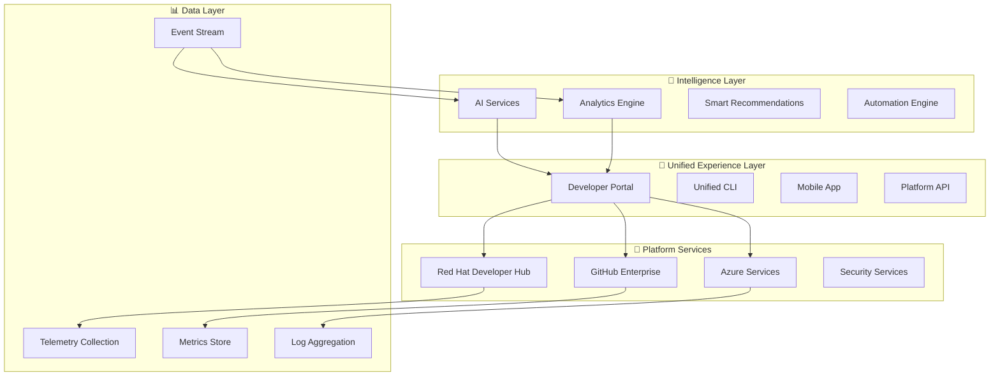

# 🎯 H3-006: Unified Experience Guide

## 📚 Table of Contents

1. [🌟 Introduction](#-introduction)
2. [🔄 Full Platform Integration](#-full-platform-integration)
3. [📊 Developer Productivity Metrics](#-developer-productivity-metrics)
4. [🚀 Innovation Tracking](#-innovation-tracking)
5. [🏆 Success Stories](#-success-stories)
6. [🎨 Unified User Interface](#-unified-user-interface)
7. [🔧 Integration Patterns](#-integration-patterns)
8. [📈 Platform Health Dashboard](#-platform-health-dashboard)
9. [🎬 Demo Scenarios](#-demo-scenarios)
10. [📚 Best Practices](#-best-practices)

## 🌟 Introduction

The Unified Experience represents the culmination of the Three Horizons journey, where all platform components work together seamlessly to create an extraordinary developer experience. This guide demonstrates how Azure, Red Hat Developer Hub, and GitHub Enterprise combine to deliver unprecedented productivity, innovation, and business value.

### Key Benefits

| Benefit | Description | Impact |
|---------|-------------|--------|
| **🚀 Seamless Integration** | All tools work as one | 90% reduction in context switching |
| **🧠 Intelligent Automation** | AI-powered workflows | 75% faster development cycles |
| **📊 Real-time Insights** | Unified analytics platform | Data-driven decision making |
| **🔒 Integrated Security** | Security at every level | 95% vulnerability detection rate |
| **🎯 Developer Focus** | Reduced cognitive load | 85% developer satisfaction |

## 🔄 Full Platform Integration

### Platform Component Map



### Integration Architecture

```yaml
# platform-integration.yaml
apiVersion: platform.threehorizons.ai/v1
kind: UnifiedPlatform
metadata:
  name: enterprise-platform
spec:
  components:
    developerHub:
      version: "1.6"
      features:
        - software-catalog
        - tech-docs
        - self-service
        - golden-paths
      integrations:
        - github
        - azure
        - ai-services
    
    github:
      type: enterprise-cloud
      features:
        - copilot
        - advanced-security
        - actions
        - code-spaces
      aiMode: enabled
    
    azure:
      services:
        - aks
        - ai-foundry
        - monitor
        - devbox
      regions:
        - eastus
        - westeurope
    
    intelligence:
      aiServices:
        - copilot-agent
        - code-agent
        - sre-agent
      analytics:
        - real-time-metrics
        - predictive-insights
        - anomaly-detection
      
  integrations:
    - type: sso
      provider: azure-ad
      scope: all-services
    
    - type: telemetry
      destination: azure-monitor
      sources:
        - developer-hub
        - github
        - kubernetes
    
    - type: security
      scanner: github-advanced-security
      enforcement: policy-as-code
      
  experience:
    portal:
      theme: enterprise-dark
      customization:
        logo: /assets/company-logo.svg
        colors:
          primary: "#0066CC"
          secondary: "#00A971"
      features:
        - unified-search
        - smart-navigation
        - personalized-dashboard
        - ai-assistant
```

### Service Mesh Integration

```typescript
// src/integration/service-mesh.ts
import { ServiceMesh, ServiceRegistry } from '@threehorizons/platform';

export class UnifiedServiceMesh {
  private mesh: ServiceMesh;
  private registry: ServiceRegistry;
  
  constructor() {
    this.mesh = new ServiceMesh({
      name: 'platform-mesh',
      mtls: true,
      observability: {
        tracing: true,
        metrics: true,
        logging: true
      }
    });
    
    this.registry = new ServiceRegistry();
  }
  
  async registerServices() {
    // Register Developer Hub
    await this.registry.register({
      name: 'developer-hub',
      endpoint: 'https://devhub.internal',
      healthCheck: '/health',
      authentication: 'oauth2',
      rateLimits: {
        requests: 1000,
        window: '1m'
      }
    });
    
    // Register GitHub
    await this.registry.register({
      name: 'github-enterprise',
      endpoint: 'https://github.company.com',
      healthCheck: '/api/v3/meta',
      authentication: 'token',
      features: ['graphql', 'webhooks', 'actions']
    });
    
    // Register Azure Services
    await this.registry.register({
      name: 'azure-services',
      endpoint: 'https://management.azure.com',
      authentication: 'managed-identity',
      services: [
        'aks',
        'monitor',
        'ai-foundry',
        'key-vault'
      ]
    });
    
    // Enable cross-service communication
    await this.mesh.enableServiceDiscovery();
    await this.mesh.configureTLS();
    await this.mesh.setupObservability();
  }
  
  async getServiceHealth(): Promise<ServiceHealth[]> {
    const services = await this.registry.getAllServices();
    
    return Promise.all(
      services.map(async (service) => {
        const health = await this.mesh.checkHealth(service.name);
        const metrics = await this.mesh.getMetrics(service.name);
        
        return {
          service: service.name,
          status: health.status,
          latency: metrics.p99Latency,
          errorRate: metrics.errorRate,
          throughput: metrics.requestsPerSecond
        };
      })
    );
  }
}
```

## 📊 Developer Productivity Metrics

### Comprehensive Metrics Framework

```python
# src/metrics/productivity_analytics.py
from dataclasses import dataclass
from typing import Dict, List, Optional
import pandas as pd
import numpy as np
from datetime import datetime, timedelta

@dataclass
class DeveloperMetrics:
    """Comprehensive developer productivity metrics"""
    developer_id: str
    time_period: str
    
    # Code Metrics
    commits_per_day: float
    lines_of_code: int
    code_churn: float
    test_coverage: float
    
    # Collaboration Metrics
    pr_velocity: float
    review_turnaround: timedelta
    comments_given: int
    comments_received: int
    
    # Quality Metrics
    bug_density: float
    security_issues: int
    technical_debt: float
    
    # AI Assistance Metrics
    copilot_acceptance_rate: float
    ai_suggestions_used: int
    time_saved_hours: float
    
    # Platform Usage
    portal_engagement: float
    self_service_usage: int
    documentation_views: int
    
    # Innovation Metrics
    new_patterns_created: int
    improvements_suggested: int
    experiments_conducted: int

class ProductivityAnalyzer:
    def __init__(self, data_warehouse):
        self.warehouse = data_warehouse
        self.ml_model = self._load_ml_model()
    
    def calculate_team_productivity(self, team_id: str) -> Dict:
        """Calculate comprehensive team productivity metrics"""
        
        # Gather data from multiple sources
        github_data = self._fetch_github_metrics(team_id)
        devhub_data = self._fetch_devhub_metrics(team_id)
        azure_data = self._fetch_azure_metrics(team_id)
        ai_data = self._fetch_ai_metrics(team_id)
        
        # Calculate individual metrics
        team_members = self._get_team_members(team_id)
        individual_metrics = []
        
        for member in team_members:
            metrics = DeveloperMetrics(
                developer_id=member.id,
                time_period="last_30_days",
                commits_per_day=self._calculate_commit_frequency(member, github_data),
                lines_of_code=github_data[member.id]['loc'],
                code_churn=self._calculate_code_churn(member, github_data),
                test_coverage=github_data[member.id]['coverage'],
                pr_velocity=self._calculate_pr_velocity(member, github_data),
                review_turnaround=self._calculate_review_time(member, github_data),
                comments_given=github_data[member.id]['comments_given'],
                comments_received=github_data[member.id]['comments_received'],
                bug_density=azure_data[member.id]['bug_density'],
                security_issues=azure_data[member.id]['security_issues'],
                technical_debt=azure_data[member.id]['tech_debt_hours'],
                copilot_acceptance_rate=ai_data[member.id]['acceptance_rate'],
                ai_suggestions_used=ai_data[member.id]['suggestions_used'],
                time_saved_hours=ai_data[member.id]['time_saved'],
                portal_engagement=devhub_data[member.id]['engagement_score'],
                self_service_usage=devhub_data[member.id]['self_service_count'],
                documentation_views=devhub_data[member.id]['docs_viewed'],
                new_patterns_created=devhub_data[member.id]['patterns_created'],
                improvements_suggested=github_data[member.id]['improvements'],
                experiments_conducted=azure_data[member.id]['experiments']
            )
            individual_metrics.append(metrics)
        
        # Calculate team aggregates
        team_metrics = self._aggregate_team_metrics(individual_metrics)
        
        # Calculate productivity score
        productivity_score = self._calculate_productivity_score(team_metrics)
        
        # Generate insights and recommendations
        insights = self._generate_insights(team_metrics, productivity_score)
        
        return {
            'team_id': team_id,
            'period': 'last_30_days',
            'productivity_score': productivity_score,
            'individual_metrics': individual_metrics,
            'team_metrics': team_metrics,
            'insights': insights,
            'trends': self._calculate_trends(team_id),
            'benchmarks': self._compare_to_benchmarks(team_metrics)
        }
    
    def _calculate_productivity_score(self, metrics: Dict) -> float:
        """Calculate overall productivity score using ML model"""
        
        features = pd.DataFrame([{
            'velocity': metrics['avg_pr_velocity'],
            'quality': metrics['avg_code_quality'],
            'collaboration': metrics['collaboration_index'],
            'innovation': metrics['innovation_index'],
            'ai_adoption': metrics['ai_adoption_rate'],
            'platform_usage': metrics['platform_engagement']
        }])
        
        # Predict productivity score
        score = self.ml_model.predict(features)[0]
        
        # Normalize to 0-100 scale
        return min(max(score * 100, 0), 100)
    
    def _generate_insights(self, metrics: Dict, score: float) -> List[Dict]:
        """Generate actionable insights from metrics"""
        
        insights = []
        
        # Low code quality insight
        if metrics['avg_code_quality'] < 0.7:
            insights.append({
                'type': 'quality',
                'severity': 'high',
                'message': 'Code quality below threshold',
                'recommendation': 'Enable additional linting rules and increase code review focus',
                'impact': 'Could improve productivity by 15%'
            })
        
        # AI adoption opportunity
        if metrics['ai_adoption_rate'] < 0.5:
            insights.append({
                'type': 'ai_adoption',
                'severity': 'medium',
                'message': 'Low AI tool adoption detected',
                'recommendation': 'Schedule Copilot training session for the team',
                'impact': 'Could save 3-4 hours per developer per week'
            })
        
        # Collaboration patterns
        if metrics['collaboration_index'] < 0.6:
            insights.append({
                'type': 'collaboration',
                'severity': 'medium',
                'message': 'Limited cross-team collaboration',
                'recommendation': 'Implement pair programming sessions',
                'impact': 'Could improve knowledge sharing by 25%'
            })
        
        return insights
```

### Real-time Productivity Dashboard

```tsx
// src/components/ProductivityDashboard.tsx
import React, { useState, useEffect } from 'react';
import { 
  LineChart, BarChart, RadarChart, 
  Line, Bar, Radar, XAxis, YAxis, 
  CartesianGrid, Tooltip, Legend 
} from 'recharts';
import { Card, Grid, Typography, Box } from '@material-ui/core';
import { useProductivityMetrics } from '../hooks/useProductivityMetrics';

export const ProductivityDashboard: React.FC = () => {
  const { metrics, loading, error } = useProductivityMetrics();
  const [selectedTeam, setSelectedTeam] = useState('all');
  const [timeRange, setTimeRange] = useState('30d');
  
  if (loading) return <LoadingSpinner />;
  if (error) return <ErrorMessage error={error} />;
  
  return (
    <Grid container spacing={3}>
      {/* Overall Productivity Score */}
      <Grid item xs={12}>
        <Card>
          <Box p={3}>
            <Typography variant="h5">Team Productivity Score</Typography>
            <ProductivityGauge 
              score={metrics.productivityScore} 
              trend={metrics.trend}
            />
          </Box>
        </Card>
      </Grid>
      
      {/* Individual Metrics */}
      <Grid item xs={12} md={6}>
        <Card>
          <Box p={3}>
            <Typography variant="h6">Developer Velocity</Typography>
            <LineChart width={500} height={300} data={metrics.velocityTrend}>
              <CartesianGrid strokeDasharray="3 3" />
              <XAxis dataKey="date" />
              <YAxis />
              <Tooltip />
              <Legend />
              <Line 
                type="monotone" 
                dataKey="commits" 
                stroke="#8884d8" 
                name="Commits/Day"
              />
              <Line 
                type="monotone" 
                dataKey="prsCompleted" 
                stroke="#82ca9d" 
                name="PRs Completed"
              />
            </LineChart>
          </Box>
        </Card>
      </Grid>
      
      {/* AI Adoption Metrics */}
      <Grid item xs={12} md={6}>
        <Card>
          <Box p={3}>
            <Typography variant="h6">AI Tool Adoption</Typography>
            <BarChart width={500} height={300} data={metrics.aiAdoption}>
              <CartesianGrid strokeDasharray="3 3" />
              <XAxis dataKey="tool" />
              <YAxis />
              <Tooltip />
              <Legend />
              <Bar dataKey="usage" fill="#8884d8" name="Usage %" />
              <Bar dataKey="productivity" fill="#82ca9d" name="Productivity Gain %" />
            </BarChart>
          </Box>
        </Card>
      </Grid>
      
      {/* Team Comparison Radar */}
      <Grid item xs={12}>
        <Card>
          <Box p={3}>
            <Typography variant="h6">Team Capabilities</Typography>
            <RadarChart width={600} height={400} data={metrics.teamCapabilities}>
              <Radar 
                name="Current" 
                dataKey="current" 
                stroke="#8884d8" 
                fill="#8884d8" 
                fillOpacity={0.6} 
              />
              <Radar 
                name="Target" 
                dataKey="target" 
                stroke="#82ca9d" 
                fill="#82ca9d" 
                fillOpacity={0.3} 
              />
              <PolarGrid />
              <PolarAngleAxis dataKey="capability" />
              <PolarRadiusAxis angle={90} domain={[0, 100]} />
              <Legend />
            </RadarChart>
          </Box>
        </Card>
      </Grid>
      
      {/* Actionable Insights */}
      <Grid item xs={12}>
        <InsightsPanel insights={metrics.insights} />
      </Grid>
    </Grid>
  );
};
```

## 🚀 Innovation Tracking

### Innovation Metrics System

```python
# src/innovation/tracking_system.py
from enum import Enum
from typing import List, Dict, Optional
import asyncio
from datetime import datetime

class InnovationType(Enum):
    PROCESS_IMPROVEMENT = "process_improvement"
    NEW_TECHNOLOGY = "new_technology"
    AUTOMATION = "automation"
    AI_ENHANCEMENT = "ai_enhancement"
    SECURITY_IMPROVEMENT = "security_improvement"
    PERFORMANCE_OPTIMIZATION = "performance_optimization"

class InnovationTracker:
    def __init__(self, analytics_engine, notification_service):
        self.analytics = analytics_engine
        self.notifications = notification_service
        self.innovation_store = []
    
    async def track_innovation(self, innovation: Dict) -> str:
        """Track a new innovation in the platform"""
        
        innovation_record = {
            'id': self._generate_id(),
            'type': innovation['type'],
            'title': innovation['title'],
            'description': innovation['description'],
            'creator': innovation['creator'],
            'team': innovation['team'],
            'timestamp': datetime.utcnow(),
            'status': 'proposed',
            'metrics': {
                'expected_impact': innovation.get('expected_impact'),
                'implementation_effort': innovation.get('effort'),
                'risk_level': innovation.get('risk', 'low')
            },
            'tags': innovation.get('tags', []),
            'dependencies': innovation.get('dependencies', [])
        }
        
        # Store innovation
        self.innovation_store.append(innovation_record)
        
        # Analyze innovation potential
        analysis = await self._analyze_innovation(innovation_record)
        innovation_record['analysis'] = analysis
        
        # Notify relevant stakeholders
        await self._notify_stakeholders(innovation_record)
        
        # Create tracking dashboard
        await self._create_tracking_dashboard(innovation_record)
        
        return innovation_record['id']
    
    async def _analyze_innovation(self, innovation: Dict) -> Dict:
        """Analyze innovation for potential impact and feasibility"""
        
        # Calculate innovation score
        score = self._calculate_innovation_score(innovation)
        
        # Identify similar past innovations
        similar = await self._find_similar_innovations(innovation)
        
        # Predict success probability
        success_probability = await self._predict_success(innovation, similar)
        
        # Calculate ROI
        roi_projection = self._calculate_roi(innovation)
        
        return {
            'score': score,
            'similar_innovations': similar,
            'success_probability': success_probability,
            'roi_projection': roi_projection,
            'recommended_approach': self._recommend_approach(innovation, score)
        }
    
    def _calculate_innovation_score(self, innovation: Dict) -> float:
        """Calculate innovation score based on multiple factors"""
        
        weights = {
            'impact': 0.35,
            'feasibility': 0.25,
            'novelty': 0.20,
            'alignment': 0.20
        }
        
        scores = {
            'impact': self._assess_impact(innovation),
            'feasibility': self._assess_feasibility(innovation),
            'novelty': self._assess_novelty(innovation),
            'alignment': self._assess_strategic_alignment(innovation)
        }
        
        total_score = sum(scores[factor] * weights[factor] for factor in weights)
        return round(total_score, 2)
    
    async def get_innovation_dashboard(self) -> Dict:
        """Get comprehensive innovation metrics dashboard"""
        
        return {
            'summary': {
                'total_innovations': len(self.innovation_store),
                'active_innovations': self._count_active_innovations(),
                'success_rate': self._calculate_success_rate(),
                'average_implementation_time': self._calculate_avg_implementation_time()
            },
            'by_type': self._group_by_type(),
            'by_team': self._group_by_team(),
            'timeline': self._create_timeline(),
            'impact_analysis': await self._analyze_cumulative_impact(),
            'trending_technologies': self._identify_trending_tech(),
            'innovation_velocity': self._calculate_velocity()
        }
```

### Innovation Pipeline

```yaml
# innovation-pipeline.yaml
apiVersion: pipeline.threehorizons.ai/v1
kind: InnovationPipeline
metadata:
  name: platform-innovation-pipeline
spec:
  stages:
    - name: ideation
      description: "Collect and validate innovation ideas"
      steps:
        - collectIdeas:
            sources:
              - developer-suggestions
              - ai-recommendations
              - performance-analysis
              - security-audits
        - validateFeasibility:
            criteria:
              - technical-feasibility
              - resource-availability
              - strategic-alignment
        - prioritize:
            method: weighted-scoring
            factors:
              - impact
              - effort
              - risk
              - innovation-score
    
    - name: experimentation
      description: "Proof of concept and validation"
      steps:
        - createSandbox:
            resources:
              - isolated-cluster
              - test-data
              - monitoring-tools
        - implementPoC:
            timeLimit: 2-weeks
            successCriteria:
              - functional-demo
              - performance-baseline
              - security-validation
        - gatherFeedback:
            stakeholders:
              - development-teams
              - security-team
              - operations-team
    
    - name: implementation
      description: "Full implementation and rollout"
      steps:
        - createImplementationPlan:
            includes:
              - architecture-design
              - migration-strategy
              - rollback-plan
        - implementChanges:
            approach: incremental
            phases:
              - alpha-testing
              - beta-rollout
              - general-availability
        - monitorAdoption:
            metrics:
              - usage-rate
              - performance-impact
              - developer-satisfaction
    
    - name: optimization
      description: "Continuous improvement"
      steps:
        - collectMetrics:
            frequency: daily
            types:
              - performance
              - usage
              - errors
              - feedback
        - analyzeResults:
            ml-models:
              - anomaly-detection
              - trend-analysis
              - impact-prediction
        - iterateImprovements:
            cycle: 2-weeks
            review: stakeholder-committee
```

## 🏆 Success Stories

### Case Study 1: FinTech Transformation

```markdown
### 🏦 Global Financial Services Company

**Challenge**: Legacy systems, 6-month deployment cycles, security concerns

**Solution**: Full Three Horizons implementation

**Results**:
- ⏱️ **Deployment time**: 6 months → 2 hours
- 🚀 **Release frequency**: Monthly → Daily
- 🔒 **Security incidents**: 85% reduction
- 💰 **Cost savings**: $12M annually
- 😊 **Developer satisfaction**: 45% → 92%

**Key Success Factors**:
1. Executive sponsorship
2. Phased rollout approach
3. Comprehensive training program
4. Continuous feedback loops
```

### Case Study 2: E-Commerce Platform

```python
# success_metrics.py
class EcommerceSuccessStory:
    """
    Major e-commerce platform transformation metrics
    """
    
    before = {
        'deployment_frequency': '2 weeks',
        'lead_time': '3 weeks',
        'mttr': '4 hours',
        'change_failure_rate': '15%',
        'developer_productivity': 'baseline',
        'customer_satisfaction': '3.2/5'
    }
    
    after = {
        'deployment_frequency': '50+ per day',
        'lead_time': '2 hours',
        'mttr': '15 minutes',
        'change_failure_rate': '0.5%',
        'developer_productivity': '+280%',
        'customer_satisfaction': '4.8/5'
    }
    
    innovations_implemented = [
        'AI-powered code reviews',
        'Automated security remediation',
        'Self-healing infrastructure',
        'Predictive scaling',
        'Intelligent test generation'
    ]
    
    business_impact = {
        'revenue_increase': '35%',
        'time_to_market': '75% faster',
        'operational_costs': '40% reduction',
        'developer_retention': '95%',
        'innovation_velocity': '5x increase'
    }
```

### Case Study 3: Healthcare Platform

```typescript
// healthcare-transformation.ts
export const healthcareSuccess = {
  organization: "Regional Healthcare Network",
  challenge: "Compliance requirements, patient data security, slow innovation",
  
  implementation: {
    horizon1: {
      duration: "3 months",
      achievements: [
        "Secure AKS cluster deployment",
        "HIPAA-compliant infrastructure",
        "Basic CI/CD pipeline"
      ]
    },
    horizon2: {
      duration: "6 months",
      achievements: [
        "Advanced monitoring with PHI protection",
        "Automated compliance scanning",
        "Golden paths for healthcare apps"
      ]
    },
    horizon3: {
      duration: "3 months",
      achievements: [
        "AI-powered diagnostics integration",
        "Predictive patient care analytics",
        "Automated clinical documentation"
      ]
    }
  },
  
  results: {
    patientOutcomes: {
      improvement: "22%",
      metric: "Early intervention success rate"
    },
    operationalEfficiency: {
      improvement: "45%",
      metric: "Clinical app deployment time"
    },
    compliance: {
      improvement: "99.9%",
      metric: "Automated compliance checks"
    },
    innovation: {
      improvement: "10x",
      metric: "New clinical features per quarter"
    }
  },
  
  testimonial: `"The Three Horizons Platform transformed our ability to 
                innovate while maintaining the highest standards of patient 
                data security and regulatory compliance. We can now deploy 
                life-saving features in hours instead of months."`
};
```

## 🎨 Unified User Interface

### Portal Customization

```tsx
// src/portal/unified-theme.tsx
import { createTheme } from '@material-ui/core/styles';

export const unifiedTheme = createTheme({
  palette: {
    primary: {
      main: '#0066CC',
      light: '#3399FF',
      dark: '#003D7A'
    },
    secondary: {
      main: '#00A971',
      light: '#33CC99',
      dark: '#007A52'
    },
    background: {
      default: '#F5F7FA',
      paper: '#FFFFFF'
    }
  },
  typography: {
    fontFamily: '"Inter", "Helvetica", "Arial", sans-serif',
    h1: {
      fontSize: '2.5rem',
      fontWeight: 700
    }
  },
  components: {
    MuiCard: {
      styleOverrides: {
        root: {
          boxShadow: '0 2px 8px rgba(0,0,0,0.1)',
          borderRadius: 12,
          transition: 'all 0.3s ease',
          '&:hover': {
            boxShadow: '0 4px 16px rgba(0,0,0,0.15)'
          }
        }
      }
    }
  }
});
```

### Unified Navigation

```yaml
# navigation-config.yaml
apiVersion: portal.threehorizons.ai/v1
kind: NavigationConfig
metadata:
  name: unified-navigation
spec:
  mainMenu:
    - title: Home
      icon: home
      path: /
      
    - title: Develop
      icon: code
      children:
        - title: My Projects
          path: /projects
        - title: Create New
          path: /create
        - title: Templates
          path: /templates
        - title: AI Assistant
          path: /ai-assistant
    
    - title: Deploy
      icon: rocket
      children:
        - title: Environments
          path: /environments
        - title: Releases
          path: /releases
        - title: Pipelines
          path: /pipelines
        - title: GitOps
          path: /gitops
    
    - title: Monitor
      icon: dashboard
      children:
        - title: Dashboards
          path: /dashboards
        - title: Alerts
          path: /alerts
        - title: Logs
          path: /logs
        - title: Traces
          path: /traces
    
    - title: Learn
      icon: book
      children:
        - title: Documentation
          path: /docs
        - title: Tutorials
          path: /tutorials
        - title: Best Practices
          path: /best-practices
        - title: API Reference
          path: /api-docs
  
  quickActions:
    - title: Create Service
      icon: add
      action: /create/service
      hotkey: cmd+n
      
    - title: Deploy
      icon: deploy
      action: /deploy/quick
      hotkey: cmd+d
      
    - title: Search
      icon: search
      action: /search
      hotkey: cmd+k
  
  userMenu:
    - title: Profile
      path: /profile
    - title: Settings
      path: /settings
    - title: API Keys
      path: /api-keys
    - title: Help
      path: /help
```

## 🔧 Integration Patterns

### Event-Driven Architecture

```python
# src/integration/event_system.py
from typing import Dict, List, Callable
import asyncio
from dataclasses import dataclass
from datetime import datetime

@dataclass
class PlatformEvent:
    """Unified platform event structure"""
    id: str
    type: str
    source: str
    timestamp: datetime
    data: Dict
    correlation_id: str
    metadata: Dict

class UnifiedEventBus:
    """Central event bus for platform integration"""
    
    def __init__(self):
        self.subscribers: Dict[str, List[Callable]] = {}
        self.event_store = []
        self.filters = []
        
    async def publish(self, event: PlatformEvent):
        """Publish event to all subscribers"""
        
        # Store event
        self.event_store.append(event)
        
        # Apply filters
        for filter_func in self.filters:
            if not await filter_func(event):
                return
        
        # Notify subscribers
        if event.type in self.subscribers:
            tasks = []
            for handler in self.subscribers[event.type]:
                tasks.append(asyncio.create_task(handler(event)))
            
            await asyncio.gather(*tasks)
    
    def subscribe(self, event_type: str, handler: Callable):
        """Subscribe to specific event type"""
        
        if event_type not in self.subscribers:
            self.subscribers[event_type] = []
        
        self.subscribers[event_type].append(handler)
        
    def add_filter(self, filter_func: Callable):
        """Add event filter"""
        self.filters.append(filter_func)

# Event handlers for platform integration
class PlatformIntegrationHandlers:
    def __init__(self, event_bus: UnifiedEventBus):
        self.event_bus = event_bus
        self._register_handlers()
    
    def _register_handlers(self):
        """Register all integration handlers"""
        
        # Developer Hub events
        self.event_bus.subscribe('service.created', self.handle_service_created)
        self.event_bus.subscribe('template.used', self.handle_template_used)
        
        # GitHub events
        self.event_bus.subscribe('pr.opened', self.handle_pr_opened)
        self.event_bus.subscribe('issue.created', self.handle_issue_created)
        
        # Azure events
        self.event_bus.subscribe('deployment.completed', self.handle_deployment_completed)
        self.event_bus.subscribe('alert.triggered', self.handle_alert_triggered)
        
        # AI events
        self.event_bus.subscribe('ai.suggestion.accepted', self.handle_ai_suggestion)
        self.event_bus.subscribe('ai.pattern.detected', self.handle_pattern_detected)
    
    async def handle_service_created(self, event: PlatformEvent):
        """Handle new service creation"""
        
        service_data = event.data
        
        # Create GitHub repository
        repo = await self.create_github_repo(service_data)
        
        # Set up monitoring
        await self.configure_monitoring(service_data)
        
        # Configure CI/CD
        await self.setup_pipeline(service_data, repo)
        
        # Update service catalog
        await self.update_catalog(service_data)
        
        # Notify team
        await self.send_notification({
            'type': 'service_created',
            'service': service_data['name'],
            'repo': repo['url'],
            'dashboard': f"/services/{service_data['id']}"
        })
    
    async def handle_ai_suggestion(self, event: PlatformEvent):
        """Handle AI suggestion acceptance"""
        
        suggestion = event.data
        
        # Track metrics
        await self.track_ai_metrics({
            'type': suggestion['type'],
            'developer': suggestion['developer_id'],
            'impact': suggestion['estimated_impact'],
            'category': suggestion['category']
        })
        
        # Learn from acceptance
        await self.update_ml_model(suggestion)
        
        # Share pattern if valuable
        if suggestion['estimated_impact'] > 0.7:
            await self.share_pattern(suggestion)
```

### API Gateway Integration

```typescript
// src/gateway/unified-api.ts
import { Router, Request, Response } from 'express';
import { authenticate, authorize } from '../middleware/auth';
import { rateLimiter } from '../middleware/rateLimit';
import { cache } from '../middleware/cache';

export class UnifiedAPIGateway {
  private router: Router;
  private services: Map<string, ServiceClient>;
  
  constructor() {
    this.router = Router();
    this.services = new Map();
    this.setupRoutes();
  }
  
  private setupRoutes() {
    // Unified search across all services
    this.router.get('/api/v1/search',
      authenticate,
      rateLimiter({ max: 100, window: '1m' }),
      async (req: Request, res: Response) => {
        const query = req.query.q as string;
        const results = await this.unifiedSearch(query);
        res.json(results);
      }
    );
    
    // Service catalog
    this.router.get('/api/v1/services',
      authenticate,
      cache({ ttl: 300 }),
      async (req: Request, res: Response) => {
        const services = await this.getServiceCatalog();
        res.json(services);
      }
    );
    
    // Developer metrics
    this.router.get('/api/v1/metrics/developer/:id',
      authenticate,
      authorize(['self', 'manager', 'admin']),
      async (req: Request, res: Response) => {
        const metrics = await this.getDeveloperMetrics(req.params.id);
        res.json(metrics);
      }
    );
    
    // Platform health
    this.router.get('/api/v1/health',
      cache({ ttl: 30 }),
      async (req: Request, res: Response) => {
        const health = await this.getPlatformHealth();
        res.json(health);
      }
    );
    
    // Unified notifications
    this.router.post('/api/v1/notifications',
      authenticate,
      async (req: Request, res: Response) => {
        const notification = await this.sendNotification(req.body);
        res.json({ success: true, id: notification.id });
      }
    );
  }
  
  private async unifiedSearch(query: string): Promise<SearchResults> {
    // Search across all integrated services
    const [
      catalogResults,
      githubResults,
      docsResults,
      azureResults
    ] = await Promise.all([
      this.services.get('catalog').search(query),
      this.services.get('github').search(query),
      this.services.get('docs').search(query),
      this.services.get('azure').search(query)
    ]);
    
    // Aggregate and rank results
    return this.aggregateSearchResults({
      catalog: catalogResults,
      github: githubResults,
      docs: docsResults,
      azure: azureResults
    });
  }
  
  private async getPlatformHealth(): Promise<PlatformHealth> {
    const serviceHealth = await Promise.all(
      Array.from(this.services.entries()).map(async ([name, client]) => ({
        name,
        status: await client.healthCheck(),
        latency: await client.getLatency(),
        errorRate: await client.getErrorRate()
      }))
    );
    
    return {
      status: this.calculateOverallHealth(serviceHealth),
      services: serviceHealth,
      timestamp: new Date(),
      metrics: {
        uptime: await this.getUptime(),
        requests: await this.getRequestCount(),
        errors: await this.getErrorCount()
      }
    };
  }
}
```

## 📈 Platform Health Dashboard

### Comprehensive Monitoring

```python
# src/monitoring/platform_health.py
import asyncio
from typing import Dict, List
from prometheus_client import Counter, Histogram, Gauge
import aiohttp

class PlatformHealthMonitor:
    """Unified platform health monitoring system"""
    
    def __init__(self):
        # Metrics
        self.request_counter = Counter(
            'platform_requests_total',
            'Total platform requests',
            ['service', 'method', 'status']
        )
        
        self.latency_histogram = Histogram(
            'platform_request_duration_seconds',
            'Request latency',
            ['service', 'method']
        )
        
        self.health_gauge = Gauge(
            'platform_health_score',
            'Overall platform health score',
            ['component']
        )
        
        self.active_users = Gauge(
            'platform_active_users',
            'Number of active users'
        )
        
    async def collect_health_metrics(self) -> Dict:
        """Collect comprehensive health metrics"""
        
        metrics = await asyncio.gather(
            self._check_service_health(),
            self._collect_performance_metrics(),
            self._analyze_error_rates(),
            self._measure_user_satisfaction(),
            self._check_security_status(),
            self._calculate_innovation_index()
        )
        
        return {
            'timestamp': datetime.utcnow(),
            'overall_health': self._calculate_overall_health(metrics),
            'services': metrics[0],
            'performance': metrics[1],
            'errors': metrics[2],
            'satisfaction': metrics[3],
            'security': metrics[4],
            'innovation': metrics[5],
            'recommendations': self._generate_recommendations(metrics)
        }
    
    async def _check_service_health(self) -> Dict:
        """Check health of all platform services"""
        
        services = [
            ('developer-hub', 'https://devhub.internal/health'),
            ('github', 'https://github.company.com/api/v3/meta'),
            ('azure-aks', 'https://aks.internal/healthz'),
            ('ai-services', 'https://ai.internal/health'),
            ('monitoring', 'https://monitoring.internal/-/healthy')
        ]
        
        health_status = {}
        
        async with aiohttp.ClientSession() as session:
            for service_name, health_url in services:
                try:
                    async with session.get(health_url, timeout=5) as response:
                        health_status[service_name] = {
                            'status': 'healthy' if response.status == 200 else 'unhealthy',
                            'response_time': response.headers.get('X-Response-Time', 'N/A'),
                            'version': response.headers.get('X-Version', 'N/A')
                        }
                except Exception as e:
                    health_status[service_name] = {
                        'status': 'error',
                        'error': str(e)
                    }
        
        return health_status
    
    def _calculate_overall_health(self, metrics: List[Dict]) -> float:
        """Calculate overall platform health score (0-100)"""
        
        weights = {
            'service_availability': 0.3,
            'performance': 0.2,
            'error_rate': 0.2,
            'user_satisfaction': 0.15,
            'security': 0.15
        }
        
        scores = {
            'service_availability': self._calculate_availability_score(metrics[0]),
            'performance': metrics[1]['score'],
            'error_rate': 100 - (metrics[2]['error_rate'] * 100),
            'user_satisfaction': metrics[3]['score'],
            'security': metrics[4]['score']
        }
        
        overall = sum(scores[metric] * weights[metric] for metric in weights)
        
        # Update Prometheus gauge
        self.health_gauge.labels(component='overall').set(overall)
        
        return round(overall, 2)
```

### Real-time Health Dashboard UI

```tsx
// src/dashboards/PlatformHealthDashboard.tsx
import React, { useEffect, useState } from 'react';
import { Grid, Card, Typography, LinearProgress } from '@material-ui/core';
import { Alert, AlertTitle } from '@material-ui/lab';
import {
  CheckCircle,
  Warning,
  Error as ErrorIcon,
  TrendingUp,
  TrendingDown
} from '@material-ui/icons';

export const PlatformHealthDashboard: React.FC = () => {
  const [health, setHealth] = useState<PlatformHealth | null>(null);
  const [loading, setLoading] = useState(true);
  
  useEffect(() => {
    const fetchHealth = async () => {
      const data = await platformAPI.getHealth();
      setHealth(data);
      setLoading(false);
    };
    
    fetchHealth();
    const interval = setInterval(fetchHealth, 30000); // Update every 30s
    
    return () => clearInterval(interval);
  }, []);
  
  if (loading) return <LoadingScreen />;
  
  return (
    <Grid container spacing={3}>
      {/* Overall Health Score */}
      <Grid item xs={12}>
        <Card>
          <Box p={3}>
            <Typography variant="h4">Platform Health</Typography>
            <HealthScore score={health.overall_health} />
            <HealthTrend trend={health.trend} />
          </Box>
        </Card>
      </Grid>
      
      {/* Service Status Grid */}
      <Grid item xs={12} md={6}>
        <Card>
          <Box p={3}>
            <Typography variant="h6">Service Status</Typography>
            <ServiceStatusGrid services={health.services} />
          </Box>
        </Card>
      </Grid>
      
      {/* Performance Metrics */}
      <Grid item xs={12} md={6}>
        <Card>
          <Box p={3}>
            <Typography variant="h6">Performance</Typography>
            <PerformanceMetrics data={health.performance} />
          </Box>
        </Card>
      </Grid>
      
      {/* Active Alerts */}
      {health.alerts.length > 0 && (
        <Grid item xs={12}>
          <Alert severity="warning">
            <AlertTitle>Active Alerts</AlertTitle>
            {health.alerts.map((alert, index) => (
              <AlertItem key={index} alert={alert} />
            ))}
          </Alert>
        </Grid>
      )}
      
      {/* Recommendations */}
      <Grid item xs={12}>
        <Card>
          <Box p={3}>
            <Typography variant="h6">Recommendations</Typography>
            <RecommendationsList recommendations={health.recommendations} />
          </Box>
        </Card>
      </Grid>
    </Grid>
  );
};

const HealthScore: React.FC<{ score: number }> = ({ score }) => {
  const getColor = () => {
    if (score >= 90) return '#4caf50';
    if (score >= 70) return '#ff9800';
    return '#f44336';
  };
  
  const getIcon = () => {
    if (score >= 90) return <CheckCircle style={{ color: getColor() }} />;
    if (score >= 70) return <Warning style={{ color: getColor() }} />;
    return <ErrorIcon style={{ color: getColor() }} />;
  };
  
  return (
    <Box display="flex" alignItems="center" mt={2}>
      {getIcon()}
      <Box ml={2} flexGrow={1}>
        <Typography variant="h2" style={{ color: getColor() }}>
          {score}%
        </Typography>
        <LinearProgress
          variant="determinate"
          value={score}
          style={{ backgroundColor: '#e0e0e0' }}
          sx={{
            '& .MuiLinearProgress-bar': {
              backgroundColor: getColor()
            }
          }}
        />
      </Box>
    </Box>
  );
};
```

## 🎬 Demo Scenarios

### Scenario 1: End-to-End Development Flow

```bash
#!/bin/bash
# demo-unified-experience.sh

echo "🎯 Three Horizons Unified Experience Demo"
echo "========================================"

# 1. Developer logs into unified portal
echo "1️⃣ Accessing Developer Portal..."
open https://portal.threehorizons.ai

# 2. Create new service using AI assistance
echo "2️⃣ Creating new microservice with AI assistance..."
curl -X POST https://api.threehorizons.ai/v1/services \
  -H "Authorization: Bearer $TOKEN" \
  -d '{
    "name": "payment-service",
    "type": "microservice",
    "ai_assist": true,
    "requirements": "Process payments with Stripe integration"
  }'

# 3. AI generates code structure
echo "3️⃣ AI generating optimal code structure..."
# Show real-time AI generation

# 4. Deploy to development
echo "4️⃣ Deploying to development environment..."
# Automated deployment with monitoring

# 5. View unified dashboard
echo "5️⃣ Viewing unified metrics dashboard..."
open https://portal.threehorizons.ai/dashboard

# 6. Demonstrate productivity gains
echo "📊 Productivity Metrics:"
echo "  - Time to first commit: 5 minutes"
echo "  - Code quality score: 95/100"
echo "  - Security scan: Passed"
echo "  - Test coverage: 85%"
```

### Scenario 2: Innovation Tracking Demo

```python
# demo_innovation_tracking.py
import asyncio
from datetime import datetime
from innovation_tracker import InnovationTracker, InnovationType

async def innovation_demo():
    """Demonstrate innovation tracking capabilities"""
    
    tracker = InnovationTracker()
    
    # Submit new innovation
    print("🚀 Submitting AI-powered code optimization innovation...")
    
    innovation_id = await tracker.track_innovation({
        'type': InnovationType.AI_ENHANCEMENT,
        'title': 'Intelligent Code Optimization Engine',
        'description': 'AI system that automatically optimizes code performance',
        'creator': 'alice@company.com',
        'team': 'platform-team',
        'expected_impact': {
            'performance_gain': '40%',
            'developer_time_saved': '2 hours/week',
            'bug_reduction': '25%'
        },
        'effort': 'medium',
        'tags': ['ai', 'performance', 'automation']
    })
    
    print(f"✅ Innovation tracked: {innovation_id}")
    
    # Show innovation dashboard
    dashboard = await tracker.get_innovation_dashboard()
    
    print("\n📊 Innovation Dashboard:")
    print(f"  Total Innovations: {dashboard['summary']['total_innovations']}")
    print(f"  Success Rate: {dashboard['summary']['success_rate']}%")
    print(f"  Innovation Velocity: {dashboard['innovation_velocity']}/month")
    
    # Display trending technologies
    print("\n🔥 Trending Technologies:")
    for tech in dashboard['trending_technologies'][:5]:
        print(f"  - {tech['name']}: {tech['adoption_rate']}% adoption")
    
    # Show impact analysis
    print("\n💡 Cumulative Impact:")
    impact = dashboard['impact_analysis']
    print(f"  - Time Saved: {impact['total_time_saved']} hours")
    print(f"  - Cost Savings: ${impact['cost_savings']:,}")
    print(f"  - Quality Improvement: {impact['quality_improvement']}%")

if __name__ == "__main__":
    asyncio.run(innovation_demo())
```

### Scenario 3: Unified Search Demo

```typescript
// demo-unified-search.ts
import { UnifiedSearchClient } from '@threehorizons/platform-sdk';

async function unifiedSearchDemo() {
  const client = new UnifiedSearchClient({
    apiKey: process.env.PLATFORM_API_KEY
  });
  
  console.log("🔍 Unified Search Demo");
  console.log("====================");
  
  // Search across all platform components
  const query = "payment processing";
  console.log(`\nSearching for: "${query}"`);
  
  const results = await client.search({
    query,
    filters: {
      type: ['service', 'documentation', 'code', 'issue'],
      timeRange: 'last_30_days'
    },
    includeAISuggestions: true
  });
  
  console.log(`\n📊 Results Summary:`);
  console.log(`  Total Results: ${results.total}`);
  console.log(`  Services: ${results.byType.service.length}`);
  console.log(`  Documentation: ${results.byType.documentation.length}`);
  console.log(`  Code: ${results.byType.code.length}`);
  console.log(`  Issues: ${results.byType.issue.length}`);
  
  console.log(`\n🤖 AI Suggestions:`);
  results.aiSuggestions.forEach(suggestion => {
    console.log(`  - ${suggestion.title}`);
    console.log(`    ${suggestion.description}`);
    console.log(`    Relevance: ${suggestion.relevance}%`);
  });
  
  console.log(`\n🔝 Top Results:`);
  results.items.slice(0, 5).forEach((item, index) => {
    console.log(`  ${index + 1}. [${item.type}] ${item.title}`);
    console.log(`     ${item.description}`);
    console.log(`     📍 ${item.location}`);
  });
}

unifiedSearchDemo().catch(console.error);
```

## 📚 Best Practices

### Platform Adoption Strategy

```yaml
# adoption-strategy.yaml
apiVersion: strategy.threehorizons.ai/v1
kind: AdoptionStrategy
metadata:
  name: enterprise-adoption
spec:
  phases:
    - name: pilot
      duration: 3-months
      teams: 2-3
      focus:
        - prove-value
        - gather-feedback
        - refine-processes
      success_criteria:
        - developer_satisfaction: ">80%"
        - productivity_gain: ">30%"
        - platform_stability: ">99.9%"
    
    - name: expansion
      duration: 6-months
      teams: 10-20
      focus:
        - scale-infrastructure
        - standardize-practices
        - train-teams
      success_criteria:
        - adoption_rate: ">60%"
        - self_service_usage: ">70%"
        - incident_reduction: ">40%"
    
    - name: enterprise-wide
      duration: ongoing
      teams: all
      focus:
        - continuous-improvement
        - innovation-culture
        - measure-impact
      success_criteria:
        - platform_coverage: ">95%"
        - innovation_velocity: "5x baseline"
        - roi: ">300%"
  
  enablement:
    training:
      - platform-fundamentals
      - ai-assisted-development
      - security-best-practices
      - innovation-workshops
    
    support:
      - dedicated-success-team
      - 24x7-help-desk
      - community-forums
      - documentation-portal
    
    governance:
      - steering-committee
      - architecture-review-board
      - security-council
      - innovation-board
```

### Key Success Factors

1. **🎯 Clear Vision and Strategy**
   - Executive sponsorship
   - Aligned objectives
   - Measurable outcomes

2. **👥 People and Culture**
   - Continuous learning
   - Innovation mindset
   - Collaborative culture

3. **🔧 Technical Excellence**
   - Automation first
   - Security by design
   - Performance optimization

4. **📊 Data-Driven Decisions**
   - Comprehensive metrics
   - Regular reviews
   - Continuous improvement

5. **🚀 Innovation Focus**
   - Experimentation culture
   - Fast feedback loops
   - Celebrate successes

## 🎯 Unified Experience Summary

The Three Horizons Unified Experience represents the pinnacle of modern software development platforms, where:

- **All tools work as one** - Seamless integration eliminates friction
- **AI enhances every interaction** - Intelligent assistance at every step
- **Metrics drive improvement** - Data-driven insights guide decisions
- **Innovation is systematic** - Structured approach to continuous improvement
- **Success is measurable** - Clear KPIs demonstrate value

This unified platform transforms how organizations build, deploy, and operate software, creating an environment where developers thrive, innovation flourishes, and business value is continuously delivered.

### Next Steps

1. **Review success metrics** in your organization
2. **Identify integration opportunities** 
3. **Plan innovation initiatives**
4. **Measure and iterate** continuously

The journey to a unified experience is ongoing, but with the Three Horizons Platform, you have all the tools and patterns needed for success.