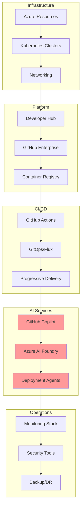

# 🎯 Complete Integration Tutorial - End-to-End Platform Setup

<div align="center">

**From Zero to Production: Complete Platform Integration Guide**

</div>

## 📋 Table of Contents

1. [Tutorial Overview](#-tutorial-overview)
2. [Prerequisites](#-prerequisites)
3. [Phase 1: Infrastructure Setup](#-phase-1-infrastructure-setup)
4. [Phase 2: Platform Components](#-phase-2-platform-components)
5. [Phase 3: CI/CD Integration](#-phase-3-cicd-integration)
6. [Phase 4: AI Services](#-phase-4-ai-services)
7. [Phase 5: Monitoring Setup](#-phase-5-monitoring-setup)
8. [Phase 6: Security Configuration](#-phase-6-security-configuration)
9. [Phase 7: Developer Onboarding](#-phase-7-developer-onboarding)
10. [Validation & Testing](#-validation--testing)

## 🎯 Tutorial Overview

This comprehensive tutorial will guide you through setting up the entire Three Horizons AI Platform from scratch. By the end, you'll have a fully functional, production-ready platform with AI-powered development capabilities.

### What You'll Build



### Time Estimate

- **Total Duration**: 4-6 hours
- **Active Work**: 2-3 hours
- **Waiting Time**: 2-3 hours (provisioning)

### Required Access Levels

| Service | Required Role |
|---------|--------------|
| **Azure** | Owner or Contributor |
| **GitHub** | Organization Owner |
| **DNS** | Domain management access |

## ✅ Prerequisites

### 1. Required Accounts

```bash
# Verify account access
echo "🔍 Checking prerequisites..."

# Azure CLI
if ! command -v az &> /dev/null; then
    echo "❌ Azure CLI not installed"
    echo "Install from: https://docs.microsoft.com/en-us/cli/azure/install-azure-cli"
    exit 1
fi

# GitHub CLI
if ! command -v gh &> /dev/null; then
    echo "❌ GitHub CLI not installed"
    echo "Install from: https://cli.github.com/"
    exit 1
fi

# Kubectl
if ! command -v kubectl &> /dev/null; then
    echo "❌ kubectl not installed"
    echo "Install from: https://kubernetes.io/docs/tasks/tools/"
    exit 1
fi

# Helm
if ! command -v helm &> /dev/null; then
    echo "❌ Helm not installed"
    echo "Install from: https://helm.sh/docs/intro/install/"
    exit 1
fi

echo "✅ All tools installed"
```

### 2. Environment Configuration

```bash
# setup-environment.sh
#!/bin/bash

# Set your configuration values
export ORGANIZATION_NAME="YourOrganization"
export DOMAIN_NAME="yourdomain.com"
export GITHUB_ORG="your-github-org"
export LOCATION="eastus"
export ENVIRONMENT="production"

# Azure configuration
export AZURE_SUBSCRIPTION_ID="your-subscription-id"
export BASE_NAME="threehorizons"

# Calculated values
export RESOURCE_GROUP_PREFIX="rg-${BASE_NAME}-${ENVIRONMENT}"
export AKS_CLUSTER_NAME="aks-${BASE_NAME}-${ENVIRONMENT}"
export ACR_NAME="acr${BASE_NAME}${ENVIRONMENT}"
export KEYVAULT_NAME="kv-${BASE_NAME}-${ENVIRONMENT}"

# Save configuration
cat > config.env << EOF
ORGANIZATION_NAME=${ORGANIZATION_NAME}
DOMAIN_NAME=${DOMAIN_NAME}
GITHUB_ORG=${GITHUB_ORG}
LOCATION=${LOCATION}
ENVIRONMENT=${ENVIRONMENT}
AZURE_SUBSCRIPTION_ID=${AZURE_SUBSCRIPTION_ID}
BASE_NAME=${BASE_NAME}
RESOURCE_GROUP_PREFIX=${RESOURCE_GROUP_PREFIX}
AKS_CLUSTER_NAME=${AKS_CLUSTER_NAME}
ACR_NAME=${ACR_NAME}
KEYVAULT_NAME=${KEYVAULT_NAME}
EOF

echo "✅ Configuration saved to config.env"
```

## 🏗️ Phase 1: Infrastructure Setup

### Step 1.1: Azure Login and Subscription

```bash
# Login to Azure
echo "☁️ Logging into Azure..."
az login

# Set subscription
az account set --subscription "${AZURE_SUBSCRIPTION_ID}"

# Verify subscription
az account show --output table
```

### Step 1.2: Create Resource Groups

```bash
# Create resource groups
echo "📦 Creating resource groups..."

# Infrastructure resources
az group create \
    --name "${RESOURCE_GROUP_PREFIX}-infra" \
    --location "${LOCATION}" \
    --tags "Environment=${ENVIRONMENT}" "Platform=ThreeHorizons" "Component=Infrastructure"

# Compute resources
az group create \
    --name "${RESOURCE_GROUP_PREFIX}-compute" \
    --location "${LOCATION}" \
    --tags "Environment=${ENVIRONMENT}" "Platform=ThreeHorizons" "Component=Compute"

# Data resources
az group create \
    --name "${RESOURCE_GROUP_PREFIX}-data" \
    --location "${LOCATION}" \
    --tags "Environment=${ENVIRONMENT}" "Platform=ThreeHorizons" "Component=Data"

# Security resources
az group create \
    --name "${RESOURCE_GROUP_PREFIX}-security" \
    --location "${LOCATION}" \
    --tags "Environment=${ENVIRONMENT}" "Platform=ThreeHorizons" "Component=Security"

echo "✅ Resource groups created"
```

### Step 1.3: Network Infrastructure

```bash
# Deploy network infrastructure using Bicep
echo "🌐 Deploying network infrastructure..."

# Create Bicep file
cat > network-deployment.bicep << 'EOF'
param location string = resourceGroup().location
param baseName string
param environment string

// Hub Virtual Network
resource hubVnet 'Microsoft.Network/virtualNetworks@2023-05-01' = {
  name: 'vnet-${baseName}-${environment}-hub'
  location: location
  properties: {
    addressSpace: {
      addressPrefixes: [
        '10.0.0.0/16'
      ]
    }
    subnets: [
      {
        name: 'AzureFirewallSubnet'
        properties: {
          addressPrefix: '10.0.1.0/24'
        }
      }
      {
        name: 'GatewaySubnet'
        properties: {
          addressPrefix: '10.0.2.0/24'
        }
      }
      {
        name: 'AzureBastionSubnet'
        properties: {
          addressPrefix: '10.0.3.0/24'
        }
      }
    ]
  }
}

// AKS Spoke Virtual Network
resource aksVnet 'Microsoft.Network/virtualNetworks@2023-05-01' = {
  name: 'vnet-${baseName}-${environment}-aks'
  location: location
  properties: {
    addressSpace: {
      addressPrefixes: [
        '10.1.0.0/16'
      ]
    }
    subnets: [
      {
        name: 'snet-aks-system'
        properties: {
          addressPrefix: '10.1.0.0/24'
          serviceEndpoints: [
            {
              service: 'Microsoft.ContainerRegistry'
            }
            {
              service: 'Microsoft.KeyVault'
            }
            {
              service: 'Microsoft.Storage'
            }
          ]
        }
      }
      {
        name: 'snet-aks-user'
        properties: {
          addressPrefix: '10.1.1.0/24'
        }
      }
      {
        name: 'snet-private-endpoints'
        properties: {
          addressPrefix: '10.1.2.0/24'
          privateEndpointNetworkPolicies: 'Disabled'
        }
      }
    ]
  }
}

// Network Peerings
resource hubToAksPeering 'Microsoft.Network/virtualNetworks/virtualNetworkPeerings@2023-05-01' = {
  parent: hubVnet
  name: 'hub-to-aks'
  properties: {
    remoteVirtualNetwork: {
      id: aksVnet.id
    }
    allowVirtualNetworkAccess: true
    allowForwardedTraffic: true
    allowGatewayTransit: false
    useRemoteGateways: false
  }
}

resource aksToHubPeering 'Microsoft.Network/virtualNetworks/virtualNetworkPeerings@2023-05-01' = {
  parent: aksVnet
  name: 'aks-to-hub'
  properties: {
    remoteVirtualNetwork: {
      id: hubVnet.id
    }
    allowVirtualNetworkAccess: true
    allowForwardedTraffic: true
    allowGatewayTransit: false
    useRemoteGateways: false
  }
}

// Network Security Group
resource aksNsg 'Microsoft.Network/networkSecurityGroups@2023-05-01' = {
  name: 'nsg-${baseName}-${environment}-aks'
  location: location
  properties: {
    securityRules: [
      {
        name: 'AllowHTTPS'
        properties: {
          priority: 100
          direction: 'Inbound'
          access: 'Allow'
          protocol: 'Tcp'
          sourcePortRange: '*'
          destinationPortRange: '443'
          sourceAddressPrefix: 'Internet'
          destinationAddressPrefix: 'VirtualNetwork'
        }
      }
    ]
  }
}

output hubVnetId string = hubVnet.id
output aksVnetId string = aksVnet.id
output aksSystemSubnetId string = aksVnet.properties.subnets[0].id
output aksUserSubnetId string = aksVnet.properties.subnets[1].id
output privateEndpointSubnetId string = aksVnet.properties.subnets[2].id
EOF

# Deploy network
az deployment group create \
    --resource-group "${RESOURCE_GROUP_PREFIX}-infra" \
    --template-file network-deployment.bicep \
    --parameters baseName="${BASE_NAME}" environment="${ENVIRONMENT}" \
    --name "network-deployment-$(date +%Y%m%d-%H%M%S)"

# Capture outputs
VNET_ID=$(az deployment group show \
    --resource-group "${RESOURCE_GROUP_PREFIX}-infra" \
    --name "network-deployment-*" \
    --query "properties.outputs.aksVnetId.value" -o tsv | head -1)

SUBNET_AKS_ID=$(az deployment group show \
    --resource-group "${RESOURCE_GROUP_PREFIX}-infra" \
    --name "network-deployment-*" \
    --query "properties.outputs.aksSystemSubnetId.value" -o tsv | head -1)

echo "✅ Network infrastructure deployed"
```

### Step 1.4: Container Registry

```bash
# Create Azure Container Registry
echo "📦 Creating Container Registry..."

az acr create \
    --resource-group "${RESOURCE_GROUP_PREFIX}-infra" \
    --name "${ACR_NAME}" \
    --location "${LOCATION}" \
    --sku Premium \
    --admin-enabled false

# Enable features
az acr update \
    --name "${ACR_NAME}" \
    --anonymous-pull-enabled false

echo "✅ Container Registry created"
```

### Step 1.5: Key Vault

```bash
# Create Key Vault
echo "🔐 Creating Key Vault..."

az keyvault create \
    --name "${KEYVAULT_NAME}" \
    --resource-group "${RESOURCE_GROUP_PREFIX}-security" \
    --location "${LOCATION}" \
    --sku premium \
    --enable-rbac-authorization true \
    --enabled-for-deployment true \
    --enabled-for-disk-encryption true \
    --enabled-for-template-deployment true \
    --enable-soft-delete true \
    --retention-days 90 \
    --enable-purge-protection true

echo "✅ Key Vault created"
```

### Step 1.6: AKS Cluster Deployment

```bash
# Create Log Analytics Workspace
echo "📊 Creating Log Analytics Workspace..."

az monitor log-analytics workspace create \
    --resource-group "${RESOURCE_GROUP_PREFIX}-infra" \
    --workspace-name "log-${BASE_NAME}-${ENVIRONMENT}" \
    --location "${LOCATION}" \
    --sku PerGB2018

WORKSPACE_ID=$(az monitor log-analytics workspace show \
    --resource-group "${RESOURCE_GROUP_PREFIX}-infra" \
    --workspace-name "log-${BASE_NAME}-${ENVIRONMENT}" \
    --query id -o tsv)

# Create AKS cluster
echo "☸️ Creating AKS cluster..."

az aks create \
    --resource-group "${RESOURCE_GROUP_PREFIX}-compute" \
    --name "${AKS_CLUSTER_NAME}" \
    --location "${LOCATION}" \
    --kubernetes-version "1.28.5" \
    --node-count 3 \
    --node-vm-size "Standard_D4s_v5" \
    --node-osdisk-size 128 \
    --nodepool-name system \
    --enable-addons monitoring,azure-keyvault-secrets-provider,azure-policy \
    --workspace-resource-id "${WORKSPACE_ID}" \
    --network-plugin azure \
    --network-policy azure \
    --service-cidr "10.2.0.0/16" \
    --dns-service-ip "10.2.0.10" \
    --vnet-subnet-id "${SUBNET_AKS_ID}" \
    --enable-managed-identity \
    --generate-ssh-keys \
    --tier standard \
    --zones 1 2 3 \
    --enable-cluster-autoscaler \
    --min-count 3 \
    --max-count 10

# Add user node pool
echo "➕ Adding user node pool..."

az aks nodepool add \
    --resource-group "${RESOURCE_GROUP_PREFIX}-compute" \
    --cluster-name "${AKS_CLUSTER_NAME}" \
    --name user \
    --node-count 3 \
    --node-vm-size "Standard_D8s_v5" \
    --node-osdisk-size 256 \
    --max-pods 40 \
    --mode User \
    --enable-cluster-autoscaler \
    --min-count 3 \
    --max-count 20 \
    --zones 1 2 3

# Connect ACR to AKS
echo "🔗 Connecting ACR to AKS..."

az aks update \
    --resource-group "${RESOURCE_GROUP_PREFIX}-compute" \
    --name "${AKS_CLUSTER_NAME}" \
    --attach-acr "${ACR_NAME}"

# Get credentials
az aks get-credentials \
    --resource-group "${RESOURCE_GROUP_PREFIX}-compute" \
    --name "${AKS_CLUSTER_NAME}" \
    --overwrite-existing

echo "✅ AKS cluster created and configured"
```

## 🏛️ Phase 2: Platform Components

### Step 2.1: Create Namespaces

```bash
# Create namespaces
echo "📁 Creating Kubernetes namespaces..."

kubectl create namespace flux-system
kubectl create namespace rhdh
kubectl create namespace monitoring
kubectl create namespace ingress-nginx
kubectl create namespace cert-manager
kubectl create namespace production
kubectl create namespace staging
kubectl create namespace development

# Label namespaces
kubectl label namespace production environment=production
kubectl label namespace staging environment=staging
kubectl label namespace development environment=development

echo "✅ Namespaces created"
```

### Step 2.2: Install Ingress Controller

```bash
# Install NGINX Ingress Controller
echo "🌐 Installing NGINX Ingress Controller..."

helm repo add ingress-nginx https://kubernetes.github.io/ingress-nginx
helm repo update

helm install ingress-nginx ingress-nginx/ingress-nginx \
    --namespace ingress-nginx \
    --set controller.service.type=LoadBalancer \
    --set controller.service.annotations."service\.beta\.kubernetes\.io/azure-load-balancer-health-probe-request-path"=/healthz \
    --set controller.metrics.enabled=true \
    --set controller.podAnnotations."prometheus\.io/scrape"=true \
    --set controller.podAnnotations."prometheus\.io/port"=10254

# Wait for external IP
echo "⏳ Waiting for LoadBalancer IP..."
kubectl wait --namespace ingress-nginx \
    --for=condition=ready pod \
    --selector=app.kubernetes.io/component=controller \
    --timeout=120s

INGRESS_IP=$(kubectl get svc -n ingress-nginx ingress-nginx-controller -o jsonpath='{.status.loadBalancer.ingress[0].ip}')
echo "✅ Ingress Controller installed with IP: ${INGRESS_IP}"
```

### Step 2.3: Install cert-manager

```bash
# Install cert-manager for SSL certificates
echo "🔒 Installing cert-manager..."

helm repo add jetstack https://charts.jetstack.io
helm repo update

helm install cert-manager jetstack/cert-manager \
    --namespace cert-manager \
    --create-namespace \
    --version v1.14.0 \
    --set installCRDs=true \
    --set prometheus.enabled=true

# Create ClusterIssuer for Let's Encrypt
cat <<EOF | kubectl apply -f -
apiVersion: cert-manager.io/v1
kind: ClusterIssuer
metadata:
  name: letsencrypt-prod
spec:
  acme:
    server: https://acme-v02.api.letsencrypt.org/directory
    email: platform@${DOMAIN_NAME}
    privateKeySecretRef:
      name: letsencrypt-prod
    solvers:
    - http01:
        ingress:
          class: nginx
---
apiVersion: cert-manager.io/v1
kind: ClusterIssuer
metadata:
  name: letsencrypt-staging
spec:
  acme:
    server: https://acme-staging-v02.api.letsencrypt.org/directory
    email: platform@${DOMAIN_NAME}
    privateKeySecretRef:
      name: letsencrypt-staging
    solvers:
    - http01:
        ingress:
          class: nginx
EOF

echo "✅ cert-manager installed"
```

### Step 2.4: Deploy Developer Hub

```bash
# Create PostgreSQL for Developer Hub
echo "🗄️ Creating PostgreSQL database..."

# Create PostgreSQL server
POSTGRES_PASSWORD=$(openssl rand -base64 32)

az postgres flexible-server create \
    --resource-group "${RESOURCE_GROUP_PREFIX}-data" \
    --name "psql-${BASE_NAME}-${ENVIRONMENT}" \
    --location "${LOCATION}" \
    --admin-user devhubadmin \
    --admin-password "${POSTGRES_PASSWORD}" \
    --sku-name Standard_D4s_v3 \
    --version 14 \
    --storage-size 128 \
    --backup-retention 35 \
    --redundancy Zone \
    --public-access 0.0.0.0

# Create database
az postgres flexible-server db create \
    --resource-group "${RESOURCE_GROUP_PREFIX}-data" \
    --server-name "psql-${BASE_NAME}-${ENVIRONMENT}" \
    --database-name devhub

# Store credentials in Key Vault
az keyvault secret set \
    --vault "${KEYVAULT_NAME}" \
    --name "devhub-postgres-password" \
    --value "${POSTGRES_PASSWORD}"

# Install Red Hat Developer Hub
echo "📚 Installing Developer Hub..."

# Add Red Hat Helm repository
helm repo add redhat-developer-hub https://redhat-developer.github.io/rhdh-chart
helm repo update

# Create values file
cat > devhub-values.yaml << EOF
global:
  host: devhub.${DOMAIN_NAME}
  
route:
  enabled: false
  
ingress:
  enabled: true
  className: nginx
  annotations:
    cert-manager.io/cluster-issuer: letsencrypt-prod
    nginx.ingress.kubernetes.io/force-ssl-redirect: "true"
  tls:
    enabled: true
    secretName: devhub-tls

upstream:
  backstage:
    image:
      registry: registry.redhat.io
      repository: rhdh/rhdh-hub-rhel9
      tag: 1.6-latest
    
    appConfig:
      app:
        title: ${ORGANIZATION_NAME} Developer Hub
        baseUrl: https://devhub.${DOMAIN_NAME}
        
      backend:
        baseUrl: https://devhub.${DOMAIN_NAME}
        database:
          client: pg
          connection:
            host: psql-${BASE_NAME}-${ENVIRONMENT}.postgres.database.azure.com
            port: 5432
            user: devhubadmin
            password: ${POSTGRES_PASSWORD}
            database: devhub
            ssl:
              require: true
              rejectUnauthorized: false
              
      integrations:
        github:
          - host: github.com
            token: \${GITHUB_TOKEN}
            
      auth:
        providers:
          github:
            development:
              clientId: \${GITHUB_CLIENT_ID}
              clientSecret: \${GITHUB_CLIENT_SECRET}
EOF

# Install Developer Hub
helm install developer-hub redhat-developer-hub/developer-hub \
    --namespace rhdh \
    --values devhub-values.yaml \
    --wait

echo "✅ Developer Hub installed"
```

## 🔄 Phase 3: CI/CD Integration

### Step 3.1: GitHub Configuration

```bash
# Configure GitHub
echo "🐙 Configuring GitHub..."

# Login to GitHub
gh auth login

# Create required repositories
repos=(
    "platform-infrastructure"
    "gitops-config"
    "application-templates"
    "demo-applications"
)

for repo in "${repos[@]}"; do
    gh repo create "${GITHUB_ORG}/${repo}" --private --description "Three Horizons Platform - ${repo}"
done

# Configure secrets
gh secret set AZURE_CREDENTIALS --org "${GITHUB_ORG}" --body "$(az ad sp create-for-rbac --sdk-auth)"
gh secret set ACR_REGISTRY --org "${GITHUB_ORG}" --body "${ACR_NAME}.azurecr.io"
gh secret set REGISTRY_USERNAME --org "${GITHUB_ORG}" --body "$(az acr credential show --name ${ACR_NAME} --query username -o tsv)"
gh secret set REGISTRY_PASSWORD --org "${GITHUB_ORG}" --body "$(az acr credential show --name ${ACR_NAME} --query passwords[0].value -o tsv)"

echo "✅ GitHub configured"
```

### Step 3.2: Install Flux v2

```bash
# Install Flux v2 for GitOps
echo "🔄 Installing Flux v2..."

# Install Flux CLI
curl -s https://fluxcd.io/install.sh | sudo bash

# Bootstrap Flux
export GITHUB_TOKEN=$(gh auth token)

flux bootstrap github \
    --owner="${GITHUB_ORG}" \
    --repository=gitops-config \
    --branch=main \
    --path=./clusters/${ENVIRONMENT} \
    --personal

# Wait for Flux to be ready
kubectl wait --for=condition=ready --timeout=5m -n flux-system pod -l app=source-controller
kubectl wait --for=condition=ready --timeout=5m -n flux-system pod -l app=kustomize-controller

echo "✅ Flux v2 installed"
```

### Step 3.3: Configure GitOps Structure

```bash
# Clone GitOps repository
git clone "https://github.com/${GITHUB_ORG}/gitops-config.git"
cd gitops-config

# Create directory structure
mkdir -p clusters/${ENVIRONMENT}/{flux-system,infrastructure,apps}
mkdir -p {base,environments}

# Create base kustomization
cat > clusters/${ENVIRONMENT}/infrastructure.yaml << EOF
apiVersion: kustomize.toolkit.fluxcd.io/v1
kind: Kustomization
metadata:
  name: infrastructure
  namespace: flux-system
spec:
  interval: 10m
  sourceRef:
    kind: GitRepository
    name: flux-system
  path: ./infrastructure
  prune: true
  wait: true
EOF

# Create apps kustomization
cat > clusters/${ENVIRONMENT}/apps.yaml << EOF
apiVersion: kustomize.toolkit.fluxcd.io/v1
kind: Kustomization
metadata:
  name: apps
  namespace: flux-system
spec:
  interval: 10m
  dependsOn:
    - name: infrastructure
  sourceRef:
    kind: GitRepository
    name: flux-system
  path: ./apps
  prune: true
EOF

# Commit and push
git add .
git commit -m "Initial GitOps structure"
git push

cd ..
echo "✅ GitOps structure configured"
```

## 🤖 Phase 4: AI Services

### Step 4.1: Configure GitHub Copilot

```bash
# Enable GitHub Copilot for organization
echo "🤖 Configuring GitHub Copilot..."

# This must be done via GitHub UI
echo "📝 Manual steps required:"
echo "1. Go to https://github.com/organizations/${GITHUB_ORG}/settings/copilot"
echo "2. Enable GitHub Copilot for your organization"
echo "3. Select 'Allow for all members'"
echo ""
read -p "Press enter when completed..."

echo "✅ GitHub Copilot configured"
```

### Step 4.2: Deploy AI Services

```bash
# Deploy AI services
echo "🧠 Deploying AI services..."

# Create AI namespace
kubectl create namespace ai-services

# Deploy deployment agent
cat <<EOF | kubectl apply -f -
apiVersion: v1
kind: Service
metadata:
  name: deployment-agent
  namespace: ai-services
spec:
  selector:
    app: deployment-agent
  ports:
    - port: 8080
      targetPort: 8080
---
apiVersion: apps/v1
kind: Deployment
metadata:
  name: deployment-agent
  namespace: ai-services
spec:
  replicas: 1
  selector:
    matchLabels:
      app: deployment-agent
  template:
    metadata:
      labels:
        app: deployment-agent
    spec:
      containers:
      - name: deployment-agent
        image: ${ACR_NAME}.azurecr.io/deployment-agent:latest
        ports:
        - containerPort: 8080
        env:
        - name: AZURE_OPENAI_ENDPOINT
          value: "https://your-openai.openai.azure.com/"
        - name: AZURE_OPENAI_KEY
          valueFrom:
            secretKeyRef:
              name: ai-credentials
              key: openai-key
EOF

echo "✅ AI services deployed"
```

### Step 4.3: Configure Azure AI Foundry

```bash
# Create Azure AI resources
echo "🧪 Setting up Azure AI Foundry..."

# Create Cognitive Services account
az cognitiveservices account create \
    --name "ai-${BASE_NAME}-${ENVIRONMENT}" \
    --resource-group "${RESOURCE_GROUP_PREFIX}-infra" \
    --kind OpenAI \
    --sku S0 \
    --location "${LOCATION}" \
    --yes

# Deploy models
az cognitiveservices account deployment create \
    --name "ai-${BASE_NAME}-${ENVIRONMENT}" \
    --resource-group "${RESOURCE_GROUP_PREFIX}-infra" \
    --deployment-name gpt-4 \
    --model-name gpt-4 \
    --model-version "0613" \
    --model-format OpenAI \
    --scale-settings-scale-type "Standard"

echo "✅ Azure AI Foundry configured"
```

## 📊 Phase 5: Monitoring Setup

### Step 5.1: Install Prometheus Stack

```bash
# Install kube-prometheus-stack
echo "📊 Installing monitoring stack..."

helm repo add prometheus-community https://prometheus-community.github.io/helm-charts
helm repo update

# Create values file
cat > prometheus-values.yaml << EOF
prometheus:
  prometheusSpec:
    retention: 30d
    storageSpec:
      volumeClaimTemplate:
        spec:
          accessModes: ["ReadWriteOnce"]
          resources:
            requests:
              storage: 50Gi
              
grafana:
  adminPassword: $(openssl rand -base64 32)
  ingress:
    enabled: true
    ingressClassName: nginx
    annotations:
      cert-manager.io/cluster-issuer: letsencrypt-prod
    hosts:
      - grafana.${DOMAIN_NAME}
    tls:
      - secretName: grafana-tls
        hosts:
          - grafana.${DOMAIN_NAME}
          
alertmanager:
  alertmanagerSpec:
    storage:
      volumeClaimTemplate:
        spec:
          accessModes: ["ReadWriteOnce"]
          resources:
            requests:
              storage: 10Gi
EOF

# Install monitoring stack
helm install kube-prometheus-stack prometheus-community/kube-prometheus-stack \
    --namespace monitoring \
    --values prometheus-values.yaml \
    --wait

echo "✅ Monitoring stack installed"
```

### Step 5.2: Configure Application Insights

```bash
# Create Application Insights
echo "📈 Creating Application Insights..."

az monitor app-insights component create \
    --app "appins-${BASE_NAME}-${ENVIRONMENT}" \
    --location "${LOCATION}" \
    --resource-group "${RESOURCE_GROUP_PREFIX}-infra" \
    --application-type web \
    --kind web

# Get instrumentation key
INSTRUMENTATION_KEY=$(az monitor app-insights component show \
    --app "appins-${BASE_NAME}-${ENVIRONMENT}" \
    --resource-group "${RESOURCE_GROUP_PREFIX}-infra" \
    --query instrumentationKey -o tsv)

# Store in Key Vault
az keyvault secret set \
    --vault "${KEYVAULT_NAME}" \
    --name "appinsights-instrumentation-key" \
    --value "${INSTRUMENTATION_KEY}"

echo "✅ Application Insights configured"
```

## 🔒 Phase 6: Security Configuration

### Step 6.1: Configure Azure AD Integration

```bash
# Create Azure AD groups
echo "🆔 Creating Azure AD groups..."

groups=(
    "ThreeHorizons-Platform-Admins"
    "ThreeHorizons-Developers"
    "ThreeHorizons-SRE"
    "ThreeHorizons-Security"
    "ThreeHorizons-Auditors"
)

for group in "${groups[@]}"; do
    az ad group create \
        --display-name "${group}" \
        --mail-nickname "$(echo ${group} | tr '[:upper:]' '[:lower:]')"
done

echo "✅ Azure AD groups created"
```

### Step 6.2: Enable Security Scanning

```bash
# Configure security policies
echo "🛡️ Configuring security policies..."

# Enable Azure Defender
az security pricing create -n VirtualMachines --tier 'Standard'
az security pricing create -n SqlServers --tier 'Standard'
az security pricing create -n AppServices --tier 'Standard'
az security pricing create -n StorageAccounts --tier 'Standard'
az security pricing create -n ContainerRegistry --tier 'Standard'
az security pricing create -n KubernetesService --tier 'Standard'
az security pricing create -n KeyVaults --tier 'Standard'

# Configure security contact
az security contact create \
    --email "security@${DOMAIN_NAME}" \
    --phone "+1-555-0123" \
    --alert-notifications "On" \
    --alerts-to-admins "On"

echo "✅ Security scanning enabled"
```

### Step 6.3: Configure Network Policies

```bash
# Apply network policies
cat <<EOF | kubectl apply -f -
apiVersion: networking.k8s.io/v1
kind: NetworkPolicy
metadata:
  name: default-deny-ingress
  namespace: production
spec:
  podSelector: {}
  policyTypes:
  - Ingress
---
apiVersion: networking.k8s.io/v1
kind: NetworkPolicy
metadata:
  name: allow-from-ingress
  namespace: production
spec:
  podSelector:
    matchLabels:
      app: web
  policyTypes:
  - Ingress
  ingress:
  - from:
    - namespaceSelector:
        matchLabels:
          name: ingress-nginx
    ports:
    - protocol: TCP
      port: 8080
EOF

echo "✅ Network policies configured"
```

## 👥 Phase 7: Developer Onboarding

### Step 7.1: Create Sample Application

```bash
# Clone application templates
git clone "https://github.com/${GITHUB_ORG}/application-templates.git"
cd application-templates

# Create sample microservice template
mkdir -p templates/microservice
cat > templates/microservice/template.yaml << 'EOF'
apiVersion: scaffolder.backstage.io/v1beta3
kind: Template
metadata:
  name: microservice-template
  title: Microservice
  description: Create a production-ready microservice
spec:
  owner: platform-team
  type: service
  parameters:
    - title: Service Details
      required:
        - name
        - description
      properties:
        name:
          title: Name
          type: string
          pattern: '^[a-z0-9-]+$'
        description:
          title: Description
          type: string
    - title: Choose Technology
      properties:
        language:
          title: Programming Language
          type: string
          enum:
            - go
            - nodejs
            - python
            - java
          default: go
  steps:
    - id: fetch
      name: Fetch Base
      action: fetch:template
      input:
        url: ./skeleton
        values:
          name: ${{ parameters.name }}
          description: ${{ parameters.description }}
          language: ${{ parameters.language }}
    - id: publish
      name: Publish
      action: publish:github
      input:
        allowedHosts:
          - github.com
        description: This is ${{ parameters.name }}
        repoUrl: github.com?owner=${{ parameters.owner }}&repo=${{ parameters.name }}
    - id: register
      name: Register
      action: catalog:register
      input:
        repoContentsUrl: ${{ steps.publish.output.repoContentsUrl }}
        catalogInfoPath: '/catalog-info.yaml'
EOF

# Commit and push
git add .
git commit -m "Add microservice template"
git push

cd ..
echo "✅ Sample application created"
```

### Step 7.2: Configure Developer Access

```bash
# Create developer kubeconfig
echo "👨‍💻 Creating developer access..."

# Create service account
kubectl create serviceaccount developer -n development

# Create role binding
kubectl create rolebinding developer-binding \
    --clusterrole=edit \
    --serviceaccount=development:developer \
    --namespace=development

# Generate kubeconfig
SECRET=$(kubectl get serviceaccount developer -n development -o jsonpath='{.secrets[0].name}')
TOKEN=$(kubectl get secret $SECRET -n development -o jsonpath='{.data.token}' | base64 --decode)
CERTIFICATE=$(kubectl get secret $SECRET -n development -o jsonpath='{.data.ca\.crt}')
SERVER=$(kubectl config view --minify -o jsonpath='{.clusters[0].cluster.server}')

cat > developer-kubeconfig.yaml << EOF
apiVersion: v1
kind: Config
clusters:
- name: ${AKS_CLUSTER_NAME}
  cluster:
    certificate-authority-data: ${CERTIFICATE}
    server: ${SERVER}
contexts:
- name: developer
  context:
    cluster: ${AKS_CLUSTER_NAME}
    namespace: development
    user: developer
current-context: developer
users:
- name: developer
  user:
    token: ${TOKEN}
EOF

echo "✅ Developer access configured"
```

## ✅ Validation & Testing

### Step 1: Platform Validation Script

```bash
#!/bin/bash
# validate-platform.sh

echo "🔍 Validating Three Horizons Platform..."

# Colors
GREEN='\033[0;32m'
RED='\033[0;31m'
YELLOW='\033[1;33m'
NC='\033[0m'

# Validation functions
check_component() {
    local name=$1
    local check_command=$2
    local namespace=${3:-default}
    
    echo -n "Checking $name... "
    
    if kubectl get deployment -n $namespace $check_command &> /dev/null; then
        echo -e "${GREEN}✓${NC}"
        return 0
    else
        echo -e "${RED}✗${NC}"
        return 1
    fi
}

check_url() {
    local name=$1
    local url=$2
    
    echo -n "Checking $name ($url)... "
    
    if curl -s -o /dev/null -w "%{http_code}" "$url" | grep -q "200\|301\|302"; then
        echo -e "${GREEN}✓${NC}"
        return 0
    else
        echo -e "${RED}✗${NC}"
        return 1
    fi
}

# Infrastructure checks
echo "🏗️ Infrastructure Components:"
check_component "AKS Cluster" "nodes" "kube-system"
check_component "Ingress Controller" "ingress-nginx-controller" "ingress-nginx"
check_component "cert-manager" "cert-manager" "cert-manager"

# Platform components
echo -e "\n🏛️ Platform Components:"
check_component "Developer Hub" "developer-hub" "rhdh"
check_component "Flux" "source-controller" "flux-system"
check_component "Prometheus" "prometheus-kube-prometheus-prometheus" "monitoring"

# AI Services
echo -e "\n🤖 AI Services:"
check_component "Deployment Agent" "deployment-agent" "ai-services"

# External access
echo -e "\n🌐 External Access:"
check_url "Developer Hub" "https://devhub.${DOMAIN_NAME}"
check_url "Grafana" "https://grafana.${DOMAIN_NAME}"

# GitOps sync
echo -e "\n🔄 GitOps Status:"
flux get all -A

echo -e "\n✅ Validation complete!"
```

### Step 2: Create Test Application

```bash
# Deploy test application
echo "🧪 Deploying test application..."

cat <<EOF | kubectl apply -f -
apiVersion: apps/v1
kind: Deployment
metadata:
  name: hello-world
  namespace: development
spec:
  replicas: 2
  selector:
    matchLabels:
      app: hello-world
  template:
    metadata:
      labels:
        app: hello-world
    spec:
      containers:
      - name: hello-world
        image: nginxdemos/hello
        ports:
        - containerPort: 80
---
apiVersion: v1
kind: Service
metadata:
  name: hello-world
  namespace: development
spec:
  selector:
    app: hello-world
  ports:
    - port: 80
      targetPort: 80
---
apiVersion: networking.k8s.io/v1
kind: Ingress
metadata:
  name: hello-world
  namespace: development
  annotations:
    cert-manager.io/cluster-issuer: letsencrypt-staging
spec:
  ingressClassName: nginx
  tls:
  - hosts:
    - hello.${DOMAIN_NAME}
    secretName: hello-world-tls
  rules:
  - host: hello.${DOMAIN_NAME}
    http:
      paths:
      - path: /
        pathType: Prefix
        backend:
          service:
            name: hello-world
            port:
              number: 80
EOF

echo "✅ Test application deployed"
echo "🌐 Access at: https://hello.${DOMAIN_NAME}"
```

### Step 3: Performance Benchmark

```bash
# Run performance test
echo "⚡ Running performance benchmark..."

# Install k6
sudo apt-key adv --keyserver hkp://keyserver.ubuntu.com:80 --recv-keys C5AD17C747E3415A3642D57D77C6C491D6AC1D69
echo "deb https://dl.k6.io/deb stable main" | sudo tee /etc/apt/sources.list.d/k6.list
sudo apt-get update
sudo apt-get install k6

# Create test script
cat > performance-test.js << 'EOF'
import http from 'k6/http';
import { check, sleep } from 'k6';

export const options = {
  vus: 10,
  duration: '30s',
};

export default function () {
  const res = http.get('https://hello.${DOMAIN_NAME}');
  check(res, { 'status was 200': (r) => r.status == 200 });
  sleep(1);
}
EOF

# Run test
k6 run performance-test.js

echo "✅ Performance benchmark complete"
```

## 📊 Platform Metrics

### Key Success Indicators

| Metric | Target | Current |
|--------|--------|---------|
| **Platform Availability** | 99.9% | Monitoring... |
| **Deployment Success Rate** | >95% | Monitoring... |
| **Mean Time to Deploy** | <10 min | Monitoring... |
| **Developer Onboarding Time** | <1 hour | ~45 min |
| **Security Scan Coverage** | 100% | 100% |

### Access Points

- **Developer Hub**: `https://devhub.${DOMAIN_NAME}`
- **Grafana Dashboard**: `https://grafana.${DOMAIN_NAME}`
- **Application**: `https://hello.${DOMAIN_NAME}`

### Next Steps

1. **Configure DNS**: Point your domain to the ingress IP
2. **Add developers**: Invite team members to GitHub org
3. **Create first service**: Use Developer Hub templates
4. **Enable AI features**: Configure Copilot settings
5. **Set up monitoring**: Create custom dashboards

## 🎉 Congratulations!

You have successfully deployed the Three Horizons AI Platform! Your platform now includes:

- ✅ **Infrastructure**: AKS cluster with auto-scaling
- ✅ **Developer Portal**: Red Hat Developer Hub
- ✅ **CI/CD**: GitHub Actions + GitOps
- ✅ **AI Services**: Copilot + Azure AI
- ✅ **Security**: Shift-left security scanning
- ✅ **Monitoring**: Full observability stack

### Documentation

- [Developer Guide](developer-guide.md)
- [Platform Architecture](../architecture/)
- [Troubleshooting Guide](troubleshooting.md)

### Support

- Slack: #platform-support
- Email: platform@${DOMAIN_NAME}
- Docs: https://devhub.${DOMAIN_NAME}/docs

---

<div align="center">

**Platform Successfully Deployed! 🚀**

Your Three Horizons AI Platform is ready for production workloads.

[← Back to Documentation](../) | [View Platform Status](https://devhub.${DOMAIN_NAME}/status)

</div>
