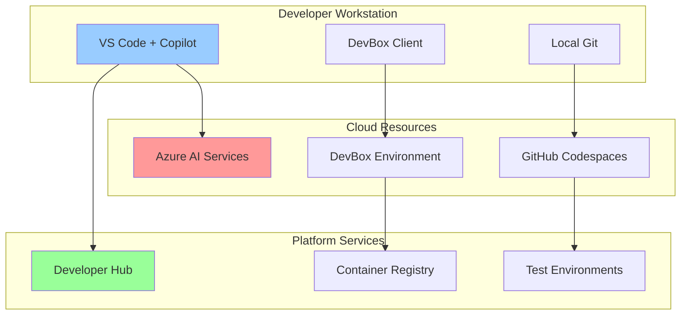

# 💻 Inner Loop Development Guide - AI-Powered Local Development

<div align="center">

**Accelerate Development with AI Assistance and Cloud-Powered Environments**

</div>

## 📋 Table of Contents

1. [Overview](#-overview)
2. [Development Environment Setup](#-development-environment-setup)
3. [GitHub Copilot Configuration](#-github-copilot-configuration)
4. [DevBox Environment](#-devbox-environment)
5. [Local Development with Codespaces](#-local-development-with-codespaces)
6. [AI-Assisted Coding Workflows](#-ai-assisted-coding-workflows)
7. [Testing and Debugging](#-testing-and-debugging)
8. [Integration with Developer Hub](#-integration-with-developer-hub)
9. [Performance Optimization](#-performance-optimization)
10. [Best Practices](#-best-practices)

## 🔍 Overview

The Inner Loop represents the rapid, iterative cycle of code-build-test that developers perform on their local machines. With Agentic DevOps, this loop is enhanced by AI assistance, cloud-powered environments, and automated tooling.

### Traditional vs Agentic Inner Loop

| Aspect | Traditional Development | Agentic Development |
|--------|------------------------|---------------------|
| **Environment Setup** | Manual, hours to configure | Automated, minutes with DevBox |
| **Code Writing** | Manual typing | AI-assisted with Copilot |
| **Testing** | Manual test creation | AI-generated test cases |
| **Debugging** | Manual investigation | AI-powered root cause analysis |
| **Documentation** | Written after coding | Generated inline with code |
| **Performance** | Local machine limited | Cloud-powered resources |

### Key Components



## 🛠️ Development Environment Setup

### 1. Prerequisites Installation

```bash
#!/bin/bash
# setup-dev-environment.sh

echo "🚀 Setting up Three Horizons Development Environment"

# Detect OS
OS="$(uname -s)"
case "${OS}" in
    Linux*)     OS_TYPE=Linux;;
    Darwin*)    OS_TYPE=Mac;;
    CYGWIN*|MINGW*|MSYS*) OS_TYPE=Windows;;
    *)          OS_TYPE="UNKNOWN:${OS}"
esac

echo "Detected OS: ${OS_TYPE}"

# Install core tools
install_core_tools() {
    echo "📦 Installing core development tools..."
    
    if [[ "$OS_TYPE" == "Mac" ]]; then
        # Install Homebrew if not present
        if ! command -v brew &> /dev/null; then
            /bin/bash -c "$(curl -fsSL https://raw.githubusercontent.com/Homebrew/install/HEAD/install.sh)"
        fi
        
        # Install tools via Homebrew
        brew install git gh azure-cli kubectl helm jq yq
        
    elif [[ "$OS_TYPE" == "Linux" ]]; then
        # Update package manager
        sudo apt-get update
        
        # Install tools
        sudo apt-get install -y git gh azure-cli kubectl helm jq
        
        # Install yq
        sudo wget -qO /usr/local/bin/yq https://github.com/mikefarah/yq/releases/latest/download/yq_linux_amd64
        sudo chmod +x /usr/local/bin/yq
        
    elif [[ "$OS_TYPE" == "Windows" ]]; then
        echo "Please use WSL2 or install tools via Chocolatey/Scoop"
        exit 1
    fi
}

# Install VS Code and extensions
install_vscode() {
    echo "💻 Installing VS Code and extensions..."
    
    # Install VS Code
    if [[ "$OS_TYPE" == "Mac" ]]; then
        brew install --cask visual-studio-code
    elif [[ "$OS_TYPE" == "Linux" ]]; then
        wget -q https://packages.microsoft.com/keys/microsoft.asc -O- | sudo apt-key add -
        sudo add-apt-repository "deb [arch=amd64] https://packages.microsoft.com/repos/vscode stable main"
        sudo apt-get update
        sudo apt-get install -y code
    fi
    
    # Install essential extensions
    code --install-extension GitHub.copilot
    code --install-extension GitHub.copilot-chat
    code --install-extension GitHub.copilot-labs
    code --install-extension ms-vscode-remote.remote-containers
    code --install-extension ms-vscode-remote.remote-ssh
    code --install-extension ms-azuretools.vscode-docker
    code --install-extension ms-kubernetes-tools.vscode-kubernetes-tools
    code --install-extension redhat.vscode-yaml
    code --install-extension hashicorp.terraform
    code --install-extension golang.go
    code --install-extension ms-python.python
    code --install-extension ms-vscode.azure-account
}

# Configure Git
configure_git() {
    echo "🔧 Configuring Git..."
    
    read -p "Enter your name: " git_name
    read -p "Enter your email: " git_email
    
    git config --global user.name "$git_name"
    git config --global user.email "$git_email"
    git config --global init.defaultBranch main
    git config --global pull.rebase false
    git config --global core.editor "code --wait"
    
    # Configure Git credential helper
    if [[ "$OS_TYPE" == "Mac" ]]; then
        git config --global credential.helper osxkeychain
    elif [[ "$OS_TYPE" == "Linux" ]]; then
        git config --global credential.helper store
    fi
}

# Main execution
install_core_tools
install_vscode
configure_git

echo "✅ Development environment setup complete!"
```

### 2. Platform Authentication

```bash
# authenticate-platform.sh

echo "🔐 Authenticating with Three Horizons Platform..."

# GitHub authentication
echo "📝 Authenticating with GitHub..."
gh auth login --web

# Azure authentication
echo "☁️ Authenticating with Azure..."
az login

# Set Azure subscription
az account set --subscription "$AZURE_SUBSCRIPTION_ID"

# Docker registry login
echo "🐳 Logging into container registry..."
ACR_NAME="acrthreehorizons${ENVIRONMENT}"
az acr login --name $ACR_NAME

# Kubernetes context
echo "☸️ Setting up Kubernetes access..."
az aks get-credentials \
    --resource-group "rg-threehorizons-${ENVIRONMENT}-compute" \
    --name "aks-threehorizons-${ENVIRONMENT}" \
    --overwrite-existing

# Verify connections
echo "✅ Verifying connections..."
gh auth status
az account show --query name -o tsv
kubectl cluster-info
docker info | grep Registry

echo "✅ Authentication complete!"
```

## 🤖 GitHub Copilot Configuration

### 1. Copilot Settings

```json
// .vscode/settings.json
{
  "github.copilot.enable": {
    "*": true,
    "yaml": true,
    "plaintext": true,
    "markdown": true,
    "dockerfile": true
  },
  "github.copilot.advanced": {
    "authProvider": "github",
    "debug.showScores": true,
    "inlineSuggest.enable": true,
    "length": "medium"
  },
  "github.copilot-labs.showBrushesLenses": true,
  "github.copilot.editor.enableAutoCompletions": true,
  
  // AI-specific settings
  "ai.temperature": 0.7,
  "ai.maxTokens": 2048,
  "ai.contextWindow": 8192,
  
  // Language-specific Copilot settings
  "[python]": {
    "github.copilot.inlineSuggest.enable": true
  },
  "[javascript]": {
    "github.copilot.inlineSuggest.enable": true
  },
  "[go]": {
    "github.copilot.inlineSuggest.enable": true
  }
}
```

### 2. Copilot Workspace Configuration

```yaml
# .github/copilot/config.yml
github:
  copilot:
    workspace:
      # Include patterns for context
      include:
        - "src/**"
        - "tests/**"
        - "docs/**/*.md"
        - "*.json"
        - "*.yaml"
        - "*.yml"
        - "Dockerfile*"
        
      # Exclude patterns
      exclude:
        - "node_modules/**"
        - "vendor/**"
        - "dist/**"
        - "build/**"
        - "*.min.js"
        - "*.lock"
        
    # Custom instructions
    instructions: |
      - Follow Three Horizons coding standards
      - Use TypeScript for frontend code
      - Use Go for backend services
      - Include comprehensive error handling
      - Add unit tests for all new functions
      - Use structured logging
      - Follow security best practices
      - Add OpenTelemetry instrumentation
      
    # Code patterns
    patterns:
      - name: "error-handling"
        description: "Consistent error handling pattern"
        template: |
          if err != nil {
              logger.Error("operation failed", 
                  zap.Error(err),
                  zap.String("operation", "{{ operation }}"))
              return fmt.Errorf("{{ operation }}: %w", err)
          }
```

### 3. AI-Powered Code Templates

```typescript
// .vscode/ai-templates/service-template.ts

// Copilot prompt: Create a new microservice with health checks, metrics, and tracing

import express from 'express';
import { Request, Response, NextFunction } from 'express';
import prometheus from 'prom-client';
import { trace, context, SpanStatusCode } from '@opentelemetry/api';
import { logger } from './utils/logger';
import { initTracing } from './utils/tracing';

// Initialize tracing
initTracing('{{ serviceName }}');

// Metrics
const httpDuration = new prometheus.Histogram({
  name: 'http_request_duration_seconds',
  help: 'Duration of HTTP requests in seconds',
  labelNames: ['method', 'route', 'status_code']
});

const httpRequests = new prometheus.Counter({
  name: 'http_requests_total',
  help: 'Total number of HTTP requests',
  labelNames: ['method', 'route', 'status_code']
});

// Middleware
const metricsMiddleware = (req: Request, res: Response, next: NextFunction) => {
  const start = Date.now();
  
  res.on('finish', () => {
    const duration = (Date.now() - start) / 1000;
    const labels = {
      method: req.method,
      route: req.route?.path || 'unknown',
      status_code: res.statusCode.toString()
    };
    
    httpDuration.observe(labels, duration);
    httpRequests.inc(labels);
  });
  
  next();
};

const tracingMiddleware = (req: Request, res: Response, next: NextFunction) => {
  const tracer = trace.getTracer('{{ serviceName }}');
  const span = tracer.startSpan(`${req.method} ${req.path}`);
  
  // Add span to context
  context.with(trace.setSpan(context.active(), span), () => {
    // Add attributes
    span.setAttributes({
      'http.method': req.method,
      'http.url': req.url,
      'http.target': req.path,
      'http.host': req.hostname,
      'http.scheme': req.protocol,
      'http.user_agent': req.get('user-agent') || ''
    });
    
    // Continue with request
    const originalSend = res.send;
    res.send = function(data: any) {
      span.setAttributes({
        'http.status_code': res.statusCode,
        'http.response_size': Buffer.byteLength(data)
      });
      
      if (res.statusCode >= 400) {
        span.setStatus({ code: SpanStatusCode.ERROR });
      }
      
      span.end();
      return originalSend.call(this, data);
    };
    
    next();
  });
};

// Create app
const app = express();

// Apply middleware
app.use(express.json());
app.use(metricsMiddleware);
app.use(tracingMiddleware);

// Health check endpoint
app.get('/health', (req: Request, res: Response) => {
  res.json({
    status: 'healthy',
    service: '{{ serviceName }}',
    version: process.env.VERSION || 'unknown',
    uptime: process.uptime()
  });
});

// Readiness check
app.get('/ready', async (req: Request, res: Response) => {
  try {
    // Check dependencies
    // TODO: Add dependency checks
    res.json({ status: 'ready' });
  } catch (error) {
    logger.error('Readiness check failed', { error });
    res.status(503).json({ status: 'not ready' });
  }
});

// Metrics endpoint
app.get('/metrics', (req: Request, res: Response) => {
  res.set('Content-Type', prometheus.register.contentType);
  res.end(prometheus.register.metrics());
});

// API routes
// TODO: Add your API routes here

// Error handling
app.use((err: Error, req: Request, res: Response, next: NextFunction) => {
  logger.error('Unhandled error', {
    error: err.message,
    stack: err.stack,
    path: req.path,
    method: req.method
  });
  
  res.status(500).json({
    error: 'Internal server error',
    message: process.env.NODE_ENV === 'development' ? err.message : undefined
  });
});

// Start server
const PORT = process.env.PORT || 8080;
app.listen(PORT, () => {
  logger.info(`Service started on port ${PORT}`);
});
```

## 🖥️ DevBox Environment

### 1. DevBox Configuration

```yaml
# devbox.yaml
name: threehorizons-devbox
description: Three Horizons AI Platform Development Environment

# Base image
image: mcr.microsoft.com/devcontainers/universal:2-linux

# Hardware specifications
compute:
  cpu: 4
  memory: 16GB
  storage: 256GB
  
# Network configuration
network:
  allowedPorts:
    - 3000  # Frontend
    - 8080  # Backend
    - 9090  # Prometheus
    - 3100  # Grafana
    - 5432  # PostgreSQL
    
# Pre-installed software
features:
  # Languages
  - go@1.21
  - node@18
  - python@3.11
  - java@17
  - dotnet@8.0
  
  # Tools
  - docker-in-docker
  - kubectl
  - helm
  - terraform
  - ansible
  - gh-cli
  - azure-cli
  
  # AI/ML tools
  - jupyter
  - tensorflow
  - pytorch
  
# Environment variables
environment:
  GITHUB_ORG: threehorizons-ai
  ENVIRONMENT: dev
  KUBECONFIG: /home/vscode/.kube/config
  
# Startup scripts
postCreateCommand: |
  # Configure kubectl
  az aks get-credentials \
    --resource-group rg-threehorizons-dev-compute \
    --name aks-threehorizons-dev \
    --overwrite-existing
    
  # Login to registries
  az acr login --name acrthreehorizonsdev
  
  # Clone repositories
  gh repo clone ${GITHUB_ORG}/platform-infrastructure ~/workspace/platform-infrastructure
  gh repo clone ${GITHUB_ORG}/application-templates ~/workspace/application-templates
  
  # Install additional tools
  go install github.com/golangci/golangci-lint/cmd/golangci-lint@latest
  npm install -g @backstage/cli
  
  # Setup Git
  git config --global user.email "developer@threehorizons.ai"
  git config --global user.name "Three Horizons Developer"

# VS Code extensions
customizations:
  vscode:
    extensions:
      - GitHub.copilot
      - GitHub.copilot-chat
      - ms-azuretools.vscode-docker
      - ms-kubernetes-tools.vscode-kubernetes-tools
      - hashicorp.terraform
      - redhat.vscode-yaml
      - golang.go
      - dbaeumer.vscode-eslint
      - esbenp.prettier-vscode
      - eamodio.gitlens
      - mhutchie.git-graph
      - usernamehw.errorlens
      - streetsidesoftware.code-spell-checker
      
    settings:
      terminal.integrated.defaultProfile.linux: zsh
      files.autoSave: afterDelay
      editor.formatOnSave: true
      editor.minimap.enabled: false
      workbench.startupEditor: readme
```

### 2. DevBox Provisioning Script

```bash
#!/bin/bash
# provision-devbox.sh

echo "🖥️ Provisioning DevBox Environment..."

# Create DevBox
az devcenter dev-box create \
  --name "devbox-${USER}" \
  --dev-center-name "dc-threehorizons" \
  --project-name "three-horizons-platform" \
  --dev-box-definition-name "threehorizons-devbox" \
  --resource-group "rg-threehorizons-dev-devbox"

# Wait for provisioning
echo "⏳ Waiting for DevBox to be ready..."
while true; do
  STATUS=$(az devcenter dev-box show \
    --name "devbox-${USER}" \
    --dev-center-name "dc-threehorizons" \
    --project-name "three-horizons-platform" \
    --query provisioningState -o tsv)
    
  if [[ "$STATUS" == "Succeeded" ]]; then
    break
  fi
  
  echo "Status: $STATUS"
  sleep 30
done

# Get connection details
CONNECTION_URL=$(az devcenter dev-box show \
  --name "devbox-${USER}" \
  --dev-center-name "dc-threehorizons" \
  --project-name "three-horizons-platform" \
  --query connectionUri -o tsv)

echo "✅ DevBox ready!"
echo "🔗 Connection URL: $CONNECTION_URL"
echo ""
echo "To connect:"
echo "1. Open browser: $CONNECTION_URL"
echo "2. Or use Remote Desktop client"
echo "3. Or connect via VS Code Remote SSH"
```

## 🚀 Local Development with Codespaces

### 1. Codespaces Configuration

```json
// .devcontainer/devcontainer.json
{
  "name": "Three Horizons Development",
  "image": "mcr.microsoft.com/devcontainers/universal:2-linux",
  
  "features": {
    "ghcr.io/devcontainers/features/docker-in-docker:2": {},
    "ghcr.io/devcontainers/features/kubectl-helm-minikube:1": {},
    "ghcr.io/devcontainers/features/go:1": {
      "version": "1.21"
    },
    "ghcr.io/devcontainers/features/node:1": {
      "version": "18"
    },
    "ghcr.io/devcontainers/features/python:1": {
      "version": "3.11"
    },
    "ghcr.io/devcontainers/features/azure-cli:1": {},
    "ghcr.io/devcontainers/features/github-cli:1": {}
  },
  
  "customizations": {
    "vscode": {
      "extensions": [
        "GitHub.copilot",
        "GitHub.copilot-chat",
        "ms-azuretools.vscode-docker",
        "ms-kubernetes-tools.vscode-kubernetes-tools",
        "golang.go",
        "dbaeumer.vscode-eslint",
        "esbenp.prettier-vscode"
      ],
      "settings": {
        "terminal.integrated.defaultProfile.linux": "zsh",
        "go.toolsManagement.checkForUpdates": "local",
        "go.useLanguageServer": true,
        "python.defaultInterpreterPath": "/usr/local/bin/python",
        "python.linting.enabled": true,
        "python.formatting.provider": "black"
      }
    }
  },
  
  "forwardPorts": [3000, 8080, 9090],
  
  "postCreateCommand": "bash .devcontainer/post-create.sh",
  
  "remoteUser": "vscode"
}
```

### 2. Codespaces Post-Create Script

```bash
#!/bin/bash
# .devcontainer/post-create.sh

echo "🚀 Setting up Codespaces environment..."

# Install additional tools
echo "📦 Installing additional tools..."
sudo apt-get update
sudo apt-get install -y jq httpie

# Install Go tools
echo "🔧 Installing Go development tools..."
go install golang.org/x/tools/gopls@latest
go install github.com/go-delve/delve/cmd/dlv@latest
go install github.com/golangci/golangci-lint/cmd/golangci-lint@latest

# Install Node tools
echo "📦 Installing Node development tools..."
npm install -g typescript ts-node nodemon jest

# Setup local Kubernetes
echo "☸️ Setting up local Kubernetes..."
minikube start --driver=docker --cpus=2 --memory=4096
minikube addons enable ingress
minikube addons enable metrics-server

# Clone sample applications
echo "📥 Cloning sample applications..."
git clone https://github.com/${GITHUB_ORG}/demo-frontend ~/workspace/demo-frontend
git clone https://github.com/${GITHUB_ORG}/demo-backend ~/workspace/demo-backend

# Create local development database
echo "🗄️ Setting up local database..."
docker run -d \
  --name postgres-dev \
  -e POSTGRES_PASSWORD=localdev \
  -e POSTGRES_DB=threehorizons \
  -p 5432:5432 \
  postgres:14

# Setup pre-commit hooks
echo "🔗 Setting up pre-commit hooks..."
pip install pre-commit
pre-commit install

# Create welcome message
cat > ~/WELCOME.md << 'EOF'
# 🚀 Welcome to Three Horizons Development Environment!

## Quick Start

1. **Start developing**: Open any project in ~/workspace
2. **Run tests**: `make test` in any project directory
3. **Access Kubernetes**: `kubectl get pods`
4. **View logs**: `stern <service-name>`

## Available Services

- PostgreSQL: localhost:5432 (user: postgres, pass: localdev)
- Minikube Dashboard: Run `minikube dashboard`

## Useful Commands

- `gh copilot suggest`: Get AI code suggestions
- `gh copilot explain`: Explain code
- `make dev`: Start development server
- `make test`: Run tests
- `make build`: Build application

Happy coding! 🎉
EOF

echo "✅ Codespaces setup complete!"
echo "📖 See ~/WELCOME.md for quick start guide"
```

## 🤖 AI-Assisted Coding Workflows

### 1. Test Generation with Copilot

```typescript
// Example: AI-assisted test generation
// test-generator.ts

import { CopilotTestGenerator } from '@github/copilot-sdk';

class AITestGenerator {
  private copilot: CopilotTestGenerator;

  constructor() {
    this.copilot = new CopilotTestGenerator({
      model: 'gpt-4',
      temperature: 0.3,
      maxTokens: 2048
    });
  }

  async generateUnitTests(sourceCode: string, language: string): Promise<string> {
    const prompt = `
Generate comprehensive unit tests for the following ${language} code.
Include:
- Happy path tests
- Edge cases
- Error scenarios
- Mock external dependencies
- Use appropriate testing framework (Jest for JS/TS, testing for Go, pytest for Python)

Source code:
\`\`\`${language}
${sourceCode}
\`\`\`
`;

    return await this.copilot.generate(prompt);
  }

  async generateIntegrationTests(apiSpec: string): Promise<string> {
    const prompt = `
Generate integration tests for the following API specification.
Include:
- Authentication tests
- CRUD operations
- Error handling
- Rate limiting tests
- Performance benchmarks

API Specification:
\`\`\`yaml
${apiSpec}
\`\`\`
`;

    return await this.copilot.generate(prompt);
  }

  async generateE2ETests(userStories: string[]): Promise<string> {
    const prompt = `
Generate end-to-end tests for the following user stories using Playwright.
Include:
- Page object models
- Test data setup
- Assertions for all acceptance criteria
- Cleanup steps

User Stories:
${userStories.map((story, i) => `${i + 1}. ${story}`).join('\n')}
`;

    return await this.copilot.generate(prompt);
  }
}

// Usage example
const testGen = new AITestGenerator();

// Generate tests for a service
const serviceCode = `
class OrderService {
  async createOrder(orderData: CreateOrderDTO): Promise<Order> {
    // Validate order data
    if (!orderData.items || orderData.items.length === 0) {
      throw new Error('Order must contain at least one item');
    }
    
    // Calculate total
    const total = orderData.items.reduce((sum, item) => {
      return sum + (item.price * item.quantity);
    }, 0);
    
    // Create order in database
    const order = await this.orderRepository.create({
      ...orderData,
      total,
      status: 'pending'
    });
    
    // Send confirmation email
    await this.emailService.sendOrderConfirmation(order);
    
    return order;
  }
}
`;

const tests = await testGen.generateUnitTests(serviceCode, 'typescript');
console.log(tests);
```

### 2. AI-Powered Code Review

```yaml
# .github/workflows/ai-code-review.yml
name: AI-Powered Code Review

on:
  pull_request:
    types: [opened, synchronize]

jobs:
  ai-review:
    runs-on: ubuntu-latest
    steps:
      - uses: actions/checkout@v4
        with:
          fetch-depth: 0
          
      - name: Setup Copilot CLI
        run: |
          gh extension install github/gh-copilot
          
      - name: Analyze Code Changes
        id: analyze
        run: |
          # Get changed files
          CHANGED_FILES=$(git diff --name-only ${{ github.event.pull_request.base.sha }}..${{ github.event.pull_request.head.sha }})
          
          # Analyze each file
          for file in $CHANGED_FILES; do
            echo "Analyzing $file..."
            
            # Get AI review
            gh copilot review $file > review_$file.md
            
            # Check for security issues
            gh copilot security-scan $file >> review_$file.md
            
            # Suggest improvements
            gh copilot suggest-improvements $file >> review_$file.md
          done
          
      - name: Post Review Comments
        uses: actions/github-script@v7
        with:
          script: |
            const fs = require('fs');
            const path = require('path');
            
            // Read all review files
            const reviewFiles = fs.readdirSync('.')
              .filter(f => f.startsWith('review_') && f.endsWith('.md'));
              
            for (const reviewFile of reviewFiles) {
              const content = fs.readFileSync(reviewFile, 'utf8');
              const filename = reviewFile.replace('review_', '').replace('.md', '');
              
              // Post review comment
              await github.rest.pulls.createReviewComment({
                owner: context.repo.owner,
                repo: context.repo.repo,
                pull_number: context.issue.number,
                body: content,
                path: filename,
                position: 1
              });
            }
```

### 3. Documentation Generation

```typescript
// doc-generator.ts
import { CopilotDocGenerator } from '@github/copilot-sdk';
import * as ts from 'typescript';
import * as fs from 'fs';

class AIDocumentationGenerator {
  private copilot: CopilotDocGenerator;

  constructor() {
    this.copilot = new CopilotDocGenerator({
      model: 'gpt-4',
      style: 'technical'
    });
  }

  async generateAPIDocumentation(sourceFile: string): Promise<string> {
    const sourceCode = fs.readFileSync(sourceFile, 'utf8');
    const sourceAST = ts.createSourceFile(
      sourceFile,
      sourceCode,
      ts.ScriptTarget.Latest,
      true
    );

    let apiDocs = '# API Documentation\n\n';

    // Walk through AST to find API endpoints
    ts.forEachChild(sourceAST, (node) => {
      if (ts.isMethodDeclaration(node) || ts.isFunctionDeclaration(node)) {
        const functionName = node.name?.getText() || 'anonymous';
        const parameters = node.parameters.map(p => p.getText()).join(', ');
        
        // Generate documentation using AI
        const docPrompt = `
Generate comprehensive API documentation for this function:

Function: ${functionName}
Parameters: ${parameters}
Implementation:
\`\`\`typescript
${node.getText()}
\`\`\`

Include:
- Description
- Parameters with types and descriptions
- Return value
- Example usage
- Error scenarios
- Rate limiting info if applicable
`;

        const doc = await this.copilot.generate(docPrompt);
        apiDocs += `## ${functionName}\n\n${doc}\n\n`;
      }
    });

    return apiDocs;
  }

  async generateArchitectureDoc(projectPath: string): Promise<string> {
    const prompt = `
Analyze the project structure and generate architecture documentation.

Project structure:
${this.getProjectStructure(projectPath)}

Include:
- System overview
- Component descriptions
- Data flow diagrams (Mermaid)
- Technology choices and rationale
- Deployment architecture
- Security considerations
`;

    return await this.copilot.generate(prompt);
  }

  private getProjectStructure(projectPath: string): string {
    // Recursively get project structure
    // Implementation details...
    return 'project structure here';
  }
}
```

## 🧪 Testing and Debugging

### 1. AI-Enhanced Debugging

```typescript
// ai-debugger.ts
import { CopilotDebugger } from '@github/copilot-sdk';

class AIDebugger {
  private debugger: CopilotDebugger;

  constructor() {
    this.debugger = new CopilotDebugger({
      model: 'gpt-4',
      contextWindow: 8192
    });
  }

  async analyzeError(error: Error, context: any): Promise<DebugAnalysis> {
    const prompt = `
Analyze this error and provide debugging guidance:

Error: ${error.message}
Stack trace:
${error.stack}

Context:
${JSON.stringify(context, null, 2)}

Provide:
1. Root cause analysis
2. Possible fixes with code examples
3. Prevention strategies
4. Related issues to check
`;

    const analysis = await this.debugger.analyze(prompt);
    
    return {
      rootCause: analysis.rootCause,
      fixes: analysis.fixes,
      preventionTips: analysis.prevention,
      relatedIssues: analysis.related
    };
  }

  async suggestBreakpoints(sourceCode: string, issue: string): Promise<Breakpoint[]> {
    const prompt = `
Given this code and issue, suggest optimal breakpoint locations:

Issue: ${issue}

Code:
\`\`\`typescript
${sourceCode}
\`\`\`

Return line numbers and reasons for each breakpoint.
`;

    return await this.debugger.suggestBreakpoints(prompt);
  }
}

// VS Code extension integration
export function activateAIDebugger(context: vscode.ExtensionContext) {
  const debugger = new AIDebugger();
  
  // Register debug command
  const disposable = vscode.commands.registerCommand('aiDebugger.analyze', async () => {
    const editor = vscode.window.activeTextEditor;
    if (!editor) return;
    
    // Get error from console or selection
    const selection = editor.document.getText(editor.selection);
    
    // Analyze with AI
    const analysis = await debugger.analyzeError(
      new Error(selection),
      {
        file: editor.document.fileName,
        line: editor.selection.start.line
      }
    );
    
    // Show analysis in panel
    const panel = vscode.window.createWebviewPanel(
      'aiDebugAnalysis',
      'AI Debug Analysis',
      vscode.ViewColumn.Two,
      {}
    );
    
    panel.webview.html = generateDebugHTML(analysis);
  });
  
  context.subscriptions.push(disposable);
}
```

### 2. Performance Profiling

```bash
#!/bin/bash
# profile-performance.sh

echo "🔍 Running AI-assisted performance profiling..."

# Start profiling
echo "📊 Starting CPU profiling..."
go test -cpuprofile=cpu.prof -memprofile=mem.prof -bench=.

# Analyze with pprof
echo "📈 Analyzing performance data..."
go tool pprof -http=:8080 cpu.prof &
PPROF_PID=$!

# AI analysis
echo "🤖 Running AI analysis..."
gh copilot analyze-performance \
  --cpu-profile cpu.prof \
  --mem-profile mem.prof \
  --suggest-optimizations > performance-report.md

# Generate flame graph
echo "🔥 Generating flame graph..."
go-torch -u http://localhost:8080 -p > flamegraph.svg

# Stop pprof server
kill $PPROF_PID

echo "✅ Performance analysis complete!"
echo "📊 Report: performance-report.md"
echo "🔥 Flame graph: flamegraph.svg"
```

## 🔗 Integration with Developer Hub

### 1. Local Development Portal

```yaml
# docker-compose.dev.yml
version: '3.8'

services:
  postgres:
    image: postgres:14
    environment:
      POSTGRES_DB: backstage
      POSTGRES_USER: backstage
      POSTGRES_PASSWORD: localdev
    ports:
      - "5432:5432"
    volumes:
      - postgres_data:/var/lib/postgresql/data

  developer-hub:
    image: registry.redhat.io/rhdh/rhdh-hub-rhel9:1.6-latest
    ports:
      - "7007:7007"
    environment:
      POSTGRES_HOST: postgres
      POSTGRES_PORT: 5432
      POSTGRES_USER: backstage
      POSTGRES_PASSWORD: localdev
      APP_CONFIG_app_baseUrl: http://localhost:3000
      APP_CONFIG_backend_baseUrl: http://localhost:7007
      APP_CONFIG_backend_cors_origin: http://localhost:3000
    volumes:
      - ./app-config.local.yaml:/app/app-config.local.yaml
    depends_on:
      - postgres

  frontend:
    build:
      context: ./packages/app
      target: dev
    ports:
      - "3000:3000"
    environment:
      BACKEND_URL: http://localhost:7007
    volumes:
      - ./packages/app:/app
      - /app/node_modules
    command: yarn dev

volumes:
  postgres_data:
```

### 2. Local Catalog Sync

```typescript
// local-catalog-sync.ts
import { CatalogClient } from '@backstage/catalog-client';
import { Config } from '@backstage/config';
import * as fs from 'fs';
import * as path from 'path';
import * as yaml from 'js-yaml';

class LocalCatalogSync {
  private catalogClient: CatalogClient;
  private config: Config;

  constructor(config: Config) {
    this.config = config;
    this.catalogClient = new CatalogClient({
      discoveryApi: {
        getBaseUrl: async () => 'http://localhost:7007/api/catalog'
      }
    });
  }

  async syncLocalServices(): Promise<void> {
    const workspacePath = process.env.WORKSPACE_PATH || '~/workspace';
    const services = await this.discoverServices(workspacePath);
    
    for (const service of services) {
      await this.registerService(service);
    }
  }

  private async discoverServices(workspacePath: string): Promise<ServiceInfo[]> {
    const services: ServiceInfo[] = [];
    const dirs = fs.readdirSync(workspacePath);
    
    for (const dir of dirs) {
      const catalogPath = path.join(workspacePath, dir, 'catalog-info.yaml');
      
      if (fs.existsSync(catalogPath)) {
        const catalogContent = fs.readFileSync(catalogPath, 'utf8');
        const catalog = yaml.load(catalogContent) as any;
        
        services.push({
          name: catalog.metadata.name,
          path: path.join(workspacePath, dir),
          catalog: catalog
        });
      }
    }
    
    return services;
  }

  private async registerService(service: ServiceInfo): Promise<void> {
    try {
      // Update catalog with local development info
      service.catalog.metadata.annotations = {
        ...service.catalog.metadata.annotations,
        'backstage.io/local-dev': 'true',
        'backstage.io/local-port': this.getLocalPort(service.name)
      };
      
      await this.catalogClient.addLocation({
        type: 'file',
        target: `file://${service.path}/catalog-info.yaml`
      });
      
      console.log(`✅ Registered ${service.name} in local catalog`);
    } catch (error) {
      console.error(`❌ Failed to register ${service.name}:`, error);
    }
  }

  private getLocalPort(serviceName: string): string {
    // Map service names to local ports
    const portMap: Record<string, string> = {
      'frontend': '3000',
      'api-gateway': '8080',
      'order-service': '8081',
      'inventory-service': '8082',
      'payment-service': '8083'
    };
    
    return portMap[serviceName] || '8080';
  }
}

// Run sync
const config = new Config([]);
const sync = new LocalCatalogSync(config);
sync.syncLocalServices().then(() => {
  console.log('✅ Local catalog sync complete');
});
```

## ⚡ Performance Optimization

### 1. Development Performance Monitoring

```typescript
// dev-performance-monitor.ts
import { performance, PerformanceObserver } from 'perf_hooks';
import * as os from 'os';

class DevPerformanceMonitor {
  private metrics: Map<string, number[]> = new Map();
  
  constructor() {
    this.setupObservers();
  }

  private setupObservers(): void {
    // Monitor build times
    const obs = new PerformanceObserver((items) => {
      items.getEntries().forEach((entry) => {
        this.recordMetric(entry.name, entry.duration);
      });
    });
    
    obs.observe({ entryTypes: ['measure'] });
  }

  startTimer(name: string): void {
    performance.mark(`${name}-start`);
  }

  endTimer(name: string): void {
    performance.mark(`${name}-end`);
    performance.measure(name, `${name}-start`, `${name}-end`);
  }

  recordMetric(name: string, value: number): void {
    if (!this.metrics.has(name)) {
      this.metrics.set(name, []);
    }
    this.metrics.get(name)!.push(value);
  }

  getReport(): DevelopmentMetrics {
    const report: DevelopmentMetrics = {
      timestamp: new Date().toISOString(),
      system: {
        cpu: os.cpus()[0].model,
        cores: os.cpus().length,
        memory: os.totalmem(),
        platform: os.platform()
      },
      metrics: {}
    };

    for (const [name, values] of this.metrics.entries()) {
      report.metrics[name] = {
        count: values.length,
        total: values.reduce((a, b) => a + b, 0),
        average: values.reduce((a, b) => a + b, 0) / values.length,
        min: Math.min(...values),
        max: Math.max(...values),
        p95: this.percentile(values, 0.95)
      };
    }

    return report;
  }

  private percentile(values: number[], p: number): number {
    const sorted = values.sort((a, b) => a - b);
    const index = Math.ceil(sorted.length * p) - 1;
    return sorted[index];
  }
}

// Usage in development tools
const monitor = new DevPerformanceMonitor();

// Monitor TypeScript compilation
monitor.startTimer('typescript-compile');
// ... compilation happens ...
monitor.endTimer('typescript-compile');

// Monitor test execution
monitor.startTimer('test-suite');
// ... tests run ...
monitor.endTimer('test-suite');

// Get performance report
const report = monitor.getReport();
console.log('Development Performance Report:', report);
```

### 2. Resource Optimization

```yaml
# .vscode/resource-optimization.yaml
development:
  # Language servers
  typescript:
    maxMemory: 2048
    maxOldSpaceSize: 2048
    
  gopls:
    GOGC: 100
    GOMEMLIMIT: 1GiB
    
  # Build tools
  webpack:
    cache:
      type: filesystem
      buildDependencies:
        config: [webpack.config.js]
    optimization:
      moduleIds: deterministic
      splitChunks:
        chunks: all
        cacheGroups:
          vendor:
            test: /[\\/]node_modules[\\/]/
            priority: 10
            
  # Docker
  docker:
    buildkit: true
    cache:
      - type=local,src=/tmp/.buildx-cache
      - type=registry,ref=acrthreehorizonsdev.azurecr.io/buildcache
      
  # Git
  git:
    core:
      preloadindex: true
      fscache: true
      autocrlf: input
    feature:
      manyFiles: true
    index:
      threads: true
```

## 📚 Best Practices

### 1. AI-Assisted Development Guidelines

```markdown
# AI-Assisted Development Best Practices

## 1. Effective Prompting

### DO:
- Be specific and provide context
- Include examples of desired output
- Specify constraints and requirements
- Review and validate AI suggestions

### DON'T:
- Accept AI code without review
- Share sensitive data in prompts
- Rely solely on AI for security-critical code
- Use AI-generated code without testing

## 2. Code Quality

### Before accepting AI suggestions:
1. **Review for correctness**: Does it solve the problem?
2. **Check security**: Are there any vulnerabilities?
3. **Verify performance**: Is it efficient?
4. **Ensure maintainability**: Is it readable and documented?
5. **Test thoroughly**: Does it handle edge cases?

## 3. Security Considerations

- Never include secrets in code or prompts
- Review AI suggestions for security vulnerabilities
- Use security scanning on all AI-generated code
- Follow the principle of least privilege

## 4. Performance Optimization

- Profile AI-generated code for bottlenecks
- Consider memory usage and computational complexity
- Optimize for your specific use case
- Benchmark against requirements

## 5. Documentation

- Document AI assistance in code comments
- Explain complex AI-generated algorithms
- Keep human-readable documentation updated
- Include examples and use cases
```

### 2. Development Workflow Automation

```bash
#!/bin/bash
# dev-workflow.sh

# Automated development workflow with AI assistance

# Function to create feature branch
create_feature() {
    local feature_name=$1
    
    echo "🌿 Creating feature branch: feature/$feature_name"
    git checkout -b "feature/$feature_name"
    
    # Create AI-assisted commit message template
    cat > .gitmessage << EOF
# <type>(<scope>): <subject>
#
# AI-Assisted Development Notes:
# - Copilot suggestions reviewed: [ ]
# - Security scan passed: [ ]
# - Tests added/updated: [ ]
# - Documentation updated: [ ]
#
# Why:
# 
# How:
# 
# Breaking changes:
# 
EOF
    
    git config commit.template .gitmessage
}

# Function to run pre-commit checks
pre_commit_checks() {
    echo "🔍 Running pre-commit checks..."
    
    # Lint code
    echo "📝 Linting code..."
    golangci-lint run ./...
    
    # Run tests
    echo "🧪 Running tests..."
    go test ./... -v
    
    # Security scan
    echo "🔒 Security scanning..."
    gosec ./...
    
    # Check for secrets
    echo "🔑 Checking for secrets..."
    trufflehog --regex --entropy=True .
    
    # Format code
    echo "🎨 Formatting code..."
    go fmt ./...
    
    echo "✅ All checks passed!"
}

# Function to create PR with AI assistance
create_pr() {
    local title=$1
    local body=$2
    
    # Generate PR description with AI
    PR_BODY=$(gh copilot suggest "
Create a pull request description for:
Title: $title
Changes: $(git diff --stat origin/main)
Include: summary, changes, testing, checklist
")
    
    # Create PR
    gh pr create \
        --title "$title" \
        --body "$PR_BODY" \
        --assignee "@me" \
        --label "needs-review"
}

# Main workflow
case "$1" in
    feature)
        create_feature "$2"
        ;;
    check)
        pre_commit_checks
        ;;
    pr)
        create_pr "$2" "$3"
        ;;
    *)
        echo "Usage: $0 {feature|check|pr} [args]"
        exit 1
        ;;
esac
```

## 📊 Metrics and Monitoring

### Development Metrics Dashboard

```typescript
// dev-metrics-dashboard.tsx
import React, { useState, useEffect } from 'react';
import { LineChart, Line, BarChart, Bar, PieChart, Pie, XAxis, YAxis, CartesianGrid, Tooltip, Legend } from 'recharts';

interface DevelopmentMetrics {
  buildTime: number[];
  testExecutionTime: number[];
  aiSuggestionAcceptance: number;
  codeQualityScore: number;
  securityIssues: number;
}

const DevelopmentDashboard: React.FC = () => {
  const [metrics, setMetrics] = useState<DevelopmentMetrics | null>(null);

  useEffect(() => {
    // Fetch metrics from local development environment
    fetchLocalMetrics();
    const interval = setInterval(fetchLocalMetrics, 30000); // Update every 30s
    return () => clearInterval(interval);
  }, []);

  const fetchLocalMetrics = async () => {
    try {
      const response = await fetch('http://localhost:9090/api/v1/query_range?query=dev_metrics');
      const data = await response.json();
      setMetrics(parseMetrics(data));
    } catch (error) {
      console.error('Failed to fetch metrics:', error);
    }
  };

  if (!metrics) return <div>Loading metrics...</div>;

  return (
    <div className="dashboard">
      <h1>🚀 Inner Loop Development Metrics</h1>
      
      <div className="metrics-grid">
        <div className="metric-card">
          <h3>Build Performance</h3>
          <LineChart width={400} height={200} data={metrics.buildTime}>
            <Line type="monotone" dataKey="time" stroke="#8884d8" />
            <XAxis dataKey="timestamp" />
            <YAxis />
            <Tooltip />
          </LineChart>
          <p>Avg: {average(metrics.buildTime)}s</p>
        </div>
        
        <div className="metric-card">
          <h3>AI Assistance Impact</h3>
          <div className="metric-value">
            {metrics.aiSuggestionAcceptance}%
          </div>
          <p>Suggestion Acceptance Rate</p>
        </div>
        
        <div className="metric-card">
          <h3>Code Quality</h3>
          <div className="quality-score" style={{
            color: metrics.codeQualityScore > 80 ? 'green' : 'orange'
          }}>
            {metrics.codeQualityScore}/100
          </div>
        </div>
        
        <div className="metric-card">
          <h3>Security Status</h3>
          <div className={`security-status ${metrics.securityIssues === 0 ? 'secure' : 'warning'}`}>
            {metrics.securityIssues === 0 ? '✅ Secure' : `⚠️ ${metrics.securityIssues} Issues`}
          </div>
        </div>
      </div>
    </div>
  );
};
```

## 🎯 Next Steps

### After Setting Up Inner Loop Development

1. **Configure your IDE**: Install all recommended extensions
2. **Set up GitHub Copilot**: Authenticate and configure settings
3. **Create a DevBox**: Provision your cloud development environment
4. **Clone repositories**: Get the platform code locally
5. **Run local services**: Start the development stack

### Continue Learning

- [Outer Loop Deployment Guide](guides/outer-loop-deployment.md)
- [AI-Assisted Testing Guide](ai-testing-guide.md)
- [Performance Optimization Guide](performance-guide.md)

---

<div align="center">

**Inner Loop Development Ready! 🎉**

Your AI-powered development environment is configured and ready for productive coding.

[← Back to Guides](../guides/) | [Next: Outer Loop Deployment →](guides/outer-loop-deployment.md)

</div>
