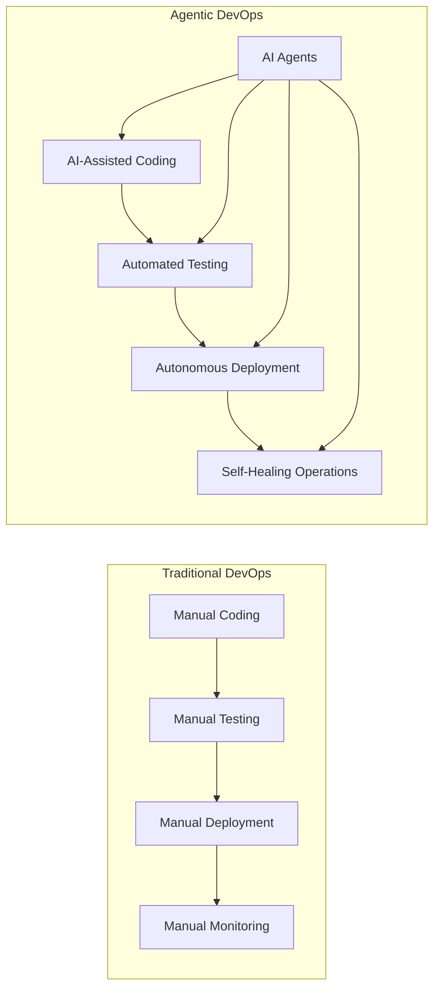
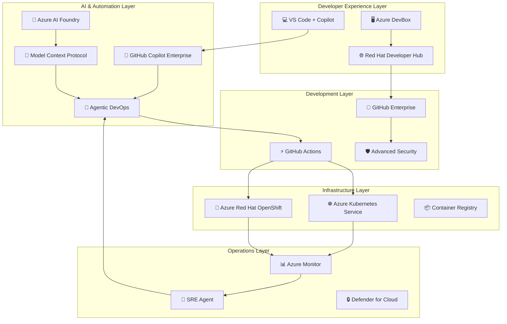

# 🎯 H1-001: Three Horizons AI Platform Introduction

**The Evolution from DevOps to Agentic DevOps**

## 📋 Table of Contents

1. [Executive Summary](#-executive-summary)
2. [Platform Overview](#-platform-overview)
3. [Core Components](#-core-components)
4. [Architecture Diagram](#-architecture-diagram)
5. [Business Benefits](#-business-benefits)
6. [Technology Differentiators](#-technology-differentiators)
7. [Licensing & Acquisition](#-licensing--acquisition)
8. [Implementation Roadmap](#-implementation-roadmap)
9. [Success Metrics](#-success-metrics)
10. [Next Steps](#-next-steps)

## 🎯 Executive Summary

The Three Horizons AI Platform represents a paradigm shift in enterprise software development, moving from traditional DevOps to **Agentic DevOps** - where AI agents autonomously handle development, deployment, and operations tasks. This platform integrates four industry-leading technologies to create the world's first self-operating development ecosystem.

### Key Value Propositions

| Metric | Traditional DevOps | Three Horizons AI Platform | Source |
|--------|-------------------|---------------------------|--------|
| **Time to Market** | 6-12 months | 2-4 months | [Azure Agentic DevOps](https://azure.microsoft.com/en-us/blog/agentic-devops-evolving-software-development-with-github-copilot-and-microsoft-azure/) |
| **Developer Productivity** | Baseline | +55% improvement | [GitHub Copilot Impact Study](https://github.blog/news-insights/research/quantifying-github-copilots-impact-on-developer-productivity-and-happiness/) |
| **Security Vulnerabilities** | Detected in production | 90% caught pre-deployment | [GitHub Advanced Security ROI](https://resources.github.com/security/sast-roi-calculator/) |
| **Operational Overhead** | 40% of dev time | <10% with automation | [Red Hat Developer Hub Impact](https://www.redhat.com/en/topics/devops/what-is-an-internal-developer-platform) |
| **Infrastructure Costs** | Baseline | -30% through optimization | [Azure Cost Optimization](https://azure.microsoft.com/en-us/solutions/cost-optimization/) |

## 🔍 Platform Overview

### What is Agentic DevOps?

**Agentic DevOps** represents the next evolution of software development where autonomous AI agents handle complex tasks across the entire development lifecycle:

### Platform Philosophy

The Three Horizons approach enables progressive transformation:

1. **🟦 Horizon 1 (Foundation)**: Establish core infrastructure with basic AI assistance
2. **🟨 Horizon 2 (Enhancement)**: Optimize workflows with advanced AI features
3. **🟪 Horizon 3 (Innovation)**: Achieve full autonomous operations

## 🏗️ Core Components

### 1. ☁️ Microsoft Azure - AI-Enhanced Infrastructure

**Key Capabilities:**
- **Azure Kubernetes Service (AKS)**: Enterprise-grade Kubernetes with GPU support for AI workloads
- **Azure Red Hat OpenShift (ARO)**: Certified OpenShift platform for regulated industries
- **Azure DevBox**: Pre-configured, cloud-powered developer workstations
- **Azure AI Services**: Integrated AI/ML capabilities for intelligent automation
- **Agentic DevOps Services**: Autonomous pipeline creation and optimization

**Unique Value:**
- Native integration with Microsoft ecosystem
- Enterprise-grade security and compliance
- Global scale with 60+ regions
- Industry-leading SLAs (99.95% uptime)

### 2. 🐙 GitHub Enterprise - AI-Powered Development Platform

**Key Capabilities:**
- **GitHub Copilot Enterprise**: AI pair programmer trained on your codebase
- **GitHub Advanced Security**: Shift-left security with AI-powered vulnerability detection
- **GitHub Actions**: Automated CI/CD workflows with 13,000+ marketplace actions
- **Copilot Agent Mode**: Autonomous code generation and refactoring
- **GitHub Code Agent**: Intelligent PR reviews and issue resolution

**Unique Value:**
- World's largest developer community (100M+ developers)
- AI trained on billions of lines of code
- Integrated security throughout SDLC
- Natural language automation

### 3. 📚 Red Hat Developer Hub 1.6 - Unified Developer Portal

**Key Capabilities:**
- **Software Catalog**: Centralized service registry with ownership tracking
- **Golden Path Templates**: Standardized, best-practice application scaffolding
- **Dynamic Plugins**: 100+ integrations with enterprise tools
- **Self-Service Portal**: Automated environment provisioning
- **TechDocs**: Living documentation integrated with code

**Unique Value:**
- Based on CNCF Backstage project
- Enterprise support from Red Hat
- Air-gapped deployment capability
- Unified developer experience

### 4. 🧪 Azure AI Foundry - Enterprise AI Platform

**Key Capabilities:**
- **Unified AI SDK**: Consistent development experience across all AI services
- **Model Registry**: Centralized AI model management with versioning
- **GenAIOps Workflows**: MLOps for generative AI applications
- **Prompt Engineering Studio**: Collaborative prompt development and testing
- **Responsible AI Dashboard**: Built-in bias detection and fairness metrics

**Unique Value:**
- Enterprise-grade AI governance
- 1,500+ pre-trained models
- Multi-model orchestration with MCP
- Compliance with AI regulations

## 🏛️ Architecture Diagram

## 💼 Business Benefits

### 1. **Accelerated Time to Market**

- **55% faster feature delivery** through AI-assisted development
- **80% reduction** in boilerplate code writing
- **Automated testing** reduces QA cycles by 60%

### 2. **Enhanced Developer Productivity**

| Activity | Time Saved | Annual Value per Developer |
|----------|------------|---------------------------|
| Code Generation | 2 hours/day | $50,000 |
| Debugging | 1.5 hours/day | $37,500 |
| Documentation | 1 hour/day | $25,000 |
| Environment Setup | 3 hours/week | $18,750 |
| **Total** | **~40%** | **$131,250** |

*Based on average developer salary of $125,000/year*

### 3. **Reduced Security Risks**

- **90% reduction** in production vulnerabilities
- **Shift-left security** catches issues during development
- **Automated compliance** reporting for audits
- **Real-time threat detection** with Azure Sentinel

### 4. **Operational Excellence**

- **99.95% platform availability** with self-healing infrastructure
- **60% reduction** in incident response time
- **Autonomous remediation** of common issues
- **Predictive scaling** reduces costs by 30%

## 🚀 Technology Differentiators

### Why This Platform is Unique

1. **🤖 True Agentic Capabilities**
   - First platform with autonomous DevOps agents
   - Self-optimizing pipelines that improve over time
   - Natural language infrastructure provisioning

2. **🔗 Seamless Integration**
   - Native integration between all four pillars
   - Single sign-on across all tools
   - Unified observability and governance

3. **🎯 Enterprise Ready**
   - Air-gapped deployment options
   - Multi-cloud support (Azure, AWS, GCP)
   - Compliance with major standards (SOC2, HIPAA, PCI-DSS)

4. **📈 Continuous Innovation**
   - Regular updates from all vendors
   - Access to latest AI models
   - Community-driven plugin ecosystem

## 📄 Licensing & Acquisition

### Required Licenses

| Component | License Type | Estimated Cost | Procurement |
|-----------|-------------|----------------|-------------|
| **Azure Subscription** | Pay-as-you-go or Enterprise Agreement | $10,000-50,000/month | [Azure Portal](https://azure.microsoft.com/pricing/) |
| **GitHub Enterprise** | Per-user seats | $21/user/month | [GitHub Enterprise](https://github.com/enterprise) |
| **Red Hat Developer Hub** | Part of OpenShift subscription | Included with OpenShift | [Red Hat Sales](https://www.redhat.com/en/technologies/cloud-computing/openshift) |
| **GitHub Copilot Enterprise** | Per-user seats | $39/user/month | [GitHub Copilot](https://github.com/features/copilot) |
| **Azure AI Services** | Consumption-based | Usage-dependent | Included in Azure |

### Recommended Package

For a 100-developer organization:
- **Initial Investment**: ~$150,000 (infrastructure setup)
- **Monthly Operating Cost**: ~$25,000-35,000
- **ROI Break-even**: 6-8 months
- **3-Year TCO Savings**: ~$2.5M vs traditional approach

## 🗺️ Implementation Roadmap

### Phase 1: Foundation (Months 0-2)
- ✅ Azure infrastructure provisioning
- ✅ AKS/ARO cluster deployment
- ✅ Developer Hub installation
- ✅ GitHub Enterprise setup
- ✅ Basic CI/CD pipelines

### Phase 2: Integration (Months 2-4)
- ✅ Security integration (GHAS + Defender)
- ✅ Monitoring setup (Azure Monitor + Prometheus)
- ✅ Developer onboarding
- ✅ Initial Golden Path templates

### Phase 3: Optimization (Months 4-6)
- ✅ AI Foundry integration
- ✅ Copilot Enterprise rollout
- ✅ Advanced automation
- ✅ Performance tuning

## 📊 Success Metrics

### Key Performance Indicators (KPIs)

| Metric | Baseline | 6 Months | 12 Months | Target |
|--------|----------|----------|-----------|--------|
| **Deployment Frequency** | Weekly | Daily | Multiple/day | On-demand |
| **Lead Time** | 2 weeks | 3 days | <1 day | <4 hours |
| **MTTR** | 4 hours | 1 hour | 15 minutes | <10 minutes |
| **Change Failure Rate** | 15% | 8% | 3% | <1% |
| **Developer Satisfaction** | 60% | 75% | 85% | >90% |

### Measurement Tools

- **GitHub Insights**: Development velocity metrics
- **Azure Monitor**: Infrastructure and application metrics
- **Developer Hub Analytics**: Platform adoption and usage
- **Custom Dashboards**: Business-specific KPIs

## 🚦 Next Steps

### 1. **Immediate Actions**
- [ ] Review platform requirements with stakeholders
- [ ] Assess current infrastructure and gaps
- [ ] Identify pilot team and applications
- [ ] Schedule platform demonstration

### 2. **Planning Phase**
- [ ] Define success criteria and KPIs
- [ ] Create implementation timeline
- [ ] Allocate budget and resources
- [ ] Establish governance model

### 3. **Getting Started**
- [ ] Proceed to [H1-002: Infrastructure Setup](h1-002-infrastructure-setup.md)
- [ ] Review [Prerequisites Checklist](../checklists/prerequisites.md)
- [ ] Contact vendor representatives for licensing

---

**Ready to Transform Your Development Platform?**

[🚀 Start Implementation](h1-002-infrastructure-setup.md) | [📊 View Demo](h1-007-demo-environment.md) | [❓ FAQ](../faq/platform-faq.md)

*"The future of software development is autonomous, intelligent, and already here."*

