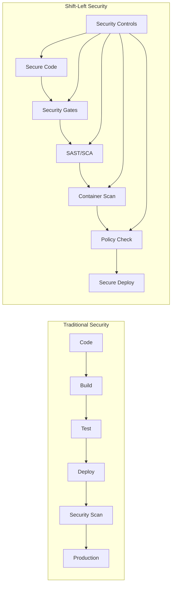

# 🔐 H1-003: Security Foundation - Implementing Shift-Left Security

<div align="center">


**Building Enterprise-Grade Security from Day One**

</div>

## 📋 Table of Contents

1. [Security Architecture Overview](#-security-architecture-overview)
2. [Azure AD Integration](#-azure-ad-integration)
3. [Role-Based Access Control (RBAC)](#-role-based-access-control-rbac)
4. [GitHub Advanced Security Setup](#-github-advanced-security-setup)
5. [Azure Defender Configuration](#-azure-defender-configuration)
6. [Key Vault Implementation](#-key-vault-implementation)
7. [Network Security](#-network-security)
8. [Compliance & Auditing](#-compliance--auditing)
9. [Security Automation](#-security-automation)
10. [Validation & Testing](#-validation--testing)

## 🏗️ Security Architecture Overview

### Shift-Left Security Principles



### Security Layers

| Layer | Components | Purpose |
|-------|------------|---------|
| **Identity** | Azure AD, Managed Identities | Authentication & Authorization |
| **Network** | NSGs, Private Endpoints, Firewall | Network isolation & traffic control |
| **Application** | GHAS, Code scanning, Secrets | Code & dependency security |
| **Data** | Encryption, Key Vault, Backup | Data protection at rest & in transit |
| **Operations** | Defender, Sentinel, Monitor | Threat detection & response |
| **Compliance** | Policies, Auditing, RBAC | Governance & compliance |

## 🆔 Azure AD Integration

### 1. Configure Azure AD Tenant

```bash
# Set variables
TENANT_ID=$(az account show --query tenantId -o tsv)
SUBSCRIPTION_ID=$(az account show --query id -o tsv)

# Create security groups
# Platform Administrators
az ad group create \
  --display-name "ThreeHorizons-Platform-Admins" \
  --mail-nickname "th-platform-admins" \
  --description "Platform administrators with full access"

# Developers
az ad group create \
  --display-name "ThreeHorizons-Developers" \
  --mail-nickname "th-developers" \
  --description "Development team with limited production access"

# SRE Team
az ad group create \
  --display-name "ThreeHorizons-SRE" \
  --mail-nickname "th-sre" \
  --description "Site Reliability Engineers with operational access"

# Auditors
az ad group create \
  --display-name "ThreeHorizons-Auditors" \
  --mail-nickname "th-auditors" \
  --description "Read-only access for compliance and auditing"
```

### 2. Create Service Principals

```bash
# Service Principal for AKS
az ad sp create-for-rbac \
  --name "sp-threehorizons-aks-${ENVIRONMENT}" \
  --role "Contributor" \
  --scopes "/subscriptions/${SUBSCRIPTION_ID}/resourceGroups/rg-${BASE_NAME}-${ENVIRONMENT}-compute" \
  --years 2 > sp-aks-credentials.json

# Service Principal for GitHub Actions
az ad sp create-for-rbac \
  --name "sp-threehorizons-github-${ENVIRONMENT}" \
  --role "Contributor" \
  --scopes "/subscriptions/${SUBSCRIPTION_ID}" \
  --years 2 > sp-github-credentials.json

# Service Principal for Developer Hub
az ad sp create-for-rbac \
  --name "sp-threehorizons-devhub-${ENVIRONMENT}" \
  --role "Reader" \
  --scopes "/subscriptions/${SUBSCRIPTION_ID}" \
  --years 2 > sp-devhub-credentials.json

# Store credentials securely
echo "⚠️  IMPORTANT: Store these credentials in a secure location and delete the JSON files!"
```

### 3. Configure Conditional Access

```bash
# Create Conditional Access Policy (requires Azure AD Premium)
cat <<EOF > conditional-access-policy.json
{
  "displayName": "Three Horizons Platform Access",
  "state": "enabled",
  "conditions": {
    "users": {
      "includeGroups": ["ThreeHorizons-Platform-Admins", "ThreeHorizons-Developers"]
    },
    "applications": {
      "includeApplications": ["All"]
    },
    "locations": {
      "includeLocations": ["All"],
      "excludeLocations": ["AllTrusted"]
    }
  },
  "grantControls": {
    "operator": "OR",
    "builtInControls": ["mfa", "compliantDevice"]
  }
}
EOF

# Note: Apply via Azure Portal > Azure AD > Security > Conditional Access
```

## 🎭 Role-Based Access Control (RBAC)

### 1. Custom Role Definitions

```bash
# Developer Role - Limited Production Access
cat <<EOF > developer-role.json
{
  "Name": "Three Horizons Developer",
  "Description": "Developer access with restricted production permissions",
  "Actions": [
    "Microsoft.ContainerService/managedClusters/read",
    "Microsoft.ContainerService/managedClusters/listClusterUserCredential/action",
    "Microsoft.ContainerRegistry/registries/pull/read",
    "Microsoft.ContainerRegistry/registries/push/write",
    "Microsoft.KeyVault/vaults/secrets/read",
    "Microsoft.Resources/subscriptions/resourceGroups/read",
    "Microsoft.Resources/deployments/read",
    "Microsoft.Monitor/metrics/read",
    "Microsoft.Monitor/logdefinitions/read"
  ],
  "NotActions": [
    "Microsoft.ContainerService/managedClusters/delete",
    "Microsoft.ContainerService/managedClusters/write",
    "Microsoft.KeyVault/vaults/secrets/write",
    "Microsoft.Authorization/*/Delete",
    "Microsoft.Authorization/*/Write"
  ],
  "AssignableScopes": [
    "/subscriptions/${SUBSCRIPTION_ID}"
  ]
}
EOF

# Create custom role
az role definition create --role-definition developer-role.json

# SRE Role - Operational Access
cat <<EOF > sre-role.json
{
  "Name": "Three Horizons SRE",
  "Description": "SRE access for operational management",
  "Actions": [
    "Microsoft.ContainerService/managedClusters/*",
    "Microsoft.ContainerRegistry/registries/*",
    "Microsoft.KeyVault/vaults/*",
    "Microsoft.Resources/*",
    "Microsoft.Monitor/*",
    "Microsoft.AlertsManagement/*",
    "Microsoft.Insights/*",
    "Microsoft.OperationalInsights/*"
  ],
  "NotActions": [
    "Microsoft.Authorization/*/Delete",
    "Microsoft.Authorization/elevateAccess/Action"
  ],
  "AssignableScopes": [
    "/subscriptions/${SUBSCRIPTION_ID}"
  ]
}
EOF

# Create SRE role
az role definition create --role-definition sre-role.json
```

### 2. Assign Roles to Groups

```bash
# Get group object IDs
ADMIN_GROUP_ID=$(az ad group show --group "ThreeHorizons-Platform-Admins" --query id -o tsv)
DEV_GROUP_ID=$(az ad group show --group "ThreeHorizons-Developers" --query id -o tsv)
SRE_GROUP_ID=$(az ad group show --group "ThreeHorizons-SRE" --query id -o tsv)
AUDIT_GROUP_ID=$(az ad group show --group "ThreeHorizons-Auditors" --query id -o tsv)

# Assign roles at subscription level
# Admins - Owner
az role assignment create \
  --assignee $ADMIN_GROUP_ID \
  --role "Owner" \
  --scope "/subscriptions/${SUBSCRIPTION_ID}"

# Developers - Custom Developer Role
az role assignment create \
  --assignee $DEV_GROUP_ID \
  --role "Three Horizons Developer" \
  --scope "/subscriptions/${SUBSCRIPTION_ID}"

# SRE - Custom SRE Role
az role assignment create \
  --assignee $SRE_GROUP_ID \
  --role "Three Horizons SRE" \
  --scope "/subscriptions/${SUBSCRIPTION_ID}"

# Auditors - Reader
az role assignment create \
  --assignee $AUDIT_GROUP_ID \
  --role "Reader" \
  --scope "/subscriptions/${SUBSCRIPTION_ID}"
```

### 3. Kubernetes RBAC

```yaml
# k8s-rbac.yaml
---
# Developer ClusterRole
apiVersion: rbac.authorization.k8s.io/v1
kind: ClusterRole
metadata:
  name: three-horizons-developer
rules:
- apiGroups: [""]
  resources: ["pods", "services", "configmaps"]
  verbs: ["get", "list", "watch"]
- apiGroups: ["apps"]
  resources: ["deployments", "replicasets"]
  verbs: ["get", "list", "watch"]
- apiGroups: [""]
  resources: ["pods/log", "pods/exec"]
  verbs: ["get", "list"]
- apiGroups: [""]
  resources: ["namespaces"]
  verbs: ["get", "list"]
  resourceNames: ["three-horizons-dev", "three-horizons-staging"]

---
# SRE ClusterRole
apiVersion: rbac.authorization.k8s.io/v1
kind: ClusterRole
metadata:
  name: three-horizons-sre
rules:
- apiGroups: ["*"]
  resources: ["*"]
  verbs: ["*"]
- nonResourceURLs: ["*"]
  verbs: ["*"]

---
# Developer RoleBinding
apiVersion: rbac.authorization.k8s.io/v1
kind: ClusterRoleBinding
metadata:
  name: three-horizons-developer-binding
roleRef:
  apiGroup: rbac.authorization.k8s.io
  kind: ClusterRole
  name: three-horizons-developer
subjects:
- kind: Group
  name: "ThreeHorizons-Developers"
  apiGroup: rbac.authorization.k8s.io

---
# SRE RoleBinding
apiVersion: rbac.authorization.k8s.io/v1
kind: ClusterRoleBinding
metadata:
  name: three-horizons-sre-binding
roleRef:
  apiGroup: rbac.authorization.k8s.io
  kind: ClusterRole
  name: three-horizons-sre
subjects:
- kind: Group
  name: "ThreeHorizons-SRE"
  apiGroup: rbac.authorization.k8s.io
```

Apply Kubernetes RBAC:
```bash
kubectl apply -f k8s-rbac.yaml
```

## 🛡️ GitHub Advanced Security Setup

### 1. Enable GHAS Features

```bash
# Using GitHub CLI (requires gh auth login first)
gh auth login

# Enable security features for organization
gh api -X PATCH /orgs/${GITHUB_ORG} \
  -F advanced_security_enabled=true \
  -F dependency_graph_enabled=true \
  -F dependabot_alerts_enabled=true \
  -F dependabot_security_updates_enabled=true

# Configure for each repository
for repo in platform-infrastructure developer-hub-config application-templates; do
  gh api -X PATCH /repos/${GITHUB_ORG}/${repo} \
    -F security_and_analysis='{"secret_scanning":{"status":"enabled"},"secret_scanning_push_protection":{"status":"enabled"},"advanced_security":{"status":"enabled"}}'
done
```

### 2. Configure Security Policies

```yaml
# .github/security-policy.yml
name: Security Policy
security:
  # Code scanning
  code_scanning:
    languages: ['javascript', 'typescript', 'python', 'go', 'java']
    queries: ['security-extended', 'security-and-quality']
    schedule: '0 0 * * *'  # Daily at midnight
    
  # Secret scanning
  secret_scanning:
    custom_patterns:
      - name: Azure Storage Key
        pattern: 'DefaultEndpointsProtocol=https;AccountName=\w+;AccountKey=[A-Za-z0-9+/=]{88}'
      - name: Azure Service Principal
        pattern: '"clientSecret":\s*"[a-zA-Z0-9_\-\.~]{34}"'
    
  # Dependency scanning
  dependency_review:
    fail_on_severity: 'high'
    allow_licenses: ['MIT', 'Apache-2.0', 'BSD-3-Clause']
    deny_licenses: ['GPL-3.0', 'AGPL-3.0']
```

### 3. Security Workflows

```yaml
# .github/workflows/security.yml
name: Security Checks

on:
  push:
    branches: [main, develop]
  pull_request:
    branches: [main]
  schedule:
    - cron: '0 0 * * *'

jobs:
  # Code scanning with CodeQL
  codeql:
    runs-on: ubuntu-latest
    permissions:
      actions: read
      contents: read
      security-events: write
    steps:
    - uses: actions/checkout@v4
    
    - name: Initialize CodeQL
      uses: github/codeql-action/init@v3
      with:
        languages: javascript,python,go
        queries: security-extended
    
    - name: Perform CodeQL Analysis
      uses: github/codeql-action/analyze@v3
  
  # Container scanning
  container-scan:
    runs-on: ubuntu-latest
    steps:
    - uses: actions/checkout@v4
    
    - name: Run Trivy scanner
      uses: aquasecurity/trivy-action@master
      with:
        image-ref: '${{ env.REGISTRY }}/${{ env.IMAGE_NAME }}:${{ github.sha }}'
        format: 'sarif'
        output: 'trivy-results.sarif'
    
    - name: Upload Trivy results
      uses: github/codeql-action/upload-sarif@v3
      with:
        sarif_file: 'trivy-results.sarif'
  
  # License compliance
  license-check:
    runs-on: ubuntu-latest
    steps:
    - uses: actions/checkout@v4
    
    - name: License Scan
      uses: fossas/fossa-action@main
      with:
        api-key: ${{ secrets.FOSSA_API_KEY }}
```

### 4. Branch Protection Rules

```bash
# Configure branch protection
gh api -X PUT /repos/${GITHUB_ORG}/${REPO}/branches/main/protection \
  -F required_status_checks='{"strict":true,"contexts":["codeql","container-scan","license-check"]}' \
  -F enforce_admins=true \
  -F required_pull_request_reviews='{"required_approving_review_count":2,"dismiss_stale_reviews":true,"require_code_owner_reviews":true}' \
  -F restrictions='{"users":[],"teams":["platform-admins"]}' \
  -F allow_force_pushes=false \
  -F allow_deletions=false \
  -F required_conversation_resolution=true
```

## 🔐 Azure Defender Configuration

### 1. Enable Defender for Cloud

```bash
# Enable Defender plans
az security pricing create -n VirtualMachines --tier 'Standard'
az security pricing create -n SqlServers --tier 'Standard'
az security pricing create -n AppServices --tier 'Standard'
az security pricing create -n StorageAccounts --tier 'Standard'
az security pricing create -n ContainerRegistry --tier 'Standard'
az security pricing create -n KubernetesService --tier 'Standard'
az security pricing create -n KeyVaults --tier 'Standard'

# Configure security contacts
az security contact create \
  --email "security@threehorizon.ai" \
  --phone "+1-555-0123" \
  --alert-notifications "On" \
  --alerts-to-admins "On"
```

### 2. Configure Security Policies

```bash
# Create custom security initiative
cat <<EOF > security-initiative.json
{
  "properties": {
    "displayName": "Three Horizons Security Standards",
    "description": "Security standards for Three Horizons AI Platform",
    "metadata": {
      "category": "Security Center"
    },
    "policyDefinitions": [
      {
        "policyDefinitionId": "/providers/Microsoft.Authorization/policyDefinitions/a8eff44f-8c92-45c3-a3fb-9880802d67a7",
        "parameters": {}
      },
      {
        "policyDefinitionId": "/providers/Microsoft.Authorization/policyDefinitions/32133ab0-ee4b-4b44-98d6-042180979d50",
        "parameters": {}
      }
    ]
  }
}
EOF

# Assign security initiative
az policy set-definition create \
  --name "ThreeHorizonsSecurityInitiative" \
  --display-name "Three Horizons Security Standards" \
  --description "Comprehensive security standards for the platform" \
  --definitions security-initiative.json
```

### 3. Configure Continuous Export

```bash
# Create Event Hub for security alerts
az eventhubs namespace create \
  --name "eh-${BASE_NAME}-security" \
  --resource-group "rg-${BASE_NAME}-${ENVIRONMENT}-infra" \
  --location $LOCATION \
  --sku Standard

az eventhubs eventhub create \
  --name "security-alerts" \
  --namespace-name "eh-${BASE_NAME}-security" \
  --resource-group "rg-${BASE_NAME}-${ENVIRONMENT}-infra" \
  --partition-count 2 \
  --message-retention 7

# Configure continuous export
az security automation create \
  --name "export-security-alerts" \
  --resource-group "rg-${BASE_NAME}-${ENVIRONMENT}-infra" \
  --location $LOCATION \
  --scopes "/subscriptions/${SUBSCRIPTION_ID}" \
  --sources "Alerts" \
  --event-hub-resource-id "/subscriptions/${SUBSCRIPTION_ID}/resourceGroups/rg-${BASE_NAME}-${ENVIRONMENT}-infra/providers/Microsoft.EventHub/namespaces/eh-${BASE_NAME}-security/eventhubs/security-alerts"
```

## 🔑 Key Vault Implementation

### 1. Create and Configure Key Vault

```bash
# Create Key Vault
az keyvault create \
  --name "kv-${BASE_NAME}-${ENVIRONMENT}" \
  --resource-group "rg-${BASE_NAME}-${ENVIRONMENT}-infra" \
  --location $LOCATION \
  --sku premium \
  --enable-rbac-authorization true \
  --enabled-for-deployment true \
  --enabled-for-disk-encryption true \
  --enabled-for-template-deployment true \
  --enable-soft-delete true \
  --retention-days 90 \
  --enable-purge-protection true \
  --network-acls-default-action Deny \
  --public-network-access Enabled

# Configure network access
KEYVAULT_NAME="kv-${BASE_NAME}-${ENVIRONMENT}"

# Allow access from AKS subnet
az keyvault network-rule add \
  --name $KEYVAULT_NAME \
  --resource-group "rg-${BASE_NAME}-${ENVIRONMENT}-infra" \
  --subnet $SUBNET_AKS_ID

# Allow access from trusted Azure services
az keyvault update \
  --name $KEYVAULT_NAME \
  --resource-group "rg-${BASE_NAME}-${ENVIRONMENT}-infra" \
  --bypass AzureServices
```

### 2. Store Platform Secrets

```bash
# GitHub Integration Secrets
az keyvault secret set \
  --vault-name $KEYVAULT_NAME \
  --name "github-token" \
  --value "$GITHUB_TOKEN" \
  --content-type "GitHub Personal Access Token"

az keyvault secret set \
  --vault-name $KEYVAULT_NAME \
  --name "github-webhook-secret" \
  --value "$(openssl rand -hex 32)" \
  --content-type "GitHub Webhook Secret"

# Database Credentials
az keyvault secret set \
  --vault-name $KEYVAULT_NAME \
  --name "postgres-admin-password" \
  --value "$(openssl rand -base64 32)" \
  --content-type "PostgreSQL Admin Password"

# Container Registry Credentials
ACR_PASSWORD=$(az acr credential show \
  --name "acr${BASE_NAME}${ENVIRONMENT}" \
  --query "passwords[0].value" -o tsv)

az keyvault secret set \
  --vault-name $KEYVAULT_NAME \
  --name "acr-password" \
  --value "$ACR_PASSWORD" \
  --content-type "ACR Admin Password"

# SSL Certificates
az keyvault certificate create \
  --vault-name $KEYVAULT_NAME \
  --name "wildcard-cert" \
  --policy "$(az keyvault certificate get-default-policy)"
```

### 3. Configure AKS Key Vault Integration

```yaml
# secrets-provider-class.yaml
apiVersion: secrets-store.csi.x-k8s.io/v1
kind: SecretProviderClass
metadata:
  name: azure-keyvault-secrets
  namespace: three-horizons-dev
spec:
  provider: azure
  parameters:
    usePodIdentity: "false"
    useVMManagedIdentity: "true"
    userAssignedIdentityID: "${CLIENT_ID}"
    keyvaultName: "${KEYVAULT_NAME}"
    cloudName: "AzurePublicCloud"
    objects: |
      array:
        - |
          objectName: github-token
          objectType: secret
          objectAlias: GITHUB_TOKEN
        - |
          objectName: postgres-admin-password
          objectType: secret
          objectAlias: DB_PASSWORD
        - |
          objectName: acr-password
          objectType: secret
          objectAlias: REGISTRY_PASSWORD
    tenantId: "${TENANT_ID}"
```

Apply configuration:
```bash
kubectl apply -f secrets-provider-class.yaml
```

## 🌐 Network Security

### 1. Network Security Groups (NSGs)

```bash
# Create NSG rules for AKS
# Allow HTTPS inbound
az network nsg rule create \
  --resource-group "rg-${BASE_NAME}-${ENVIRONMENT}-infra" \
  --nsg-name "nsg-${BASE_NAME}-${ENVIRONMENT}-aks" \
  --name "AllowHTTPS" \
  --priority 100 \
  --access Allow \
  --protocol Tcp \
  --direction Inbound \
  --source-address-prefixes "Internet" \
  --source-port-ranges "*" \
  --destination-address-prefixes "VirtualNetwork" \
  --destination-port-ranges 443

# Allow internal communication
az network nsg rule create \
  --resource-group "rg-${BASE_NAME}-${ENVIRONMENT}-infra" \
  --nsg-name "nsg-${BASE_NAME}-${ENVIRONMENT}-aks" \
  --name "AllowVnetInBound" \
  --priority 200 \
  --access Allow \
  --protocol "*" \
  --direction Inbound \
  --source-address-prefixes "VirtualNetwork" \
  --source-port-ranges "*" \
  --destination-address-prefixes "VirtualNetwork" \
  --destination-port-ranges "*"

# Deny all other inbound
az network nsg rule create \
  --resource-group "rg-${BASE_NAME}-${ENVIRONMENT}-infra" \
  --nsg-name "nsg-${BASE_NAME}-${ENVIRONMENT}-aks" \
  --name "DenyAllInBound" \
  --priority 4096 \
  --access Deny \
  --protocol "*" \
  --direction Inbound \
  --source-address-prefixes "*" \
  --source-port-ranges "*" \
  --destination-address-prefixes "*" \
  --destination-port-ranges "*"
```

### 2. Azure Firewall Configuration

```bash
# Create Azure Firewall
az network firewall create \
  --name "fw-${BASE_NAME}-${ENVIRONMENT}" \
  --resource-group "rg-${BASE_NAME}-${ENVIRONMENT}-infra" \
  --location $LOCATION \
  --sku AZFW_VNet \
  --tier Standard

# Configure application rules
az network firewall application-rule create \
  --firewall-name "fw-${BASE_NAME}-${ENVIRONMENT}" \
  --resource-group "rg-${BASE_NAME}-${ENVIRONMENT}-infra" \
  --collection-name "AKS-Required" \
  --name "AKS-ServiceTags" \
  --protocols Http=80 Https=443 \
  --source-addresses "10.1.0.0/16" \
  --target-fqdns "*.hcp.${LOCATION}.azmk8s.io" "*.tun.${LOCATION}.azmk8s.io" \
  --priority 100 \
  --action Allow

# Configure network rules
az network firewall network-rule create \
  --firewall-name "fw-${BASE_NAME}-${ENVIRONMENT}" \
  --resource-group "rg-${BASE_NAME}-${ENVIRONMENT}-infra" \
  --collection-name "AKS-Network" \
  --name "NTP" \
  --protocols UDP \
  --source-addresses "10.1.0.0/16" \
  --destination-addresses "*" \
  --destination-ports 123 \
  --priority 200 \
  --action Allow
```

### 3. Private Endpoints

```bash
# Create private endpoint for Key Vault
az network private-endpoint create \
  --name "pe-keyvault-${BASE_NAME}-${ENVIRONMENT}" \
  --resource-group "rg-${BASE_NAME}-${ENVIRONMENT}-infra" \
  --vnet-name "vnet-${BASE_NAME}-${ENVIRONMENT}-aks" \
  --subnet "snet-private-endpoints" \
  --private-connection-resource-id $(az keyvault show --name $KEYVAULT_NAME --query id -o tsv) \
  --group-id vault \
  --connection-name "keyvault-connection"

# Create private endpoint for Container Registry
az network private-endpoint create \
  --name "pe-acr-${BASE_NAME}-${ENVIRONMENT}" \
  --resource-group "rg-${BASE_NAME}-${ENVIRONMENT}-infra" \
  --vnet-name "vnet-${BASE_NAME}-${ENVIRONMENT}-aks" \
  --subnet "snet-private-endpoints" \
  --private-connection-resource-id $(az acr show --name "acr${BASE_NAME}${ENVIRONMENT}" --query id -o tsv) \
  --group-id registry \
  --connection-name "acr-connection"
```

## 📊 Compliance & Auditing

### 1. Enable Azure Policy

```bash
# Assign built-in initiatives
# CIS Microsoft Azure Foundations Benchmark
az policy assignment create \
  --name "CIS-Azure-1.4.0" \
  --display-name "CIS Microsoft Azure Foundations Benchmark v1.4.0" \
  --policy-set-definition "/providers/Microsoft.Authorization/policySetDefinitions/c3f5c4d9-9a1d-4a99-85c0-7f93e384d5c5" \
  --scope "/subscriptions/${SUBSCRIPTION_ID}" \
  --params '{"effect":{"value":"Audit"}}'

# ISO 27001
az policy assignment create \
  --name "ISO27001-2013" \
  --display-name "ISO 27001:2013" \
  --policy-set-definition "/providers/Microsoft.Authorization/policySetDefinitions/89c6cddc-1c73-4ac1-b19c-54d1a15a42f2" \
  --scope "/subscriptions/${SUBSCRIPTION_ID}" \
  --params '{"effect":{"value":"Audit"}}'
```

### 2. Configure Activity Logs

```bash
# Create diagnostic setting for activity logs
az monitor diagnostic-settings create \
  --name "activity-logs-to-workspace" \
  --resource "/subscriptions/${SUBSCRIPTION_ID}" \
  --workspace "/subscriptions/${SUBSCRIPTION_ID}/resourceGroups/rg-${BASE_NAME}-${ENVIRONMENT}-infra/providers/Microsoft.OperationalInsights/workspaces/log-${BASE_NAME}-${ENVIRONMENT}" \
  --logs '[
    {
      "category": "Administrative",
      "enabled": true,
      "retentionPolicy": {"enabled": true, "days": 90}
    },
    {
      "category": "Security",
      "enabled": true,
      "retentionPolicy": {"enabled": true, "days": 90}
    },
    {
      "category": "Alert",
      "enabled": true,
      "retentionPolicy": {"enabled": true, "days": 90}
    }
  ]'
```

### 3. Compliance Reporting

```bash
# Create compliance assessment
cat <<EOF > compliance-queries.kql
// Security compliance summary
AzureDiagnostics
| where Category == "Policy" and OperationName == "Microsoft.Authorization/policies/audit/action"
| summarize ComplianceCount = count() by ComplianceState, PolicyDefinitionName
| order by ComplianceState desc

// Failed login attempts
SigninLogs
| where ResultType != 0
| summarize FailedAttempts = count() by UserPrincipalName, IPAddress, Location
| where FailedAttempts > 5
| order by FailedAttempts desc

// Resource modifications
AzureActivity
| where OperationName contains "write" or OperationName contains "delete"
| project TimeGenerated, Caller, OperationName, Resource, ResourceGroup
| order by TimeGenerated desc
EOF

# Save queries for regular compliance checks
```

## 🤖 Security Automation

### 1. Automated Remediation

```yaml
# azure-policy-remediation.yaml
apiVersion: batch/v1
kind: CronJob
metadata:
  name: policy-remediation
  namespace: security
spec:
  schedule: "0 */6 * * *"  # Every 6 hours
  jobTemplate:
    spec:
      template:
        spec:
          serviceAccountName: security-automation
          containers:
          - name: remediation
            image: mcr.microsoft.com/azure-cli:latest
            command:
            - /bin/bash
            - -c
            - |
              # Get non-compliant resources
              RESOURCES=$(az policy state list \
                --filter "complianceState eq 'NonCompliant'" \
                --query "[].{id:resourceId, policy:policyDefinitionName}" \
                -o json)
              
              # Remediate each resource
              echo "$RESOURCES" | jq -c '.[]' | while read -r resource; do
                RESOURCE_ID=$(echo $resource | jq -r '.id')
                POLICY=$(echo $resource | jq -r '.policy')
                
                case $POLICY in
                  "require-tag-on-resources")
                    az tag create --resource-id $RESOURCE_ID \
                      --tags Environment=${ENVIRONMENT} \
                             ManagedBy="ThreeHorizons" \
                             SecurityCompliance="Required"
                    ;;
                  "storage-account-https-traffic-only")
                    STORAGE_NAME=$(echo $RESOURCE_ID | grep -oP '(?<=storageAccounts/)[^/]+')
                    az storage account update --name $STORAGE_NAME --https-only true
                    ;;
                esac
              done
          restartPolicy: OnFailure
```

### 2. Security Monitoring Alerts

```bash
# Create action group for security alerts
az monitor action-group create \
  --name "ag-security-${ENVIRONMENT}" \
  --resource-group "rg-${BASE_NAME}-${ENVIRONMENT}-infra" \
  --short-name "Security" \
  --email security-team "security@threehorizon.ai" \
  --webhook "https://webhook.site/security-alerts"

# Alert: Suspicious login activity
az monitor metrics alert create \
  --name "alert-suspicious-login" \
  --resource-group "rg-${BASE_NAME}-${ENVIRONMENT}-infra" \
  --scopes "/subscriptions/${SUBSCRIPTION_ID}" \
  --condition "count() > 5" \
  --window-size 5m \
  --evaluation-frequency 1m \
  --action "ag-security-${ENVIRONMENT}" \
  --description "Multiple failed login attempts detected"

# Alert: Resource deletion
az monitor activity-log alert create \
  --name "alert-resource-deletion" \
  --resource-group "rg-${BASE_NAME}-${ENVIRONMENT}-infra" \
  --condition category=Administrative and operationName=Microsoft.Resources/deployments/delete \
  --action-group "ag-security-${ENVIRONMENT}" \
  --description "Critical resource deletion detected"

# Alert: Privilege escalation
az monitor activity-log alert create \
  --name "alert-privilege-escalation" \
  --resource-group "rg-${BASE_NAME}-${ENVIRONMENT}-infra" \
  --condition category=Administrative and operationName=Microsoft.Authorization/roleAssignments/write \
  --action-group "ag-security-${ENVIRONMENT}" \
  --description "New role assignment detected"
```

## ✅ Validation & Testing

### 1. Security Validation Script

```bash
#!/bin/bash
# save as validate-security.sh

echo "🔒 Validating Three Horizons Security Configuration..."

# Colors
GREEN='\033[0;32m'
RED='\033[0;31m'
YELLOW='\033[1;33m'
NC='\033[0m'

# Validation results
PASS=0
FAIL=0
WARN=0

# Function to check security feature
check_security() {
    local name=$1
    local command=$2
    local expected=$3
    
    echo -n "Checking $name... "
    result=$(eval $command 2>/dev/null)
    
    if [[ "$result" == *"$expected"* ]]; then
        echo -e "${GREEN}✓ PASS${NC}"
        ((PASS++))
    else
        echo -e "${RED}✗ FAIL${NC}"
        echo "  Expected: $expected"
        echo "  Got: $result"
        ((FAIL++))
    fi
}

# Azure AD checks
echo -e "\n🆔 Azure AD Configuration"
check_security "Platform Admin Group" \
    "az ad group show --group 'ThreeHorizons-Platform-Admins' --query displayName -o tsv" \
    "ThreeHorizons-Platform-Admins"

check_security "MFA Requirement" \
    "az ad conditional-access policy list --query \"[?displayName=='Three Horizons Platform Access'].state\" -o tsv" \
    "enabled"

# RBAC checks
echo -e "\n🎭 RBAC Configuration"
check_security "Custom Developer Role" \
    "az role definition list --query \"[?roleName=='Three Horizons Developer'].roleName\" -o tsv" \
    "Three Horizons Developer"

check_security "Role Assignments" \
    "az role assignment list --query \"[?principalName=='ThreeHorizons-Developers'].roleDefinitionName\" -o tsv | head -1" \
    "Three Horizons Developer"

# Key Vault checks
echo -e "\n🔑 Key Vault Security"
check_security "Key Vault Firewall" \
    "az keyvault show --name $KEYVAULT_NAME --query properties.networkAcls.defaultAction -o tsv" \
    "Deny"

check_security "Soft Delete Enabled" \
    "az keyvault show --name $KEYVAULT_NAME --query properties.enableSoftDelete -o tsv" \
    "true"

# AKS Security checks
echo -e "\n☸️ AKS Security"
check_security "Network Policy" \
    "az aks show -g rg-${BASE_NAME}-${ENVIRONMENT}-compute -n aks-${BASE_NAME}-${ENVIRONMENT} --query networkProfile.networkPolicy -o tsv" \
    "calico"

check_security "Azure Policy Add-on" \
    "az aks show -g rg-${BASE_NAME}-${ENVIRONMENT}-compute -n aks-${BASE_NAME}-${ENVIRONMENT} --query addonProfiles.azurepolicy.enabled -o tsv" \
    "true"

# Defender checks
echo -e "\n🛡️ Azure Defender"
check_security "Defender for Kubernetes" \
    "az security pricing show -n KubernetesService --query pricingTier -o tsv" \
    "Standard"

check_security "Defender for Container Registry" \
    "az security pricing show -n ContainerRegistry --query pricingTier -o tsv" \
    "Standard"

# Policy compliance
echo -e "\n📋 Policy Compliance"
COMPLIANCE=$(az policy state summarize --query "results[0].results.nonCompliantResources" -o tsv)
if [ "$COMPLIANCE" -eq 0 ]; then
    echo -e "${GREEN}✓ All resources compliant${NC}"
    ((PASS++))
else
    echo -e "${YELLOW}⚠ $COMPLIANCE non-compliant resources${NC}"
    ((WARN++))
fi

# Summary
echo -e "\n📊 Security Validation Summary"
echo "================================"
echo -e "Passed: ${GREEN}$PASS${NC}"
echo -e "Failed: ${RED}$FAIL${NC}"
echo -e "Warnings: ${YELLOW}$WARN${NC}"

if [ $FAIL -eq 0 ]; then
    echo -e "\n${GREEN}✅ Security validation completed successfully!${NC}"
    exit 0
else
    echo -e "\n${RED}❌ Security validation failed. Please fix the issues above.${NC}"
    exit 1
fi
```

### 2. Security Testing Checklist

- [ ] **Identity & Access**
  - [ ] MFA enforced for all admin accounts
  - [ ] Service principals have minimum required permissions
  - [ ] No users have direct resource access (only through groups)
  - [ ] Regular access reviews scheduled

- [ ] **Network Security**
  - [ ] All subnets have NSGs attached
  - [ ] Private endpoints configured for sensitive resources
  - [ ] Firewall rules follow least privilege
  - [ ] No public IPs except load balancers

- [ ] **Data Protection**
  - [ ] All storage encrypted at rest
  - [ ] Key Vault stores all secrets
  - [ ] Certificates auto-rotate
  - [ ] Backup policies configured

- [ ] **Compliance**
  - [ ] All resources tagged properly
  - [ ] Audit logs retained for 90+ days
  - [ ] Compliance reports automated
  - [ ] Regular security assessments

## 📋 Next Steps

### Immediate Actions
1. ✅ Run the security validation script
2. ✅ Review and approve all role assignments
3. ✅ Enable GitHub Advanced Security on all repositories
4. ✅ Configure security alerts and notifications

### Continue to Next Phase
- [**H1-004: GitHub Enterprise Setup**](h1-004-github-setup.md) - Configure source control and CI/CD
- [**H1-005: Developer Hub Deployment**](h1-005-developer-hub-deployment.md) - Install Red Hat Developer Hub
- [**H1-006: Basic CI/CD Pipeline**](h1-006-basic-cicd.md) - Set up initial pipelines

---

<div align="center">

**Security Foundation Established! 🔐**

Your platform now has enterprise-grade security with shift-left principles.

[← Previous: Infrastructure Setup](h1-002-infrastructure-setup.md) | [Next: GitHub Enterprise Setup →](h1-004-github-setup.md)

</div>