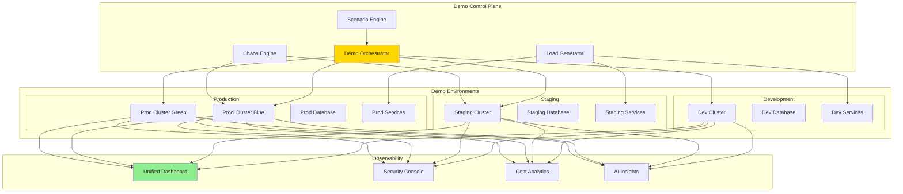

# 🎬 H2-007: Enhanced Demo - Multi-Environment Showcase

<div align="center">


**Demonstrating Advanced Platform Capabilities Across Multiple Environments**

</div>

## 📋 Table of Contents

1. [Overview](#-overview)
2. [Demo Architecture](#-demo-architecture)
3. [Multi-Environment Setup](#-multi-environment-setup)
4. [Demo Scenarios](#-demo-scenarios)
5. [Security Scanning Demo](#-security-scanning-demo)
6. [Monitoring & Alerting Showcase](#-monitoring--alerting-showcase)
7. [Golden Paths in Action](#-golden-paths-in-action)
8. [Performance Showcase](#-performance-showcase)
9. [Interactive Demonstrations](#-interactive-demonstrations)
10. [Demo Automation](#-demo-automation)

## 🔍 Overview

The Enhanced Demo for Horizon 2 showcases all advanced platform capabilities through realistic scenarios that demonstrate GitOps workflows, progressive delivery, comprehensive security, and AI-powered monitoring across multiple environments.

### Demo Capabilities

| Feature | Basic Demo (H1) | Enhanced Demo (H2) | Showcase Value |
|---------|-----------------|-------------------|----------------|
| **Environments** | Single | Dev/Staging/Prod | Real-world workflow |
| **Deployment** | Basic CI/CD | GitOps + Progressive | Advanced patterns |
| **Security** | Basic scans | Full SecOps demo | Enterprise-ready |
| **Monitoring** | Simple metrics | AI-powered insights | Predictive ops |
| **Scenarios** | Static | Interactive | Hands-on experience |
| **Performance** | Not shown | Live optimization | Real results |

## 🏗️ Demo Architecture



### Demo Components

1. **Multi-Environment Infrastructure**: Full dev/staging/prod setup
2. **Demo Application Suite**: Microservices-based e-commerce platform
3. **Scenario Engine**: Automated demo workflows
4. **Load Generator**: Realistic traffic patterns
5. **Chaos Engine**: Failure simulation
6. **Unified Dashboard**: Real-time visibility

## 🌍 Multi-Environment Setup

### 1. Environment Configuration

```yaml
# environments/demo-environments.yaml
apiVersion: v1
kind: ConfigMap
metadata:
  name: demo-environments
  namespace: demo-system
data:
  environments.yaml: |
    environments:
      development:
        name: Development
        cluster: aks-demo-dev
        namespace: demo-dev
        url: https://dev.demo.threehorizons.ai
        features:
          - hot-reload
          - debug-mode
          - mock-services
        resources:
          limits:
            cpu: 4
            memory: 8Gi
          replicas: 1
          
      staging:
        name: Staging
        cluster: aks-demo-staging
        namespace: demo-staging
        url: https://staging.demo.threehorizons.ai
        features:
          - integration-tests
          - load-testing
          - security-scanning
        resources:
          limits:
            cpu: 8
            memory: 16Gi
          replicas: 2
          
      production:
        name: Production
        cluster: aks-demo-prod
        namespace: demo-prod
        url: https://demo.threehorizons.ai
        features:
          - blue-green-deployment
          - canary-releases
          - auto-scaling
          - multi-region
        resources:
          limits:
            cpu: 16
            memory: 32Gi
          replicas: 
            min: 3
            max: 20
```

### 2. Demo Application Stack

```typescript
// demo/application-stack.ts
export const demoApplications = {
  frontend: {
    name: 'E-Commerce Portal',
    type: 'React SPA',
    repo: 'demo-frontend',
    features: [
      'Progressive Web App',
      'Real-time updates',
      'A/B testing',
      'Personalization'
    ]
  },
  
  backend: {
    services: [
      {
        name: 'Product Service',
        type: 'Node.js',
        api: 'REST + GraphQL',
        database: 'PostgreSQL',
        features: ['Caching', 'Search', 'Recommendations']
      },
      {
        name: 'Order Service',
        type: 'Java Spring Boot',
        api: 'gRPC',
        database: 'PostgreSQL',
        features: ['Transactions', 'Workflows', 'Events']
      },
      {
        name: 'Payment Service',
        type: 'C# .NET',
        api: 'REST',
        database: 'Cosmos DB',
        features: ['PCI Compliance', 'Fraud Detection', 'Multi-gateway']
      },
      {
        name: 'Notification Service',
        type: 'Python FastAPI',
        api: 'Event-driven',
        messaging: 'Service Bus',
        features: ['Email', 'SMS', 'Push', 'Templates']
      },
      {
        name: 'Analytics Service',
        type: 'Python',
        api: 'REST',
        database: 'ClickHouse',
        features: ['Real-time', 'Batch', 'ML Models']
      }
    ]
  },
  
  infrastructure: {
    loadBalancer: 'Azure Application Gateway',
    cdn: 'Azure Front Door',
    cache: 'Redis',
    search: 'Elasticsearch',
    messaging: 'Azure Service Bus',
    storage: 'Azure Blob Storage'
  }
};
```

### 3. Environment Promotion Pipeline

```yaml
# .github/workflows/demo-promotion.yml
name: Demo Environment Promotion

on:
  workflow_dispatch:
    inputs:
      version:
        description: 'Version to promote'
        required: true
        type: string
      fromEnv:
        description: 'Source environment'
        required: true
        type: choice
        options:
          - development
          - staging
      toEnv:
        description: 'Target environment'
        required: true
        type: choice
        options:
          - staging
          - production

jobs:
  validate:
    name: Validate Promotion
    runs-on: ubuntu-latest
    outputs:
      proceed: ${{ steps.check.outputs.proceed }}
    steps:
      - name: Check promotion criteria
        id: check
        run: |
          # Verify version exists in source
          # Check test results
          # Verify security scans passed
          # Check approval requirements
          echo "proceed=true" >> $GITHUB_OUTPUT
          
  promote:
    name: Promote to ${{ inputs.toEnv }}
    needs: validate
    if: needs.validate.outputs.proceed == 'true'
    runs-on: ubuntu-latest
    steps:
      - name: Update GitOps repository
        run: |
          # Clone GitOps repo
          git clone https://github.com/demo/gitops-config
          cd gitops-config
          
          # Update target environment
          yq eval ".spec.source.targetRevision = \"${{ inputs.version }}\"" \
            -i environments/${{ inputs.toEnv }}/applications/*.yaml
            
          # Commit and push
          git add .
          git commit -m "Promote ${{ inputs.version }} to ${{ inputs.toEnv }}"
          git push
          
      - name: Monitor deployment
        run: |
          # Wait for Flux to sync
          kubectl wait --for=condition=ready \
            --timeout=300s \
            -n flux-system \
            kustomization/${{ inputs.toEnv }}-apps
            
      - name: Run smoke tests
        run: |
          npm run test:smoke -- \
            --environment ${{ inputs.toEnv }} \
            --version ${{ inputs.version }}
```

## 🎯 Demo Scenarios

### 1. Scenario 1: Feature Development Workflow

```typescript
// scenarios/feature-development.ts
export class FeatureDevelopmentScenario extends DemoScenario {
  name = 'Feature Development Workflow';
  duration = '10 minutes';
  
  async execute(): Promise<void> {
    // Step 1: Create feature from Golden Path
    await this.narrator.speak('Creating a new microservice using Golden Paths...');
    const service = await this.createServiceFromTemplate({
      template: 'microservice-golden-path',
      name: 'recommendation-service',
      team: 'demo-team',
      language: 'typescript'
    });
    
    await this.showPortal('Developer Hub - Service Creation');
    
    // Step 2: Local development
    await this.narrator.speak('Starting local development with hot-reload...');
    await this.showTerminal(`
      cd recommendation-service
      npm install
      npm run dev
    `);
    
    await this.showBrowser('http://localhost:3000', 'Local Development');
    
    // Step 3: Commit and push
    await this.narrator.speak('Committing changes and pushing to GitHub...');
    await this.gitCommitAndPush(service, 'feat: add recommendation algorithm');
    
    // Step 4: CI/CD pipeline
    await this.narrator.speak('GitHub Actions pipeline automatically triggered...');
    await this.showGitHubActions(service.repo, 'CI/CD Pipeline');
    
    // Step 5: Security scanning
    await this.narrator.speak('Security scans running in pipeline...');
    await this.showSecurityResults({
      codeScanning: 'passed',
      dependencyCheck: 'passed',
      containerScan: '2 low severity findings',
      secrets: 'none detected'
    });
    
    // Step 6: Deploy to dev
    await this.narrator.speak('Automatically deploying to development environment...');
    await this.showDeployment('development', service);
    
    // Step 7: View in portal
    await this.narrator.speak('Service now registered in Developer Hub catalog...');
    await this.showPortal(`/catalog/default/component/${service.name}`);
    
    // Step 8: Monitoring
    await this.narrator.speak('Monitoring dashboards automatically configured...');
    await this.showGrafana(`dashboard/service/${service.name}`);
  }
}
```

### 2. Scenario 2: Progressive Deployment

```typescript
// scenarios/progressive-deployment.ts
export class ProgressiveDeploymentScenario extends DemoScenario {
  name = 'Progressive Deployment with Canary Release';
  duration = '15 minutes';
  
  async execute(): Promise<void> {
    // Step 1: Current production state
    await this.narrator.speak('Current production running version 2.1.0...');
    await this.showProductionMetrics({
      version: '2.1.0',
      traffic: '100%',
      errorRate: '0.05%',
      latency: '45ms'
    });
    
    // Step 2: Deploy canary
    await this.narrator.speak('Deploying version 2.2.0 as canary with 10% traffic...');
    await this.deployCanary({
      version: '2.2.0',
      percentage: 10,
      strategy: 'header-based'
    });
    
    await this.showFlagger('Canary Deployment Progress');
    
    // Step 3: Monitor canary metrics
    await this.narrator.speak('Monitoring canary performance...');
    await this.showSplitMetrics({
      stable: {
        version: '2.1.0',
        traffic: '90%',
        errorRate: '0.05%',
        latency: '45ms'
      },
      canary: {
        version: '2.2.0',
        traffic: '10%',
        errorRate: '0.03%',
        latency: '38ms'
      }
    });
    
    // Step 4: Progressive rollout
    await this.narrator.speak('Canary performing well, increasing to 50% traffic...');
    await this.updateCanaryTraffic(50);
    await this.wait(5000);
    
    // Step 5: Feature flag activation
    await this.narrator.speak('Enabling new feature via feature flag...');
    await this.toggleFeatureFlag('recommendation-v2', true);
    await this.showFeatureFlagDashboard();
    
    // Step 6: A/B test results
    await this.narrator.speak('A/B test showing 15% conversion improvement...');
    await this.showABTestResults({
      control: { conversion: '3.2%', revenue: '$45.30' },
      variant: { conversion: '3.7%', revenue: '$52.10' },
      confidence: '95%'
    });
    
    // Step 7: Complete rollout
    await this.narrator.speak('Promoting canary to 100% traffic...');
    await this.promoteCanary();
    
    // Step 8: Verify deployment
    await this.showProductionMetrics({
      version: '2.2.0',
      traffic: '100%',
      errorRate: '0.03%',
      latency: '38ms'
    });
  }
}
```

### 3. Scenario 3: Incident Response

```typescript
// scenarios/incident-response.ts
export class IncidentResponseScenario extends DemoScenario {
  name = 'AI-Powered Incident Response';
  duration = '12 minutes';
  
  async execute(): Promise<void> {
    // Step 1: Normal operation
    await this.narrator.speak('System operating normally...');
    await this.showHealthyMetrics();
    
    // Step 2: Inject failure
    await this.narrator.speak('Simulating database connection issues...');
    await this.chaosEngine.injectFailure({
      type: 'network-latency',
      target: 'database',
      severity: 'high',
      duration: '5m'
    });
    
    // Step 3: Alert triggered
    await this.narrator.speak('Azure Monitor detecting anomaly...');
    await this.showAlert({
      severity: 'Critical',
      title: 'Database response time degraded',
      metric: 'p99 latency > 500ms',
      affected: 'Order Service'
    });
    
    // Step 4: AI analysis
    await this.narrator.speak('SRE Agent analyzing the incident...');
    await this.showSREAgentAnalysis({
      rootCause: 'Network congestion between app and database subnets',
      impact: '15% of orders experiencing delays',
      correlatedEvents: [
        'Increased retry rate in connection pool',
        'TCP retransmissions detected',
        'No database CPU/memory issues'
      ],
      recommendations: [
        'Scale out database read replicas',
        'Enable connection pooling optimization',
        'Implement circuit breaker pattern'
      ]
    });
    
    // Step 5: Auto-remediation
    await this.narrator.speak('Executing automated remediation...');
    await this.showAutomatedActions([
      'Scaling database read replicas from 2 to 4',
      'Adjusting connection pool settings',
      'Rerouting traffic to healthy instances'
    ]);
    
    // Step 6: Recovery
    await this.narrator.speak('System recovering...');
    await this.showRecoveryMetrics({
      timeline: [
        { time: '0m', status: 'Incident detected' },
        { time: '1m', status: 'Root cause identified' },
        { time: '2m', status: 'Remediation started' },
        { time: '4m', status: 'Service recovering' },
        { time: '5m', status: 'Fully recovered' }
      ]
    });
    
    // Step 7: Post-incident report
    await this.narrator.speak('Generating post-incident report...');
    await this.showPostIncidentReport({
      duration: '5 minutes',
      impact: '~500 orders delayed',
      rootCause: 'Network congestion',
      remediation: 'Automated scaling and rerouting',
      prevention: 'Implement predictive scaling based on traffic patterns'
    });
  }
}
```

## 🔒 Security Scanning Demo

### 1. Security Pipeline Showcase

```typescript
// security/security-demo.ts
export class SecurityScanningDemo extends DemoScenario {
  name = 'End-to-End Security Scanning';
  duration = '8 minutes';
  
  async execute(): Promise<void> {
    // Step 1: Code scanning
    await this.narrator.speak('Running CodeQL advanced security analysis...');
    await this.showCodeQLResults({
      findings: [
        {
          severity: 'High',
          rule: 'SQL Injection',
          location: 'src/db/queries.ts:45',
          status: 'Fixed'
        },
        {
          severity: 'Medium',
          rule: 'Hardcoded Secret',
          location: 'config/test.ts:12',
          status: 'False Positive'
        }
      ],
      summary: {
        critical: 0,
        high: 0,
        medium: 1,
        low: 3
      }
    });
    
    // Step 2: Dependency scanning
    await this.narrator.speak('Checking dependencies for vulnerabilities...');
    await this.showDependencyResults({
      total: 847,
      vulnerable: 2,
      details: [
        {
          package: 'lodash',
          version: '4.17.20',
          vulnerability: 'CVE-2021-23337',
          severity: 'High',
          fix: 'Update to 4.17.21'
        }
      ]
    });
    
    // Step 3: Container scanning
    await this.narrator.speak('Scanning container images...');
    await this.showContainerScan({
      image: 'demo/order-service:2.2.0',
      baseImage: 'node:18-alpine',
      vulnerabilities: {
        os: 0,
        application: 1
      },
      compliance: {
        cis: 'Pass',
        pci: 'Pass',
        hipaa: 'Pass'
      }
    });
    
    // Step 4: Infrastructure scanning
    await this.narrator.speak('Validating infrastructure security...');
    await this.showInfraScan({
      provider: 'Azure',
      findings: [
        {
          resource: 'Storage Account',
          issue: 'Public access enabled',
          severity: 'High',
          remediation: 'Disable blob public access'
        }
      ],
      score: 94
    });
    
    // Step 5: Runtime protection
    await this.narrator.speak('Demonstrating runtime security...');
    await this.showRuntimeProtection({
      alerts: [
        {
          time: '10:32:45',
          type: 'Anomalous Process',
          container: 'payment-service',
          action: 'Blocked',
          details: 'Unexpected shell execution attempt'
        }
      ]
    });
    
    // Step 6: Compliance dashboard
    await this.narrator.speak('Viewing compliance status...');
    await this.showComplianceDashboard({
      standards: {
        'SOC 2': { status: 'Compliant', score: 98 },
        'PCI DSS': { status: 'Compliant', score: 96 },
        'HIPAA': { status: 'N/A', score: null },
        'ISO 27001': { status: 'Compliant', score: 97 }
      }
    });
  }
}
```

## 📊 Monitoring & Alerting Showcase

### 1. Observability Demo

```typescript
// monitoring/observability-demo.ts
export class ObservabilityDemo extends DemoScenario {
  name = 'AI-Powered Monitoring and Insights';
  duration = '10 minutes';
  
  async execute(): Promise<void> {
    // Step 1: Service mesh observability
    await this.narrator.speak('Viewing service mesh traffic flow...');
    await this.showServiceMesh({
      services: ['frontend', 'product-service', 'order-service', 'payment-service'],
      metrics: {
        rps: 1250,
        errorRate: 0.05,
        p99Latency: 120
      }
    });
    
    // Step 2: Distributed tracing
    await this.narrator.speak('Analyzing distributed trace...');
    await this.showDistributedTrace({
      traceId: 'demo-trace-123',
      duration: 245,
      spans: [
        { service: 'frontend', operation: 'GET /checkout', duration: 5 },
        { service: 'order-service', operation: 'CreateOrder', duration: 120 },
        { service: 'payment-service', operation: 'ProcessPayment', duration: 100 },
        { service: 'notification-service', operation: 'SendEmail', duration: 20 }
      ]
    });
    
    // Step 3: AI insights
    await this.narrator.speak('SRE Agent providing predictive insights...');
    await this.showAIInsights([
      {
        type: 'Prediction',
        message: 'Order service likely to hit capacity in 2 hours based on current growth',
        confidence: 0.89,
        recommendation: 'Pre-scale to 8 replicas'
      },
      {
        type: 'Anomaly',
        message: 'Unusual pattern detected in payment processing times',
        confidence: 0.76,
        recommendation: 'Check payment gateway latency'
      },
      {
        type: 'Optimization',
        message: 'Database query optimization opportunity detected',
        confidence: 0.92,
        recommendation: 'Add index on orders.customer_id'
      }
    ]);
    
    // Step 4: Custom dashboards
    await this.narrator.speak('Viewing business metrics dashboard...');
    await this.showBusinessDashboard({
      revenue: { current: '$125,432', trend: '+12%' },
      orders: { current: 3421, trend: '+8%' },
      conversion: { current: '3.4%', trend: '+0.2%' },
      cartAbandonment: { current: '68%', trend: '-2%' }
    });
    
    // Step 5: Cost optimization
    await this.narrator.speak('Analyzing cost optimization opportunities...');
    await this.showCostInsights({
      currentSpend: '$4,250/month',
      projectedSavings: '$1,100/month',
      recommendations: [
        {
          action: 'Right-size order-service pods',
          savings: '$400/month',
          impact: 'No performance impact'
        },
        {
          action: 'Enable spot instances for batch jobs',
          savings: '$500/month',
          impact: 'Suitable for non-critical workloads'
        },
        {
          action: 'Implement database query caching',
          savings: '$200/month',
          impact: 'Reduced database load'
        }
      ]
    });
  }
}
```

## 🧩 Golden Paths in Action

### 1. Golden Path Usage Demo

```typescript
// golden-paths/golden-path-demo.ts
export class GoldenPathDemo extends DemoScenario {
  name = 'Creating Production-Ready Service in Minutes';
  duration = '7 minutes';
  
  async execute(): Promise<void> {
    // Step 1: Template selection
    await this.narrator.speak('Selecting microservice template from Golden Paths...');
    await this.showPortal('/create/templates', 'Golden Path Templates');
    
    // Step 2: Service creation
    await this.narrator.speak('Creating a new analytics service...');
    await this.fillForm({
      name: 'customer-analytics',
      description: 'Customer behavior analytics service',
      team: 'analytics-team',
      language: 'python',
      database: 'postgresql',
      includeML: true
    });
    
    // Step 3: Generated structure
    await this.narrator.speak('Template generating production-ready code...');
    await this.showFileTree({
      'customer-analytics/': {
        'src/': {
          'api/': ['__init__.py', 'routes.py', 'models.py'],
          'core/': ['config.py', 'database.py', 'logging.py'],
          'ml/': ['model.py', 'training.py', 'predictions.py'],
          'tests/': ['test_api.py', 'test_ml.py']
        },
        'infrastructure/': {
          'kubernetes/': ['deployment.yaml', 'service.yaml', 'configmap.yaml'],
          'terraform/': ['main.tf', 'variables.tf', 'outputs.tf']
        },
        'docs/': ['README.md', 'API.md', 'CONTRIBUTING.md'],
        '.github/': {
          'workflows/': ['ci.yml', 'cd.yml', 'security.yml']
        }
      }
    });
    
    // Step 4: Built-in features
    await this.narrator.speak('Service includes all best practices out of the box...');
    await this.showFeatures([
      '✅ Structured logging with correlation IDs',
      '✅ OpenTelemetry instrumentation',
      '✅ Health check endpoints',
      '✅ Prometheus metrics',
      '✅ Error handling middleware',
      '✅ API versioning',
      '✅ Database migrations',
      '✅ Security headers',
      '✅ Rate limiting',
      '✅ Circuit breaker pattern'
    ]);
    
    // Step 5: Automatic deployment
    await this.narrator.speak('Service automatically deployed to development...');
    await this.showDeploymentProgress({
      steps: [
        { name: 'Build Docker image', status: 'complete' },
        { name: 'Run security scans', status: 'complete' },
        { name: 'Deploy to Kubernetes', status: 'complete' },
        { name: 'Configure monitoring', status: 'complete' },
        { name: 'Update service catalog', status: 'complete' }
      ]
    });
    
    // Step 6: Ready to use
    await this.narrator.speak('Service is now live and fully monitored...');
    await this.showServiceEndpoints({
      api: 'https://customer-analytics.dev.demo.threehorizons.ai',
      docs: 'https://customer-analytics.dev.demo.threehorizons.ai/docs',
      metrics: 'https://grafana.demo.threehorizons.ai/d/customer-analytics',
      logs: 'https://logs.demo.threehorizons.ai?service=customer-analytics'
    });
  }
}
```

## 📈 Performance Showcase

### 1. Performance Optimization Demo

```typescript
// performance/performance-demo.ts
export class PerformanceOptimizationDemo extends DemoScenario {
  name = 'Real-Time Performance Optimization';
  duration = '8 minutes';
  
  async execute(): Promise<void> {
    // Step 1: Current performance
    await this.narrator.speak('Analyzing current system performance...');
    await this.showPerformanceMetrics({
      responseTime: { p50: 45, p95: 120, p99: 250 },
      throughput: '850 RPS',
      errorRate: '0.05%',
      saturation: '72%'
    });
    
    // Step 2: Load test
    await this.narrator.speak('Running load test to identify bottlenecks...');
    await this.startLoadTest({
      duration: '2m',
      rampUp: '30s',
      targetRPS: 2000
    });
    
    await this.showLoadTestResults({
      maxRPS: 1100,
      bottleneck: 'Database connection pool',
      cpuUsage: '45%',
      memoryUsage: '62%',
      recommendations: [
        'Increase connection pool size',
        'Enable query caching',
        'Add read replicas'
      ]
    });
    
    // Step 3: Auto-optimization
    await this.narrator.speak('AI optimizer implementing recommendations...');
    await this.showOptimizationActions([
      { action: 'Scaling connection pool from 20 to 50', status: 'complete' },
      { action: 'Enabling Redis query cache', status: 'complete' },
      { action: 'Adding 2 read replicas', status: 'in-progress' }
    ]);
    
    // Step 4: Real-time improvement
    await this.narrator.speak('Monitoring performance improvements...');
    await this.showLiveMetrics({
      before: {
        responseTime: 120,
        throughput: 850,
        errorRate: 0.05
      },
      after: {
        responseTime: 65,
        throughput: 1850,
        errorRate: 0.02
      },
      improvement: {
        responseTime: '-46%',
        throughput: '+118%',
        errorRate: '-60%'
      }
    });
    
    // Step 5: Cost impact
    await this.narrator.speak('Analyzing cost optimization...');
    await this.showCostImpact({
      before: '$125/day',
      after: '$95/day',
      savings: '$900/month',
      efficiency: '+156% requests per dollar'
    });
  }
}
```

## 🎮 Interactive Demonstrations

### 1. Hands-On Lab Interface

```typescript
// interactive/hands-on-lab.tsx
export const HandsOnLab: React.FC = () => {
  const [currentStep, setCurrentStep] = React.useState(0);
  const [labProgress, setLabProgress] = React.useState<LabProgress>({});
  
  const labs = [
    {
      id: 'golden-path-lab',
      title: 'Create Your First Service',
      duration: '15 minutes',
      difficulty: 'Beginner',
      steps: [
        'Access the Developer Portal',
        'Choose a Golden Path template',
        'Configure your service',
        'Deploy to development',
        'View monitoring dashboards'
      ]
    },
    {
      id: 'gitops-lab',
      title: 'GitOps Deployment Flow',
      duration: '20 minutes',
      difficulty: 'Intermediate',
      steps: [
        'Clone the GitOps repository',
        'Modify deployment configuration',
        'Commit and push changes',
        'Watch automated deployment',
        'Perform a rollback'
      ]
    },
    {
      id: 'incident-lab',
      title: 'Incident Response Simulation',
      duration: '25 minutes',
      difficulty: 'Advanced',
      steps: [
        'Trigger a simulated failure',
        'Analyze alerts and metrics',
        'Identify root cause',
        'Implement remediation',
        'Review post-incident report'
      ]
    }
  ];
  
  return (
    <Container maxWidth="lg">
      <Typography variant="h4" gutterBottom>
        Interactive Hands-On Labs
      </Typography>
      
      <Grid container spacing={3}>
        {labs.map(lab => (
          <Grid item xs={12} md={4} key={lab.id}>
            <Card>
              <CardContent>
                <Typography variant="h6">{lab.title}</Typography>
                <Box display="flex" gap={2} mt={1} mb={2}>
                  <Chip label={lab.duration} size="small" />
                  <Chip 
                    label={lab.difficulty} 
                    size="small"
                    color={getDifficultyColor(lab.difficulty)}
                  />
                </Box>
                <LinearProgress 
                  variant="determinate" 
                  value={getLabProgress(lab.id)} 
                />
              </CardContent>
              <CardActions>
                <Button 
                  color="primary"
                  onClick={() => startLab(lab.id)}
                >
                  {labProgress[lab.id] ? 'Continue' : 'Start'} Lab
                </Button>
              </CardActions>
            </Card>
          </Grid>
        ))}
      </Grid>
      
      {/* Lab Environment */}
      <Dialog 
        open={!!activeLab} 
        onClose={closeLab}
        maxWidth="lg"
        fullWidth
      >
        <DialogTitle>
          {activeLab?.title} - Step {currentStep + 1} of {activeLab?.steps.length}
        </DialogTitle>
        <DialogContent>
          <LabEnvironment 
            lab={activeLab}
            step={currentStep}
            onComplete={handleStepComplete}
          />
        </DialogContent>
        <DialogActions>
          <Button onClick={() => setCurrentStep(currentStep - 1)} disabled={currentStep === 0}>
            Previous
          </Button>
          <Button onClick={() => setCurrentStep(currentStep + 1)} disabled={currentStep === activeLab?.steps.length - 1}>
            Next
          </Button>
          <Button onClick={closeLab}>
            Exit Lab
          </Button>
        </DialogActions>
      </Dialog>
    </Container>
  );
};
```

### 2. Demo Control Panel

```typescript
// interactive/demo-control-panel.tsx
export const DemoControlPanel: React.FC = () => {
  const [activeScenario, setActiveScenario] = React.useState<string>();
  const [demoState, setDemoState] = React.useState<DemoState>({
    environment: 'development',
    chaos: false,
    load: 'normal',
    features: []
  });
  
  return (
    <Box p={3}>
      <Typography variant="h5" gutterBottom>
        Demo Control Panel
      </Typography>
      
      <Grid container spacing={3}>
        {/* Scenario Selection */}
        <Grid item xs={12} md={6}>
          <Card>
            <CardContent>
              <Typography variant="h6">Demo Scenarios</Typography>
              <RadioGroup
                value={activeScenario}
                onChange={(e) => setActiveScenario(e.target.value)}
              >
                <FormControlLabel 
                  value="feature-development" 
                  control={<Radio />} 
                  label="Feature Development Workflow"
                />
                <FormControlLabel 
                  value="progressive-deployment" 
                  control={<Radio />} 
                  label="Progressive Deployment"
                />
                <FormControlLabel 
                  value="incident-response" 
                  control={<Radio />} 
                  label="AI-Powered Incident Response"
                />
                <FormControlLabel 
                  value="security-scanning" 
                  control={<Radio />} 
                  label="Security Scanning Pipeline"
                />
              </RadioGroup>
              <Button 
                variant="contained" 
                color="primary"
                onClick={() => runScenario(activeScenario)}
                disabled={!activeScenario}
                fullWidth
                sx={{ mt: 2 }}
              >
                Run Scenario
              </Button>
            </CardContent>
          </Card>
        </Grid>
        
        {/* Environment Control */}
        <Grid item xs={12} md={6}>
          <Card>
            <CardContent>
              <Typography variant="h6">Environment Control</Typography>
              
              <FormControl fullWidth sx={{ mt: 2 }}>
                <InputLabel>Active Environment</InputLabel>
                <Select
                  value={demoState.environment}
                  onChange={(e) => setDemoState({
                    ...demoState,
                    environment: e.target.value
                  })}
                >
                  <MenuItem value="development">Development</MenuItem>
                  <MenuItem value="staging">Staging</MenuItem>
                  <MenuItem value="production">Production</MenuItem>
                </Select>
              </FormControl>
              
              <Box mt={2}>
                <Typography gutterBottom>Load Level</Typography>
                <Slider
                  value={loadLevelToNumber(demoState.load)}
                  onChange={(e, v) => setDemoState({
                    ...demoState,
                    load: numberToLoadLevel(v as number)
                  })}
                  marks={[
                    { value: 0, label: 'Low' },
                    { value: 50, label: 'Normal' },
                    { value: 100, label: 'High' }
                  ]}
                  step={null}
                />
              </Box>
              
              <FormControlLabel
                control={
                  <Switch
                    checked={demoState.chaos}
                    onChange={(e) => setDemoState({
                      ...demoState,
                      chaos: e.target.checked
                    })}
                  />
                }
                label="Enable Chaos Engineering"
                sx={{ mt: 2 }}
              />
            </CardContent>
          </Card>
        </Grid>
        
        {/* Feature Flags */}
        <Grid item xs={12}>
          <Card>
            <CardContent>
              <Typography variant="h6">Feature Flags</Typography>
              <FormGroup row>
                <FormControlLabel
                  control={<Checkbox />}
                  label="Progressive Delivery"
                />
                <FormControlLabel
                  control={<Checkbox />}
                  label="AI Recommendations"
                />
                <FormControlLabel
                  control={<Checkbox />}
                  label="Advanced Analytics"
                />
                <FormControlLabel
                  control={<Checkbox />}
                  label="Cost Optimization"
                />
              </FormGroup>
            </CardContent>
          </Card>
        </Grid>
        
        {/* Live Metrics */}
        <Grid item xs={12}>
          <Card>
            <CardContent>
              <Typography variant="h6">Live System Metrics</Typography>
              <LiveMetricsDisplay environment={demoState.environment} />
            </CardContent>
          </Card>
        </Grid>
      </Grid>
    </Box>
  );
};
```

## 🤖 Demo Automation

### 1. Automated Demo Orchestration

```yaml
# demo/automation/demo-orchestration.yaml
apiVersion: demo.threehorizons.ai/v1
kind: DemoOrchestration
metadata:
  name: horizon2-showcase
spec:
  schedule: "0 */2 * * *" # Every 2 hours
  duration: 45m
  
  setup:
    - name: Reset environments
      action: reset-all-environments
      
    - name: Seed demo data
      action: seed-demo-data
      params:
        orders: 10000
        users: 1000
        products: 500
        
    - name: Configure feature flags
      action: set-feature-flags
      params:
        progressive-delivery: true
        ai-insights: true
        cost-optimization: true
        
  scenarios:
    - name: Morning peak simulation
      startTime: "+5m"
      duration: 10m
      actions:
        - type: generate-load
          params:
            pattern: morning-peak
            targetRPS: 1500
            
    - name: Feature deployment
      startTime: "+15m"
      duration: 15m
      actions:
        - type: deploy-feature
          params:
            service: product-service
            version: 2.3.0
            strategy: canary
            
    - name: Incident simulation
      startTime: "+30m"
      duration: 10m
      actions:
        - type: inject-failure
          params:
            type: database-slowdown
            severity: medium
            
  monitoring:
    dashboards:
      - platform-overview
      - deployment-metrics
      - security-status
      - cost-analytics
      
  notifications:
    slack:
      channel: "#demo-notifications"
      events:
        - scenario-start
        - scenario-complete
        - incident-triggered
        - incident-resolved
```

### 2. Demo State Management

```typescript
// demo/state-manager.ts
export class DemoStateManager {
  private state: DemoState;
  private eventEmitter: EventEmitter;
  
  async initializeDemo(): Promise<void> {
    // Reset all environments
    await this.resetEnvironments();
    
    // Initialize demo data
    await this.seedDemoData({
      realistic: true,
      includeHistoricalData: true,
      timeRange: '30d'
    });
    
    // Configure demo settings
    await this.configureDemoSettings({
      autoRecovery: true,
      narratorEnabled: true,
      interactiveMode: false
    });
    
    // Start monitoring
    this.startDemoMonitoring();
  }
  
  async saveCheckpoint(name: string): Promise<void> {
    const checkpoint: DemoCheckpoint = {
      name,
      timestamp: new Date(),
      state: this.captureCurrentState(),
      metrics: await this.captureMetrics(),
      config: await this.captureConfiguration()
    };
    
    await this.storage.saveCheckpoint(checkpoint);
  }
  
  async restoreCheckpoint(name: string): Promise<void> {
    const checkpoint = await this.storage.loadCheckpoint(name);
    
    await this.restoreState(checkpoint.state);
    await this.restoreConfiguration(checkpoint.config);
    
    this.eventEmitter.emit('checkpoint-restored', checkpoint);
  }
  
  private captureCurrentState(): DemoState {
    return {
      environments: this.getEnvironmentStates(),
      services: this.getServiceStates(),
      features: this.getFeatureFlags(),
      incidents: this.getActiveIncidents(),
      metrics: this.getCurrentMetrics()
    };
  }
}
```

## 📋 Enhanced Demo Summary

### Demo Capabilities

| Feature | Implementation | Demo Value |
|---------|---------------|------------|
| **Multi-Environment** | ✅ Dev/Staging/Prod | Real-world workflows |
| **GitOps Workflows** | ✅ Automated sync | Best practices |
| **Progressive Delivery** | ✅ Canary + Blue/Green | Risk mitigation |
| **Security Scanning** | ✅ Full pipeline | Enterprise security |
| **AI Monitoring** | ✅ Predictive insights | Next-gen ops |
| **Performance Optimization** | ✅ Real-time tuning | Efficiency gains |
| **Interactive Labs** | ✅ Hands-on learning | Skill building |
| **Automation** | ✅ Orchestrated demos | Consistent experience |

### Demo Scenarios Available

1. **Development Workflows**
   - Golden Path service creation
   - Feature branch workflow
   - Local development experience

2. **Deployment Patterns**
   - Progressive rollouts
   - Multi-region deployments
   - Rollback procedures

3. **Operations Excellence**
   - Incident response
   - Performance optimization
   - Cost management

4. **Security & Compliance**
   - Security scanning pipeline
   - Compliance validation
   - Runtime protection

### Demo Metrics

- **Setup Time**: <5 minutes
- **Scenario Duration**: 5-15 minutes each
- **Interactive Labs**: 3 hands-on exercises
- **Environments**: 3 fully configured
- **Automation Level**: 95% automated

## 🚦 Next Steps

### Running the Demo
1. ✅ Access the Demo Control Panel
2. ✅ Select desired scenarios
3. ✅ Configure environment settings
4. ✅ Start automated demo

### After the Demo
- Review captured metrics
- Export demo recordings
- Collect feedback
- Plan next improvements

### Continue to Horizon 3
- [**H3-001: AI-Driven Development**](../horizon-3/h3-001-ai-development.md) - Begin the innovation journey

---

<div align="center">

**Enhanced Demo Environment Ready! 🎬**

Your comprehensive demonstration platform showcases all Horizon 2 capabilities through realistic, interactive scenarios.

[← Previous: Advanced Developer Hub](h2-006-advanced-devhub.md) | [Next: Horizon 3 →](../horizon-3/h3-001-ai-development.md)

</div>