# 🚀 Outer Loop Deployment Guide - Autonomous Deployment Operations

<div align="center">


**From Code to Production with AI-Driven Automation**

</div>

## 📋 Table of Contents

1. [Overview](#-overview)
2. [GitOps Architecture](#-gitops-architecture)
3. [Progressive Delivery](#-progressive-delivery)
4. [Multi-Cloud Deployment](#-multi-cloud-deployment)
5. [Agentic Deployment Automation](#-agentic-deployment-automation)
6. [Environment Management](#-environment-management)
7. [Rollback Strategies](#-rollback-strategies)
8. [Production Monitoring](#-production-monitoring)
9. [Feedback Loops](#-feedback-loops)
10. [Best Practices](#-best-practices)

## 🔍 Overview

The Outer Loop encompasses all activities from code commit to production deployment, including CI/CD, environment promotion, and production monitoring. With Agentic DevOps, these processes are enhanced by AI-driven decision making and autonomous operations.

### Traditional vs Agentic Outer Loop

| Aspect | Traditional Deployment | Agentic Deployment |
|--------|----------------------|-------------------|
| **Pipeline Creation** | Manual configuration | AI-generated pipelines |
| **Deployment Decisions** | Human approval gates | AI-driven risk assessment |
| **Rollout Strategy** | Fixed percentages | Dynamic based on metrics |
| **Issue Detection** | Reactive monitoring | Predictive anomaly detection |
| **Rollback** | Manual intervention | Autonomous self-healing |
| **Optimization** | Periodic reviews | Continuous AI optimization |

### Outer Loop Architecture

```mermaid
graph LR
    subgraph "Source"
        A[Git Repository]
        B[PR Merge]
    end
    
    subgraph "CI/CD"
        C[Build & Test]
        D[Security Scan]
        E[Container Build]
    end
    
    subgraph "GitOps"
        F[Config Repo]
        G[ArgoCD/Flux]
        H[Sync]
    end
    
    subgraph "Progressive Delivery"
        I[Canary]
        J[Blue/Green]
        K[Feature Flags]
    end
    
    subgraph "Production"
        L[Multi-Cloud]
        M[Monitoring]
        N[Feedback]
    end
    
    subgraph "AI Layer"
        O[Deployment Agent]
        P[Risk Analyzer]
        Q[Performance Optimizer]
    end
    
    B --> C
    C --> D
    D --> E
    E --> F
    F --> G
    G --> H
    H --> I
    I --> J
    J --> K
    K --> L
    L --> M
    M --> N
    N --> O
    
    O --> P
    P --> Q
    Q --> G
    
    style O fill:#ff9999
    style P fill:#ff9999
    style Q fill:#ff9999
```



## 🔄 GitOps Architecture

### 1. GitOps Repository Structure

```bash
# GitOps repository structure
gitops-config/
├── environments/
│   ├── dev/
│   │   ├── kustomization.yaml
│   │   ├── namespace.yaml
│   │   ├── config/
│   │   │   ├── configmaps.yaml
│   │   │   └── secrets.yaml
│   │   └── apps/
│   │       ├── frontend/
│   │       ├── backend/
│   │       └── database/
│   ├── staging/
│   │   └── ... (similar structure)
│   └── prod/
│       ├── kustomization.yaml
│       ├── apps/
│       └── policies/
├── base/
│   ├── frontend/
│   │   ├── deployment.yaml
│   │   ├── service.yaml
│   │   ├── ingress.yaml
│   │   └── kustomization.yaml
│   ├── backend/
│   └── monitoring/
├── clusters/
│   ├── azure-aks/
│   │   ├── flux-system/
│   │   └── apps.yaml
│   ├── aws-eks/
│   └── gcp-gke/
└── scripts/
    ├── setup-gitops.sh
    └── promote-environment.sh
```

### 2. Flux v2 Configuration

```yaml
# clusters/azure-aks/flux-system/gotk-sync.yaml
apiVersion: source.toolkit.fluxcd.io/v1beta2
kind: GitRepository
metadata:
  name: flux-system
  namespace: flux-system
spec:
  interval: 1m
  ref:
    branch: main
  secretRef:
    name: flux-system
  url: ssh://git@github.com/threehorizons-ai/gitops-config
---
apiVersion: kustomize.toolkit.fluxcd.io/v1beta2
kind: Kustomization
metadata:
  name: flux-system
  namespace: flux-system
spec:
  interval: 10m
  path: ./clusters/azure-aks
  prune: true
  sourceRef:
    kind: GitRepository
    name: flux-system
  decryption:
    provider: sops
    secretRef:
      name: sops-age
  postBuild:
    substituteFrom:
      - kind: ConfigMap
        name: cluster-config
      - kind: Secret
        name: cluster-secrets
```

### 3. Application Deployment with Kustomize

```yaml
# base/frontend/deployment.yaml
apiVersion: apps/v1
kind: Deployment
metadata:
  name: frontend
  labels:
    app: frontend
    version: v1
spec:
  replicas: 3
  strategy:
    type: RollingUpdate
    rollingUpdate:
      maxSurge: 1
      maxUnavailable: 0
  selector:
    matchLabels:
      app: frontend
  template:
    metadata:
      labels:
        app: frontend
        version: v1
      annotations:
        prometheus.io/scrape: "true"
        prometheus.io/port: "8080"
    spec:
      serviceAccountName: frontend
      containers:
      - name: frontend
        image: acrthreehorizonsdev.azurecr.io/frontend:latest
        ports:
        - containerPort: 8080
          name: http
        env:
        - name: ENVIRONMENT
          valueFrom:
            configMapKeyRef:
              name: environment-config
              key: environment
        - name: API_URL
          valueFrom:
            configMapKeyRef:
              name: app-config
              key: api.url
        resources:
          requests:
            memory: "256Mi"
            cpu: "100m"
          limits:
            memory: "512Mi"
            cpu: "500m"
        livenessProbe:
          httpGet:
            path: /health
            port: 8080
          initialDelaySeconds: 30
          periodSeconds: 10
        readinessProbe:
          httpGet:
            path: /ready
            port: 8080
          initialDelaySeconds: 5
          periodSeconds: 5
        lifecycle:
          preStop:
            exec:
              command: ["/bin/sh", "-c", "sleep 15"]
---
# base/frontend/kustomization.yaml
apiVersion: kustomize.config.k8s.io/v1beta1
kind: Kustomization

resources:
  - deployment.yaml
  - service.yaml
  - ingress.yaml
  - hpa.yaml

configMapGenerator:
  - name: app-config
    literals:
      - api.url=http://api-gateway:8080
      - cache.ttl=3600

images:
  - name: acrthreehorizonsdev.azurecr.io/frontend
    newTag: latest

replicas:
  - name: frontend
    count: 3

patchesStrategicMerge:
  - |-
    apiVersion: apps/v1
    kind: Deployment
    metadata:
      name: frontend
    spec:
      template:
        metadata:
          annotations:
            fluxcd.io/automated: "true"
            fluxcd.io/tag.frontend: semver:~1.0
```

### 4. Environment-Specific Overlays

```yaml
# environments/prod/kustomization.yaml
apiVersion: kustomize.config.k8s.io/v1beta1
kind: Kustomization

namespace: production

resources:
  - ../../base/frontend
  - ../../base/backend
  - ../../base/monitoring
  - namespace.yaml
  - policies/

patchesStrategicMerge:
  - |-
    apiVersion: apps/v1
    kind: Deployment
    metadata:
      name: frontend
    spec:
      replicas: 10
      template:
        spec:
          containers:
          - name: frontend
            resources:
              requests:
                memory: "1Gi"
                cpu: "500m"
              limits:
                memory: "2Gi"
                cpu: "1000m"

configMapGenerator:
  - name: environment-config
    behavior: merge
    literals:
      - environment=production
      - log.level=info
      - feature.ai-assist=enabled

secretGenerator:
  - name: app-secrets
    envs:
      - prod.env

images:
  - name: acrthreehorizonsdev.azurecr.io/frontend
    newTag: v1.2.3

patches:
  - target:
      kind: Ingress
      name: frontend
    patch: |-
      - op: replace
        path: /spec/rules/0/host
        value: app.threehorizons.ai
      - op: add
        path: /spec/tls
        value:
          - hosts:
            - app.threehorizons.ai
            secretName: prod-tls-cert
```

## 🎯 Progressive Delivery

### 1. Flagger Configuration for Canary Deployments

```yaml
# progressive-delivery/canary.yaml
apiVersion: flagger.app/v1beta1
kind: Canary
metadata:
  name: frontend
  namespace: production
spec:
  provider: istio
  targetRef:
    apiVersion: apps/v1
    kind: Deployment
    name: frontend
  progressDeadlineSeconds: 600
  service:
    port: 8080
    targetPort: 8080
    gateways:
      - public-gateway.istio-system.svc.cluster.local
    hosts:
      - app.threehorizons.ai
  analysis:
    interval: 30s
    threshold: 5
    maxWeight: 50
    stepWeight: 10
    stepWeightPromotion: 100
    metrics:
      - name: request-success-rate
        templateRef:
          name: request-success-rate
          namespace: flagger-system
        thresholdRange:
          min: 99
        interval: 1m
      - name: latency
        templateRef:
          name: latency
          namespace: flagger-system
        thresholdRange:
          max: 500
        interval: 30s
      - name: ai-quality-score
        templateRef:
          name: ai-quality-metrics
          namespace: flagger-system
        thresholdRange:
          min: 0.95
    webhooks:
      - name: ai-deployment-analyzer
        type: pre-rollout
        url: http://deployment-agent.agentic-system:8080/analyze
        timeout: 10s
        metadata:
          deployment: frontend
          environment: production
      - name: load-test
        type: rollout
        url: http://flagger-loadtester.flagger-system:8080/
        metadata:
          cmd: "hey -z 2m -q 50 -c 10 http://frontend-canary.production:8080/"
      - name: ai-decision
        type: confirm-promotion
        url: http://deployment-agent.agentic-system:8080/decide
        metadata:
          risk_threshold: "0.1"
  autoscalerRef:
    apiVersion: autoscaling/v2
    kind: HorizontalPodAutoscaler
    name: frontend
```

### 2. Blue-Green Deployment

```yaml
# progressive-delivery/blue-green.yaml
apiVersion: argoproj.io/v1alpha1
kind: Rollout
metadata:
  name: backend-service
  namespace: production
spec:
  replicas: 10
  strategy:
    blueGreen:
      activeService: backend-active
      previewService: backend-preview
      autoPromotionEnabled: false
      prePromotionAnalysis:
        templates:
          - templateName: ai-analysis
        args:
          - name: service-name
            value: backend-service
      scaleDownDelaySeconds: 30
      scaleDownDelayRevisionLimit: 2
  selector:
    matchLabels:
      app: backend
  template:
    metadata:
      labels:
        app: backend
    spec:
      containers:
      - name: backend
        image: acrthreehorizonsdev.azurecr.io/backend:latest
        ports:
        - containerPort: 8080
---
apiVersion: v1
kind: Service
metadata:
  name: backend-active
  namespace: production
spec:
  selector:
    app: backend
  ports:
  - port: 8080
    targetPort: 8080
---
apiVersion: v1
kind: Service
metadata:
  name: backend-preview
  namespace: production
spec:
  selector:
    app: backend
  ports:
  - port: 8080
    targetPort: 8080
```

### 3. Feature Flags with OpenFeature

```typescript
// feature-flags/feature-flag-config.ts
import { OpenFeature, Provider } from '@openfeature/js-sdk';
import { FlagdProvider } from '@openfeature/flagd-provider';

// Feature flag configuration
const featureFlagConfig = {
  flags: {
    "ai-recommendations": {
      state: "ENABLED",
      variants: {
        "on": true,
        "off": false
      },
      defaultVariant: "off",
      targeting: {
        "if": [
          {
            "in": ["beta-users", { "var": "userGroup" }]
          },
          "on",
          "off"
        ]
      }
    },
    "progressive-rollout": {
      state: "ENABLED",
      variants: {
        "percentage": 0
      },
      defaultVariant: "percentage",
      targeting: {
        "fractional": [
          { "var": "userId" },
          [
            "percentage",
            25  // 25% of users
          ]
        ]
      }
    },
    "canary-features": {
      state: "ENABLED",
      variants: {
        "stable": "v1",
        "canary": "v2"
      },
      defaultVariant: "stable",
      targeting: {
        "if": [
          {
            ">=": [
              { "var": "deploymentVersion" },
              "2.0.0"
            ]
          },
          "canary",
          "stable"
        ]
      }
    }
  }
};

// Initialize OpenFeature
export async function initializeFeatureFlags() {
  const provider = new FlagdProvider({
    host: 'flagd.feature-system',
    port: 8013,
    tls: true,
    maxRetries: 3,
    maxEventStreamRetries: 3
  });

  OpenFeature.setProvider(provider);
  
  // Set context
  OpenFeature.setContext({
    userId: getUserId(),
    userGroup: getUserGroup(),
    environment: process.env.ENVIRONMENT,
    deploymentVersion: process.env.VERSION
  });

  return OpenFeature.getClient();
}

// Feature flag wrapper component
export const FeatureFlag: React.FC<{
  flag: string;
  children: React.ReactNode;
  fallback?: React.ReactNode;
}> = ({ flag, children, fallback }) => {
  const [enabled, setEnabled] = useState(false);
  const client = OpenFeature.getClient();

  useEffect(() => {
    const checkFlag = async () => {
      const flagValue = await client.getBooleanValue(flag, false);
      setEnabled(flagValue);
    };

    checkFlag();

    // Subscribe to flag changes
    const unsubscribe = client.on('change', () => checkFlag());
    return unsubscribe;
  }, [flag]);

  return enabled ? <>{children}</> : <>{fallback}</>;
};
```

## 🌍 Multi-Cloud Deployment

### 1. Multi-Cloud GitOps Structure

```yaml
# clusters/aws-eks/apps.yaml
apiVersion: kustomize.toolkit.fluxcd.io/v1beta2
kind: Kustomization
metadata:
  name: apps
  namespace: flux-system
spec:
  interval: 10m
  dependsOn:
    - name: infrastructure
  sourceRef:
    kind: GitRepository
    name: flux-system
  path: ./environments/prod
  prune: true
  wait: true
  timeout: 5m
  postBuild:
    substitute:
      CLUSTER_NAME: aws-eks-production
      CLOUD_PROVIDER: aws
      REGION: us-east-1
    substituteFrom:
      - kind: ConfigMap
        name: aws-config
---
# clusters/gcp-gke/apps.yaml
apiVersion: kustomize.toolkit.fluxcd.io/v1beta2
kind: Kustomization
metadata:
  name: apps
  namespace: flux-system
spec:
  interval: 10m
  dependsOn:
    - name: infrastructure
  sourceRef:
    kind: GitRepository
    name: flux-system
  path: ./environments/prod
  prune: true
  wait: true
  timeout: 5m
  postBuild:
    substitute:
      CLUSTER_NAME: gcp-gke-production
      CLOUD_PROVIDER: gcp
      REGION: us-central1
    substituteFrom:
      - kind: ConfigMap
        name: gcp-config
```

### 2. Cloud-Specific Configurations

```yaml
# base/cloud-specific/aws/storage-class.yaml
apiVersion: storage.k8s.io/v1
kind: StorageClass
metadata:
  name: fast-ssd
provisioner: kubernetes.io/aws-ebs
parameters:
  type: gp3
  fsType: ext4
  iops: "3000"
  throughput: "125"
allowVolumeExpansion: true
volumeBindingMode: WaitForFirstConsumer
---
# base/cloud-specific/azure/storage-class.yaml
apiVersion: storage.k8s.io/v1
kind: StorageClass
metadata:
  name: fast-ssd
provisioner: kubernetes.io/azure-disk
parameters:
  storageaccounttype: Premium_LRS
  kind: Managed
allowVolumeExpansion: true
volumeBindingMode: WaitForFirstConsumer
---
# base/cloud-specific/gcp/storage-class.yaml
apiVersion: storage.k8s.io/v1
kind: StorageClass
metadata:
  name: fast-ssd
provisioner: kubernetes.io/gce-pd
parameters:
  type: pd-ssd
  replication-type: regional-pd
allowVolumeExpansion: true
volumeBindingMode: WaitForFirstConsumer
```

### 3. Multi-Cloud Service Mesh

```yaml
# istio/multi-cloud-mesh.yaml
apiVersion: install.istio.io/v1alpha1
kind: IstioOperator
metadata:
  name: control-plane
spec:
  values:
    pilot:
      env:
        PILOT_ENABLE_WORKLOAD_ENTRY_AUTOREGISTRATION: true
        PILOT_ENABLE_CROSS_CLUSTER_WORKLOAD_ENTRY: true
    global:
      meshID: mesh-threehorizons
      multiCluster:
        clusterName: azure-aks
      network: azure-network
---
apiVersion: networking.istio.io/v1beta1
kind: Gateway
metadata:
  name: cross-network-gateway
  namespace: istio-system
spec:
  selector:
    istio: eastwestgateway
  servers:
    - port:
        number: 15443
        name: tls
        protocol: TLS
      tls:
        mode: ISTIO_MUTUAL
      hosts:
        - "*.local"
---
# Multi-cluster service discovery
apiVersion: networking.istio.io/v1beta1
kind: ServiceEntry
metadata:
  name: cross-cluster-backend
  namespace: production
spec:
  hosts:
    - backend.production.global
  location: MESH_EXTERNAL
  ports:
    - number: 8080
      name: http
      protocol: HTTP
  resolution: DNS
  endpoints:
    - address: azure-aks.eastwest.istio-system.svc.cluster.local
      priority: 0
      weight: 33
    - address: aws-eks.eastwest.istio-system.svc.cluster.local
      priority: 0
      weight: 33
    - address: gcp-gke.eastwest.istio-system.svc.cluster.local
      priority: 0
      weight: 34
```

## 🤖 Agentic Deployment Automation

### 1. AI Deployment Agent

```go
// deployment-agent/main.go
package main

import (
    "context"
    "encoding/json"
    "fmt"
    "net/http"
    "time"

    "github.com/gorilla/mux"
    "github.com/prometheus/client_golang/prometheus"
    "github.com/prometheus/client_golang/prometheus/promhttp"
    "go.opentelemetry.io/otel"
    "k8s.io/client-go/kubernetes"
    "github.com/fluxcd/flagger/pkg/apis/flagger/v1beta1"
)

type DeploymentAgent struct {
    k8sClient     kubernetes.Interface
    aiClient      *AIServiceClient
    metricsClient *MetricsClient
    tracer        trace.Tracer
}

type DeploymentAnalysis struct {
    DeploymentID   string    `json:"deploymentId"`
    RiskScore      float64   `json:"riskScore"`
    Recommendation string    `json:"recommendation"`
    Confidence     float64   `json:"confidence"`
    Factors        []Factor  `json:"factors"`
    Timestamp      time.Time `json:"timestamp"`
}

type Factor struct {
    Name   string  `json:"name"`
    Value  float64 `json:"value"`
    Impact string  `json:"impact"`
}

func (da *DeploymentAgent) AnalyzeDeployment(w http.ResponseWriter, r *http.Request) {
    ctx, span := da.tracer.Start(r.Context(), "AnalyzeDeployment")
    defer span.End()

    var request struct {
        Deployment  string `json:"deployment"`
        Environment string `json:"environment"`
        Version     string `json:"version"`
    }

    if err := json.NewDecoder(r.Body).Decode(&request); err != nil {
        http.Error(w, err.Error(), http.StatusBadRequest)
        return
    }

    // Gather metrics and historical data
    metrics, err := da.gatherMetrics(ctx, request.Deployment)
    if err != nil {
        span.RecordError(err)
        http.Error(w, err.Error(), http.StatusInternalServerError)
        return
    }

    // Get AI analysis
    analysis, err := da.performAIAnalysis(ctx, request, metrics)
    if err != nil {
        span.RecordError(err)
        http.Error(w, err.Error(), http.StatusInternalServerError)
        return
    }

    // Record decision
    deploymentDecisions.WithLabelValues(
        request.Deployment,
        request.Environment,
        analysis.Recommendation,
    ).Inc()

    w.Header().Set("Content-Type", "application/json")
    json.NewEncoder(w).Encode(analysis)
}

func (da *DeploymentAgent) performAIAnalysis(ctx context.Context, req request, metrics *Metrics) (*DeploymentAnalysis, error) {
    // Prepare context for AI
    context := AIContext{
        CurrentMetrics: metrics,
        HistoricalData: da.getHistoricalData(req.Deployment),
        EnvironmentConfig: da.getEnvironmentConfig(req.Environment),
        Version: req.Version,
    }

    // Call AI service
    aiRequest := &AIAnalysisRequest{
        Context: context,
        Model: "deployment-risk-analyzer-v2",
        Parameters: map[string]interface{}{
            "risk_tolerance": 0.05,
            "sla_targets": map[string]float64{
                "availability": 99.95,
                "latency_p99": 200,
                "error_rate": 0.1,
            },
        },
    }

    response, err := da.aiClient.Analyze(ctx, aiRequest)
    if err != nil {
        return nil, fmt.Errorf("AI analysis failed: %w", err)
    }

    // Process AI response
    analysis := &DeploymentAnalysis{
        DeploymentID: generateDeploymentID(req),
        RiskScore: response.RiskScore,
        Recommendation: da.interpretRecommendation(response),
        Confidence: response.Confidence,
        Timestamp: time.Now(),
    }

    // Extract key factors
    for _, factor := range response.Factors {
        analysis.Factors = append(analysis.Factors, Factor{
            Name: factor.Name,
            Value: factor.Score,
            Impact: da.categorizeImpact(factor.Score),
        })
    }

    return analysis, nil
}

func (da *DeploymentAgent) DecidePromotion(w http.ResponseWriter, r *http.Request) {
    ctx, span := da.tracer.Start(r.Context(), "DecidePromotion")
    defer span.End()

    var request struct {
        CanaryName      string                 `json:"canaryName"`
        CanaryNamespace string                 `json:"canaryNamespace"`
        Metrics         map[string]float64     `json:"metrics"`
        RiskThreshold   float64                `json:"risk_threshold"`
    }

    if err := json.NewDecoder(r.Body).Decode(&request); err != nil {
        http.Error(w, err.Error(), http.StatusBadRequest)
        return
    }

    // Get current canary state
    canary, err := da.getCanaryState(ctx, request.CanaryName, request.CanaryNamespace)
    if err != nil {
        span.RecordError(err)
        http.Error(w, err.Error(), http.StatusInternalServerError)
        return
    }

    // Analyze promotion risk
    decision, err := da.makePromotionDecision(ctx, canary, request)
    if err != nil {
        span.RecordError(err)
        http.Error(w, err.Error(), http.StatusInternalServerError)
        return
    }

    // Execute decision
    if decision.Approve {
        span.SetAttributes(
            attribute.Bool("decision.approve", true),
            attribute.Float64("decision.confidence", decision.Confidence),
        )
        
        // Trigger promotion
        if err := da.promoteCanary(ctx, canary); err != nil {
            span.RecordError(err)
            http.Error(w, err.Error(), http.StatusInternalServerError)
            return
        }
    } else {
        span.SetAttributes(
            attribute.Bool("decision.approve", false),
            attribute.String("decision.reason", decision.Reason),
        )
        
        // Trigger rollback if needed
        if decision.Rollback {
            if err := da.rollbackCanary(ctx, canary); err != nil {
                span.RecordError(err)
                http.Error(w, err.Error(), http.StatusInternalServerError)
                return
            }
        }
    }

    w.Header().Set("Content-Type", "application/json")
    json.NewEncoder(w).Encode(decision)
}

func (da *DeploymentAgent) makePromotionDecision(ctx context.Context, canary *v1beta1.Canary, req request) (*PromotionDecision, error) {
    // Gather all relevant data
    data := &DecisionData{
        CanaryMetrics: req.Metrics,
        BaselineMetrics: da.getBaselineMetrics(ctx, canary),
        TrafficPercentage: canary.Status.CanaryWeight,
        Duration: time.Since(canary.Status.LastTransitionTime.Time),
        PreviousFailures: da.getFailureHistory(canary.Name),
    }

    // AI-powered decision making
    aiDecision, err := da.aiClient.MakeDecision(ctx, &DecisionRequest{
        Data: data,
        Policy: &DecisionPolicy{
            RiskThreshold: req.RiskThreshold,
            MinConfidence: 0.85,
            RequiredMetrics: []string{
                "request-success-rate",
                "latency",
                "error-rate",
                "cpu-usage",
                "memory-usage",
            },
        },
    })

    if err != nil {
        return nil, fmt.Errorf("AI decision failed: %w", err)
    }

    decision := &PromotionDecision{
        Approve: aiDecision.Approve,
        Confidence: aiDecision.Confidence,
        Reason: aiDecision.Explanation,
        Rollback: aiDecision.RiskScore > 0.8,
        Timestamp: time.Now(),
    }

    // Log decision for audit
    da.logDecision(decision, canary, data)

    return decision, nil
}

// Autonomous optimization
func (da *DeploymentAgent) OptimizeDeployment(ctx context.Context) error {
    deployments, err := da.getActiveDeployments(ctx)
    if err != nil {
        return err
    }

    for _, deployment := range deployments {
        // Analyze current performance
        performance, err := da.analyzePerformance(ctx, deployment)
        if err != nil {
            continue
        }

        // Generate optimization recommendations
        optimizations, err := da.aiClient.GenerateOptimizations(ctx, &OptimizationRequest{
            Deployment: deployment,
            Performance: performance,
            Constraints: &Constraints{
                MaxCost: 10000,
                MinAvailability: 99.9,
                MaxLatency: 200,
            },
        })

        if err != nil {
            continue
        }

        // Apply optimizations
        for _, opt := range optimizations.Recommendations {
            if opt.AutoApply && opt.Confidence > 0.9 {
                if err := da.applyOptimization(ctx, deployment, opt); err != nil {
                    da.logger.Error("Failed to apply optimization", 
                        zap.String("deployment", deployment.Name),
                        zap.Error(err))
                } else {
                    da.logger.Info("Applied optimization",
                        zap.String("deployment", deployment.Name),
                        zap.String("optimization", opt.Type),
                        zap.Float64("expected_improvement", opt.ExpectedImprovement))
                }
            }
        }
    }

    return nil
}

func main() {
    agent := &DeploymentAgent{
        k8sClient: getK8sClient(),
        aiClient: newAIServiceClient(),
        metricsClient: newMetricsClient(),
        tracer: otel.Tracer("deployment-agent"),
    }

    router := mux.NewRouter()
    
    // API endpoints
    router.HandleFunc("/analyze", agent.AnalyzeDeployment).Methods("POST")
    router.HandleFunc("/decide", agent.DecidePromotion).Methods("POST")
    router.HandleFunc("/optimize", agent.OptimizeDeployment).Methods("POST")
    
    // Health and metrics
    router.HandleFunc("/health", healthCheck).Methods("GET")
    router.Handle("/metrics", promhttp.Handler())

    // Start optimization loop
    go func() {
        ticker := time.NewTicker(5 * time.Minute)
        defer ticker.Stop()
        
        for range ticker.C {
            if err := agent.OptimizeDeployment(context.Background()); err != nil {
                log.Printf("Optimization failed: %v", err)
            }
        }
    }()

    log.Println("Deployment Agent starting on :8080")
    log.Fatal(http.ListenAndServe(":8080", router))
}
```

### 2. Deployment Policies

```yaml
# deployment-policies/production-policy.yaml
apiVersion: policy.threehorizons.ai/v1beta1
kind: DeploymentPolicy
metadata:
  name: production-deployment-policy
  namespace: agentic-system
spec:
  selector:
    environment: production
  rules:
    - name: risk-assessment
      type: pre-deployment
      config:
        maxRiskScore: 0.3
        requiredConfidence: 0.85
        
    - name: canary-requirements
      type: progressive-delivery
      config:
        minCanaryDuration: 10m
        maxErrorRate: 0.01
        minSuccessRate: 99.9
        
    - name: rollback-triggers
      type: monitoring
      config:
        errorRateThreshold: 0.05
        latencyThreshold: 500ms
        availabilityThreshold: 99.5
        
    - name: approval-gates
      type: approval
      config:
        autoApprove:
          - environment: dev
          - environment: staging
        manualApprove:
          - environment: production
            conditions:
              - riskScore: ">0.5"
              - firstTimeDeployment: true
              
  automation:
    enabled: true
    agent: deployment-agent
    decisionModel: "production-v2"
    optimizationInterval: 5m
```

## 🏗️ Environment Management

### 1. Environment Configuration

```yaml
# environments/base/environment-config.yaml
apiVersion: v1
kind: ConfigMap
metadata:
  name: environment-config
data:
  config.yaml: |
    environments:
      dev:
        replicas:
          min: 1
          max: 3
        resources:
          requests:
            cpu: 100m
            memory: 256Mi
          limits:
            cpu: 500m
            memory: 512Mi
        features:
          debug: enabled
          tracing: enabled
          profiling: enabled
        retention:
          logs: 7d
          metrics: 30d
          
      staging:
        replicas:
          min: 2
          max: 5
        resources:
          requests:
            cpu: 250m
            memory: 512Mi
          limits:
            cpu: 1000m
            memory: 1Gi
        features:
          debug: disabled
          tracing: enabled
          profiling: sampling
        retention:
          logs: 30d
          metrics: 90d
          
      production:
        replicas:
          min: 3
          max: 20
        resources:
          requests:
            cpu: 500m
            memory: 1Gi
          limits:
            cpu: 2000m
            memory: 2Gi
        features:
          debug: disabled
          tracing: sampling
          profiling: disabled
        retention:
          logs: 90d
          metrics: 365d
---
apiVersion: external-secrets.io/v1beta1
kind: ExternalSecret
metadata:
  name: environment-secrets
spec:
  refreshInterval: 15m
  secretStoreRef:
    name: azure-keyvault
    kind: SecretStore
  target:
    name: app-secrets
    creationPolicy: Owner
  dataFrom:
    - extract:
        key: "{{ .Environment }}-secrets"
```

### 2. Environment Promotion Automation

```bash
#!/bin/bash
# scripts/promote-environment.sh

set -e

SOURCE_ENV=$1
TARGET_ENV=$2
APP_NAME=$3
VERSION=$4

echo "🚀 Promoting $APP_NAME from $SOURCE_ENV to $TARGET_ENV"

# Validate inputs
if [[ -z "$SOURCE_ENV" || -z "$TARGET_ENV" || -z "$APP_NAME" || -z "$VERSION" ]]; then
    echo "Usage: $0 <source-env> <target-env> <app-name> <version>"
    exit 1
fi

# AI-powered validation
echo "🤖 Running AI validation..."
VALIDATION_RESULT=$(curl -s -X POST http://deployment-agent.agentic-system:8080/validate \
    -H "Content-Type: application/json" \
    -d "{
        \"sourceEnv\": \"$SOURCE_ENV\",
        \"targetEnv\": \"$TARGET_ENV\",
        \"app\": \"$APP_NAME\",
        \"version\": \"$VERSION\"
    }")

RISK_SCORE=$(echo $VALIDATION_RESULT | jq -r '.riskScore')
APPROVAL_REQUIRED=$(echo $VALIDATION_RESULT | jq -r '.approvalRequired')

if (( $(echo "$RISK_SCORE > 0.7" | bc -l) )); then
    echo "❌ Risk score too high: $RISK_SCORE"
    echo "Recommendation: $(echo $VALIDATION_RESULT | jq -r '.recommendation')"
    exit 1
fi

# Update GitOps repository
echo "📝 Updating GitOps configuration..."
cd /tmp
git clone git@github.com:threehorizons-ai/gitops-config.git
cd gitops-config

# Update kustomization
yq eval ".images[] |= select(.name == \"*/$APP_NAME\").newTag = \"$VERSION\"" \
    -i environments/$TARGET_ENV/kustomization.yaml

# Create PR
git checkout -b promote-$APP_NAME-$VERSION-to-$TARGET_ENV
git add environments/$TARGET_ENV/kustomization.yaml
git commit -m "Promote $APP_NAME $VERSION to $TARGET_ENV

Source: $SOURCE_ENV
Target: $TARGET_ENV
Risk Score: $RISK_SCORE
AI Validation: Passed
"

git push origin promote-$APP_NAME-$VERSION-to-$TARGET_ENV

# Create PR with AI-generated description
PR_BODY=$(curl -s -X POST http://deployment-agent.agentic-system:8080/generate-pr \
    -H "Content-Type: application/json" \
    -d "{
        \"app\": \"$APP_NAME\",
        \"version\": \"$VERSION\",
        \"sourceEnv\": \"$SOURCE_ENV\",
        \"targetEnv\": \"$TARGET_ENV\",
        \"validation\": $VALIDATION_RESULT
    }" | jq -r '.description')

gh pr create \
    --title "Promote $APP_NAME $VERSION to $TARGET_ENV" \
    --body "$PR_BODY" \
    --base main \
    --label "promotion,$TARGET_ENV"

if [[ "$APPROVAL_REQUIRED" == "true" ]]; then
    echo "⏳ Manual approval required for $TARGET_ENV"
    gh pr view --web
else
    echo "✅ Auto-merging PR..."
    gh pr merge --auto --merge
fi

echo "✅ Promotion initiated successfully!"
```

### 3. Environment Drift Detection

```go
// drift-detector/main.go
package main

import (
    "context"
    "fmt"
    "time"
    
    "github.com/fluxcd/flux2/pkg/manifestgen"
    "k8s.io/apimachinery/pkg/apis/meta/v1/unstructured"
    "sigs.k8s.io/controller-runtime/pkg/client"
)

type DriftDetector struct {
    k8sClient client.Client
    gitClient *GitClient
    aiClient  *AIServiceClient
}

type DriftReport struct {
    Environment string         `json:"environment"`
    Timestamp   time.Time      `json:"timestamp"`
    Drifts      []Drift        `json:"drifts"`
    RiskLevel   string         `json:"riskLevel"`
    Actions     []RemediationAction `json:"actions"`
}

type Drift struct {
    Resource    string      `json:"resource"`
    Namespace   string      `json:"namespace"`
    Kind        string      `json:"kind"`
    DriftType   string      `json:"driftType"`
    Expected    interface{} `json:"expected"`
    Actual      interface{} `json:"actual"`
    Severity    string      `json:"severity"`
}

func (dd *DriftDetector) DetectDrift(ctx context.Context, environment string) (*DriftReport, error) {
    // Get expected state from Git
    expectedState, err := dd.getExpectedState(ctx, environment)
    if err != nil {
        return nil, fmt.Errorf("failed to get expected state: %w", err)
    }
    
    // Get actual state from cluster
    actualState, err := dd.getActualState(ctx, environment)
    if err != nil {
        return nil, fmt.Errorf("failed to get actual state: %w", err)
    }
    
    // Compare states
    drifts := dd.compareStates(expectedState, actualState)
    
    // Analyze with AI
    analysis, err := dd.analyzeDrifts(ctx, drifts)
    if err != nil {
        return nil, fmt.Errorf("failed to analyze drifts: %w", err)
    }
    
    report := &DriftReport{
        Environment: environment,
        Timestamp:   time.Now(),
        Drifts:      drifts,
        RiskLevel:   analysis.RiskLevel,
        Actions:     analysis.RecommendedActions,
    }
    
    // Auto-remediate if low risk
    if analysis.RiskLevel == "low" && analysis.AutoRemediate {
        for _, action := range analysis.RecommendedActions {
            if err := dd.executeRemediation(ctx, action); err != nil {
                dd.logger.Error("Failed to auto-remediate", 
                    zap.String("action", action.Type),
                    zap.Error(err))
            }
        }
    }
    
    return report, nil
}

func (dd *DriftDetector) compareStates(expected, actual map[string]*unstructured.Unstructured) []Drift {
    var drifts []Drift
    
    for key, expectedObj := range expected {
        actualObj, exists := actual[key]
        
        if !exists {
            drifts = append(drifts, Drift{
                Resource:  expectedObj.GetName(),
                Namespace: expectedObj.GetNamespace(),
                Kind:      expectedObj.GetKind(),
                DriftType: "missing",
                Expected:  expectedObj,
                Actual:    nil,
                Severity:  "high",
            })
            continue
        }
        
        // Compare specifications
        if !dd.specsEqual(expectedObj, actualObj) {
            drifts = append(drifts, Drift{
                Resource:  expectedObj.GetName(),
                Namespace: expectedObj.GetNamespace(),
                Kind:      expectedObj.GetKind(),
                DriftType: "modified",
                Expected:  expectedObj.Object["spec"],
                Actual:    actualObj.Object["spec"],
                Severity:  dd.calculateSeverity(expectedObj, actualObj),
            })
        }
    }
    
    // Check for extra resources
    for key, actualObj := range actual {
        if _, exists := expected[key]; !exists {
            drifts = append(drifts, Drift{
                Resource:  actualObj.GetName(),
                Namespace: actualObj.GetNamespace(),
                Kind:      actualObj.GetKind(),
                DriftType: "extra",
                Expected:  nil,
                Actual:    actualObj,
                Severity:  "medium",
            })
        }
    }
    
    return drifts
}

func (dd *DriftDetector) analyzeDrifts(ctx context.Context, drifts []Drift) (*DriftAnalysis, error) {
    request := &AIAnalysisRequest{
        Type: "drift-analysis",
        Data: map[string]interface{}{
            "drifts": drifts,
            "environment": dd.environment,
            "history": dd.getDriftHistory(),
        },
        Parameters: map[string]interface{}{
            "risk_tolerance": 0.1,
            "auto_remediate_threshold": 0.3,
        },
    }
    
    response, err := dd.aiClient.Analyze(ctx, request)
    if err != nil {
        return nil, err
    }
    
    return &DriftAnalysis{
        RiskLevel: response.RiskLevel,
        AutoRemediate: response.Confidence > 0.9 && response.RiskScore < 0.3,
        RecommendedActions: dd.parseActions(response.Actions),
    }, nil
}
```

## 🔄 Rollback Strategies

### 1. Automated Rollback Configuration

```yaml
# rollback/rollback-policy.yaml
apiVersion: policy.threehorizons.ai/v1beta1
kind: RollbackPolicy
metadata:
  name: auto-rollback-policy
  namespace: production
spec:
  enabled: true
  
  triggers:
    - name: error-rate-spike
      type: metric
      config:
        query: |
          rate(http_requests_total{status=~"5.."}[5m]) 
          / rate(http_requests_total[5m]) > 0.05
        duration: 2m
        
    - name: latency-degradation
      type: metric
      config:
        query: |
          histogram_quantile(0.99, rate(http_request_duration_seconds_bucket[5m])) > 1.0
        duration: 3m
        
    - name: pod-crashloop
      type: kubernetes
      config:
        condition: CrashLoopBackOff
        threshold: 2
        
    - name: ai-anomaly-detection
      type: ai
      config:
        model: anomaly-detector-v2
        sensitivity: high
        
  strategy:
    type: immediate  # immediate, gradual, or manual
    config:
      preserveData: true
      notifyChannels:
        - slack
        - pagerduty
      requireApproval: false
      
  postRollback:
    - name: create-incident
      type: incident-management
      config:
        severity: high
        assignTo: on-call
        
    - name: gather-diagnostics
      type: diagnostics
      config:
        logs: true
        metrics: true
        traces: true
        duration: 30m
```

### 2. Rollback Automation Script

```typescript
// rollback/rollback-controller.ts
import { KubernetesClient } from '@kubernetes/client-node';
import { FluxClient } from '@fluxcd/flux-client';
import { AIClient } from '@threehorizons/ai-client';

interface RollbackDecision {
  shouldRollback: boolean;
  confidence: number;
  reason: string;
  targetVersion: string;
  strategy: 'immediate' | 'gradual' | 'canary';
}

export class RollbackController {
  constructor(
    private k8s: KubernetesClient,
    private flux: FluxClient,
    private ai: AIClient
  ) {}

  async evaluateRollback(
    deployment: string,
    namespace: string,
    alerts: Alert[]
  ): Promise<RollbackDecision> {
    // Gather current state
    const currentState = await this.getCurrentState(deployment, namespace);
    const deploymentHistory = await this.getDeploymentHistory(deployment, namespace);
    const metrics = await this.getMetrics(deployment, namespace);
    
    // AI-powered decision
    const decision = await this.ai.makeRollbackDecision({
      currentState,
      history: deploymentHistory,
      metrics,
      alerts,
      policies: await this.getRollbackPolicies(namespace)
    });
    
    return decision;
  }

  async executeRollback(
    deployment: string,
    namespace: string,
    decision: RollbackDecision
  ): Promise<void> {
    console.log(`🔄 Executing rollback for ${deployment} in ${namespace}`);
    console.log(`Target version: ${decision.targetVersion}`);
    console.log(`Strategy: ${decision.strategy}`);
    
    try {
      switch (decision.strategy) {
        case 'immediate':
          await this.immediateRollback(deployment, namespace, decision.targetVersion);
          break;
          
        case 'gradual':
          await this.gradualRollback(deployment, namespace, decision.targetVersion);
          break;
          
        case 'canary':
          await this.canaryRollback(deployment, namespace, decision.targetVersion);
          break;
      }
      
      // Verify rollback success
      await this.verifyRollback(deployment, namespace, decision.targetVersion);
      
      // Notify stakeholders
      await this.notifyRollback(deployment, namespace, decision);
      
    } catch (error) {
      console.error('Rollback failed:', error);
      await this.handleRollbackFailure(deployment, namespace, error);
      throw error;
    }
  }

  private async immediateRollback(
    deployment: string,
    namespace: string,
    targetVersion: string
  ): Promise<void> {
    // Update GitOps repository
    const gitopsPath = `environments/${this.getEnvironment(namespace)}/apps/${deployment}`;
    
    await this.flux.updateKustomization({
      path: gitopsPath,
      images: [{
        name: `*/${deployment}`,
        newTag: targetVersion
      }]
    });
    
    // Force sync
    await this.flux.reconcile({
      kind: 'Kustomization',
      name: deployment,
      namespace: 'flux-system'
    });
    
    // Scale down current version
    await this.k8s.apps.v1.namespaced(namespace).deployments(deployment).patch({
      spec: {
        replicas: 0
      }
    });
    
    // Wait for rollback to complete
    await this.waitForRollout(deployment, namespace, targetVersion);
  }

  private async gradualRollback(
    deployment: string,
    namespace: string,
    targetVersion: string
  ): Promise<void> {
    const steps = [10, 25, 50, 100]; // Traffic percentages
    
    for (const percentage of steps) {
      // Update traffic split
      await this.updateTrafficSplit(deployment, namespace, {
        stable: 100 - percentage,
        canary: percentage
      });
      
      // Monitor for issues
      const healthy = await this.monitorHealth(deployment, namespace, 60); // 1 minute
      
      if (!healthy) {
        console.error(`Health check failed at ${percentage}% rollback`);
        // Revert to full current version
        await this.updateTrafficSplit(deployment, namespace, {
          stable: 100,
          canary: 0
        });
        throw new Error('Gradual rollback failed health checks');
      }
    }
  }

  private async canaryRollback(
    deployment: string,
    namespace: string,
    targetVersion: string
  ): Promise<void> {
    // Create canary deployment with previous version
    const canaryName = `${deployment}-rollback-canary`;
    
    await this.k8s.apps.v1.namespaced(namespace).deployments.create({
      metadata: {
        name: canaryName,
        labels: {
          app: deployment,
          version: targetVersion,
          'rollback-canary': 'true'
        }
      },
      spec: {
        replicas: 1,
        selector: {
          matchLabels: {
            app: deployment,
            version: targetVersion
          }
        },
        template: {
          metadata: {
            labels: {
              app: deployment,
              version: targetVersion
            }
          },
          spec: {
            containers: [{
              name: deployment,
              image: `${this.getImageRepository(deployment)}:${targetVersion}`
            }]
          }
        }
      }
    });
    
    // Gradually shift traffic
    const canarySteps = [5, 10, 25, 50, 75, 100];
    
    for (const percentage of canarySteps) {
      await this.updateCanaryTraffic(deployment, namespace, percentage);
      
      // AI-powered health assessment
      const assessment = await this.ai.assessCanaryHealth({
        deployment: canaryName,
        namespace,
        duration: '2m',
        metrics: ['error_rate', 'latency', 'throughput']
      });
      
      if (assessment.healthy && assessment.confidence > 0.95) {
        continue;
      } else {
        // Abort canary rollback
        await this.abortCanaryRollback(canaryName, namespace);
        throw new Error(`Canary rollback failed: ${assessment.reason}`);
      }
    }
    
    // Finalize rollback
    await this.finalizeCanaryRollback(deployment, namespace, canaryName);
  }

  private async verifyRollback(
    deployment: string,
    namespace: string,
    expectedVersion: string
  ): Promise<void> {
    const maxAttempts = 30;
    let attempts = 0;
    
    while (attempts < maxAttempts) {
      const currentVersion = await this.getCurrentVersion(deployment, namespace);
      
      if (currentVersion === expectedVersion) {
        console.log(`✅ Rollback verified: ${deployment} is now at version ${expectedVersion}`);
        return;
      }
      
      await new Promise(resolve => setTimeout(resolve, 10000)); // 10 seconds
      attempts++;
    }
    
    throw new Error(`Rollback verification failed after ${maxAttempts} attempts`);
  }
}

// Usage
const controller = new RollbackController(k8sClient, fluxClient, aiClient);

// Monitor for rollback triggers
setInterval(async () => {
  const alerts = await getActiveAlerts();
  
  for (const alert of alerts) {
    if (alert.labels.severity === 'critical') {
      const decision = await controller.evaluateRollback(
        alert.labels.deployment,
        alert.labels.namespace,
        [alert]
      );
      
      if (decision.shouldRollback && decision.confidence > 0.85) {
        await controller.executeRollback(
          alert.labels.deployment,
          alert.labels.namespace,
          decision
        );
      }
    }
  }
}, 30000); // Check every 30 seconds
```

## 📊 Production Monitoring

### 1. SLO-Based Monitoring

```yaml
# monitoring/slo-config.yaml
apiVersion: sloth.slok.dev/v1
kind: PrometheusServiceLevel
metadata:
  name: frontend-slo
  namespace: production
spec:
  service: frontend
  labels:
    team: platform
    tier: critical
  slos:
    - name: availability
      objective: 99.95
      description: "Frontend availability SLO"
      sli:
        raw:
          errorRatioQuery: |
            sum(rate(http_requests_total{job="frontend",status=~"5.."}[5m]))
            /
            sum(rate(http_requests_total{job="frontend"}[5m]))
      alerting:
        name: FrontendAvailabilityAlert
        pageAlert:
          disable: false
        ticketAlert:
          disable: false
          
    - name: latency
      objective: 99
      description: "Frontend latency SLO"
      sli:
        raw:
          errorRatioQuery: |
            (
              sum(rate(http_request_duration_seconds_bucket{job="frontend",le="0.5"}[5m]))
              /
              sum(rate(http_request_duration_seconds_count{job="frontend"}[5m]))
            ) < 0.99
      alerting:
        name: FrontendLatencyAlert
```

### 2. AI-Powered Monitoring

```go
// monitoring/ai-monitor.go
package monitoring

import (
    "context"
    "time"
    
    "github.com/prometheus/client_golang/api"
    v1 "github.com/prometheus/client_golang/api/prometheus/v1"
)

type AIMonitor struct {
    promClient v1.API
    aiClient   *AIServiceClient
    predictor  *AnomalyPredictor
}

func (m *AIMonitor) MonitorAndPredict(ctx context.Context) error {
    ticker := time.NewTicker(1 * time.Minute)
    defer ticker.Stop()
    
    for {
        select {
        case <-ticker.C:
            if err := m.runPredictiveAnalysis(ctx); err != nil {
                m.logger.Error("Predictive analysis failed", zap.Error(err))
            }
        case <-ctx.Done():
            return ctx.Err()
        }
    }
}

func (m *AIMonitor) runPredictiveAnalysis(ctx context.Context) error {
    // Gather metrics
    metrics, err := m.gatherMetrics(ctx)
    if err != nil {
        return err
    }
    
    // Run anomaly detection
    anomalies, err := m.predictor.DetectAnomalies(metrics)
    if err != nil {
        return err
    }
    
    // Predict future issues
    predictions, err := m.aiClient.PredictIssues(ctx, &PredictionRequest{
        CurrentMetrics: metrics,
        HistoricalData: m.getHistoricalData(),
        Anomalies: anomalies,
        TimeHorizon: 30 * time.Minute,
    })
    
    if err != nil {
        return err
    }
    
    // Take preventive actions
    for _, prediction := range predictions.Issues {
        if prediction.Probability > 0.8 {
            m.logger.Warn("Predicted issue detected",
                zap.String("type", prediction.Type),
                zap.Float64("probability", prediction.Probability),
                zap.Time("estimated_time", prediction.EstimatedTime))
                
            // Trigger preventive action
            if err := m.triggerPreventiveAction(ctx, prediction); err != nil {
                m.logger.Error("Failed to trigger preventive action", 
                    zap.Error(err),
                    zap.String("issue", prediction.Type))
            }
        }
    }
    
    return nil
}

func (m *AIMonitor) triggerPreventiveAction(ctx context.Context, prediction *PredictedIssue) error {
    switch prediction.Type {
    case "memory_exhaustion":
        return m.scaleUpPods(ctx, prediction.AffectedService, prediction.RecommendedAction.ScaleFactor)
        
    case "latency_spike":
        return m.enableCaching(ctx, prediction.AffectedService)
        
    case "traffic_surge":
        return m.activateRateLimiting(ctx, prediction.AffectedService, prediction.RecommendedAction.RateLimit)
        
    case "cascading_failure":
        return m.enableCircuitBreaker(ctx, prediction.AffectedService)
        
    default:
        // Generic mitigation
        return m.applyGenericMitigation(ctx, prediction)
    }
}
```

### 3. Production Dashboard

```typescript
// monitoring/production-dashboard.tsx
import React, { useState, useEffect } from 'react';
import { Grid, Card, CardContent, Typography, Alert } from '@mui/material';
import { LineChart, Line, AreaChart, Area, XAxis, YAxis, CartesianGrid, Tooltip, Legend } from 'recharts';

interface ProductionMetrics {
  timestamp: Date;
  availability: number;
  errorRate: number;
  latency: LatencyMetrics;
  throughput: number;
  aiPredictions: Prediction[];
}

interface Prediction {
  type: string;
  probability: number;
  timeToIssue: number;
  recommendation: string;
}

const ProductionDashboard: React.FC = () => {
  const [metrics, setMetrics] = useState<ProductionMetrics[]>([]);
  const [sloStatus, setSloStatus] = useState<SLOStatus>({});
  const [predictions, setPredictions] = useState<Prediction[]>([]);

  useEffect(() => {
    const ws = new WebSocket('wss://monitor.threehorizons.ai/metrics-stream');
    
    ws.onmessage = (event) => {
      const data = JSON.parse(event.data);
      
      if (data.type === 'metrics') {
        setMetrics(prev => [...prev.slice(-100), data.metrics]);
      } else if (data.type === 'predictions') {
        setPredictions(data.predictions);
      } else if (data.type === 'slo-status') {
        setSloStatus(data.status);
      }
    };
    
    return () => ws.close();
  }, []);

  return (
    <Grid container spacing={3}>
      <Grid item xs={12}>
        <Typography variant="h4">🚀 Production Environment Dashboard</Typography>
      </Grid>
      
      {/* AI Predictions Alert */}
      {predictions.length > 0 && (
        <Grid item xs={12}>
          <Alert severity="warning">
            <Typography variant="h6">🤖 AI Predictions</Typography>
            {predictions.map((pred, idx) => (
              <div key={idx}>
                <Typography>
                  {pred.type}: {(pred.probability * 100).toFixed(1)}% probability in {pred.timeToIssue} minutes
                </Typography>
                <Typography variant="caption">
                  Recommendation: {pred.recommendation}
                </Typography>
              </div>
            ))}
          </Alert>
        </Grid>
      )}
      
      {/* SLO Status */}
      <Grid item xs={12} md={4}>
        <Card>
          <CardContent>
            <Typography variant="h6">SLO Status</Typography>
            <SLOIndicator 
              name="Availability" 
              current={sloStatus.availability?.current}
              target={99.95}
              errorBudgetRemaining={sloStatus.availability?.errorBudgetRemaining}
            />
            <SLOIndicator 
              name="Latency (P99)" 
              current={sloStatus.latency?.current}
              target={99}
              errorBudgetRemaining={sloStatus.latency?.errorBudgetRemaining}
            />
          </CardContent>
        </Card>
      </Grid>
      
      {/* Real-time Metrics */}
      <Grid item xs={12} md={8}>
        <Card>
          <CardContent>
            <Typography variant="h6">Real-time Performance</Typography>
            <LineChart width={800} height={300} data={metrics}>
              <CartesianGrid strokeDasharray="3 3" />
              <XAxis dataKey="timestamp" />
              <YAxis yAxisId="left" />
              <YAxis yAxisId="right" orientation="right" />
              <Tooltip />
              <Legend />
              <Line 
                yAxisId="left" 
                type="monotone" 
                dataKey="throughput" 
                stroke="#8884d8" 
                name="Requests/sec"
              />
              <Line 
                yAxisId="right" 
                type="monotone" 
                dataKey="latency.p99" 
                stroke="#82ca9d" 
                name="P99 Latency (ms)"
              />
              <Line 
                yAxisId="right" 
                type="monotone" 
                dataKey="errorRate" 
                stroke="#ff7300" 
                name="Error Rate %"
              />
            </LineChart>
          </CardContent>
        </Card>
      </Grid>
      
      {/* Deployment Status */}
      <Grid item xs={12}>
        <Card>
          <CardContent>
            <Typography variant="h6">Active Deployments</Typography>
            <DeploymentTimeline />
          </CardContent>
        </Card>
      </Grid>
    </Grid>
  );
};

const SLOIndicator: React.FC<{
  name: string;
  current: number;
  target: number;
  errorBudgetRemaining: number;
}> = ({ name, current, target, errorBudgetRemaining }) => {
  const isViolated = current < target;
  
  return (
    <div style={{ marginBottom: 16 }}>
      <Typography variant="subtitle1">{name}</Typography>
      <LinearProgress 
        variant="determinate" 
        value={current} 
        color={isViolated ? "error" : "success"}
      />
      <Typography variant="caption">
        Current: {current.toFixed(3)}% | Target: {target}% | Error Budget: {errorBudgetRemaining.toFixed(2)}%
      </Typography>
    </div>
  );
};
```

## 🔄 Feedback Loops

### 1. Deployment Feedback Collection

```yaml
# feedback/deployment-feedback.yaml
apiVersion: feedback.threehorizons.ai/v1beta1
kind: FeedbackLoop
metadata:
  name: deployment-feedback
  namespace: agentic-system
spec:
  sources:
    - name: metrics
      type: prometheus
      config:
        queries:
          - name: deployment_success_rate
            query: |
              sum(rate(deployment_status{status="success"}[1h])) 
              / sum(rate(deployment_status[1h]))
          - name: rollback_rate
            query: |
              sum(rate(deployment_rollback_total[24h]))
              
    - name: user-feedback
      type: survey
      config:
        channels:
          - slack
          - email
        questions:
          - "How satisfied are you with the deployment process?"
          - "Did you encounter any issues?"
          
    - name: developer-metrics
      type: telemetry
      config:
        events:
          - deployment_duration
          - manual_interventions
          - failed_deployments
          
  analysis:
    type: ai
    config:
      model: feedback-analyzer-v2
      schedule: "0 * * * *"  # Hourly
      
  actions:
    - name: optimize-pipelines
      type: pipeline-optimization
      trigger:
        condition: deployment_success_rate < 0.95
        
    - name: update-documentation
      type: documentation
      trigger:
        condition: manual_interventions > 5
        
    - name: retrain-models
      type: model-training
      trigger:
        condition: prediction_accuracy < 0.85
```

### 2. Continuous Learning System

```typescript
// feedback/continuous-learning.ts
import { MLPipeline } from '@threehorizons/ml-pipeline';
import { MetricsCollector } from '@threehorizons/metrics';

export class ContinuousLearningSystem {
  private pipeline: MLPipeline;
  private collector: MetricsCollector;
  
  constructor() {
    this.pipeline = new MLPipeline({
      models: [
        'deployment-risk-predictor',
        'anomaly-detector',
        'performance-optimizer'
      ]
    });
    
    this.collector = new MetricsCollector({
      sources: ['prometheus', 'elasticsearch', 'github']
    });
  }

  async collectFeedback(): Promise<void> {
    // Collect deployment outcomes
    const deploymentData = await this.collector.collect({
      metric: 'deployment_outcomes',
      period: '24h',
      include: [
        'deployment_id',
        'risk_score_predicted',
        'risk_score_actual',
        'success',
        'duration',
        'rollback_required',
        'manual_intervention'
      ]
    });
    
    // Collect performance metrics
    const performanceData = await this.collector.collect({
      metric: 'application_performance',
      period: '24h',
      include: [
        'latency_p50',
        'latency_p99',
        'error_rate',
        'throughput',
        'cpu_usage',
        'memory_usage'
      ]
    });
    
    // Store for training
    await this.storeTrainingData({
      deployment: deploymentData,
      performance: performanceData,
      timestamp: new Date()
    });
  }

  async retrainModels(): Promise<void> {
    const trainingData = await this.getTrainingData();
    
    // Retrain deployment risk predictor
    const riskModel = await this.pipeline.retrain({
      model: 'deployment-risk-predictor',
      data: trainingData.deployment,
      validation_split: 0.2,
      hyperparameters: {
        learning_rate: 0.001,
        epochs: 100,
        batch_size: 32
      }
    });
    
    // Evaluate new model
    const evaluation = await this.evaluateModel(riskModel, trainingData.validation);
    
    if (evaluation.accuracy > 0.85 && evaluation.f1_score > 0.8) {
      // Deploy new model
      await this.deployModel(riskModel);
      
      // Update deployment agent
      await this.updateDeploymentAgent(riskModel);
    } else {
      console.warn('Model performance below threshold, keeping current model');
    }
  }

  async generateInsights(): Promise<Insights> {
    const data = await this.getHistoricalData();
    
    // AI-powered insight generation
    const insights = await this.pipeline.generateInsights({
      data,
      focus_areas: [
        'deployment_patterns',
        'failure_correlations',
        'optimization_opportunities',
        'risk_factors'
      ]
    });
    
    // Generate recommendations
    const recommendations = await this.generateRecommendations(insights);
    
    return {
      insights,
      recommendations,
      confidence: this.calculateConfidence(insights)
    };
  }

  private async generateRecommendations(insights: any): Promise<Recommendation[]> {
    const recommendations: Recommendation[] = [];
    
    // Analyze deployment patterns
    if (insights.deployment_patterns.peak_failure_time) {
      recommendations.push({
        type: 'deployment_schedule',
        priority: 'high',
        description: `Avoid deployments during ${insights.deployment_patterns.peak_failure_time}`,
        expected_impact: 'Reduce failure rate by 25%'
      });
    }
    
    // Resource optimization
    if (insights.resource_usage.over_provisioned.length > 0) {
      recommendations.push({
        type: 'resource_optimization',
        priority: 'medium',
        description: 'Reduce resource allocation for over-provisioned services',
        services: insights.resource_usage.over_provisioned,
        expected_savings: insights.resource_usage.potential_savings
      });
    }
    
    // Performance improvements
    if (insights.performance.bottlenecks.length > 0) {
      for (const bottleneck of insights.performance.bottlenecks) {
        recommendations.push({
          type: 'performance_optimization',
          priority: bottleneck.severity,
          description: `Optimize ${bottleneck.service} - ${bottleneck.issue}`,
          suggested_fix: bottleneck.recommendation
        });
      }
    }
    
    return recommendations;
  }
}

// Automated feedback loop
const learningSystem = new ContinuousLearningSystem();

// Schedule continuous learning
setInterval(async () => {
  await learningSystem.collectFeedback();
}, 3600000); // Every hour

setInterval(async () => {
  await learningSystem.retrainModels();
}, 86400000); // Daily

// Real-time insight generation
app.get('/api/insights', async (req, res) => {
  const insights = await learningSystem.generateInsights();
  res.json(insights);
});
```

## 📚 Best Practices

### 1. GitOps Best Practices

```markdown
# GitOps Best Practices for Outer Loop

## Repository Structure
- **Separate repos**: Application code vs configuration
- **Environment branches**: Use directories, not branches for environments
- **Declarative everything**: All config in Git
- **Single source of truth**: Git is the only source

## Security
- **Sign commits**: GPG sign all commits
- **Encrypt secrets**: Use SOPS or Sealed Secrets
- **RBAC**: Limit who can merge to main
- **Audit trail**: All changes tracked in Git

## Automation
- **No manual kubectl**: All changes through Git
- **Automated sync**: Sub-minute sync intervals
- **Health checks**: Automated rollback on failure
- **Progressive delivery**: Start with small traffic %

## Monitoring
- **GitOps metrics**: Track sync time, failures
- **Drift detection**: Alert on manual changes
- **Deployment frequency**: Measure and optimize
- **Error budgets**: Stop deployments when exhausted
```

### 2. Progressive Delivery Patterns

```yaml
# progressive-delivery/patterns.yaml
apiVersion: v1
kind: ConfigMap
metadata:
  name: progressive-delivery-patterns
data:
  patterns.yaml: |
    patterns:
      feature_flags:
        description: "Toggle features without deployment"
        use_cases:
          - A/B testing
          - Gradual rollout
          - Quick rollback
        implementation: OpenFeature + Flagd
        
      canary_deployment:
        description: "Test with small traffic percentage"
        use_cases:
          - Production testing
          - Risk mitigation
          - Performance validation
        implementation: Flagger + Istio
        
      blue_green:
        description: "Zero-downtime deployment"
        use_cases:
          - Database migrations
          - Breaking changes
          - Quick rollback
        implementation: Argo Rollouts
        
      shadow_traffic:
        description: "Test with duplicated traffic"
        use_cases:
          - Performance testing
          - Behavior comparison
          - No user impact
        implementation: Istio Mirroring
        
      dark_launch:
        description: "Deploy without user exposure"
        use_cases:
          - Integration testing
          - Performance baseline
          - Feature validation
        implementation: Feature Flags + Canary
```

### 3. Multi-Cloud Best Practices

```typescript
// multi-cloud/cloud-abstraction.ts
export interface CloudProvider {
  deployApplication(app: Application): Promise<Deployment>;
  scaleApplication(deployment: Deployment, replicas: number): Promise<void>;
  getMetrics(deployment: Deployment): Promise<Metrics>;
  getLogs(deployment: Deployment, options: LogOptions): Promise<Logs>;
}

export class MultiCloudOrchestrator {
  private providers: Map<string, CloudProvider>;
  
  constructor() {
    this.providers = new Map([
      ['azure', new AzureProvider()],
      ['aws', new AWSProvider()],
      ['gcp', new GCPProvider()]
    ]);
  }

  async deployToMultiCloud(
    app: Application,
    strategy: MultiCloudStrategy
  ): Promise<MultiCloudDeployment> {
    const deployments: Deployment[] = [];
    
    for (const cloud of strategy.clouds) {
      const provider = this.providers.get(cloud.name);
      if (!provider) {
        throw new Error(`Unknown cloud provider: ${cloud.name}`);
      }
      
      // Apply cloud-specific configurations
      const cloudApp = this.applyCloudConfig(app, cloud);
      
      // Deploy with retry logic
      const deployment = await this.deployWithRetry(
        provider,
        cloudApp,
        cloud.retryPolicy
      );
      
      deployments.push(deployment);
    }
    
    // Configure cross-cloud networking
    await this.setupCrossCloudNetworking(deployments);
    
    // Setup global load balancing
    await this.configureGlobalLoadBalancer(deployments, strategy);
    
    return {
      id: generateDeploymentId(),
      application: app,
      deployments,
      status: 'active',
      strategy
    };
  }

  async performCrossCloudFailover(
    deployment: MultiCloudDeployment,
    failedCloud: string
  ): Promise<void> {
    // Remove failed cloud from load balancer
    await this.updateLoadBalancer(deployment, {
      remove: [failedCloud]
    });
    
    // Scale up healthy clouds
    const healthyClouds = deployment.deployments
      .filter(d => d.cloud !== failedCloud);
      
    for (const healthy of healthyClouds) {
      const provider = this.providers.get(healthy.cloud);
      const currentScale = healthy.replicas;
      const newScale = Math.ceil(currentScale * 1.5); // 50% increase
      
      await provider.scaleApplication(healthy, newScale);
    }
    
    // Notify and create incident
    await this.notifyFailover(deployment, failedCloud);
  }
}
```

## 🎯 Success Metrics

### Key Performance Indicators

| Metric | Target | Measurement |
|--------|--------|-------------|
| **Deployment Frequency** | >50/day | GitHub API |
| **Lead Time** | <1 hour | Commit to production |
| **MTTR** | <10 minutes | Incident start to resolution |
| **Change Failure Rate** | <5% | Failed deployments / total |
| **Automation Rate** | >95% | Manual vs automated tasks |

### Monitoring Dashboard Access

- **Production Dashboard**: https://grafana.threehorizons.ai/d/outer-loop
- **Deployment Metrics**: https://devhub.threehorizons.ai/deployments
- **AI Insights**: https://insights.threehorizons.ai

## 🚦 Next Steps

### After Implementing Outer Loop

1. **Monitor deployment metrics**: Track success rates and performance
2. **Optimize pipelines**: Use AI insights to improve efficiency
3. **Implement progressive delivery**: Start with canary deployments
4. **Enable multi-cloud**: Deploy to multiple providers
5. **Activate autonomous operations**: Let AI handle routine deployments

### Continue Learning

- [Agentic DevOps Guide](agentic-devops-guide.md)
- [Multi-Cloud Strategy Guide](multi-cloud-guide.md)
- [SRE Practices Guide](sre-practices-guide.md)

---

<div align="center">

**Outer Loop Deployment Configured! 🎉**

Your autonomous deployment pipeline is ready for production workloads.

[← Previous: Inner Loop Development](inner-loop-development-guide.md) | [Next: Developer Guide →](developer-guide.md)

</div>