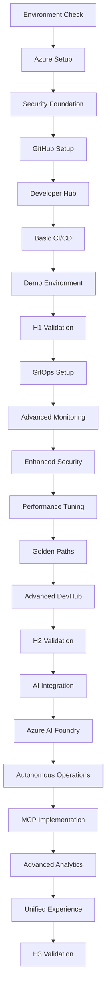

# 🛠️ Scripts Directory - Three Horizons AI Platform

<div align="center">

**Automation Scripts Organized by Implementation Horizon**

</div>

## 📁 Directory Structure

```
scripts/
├── README.md                     # This file
├── h1-foundation/               # Horizon 1 Foundation Scripts
│   ├── 001-azure-setup.sh          # Azure infrastructure setup
│   ├── 002-security-config.sh      # Security foundation configuration
│   ├── 003-github-setup.sh         # GitHub Enterprise setup
│   ├── 004-devhub-deploy.sh        # Developer Hub deployment
│   ├── 005-basic-cicd.sh           # Basic CI/CD pipeline setup
│   ├── 006-demo-setup.sh           # Demo environment configuration
│   └── validate-h1.sh              # H1 validation script
├── h2-optimization/             # Horizon 2 Optimization Scripts
│   ├── 001-gitops-setup.sh         # GitOps configuration
│   ├── 002-monitoring-setup.sh     # Advanced monitoring
│   ├── 003-security-enhanced.sh    # Enhanced security controls
│   ├── 004-performance-tune.sh     # Performance optimization
│   ├── 005-golden-paths.sh         # Golden Paths implementation
│   ├── 006-devhub-advanced.sh      # Advanced Developer Hub features
│   └── validate-h2.sh              # H2 validation script
├── h3-innovation/               # Horizon 3 Innovation Scripts
│   ├── 001-ai-integration.sh       # AI-driven development setup
│   ├── 002-azure-ai-foundry.sh     # Azure AI Foundry configuration
│   ├── 003-autonomous-ops.sh       # Autonomous operations setup
│   ├── 004-mcp-setup.sh            # Multi-Cloud Protocol implementation
│   ├── 005-analytics-setup.sh      # Advanced analytics configuration
│   ├── 006-unified-experience.sh   # Unified experience setup
│   └── validate-h3.sh              # H3 validation script
└── shared/                      # Shared Utility Scripts
    ├── common-functions.sh          # Common bash functions
    ├── environment-check.sh         # Environment validation
    ├── cleanup.sh                   # Environment cleanup
    ├── backup.sh                    # Backup utilities
    └── troubleshooting.sh           # Diagnostic utilities
```

## 🎯 Usage Guidelines

### 🏗️ Horizon 1 Foundation Scripts
**Purpose**: Bootstrap the core platform infrastructure and basic capabilities.

```bash
# Run scripts in sequence for complete H1 setup
cd scripts/h1-foundation/
./001-azure-setup.sh
./002-security-config.sh
./003-github-setup.sh
./004-devhub-deploy.sh
./005-basic-cicd.sh
./006-demo-setup.sh
./validate-h1.sh
```

### ⚡ Horizon 2 Optimization Scripts
**Purpose**: Add advanced features and optimize existing capabilities.

```bash
# Prerequisites: H1 must be complete
cd scripts/h2-optimization/
./validate-h1.sh  # Ensure H1 is ready
./001-gitops-setup.sh
./002-monitoring-setup.sh
./003-security-enhanced.sh
./004-performance-tune.sh
./005-golden-paths.sh
./006-devhub-advanced.sh
./validate-h2.sh
```

### 🤖 Horizon 3 Innovation Scripts
**Purpose**: Implement cutting-edge AI and autonomous capabilities.

```bash
# Prerequisites: H2 must be complete
cd scripts/h3-innovation/
./validate-h2.sh  # Ensure H2 is ready
./001-ai-integration.sh
./002-azure-ai-foundry.sh
./003-autonomous-ops.sh
./004-mcp-setup.sh
./005-analytics-setup.sh
./006-unified-experience.sh
./validate-h3.sh
```

## 🔧 Script Categories

### 📦 Infrastructure Scripts
- **Azure Setup**: Resource group, networking, storage, compute
- **Kubernetes**: AKS cluster configuration and node pools
- **Security**: RBAC, network policies, secret management

### 🔄 CI/CD Scripts
- **Pipeline Setup**: GitHub Actions, Azure DevOps integration
- **GitOps**: Flux, ArgoCD configuration
- **Deployment**: Multi-environment deployment strategies

### 🤖 AI & Automation Scripts
- **GitHub Copilot**: Enterprise setup and configuration
- **Azure AI Foundry**: Model deployment and management
- **Autonomous Operations**: Self-healing and scaling

### 🔍 Validation Scripts
- **Environment Checks**: Prerequisites validation
- **Health Checks**: System health verification
- **Integration Tests**: End-to-end functionality tests

## 🛡️ Security Considerations

### 🔐 Secret Management
- All scripts use Azure Key Vault for secrets
- No hardcoded credentials in scripts
- Service principal authentication with minimal permissions

### 🔒 Access Control
- Scripts require appropriate Azure RBAC permissions
- GitHub Personal Access Tokens with scoped permissions
- Red Hat subscription credentials securely stored

### 📋 Audit Trail
- All script executions are logged
- Changes tracked in Git with signed commits
- Compliance reporting integrated

## 🚨 Prerequisites

### 🔧 Required Tools
```bash
# Install required CLI tools
curl -sL https://aka.ms/InstallAzureCLIDeb | sudo bash
gh auth login
kubectl version --client
helm version --client
```

### 🎫 Required Licenses & Subscriptions
- Azure subscription with adequate quotas
- GitHub Enterprise licenses
- Red Hat Developer Hub subscription
- Red Hat OpenShift licenses (if using ARO)

### 📋 Environment Variables
```bash
# Set required environment variables
export AZURE_SUBSCRIPTION_ID="your-subscription-id"
export AZURE_TENANT_ID="your-tenant-id"
export GITHUB_ORG="your-github-org"
export RHDH_SUBSCRIPTION="your-rhdh-subscription"
```

## 🔄 Execution Flow

### 📊 Dependency Matrix



## 📈 Monitoring & Observability

### 📊 Script Execution Metrics
- Execution time tracking
- Success/failure rates
- Resource utilization during execution
- Error pattern analysis

### 🔍 Troubleshooting
```bash
# Debug mode execution
export DEBUG=true
./script-name.sh

# Verbose logging
export VERBOSE=true
./script-name.sh

# Dry run mode
export DRY_RUN=true
./script-name.sh
```

## 🆘 Support & Troubleshooting

### 📞 Getting Help
1. **Check Logs**: Review execution logs in `/tmp/three-horizons-logs/`
2. **Run Diagnostics**: Use `shared/troubleshooting.sh` for system checks
3. **Validate Environment**: Run `shared/environment-check.sh`
4. **Community Support**: Access community forums and documentation

### 🔧 Common Issues
- **Permission Errors**: Verify Azure RBAC and GitHub permissions
- **Network Connectivity**: Check firewall and DNS settings
- **Resource Quotas**: Ensure adequate Azure quotas
- **License Validation**: Verify subscription status

---

<div align="center">

**🚀 Ready to Automate Your Platform Deployment? 🚀**

[📋 Check Prerequisites](shared/environment-check.sh) | [🏗️ Start H1 Foundation](h1-foundation/) | [📖 View Templates](../templates/)

</div>
