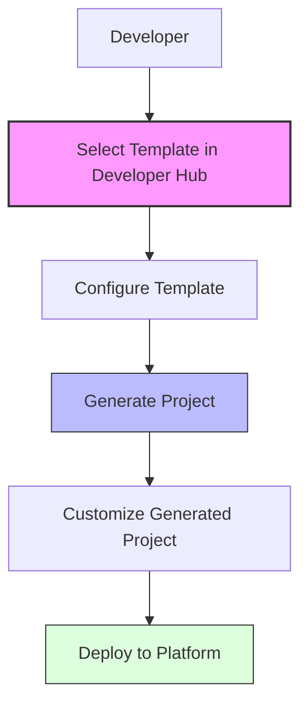

# Your Template Acceleration Journey

Welcome to your template acceleration journey with the Three Horizons Platform. This library of standardized templates will help you rapidly create consistent, high-quality components that align with platform standards and best practices.

## Table of Contents
- [Overview](#overview)
- [Template Categories](#template-categories)
- [Using Templates](#using-templates)
- [Template Structure](#template-structure)
- [Creating New Templates](#creating-new-templates)
- [Testing Templates](#testing-templates)
- [Best Practices](#best-practices)

## Your Template-Driven Development Foundation

Templates form a critical acceleration tool in your Three Horizons journey, providing a standardized way to create new components with built-in best practices. As you progress through your implementation journey, these templates will help you:

- **Accelerate Development**: Create new components in minutes instead of days
- **Ensure Consistency**: Maintain standards across all platform components
- **Embed Best Practices**: Security, scalability, and reliability built-in
- **Improve Quality**: Avoid common errors and pitfalls
- **Enable Innovation**: Focus on business value instead of boilerplate code

<div align="center">



</div>

## Your Template Journey Map

The Three Horizons Platform provides templates that evolve across your implementation journey:

### Horizon 1: Foundation Templates

#### Web Applications
Start your journey with standardized web application frameworks:
- **React Application Template**: Create modern React applications with best practices
- **Angular Application Template**: Build enterprise Angular applications with security baked in
- **Vue Application Template**: Develop lightweight Vue.js applications with optimal performance

#### Kubernetes Applications
Deploy cloud-native applications with these essential patterns:
- **Kubernetes Service Template**: Launch resilient microservices on Kubernetes
- **Kubernetes Job Template**: Create reliable batch processing workloads
- **Kubernetes CronJob Template**: Set up scheduled tasks with monitoring built-in

### Horizon 2: Platform Enhancement Templates

#### Infrastructure Templates
Expand your platform capabilities with these infrastructure components:
- **Network Infrastructure Template**: Create secure, scalable network topologies
- **Storage Infrastructure Template**: Implement persistent storage solutions
- **Database Infrastructure Template**: Deploy production-ready database environments

#### Azure Templates
Leverage Azure-specific capabilities to enhance your platform:
- **Azure Kubernetes Service (AKS) Template**: Deploy optimized AKS clusters
- **Azure Red Hat OpenShift (ARO) Template**: Implement enterprise-grade OpenShift
- **Azure Virtual Network Template**: Design secure virtual network architectures

### Horizon 3: Advanced Capabilities

#### ARM Templates
Implement sophisticated infrastructure-as-code patterns:
- **ARM Service Infrastructure Template**: Create composable service architectures
- **ARM Network Configuration Template**: Deploy complex network configurations

## Begin Your Template-Driven Development

Start using templates right away to accelerate your development process:

### Getting Started with Templates

1. **Access the Portal**: Log in to the Developer Hub
2. **Discover Templates**: Navigate to the "Create" section
3. **Select Your Template**: Choose from our curated template collection
4. **Configure Your Component**: Fill in the parameters to customize your implementation
5. **Generate Your Project**: Click "Create" to generate your new component
6. **Deploy with Confidence**: Follow the provided instructions to deploy to your environment

Every template in your journey is designed to work seamlessly with the Three Horizons Platform, providing a consistent path from development to production.

## Understanding Template Architecture

Each template in the Three Horizons Platform follows a consistent, well-organized structure designed for clarity and extensibility:

```
resources/
└── [category]/
    └── [template-name]/
        ├── template.yaml    # Template definition with metadata and parameters
        ├── README.md        # Comprehensive template documentation
        └── skeleton/        # Source files for your new project
            ├── ...          # Configuration files
            └── ...          # Application code
```

The architecture ensures:

- **template.yaml**: Defines the template metadata, parameters, and generation steps
- **README.md**: Provides detailed documentation on usage and customization options
- **skeleton/**: Contains the template files that will form the foundation of your new project

When you use a template, the system processes all files in the skeleton directory, replacing variables with your parameter values to create a customized implementation.

## Contributing to the Template Ecosystem

As you progress in your Three Horizons journey, you can create and contribute your own templates to expand the platform's capabilities:

### Creating Your First Template

Start with our template generator to create a properly structured template:

```bash
./template-generator.sh --type <type> --name <name> --description "<description>"
```

For example, to create a React single-page application template:

```bash
./template-generator.sh --type web --name react-spa --description "React single-page application with authentication and state management"
```

This command generates a template with the proper structure, including all necessary files and directories. From there, you can:

1. **Define Parameters**: Add customization options to the `template.yaml` file
2. **Build the Skeleton**: Create the template files that will be included in new projects
3. **Document Usage**: Update the README.md with clear instructions
4. **Test Thoroughly**: Ensure your template works as expected

## Validating Your Templates

Before contributing a template to the shared repository, validate its quality and reliability:

### Template Testing Workflow

Follow this comprehensive testing approach to ensure your template provides an excellent developer experience:

1. **Register for Testing**: Add your template to a local Developer Hub instance
2. **Create Test Components**: Generate multiple components with different parameter combinations
3. **Validate Parameter Behavior**: Verify all parameters work correctly, including edge cases
4. **Build and Deploy**: Ensure generated components build successfully and deploy properly
5. **Collect Feedback**: Ask other developers to try your template and provide input
6. **Refine and Improve**: Iterate based on testing results and feedback

This thorough validation ensures your template will be valuable to other developers in their Three Horizons journey.

## Template Creation Excellence

Follow these best practices to create high-quality templates that accelerate the Three Horizons journey:

### Horizon 1: Foundation Principles
1. **Start With Essential Value**: Focus on core functionality that delivers immediate value
2. **Provide Sensible Defaults**: Implement reasonable defaults for all optional parameters
3. **Document Comprehensively**: Create clear, thorough documentation in the README

### Horizon 2: Enhanced User Experience
4. **Validate User Input**: Implement parameter validation to prevent errors
5. **Provide Usage Examples**: Include practical examples of parameter combinations
6. **Enable Flexibility**: Use conditional logic to support different implementation scenarios

### Horizon 3: Excellence and Innovation
7. **Align With Platform Standards**: Ensure compatibility with the Three Horizons architecture
8. **Test Edge Cases**: Verify template behavior with unusual parameter combinations
9. **Gather and Apply Feedback**: Continuously improve based on user experiences

By following these principles, you'll create templates that provide significant value throughout the Three Horizons implementation journey.

## Continue Your Journey

Now that you understand the template ecosystem, continue exploring the Three Horizons Platform with these resources:

- [Developer Guide](/docs/documentation/guides/developer-guide.md) - Learn how to use templates in your development workflow
- [Golden Paths](/docs/documentation/guides/golden-paths.md) - Discover standardized development workflows
- [Example Configurations](/examples/configurations/README.md) - See real-world uses of templates